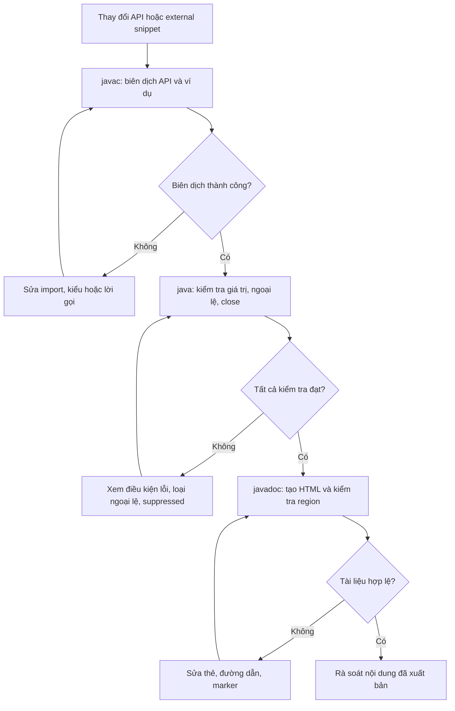

# Chạy ví dụ như kiểm thử để xác nhận kết quả, ngoại lệ và tài nguyên được đóng

## 1. Ví dụ chạy được mới chỉ là điểm bắt đầu

Khi viết tài liệu API, một ví dụ có thể **biên dịch thành công** nhưng vẫn cho kết quả sai, bỏ qua ngoại lệ cần xử lý hoặc quên đóng tài nguyên. Vì vậy, sau khi dùng `javac` kiểm tra cú pháp và kiểu, cần **thực thi ví dụ như một bài kiểm thử**, với điều kiện đạt/thất bại có thể xác định tự động.

Trong mô-đun **JAVA_VERSION_JAVA18**, phần **Kiểm chứng tài liệu** áp dụng tư duy này cho thẻ Javadoc **`{@snippet}`** được giới thiệu từ Java 18 (JEP 413) và vẫn hữu ích trên JDK hiện đại. Một **external snippet** có thể nằm trong lớp Java hoàn chỉnh, được Javadoc trích một region vào HTML, đồng thời được chạy để kiểm tra hợp đồng API.

Phân biệt ba lớp kiểm chứng:

| Bước | Kiểm chứng | Giới hạn |
| --- | --- | --- |
| `javac` | File ví dụ đúng cú pháp, import, kiểu và lời gọi API. | Không biết giá trị thực tế khi chạy hoặc tài nguyên có được đóng. |
| `java` / unit test | Giá trị trả về, ngoại lệ, trạng thái tài nguyên và các hiệu ứng có thể quan sát. | Chỉ kiểm tra những trường hợp đã được viết thành test. |
| `javadoc` | Thẻ snippet, file, region, markup và tài liệu HTML được sinh ra. | Standard Doclet không biên dịch hoặc chạy snippet. |

**Mục tiêu học tập:** Sau bài này, bạn có thể viết ví dụ tự báo thất bại khi kết quả không đúng; kiểm tra chính xác loại ngoại lệ và thông điệp có ý nghĩa; chứng minh `close()` được gọi cả ở đường chạy bình thường lẫn khi lỗi; hiểu ngoại lệ bị ẩn bằng `getSuppressed()`; và đưa các bước vào CI.

Các ví dụ chỉ dùng API Java còn được hỗ trợ lâu dài: `Reader`, `BufferedReader`, `IOException`, `StringReader`, `AutoCloseable` và `try-with-resources`. Chúng không đòi hỏi thư viện test ngoài JDK hay tính năng preview.

## 2. Hợp đồng API cần kiểm tra

Ta xây dựng một hàm đọc **dòng đầu tiên** của `Reader`. Để minh họa quyền sở hữu tài nguyên một cách rõ ràng, tên phương thức là `firstLineAndClose` và hợp đồng quy định rằng **phương thức nhận trách nhiệm đóng Reader được truyền vào**.

Các hành vi cần được kiểm thử:

1. Có dữ liệu: trả về dòng đầu tiên, không kèm ký tự xuống dòng.
2. Không có dữ liệu: trả về `null`, đúng hợp đồng của `BufferedReader.readLine()` khi đến EOF ngay lập tức.
3. Khi đọc thất bại: phát sinh `IOException` cho người gọi.
4. Khi hoàn tất hoặc gặp ngoại lệ trong lúc đọc: `close()` của nguồn được gọi.
5. Nếu vừa đọc thất bại vừa đóng cũng thất bại: lỗi đọc vẫn là lỗi chính, lỗi đóng được ghi trong danh sách **suppressed exceptions**.

Lưu ý: Một số API **không sở hữu** `Reader` do người gọi truyền vào và không được tự đóng nó. Ở bài này, hành vi đóng là **cam kết công khai của chính API minh họa**; người gọi phải biết rằng nguồn sẽ không còn được sử dụng sau khi gọi phương thức.

## 3. Tổ chức external snippet thành lớp kiểm thử tự chứa

Cây thư mục tính từ `demo/`:

```text
demo/
└── src/
    └── main/
        └── java/
            └── example/
                └── docs/
                    ├── LinePreview.java
                    └── snippet-files/
                        └── LinePreviewExample.java
```

Thư mục `snippet-files` là vị trí mà Standard Doclet tìm external snippet của package tương ứng. Tên này **không nằm trong Java package**: cả hai file đều khai báo `package example.docs;`.

### 3.1. API — `LinePreview.java`

Tạo `src/main/java/example/docs/LinePreview.java`:

```java
package example.docs;

import java.io.BufferedReader;
import java.io.IOException;
import java.io.Reader;
import java.util.Objects;

/**
 * Đọc một phần nội dung văn bản.
 */
public final class LinePreview {
    private LinePreview() {
    }

    /**
     * Đọc dòng đầu tiên và đóng Reader đã nhận, kể cả khi đọc thất bại.
     *
     * <p>Kiểm tra kết quả và đóng tài nguyên:</p>
     * {@snippet class=LinePreviewExample region=success}
     *
     * <p>Kiểm tra ngoại lệ đọc và đóng tài nguyên:</p>
     * {@snippet class=LinePreviewExample region=readFailure}
     *
     * <p>Kiểm tra ngoại lệ khi đọc và đóng cùng thất bại:</p>
     * {@snippet class=LinePreviewExample region=suppressed}
     *
     * @param source nguồn ký tự; quyền sở hữu được chuyển cho phương thức
     * @return dòng đầu tiên, hoặc null nếu không có dòng nào
     * @throws NullPointerException nếu source là null
     * @throws IOException nếu đọc hoặc đóng nguồn thất bại
     */
    public static String firstLineAndClose(Reader source) throws IOException {
        Objects.requireNonNull(source, "source");
        try (BufferedReader reader = new BufferedReader(source)) {
            return reader.readLine();
        }
    }
}
```

Ý nghĩa của phần cài đặt:

- `Objects.requireNonNull` từ chối nguồn `null` **trước khi** tạo tài nguyên. Trường hợp này không có đối tượng hợp lệ để đóng.
- `new BufferedReader(source)` bao bọc `Reader` để đọc theo dòng.
- `try (BufferedReader reader = ...)` quản lý `BufferedReader`; khi thoát khối `try`, Java tự gọi `reader.close()`. Việc đóng `BufferedReader` cũng đóng `Reader` bên dưới.
- Nếu `readLine()` trả về hoặc ném `IOException`, đường đi qua `try-with-resources` đều thực hiện bước đóng.

`try-with-resources` đã là cơ chế ổn định của Java qua nhiều phiên bản và vẫn là cách được khuyến nghị để quản lý đối tượng `AutoCloseable`. Bài này sử dụng nó cùng external snippet Java 18 để tạo tài liệu có kiểm thử.

### 3.2. Lớp ví dụ — `LinePreviewExample.java`

Tạo `src/main/java/example/docs/snippet-files/LinePreviewExample.java`:

```java
package example.docs;

import java.io.IOException;
import java.io.Reader;
import java.io.StringReader;
import java.util.Objects;

/**
 * Ví dụ có thể biên dịch và chạy như một bài kiểm thử nhỏ.
 */
public final class LinePreviewExample {
    private LinePreviewExample() {
    }

    public static void main(String[] args) throws IOException {
        // @start region=success
        ObservedReader input = new ObservedReader("dòng một\n dòng hai");
        String first = LinePreview.firstLineAndClose(input);
        check(Objects.equals("dòng một", first), "Wrong first line: " + first);
        check(input.closed, "Reader not closed on success");
        // @end region=success

        // @start region=empty
        ObservedReader empty = new ObservedReader("");
        String missing = LinePreview.firstLineAndClose(empty);
        check(missing == null, "Empty input should return null");
        check(empty.closed, "Empty reader not closed");
        // @end region=empty

        // @start region=readFailure
        FailingReader broken = new FailingReader(false);
        IOException readError = expectIOException(broken);
        check("read failed".equals(readError.getMessage()),
                "Unexpected read failure");
        check(broken.closed, "Reader not closed after read failure");
        // @end region=readFailure

        // @start region=suppressed
        FailingReader bothFail = new FailingReader(true);
        IOException mainError = expectIOException(bothFail);
        check("read failed".equals(mainError.getMessage()),
                "Read error should remain primary");
        Throwable[] suppressed = mainError.getSuppressed();
        check(suppressed.length == 1, "Expected one suppressed error");
        check("close failed".equals(suppressed[0].getMessage()),
                "Unexpected suppressed close error");
        check(bothFail.closed, "close() was not called");
        // @end region=suppressed

        System.out.println("PASS: value, EOF, read error, resource close");
    }

    private static IOException expectIOException(Reader source) {
        try {
            LinePreview.firstLineAndClose(source);
            throw new AssertionError("Expected IOException");
        } catch (IOException expected) {
            return expected;
        }
    }

    private static void check(boolean condition, String message) {
        if (!condition) {
            throw new AssertionError(message);
        }
    }

    private static final class ObservedReader extends Reader {
        private final StringReader delegate;
        private boolean closed;

        private ObservedReader(String content) {
            delegate = new StringReader(content);
        }

        @Override
        public int read(char[] buffer, int offset, int length)
                throws IOException {
            return delegate.read(buffer, offset, length);
        }

        @Override
        public void close() {
            closed = true;
            delegate.close();
        }
    }

    private static final class FailingReader extends Reader {
        private final boolean failOnClose;
        private boolean closed;

        private FailingReader(boolean failOnClose) {
            this.failOnClose = failOnClose;
        }

        @Override
        public int read(char[] buffer, int offset, int length)
                throws IOException {
            throw new IOException("read failed");
        }

        @Override
        public void close() throws IOException {
            closed = true;
            if (failOnClose) {
                throw new IOException("close failed");
            }
        }
    }
}
```

Đây là **một file Java đầy đủ**. Các lớp `ObservedReader` và `FailingReader` hỗ trợ kiểm thử; chúng nằm bên ngoài các region trích vào tài liệu. Các tên này là ví dụ về **test double**: đối tượng có hành vi có thể kiểm soát để xác minh API gọi `close()` và phản ứng với lỗi như cam kết.

Trong Javadoc, một region như `success` chỉ chứa vài dòng lệnh. Đoạn đó không tự biên dịch độc lập vì dựa vào các lớp trợ giúp; **toàn bộ file `LinePreviewExample.java` mới là đơn vị được biên dịch và chạy**. Đây là lý do nên dùng external snippet cho ví dụ cần kiểm chứng.

## 4. Kiểm tra giá trị trả về: không chỉ in ra màn hình

Trong region `success`, lời gọi API cho ra dòng đầu tiên. Phép kiểm tra:

```java
check(Objects.equals("dòng một", first), "Wrong first line: " + first);
```

chuyển yêu cầu bằng lời thành một điều kiện máy có thể xác minh. Nếu giá trị khác dự kiến, `check` ném `AssertionError` và tiến trình thất bại.

Region `empty` kiểm tra hợp đồng EOF:

```java
ObservedReader empty = new ObservedReader("");
String missing = LinePreview.firstLineAndClose(empty);
check(missing == null, "Empty input should return null");
check(empty.closed, "Empty reader not closed");
```

Hai ví dụ này xác minh những điều khác nhau: một ví dụ có dữ liệu và một ví dụ đọc ngay EOF. Đừng chỉ kiểm tra kết quả của một đầu vào thông thường rồi kết luận rằng API đã đúng với mọi trường hợp.

### Tại sao dùng `AssertionError` thay cho từ khóa `assert`?

Java hỗ trợ:

```java
assert "dòng một".equals(first);
```

Nhưng **assertion bằng từ khóa `assert` mặc định bị vô hiệu hóa** trừ khi chạy `java -ea` (hoặc cấu hình bật tương đương). Nếu dùng `assert` trong ví dụ rồi chạy `java` thông thường, chương trình có thể in `PASS` dù điều kiện sai.

Vì thế, ví dụ tự chứa trong bài dùng `if` + `throw new AssertionError` để điều kiện **luôn được kiểm tra**. Với dự án dùng JUnit hoặc framework kiểm thử khác, có thể thay bằng `assertEquals`/`assertTrue` của framework; các phép kiểm tra ấy được chạy bởi test runner, không phải tùy chọn `-ea`.

## 5. Kiểm chứng ngoại lệ chính xác, tránh kiểm thử “đạt giả”

Không chỉ yêu cầu “có lỗi”, ta cần kiểm tra:

- **Loại ngoại lệ:** mong đợi `IOException` khi nguồn đọc thất bại.
- **Đường đi:** nếu không có ngoại lệ, bài kiểm thử phải thất bại.
- **Nội dung liên quan:** trong ví dụ có thể đối chiếu thông điệp `"read failed"` do test double chủ động tạo ra; với API thực tế, ưu tiên kiểm tra loại, mã lỗi hoặc thuộc tính ổn định hơn là phụ thuộc thông điệp từ hệ điều hành.
- **Tài nguyên:** sau khi có lỗi, việc đóng vẫn phải được thực hiện.

Hàm trợ giúp:

```java
private static IOException expectIOException(Reader source) {
    try {
        LinePreview.firstLineAndClose(source);
        throw new AssertionError("Expected IOException");
    } catch (IOException expected) {
        return expected;
    }
}
```

Nếu lời gọi **không ném ngoại lệ**, hàm tự ném `AssertionError`. Nó chỉ bắt `IOException`, nên không vô tình coi một loại lỗi khác như `NullPointerException` hoặc `AssertionError` là trường hợp đạt.

**Mẫu dễ sai** là:

```java
try {
    someOperation();
} catch (Exception ignored) {
    // Có lỗi thì coi như đạt.
}
```

Đoạn này có thể chạy xong mà không hề xác nhận ngoại lệ **đã xảy ra**, hoặc bắt nhầm lỗi không liên quan. Hãy luôn có nhánh thất bại nếu ngoại lệ mong đợi không xuất hiện, và bắt đúng loại.

### Hợp đồng ngoại lệ có thể cần nhiều trường hợp

Với `firstLineAndClose`, truyền `null` phải gây `NullPointerException`. Đây là trường hợp riêng: `Objects.requireNonNull` chạy trước khi tạo `BufferedReader`, nên **không có Reader thực tế để đóng**. Có thể bổ sung test:

```java
try {
    LinePreview.firstLineAndClose(null);
    throw new AssertionError("Expected NullPointerException");
} catch (NullPointerException expected) {
    // Đã xác nhận đúng loại ngoại lệ.
}
```

Nếu hợp đồng có điều kiện đầu vào khác nhau, nên kiểm tra rõ từng điều kiện thay vì dùng một `catch (Exception)` chung.

## 6. Kiểm chứng tài nguyên được đóng ở cả hai đường chạy

`ObservedReader` bọc `StringReader` và đặt `closed = true` khi phương thức `close()` được gọi. Với đường chạy bình thường:

```java
ObservedReader input = new ObservedReader("dòng một\n dòng hai");
String first = LinePreview.firstLineAndClose(input);
check(Objects.equals("dòng một", first), "Wrong first line: " + first);
check(input.closed, "Reader not closed on success");
```

Với đường đọc thất bại, `FailingReader.read()` cố tình ném `IOException`. Ngay sau khi bắt ngoại lệ, kiểm tra:

```java
FailingReader broken = new FailingReader(false);
IOException readError = expectIOException(broken);
check("read failed".equals(readError.getMessage()),
        "Unexpected read failure");
check(broken.closed, "Reader not closed after read failure");
```

Hai phép kiểm tra bảo vệ hai nhánh dễ bị bỏ sót khi xử lý I/O: **trả về bình thường** và **thoát ra do lỗi**.

**Giới hạn cần hiểu:** kiểm tra cờ `closed` chứng minh rằng `close()` của đối tượng thử nghiệm **đã được gọi**. Nó không tự chứng minh hệ điều hành đã giải phóng một file descriptor hay kết nối mạng thực. Để kiểm tra tích hợp với file, socket hoặc database thật, phải dùng tài nguyên thật và cách quan sát phù hợp; các điều kiện giải phóng của hệ điều hành có thể khác nhau.

Ngoài ra, đừng giữ `Reader` của một API với hợp đồng **chuyển quyền sở hữu** rồi tái sử dụng nó sau khi gọi. Nếu API không sở hữu tài nguyên do người gọi truyền vào, hãy thiết kế khác: ví dụ cho phép người gọi giữ trách nhiệm đóng hoặc nhận `Path` rồi tự mở/đóng file bên trong. Quyền sở hữu phải được ghi rõ trong Javadoc.

## 7. Khi đọc và đóng cùng thất bại: `getSuppressed()`

`try-with-resources` quy định rằng nếu thân `try` đã ném lỗi khi đọc, sau đó `close()` cũng ném lỗi, thì **lỗi đọc giữ vai trò ngoại lệ chính**; ngoại lệ khi đóng được gắn vào thông qua `Throwable.getSuppressed()`.

Trong region `suppressed`:

```java
FailingReader bothFail = new FailingReader(true);
IOException mainError = expectIOException(bothFail);
check("read failed".equals(mainError.getMessage()),
        "Read error should remain primary");
Throwable[] suppressed = mainError.getSuppressed();
check(suppressed.length == 1, "Expected one suppressed error");
check("close failed".equals(suppressed[0].getMessage()),
        "Unexpected suppressed close error");
check(bothFail.closed, "close() was not called");
```

Thứ tự sự kiện dự kiến:

```text
read()  -> throws IOException("read failed")
close() -> sets closed = true
close() -> throws IOException("close failed")
method  -> throws primary IOException("read failed")
primary.getSuppressed()[0] -> IOException("close failed")
```

| Tình huống | Ngoại lệ mà người gọi nhận | Trạng thái đóng |
| --- | --- | --- |
| Đọc và đóng đều thành công | Không có; nhận dòng đầu hoặc `null`. | `close()` được gọi. |
| Đọc lỗi, đóng thành công | Ngoại lệ đọc. | `close()` được gọi. |
| Đọc thành công, đóng lỗi | Ngoại lệ từ `close()` trở thành lỗi chính. | Đã thử đóng; không mặc nhiên kết luận giải phóng thành công. |
| Cả đọc và đóng đều lỗi | Ngoại lệ đọc là lỗi chính, lỗi đóng nằm trong `getSuppressed()`. | Đã thử đóng; lỗi đóng cần được kiểm tra. |

Nếu một khối `try-with-resources` sở hữu nhiều tài nguyên, Java **đóng theo thứ tự ngược với thứ tự tạo**. Trong một kiểm thử chuyên sâu, có thể dùng các test double ghi lại thứ tự gọi `close()`. Không dùng `finalize()` hoặc ép chạy GC để kiểm tra đóng tài nguyên; đây không phải cách kiểm chứng đáng tin cậy và không phù hợp với cách quản lý tài nguyên hiện đại.

## 8. Chạy ví dụ và coi mã thoát là kết quả kiểm thử

### 8.1. Biên dịch bằng `javac`

Tại thư mục `demo/`, chạy với **JDK 18 trở lên**. Lệnh dưới đây theo cú pháp Bash hoặc shell POSIX:

```bash
mkdir -p build/classes

javac --release 18 -encoding UTF-8 -d build/classes \
  src/main/java/example/docs/LinePreview.java \
  src/main/java/example/docs/snippet-files/LinePreviewExample.java
```

Phải đưa **cả hai file Java** vào bước biên dịch. Nếu chỉ biên dịch `LinePreview.java`, không thể kết luận rằng file snippet dùng để chạy đã đúng cú pháp hoặc gọi đúng API.

### 8.2. Thực thi và xác minh

```bash
java -cp build/classes example.docs.LinePreviewExample
```

Đầu ra mong đợi khi mọi điều kiện đều đạt:

```text
PASS: value, EOF, read error, resource close
```

Tại đây, dòng `PASS` chỉ được in ra **sau** khi kiểm tra giá trị, EOF, ngoại lệ và trạng thái đóng tài nguyên. Nếu bất kỳ `check` nào thất bại, `AssertionError` làm chương trình dừng và trả mã thoát khác 0. Thay đổi hành vi ví dụ để một điều kiện sai là cách đơn giản xác nhận bài kiểm thử thực sự có thể thất bại.

Nếu muốn chạy trên PowerShell, có thể dùng:

```powershell
New-Item -ItemType Directory -Force -Path build\classes | Out-Null
javac --release 18 -encoding UTF-8 -d build\classes src\main\java\example\docs\LinePreview.java src\main\java\example\docs\snippet-files\LinePreviewExample.java
if ($LASTEXITCODE -ne 0) { throw "javac failed" }
java -cp build\classes example.docs.LinePreviewExample
if ($LASTEXITCODE -ne 0) { throw "Example test failed" }
```

Không chỉ kiểm tra có dòng chữ `PASS`: **CI cần quan tâm tới exit code** và không chạy class cũ sau khi biên dịch lỗi. Với Java thông thường, `AssertionError` chưa được xử lý sẽ làm tiến trình kết thúc thất bại; nhưng nếu chương trình cố tình bắt lỗi rồi nuốt đi hoặc chỉ log, CI có thể hiểu nhầm thành đạt.

### 8.3. Sinh Javadoc sau khi test đạt

```bash
javadoc -d build/docs \
  -encoding UTF-8 -docencoding UTF-8 \
  -Xdoclint:all -Werror \
  src/main/java/example/docs/LinePreview.java
```

Mở `build/docs/example/docs/LinePreview.html` và xác nhận những region `success`, `readFailure`, `suppressed` được hiển thị đúng. `javadoc` chỉ xác nhận cú pháp, vị trí, markup và kết quả sinh tài liệu; nó **không thay thế** bước chạy `LinePreviewExample`.

## 9. Quy trình kiểm chứng để đưa vào CI



Ví dụ script CI tối thiểu dùng shell POSIX:

```bash
set -eu
mkdir -p build/classes

javac --release 18 -encoding UTF-8 -d build/classes \
  src/main/java/example/docs/LinePreview.java \
  src/main/java/example/docs/snippet-files/LinePreviewExample.java

java -cp build/classes example.docs.LinePreviewExample

javadoc -d build/docs -encoding UTF-8 -docencoding UTF-8 \
  -Xdoclint:all -Werror \
  src/main/java/example/docs/LinePreview.java
```

`set -e` giúp script dừng khi một lệnh trả mã thoát khác 0. Với dự án lớn, có thể thay `main` bằng bộ kiểm thử JUnit hoặc framework khác, nhưng vẫn cần giữ đủ ba lớp kiểm chứng: **biên dịch nguồn ví dụ, chạy kiểm thử hành vi, tạo và kiểm tra tài liệu**.

Khi tổ chức CI, nên dùng cùng phiên bản API và ví dụ trong một commit, làm sạch output build theo cách được dự án hỗ trợ, lưu log lỗi, và xác định JDK mục tiêu bằng `--release` thích hợp. Không suy luận rằng một tài liệu hợp lệ sẽ tự đảm bảo mã ví dụ chạy đúng.

## 10. Phân biệt kiểm tra có ý nghĩa và kiểm tra chưa đủ

| Cách kiểm tra | Vấn đề | Cách cải thiện |
| --- | --- | --- |
| Chỉ in kết quả bằng `System.out.println`. | Người hoặc pipeline phải đọc thủ công; kết quả sai vẫn có exit code 0. | Có `check` hoặc test assertion thất bại khi sai. |
| Dùng `assert` nhưng không bật `-ea`. | Biểu thức kiểm tra có thể không chạy. | Dùng test framework hoặc kiểm tra chủ động bằng `AssertionError`. |
| Chỉ kiểm tra rằng có ngoại lệ bất kỳ. | Có thể bắt nhầm lỗi khác; thậm chí không có lỗi vẫn được coi đạt. | Bắt chính xác loại, có nhánh thất bại nếu lỗi mong đợi không xuất hiện. |
| Chỉ kiểm tra kết quả đúng khi đọc thành công. | Không phát hiện tài nguyên bị bỏ quên lúc xảy ra lỗi. | Có test double ghi nhận `close()` ở cả nhánh thành công và thất bại. |
| Chỉ kiểm tra rằng `close()` đã được gọi. | Chưa chứng minh close hoàn tất không lỗi hoặc OS đã giải phóng resource. | Kiểm tra lỗi đóng/suppressed và thêm integration test khi cần. |
| Chỉ chạy `javadoc` hoặc `javac`. | Không xác minh được hành vi runtime. | Chạy chính lớp ví dụ và kiểm tra exit code. |

### Câu hỏi và bài thực hành

1. Trong `LinePreviewExample`, đổi kỳ vọng `"dòng một"` thành `"dòng hai"`. Mã có còn biên dịch không? Khi chạy, điều gì làm kiểm thử thất bại?
2. Xóa lệnh `check(input.closed, ...)` trong region `success`. Điều kiện quan trọng nào không còn được bảo vệ?
3. Sửa `LinePreview.firstLineAndClose` để trả dòng mà không dùng `try-with-resources`. Test nào sẽ thất bại khi nguồn không được đóng?
4. Đổi `FailingReader(false)` thành `FailingReader(true)` trong phần kiểm tra lỗi đọc. Lỗi nào giữ vai trò chính và lỗi nào nằm trong `getSuppressed()`?
5. Đổi `expectIOException` thành hàm bắt mọi `Exception` nhưng không ném lỗi khi không có ngoại lệ. Vì sao bài kiểm thử có thể báo đạt giả?
6. Giả sử API cần đọc file UTF-8 thật. Nêu ai sở hữu `Reader` và vì sao cần phép kiểm thử tích hợp riêng ngoài kiểm tra cờ `closed`.

## 11. Tài liệu tham khảo chính thức

- [JEP 413 — Code Snippets in Java API Documentation](https://openjdk.org/jeps/413): nguồn gốc thẻ `{@snippet}` từ Java 18.
- [Oracle Javadoc Guide — Snippets (JDK 25)](https://docs.oracle.com/en/java/javase/25/javadoc/snippets.html): external snippet và phạm vi kiểm thử; Standard Doclet không tự biên dịch hoặc chạy snippet.
- [Java Language Specification, `14.20.3 — Try-with-resources (Java SE 25)](https://docs.oracle.com/javase/specs/jls/se25/html/jls-14.html#jls-14.20.3): thứ tự đóng tài nguyên, ngoại lệ chính và ngoại lệ bị suppressed.
- [AutoCloseable (JDK 25)](https://docs.oracle.com/en/java/javase/25/docs/api/java.base/java/lang/AutoCloseable.html): hợp đồng `close()` và quản lý tài nguyên bằng `try-with-resources`.
- [BufferedReader (JDK 25)](https://docs.oracle.com/en/java/javase/25/docs/api/java.base/java/io/BufferedReader.html): hợp đồng `readLine()` và việc đóng nguồn đọc được bao bọc.

**Ghi nhớ:** Một ví dụ tài liệu đáng tin cần có điều kiện thất bại tự động. Hãy kiểm tra **giá trị trả về**, **đúng ngoại lệ** và **tài nguyên được đóng** ở cả đường chạy bình thường lẫn đường lỗi, đồng thời bảo đảm file ví dụ được biên dịch và region được sinh đúng trong Javadoc.
