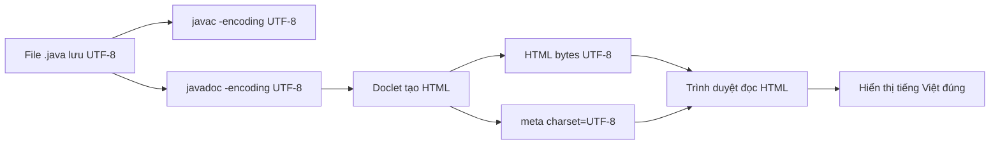

# Cấu hình `-encoding`, `-docencoding` và `-charset` khi tạo tài liệu có tiếng Việt

## 1. Vì sao tài liệu tiếng Việt cần cấu hình encoding rõ ràng?

Một file Java có thể biên dịch đúng nhưng trang Javadoc sinh ra lại hiển thị tiếng Việt thành các ký tự lỗi. Nguyên nhân thường là các bước đọc và ghi văn bản không thống nhất charset: trình biên dịch đọc source theo một encoding, Javadoc đọc comment theo encoding khác, hoặc HTML được ghi ra không khớp với charset mà trình duyệt được thông báo.

Từ Java 18, **JEP 400** đặt UTF-8 làm charset mặc định trong các cấu hình JDK thông thường. Thay đổi này giúp hành vi mặc định nhất quán hơn trên các hệ điều hành, nhưng **không thay thế việc cấu hình encoding tường minh cho quy trình build**. Một dự án vẫn cần biết:

- File `.java` và comment Javadoc được đọc bằng charset nào.
- File HTML được ghi bằng charset nào.
- HTML khai báo charset nào trong phần metadata để trình duyệt giải mã nội dung.

Ba tùy chọn cần phân biệt trong lệnh `javadoc`:

| Tùy chọn | Vai trò | Hướng dữ liệu |
| --- | --- | --- |
| `-encoding UTF-8` | Charset dùng để đọc các file đầu vào của Javadoc, gồm source và comment. | Đầu vào |
| `-docencoding UTF-8` | Charset dùng để ghi các file HTML được sinh ra. | Đầu ra |
| `-charset UTF-8` | Khai báo charset HTML bằng thẻ `meta` trong trang được sinh ra; đồng thời là lựa chọn encoding đầu ra của Javadoc. | Đầu ra / metadata |

**Điểm dễ nhầm:** `-docencoding` và `-charset` đều thuộc nhóm tùy chọn encoding đầu ra. Tài liệu lệnh Javadoc quy định trong một lệnh encoding chỉ dùng tối đa **một tùy chọn đầu ra** cùng với tùy chọn đầu vào. Nếu chỉ định cả input và output, hai giá trị phải giống nhau. Vì vậy, không ghép cả ba tùy chọn `-encoding`, `-docencoding`, `-charset` vào cùng một lệnh.

Bài này thuộc phần **Kiểm chứng tài liệu** của mô-đun **JAVA_VERSION_JAVA18**. Ta sẽ tạo source có comment tiếng Việt, biên dịch bằng UTF-8, sinh Javadoc với metadata HTML phù hợp, sau đó kiểm tra file HTML và nội dung khi mở bằng trình duyệt. Các tùy chọn trên vẫn được hỗ trợ trong JDK hiện đại.

### Mục tiêu học tập

Sau bài này, bạn có thể:

1. Phân biệt charset đọc source với charset ghi HTML.
2. Dùng `javac -encoding UTF-8` để biên dịch source được lưu bằng UTF-8.
3. Dùng `javadoc -encoding UTF-8` để đọc comment và source đúng encoding.
4. Chọn `-docencoding` hoặc `-charset` theo mục đích, hiểu vì sao không ghép cả hai trong một lệnh.
5. Xác minh metadata charset và nội dung tiếng Việt trong HTML đã sinh ra.
6. Không nhầm `-locale vi` với cấu hình encoding.

## 2. Luồng encoding từ file nguồn đến trình duyệt

Giả sử source Java được lưu bằng UTF-8 và chứa comment:

```java
/**
 * Chuyển đổi chuỗi về dạng chuẩn hóa.
 *
 * @param input chuỗi đầu vào cần xử lý
 * @return chuỗi đã chuẩn hóa
 */
```

Để văn bản xuất hiện đúng trên trang Javadoc, các bước phải thống nhất:



`javac` và `javadoc` là hai chương trình riêng. `javac -encoding UTF-8` điều khiển cách **trình biên dịch** đọc file Java. `javadoc -encoding UTF-8` điều khiển cách **công cụ tạo tài liệu** đọc source và comment. Việc đặt một tùy chọn cho `javac` không tự cấu hình lệnh `javadoc`.

Ở phía HTML, byte được ghi ra phải khớp với charset mà trang khai báo. Nếu HTML được ghi bằng UTF-8 nhưng lại khai báo `windows-1252`, trình duyệt có thể giải mã sai tiếng Việt. Nếu metadata khai báo UTF-8 nhưng file thực tế được ghi bằng một encoding khác, kết quả cũng sai. Cần kiểm tra cả hai phía.

## 3. Phân biệt ba tùy chọn Javadoc

### 3.1. `-encoding`: charset của file đầu vào

`-encoding` cho Javadoc biết cách giải mã các file mà công cụ đọc. Khi source và comment được lưu bằng UTF-8, dùng:

```bash
javadoc -encoding UTF-8 ...
```

Tùy chọn này quan trọng với comment chứa dấu tiếng Việt, ký tự Unicode và nội dung snippet ngoài được đọc từ file. Nếu file thực tế đang lưu bằng Windows-1258 nhưng khai báo UTF-8, chỉ thêm `-encoding UTF-8` không thể sửa dữ liệu sai; phải chuyển file sang encoding thống nhất hoặc khai báo đúng encoding thực tế.

### 3.2. `-docencoding`: charset của HTML đầu ra

`-docencoding` xác định encoding được dùng để ghi các file HTML do Javadoc tạo:

```bash
javadoc -encoding UTF-8 -docencoding UTF-8 ...
```

Hai giá trị ở đây phải giống nhau theo quy tắc của Javadoc khi chỉ định cả encoding đầu vào và đầu ra. Lệnh này tập trung xác định encoding của file HTML được ghi.

### 3.3. `-charset`: khai báo charset HTML bằng metadata

`-charset` chỉ định charset của tài liệu HTML và làm Javadoc chèn một phần tử `meta` vào phần `head` của các trang được sinh ra. Ví dụ:

```html
<meta http-equiv="Content-Type" content="text/html; charset=UTF-8">
```

Lệnh thường dùng khi muốn trang HTML có khai báo charset rõ ràng:

```bash
javadoc -encoding UTF-8 -charset UTF-8 ...
```

Lệnh này đọc source theo UTF-8 và dùng lựa chọn output UTF-8; metadata trong HTML cũng khai báo UTF-8. Đây là cách thuận tiện cho tài liệu tiếng Việt cần hiển thị ổn định khi được mở từ file hoặc phục vụ qua web.

### 3.4. Quy tắc không ghép hai tùy chọn đầu ra

Oracle mô tả ba tùy chọn encoding của Javadoc như sau:

- `-encoding` là tùy chọn đầu vào.
- `-docencoding` và `-charset` là hai lựa chọn encoding đầu ra.
- Một lệnh encoding dùng tối đa một lựa chọn đầu vào và một lựa chọn đầu ra.
- Khi chỉ định cả đầu vào và đầu ra, giá trị phải giống nhau.
- Nếu không chỉ định tùy chọn đầu ra, encoding đầu ra mặc định theo encoding đầu vào.

Do đó, dùng một trong hai mẫu:

```bash
# Chỉ định encoding đọc source và encoding ghi HTML
javadoc -encoding UTF-8 -docencoding UTF-8 -d build/docs \
  src/main/java/com/example/docs/VietnameseApi.java

# Hoặc chỉ định encoding đọc source và charset HTML/meta
javadoc -encoding UTF-8 -charset UTF-8 -d build/docs \
  src/main/java/com/example/docs/VietnameseApi.java
```

Không dùng cả `-docencoding UTF-8` và `-charset UTF-8` trong cùng lệnh. Hai mẫu trên là **hai lựa chọn thay thế**, không phải hai bước phải chạy liên tiếp trên cùng một bộ tài liệu.

## 4. Tạo source Java có comment tiếng Việt

Tạo cấu trúc tối thiểu:

```text
demo/
├── src/
│   └── main/
│       └── java/
│           └── com/
│               └── example/
│                   └── docs/
│                       └── VietnameseApi.java
└── build/
```

Lưu file `VietnameseApi.java` bằng **UTF-8**. Ví dụ:

```java
package com.example.docs;

/**
 * Cung cấp các thao tác xử lý văn bản tiếng Việt.
 *
 * <p>Ví dụ này minh họa cách ghi tài liệu API có dấu tiếng Việt,
 * ký tự Unicode và tên tham số dễ đọc.</p>
 */
public final class VietnameseApi {
    private VietnameseApi() {
    }

    /**
     * Loại bỏ khoảng trắng ở hai đầu chuỗi.
     *
     * @param input chuỗi đầu vào cần chuẩn hóa, không được null
     * @return chuỗi đã loại bỏ khoảng trắng ở hai đầu
     * @throws NullPointerException nếu input là null
     */
    public static String trim(String input) {
        return java.util.Objects.requireNonNull(input, "input").strip();
    }
}
```

Để ví dụ dễ tái hiện, comment có cả dấu tiếng Việt và các ký tự Unicode. Nếu editor lưu file bằng UTF-8, byte nguồn và chuỗi hiển thị phải khớp với cấu hình encoding của công cụ.

## 5. Biên dịch source bằng `javac -encoding UTF-8`

Tại thư mục `demo/`, chạy trên JDK 18 trở lên:

```bash
mkdir -p build/classes

javac --release 18 -encoding UTF-8 -d build/classes \
  src/main/java/com/example/docs/VietnameseApi.java
```

Ý nghĩa:

- `--release 18` kiểm tra tương thích với Java SE 18 cho ví dụ này. Nếu dự án hỗ trợ release khác, chọn mức mục tiêu tương ứng.
- `-encoding UTF-8` hướng dẫn `javac` giải mã file `.java` theo UTF-8.
- `-d build/classes` xác định nơi ghi bytecode.

Nếu lệnh thành công, `javac` thường không in thông báo hoàn thành; mã thoát `0` là dấu hiệu thành công. Nếu file nguồn thực tế không phải UTF-8, có thể thấy lỗi ký tự không hợp lệ hoặc nội dung chuỗi/comment sai. Hãy kiểm tra encoding thật của file trước khi thay đổi tùy chọn.

`javac -encoding UTF-8` không cấu hình Javadoc. Khi sinh tài liệu, phải truyền `-encoding UTF-8` cho chính lệnh `javadoc`.

## 6. Sinh Javadoc tiếng Việt

### 6.1. Cách khuyến nghị: dùng `-charset UTF-8`

Tại thư mục `demo/`:

```bash
javadoc -encoding UTF-8 -charset UTF-8 \
  -d build/docs \
  -Xdoclint:all -Werror \
  src/main/java/com/example/docs/VietnameseApi.java
```

Lệnh này:

1. Đọc file Java và comment bằng UTF-8.
2. Sinh HTML theo lựa chọn charset đầu ra UTF-8.
3. Chèn metadata khai báo `charset=UTF-8` vào phần `head` của trang.
4. Dùng DocLint để kiểm tra các vấn đề phổ biến trong comment; `-Werror` biến cảnh báo thành lỗi.

Mở file `build/docs/com/example/docs/VietnameseApi.html`. Phần comment tiếng Việt cần hiển thị đúng trong trình duyệt.

### 6.2. Lựa chọn khác: dùng `-docencoding UTF-8`

Nếu mục tiêu là chỉ định rõ encoding của file HTML được ghi, có thể dùng:

```bash
javadoc -encoding UTF-8 -docencoding UTF-8 \
  -d build/docs \
  -Xdoclint:all -Werror \
  src/main/java/com/example/docs/VietnameseApi.java
```

Lệnh này dùng UTF-8 cho đầu vào và byte HTML đầu ra. Nếu cần metadata charset được chèn rõ trong HTML, hãy dùng mẫu `-charset UTF-8` ở mục 6.1. Không thêm `-charset` vào lệnh này vì Javadoc chỉ cho phép một tùy chọn encoding đầu ra trong một encoding command.

### 6.3. Trên Windows PowerShell

Các lệnh có thể viết trên một dòng để tránh nhầm ký tự nối dòng:

```powershell
javac --release 18 -encoding UTF-8 -d build\classes src\main\java\com\example\docs\VietnameseApi.java
javadoc -encoding UTF-8 -charset UTF-8 -d build\docs -Xdoclint:all -Werror src\main\java\com\example\docs\VietnameseApi.java
```

## 7. Kiểm tra kết quả HTML thay vì chỉ nhìn log Javadoc

Javadoc kết thúc thành công chưa chứng minh rằng trình duyệt đang đọc đúng charset. Hãy kiểm tra file được sinh ra.

### 7.1. Kiểm tra metadata

Trong PowerShell:

```powershell
Select-String -Path build\docs\com\example\docs\VietnameseApi.html -Pattern 'charset=UTF-8' -Encoding utf8
```

Kết quả cần có một khai báo tương tự:

```html
<meta http-equiv="Content-Type" content="text/html; charset=UTF-8">
```

Nếu không thấy metadata mong muốn, hãy kiểm tra lệnh có dùng `-charset UTF-8` hay không và chắc chắn không đặt hai output options cùng lúc.

### 7.2. Kiểm tra nội dung tiếng Việt

Có thể tìm một cụm từ trong comment đã biết:

```powershell
Select-String -Path build\docs\com\example\docs\VietnameseApi.html -Pattern 'Cung cấp các thao tác xử lý văn bản tiếng Việt' -Encoding utf8
```

Sau đó mở HTML bằng trình duyệt. Nếu văn bản trong file đúng nhưng trình duyệt hiển thị sai, hãy xem metadata charset, HTTP `Content-Type` nếu tài liệu được phục vụ qua web, cache và encoding thực tế của file. Nếu nội dung trong file đã sai, quay lại kiểm tra encoding nguồn và tùy chọn `-encoding`.

### 7.3. Phân biệt lỗi ở từng tầng

| Dấu hiệu | Tầng có thể sai | Việc cần kiểm tra |
| --- | --- | --- |
| `javac` báo lỗi ký tự trong source | File nguồn / `javac` | Encoding thực tế của file và `javac -encoding`. |
| Javadoc hiển thị comment sai ngay trong HTML | File nguồn / `javadoc` | `javadoc -encoding`, encoding của external snippet nếu có. |
| HTML chứa đúng nội dung khi đọc UTF-8 nhưng browser hiển thị sai | HTML đầu ra / metadata / HTTP | `-docencoding` hoặc `-charset`, thẻ meta, HTTP `Content-Type`. |
| Chỉ một số snippet bị sai dấu | File external snippet | Encoding thật của từng file và cách Javadoc đọc file. |
| Máy cá nhân đúng, CI sai | Cấu hình build | JDK, flags, encoding file, môi trường phục vụ HTML. |

## 8. `-locale vi` không phải là tùy chọn encoding

Javadoc có tùy chọn `-locale` để chọn locale cho các nhãn do công cụ sinh ra, ví dụ tiêu đề navigation, tên các phần summary, thứ tự sắp xếp và một số thông báo. Mức độ bản địa hóa phụ thuộc vào bộ tài nguyên mà doclet cung cấp; đặt `-locale vi` không tự dịch comment do tác giả viết. Ví dụ:

```bash
javadoc -locale vi -encoding UTF-8 -charset UTF-8 \
  -d build/docs \
  src/main/java/com/example/docs/VietnameseApi.java
```

Tuy nhiên, `-locale vi` **không quyết định charset của comment** và không dịch nội dung do tác giả viết trong source. Muốn comment tiếng Việt đọc đúng, vẫn phải cấu hình `-encoding UTF-8`. Muốn HTML có charset khai báo phù hợp, vẫn phải chọn output encoding option tương ứng.

Có thể nhớ:

- `-encoding`: Javadoc đọc source như thế nào.
- `-docencoding`: Javadoc ghi byte HTML như thế nào.
- `-charset`: charset HTML được khai báo trong metadata.
- `-locale`: ngôn ngữ cho các nhãn và quy tắc locale do Javadoc sinh ra.

## 9. Lỗi thường gặp và cách xử lý

| Triệu chứng | Nguyên nhân | Cách khắc phục |
| --- | --- | --- |
| Comment tiếng Việt sai ngay sau khi sinh Javadoc | `-encoding` không khớp encoding source. | Chuẩn hóa source về UTF-8 và dùng `javadoc -encoding UTF-8`. |
| Biên dịch đúng nhưng Javadoc sai dấu | Chỉ cấu hình `javac -encoding`, quên cấu hình Javadoc. | Truyền `-encoding UTF-8` riêng cho lệnh `javadoc`. |
| Trình duyệt hiển thị sai dù nội dung file HTML đúng | Metadata hoặc HTTP header khai báo charset khác byte thực tế. | Dùng `-charset UTF-8` hoặc kiểm tra `Content-Type` khi deploy. |
| Javadoc báo không thể dùng các encoding option cùng lúc | Đã ghép cả `-docencoding` và `-charset`. | Chỉ chọn một output option. |
| Dùng `-locale vi` nhưng dấu tiếng Việt vẫn lỗi | Nhầm locale với encoding. | Cấu hình `-encoding` và output option riêng. |
| External snippet sai dấu, còn comment chính đúng | File snippet có encoding khác hoặc không được lưu UTF-8. | Chuẩn hóa file snippet và dùng cùng quy ước encoding đầu vào. |
| Đặt `-docencoding ISO-8859-1` nhưng mong lưu tiếng Việt trực tiếp bằng UTF-8 | Chọn encoding đầu ra không phù hợp. | Dùng UTF-8 cho đầu ra HTML. |

### Bài tự luyện

1. Bỏ `-encoding UTF-8` khỏi lệnh Javadoc. So sánh kết quả trên JDK 18+ với môi trường build có cấu hình khác và giải thích vì sao cấu hình tường minh dễ tái lập hơn.
2. Đổi `-charset UTF-8` thành `-charset ISO-8859-1`. Quan sát metadata HTML và giải thích vì sao nội dung tiếng Việt có thể bị hiển thị sai.
3. Thử chạy một lệnh có cả `-docencoding UTF-8` và `-charset UTF-8`. Ghi lại phản hồi của Javadoc và đối chiếu với quy tắc một output option.
4. Thêm external snippet chứa tiếng Việt rồi kiểm tra encoding đầu vào của Javadoc có được áp dụng nhất quán không.
5. Thử `-locale vi` mà không thay `-encoding`. Phân biệt nhãn giao diện do doclet sinh với comment do tác giả viết.
6. Mở HTML bằng trình duyệt và kiểm tra đồng thời byte nội dung, thẻ meta và HTTP `Content-Type` nếu trang được host qua server.

## 10. Quy trình khuyến nghị cho dự án

Với tài liệu API có tiếng Việt, hãy thống nhất các quy ước sau:

1. Lưu source Java, comment và file snippet văn bản bằng UTF-8.
2. Biên dịch bằng `javac -encoding UTF-8`.
3. Sinh tài liệu bằng `javadoc -encoding UTF-8`.
4. Chọn **một** tùy chọn đầu ra: `-charset UTF-8` để khai báo charset HTML rõ ràng, hoặc `-docencoding UTF-8` để chỉ định encoding file HTML.
5. Kiểm tra file HTML, metadata và cách trình duyệt hiển thị; nếu deploy qua web, kiểm tra cả HTTP `Content-Type`.
6. Đưa lệnh Javadoc vào CI với JDK được xác định rõ, tránh phụ thuộc ngầm vào cấu hình máy cá nhân.

Một chuỗi lệnh shell POSIX có thể dùng làm mẫu:

```bash
set -eu
mkdir -p build/classes build/docs

javac --release 18 -encoding UTF-8 -d build/classes \
  src/main/java/com/example/docs/VietnameseApi.java

javadoc -encoding UTF-8 -charset UTF-8 \
  -d build/docs -Xdoclint:all -Werror \
  src/main/java/com/example/docs/VietnameseApi.java
```

Nếu dự án chọn `-docencoding`, thay `-charset` bằng `-docencoding`; không giữ cả hai. Bước kiểm tra HTML cần xác nhận nội dung tiếng Việt thực tế, không chỉ xác nhận tiến trình Javadoc trả mã thoát 0.

## 11. Tài liệu tham khảo chính thức

- [JEP 400 — UTF-8 by Default](https://openjdk.org/jeps/400): thay đổi charset mặc định từ Java 18 và mục tiêu thống nhất encoding.
- [The javadoc Command (JDK 25)](https://docs.oracle.com/en/java/javase/25/docs/specs/man/javadoc.html): định nghĩa chính thức của `-encoding`, `-docencoding`, `-charset`, `-locale` và quy tắc lựa chọn output option.
- [The javac Command (JDK 25)](https://docs.oracle.com/en/java/javase/25/docs/specs/man/javac.html): tùy chọn `-encoding` khi đọc source Java.
- [JavaDoc Guide (JDK 25)](https://docs.oracle.com/en/java/javase/25/javadoc/index.html): hướng dẫn tạo tài liệu API bằng Javadoc trên JDK hiện đại.

**Ghi nhớ:** Với tài liệu tiếng Việt, hãy giữ UTF-8 nhất quán từ source đến HTML. `-encoding` điều khiển đầu vào; `-docencoding` hoặc `-charset` là lựa chọn đầu ra. `-charset` thêm khai báo charset trong HTML. Chọn đúng một output option và kiểm tra HTML thực tế để chắc chắn nội dung được trình duyệt giải mã đúng.
