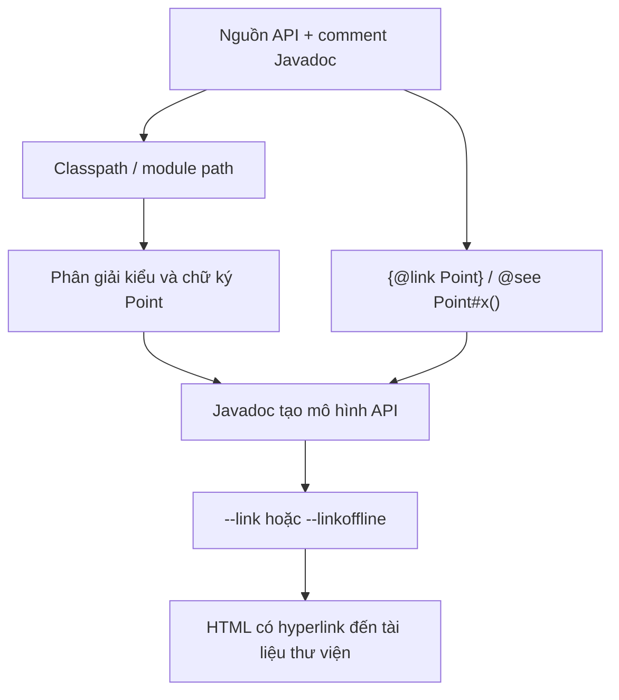
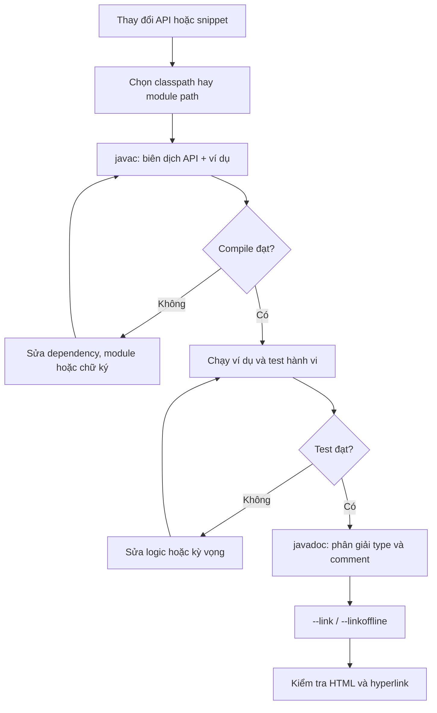

# Cấu hình classpath hoặc module path cho ví dụ và liên kết API trong tài liệu

## 1. Hai việc khác nhau khi Javadoc tham chiếu thư viện ngoài

Một API công khai có thể nhận hoặc trả về kiểu được định nghĩa trong thư viện khác. Ví dụ, phương thức của ứng dụng nhận một đối tượng `Point` từ thư viện hình học. Khi tạo tài liệu, Javadoc cần tìm được khai báo kiểu đó để kiểm tra tham chiếu `{@link Point}`. Khi xuất bản HTML, người đọc cũng cần có đường dẫn đến tài liệu API của thư viện hình học.

Để làm đúng cả hai việc, cần phân biệt:

1. **Classpath hoặc module path** cho biết nơi tìm bytecode/module để phân giải kiểu và chữ ký API.
2. **`--link` hoặc `--linkoffline`** cho biết Javadoc liên kết tham chiếu đến trang tài liệu API bên ngoài ở đâu.

Hai nhóm cấu hình bổ sung cho nhau:

| Cấu hình | Câu hỏi được giải quyết | Ví dụ |
| --- | --- | --- |
| `--class-path` / `-cp` | Thư viện JAR không phải named module nằm ở đâu? | `lib/geometry-api.jar` |
| `--module-path` / `-p` | Named module nằm ở đâu để công cụ phân giải `requires`? | `mods/` chứa `com.example.geometry.jar` |
| `--link` | Tài liệu Javadoc đã xuất bản của thư viện ở URL nào? | `https://docs.example.org/geometry/` |
| `--linkoffline` | URL sẽ ghi vào HTML là gì, và bản sao cục bộ của danh mục API ở đâu? | URL tài liệu cùng thư mục chứa `element-list` |

**Classpath không tự tạo hyperlink đến tài liệu bên ngoài.** Ngược lại, `--link` không đưa JAR vào môi trường phân giải kiểu để Javadoc hiểu chữ ký phương thức. Nếu chỉ có một trong hai, một phần công việc có thể thành công nhưng phần còn lại vẫn thiếu.

Bài này thuộc phần **Kiểm chứng tài liệu** của mô-đun **JAVA_VERSION_JAVA18**. Ta sẽ xây dựng ví dụ có phụ thuộc thư viện, biên dịch bằng classpath, chuyển sang mô hình named module với module path, rồi tạo liên kết đến tài liệu API ngoài. Các tùy chọn này vẫn được hỗ trợ trên JDK hiện đại.

### Mục tiêu học tập

Sau bài này, bạn có thể:

- Chọn classpath cho thư viện trên classpath và module path cho named module.
- Biên dịch file ví dụ external cùng API mà nó sử dụng.
- Cấu hình Javadoc phân giải được kiểu ngoài thông qua đúng đường dẫn.
- Dùng `{@link}` / `@see` cùng `--link` hoặc `--linkoffline` để tạo hyperlink tới API ngoài.
- Phân biệt `--module-path` với `--module-source-path`.
- Kiểm tra HTML và chẩn đoán lỗi thiếu JAR, thiếu module hoặc thiếu danh mục tài liệu liên kết.

## 2. Hiểu đường đi của một tham chiếu API

Giả sử API ứng dụng có phương thức:

```java
public static double distance(Point start, Point end)
```

`Point` được cung cấp bởi một thư viện khác. Trong comment Javadoc có thể viết:

```java
/**
 * Tính khoảng cách giữa hai điểm.
 *
 * @param start điểm bắt đầu, xem {@link Point}
 * @param end điểm kết thúc
 * @see Point#x()
 */
```

Javadoc cần giải quyết tên `Point` và phương thức `x()` dựa trên khai báo API. Sau đó, Standard Doclet có thể dùng thông tin liên kết ngoài để tạo URL trỏ đến tài liệu của `Point`.



`{@link}` là thẻ trong comment để tham chiếu một phần tử Java. `--link` và `--linkoffline` là tùy chọn ở cấp lệnh để Javadoc biết thư mục tài liệu ngoài và cách tạo URL. Khi tham chiếu không phân giải được, hãy kiểm tra **đường dẫn bytecode/module trước**; khi tham chiếu đã được nhận diện nhưng HTML không có URL ngoài, hãy kiểm tra **cấu hình link và danh mục tài liệu**.

## 3. Ví dụ không dùng module: cấu hình classpath

### 3.1. Cấu trúc dự án

Ví dụ dùng thư viện hình học nhỏ. Tính từ thư mục `demo/`:

```text
demo/
├── lib/
│   └── geometry-api.jar
├── src/
│   ├── geometry/
│   │   └── com/example/geometry/Point.java
│   └── app/
│       └── com/example/app/
│           ├── DistanceApi.java
│           └── snippet-files/
│               └── DistanceExample.java
└── build/
```

`geometry-api.jar` là thư viện phụ thuộc không được đóng gói thành named module trong ví dụ classpath này. Để tái hiện từ đầu, tạo lớp `Point`:

```java
package com.example.geometry;

/**
 * Một điểm trong mặt phẳng hai chiều.
 */
public record Point(double x, double y) {
}
```

Biên dịch và đóng gói JAR:

```bash
mkdir -p build/geometry-classes lib

javac --release 18 -d build/geometry-classes \
  src/geometry/com/example/geometry/Point.java

jar --create --file lib/geometry-api.jar \
  -C build/geometry-classes .
```

Thư viện đã có trong JAR nên bước tiếp theo chỉ cần đưa JAR đó lên classpath.

### 3.2. API ứng dụng tham chiếu kiểu bên ngoài

Tạo `src/app/com/example/app/DistanceApi.java`:

```java
package com.example.app;

import com.example.geometry.Point;

/**
 * Cung cấp phép tính khoảng cách cho {@link Point}.
 *
 * <p>Ví dụ sử dụng:</p>
 * {@snippet class=DistanceExample region=usage}
 *
 * @see Point#x()
 */
public final class DistanceApi {
    private DistanceApi() {
    }

    /**
     * Tính khoảng cách Euclid giữa hai điểm.
     *
     * @param start điểm đầu, không được null
     * @param end điểm cuối, không được null
     * @return khoảng cách giữa hai điểm
     */
    public static double distance(Point start, Point end) {
        return Math.hypot(start.x() - end.x(), start.y() - end.y());
    }
}
```

Trong comment, `{@link Point}` và `@see Point#x()` tham chiếu tới kiểu và phương thức của thư viện ngoài. `import` chỉ giúp tên ngắn `Point` được dùng trong source; nó **không cung cấp bytecode**. Trình biên dịch và Javadoc vẫn cần tìm được JAR.

### 3.3. External snippet dùng cùng API

Tạo `src/app/com/example/app/snippet-files/DistanceExample.java`:

```java
package com.example.app;

import com.example.geometry.Point;

/**
 * Ví dụ chạy được cho DistanceApi.
 */
public final class DistanceExample {
    private DistanceExample() {
    }

    public static void main(String[] args) {
        // @start region=usage
        Point start = new Point(0, 0);
        Point end = new Point(3, 4);
        double actual = DistanceApi.distance(start, end);

        if (Double.compare(5.0, actual) != 0) {
            throw new AssertionError("Expected 5.0, got " + actual);
        }
        System.out.println(actual);
        // @end region=usage
    }
}
```

Đây là lớp Java hoàn chỉnh; Javadoc chỉ trích region `usage` để trình bày. Khi kiểm tra mã, phải biên dịch **cả API lẫn file ví dụ**, cùng với JAR mà cả hai sử dụng.

### 3.4. Biên dịch và chạy với classpath

Tại thư mục `demo/`, dùng shell POSIX:

```bash
mkdir -p build/app-classes

javac --release 18 \
  --class-path lib/geometry-api.jar \
  -d build/app-classes \
  src/app/com/example/app/DistanceApi.java \
  src/app/com/example/app/snippet-files/DistanceExample.java

java --class-path "lib/geometry-api.jar:build/app-classes" \
  com.example.app.DistanceExample
```

Kết quả mong đợi:

```text
5.0
```

`--class-path` (viết tắt `-cp`) cho `javac` tìm kiểu `Point` trong JAR. Khi chạy, `java` cũng cần cả JAR và class ứng dụng trên classpath. Trên Windows, dấu phân cách các phần tử classpath là dấu chấm phẩy (`;`), ví dụ:

```powershell
javac --release 18 --class-path lib\geometry-api.jar -d build\app-classes src\app\com\example\app\DistanceApi.java src\app\com\example\app\snippet-files\DistanceExample.java
java --class-path "lib\geometry-api.jar;build\app-classes" com.example.app.DistanceExample
```

Nếu bỏ `lib/geometry-api.jar` khỏi lệnh `javac`, compiler không tìm thấy `Point` và báo lỗi phân giải kiểu. Nếu biên dịch được nhưng bỏ JAR khỏi lệnh `java`, ứng dụng có thể kết thúc với `NoClassDefFoundError` khi nạp lớp cần thiết. Đây là hai giai đoạn khác nhau: **compile-time path** và **runtime path**.

## 4. Tạo liên kết đến tài liệu API bên ngoài

### 4.1. `--link`: tài liệu ngoài có thể truy cập trực tuyến

Giả sử thư viện hình học đã xuất bản Javadoc tại:

`https://docs.example.org/geometry/`

Thư mục gốc của tài liệu đó phải cung cấp danh mục do Javadoc sinh ra: `package-list` đối với bộ tài liệu theo package, hoặc `element-list` đối với bộ tài liệu module. Đây là hai dạng danh mục theo cấu trúc tài liệu, không phải cách phân biệt JDK cũ và mới. URL phải trỏ tới **thư mục gốc tài liệu**, không phải tới file `Point.html`.

Lệnh tạo tài liệu cho ứng dụng:

```bash
javadoc \
  --class-path lib/geometry-api.jar \
  --link https://docs.example.org/geometry/ \
  -d build/app-docs \
  -Xdoclint:all -Werror \
  src/app/com/example/app/DistanceApi.java
```

Ở đây:

- `--class-path` giúp Javadoc phân giải `Point` và chữ ký `Point#x()`.
- `--link` hướng các hyperlink tới tài liệu đã xuất bản của thư viện.
- URL được ghi vào liên kết trong HTML; Javadoc cần truy cập danh mục ở URL đó khi tạo tài liệu.

Thay URL ví dụ bằng URL tài liệu thật của thư viện. Không dùng URL tới một trang HTML riêng lẻ vì Javadoc cần danh mục package/module ở thư mục gốc.

### 4.2. `--linkoffline`: URL công bố và danh mục cục bộ

Nếu môi trường build không có mạng, hoặc danh mục ở URL không thể tải trực tiếp, dùng `--linkoffline`. Tùy chọn này nhận **hai đối số**:

1. URL sẽ được nhúng vào hyperlink trong tài liệu sinh ra.
2. Thư mục cục bộ chứa `element-list` hoặc `package-list` của tài liệu ngoài.

Trước tiên, nếu có source của thư viện, sinh Javadoc cục bộ:

```bash
mkdir -p build/geometry-docs

javadoc -d build/geometry-docs \
  -sourcepath src/geometry com.example.geometry
```

Thư mục `build/geometry-docs` là gốc tài liệu package được sinh; nó cần có file `package-list`. Sau đó tạo Javadoc cho ứng dụng:

```bash
javadoc \
  --class-path lib/geometry-api.jar \
  --linkoffline https://docs.example.org/geometry/ build/geometry-docs \
  -d build/app-docs \
  -Xdoclint:all -Werror \
  src/app/com/example/app/DistanceApi.java
```

Javadoc đọc danh mục ở `build/geometry-docs` để biết phần tử API ngoài, nhưng ghi URL công bố `https://docs.example.org/geometry/` vào HTML. Máy build không cần truy cập URL đó ở thời điểm tạo tài liệu; người đọc cần có quyền truy cập URL khi mở liên kết.

Không chỉnh sửa `element-list` hoặc `package-list` bằng tay. Đây là các file chỉ mục do Javadoc sinh ra, dùng để kết nối tài liệu của hai thư viện.

### 4.3. `{@link}` và `--link` không thay thế nhau

| Thành phần | Nơi khai báo | Tác dụng |
| --- | --- | --- |
| `{@link Point}` | Comment Javadoc | Chọn phần tử API muốn liên kết. |
| `@see Point#x()` | Comment Javadoc | Thêm tham chiếu API ở phần See Also. |
| `--class-path` | Dòng lệnh Javadoc | Giúp công cụ tìm kiểu `Point` trong JAR. |
| `--link URL` | Dòng lệnh Javadoc | Ánh xạ tham chiếu API ngoài sang URL tài liệu đã xuất bản. |
| `--linkoffline URL DIR` | Dòng lệnh Javadoc | Ánh xạ tham chiếu API ngoài khi dùng danh mục tài liệu cục bộ. |

Nếu thiếu `{@link}` hoặc `@see`, Javadoc không tự đoán rằng mọi kiểu xuất hiện trong chữ thường đều cần liên kết. Nếu có `{@link}` nhưng kiểu không phân giải được, cần bổ sung classpath/module path. Nếu kiểu đã phân giải nhưng hyperlink không trỏ ra tài liệu ngoài, kiểm tra danh mục và tùy chọn `--link`/`--linkoffline`.

## 5. Khi thư viện là named module: dùng module path

Classpath phù hợp với thư viện không được sử dụng như named module. Khi thư viện có `module-info.java`, hãy dùng **module path** để giữ thông tin module, quan hệ `requires` và quy tắc export package.

### 5.1. Cấu trúc hai module

```text
demo-modules/
├── lib/
│   └── com.example.geometry.jar
├── src/
│   └── com.example.app/
│       ├── module-info.java
│       └── com/example/app/
│           ├── DistanceApi.java
│           └── snippet-files/DistanceExample.java
└── geometry-src/
    └── com.example.geometry/
        ├── module-info.java
        └── com/example/geometry/Point.java
```

Module thư viện `com.example.geometry`:

```java
module com.example.geometry {
    exports com.example.geometry;
}
```

`Point.java` vẫn là record hai chiều ở phần 3. Module ứng dụng khai báo phụ thuộc:

```java
module com.example.app {
    requires com.example.geometry;
    exports com.example.app;
}
```

Trong `DistanceApi.java` và `DistanceExample.java`, nội dung package, import và lời gọi API giống ví dụ classpath ở trên. Điểm khác là mã ứng dụng giờ nằm trong named module và module đó khai báo rõ `requires com.example.geometry`.

### 5.2. Đóng gói module thư viện

Tại thư mục `demo-modules/`:

```bash
mkdir -p build/geometry-module lib

javac -d build/geometry-module \
  geometry-src/com.example.geometry/module-info.java \
  geometry-src/com.example.geometry/com/example/geometry/Point.java

jar --create --file lib/com.example.geometry.jar \
  -C build/geometry-module .
```

JAR này chứa `module-info.class` và các lớp của package được export. Nó là named module trên module path.

### 5.3. Biên dịch ứng dụng bằng `--module-path`

```bash
mkdir -p build/app-module

javac --module-path lib -d build/app-module \
  src/com.example.app/module-info.java \
  src/com.example.app/com/example/app/DistanceApi.java \
  src/com.example.app/com/example/app/snippet-files/DistanceExample.java
```

`--module-path` (viết tắt `-p`) cho compiler tìm module `com.example.geometry`. Compiler đọc `requires com.example.geometry` trong `module-info.java`, sau đó kiểm tra package `com.example.geometry` có được export và các kiểu có thể truy cập hay không.

Chạy ví dụ:

```bash
java --module-path "lib:build/app-module" \
  --module com.example.app/com.example.app.DistanceExample
```

Trên Windows, dùng dấu chấm phẩy giữa các phần tử module path:

```powershell
java --module-path "lib;build\app-module" --module com.example.app/com.example.app.DistanceExample
```

### 5.4. `--module-path` và `--module-source-path` có nhiệm vụ khác nhau

| Tùy chọn | Dùng để |
| --- | --- |
| `--module-path` | Tìm các module đã được biên dịch, thường là thư mục chứa JAR hoặc thư mục module. |
| `--module-source-path` | Tìm source của một hoặc nhiều module đang được biên dịch/tài liệu hóa theo cấu trúc thư mục module. |
| `--module` | Chỉ định tên module cần biên dịch hoặc tạo tài liệu. |

Nếu gom cả hai module dưới một source root chung tên `src-all/`, có thể biên dịch nhiều module trực tiếp từ cây source được tổ chức theo tên module:

```bash
javac --module-source-path src-all -d build/all-modules \
  --module com.example.geometry,com.example.app
```

Trong lệnh này compiler tìm source của hai module dưới `src-all/`. Đây là một mô hình khác với ví dụ đóng gói JAR rồi dùng `--module-path`. Đừng đặt JAR dependency vào `--module-source-path`; hai tùy chọn có vai trò riêng.

## 6. Javadoc cho named module và liên kết tài liệu module ngoài

Javadoc hỗ trợ các tùy chọn module tương ứng như `--module-path`, `--module-source-path` và `--module`. Để tạo tài liệu cho module ứng dụng từ cây source ở phần 5:

Trước hết, tạo bộ tài liệu cho **module thư viện**. Bước này bảo đảm thư mục offline có danh mục module phù hợp, thay vì dùng lại bộ tài liệu classpath ở phần 4:

```bash
javadoc \
  --module-source-path geometry-src \
  --module com.example.geometry \
  -d build/geometry-docs
```

Sau lệnh này, kiểm tra `build/geometry-docs/element-list` tồn tại. Đây là danh mục của bộ tài liệu module hình học, được dùng ở đối số thứ hai của `--linkoffline`.

```bash
javadoc \
  --module-path lib \
  --module-source-path src \
  --module com.example.app \
  -d build/app-docs \
  -Xdoclint:all -Werror
```

Javadoc tìm module ứng dụng trong source path, rồi dùng module path để phân giải dependency được khai báo trong `module-info.java`. Chỉ module được nêu rõ bằng `--module` được chọn để tài liệu hóa theo lệnh này; module phụ thuộc được dùng để phân giải kiểu.

Nếu tài liệu của `com.example.geometry` đã được xuất bản ở URL và danh mục của nó có thể tải trực tuyến, thêm:

```bash
javadoc \
  --module-path lib \
  --module-source-path src \
  --module com.example.app \
  --link https://docs.example.org/geometry/ \
  -d build/app-docs \
  -Xdoclint:all -Werror
```

Nếu build offline, thay `--link` bằng hai đối số `--linkoffline`:

```bash
javadoc \
  --module-path lib \
  --module-source-path src \
  --module com.example.app \
  --linkoffline https://docs.example.org/geometry/ build/geometry-docs \
  -d build/app-docs \
  -Xdoclint:all -Werror
```

Đối với tài liệu module, danh mục `element-list` chứa thông tin module/package. URL đích và danh mục cục bộ phải thuộc cùng một bộ tài liệu và cùng phiên bản API. Nếu tài liệu ngoài thay đổi module/package mà thư mục offline vẫn chứa `element-list` cũ, hyperlink có thể thiếu hoặc trỏ sai.

## 7. Kiểm tra kết quả: phân giải kiểu và hyperlink là hai điều kiện

Sau khi tạo tài liệu, mở trang `build/app-docs/com/example/app/DistanceApi.html` (đường dẫn thực tế có thể có thêm thư mục module tùy cấu trúc đầu ra). Kiểm tra:

- Chữ ký phương thức hiển thị `Point` mà không có lỗi unresolved reference.
- `{@link Point}` trong phần mô tả trở thành hyperlink tới tài liệu thư viện.
- `@see Point#x()` trỏ tới đúng thành viên API.
- URL trong hyperlink bắt đầu bằng URL công bố mà bạn truyền cho `--link` hoặc `--linkoffline`.
- Liên kết mở được từ môi trường mà người đọc sử dụng.

Không chỉ nhìn thấy chữ `Point` có gạch chân rồi kết luận liên kết đúng. Hãy kiểm tra `href` hoặc mở liên kết để xác nhận nó dẫn đến đúng phiên bản tài liệu.

### Ma trận chẩn đoán

| Triệu chứng | Nguyên nhân thường gặp | Cách xử lý |
| --- | --- | --- |
| `javac` báo `package com.example.geometry does not exist` | Thiếu JAR trong classpath/module path hoặc sai đường dẫn. | Thêm `--class-path` hoặc `--module-path` đúng loại thư viện. |
| `javac` báo `module not found: com.example.geometry` | Named module không nằm trên module path. | Kiểm tra `--module-path`, tên module trong `module-info.java` và cấu trúc JAR. |
| Javadoc báo không tìm thấy `Point` | Javadoc thiếu classpath/module path hoặc dependency không export package. | Dùng đúng `--class-path`/`--module-path`; kiểm tra `exports`. |
| Javadoc nhận diện kiểu nhưng không có hyperlink ngoài | Thiếu `--link`/`--linkoffline`, hoặc comment không có thẻ liên kết. | Thêm `{@link}`/`@see` và cấu hình tài liệu ngoài. |
| `--link` không tìm thấy danh mục | URL không cung cấp `element-list`/`package-list`, hoặc URL không phải gốc tài liệu. | Dùng URL gốc đúng hoặc chuyển sang `--linkoffline`. |
| `--linkoffline` không hoạt động | Đối số thứ hai không trỏ tới thư mục chứa danh mục hoặc danh mục sai phiên bản. | Chọn đúng thư mục gốc tài liệu offline và đồng bộ version. |
| Javadoc sinh được nhưng ví dụ không biên dịch | External snippet chưa được đưa vào `javac`, hoặc build bỏ qua thư mục `snippet-files`. | Biên dịch tường minh file ví dụ cùng dependency. |
| Chạy chương trình báo `NoClassDefFoundError` | Runtime path thiếu thư viện dù compile path đã đúng. | Thêm JAR/module vào classpath/module path khi chạy. |
| Module thấy được nhưng không truy cập được kiểu | Package không được `exports`, module chưa `requires`, hoặc API không public. | Sửa module descriptor và khả năng truy cập theo thiết kế API. |

## 8. Quy trình kiểm chứng trong CI

Một pipeline cho dự án có thư viện ngoài nên kiểm tra theo thứ tự:



Ví dụ shell POSIX cho mô hình classpath:

```bash
set -eu
mkdir -p build/app-classes build/app-docs

javac --release 18 --class-path lib/geometry-api.jar \
  -d build/app-classes \
  src/app/com/example/app/DistanceApi.java \
  src/app/com/example/app/snippet-files/DistanceExample.java

java --class-path "lib/geometry-api.jar:build/app-classes" \
  com.example.app.DistanceExample

javadoc --class-path lib/geometry-api.jar \
  --linkoffline https://docs.example.org/geometry/ build/geometry-docs \
  -d build/app-docs -Xdoclint:all -Werror \
  src/app/com/example/app/DistanceApi.java
```

`set -e` khiến script dừng khi một lệnh trả mã thoát khác 0. Với dự án module, thay classpath bằng module path và cấu hình `--module-source-path`/`--module` như phần 5–6. CI cần dùng đúng JAR và bộ tài liệu của cùng phiên bản dependency; không để Javadoc liên kết tới tài liệu mới hơn hoặc cũ hơn API đang biên dịch.

### Bài tự luyện

1. Bỏ JAR khỏi `--class-path` rồi biên dịch `DistanceApi.java`. Ghi lại lỗi phân giải `Point`.
2. Giữ classpath cho `javac` nhưng bỏ JAR khỏi lệnh `java`. Giải thích vì sao biên dịch đạt nhưng runtime thất bại.
3. Xóa `{@link Point}` khỏi comment nhưng giữ `--link`. Điều gì thay đổi trong trang HTML?
4. Giữ `{@link Point}` nhưng bỏ `--link` và `--linkoffline`. Phân biệt việc Javadoc biết phần tử `Point` với việc tạo URL đến docs bên ngoài.
5. Chuyển thư viện thành named module. Thêm `requires` và `exports`, sau đó thay `--class-path` bằng `--module-path`.
6. Thử `--linkoffline` với thư mục không có `element-list`. Javadoc báo gì và vì sao URL đầu tiên không đủ?
7. Đổi phiên bản thư viện nhưng dùng lại thư mục docs offline cũ. Xác định nguy cơ hyperlink sai phiên bản.

## 9. Tài liệu tham khảo chính thức

- [The javac Command (JDK 25)](https://docs.oracle.com/en/java/javase/25/docs/specs/man/javac.html): `--class-path`, `--module-path`, `--module-source-path`, cách tìm kiểu và module.
- [The javadoc Command (JDK 25)](https://docs.oracle.com/en/java/javase/25/docs/specs/man/javadoc.html): các tùy chọn classpath/module path, `--link`, `--linkoffline`, `--module` và `--module-source-path`.
- [Javadoc Documentation Comment Specification (JDK 25)](https://docs.oracle.com/en/java/javase/25/docs/specs/javadoc/doc-comment-spec.html): cú pháp `{@link}`, `@see` và cách tham chiếu phần tử API.
- [JEP 261 — Module System](https://openjdk.org/jeps/261): nền tảng module path và hệ thống module của Java.

**Ghi nhớ:** Để Javadoc hiểu một kiểu ngoài, cung cấp thư viện qua classpath hoặc module path phù hợp. Để hyperlink của `{@link}`/`@see` dẫn tới tài liệu API ngoài, cấu hình thêm `--link` hoặc `--linkoffline`. Kiểm tra riêng bước biên dịch, bước chạy ví dụ và URL trong HTML để chắc chắn tài liệu phản ánh đúng dependency đang sử dụng.
