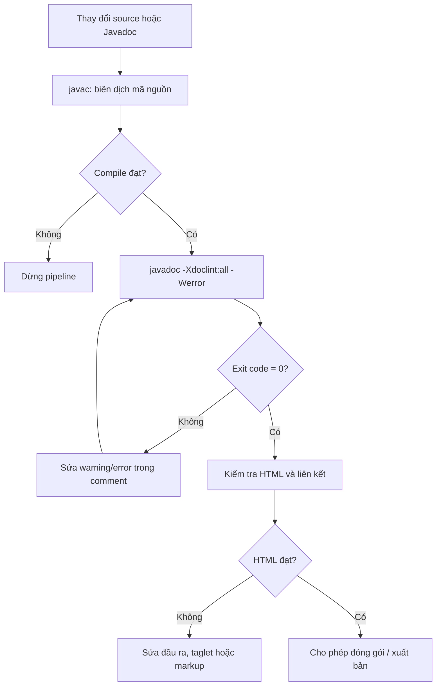

# Dùng `doclint`, mức cảnh báo và mã thoát của `javadoc` để phát hiện lỗi tài liệu

## 1. Vì sao cần kiểm tra tài liệu tự động?

Một dự án Java có thể biên dịch và chạy đúng nhưng tài liệu API vẫn có lỗi: tham chiếu `{@link}` trỏ tới kiểu không tồn tại, tên trong `@param` không khớp chữ ký phương thức, thẻ HTML sai cấu trúc hoặc phần mô tả khó tiếp cận với người dùng công nghệ hỗ trợ. Nếu chỉ mở từng trang HTML để đọc thủ công, nhiều lỗi nhỏ sẽ lọt qua khi API thay đổi.

**DocLint** là bộ kiểm tra tích hợp trong `javadoc` và `javac`, giúp phát hiện những vấn đề phổ biến trong documentation comment. Với Javadoc, DocLint được bật mặc định cho các comment thuộc nội dung tài liệu được tạo. Bạn có thể cấu hình rõ nhóm kiểm tra bằng `-Xdoclint` và dùng `-Werror` để biến cảnh báo thành lỗi của lần chạy.

DocLint đã có từ trước Java 18 và vẫn được hỗ trợ trong JDK hiện đại. Nội dung bài này tập trung vào cách dùng hiện hành để kiểm chứng tài liệu API, kể cả tài liệu có external snippet `{@snippet}` được giới thiệu từ Java 18.

DocLint giúp phát hiện lỗi ở **nguồn comment** và chỉ ra vị trí gần nơi phát sinh vấn đề. Nó không tự sửa comment, không biên dịch hoặc chạy mã trong snippet, và cũng không phải bộ kiểm định đầy đủ cho mọi HTML được sinh ra. Vì thế, quy trình tốt cần kết hợp kiểm tra DocLint, mã thoát của tiến trình và việc rà soát HTML đầu ra.

### Mục tiêu học tập

Sau bài này, bạn có thể:

1. Giải thích DocLint kiểm tra những gì và những gì nằm ngoài phạm vi.
2. Nhận diện năm nhóm kiểm tra `accessibility`, `html`, `missing`, `reference`, `syntax`.
3. Chọn `-Xdoclint:all`, nhóm kiểm tra cụ thể hoặc loại trừ nhóm `missing`.
4. Phân biệt cảnh báo với lỗi và dùng `-Werror` để áp dụng chính sách CI.
5. Đọc mã thoát của `javadoc` trong shell và PowerShell.
6. Tránh việc vô tình che giấu lỗi bằng cách tắt DocLint hoặc suppress quá rộng.

## 2. DocLint kiểm tra điều gì?

DocLint đọc documentation comment trong các source mà Javadoc đưa vào tài liệu. Nó phân nhóm vấn đề để có thể bật/tắt theo nhu cầu:

| Nhóm | Phạm vi kiểm tra | Ví dụ |
| --- | --- | --- |
| `accessibility` | Vấn đề tiếp cận nội dung HTML. | Hình ảnh thiếu `alt`; bảng thiếu caption phù hợp. |
| `html` | Lỗi cấu trúc HTML phổ biến. | Đặt phần tử block trong phần tử inline; thẻ cần đóng nhưng bị bỏ quên. |
| `missing` | Thiếu comment hoặc tag tài liệu. | Thiếu Javadoc cho khai báo; thiếu `@param` hoặc `@return`. |
| `reference` | Tham chiếu tới phần tử Java trong tag Javadoc. | `{@link}` không phân giải được; tên `@param` không tồn tại; tag `@throws` mô tả sai kiểu ngoại lệ. |
| `syntax` | Cú pháp thấp của documentation comment. | Dấu `<`, `>` hoặc `&` không escape đúng; tag Javadoc không hợp lệ. |

DocLint báo lỗi hoặc cảnh báo tùy mức độ. Một tham chiếu tới kiểu Java không tồn tại thường nghiêm trọng vì tạo tài liệu sai, trong khi thiếu một comment có thể chỉ là vấn đề chất lượng. Các lỗi HTML hoặc accessibility được báo là lỗi khi công cụ kiểm tra cho rằng bộ kiểm định đầu ra có thể xem đó là lỗi.

### DocLint không thay thế các phép kiểm tra khác

- Nó không xác minh rằng lời giải thích trong comment đúng về mặt nghiệp vụ.
- Nó không chạy ví dụ Java hoặc biên dịch mã trong `{@snippet}`.
- Nó không đảm bảo mọi URL ngoài vẫn hoạt động.
- Nó không kiểm định toàn bộ HTML được tạo bởi Standard Doclet, taglet tùy chỉnh hoặc nội dung thêm từ build.
- Nó không thay thế bài kiểm tra hành vi API, kiểm thử hợp đồng hoặc công cụ kiểm tra HTML/accessibility trên trang đã sinh.

DocLint được thiết kế để phát hiện các lỗi phổ biến ngay tại source, nơi thông báo có thể chỉ tới file, dòng và vị trí cụ thể.

## 3. Trạng thái mặc định và cách chọn nhóm kiểm tra

### 3.1. Javadoc đã bật DocLint mặc định

Với `javadoc`, tùy chọn `-Xdoclint` được bật mặc định. Lệnh sau đã chạy các kiểm tra được khuyến nghị:

```bash
javadoc -d build/docs src/main/java/com/example/docs/GreetingApi.java
```

Việc viết rõ `-Xdoclint:all` trong lệnh CI vẫn có ích: nó thể hiện chính sách muốn bật đủ các nhóm và giúp người đọc lệnh không phải suy luận từ mặc định.

Phạm vi comment được kiểm tra phụ thuộc vào những khai báo Javadoc đưa vào đầu ra. Mặc định Javadoc tạo tài liệu cho API public và protected; nếu dùng `-private`, `-package` hoặc tùy chọn hiển thị khác, tập khai báo được tài liệu hóa và kiểm tra cũng thay đổi.

**Đừng nhầm với `javac`:** DocLint không được bật mặc định trong lệnh `javac`. Khi muốn kiểm tra comment trong bước biên dịch, phải truyền `-Xdoclint...` cho chính `javac`. Bài này tập trung vào bước sinh tài liệu bằng `javadoc`.

### 3.2. Bật toàn bộ nhóm

```bash
javadoc -Xdoclint:all -d build/docs \
  src/main/java/com/example/docs/GreetingApi.java
```

`all` bao gồm cả `accessibility`, `html`, `missing`, `reference` và `syntax`.

### 3.3. Chỉ bật những nhóm cần thiết

Ví dụ chỉ kiểm tra HTML, tham chiếu và cú pháp:

```bash
javadoc -Xdoclint:html,reference,syntax -d build/docs \
  src/main/java/com/example/docs/GreetingApi.java
```

Có thể dùng nhiều tùy chọn riêng hoặc liệt kê nhiều nhóm trong một tùy chọn. Khi bảo trì cấu hình CI, cách liệt kê trong một tùy chọn thường dễ đọc và ít lặp hơn.

### 3.4. Bật tất cả nhưng loại trừ nhóm thiếu tài liệu

Trong giai đoạn chuyển đổi một codebase cũ sang chính sách tài liệu đầy đủ, có thể tạm thời loại trừ nhóm `missing`:

```bash
javadoc -Xdoclint:all,-missing -d build/docs \
  src/main/java/com/example/docs/GreetingApi.java
```

Các nhóm HTML, accessibility, reference và syntax vẫn được kiểm tra. Cách này có thể giúp đội dự án xử lý lỗi nội dung nghiêm trọng trước, sau đó bổ sung comment và tag còn thiếu rồi bật lại `missing`.

### 3.5. Tắt toàn bộ DocLint

```bash
javadoc -Xdoclint:none -d build/docs \
  src/main/java/com/example/docs/GreetingApi.java
```

`-Xdoclint:none` tắt toàn bộ nhóm DocLint. Đây là một lựa chọn cấu hình có thật, nhưng không nên dùng như cách xử lý mặc định khi build gặp lỗi. Tắt kiểm tra chỉ làm mất tín hiệu phát hiện; lỗi trong comment vẫn còn đó và có thể được xuất bản.

## 4. Hiểu cảnh báo và lỗi

DocLint phân loại chẩn đoán dựa trên mức độ ảnh hưởng. Quy tắc điển hình:

| Vấn đề | Mức thường gặp | Vì sao |
| --- | --- | --- |
| Thiếu comment hoặc tag (`missing`) | Warning | Tài liệu có thể vẫn sinh HTML hợp lệ, nhưng chưa đầy đủ. |
| Tham chiếu Java sai (`reference`) | Error | Liên kết hoặc mô tả API có thể sai, khiến người đọc hiểu nhầm. |
| Cú pháp comment sai (`syntax`) | Error | Nội dung có thể bị phân tích hoặc hiển thị không đúng. |
| HTML sai cấu trúc (`html`) | Thường là error | Có nguy cơ tạo HTML không hợp lệ. |
| Accessibility (`accessibility`) | Có thể là error | Đầu ra có thể không đáp ứng yêu cầu tiếp cận cơ bản. |

Đây là mức độ điển hình theo loại vấn đề, không phải quy tắc rằng mọi thông báo trong một nhóm luôn có cùng severity. Hãy đọc tiền tố `warning:` hoặc `error:` trong kết quả thực tế.

Một chẩn đoán thường có dạng:

```text
GreetingApi.java:18: warning: no @param for name
    public static String greet(String name) {
                         ^
```

Thông báo cung cấp file, dòng và vị trí gần nơi cần sửa. Có thể có nhiều thông báo cho cùng một comment; xử lý lỗi gốc trước rồi chạy lại để xác nhận.

## 5. Thí nghiệm: tạo lỗi và sửa documentation comment

Tạo file `src/main/java/com/example/docs/GreetingApi.java`:

```java
package com.example.docs;

/**
 * Các thao tác tạo lời chào.
 */
public final class GreetingApi {
    private GreetingApi() {
    }

    /**
     * Tạo lời chào cho một người.
     *
     * @param user tên người nhận
     * @throws IllegalArgumentException nếu tên rỗng
     */
    public static String greet(String name) {
        if (name.isBlank()) {
            throw new IllegalArgumentException("name must not be blank");
        }
        return "Xin chào, " + name;
    }

    public static String defaultGreeting() {
        return "Xin chào";
    }
}
```

Comment của `greet` có lỗi tham chiếu: chữ ký khai báo tham số `name`, nhưng tag lại viết `@param user`. Phương thức `defaultGreeting` không có comment, nên nhóm `missing` có thể báo cảnh báo khi khai báo này nằm trong tập tài liệu được sinh.

Chạy:

```bash
javadoc -Xdoclint:all -d build/docs \
  src/main/java/com/example/docs/GreetingApi.java
```

Kết quả dự kiến gồm:

- Chẩn đoán thuộc nhóm `reference` vì tên `user` không phải tham số của phương thức.
- Cảnh báo thuộc nhóm `missing` vì phương thức công khai `defaultGreeting` thiếu comment; tùy nội dung comment còn có thể có cảnh báo tag cần bổ sung.

Sửa comment thành:

```java
    /**
     * Tạo lời chào cho một người.
     *
     * @param name tên người nhận
     * @return lời chào đã tạo
     * @throws IllegalArgumentException nếu tên rỗng
     */
    public static String greet(String name) {
        if (name.isBlank()) {
            throw new IllegalArgumentException("name must not be blank");
        }
        return "Xin chào, " + name;
    }

    /**
     * Trả về lời chào mặc định.
     *
     * @return lời chào mặc định
     */
    public static String defaultGreeting() {
        return "Xin chào";
    }
```

Sau khi sửa, chạy lại Javadoc. Việc hết cảnh báo ở ví dụ này cho thấy các tag khớp với chữ ký và các phương thức công khai có mô tả cần thiết.

### Một số lỗi cú pháp và HTML thường gặp

Trong comment, biểu thức `n < 0` không nên viết thành văn bản HTML thô vì dấu `<` có thể bị hiểu là mở tag. Hãy dùng `{@code n < 0}` hoặc `&lt;` khi viết trực tiếp trong văn bản.

Nếu dùng HTML, bảo đảm tag được lồng đúng và đóng theo yêu cầu. Với ảnh, thêm mô tả `alt` có ý nghĩa; với bảng dữ liệu, cung cấp caption phù hợp. Đây là những ví dụ điển hình thuộc nhóm syntax, html và accessibility.

## 6. Dùng `-Werror` để biến cảnh báo thành lỗi build

Mặc định, một số vấn đề DocLint chỉ là warning. Vì vậy, tiến trình Javadoc có thể vẫn sinh tài liệu và hoàn tất khi chỉ có cảnh báo. Trong CI, điều này có thể khiến tài liệu thiếu `@param` hoặc `@return` lọt qua dù log đã ghi warning.

Tùy chọn Javadoc `-Werror` thay đổi chính sách đó: **nếu có bất kỳ warning nào, Javadoc báo lỗi**. Kết hợp với DocLint:

```bash
javadoc -Xdoclint:all -Werror \
  -d build/docs \
  src/main/java/com/example/docs/GreetingApi.java
```

Khi dùng `-Werror`, warning từ DocLint hoặc warning khác do Javadoc phát ra đều có thể làm lệnh thất bại. Đây là chính sách nghiêm ngặt phù hợp cho CI khi đội dự án đã xử lý các cảnh báo hiện hữu.

Nếu codebase đang được cải thiện dần, có thể tạm thời bỏ nhóm `missing` nhưng vẫn coi warning khác là lỗi:

```bash
javadoc -Xdoclint:all,-missing -Werror \
  -d build/docs \
  src/main/java/com/example/docs/GreetingApi.java
```

Khi đã hoàn thiện comment, chuyển về `-Xdoclint:all -Werror`. Không dùng `-Xdoclint:none` chỉ để làm pipeline xanh.

**Phân biệt với `javac`:** `-Werror` cũng là tùy chọn của `javac`, nhưng hai lệnh có tập chẩn đoán riêng. `javac -Werror` áp dụng cho cảnh báo biên dịch; `javadoc -Werror` áp dụng cho cảnh báo trong quá trình sinh tài liệu. Hãy đặt tùy chọn trên đúng lệnh.

## 7. Suppress có chủ đích và giới hạn số thông báo

### 7.1. Suppress một nhóm cụ thể

DocLint nhận diện `@SuppressWarnings` với giá trị `doclint` hoặc `doclint:LIST`. Ví dụ chỉ suppress nhóm `missing` tại một khai báo có lý do rõ ràng:

```java
@SuppressWarnings("doclint:missing")
public static void generatedHook() {
    // Điểm móc được sinh tự động; tài liệu được cung cấp ở nơi khác.
}
```

Chỉ dùng suppression khi thiếu tài liệu là có chủ đích và có giải thích trong dự án. Nó không thay thế việc viết comment cho API công khai mà người dùng cần hiểu.

Lưu ý quan trọng: suppression phù hợp sẽ bỏ qua cả warning **và error** thuộc nhóm được chỉ định. Vì vậy, không suppress `reference`, `syntax`, `html` hoặc `accessibility` một cách rộng rãi chỉ để làm build thành công. Một `@SuppressWarnings("doclint")` trên khai báo bao ngoài còn có thể suppress toàn bộ nhóm cho khai báo đó và các khai báo bên trong.

### 7.2. Giới hạn số thông báo được in

Javadoc có các tùy chọn nâng cao `-Xmaxerrs` và `-Xmaxwarns` để giới hạn số lỗi hoặc cảnh báo được in:

```bash
javadoc -Xmaxerrs 100 -Xmaxwarns 100 \
  -Xdoclint:all -d build/docs \
  src/main/java/com/example/docs/GreetingApi.java
```

Hai tùy chọn này chỉ giới hạn **số thông báo hiển thị**, không phải ngưỡng cho phép dự án có 100 lỗi hoặc 100 cảnh báo. Chúng cũng không biến warning thành error; dùng `-Werror` cho chính sách đó. Đây là tùy chọn nâng cao có tiền tố `-X`, nên hãy kiểm tra `javadoc -X` trên JDK mà CI sử dụng trước khi chuẩn hóa.

### 7.3. Giữ log dễ đọc

`-quiet` giảm các thông báo tiến trình thông thường để tập trung vào warning và error:

```bash
javadoc -quiet -Xdoclint:all -Werror \
  -d build/docs \
  src/main/java/com/example/docs/GreetingApi.java
```

`-quiet` không tắt DocLint và không làm warning biến mất. Không dùng nó như một cách thay thế `-Werror` hoặc việc xử lý lỗi.

## 8. Mã thoát của `javadoc` trong CI

CI cần dựa vào **mã thoát của tiến trình**, không chỉ tìm từ `BUILD SUCCESS` trong log hay kiểm tra thư mục HTML có được tạo hay không.

| Kết quả Javadoc | Không có `-Werror` | Có `-Werror` |
| --- | --- | --- |
| Không có warning/error | Thành công, exit code `0`. | Thành công, exit code `0`. |
| Chỉ có warning | Thường vẫn hoàn tất, exit code có thể là `0`. | Warning được nâng thành lỗi, tiến trình thất bại. |
| Có error | Tiến trình thất bại, exit code khác `0`. | Tiến trình thất bại, exit code khác `0`. |

Không nên xuất bản tài liệu chỉ vì một phần file HTML đã được tạo. Khi có error, Javadoc có thể đã ghi một số file trước khi dừng; mã thoát khác `0` phải làm bước CI thất bại.

### 8.1. Shell POSIX

```bash
set -eu

javadoc -Xdoclint:all -Werror \
  -d build/docs \
  src/main/java/com/example/docs/GreetingApi.java

echo "Javadoc validation passed"
```

Với `set -e`, shell dừng nếu `javadoc` trả mã thoát khác `0`; dòng thông báo thành công chỉ chạy sau khi Javadoc hoàn tất đạt yêu cầu.

### 8.2. Windows PowerShell

```powershell
javadoc -Xdoclint:all -Werror -d build\docs src\main\java\com\example\docs\GreetingApi.java
if ($LASTEXITCODE -ne 0) {
    throw "Javadoc validation failed"
}
Write-Output "Javadoc validation passed"
```

`$LASTEXITCODE` chứa mã thoát của chương trình native gần nhất. Kiểm tra nó ngay sau lệnh `javadoc`, trước khi chạy một chương trình native khác có thể ghi đè giá trị.

### 8.3. Đưa vào pipeline nhiều bước



Mỗi bước có mã thoát riêng. `javac` xác minh mã Java; `javadoc` cùng DocLint xác minh comment; công cụ kiểm tra HTML sau đó xác minh các trang đã sinh. Không gộp các kết quả này thành một khẳng định chung rằng “tài liệu đã đúng”.

## 9. DocLint và kiểm tra HTML đầu ra

DocLint phân tích documentation comment ở source nên có thể chỉ ra chính xác nơi sửa. Nhưng HTML cuối cùng còn chứa nội dung từ Standard Doclet, stylesheet, taglet và các tùy chọn dòng lệnh. Để kiểm tra đầy đủ hơn, hãy bổ sung:

- HTML validator để phát hiện lỗi trong toàn bộ trang được sinh.
- Kiểm tra accessibility trên HTML thực tế, đặc biệt với bảng, ảnh và nội dung tương tác.
- Link checker cho liên kết nội bộ và liên kết ra tài liệu bên ngoài.
- Kiểm tra trực quan một số trang đại diện trên trình duyệt.
- Kiểm thử biên dịch/chạy riêng cho external snippet và ví dụ mã; DocLint không thay thế các bước này.

DocLint không bảo đảm tất cả vấn đề đã được phát hiện. Mục tiêu của nó là báo các lỗi phổ biến thuận tiện ngay tại nguồn, còn công cụ kiểm tra đầu ra có thể bao quát nội dung mà DocLint không nhìn thấy.

### Bài tự luyện

1. Xóa `@return` khỏi `greet`. Xác định nhóm DocLint và mức chẩn đoán thường gặp.
2. Đổi `@param name` thành `@param user`. Giải thích vì sao đây là lỗi tham chiếu.
3. Thêm `{@link UnknownApi}`. Xác định nhóm kiểm tra và cách sửa.
4. Chạy với `-Xdoclint:all,-missing`. Những lỗi nào vẫn được phát hiện và nhóm nào đã bị loại trừ?
5. Chạy với `-Werror` khi còn một warning. Mã thoát của Javadoc ảnh hưởng pipeline ra sao?
6. Đặt `@SuppressWarnings("doclint:missing")` trên một khai báo. Vì sao không nên dùng `@SuppressWarnings("doclint")` cho toàn lớp?
7. Tạo một external snippet sai cú pháp Java nhưng Javadoc vẫn trích được. Bước nào cần chạy để xác minh mã snippet?
8. Tạo HTML có link sai do taglet tùy chỉnh. Vì sao chỉ chạy DocLint chưa đủ?

## 10. Quy trình khuyến nghị và tài liệu tham khảo

Với thư viện Java có tài liệu API được duy trì thường xuyên, có thể áp dụng quy trình:

1. Giữ DocLint bật; cấu hình rõ `-Xdoclint:all` trong lệnh Javadoc.
2. Sửa lỗi `reference`, `syntax`, `html` và `accessibility` ngay khi xuất hiện.
3. Bổ sung comment và tag còn thiếu; khi codebase đã đầy đủ, bật nhóm `missing`.
4. Dùng `-Werror` trong CI để warning mới làm bước tài liệu thất bại.
5. Kiểm tra mã thoát của Javadoc, không chỉ sự tồn tại của HTML.
6. Chạy validator và kiểm tra link trên HTML cuối cùng.
7. Biên dịch và chạy riêng các ví dụ/external snippet để xác nhận hành vi API.

Lệnh CI cơ bản:

```bash
set -eu

javac --release 18 -encoding UTF-8 -d build/classes \
  src/main/java/com/example/docs/GreetingApi.java

javadoc --release 18 -encoding UTF-8 \
  -Xdoclint:all -Werror \
  -d build/docs \
  src/main/java/com/example/docs/GreetingApi.java
```

Nếu đang chuyển đổi codebase cũ, có thể bắt đầu với `-Xdoclint:all,-missing -Werror`, theo dõi phần tài liệu còn thiếu và lên kế hoạch bật lại `missing`. Không để ngoại lệ tạm thời trở thành cấu hình vĩnh viễn mà không có chủ sở hữu.

### Tài liệu chính thức

- [The javadoc Command (JDK 25)](https://docs.oracle.com/en/java/javase/25/docs/specs/man/javadoc.html): `-Xdoclint`, các nhóm kiểm tra, `-Werror`, `-Xmaxerrs`, `-Xmaxwarns` và phạm vi của DocLint.
- [The javac Command (JDK 25)](https://docs.oracle.com/en/java/javase/25/docs/specs/man/javac.html): cách dùng DocLint trong compiler và sự khác nhau về mặc định so với Javadoc.
- [Javadoc Documentation Comment Specification (JDK 25)](https://docs.oracle.com/en/java/javase/25/docs/specs/javadoc/doc-comment-spec.html): cú pháp và quy tắc documentation comment.
- [HTML Living Standard](https://html.spec.whatwg.org/): nền tảng kiểm tra cấu trúc HTML đầu ra.
- [Web Content Accessibility Guidelines (WCAG)](https://www.w3.org/TR/WCAG22/): hướng dẫn đánh giá khả năng tiếp cận nội dung web.

**Ghi nhớ:** DocLint giúp tìm lỗi comment ngay tại source; `-Werror` khiến warning trở thành lỗi của bước Javadoc; mã thoát khác `0` phải làm CI dừng. Sau đó vẫn cần kiểm tra HTML đầu ra và biên dịch/chạy riêng các snippet để xác minh nội dung mà người dùng tài liệu sẽ thực sự sử dụng.
