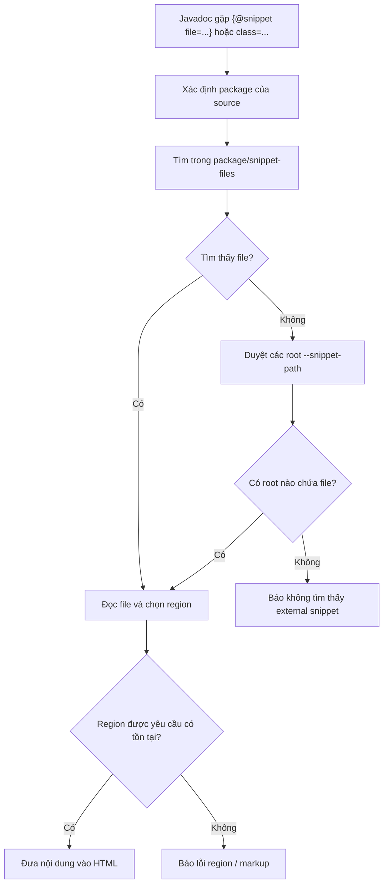

# Chẩn đoán tệp snippet không tìm thấy theo package, working directory và `--snippet-path`

## 1. Khi Javadoc báo không tìm thấy external snippet

Từ Java 18, Javadoc hỗ trợ thẻ **`{@snippet}`** để đưa ví dụ mã vào tài liệu API. Với external snippet, nội dung nằm trong một file riêng và comment tham chiếu đến file hoặc lớp chứa ví dụ. Cách làm này giúp dùng chung một ví dụ cho tài liệu, biên dịch và kiểm thử.

Một lỗi thường gặp là Javadoc không tìm thấy file được tham chiếu, dù file vẫn tồn tại trong repository. Nguyên nhân thường thuộc một trong ba vị trí:

1. File được đặt sai **thư mục package** so với source chứa comment.
2. Lệnh Javadoc chạy từ **working directory** khác với nơi người viết giả định, khiến các đường dẫn tương đối trỏ sai.
3. File nằm trong một cây thư mục riêng nhưng lệnh chưa khai báo root đó bằng **`--snippet-path`**.

Điều quan trọng là xác định Javadoc đang tìm file từ root nào. Đường dẫn trong thuộc tính `file` là đường dẫn tương đối bên trong một thư mục tìm kiếm snippet; nó không mặc nhiên là đường dẫn tương đối từ project root hoặc từ thư mục shell hiện tại.

Bài này thuộc phần **Kiểm chứng tài liệu** của mô-đun **JAVA_VERSION_JAVA18**. Ta sẽ dùng một API có external snippet, đặt file theo package, di chuyển file sang thư mục riêng, rồi cấu hình Javadoc bằng `--snippet-path`. Nội dung chỉ sử dụng tính năng Javadoc snippet và tùy chọn CLI còn được hỗ trợ trên JDK hiện đại.

### Mục tiêu học tập

Sau bài này, bạn có thể:

- Xác định vị trí `snippet-files` tương ứng với package của source chứa `{@snippet}`.
- Phân biệt đường dẫn file snippet với working directory của tiến trình Javadoc.
- Dùng `--source-path` khi đầu vào là tên package và `--snippet-path` khi snippet nằm ở root riêng.
- Chọn đúng thuộc tính `class` hoặc `file` cho external snippet.
- Hiểu thứ tự tìm kiếm package-local trước các root của `--snippet-path`.
- Phân biệt lỗi không tìm thấy file với lỗi file có tồn tại nhưng thiếu region.
- Chẩn đoán lỗi do chữ hoa/thường, dấu phân cách đường dẫn, build tool và cấu hình CI.

## 2. Cơ chế tìm kiếm external snippet

Thẻ snippet có thể trỏ đến file theo hai cách:

```java
/**
 * Ví dụ tham chiếu một lớp Java bên ngoài.
 * {@snippet class=GreetingExample}
 *
 * Ví dụ tham chiếu một file theo đường dẫn tương đối.
 * {@snippet file="examples/greeting.properties" region=basic}
 */
```

- Thuộc tính `class` dùng để chỉ một file nguồn Java theo tên lớp. Ví dụ `class=GreetingExample` tham chiếu file `GreetingExample.java`.
- Thuộc tính `file` dùng tên file hoặc đường dẫn tương đối ngắn; cách này phù hợp với file Java, properties, JSON, XML hoặc nội dung có cấu trúc khác.

Standard Doclet tìm external snippet theo thứ tự:

1. Thư mục `snippet-files` trong cây package chứa source có thẻ snippet.
2. Các thư mục được liệt kê trong `--snippet-path`, theo danh sách search path của lệnh Javadoc.

`--snippet-path` nhận một hoặc nhiều root tìm kiếm. Dấu phân cách giữa các root phụ thuộc hệ điều hành: dấu hai chấm (`:`) trên Linux/macOS và dấu chấm phẩy (`;`) trên Windows.



Nếu cùng một đường dẫn tương đối xuất hiện ở package-local và trong root ngoài, bản package-local được ưu tiên vì được tìm trước. Tránh đặt hai file khác nội dung nhưng trùng đường dẫn tương đối; việc shadowing này khiến kết quả phụ thuộc vào vị trí tìm kiếm.

## 3. Ví dụ chuẩn: snippet nằm trong thư mục package

### 3.1. Cấu trúc dự án

Giả sử source package là `com.example.text` và source root là `src/main/java`:

```text
demo/
└── src/
    └── main/
        └── java/
            └── com/
                └── example/
                    └── text/
                        ├── TextFormatter.java
                        └── snippet-files/
                            └── GreetingExample.java
```

Source chứa Javadoc:

```java
package com.example.text;

/**
 * Các thao tác xử lý văn bản.
 *
 * <p>Ví dụ sử dụng:</p>
 * {@snippet class=GreetingExample region=basic}
 */
public final class TextFormatter {
    private TextFormatter() {
    }

    /**
     * Chuyển chuỗi thành chữ hoa theo locale độc lập.
     *
     * @param value chuỗi đầu vào
     * @return chuỗi đã chuyển thành chữ hoa
     */
    public static String upper(String value) {
        return value.toUpperCase(java.util.Locale.ROOT);
    }
}
```

File `src/main/java/com/example/text/snippet-files/GreetingExample.java`:

```java
package com.example.text;

public class GreetingExample {
    public static void main(String[] args) {
        // @start region=basic
        String actual = TextFormatter.upper("xin chào");
        if (!"XIN CHÀO".equals(actual)) {
            throw new AssertionError("Unexpected value: " + actual);
        }
        System.out.println(actual);
        // @end region=basic
    }
}
```

Trong ví dụ này:

- Package của source có comment là `com.example.text`.
- Thư mục package trên đĩa là `src/main/java/com/example/text`.
- Thư mục snippet cục bộ là thư mục con `snippet-files` của chính thư mục package đó.
- `class=GreetingExample` trỏ tới file Java `GreetingExample.java` trong thư mục snippet cục bộ.
- `region=basic` chỉ chọn phần mã nằm giữa marker `@start region=basic` và `@end region=basic`.

`snippet-files` **không phải một phần của tên package Java**. Không khai báo package là `com.example.text.snippet-files` và không đặt file snippet vào thư mục giả định đó.

### 3.2. Gọi Javadoc theo tên package

Từ thư mục project root `demo/`, chạy:

```bash
javadoc \
  --source-path src/main/java \
  -d build/docs \
  com.example.text
```

`--source-path` cho Javadoc biết root chứa cây package. Khi tìm package `com.example.text`, công cụ tìm source trong `src/main/java/com/example/text`; thư mục snippet tương ứng nằm cạnh source đó.

### 3.3. Gọi Javadoc bằng đường dẫn source file

Có thể truyền file source trực tiếp:

```bash
javadoc --source-path src/main/java -d build/docs \
  src/main/java/com/example/text/TextFormatter.java
```

Khi dùng source file trực tiếp, vẫn khai báo `--source-path` để Javadoc có root package rõ ràng; giữ nguyên cấu trúc package trên đĩa và đặt `snippet-files` cạnh file source. Tránh dựa vào việc công cụ tự suy ra mọi thư mục phụ trợ từ một đường dẫn file đơn lẻ.

External snippet chỉ được Javadoc trích và trình bày; Standard Doclet không biên dịch hay chạy file này. Nếu muốn kiểm tra ví dụ Java như mã nguồn thực thi, có thể biên dịch riêng cả API và file ví dụ:

```bash
javac --release 18 -d build/classes \
  src/main/java/com/example/text/TextFormatter.java \
  src/main/java/com/example/text/snippet-files/GreetingExample.java

java -cp build/classes com.example.text.GreetingExample
```

Kết quả mong đợi là `XIN CHÀO`. Bước này xác nhận nội dung ví dụ và API có thể được biên dịch/chạy; nó không thay đổi quy tắc tìm file của Javadoc.

## 4. Working directory ảnh hưởng đường dẫn như thế nào?

**Working directory** là thư mục tiến trình đang đứng khi lệnh Javadoc được chạy. Nó không nhất thiết là thư mục chứa source file, thư mục package hay thư mục project root.

Ví dụ lệnh:

```bash
javadoc --source-path src/main/java \
  --snippet-path docs/snippets \
  -d build/docs \
  com.example.text
```

Nếu chạy từ project root `demo/`, các đường dẫn tương đối `src/main/java`, `docs/snippets` và `build/docs` đều được hiểu từ `demo/`. Nếu chạy từ `demo/docs/` nhưng vẫn dùng nguyên lệnh, Javadoc sẽ tìm `docs/snippets` dưới `demo/docs/docs/snippets` và có thể không tìm thấy file.

### 4.1. Kiểm tra thư mục hiện tại

Trên Bash:

```bash
pwd
test -d src/main/java && echo "source root exists"
test -d docs/snippets && echo "snippet root exists"
```

Trên PowerShell:

```powershell
Get-Location
Test-Path .\src\main\java
Test-Path .\docs\snippets
Resolve-Path .\docs\snippets
```

Nếu một đường dẫn trả về false hoặc báo không tồn tại, hãy kiểm tra vị trí hiện tại trước khi sửa thuộc tính `file`. Có thể lỗi chỉ do lệnh được chạy từ thư mục con.

### 4.2. Chọn một working directory ổn định

Khuyến nghị gọi Javadoc từ project root hoặc chỉ định working directory cố định trong build script/CI. Ví dụ:

```bash
cd /workspace/demo
javadoc --source-path src/main/java \
  --snippet-path docs/snippets \
  -d build/docs \
  com.example.text
```

Trên PowerShell:

```powershell
Set-Location C:\workspace\demo
javadoc --source-path src\main\java --snippet-path docs\snippets -d build\docs com.example.text
```

Không dùng một đường dẫn tương đối được tính từ vị trí máy cá nhân rồi giả định CI cũng chạy từ cùng thư mục. Trong Maven, Gradle hoặc pipeline riêng, hãy xem working directory thực tế của tác vụ Javadoc và cách plugin truyền tham số.

## 5. Dùng `--snippet-path` khi snippet nằm ngoài package

Có những trường hợp không nên hoặc không thể đặt snippet trong thư mục package-local:

- Ví dụ được chia sẻ bởi nhiều package.
- Build tool xử lý sai thư mục `snippet-files` như thể nó là thư mục chứa package Java.
- Dự án muốn giữ ví dụ trong cây tài liệu hoặc cây test riêng.
- Source được sinh ra hoặc được bố trí theo cách không phù hợp với thư mục snippet cục bộ.

Oracle lưu ý một số build system có thể coi nhầm `snippet-files` là một phần của package hierarchy. Trong trường hợp đó, chuyển snippet sang root riêng và dùng `--snippet-path` là cách được Javadoc hỗ trợ.

### 5.1. Cấu trúc khi dùng root ngoài

Di chuyển file ví dụ sang `docs/snippets`:

```text
demo/
├── src/
│   └── main/
│       └── java/
│           └── com/
│               └── example/
│                   └── text/
│                       └── TextFormatter.java
├── docs/
│   └── snippets/
│       └── examples/
│           └── GreetingExample.java
└── build/
```

Đổi Javadoc trong `TextFormatter.java` thành:

```java
/**
 * Các thao tác xử lý văn bản.
 *
 * <p>Ví dụ sử dụng:</p>
 * {@snippet file="examples/GreetingExample.java" region=basic}
 */
```

Đường dẫn `examples/GreetingExample.java` được tính tương đối từ root snippet:

```text
docs/snippets/                  <- --snippet-path
└── examples/
    └── GreetingExample.java    <- file=examples/GreetingExample.java
```

Không viết `file="docs/snippets/examples/GreetingExample.java"` nếu đã truyền `--snippet-path docs/snippets`. Khi đó Javadoc có thể ghép root thành `docs/snippets/docs/snippets/examples/GreetingExample.java`, là đường dẫn sai.

### 5.2. Lệnh trên Linux/macOS

Chạy từ project root:

```bash
javadoc \
  --source-path src/main/java \
  --snippet-path docs/snippets \
  -d build/docs \
  com.example.text
```

`--snippet-path docs/snippets` nói cho Standard Doclet biết root ngoài. Đường dẫn trong thuộc tính `file` vẫn chỉ là phần tương đối bên trong root này.

### 5.3. Lệnh trên Windows PowerShell

```powershell
javadoc --source-path src\main\java --snippet-path docs\snippets -d build\docs com.example.text
```

Nếu có nhiều root, Windows dùng dấu chấm phẩy:

```powershell
javadoc --source-path src\main\java --snippet-path "docs\snippets;shared\snippets" -d build\docs com.example.text
```

Trên Linux/macOS, dùng dấu hai chấm:

```bash
javadoc --source-path src/main/java \
  --snippet-path "docs/snippets:shared/snippets" \
  -d build/docs \
  com.example.text
```

Các thư mục trong danh sách là **root tìm kiếm**. Nếu snippet được tham chiếu bằng `file="examples/GreetingExample.java"`, mỗi root được kiểm tra theo đường dẫn tương đối đó. Không thêm dấu phân cách của hệ điều hành vào chính thuộc tính `file`; hãy dùng dấu gạch chéo xuôi (`/`) cho đường dẫn tương đối trong tag.

## 6. Chọn đúng `class` hay `file`

Hai thuộc tính không phải hai cách viết tùy ý cho cùng một giá trị:

| Thuộc tính | Dùng khi | Ví dụ |
| --- | --- | --- |
| `class` | File là mã nguồn Java và muốn định danh bằng tên lớp. | `{@snippet class=GreetingExample region=basic}` |
| `file` | Muốn chỉ định đường dẫn tương đối hoặc file không phải Java. | `{@snippet file="examples/GreetingExample.java" region=basic}` |

Với `class=GreetingExample`, Standard Doclet tìm file Java có tên tương ứng trong vị trí external snippet. Với `file`, phần đường dẫn được tính từ thư mục `snippet-files` package-local hoặc từ một root trong `--snippet-path`.

Nếu dùng `class` trong snippet path ngoài, hãy bảo đảm file Java và cách tổ chức package phù hợp với cách Javadoc phân giải tên lớp. Khi cần kiểm soát đường dẫn rõ ràng, `file` thường dễ chẩn đoán hơn vì thể hiện chính xác relative path cần tìm.

## 7. Phân biệt lỗi không tìm thấy file và lỗi region

Khi Javadoc báo snippet không hợp lệ, hãy xác định nó dừng ở bước nào:

| Hiện tượng | Nguyên nhân cần kiểm tra | Cách xử lý |
| --- | --- | --- |
| Không tìm thấy external snippet file | Sai package path, sai root hoặc thiếu `--snippet-path`. | Kiểm tra source directory, working directory và root tìm kiếm. |
| Tìm thấy file nhưng không có region | Tên `region` trong tag không khớp marker trong file. | So sánh chính tả, chữ hoa/thường và marker `@start`/`@end`. |
| Tìm thấy file Java nhưng không thấy class | Dùng sai thuộc tính `class` hoặc tên lớp không khớp tên file. | Đối chiếu `class=...` với tên lớp/file Java. |
| Chỉ một số package bị lỗi | Snippet được đặt dưới package khác với source có comment. | Đưa file vào `snippet-files` của đúng package hoặc dùng root chung. |
| Máy cá nhân chạy, CI lỗi | Working directory, separator hoặc case-sensitive path khác nhau. | Cố định working directory và kiểm tra đường dẫn trong CI. |
| File tồn tại nhưng nội dung cũ được hiển thị | Có file trùng tên ở package-local và root ngoài; package-local được tìm trước. | Loại bỏ bản trùng hoặc đổi relative path để không shadow. |

### 7.1. Kiểm tra tên region

Nếu tag là:

```java
{@snippet file="examples/GreetingExample.java" region=basic}
```

thì file phải có marker tương ứng:

```java
// @start region=basic
String actual = TextFormatter.upper("xin chào");
System.out.println(actual);
// @end region=basic
```

Tên region phải khớp chính xác. `region=Basic` không phải `region=basic`. Một file được tìm thấy nhưng không có region không phải lỗi đường dẫn; không cần tiếp tục thay đổi working directory hoặc thêm root tìm kiếm.

### 7.2. Kiểm tra chữ hoa/thường và phần mở rộng

Trên Windows, đường dẫn thường không phân biệt chữ hoa/thường; trên Linux, phân biệt chữ hoa/thường. Ví dụ `GreetingExample.java` và `greetingExample.java` có thể được xem là hai tên khác nhau trong CI Linux.

Kiểm tra đồng thời:

- Tên file trong thuộc tính `file`.
- Tên lớp trong thuộc tính `class`.
- Phần mở rộng `.java` hoặc `.properties`.
- Tên thư mục con trong đường dẫn tương đối.
- Cách viết chính xác của tên package trong source.

Nên dùng một quy ước chữ thường cho thư mục và giữ tên file Java khớp tên lớp công khai theo quy tắc Java.

## 8. Quy trình chẩn đoán theo từng bước

Khi gặp lỗi, xử lý theo thứ tự sau để không thay đổi nhiều cấu hình cùng lúc:

1. **Đọc đúng thuộc tính snippet.** Xác định comment dùng `class` hay `file` và giá trị có `region` hay không.
2. **Xác định package source.** Đọc khai báo `package` trong file có comment, sau đó tìm thư mục package tương ứng dưới source root.
3. **Kiểm tra package-local.** Xem có thư mục `snippet-files` nằm cạnh source trong đúng package không; kiểm tra tên file và thư mục con.
4. **Kiểm tra working directory.** In `pwd` hoặc `Get-Location`; xác minh các đường dẫn tương đối trong lệnh có tồn tại từ vị trí đó.
5. **Kiểm tra source path.** Nếu gọi Javadoc bằng tên package, xác nhận `--source-path` trỏ tới root package, không phải chính thư mục package con.
6. **Kiểm tra snippet path.** Nếu file ở root riêng, xác nhận `--snippet-path` trỏ tới thư mục gốc chứa cây snippet.
7. **Kiểm tra relative path.** Ghép root tìm kiếm với giá trị `file` để xem đúng file vật lý có tồn tại không.
8. **Kiểm tra region.** Chỉ sau khi xác nhận file được tìm thấy, đối chiếu marker bắt đầu/kết thúc.
9. **Chạy lại Javadoc.** Giữ nguyên working directory và các đường dẫn đã xác nhận để kết quả có thể tái lập.

### Bảng chẩn đoán nhanh

| Câu hỏi | Nếu câu trả lời là “không” |
| --- | --- |
| Source có khai báo package đúng không? | Sửa khai báo hoặc vị trí package source theo cấu trúc dự án. |
| Source root có được Javadoc nhận diện không? | Thêm hoặc sửa `--source-path`. |
| File có ở `package/snippet-files` không? | Chuyển file về đúng package hoặc dùng `--snippet-path`. |
| Root `--snippet-path` có tồn tại từ working directory không? | Đổi working directory hoặc sửa đường dẫn root. |
| Relative path trong `file` có khớp phần bên dưới root không? | Sửa `file` hoặc cấu trúc thư mục. |
| Region được yêu cầu có marker khớp không? | Sửa tên region hoặc marker trong file. |

## 9. Ví dụ kiểm tra đường dẫn trong CI

Một script nên kiểm tra sự tồn tại của các root trước khi chạy Javadoc. Việc này tạo thông báo dễ hiểu hơn so với chỉ đọc lỗi cuối từ Doclet.

### 9.1. Bash

```bash
set -eu

test -d src/main/java
test -d docs/snippets
test -f docs/snippets/examples/GreetingExample.java

javadoc \
  --source-path src/main/java \
  --snippet-path docs/snippets \
  -d build/docs \
  -Xdoclint:all \
  com.example.text
```

Nếu script được gọi từ một thư mục khác, hãy đổi sang project root trước khi kiểm tra hoặc truyền các đường dẫn tuyệt đối đã được tạo từ root đó. Không ghép đường dẫn từ chuỗi tùy ý mà không kiểm tra vị trí làm việc.

### 9.2. PowerShell

```powershell
$sourceRoot = Resolve-Path .\src\main\java
$snippetRoot = Resolve-Path .\docs\snippets
$snippetFile = Join-Path $snippetRoot 'examples\GreetingExample.java'

if (-not (Test-Path $snippetFile -PathType Leaf)) {
    throw "External snippet not found: $snippetFile"
}

javadoc --source-path $sourceRoot.Path --snippet-path $snippetRoot.Path -d build\docs -Xdoclint:all com.example.text
if ($LASTEXITCODE -ne 0) {
    throw "Javadoc failed"
}
```

Trong PowerShell, `Resolve-Path` giúp nhìn thấy đường dẫn đã được chuẩn hóa; `Test-Path` kiểm tra file trước khi Javadoc chạy. Nếu dùng nhiều root trên Windows, ghép chúng bằng dấu chấm phẩy trong giá trị `--snippet-path`. Luôn kiểm tra `$LASTEXITCODE` ngay sau tiến trình Javadoc.

## 10. Những nhầm lẫn cần tránh

- **Đặt snippet vào package Java:** `snippet-files` là thư mục phụ trợ, không phải package.
- **Đưa cả prefix `snippet-files/` vào thuộc tính `file`:** đường dẫn được tính từ thư mục snippet root; nếu root đã là `.../snippet-files`, tag chỉ cần tên tương đối bên dưới nó.
- **Dùng `--source-path` thay cho `--snippet-path`:** source path giúp tìm source package; nó không khai báo root ngoài cho external snippet.
- **Dùng `--snippet-path` thay cho `--source-path`:** snippet path không giúp Javadoc tìm package source.
- **Giả định đường dẫn trong `file` tính từ working directory:** nó tính từ thư mục snippet search root; working directory ảnh hưởng các root tương đối trong lệnh.
- **Đổi tên region để sửa lỗi file not found:** region chỉ được xử lý sau khi file đã tìm thấy.
- **Chỉ kiểm tra trên Windows:** CI Linux có thể phát hiện lỗi chữ hoa/thường và dấu phân cách bị che khuất trên máy cá nhân.

Một số build system có thể tự động thêm mọi thư mục dưới source root vào danh sách source. Nếu nó cố xử lý `snippet-files` như package Java, hãy dùng root snippet riêng qua `--snippet-path` thay vì buộc thư mục phụ trợ vào source set.

## 11. Tài liệu tham khảo chính thức

- [Snippets — Javadoc Guide (JDK 25)](https://docs.oracle.com/en/java/javase/25/javadoc/snippets.html): external snippet, cấu trúc `snippet-files`, `class`/`file`, region và lưu ý về build system.
- [The javadoc Command (JDK 25)](https://docs.oracle.com/en/java/javase/25/docs/specs/man/javadoc.html): tùy chọn `--snippet-path`, danh sách root tìm kiếm và dấu phân cách theo nền tảng.
- [JavaDoc Documentation Comment Specification for the Standard Doclet (JDK 25)](https://docs.oracle.com/en/java/javase/25/docs/specs/javadoc/doc-comment-spec.html): cú pháp external snippet và thuộc tính tham chiếu file/lớp.
- [JEP 413 — Code Snippets in Java API Documentation](https://openjdk.org/jeps/413): tính năng snippet được đưa vào Java 18.

**Ghi nhớ:** Khi Javadoc không tìm thấy external snippet, hãy xác định package của source trước, sau đó kiểm tra `snippet-files` cạnh package, working directory và các root `--snippet-path`. Đường dẫn trong `file` là đường dẫn tương đối từ snippet root; `--source-path` tìm source package còn `--snippet-path` tìm file ví dụ ngoài package. Khi file đã được tìm thấy nhưng region sai, xử lý marker region riêng thay vì tiếp tục thay đổi đường dẫn.
