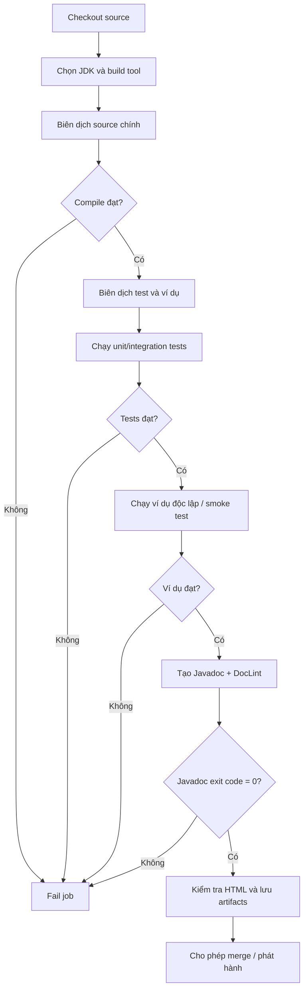

# Đưa biên dịch ví dụ, chạy kiểm thử và tạo Javadoc vào quy trình CI

## 1. Vì sao tài liệu API cần được kiểm tra trong CI?

Một thay đổi nhỏ trong API có thể làm ví dụ trong Javadoc không còn biên dịch được, tên tham số trong @param không khớp chữ ký phương thức, liên kết {@link} bị hỏng hoặc trang HTML không được tạo. Nếu chỉ kiểm tra ứng dụng chạy được, các lỗi này có thể đi vào nhánh chính và xuất hiện trong tài liệu mà người dùng đọc.

Quy trình CI cho thư viện Java nên xác minh đồng thời ba điều:

1. **Mã nguồn và ví dụ biên dịch được** bằng JDK/toolchain đã chọn.
2. **Kiểm thử chạy thành công** và xác nhận hành vi API được mô tả.
3. **Javadoc được tạo thành công** với DocLint, encoding và các liên kết đã cấu hình.

Ba bước bổ sung cho nhau. Javadoc có thể trích được một snippet nhưng không biên dịch hoặc chạy mã trong snippet đó. Ngược lại, bài test có thể đạt trong khi comment đã lỗi hoặc trang tài liệu không được tạo. Vì thế, cần có bước riêng cho compile, test, chạy ví dụ và Javadoc.

Bài này thuộc phần **Kiểm chứng tài liệu** của mô-đun **JAVA_VERSION_JAVA18**. Ta sẽ xây dựng một ví dụ có thể chạy, kiểm thử nó bằng JUnit, tạo tài liệu với công cụ Javadoc, rồi tích hợp vào Maven, Gradle và GitHub Actions. Các công cụ và tùy chọn đều được hỗ trợ trên JDK hiện đại. Ví dụ dùng JDK 25 làm JDK chạy build và --release 18 để minh họa trường hợp dự án vẫn cần phát hành bytecode/API tương thích Java 18.

### Mục tiêu học tập

Sau bài này, bạn có thể:

- Thiết kế các bước compile, test, smoke test ví dụ và Javadoc trong một pipeline.
- Phân biệt JDK dùng để chạy build với Java release mà sản phẩm hỗ trợ.
- Đặt Javadoc/DocLint thành quality gate có mã thoát đáng tin cậy.
- Tích hợp quy trình bằng Maven Wrapper hoặc Gradle Wrapper.
- Lưu test report và HTML Javadoc làm artifact để xem lại.
- Thiết kế CI cho pull request, tránh vô tình bỏ qua test hoặc cảnh báo tài liệu.
- Chẩn đoán lỗi do toolchain, encoding, snippet, dependency và cấu hình build.

## 2. Pipeline cần kiểm chứng những gì?

Một pipeline cơ bản có thể đi theo thứ tự:



| Bước | Điều cần chứng minh | Dấu hiệu đạt |
| --- | --- | --- |
| Chọn JDK | Mọi môi trường dùng toolchain đã thống nhất. | java -version, javac -version, javadoc --version đúng kỳ vọng. |
| Compile | Source và ví dụ Java hợp lệ với release mục tiêu. | Compiler trả exit code 0. |
| Test | Hành vi API khớp với hợp đồng và kỳ vọng. | Test runner không có test thất bại hoặc bị bỏ qua ngoài ý muốn. |
| Smoke test ví dụ | Ví dụ được quảng bá là chạy được thực sự chạy được. | Exit code 0 và output đúng. |
| Javadoc | Comment, tham chiếu, snippet và encoding xử lý thành công. | Javadoc trả exit code 0, không có warning bị chính sách build từ chối. |
| Kiểm tra đầu ra | HTML được tạo đúng nơi và có thể lưu lại. | Trang API tồn tại, liên kết/snippet quan trọng có mặt. |

Không nên xem việc thư mục HTML được tạo là bằng chứng duy nhất. Javadoc có thể đã ghi một số file trước khi phát hiện lỗi; CI phải dựa vào mã thoát của tiến trình.

## 3. Tạo một ví dụ có thể biên dịch, chạy và kiểm thử

Ta dùng API tạo lời chào. Mục tiêu là cùng một hành vi được minh họa trong snippet, kiểm tra bằng unit test và chạy độc lập trong CI.

### 3.1. Cấu trúc dự án

```text
demo/
├── pom.xml hoặc build.gradle.kts
├── src/
│   ├── main/
│   │   └── java/
│   │       └── com/example/greeting/
│   │           ├── GreetingService.java
│   │           └── snippet-files/
│   │               └── GreetingExample.java
│   └── test/
│       └── java/
│           └── com/example/greeting/
│               └── GreetingServiceTest.java
└── .github/
    └── workflows/
        └── java-ci.yml
```

File GreetingService.java:

```java
package com.example.greeting;

import java.util.Objects;

/**
 * Cung cấp lời chào cho người dùng.
 *
 * <p>Ví dụ sử dụng:</p>
 * {@snippet class=GreetingExample region=basic}
 */
public final class GreetingService {
    private GreetingService() {
    }

    /**
     * Tạo lời chào sau khi loại bỏ khoảng trắng ở hai đầu tên.
     *
     * @param name tên người nhận, không được null hoặc rỗng
     * @return lời chào tiếng Việt
     * @throws NullPointerException nếu name là null
     * @throws IllegalArgumentException nếu name chỉ chứa khoảng trắng
     */
    public static String greet(String name) {
        String normalized = Objects.requireNonNull(name, "name").strip();
        if (normalized.isEmpty()) {
            throw new IllegalArgumentException("name must not be blank");
        }
        return "Xin chào, " + normalized;
    }
}
```

File external snippet src/main/java/com/example/greeting/snippet-files/GreetingExample.java:

```java
package com.example.greeting;

public final class GreetingExample {
    private GreetingExample() {
    }

    public static void main(String[] args) {
        // @start region=basic
        String greeting = GreetingService.greet("  Java  ");
        System.out.println(greeting);
        // @end region=basic
    }
}
```

Snippet được Javadoc trích bằng {@snippet class=GreetingExample region=basic}. File ví dụ có package và là mã Java hoàn chỉnh nên build tool có thể biên dịch cùng source chính. Standard Doclet chỉ trích nội dung; việc biên dịch và chạy file được thực hiện bởi compiler và Java runtime trong pipeline.

File test src/test/java/com/example/greeting/GreetingServiceTest.java dùng JUnit Jupiter:

```java
package com.example.greeting;

import org.junit.jupiter.api.Test;

import static org.junit.jupiter.api.Assertions.assertEquals;
import static org.junit.jupiter.api.Assertions.assertThrows;

class GreetingServiceTest {
    @Test
    void trimsNameBeforeCreatingGreeting() {
        assertEquals("Xin chào, Java", GreetingService.greet("  Java  "));
    }

    @Test
    void rejectsBlankName() {
        assertThrows(
                IllegalArgumentException.class,
                () -> GreetingService.greet("   ")
        );
    }

    @Test
    void rejectsNullName() {
        assertThrows(
                NullPointerException.class,
                () -> GreetingService.greet(null)
        );
    }
}
```

Các test xác nhận hợp đồng mà Javadoc mô tả: tên được trim, tên rỗng bị từ chối và null gây NullPointerException.

## 4. Hiểu đúng JDK toolchain và --release

CI cần phân biệt hai phiên bản:

- **JDK chạy build:** phiên bản của javac, java và javadoc được dùng trong job.
- **Java release mục tiêu:** phiên bản ngôn ngữ, bytecode và API mà source được phép sử dụng.

Ví dụ, một job chạy bằng JDK 25 có thể biên dịch với --release 18 nếu sản phẩm vẫn cam kết tương thích Java 18:

```bash
javac --release 18 -encoding UTF-8 -d build/classes \
  src/main/java/com/example/greeting/GreetingService.java \
  src/main/java/com/example/greeting/snippet-files/GreetingExample.java
```

--release 18 kiểm tra source và API theo Java 18, đồng thời tạo bytecode phù hợp với release đó. Nó **không** thay đổi JDK đang chạy lệnh và không chứng minh hành vi runtime trên mọi JDK. Muốn kiểm tra hành vi trên một runtime cụ thể, cần chạy test trên runtime đó.

Java 18 là feature release đã hết vòng hỗ trợ. Với dự án mới, nên chọn các JDK LTS còn được nhà cung cấp hỗ trợ làm runtime kiểm thử. Chỉ giữ --release 18 nếu hợp đồng tương thích của sản phẩm vẫn yêu cầu phát hành cho Java 18; nếu không, thay bằng release tối thiểu mà dự án thực sự hỗ trợ.

Không chỉ đặt JAVA_HOME rồi giả định mọi tool đều dùng cùng JDK. Hãy xác nhận phiên bản trong log CI và dùng Java toolchain của build tool để compiler, test runner và Javadoc dùng đúng bộ công cụ đã chọn.

## 5. Pipeline tối thiểu chỉ dùng JDK

Với một dự án nhỏ chưa dùng Maven hoặc Gradle, có thể tách các bước thủ công để hiểu rõ từng công cụ.

### 5.1. Biên dịch API và ví dụ

Chạy từ project root demo/ trên Bash:

```bash
set -eu

mkdir -p build/classes build/docs

javac --release 18 -encoding UTF-8 -d build/classes \
  src/main/java/com/example/greeting/GreetingService.java \
  src/main/java/com/example/greeting/snippet-files/GreetingExample.java
```

javac nhận cả source API và external snippet. Nếu file snippet không được đưa vào tập source của build, bước này sẽ không kiểm tra được mã ví dụ.

### 5.2. Chạy ví dụ độc lập

```bash
java -cp build/classes com.example.greeting.GreetingExample
```

Output mong đợi:

```text
Xin chào, Java
```

Trong CI, nếu output là một phần hợp đồng của ví dụ, hãy so sánh output với giá trị kỳ vọng thay vì chỉ dựa vào exit code. Có thể dùng script kiểm tra:

```bash
actual="$(java -cp build/classes com.example.greeting.GreetingExample)"
expected="Xin chào, Java"
test "$actual" = "$expected"
```

Trên PowerShell:

```powershell
$actual = java -cp build\classes com.example.greeting.GreetingExample
if ($LASTEXITCODE -ne 0) {
    throw "Example process failed"
}
if ($actual -ne "Xin chào, Java") {
    throw "Unexpected example output: $actual"
}
```

### 5.3. Tạo Javadoc có DocLint

```bash
javadoc --release 18 \
  -encoding UTF-8 \
  -docencoding UTF-8 \
  -Xdoclint:all -Werror \
  --source-path src/main/java \
  -d build/docs \
  com.example.greeting
```

Lệnh này:

- Đọc source và comment theo UTF-8.
- Ghi HTML theo UTF-8.
- Bật đủ nhóm DocLint.
- Nâng warning thành lỗi bằng -Werror.
- Sinh trang API trong build/docs.

Không thêm -charset cùng -docencoding trong một lệnh Javadoc. Đây là hai lựa chọn encoding đầu ra; chọn một trong hai. Khi chỉ định -docencoding UTF-8, HTML đầu ra được ghi UTF-8; nếu cần khai báo metadata charset tường minh thay vì dùng -docencoding, chọn -charset UTF-8.

### 5.4. Test tự động cần test runner

JDK không tự tìm và chạy JUnit test. Với dự án đã dùng JUnit, hãy để Maven Surefire hoặc Gradle Test task quản lý test classpath, discovery và báo cáo. Nếu tự gọi javac/java, cần cung cấp JUnit API và test engine đúng phiên bản trên classpath; tránh một lệnh java đơn giản rồi giả định test đã chạy.

## 6. Tích hợp với Maven

Maven Lifecycle đã có các phase compile, test-compile, test, package, integration-test và verify. Compiler Plugin biên dịch source chính ở phase compile và test source ở test-compile; Surefire chạy unit test ở phase test. Javadoc Plugin tạo tài liệu API bằng Standard Doclet.

### 6.1. Cấu hình release và encoding

Trong pom.xml, khai báo các property:

```xml
<properties>
    <maven.compiler.release>18</maven.compiler.release>
    <project.build.sourceEncoding>UTF-8</project.build.sourceEncoding>
    <project.reporting.outputEncoding>UTF-8</project.reporting.outputEncoding>
    <junit.version>VERSION_MANAGED_BY_PROJECT</junit.version>
</properties>
```

maven.compiler.release giữ compiler và test compiler ở cùng mức Java. project.build.sourceEncoding giúp các plugin xử lý source/resource theo encoding thống nhất. Thay VERSION_MANAGED_BY_PROJECT bằng phiên bản JUnit Jupiter được dự án quản lý tập trung hoặc khai báo qua dependency management.

### 6.2. Cấu hình các plugin

Ví dụ phần build:

```xml
<build>
    <plugins>
        <plugin>
            <groupId>org.apache.maven.plugins</groupId>
            <artifactId>maven-compiler-plugin</artifactId>
            <version>3.16.0</version>
            <configuration>
                <release>18</release>
                <encoding>UTF-8</encoding>
            </configuration>
        </plugin>

        <plugin>
            <groupId>org.apache.maven.plugins</groupId>
            <artifactId>maven-surefire-plugin</artifactId>
            <version>3.6.1</version>
            <configuration>
                <failIfNoTests>true</failIfNoTests>
            </configuration>
        </plugin>

        <plugin>
            <groupId>org.apache.maven.plugins</groupId>
            <artifactId>maven-javadoc-plugin</artifactId>
            <version>3.12.0</version>
            <configuration>
                <release>18</release>
                <encoding>UTF-8</encoding>
                <docencoding>UTF-8</docencoding>
                <doclint>all</doclint>
                <failOnError>true</failOnError>
                <failOnWarnings>true</failOnWarnings>
                <outputDirectory>${project.build.directory}/apidocs</outputDirectory>
            </configuration>
        </plugin>
    </plugins>
</build>
```

Trong phần dependencies, thêm JUnit Jupiter ở scope test:

```xml
<dependency>
    <groupId>org.junit.jupiter</groupId>
    <artifactId>junit-jupiter</artifactId>
    <version>${junit.version}</version>
    <scope>test</scope>
</dependency>
```

Các phiên bản plugin ở đây là ví dụ đã đối chiếu với tài liệu Apache tại thời điểm viết bài. Dự án nên pin phiên bản trong parent POM hoặc pluginManagement, cập nhật có kiểm soát và không dựa vào phiên bản ngầm từ Maven Super POM.

failIfNoTests được đặt true để job không xanh khi test discovery không tìm thấy test nào. Nếu một module cố ý không có test, hãy cấu hình ngoại lệ riêng cho module đó thay vì tắt kiểm tra toàn repository.

### 6.3. Lệnh CI cho Maven

Với Maven Wrapper đã được commit vào repository:

```bash
./mvnw -B -ntp verify javadoc:javadoc
```

Lệnh trên:

1. Chạy lifecycle tới verify, bao gồm compile, test-compile, unit test và các integration test đã được cấu hình bằng Failsafe.
2. Sau đó gọi tường minh goal javadoc:javadoc để tạo báo cáo Javadoc.
3. Làm job thất bại nếu Javadoc có error hoặc warning theo cấu hình failOnError và failOnWarnings.

**Điểm cần nhớ:** mvn verify không tự động bảo đảm goal báo cáo javadoc:javadoc đã chạy. Nếu muốn Javadoc là quality gate, hãy cấu hình goal vào report/lifecycle phù hợp hoặc gọi tường minh trong pipeline như ví dụ trên.

Nếu cần chạy ví dụ độc lập sau khi Maven compile:

```bash
java -cp target/classes com.example.greeting.GreetingExample
```

Hãy kiểm tra output và exit code. Với Maven multi-module, chạy Wrapper từ root reactor để các module có dependency được build theo đúng thứ tự.

### 6.4. Báo cáo Maven cần lưu

| Nội dung | Vị trí thường dùng |
| --- | --- |
| Unit test report từ Surefire | target/surefire-reports/ |
| Integration test report từ Failsafe | target/failsafe-reports/ khi plugin được cấu hình |
| Javadoc HTML | target/apidocs/ theo outputDirectory trong ví dụ |
| JAR đã đóng gói | target/*.jar |

Giữ các report này thành CI artifact để người review có thể xem lỗi test hoặc HTML được tạo. Không dùng việc file report tồn tại để thay cho mã thoát thành công.

## 7. Tích hợp với Gradle

Gradle Java Plugin cung cấp task compile, test và Javadoc. compileJava biên dịch source chính; compileTestJava biên dịch test source; test chạy JUnit hoặc TestNG; javadoc tạo tài liệu API.

### 7.1. Khai báo toolchain và release

Trong build.gradle.kts:

```kotlin
import org.gradle.external.javadoc.StandardJavadocDocletOptions

plugins {
    `java`
}

java {
    toolchain {
        languageVersion.set(JavaLanguageVersion.of(25))
    }
}

tasks.withType<JavaCompile>().configureEach {
    options.release.set(18)
    options.encoding = "UTF-8"
}
```

Toolchain xác định bộ JDK dùng cho compiler, test runner và Javadoc. options.release kiểm soát API/bytecode mục tiêu của compiler; nó không thay thế toolchain.

### 7.2. Cấu hình test và Javadoc

```kotlin
dependencies {
    testImplementation(libs.junit.jupiter)
}

tasks.test {
    useJUnitPlatform()
}

tasks.withType<Javadoc>().configureEach {
    (options as StandardJavadocDocletOptions).apply {
        encoding = "UTF-8"
        docEncoding = "UTF-8"
        addBooleanOption("Xdoclint:all", true)
        addBooleanOption("Werror", true)
    }
}
```

libs.junit.jupiter là alias trong version catalog của dự án; khai báo phiên bản JUnit ở gradle/libs.versions.toml hoặc hệ thống dependency management đang dùng. addBooleanOption truyền tùy chọn Javadoc không có đối số như -Xdoclint:all và -Werror.

### 7.3. Lệnh CI cho Gradle

```bash
./gradlew check javadoc --no-daemon
```

check chạy các task kiểm chứng đã gắn vào lifecycle, trong đó có test. javadoc được gọi tường minh để tạo tài liệu. Không giả định check hoặc build luôn chạy task Javadoc; nếu muốn tài liệu là quality gate, gọi task javadoc hoặc gắn nó vào lifecycle theo quy ước dự án.

Nếu cần chạy ví dụ độc lập sau khi compile:

```bash
java -cp build/classes/java/main com.example.greeting.GreetingExample
```

Với cấu hình source set mặc định của Java Plugin, class được biên dịch vào build/classes/java/main. Nếu dự án đổi source set hoặc package, cập nhật classpath theo output thực tế.

### 7.4. Báo cáo Gradle cần lưu

| Nội dung | Vị trí mặc định |
| --- | --- |
| Unit test HTML report | build/reports/tests/test/ |
| Unit test XML result | build/test-results/test/ |
| Javadoc HTML | build/docs/javadoc/ |
| Main class output | build/classes/java/main/ |

Gradle task có thể chạy incremental hoặc lấy output từ build cache. Trong CI, hãy giữ Gradle Wrapper và cấu hình toolchain trong repository để các job dùng cùng phiên bản Gradle/JDK.

## 8. Ví dụ workflow GitHub Actions

Workflow sau chạy trên pull request và khi push vào main. Ví dụ dùng JDK 25, Maven Wrapper, cache Maven dependency và chạy toàn bộ quality gate:

```yaml
name: Java verification

on:
  pull_request:
  push:
    branches: [main]

permissions:
  contents: read

jobs:
  verify:
    runs-on: ubuntu-latest
    steps:
      - name: Checkout
        uses: actions/checkout@v7

      - name: Set up JDK
        uses: actions/setup-java@v6
        with:
          distribution: temurin
          java-version: '25'
          cache: maven

      - name: Show toolchain
        run: |
          java -version
          javac -version
          javadoc --version
          ./mvnw --version

      - name: Compile, test and generate Javadoc
        run: ./mvnw -B -ntp verify javadoc:javadoc

      - name: Run documented example
        run: |
          output="$(java -cp target/classes com.example.greeting.GreetingExample)"
          test "$output" = "Xin chào, Java"
```

Trong workflow này:

- setup-java cài đúng JDK và cache dependency Maven.
- Maven Wrapper khóa phiên bản Maven được dự án khai báo.
- verify chạy compile và test; goal Javadoc được gọi rõ ràng sau đó.
- Ví dụ trong tài liệu được chạy như một smoke test riêng.
- Mọi lệnh mặc định phải trả exit code 0; không dùng continue-on-error cho các bước quality gate.

Nếu dùng Gradle, thay cache: maven bằng cache: gradle và lệnh build bằng ./gradlew check javadoc --no-daemon. Có thể thêm bước upload artifact của nền tảng CI để lưu target/surefire-reports/, target/apidocs/ hoặc build/reports/tests/test/, build/docs/javadoc/. Nên cấu hình lưu report với điều kiện chạy cả khi job thất bại để người review có dữ liệu chẩn đoán.

actions/setup-java hiện hỗ trợ cache dependency và Wrapper cho Maven/Gradle. Cache chỉ giúp giảm thời gian tải; nó không thay thế việc chạy lại compile, test và Javadoc trên source của commit hiện tại.

## 9. Ma trận JDK và chiến lược kiểm thử

Một dự án có thể cần kiểm tra trên nhiều runtime:

| Mục tiêu | Cách cấu hình |
| --- | --- |
| Giữ API/bytecode ở Java 18 | Dùng --release 18 cho compiler và --release 18 cho Javadoc. |
| Build bằng JDK LTS hiện hành | Khai báo toolchain JDK 25 hoặc phiên bản LTS còn được hỗ trợ mà dự án chọn. |
| Kiểm tra tương thích runtime | Chạy test trên từng runtime mà sản phẩm cam kết hỗ trợ. |
| Kiểm tra thay đổi khi nâng JDK | Thêm một job dùng JDK mới hơn trong ma trận, nhưng vẫn giữ job trên runtime được hỗ trợ. |

--release xác minh giới hạn compile-time, không chứng minh mọi hành vi runtime trên release đó. Nếu sản phẩm hỗ trợ nhiều runtime, hãy chạy test trên từng runtime có trong support matrix.

Với Java 18, nên phân biệt mục tiêu học API của release này với chính sách hỗ trợ runtime. Java 18 không còn là runtime LTS được hỗ trợ; pipeline hiện đại nên kiểm thử trên các runtime LTS hiện được dự án và nhà cung cấp hỗ trợ. Chỉ giữ release target 18 khi sản phẩm vẫn cần phát hành bytecode tương thích Java 18.

### Kiểm thử theo tầng

- **Unit test:** kiểm tra hợp đồng từng phương thức, trường hợp biên và exception.
- **Example smoke test:** chạy chương trình ví dụ được trích trong Javadoc để phát hiện ví dụ sai hoặc output thay đổi.
- **Integration test:** kiểm tra API với dependency, file, mạng hoặc dịch vụ mà ứng dụng cần; trong Maven có thể dùng Failsafe, Gradle có thể tạo task/source set riêng.
- **Javadoc validation:** chạy DocLint với warning policy phù hợp.
- **HTML/link validation:** nếu tài liệu được xuất bản, kiểm tra trang HTML, anchor và liên kết ngoài sau khi Javadoc hoàn tất.

Không phải dự án nào cũng cần tất cả tầng trên trong mỗi pull request. Nhưng API công khai cần ít nhất compile, unit test và Javadoc validation; ví dụ được quảng bá là chạy được nên có smoke test.

## 10. Giữ CI nhanh và tái lập

### 10.1. Dùng Wrapper và khóa phiên bản

- Commit Maven Wrapper hoặc Gradle Wrapper cùng cấu hình distribution.
- Pin JDK distribution và version trong workflow.
- Pin phiên bản plugin, test framework và dependency.
- Dùng dependency lock hoặc dependency management khi phù hợp.
- Ghi java -version, javac -version, javadoc --version và build tool version vào log.

Wrapper giúp developer và CI dùng cùng phiên bản build tool. Toolchain giúp build tool chọn đúng compiler, launcher và Javadoc executable.

### 10.2. Cache dependency, không thay thế kiểm tra

Cache thư viện Maven/Gradle giúp giảm thời gian tải dependency. Cache key cần gắn với file khai báo dependency và Wrapper; khi các file này thay đổi, cache cần được làm mới theo key mới.

Không lấy một thư mục target/ hoặc build/ cũ làm bằng chứng rằng commit hiện tại đã build thành công. Output có thể thuộc source khác hoặc bị stale. Hãy để build tool quyết định incremental task/cache dựa trên input đã khai báo, và chạy quality gate trên checkout hiện tại.

### 10.3. Phân chia job hợp lý

Một repository lớn có thể tách:

1. compile-and-test: compile, unit test và integration test.
2. javadoc: tạo Javadoc với DocLint, phụ thuộc vào compile nếu cần.
3. publish-preview: chỉ tạo preview/artifact sau khi các quality gate đạt.

Khi tách job, bảo đảm mỗi job dùng cùng commit, cùng JDK/toolchain và cùng dependency lock. Job Javadoc không được lấy source hoặc class output từ một build khác commit.

### 10.4. Không vô tình bỏ qua test

Các cờ như -DskipTests, -Dmaven.test.skip=true hoặc cấu hình Gradle bỏ task test có thể khiến job chạy nhanh nhưng không còn kiểm tra hành vi. Không dùng chúng trong job bắt buộc bảo vệ pull request. Nếu cần một job chỉ tạo Javadoc để preview, đặt tên rõ ràng và không xem job đó là quality gate hoàn chỉnh.

Với Maven, failIfNoTests mặc định của Surefire là false; nếu module bắt buộc phải có test, cấu hình true như ví dụ để phát hiện test discovery bị hỏng.

## 11. Chẩn đoán lỗi thường gặp

| Triệu chứng | Nguyên nhân | Cách xử lý |
| --- | --- | --- |
| Local compile được, CI báo lỗi API | JDK hoặc release target khác nhau. | Pin toolchain, đặt --release và ghi phiên bản JDK vào log. |
| Unit test không chạy nhưng build vẫn xanh | Không tìm thấy test, test bị skip hoặc provider chưa cấu hình. | Bật fail-if-no-tests, kiểm tra dependency JUnit và bỏ cờ skip trong quality gate. |
| Ví dụ trong snippet sai nhưng Javadoc vẫn thành công | Javadoc chỉ trích snippet, không biên dịch/chạy mã. | Đưa external snippet vào source được compile hoặc tạo test/smoke test riêng. |
| Javadoc không chạy trong pipeline | Maven report goal chưa được gọi hoặc Gradle task chưa được thêm vào lệnh CI. | Gọi javadoc:javadoc hoặc javadoc tường minh. |
| Javadoc có warning nhưng job vẫn xanh | Chính sách fail-on-warning chưa bật. | Dùng -Werror, Maven failOnWarnings hoặc cấu hình tương ứng trong build tool. |
| Javadoc báo không tìm thấy snippet | Sai package snippet-files, --snippet-path hoặc source root. | Kiểm tra cấu trúc package và đường dẫn snippet; xem lại bài về external snippet. |
| Tiếng Việt hiển thị sai trong HTML | Encoding source và output không thống nhất. | Lưu UTF-8, cấu hình Javadoc encoding và output encoding UTF-8. |
| Build local đạt nhưng CI báo thiếu test/dependency | Khác cache, Wrapper hoặc file lock. | Dùng Wrapper, commit lock/configuration và không dựa vào thư viện cài cục bộ. |
| Javadoc HTML tồn tại dù job lỗi | Javadoc đã ghi một phần output trước khi gặp error. | Tin mã thoát; không publish artifact khi job thất bại. |
| CI chạy lâu sau mỗi thay đổi nhỏ | Tải dependency lặp lại hoặc job chạy thừa. | Cache dependency theo lock/POM/Gradle files; tách job theo nhu cầu mà vẫn giữ cùng commit. |

## 12. Checklist trước khi bật quality gate bắt buộc

- [ ] JDK và build tool version được pin.
- [ ] Compiler dùng --release phù hợp với support policy.
- [ ] Source và Javadoc dùng UTF-8 nhất quán.
- [ ] Test framework và test engine đã được cấu hình.
- [ ] Build thất bại khi test được yêu cầu nhưng không có test nào chạy.
- [ ] Ví dụ được trích trong tài liệu có compile/smoke test nếu được mô tả là runnable.
- [ ] Javadoc được gọi tường minh trong pipeline.
- [ ] DocLint được bật và warning policy được quyết định rõ.
- [ ] CI kiểm tra exit code thay vì chỉ kiểm tra file output.
- [ ] Test report và Javadoc HTML được lưu làm artifact để review.
- [ ] Không có cờ skip/continue-on-error làm suy yếu quality gate.
- [ ] Các job trong ma trận chạy cùng commit và cấu hình dependency.

### Bài tự luyện

1. Cố ý đổi tên tham số trong GreetingService nhưng giữ nguyên @param. Quan sát Javadoc/DocLint thất bại như thế nào.
2. Xóa test class nhưng giữ cấu hình failIfNoTests=true. Xác nhận pipeline không còn xanh.
3. Thay nội dung snippet bằng một lời gọi API không tồn tại. Vì sao chỉ chạy Javadoc chưa đủ để phát hiện lỗi compile?
4. Bỏ lệnh javadoc:javadoc khỏi Maven workflow. Xác nhận verify vẫn chạy test nhưng không tạo report Javadoc theo cấu hình ví dụ.
5. Bỏ task javadoc khỏi lệnh Gradle. Kiểm tra sự khác nhau giữa check và javadoc.
6. Chạy build bằng JDK 25 với --release 18, sau đó thử dùng một API chỉ có từ release mới hơn. Giải thích vì sao compiler từ chối.
7. Tạo warning DocLint và bật failOnWarnings. Xác nhận job thất bại dù HTML có thể đã được ghi.
8. Lưu test report và Javadoc HTML làm artifact. Thử mở chúng từ một lần CI thất bại để xác định bước lỗi.

## 13. Tài liệu tham khảo chính thức

- [The javac Command (JDK 25)](https://docs.oracle.com/en/java/javase/25/docs/specs/man/javac.html): --release, encoding và hành vi compiler.
- [The javadoc Command (JDK 25)](https://docs.oracle.com/en/java/javase/25/docs/specs/man/javadoc.html): --release, -Xdoclint, -Werror, encoding và mã thoát của Javadoc.
- [Apache Maven Compiler Plugin](https://maven.apache.org/plugins/maven-compiler-plugin/): compile source/test source và cấu hình release.
- [Apache Maven Surefire Plugin](https://maven.apache.org/surefire/maven-surefire-plugin/): chạy unit test, report và hành vi khi không tìm thấy test.
- [Apache Maven Javadoc Plugin](https://maven.apache.org/plugins/maven-javadoc-plugin/javadoc-mojo.html): goal javadoc:javadoc, release, doclint, failOnError, failOnWarnings và encoding.
- [Gradle Toolchains for JVM Projects](https://docs.gradle.org/current/userguide/toolchains.html): chọn JDK cho compile, test và Javadoc; phân biệt toolchain với --release.
- [Gradle Java Plugin](https://docs.gradle.org/current/userguide/java_plugin.html): task compileJava, compileTestJava, test, javadoc, check và build.
- [Gradle StandardJavadocDocletOptions](https://docs.gradle.org/current/javadoc/org/gradle/external/javadoc/StandardJavadocDocletOptions.html): cấu hình encoding và tùy chọn Standard Doclet.
- [GitHub actions/setup-java](https://github.com/actions/setup-java): chọn JDK và cache dependency Maven/Gradle trong GitHub Actions.

**Ghi nhớ:** Một pipeline tài liệu đáng tin cậy phải compile source và ví dụ, chạy test, smoke test ví dụ có thể thực thi, rồi tạo Javadoc với DocLint. Maven cần gọi goal Javadoc rõ ràng; Gradle cần gọi task javadoc rõ ràng. Hãy pin toolchain, kiểm tra mã thoát và lưu report/HTML để mỗi thay đổi API đều có bằng chứng kiểm chứng trước khi merge.
