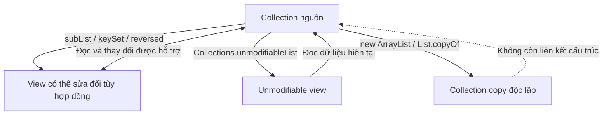
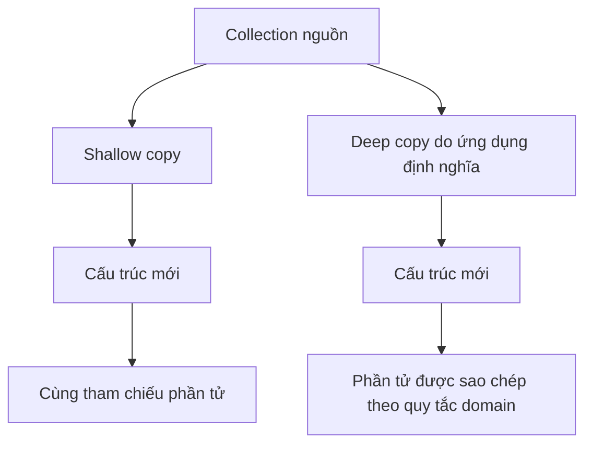

# Phân biệt view, bản sao, snapshot và collection bất biến

Khi một API nhận hoặc trả về collection, cần xác định rõ dữ liệu được chia sẻ như thế nào. Một `List` trả về từ `subList()` có thể là view gắn với danh sách gốc; `new ArrayList<>(source)` tạo một cấu trúc danh sách riêng; `List.copyOf(source)` tạo một danh sách không thể sửa đổi; còn `Collections.unmodifiableList(source)` chỉ chặn thao tác sửa đổi qua wrapper trong khi vẫn quan sát thay đổi từ danh sách gốc.

Những đối tượng này có thể cùng triển khai `List`, nhưng có vòng đời, khả năng thay đổi và quan hệ với dữ liệu nguồn khác nhau. Nhầm lẫn giữa chúng dễ gây lỗi khi dữ liệu bị thay đổi ngoài dự kiến, khi trả collection qua ranh giới module hoặc khi cần lưu một trạng thái ổn định để xử lý sau.

## Mục tiêu học tập

Sau bài học, bạn có thể:

- Phân biệt collection view với bản sao có cấu trúc độc lập.
- Giải thích snapshot là gì và vì sao bản sao thông thường chỉ là shallow copy.
- Phân biệt unmodifiable view với collection không thể sửa đổi được tạo bằng factory hoặc `copyOf`.
- Chọn đúng API như `subList`, `Collections.unmodifiableList`, `List.copyOf` và constructor sao chép.
- Nhận biết tác động của thay đổi nguồn, thay đổi phần tử và truy cập đồng thời.
- Thiết kế API trả collection an toàn và có hợp đồng rõ ràng.

## 1. Bốn khái niệm cần phân biệt

### 1.1. View

View là một đối tượng cung cấp góc nhìn hoặc tập thao tác trên dữ liệu do một đối tượng khác quản lý. View thường không sở hữu một bản sao độc lập của các phần tử. Thay đổi trên nguồn có thể xuất hiện trong view; nếu view cho phép sửa đổi, thay đổi qua view có thể được ghi ngược về nguồn.

Ví dụ phổ biến:

- `List.subList(from, to)` trả về view của một đoạn list.
- `Map.keySet()`, `Map.values()` và `Map.entrySet()` trả về các view gắn với map.
- `Collections.unmodifiableList(list)` trả về một wrapper không cho sửa đổi qua wrapper, nhưng vẫn đọc từ list gốc.
- `SequencedCollection.reversed()` trả về view có encounter order ngược với collection gốc.

Không phải view nào cũng cho phép thay đổi. Khả năng sửa đổi phụ thuộc hợp đồng của view và collection nền.

### 1.2. Bản sao (copy)

Bản sao có cấu trúc riêng được tạo bằng cách lấy các phần tử từ collection nguồn và đưa chúng vào một collection khác. Thêm hoặc xóa phần tử ở một collection không tự động thay đổi cấu trúc của collection còn lại.

Ví dụ:

```java
List<String> source = new ArrayList<>(List.of("a", "b"));
List<String> copy = new ArrayList<>(source);

copy.add("c");
System.out.println(source); // [a, b]
System.out.println(copy);   // [a, b, c]
```

Constructor sao chép tạo một collection mới, nhưng không nhất thiết sao chép sâu các đối tượng phần tử. Với `List<Customer>`, hai list có thể chứa cùng các tham chiếu `Customer`.

### 1.3. Snapshot

Snapshot là một bản ghi trạng thái collection tại một thời điểm hoặc trong một khoảng thời gian xác định. Trong mã Java, snapshot thường được tạo bằng cách sao chép các phần tử vào collection riêng. Snapshot có cấu trúc độc lập với nguồn, vì vậy các thao tác thêm hoặc xóa ở nguồn sau đó không làm thay đổi cấu trúc snapshot.

Snapshot không phải một interface hoặc một từ khóa đặc biệt của Java Collections Framework. Đây là thuật ngữ mô tả mục đích và hợp đồng của dữ liệu được chụp lại. Một snapshot có thể mutable hoặc unmodifiable; điều đó phụ thuộc cách tạo.

### 1.4. Collection không thể sửa đổi (unmodifiable collection)

Unmodifiable collection là collection mà các thao tác làm thay đổi cấu trúc hoặc nội dung thông qua API collection không được hỗ trợ. Các phương thức sửa đổi thường ném `UnsupportedOperationException`.

Java cung cấp nhiều cách tạo collection không thể sửa đổi, chẳng hạn:

- `List.of(...)`, `Set.of(...)`, `Map.of(...)`.
- `List.copyOf(...)`, `Set.copyOf(...)`, `Map.copyOf(...)`.
- Các wrapper `Collections.unmodifiableList(...)`, `unmodifiableSet(...)`, `unmodifiableMap(...)`.

Ba nhóm này không có cùng ngữ nghĩa về nguồn dữ liệu. Factory `of` tạo collection không thể sửa đổi từ các phần tử được truyền vào; `copyOf` tạo collection không thể sửa đổi từ collection nguồn; còn `Collections.unmodifiable...` tạo view không thể sửa đổi trên một collection khác.

Unmodifiable cũng không đồng nghĩa với deep immutable. Nếu phần tử là đối tượng mutable, trạng thái bên trong phần tử vẫn có thể thay đổi thông qua một tham chiếu khác.

## 2. Quan hệ giữa nguồn, view và bản sao

Sơ đồ sau minh họa ba kiểu quan hệ thường gặp:



| Đặc tính | View có thể sửa đổi | Unmodifiable view | Bản sao có cấu trúc riêng |
|---|---|---|---|
| Đọc thay đổi từ nguồn | Có, theo hợp đồng view | Có | Không |
| Thay đổi qua đối tượng đang cầm | Có, nếu thao tác được hỗ trợ | Không | Tùy loại bản sao |
| Thay đổi cấu trúc nguồn qua đối tượng đó | Có thể | Không | Không |
| Chia sẻ tham chiếu đến phần tử | Có | Có | Thông thường có |
| Ví dụ | `subList`, `keySet`, `reversed` | `Collections.unmodifiableList` | `new ArrayList`, `List.copyOf` |

Một điểm quan trọng: view và bản sao đều có thể được gán vào cùng kiểu interface như `List<E>`. Chỉ nhìn kiểu khai báo không thể biết đối tượng có đang chia sẻ dữ liệu với nguồn hay không. Cần xem API tạo ra nó và hợp đồng của API đó.

## 3. View của List: `subList()`

`subList(fromIndex, toIndex)` trả về một view của list gốc trong khoảng từ `fromIndex` (bao gồm) đến `toIndex` (không bao gồm). Nó không tạo một list độc lập.

```java
List<String> tasks = new ArrayList<>(
    List.of("compile", "test", "package", "deploy")
);

List<String> verification = tasks.subList(1, 3);
System.out.println(verification); // [test, package]

verification.set(0, "integration-test");
System.out.println(tasks);
// [compile, integration-test, package, deploy]

verification.remove(1);
System.out.println(tasks);
// [compile, integration-test, deploy]
```

Các thay đổi được hỗ trợ qua `verification` tác động trực tiếp lên `tasks`. Thay đổi phần tử tại vị trí tương ứng trong list gốc cũng được phản ánh trong view.

### 3.1. Quy tắc khi sửa list gốc ngoài view

Theo hợp đồng `List.subList`, ngữ nghĩa của view trở nên không xác định nếu list nền bị thay đổi cấu trúc theo cách khác với việc thay đổi thông qua chính view đó. Vì vậy, không nên giữ `subList` rồi tùy ý thêm hoặc xóa phần tử trên list gốc trong khi vẫn tiếp tục sử dụng view.

Ví dụ cần tránh:

```java
List<String> source = new ArrayList<>(List.of("a", "b", "c"));
List<String> part = source.subList(1, 3);

source.add("d");

// Không tiếp tục dựa vào trạng thái hoặc kết quả của part ở đây.
```

Nếu cần một đoạn dữ liệu độc lập, hãy tạo bản sao ngay khi lấy đoạn:

```java
List<String> snapshot = new ArrayList<>(source.subList(1, 3));
```

Khi đó `snapshot` có cấu trúc riêng và không phụ thuộc vòng đời của view `subList`.

## 4. Các view của Map

Map cung cấp ba view quan trọng:

- `keySet()` — view của các khóa.
- `values()` — view của các giá trị.
- `entrySet()` — view của các cặp khóa và giá trị.

Các view này được gắn với map nguồn. Nếu map thay đổi, nội dung view thay đổi theo. Một số thao tác xóa qua view cũng xóa ánh xạ tương ứng khỏi map.

```java
Map<String, Integer> inventory = new HashMap<>();
inventory.put("book", 4);
inventory.put("pen", 10);

Set<String> keys = inventory.keySet();
Collection<Integer> quantities = inventory.values();

inventory.put("notebook", 7);
System.out.println(keys); // Có thêm notebook

keys.remove("pen");
System.out.println(inventory.containsKey("pen")); // false
```

View `values()` có thể chứa các giá trị trùng nhau vì các khóa khác nhau có thể ánh xạ đến cùng một giá trị. `keySet()` và `entrySet()` có quy tắc phần tử riêng theo hợp đồng của Map.

### 4.1. Thao tác qua `entrySet()`

Với map mutable như `HashMap`, các entry lấy từ `entrySet()` có thể hỗ trợ `setValue()` để thay giá trị ánh xạ tương ứng:

```java
Map<String, Integer> scores = new HashMap<>();
scores.put("An", 8);
scores.put("Binh", 9);

for (Map.Entry<String, Integer> entry : scores.entrySet()) {
    if (entry.getKey().equals("An")) {
        entry.setValue(10);
    }
}

System.out.println(scores.get("An")); // 10
```

Không phải mọi map hoặc entry đều hỗ trợ mọi thao tác sửa đổi. Với unmodifiable map, các thao tác ghi qua map hoặc view của nó đều không được hỗ trợ.

## 5. View đảo chiều trong Sequenced Collections

Từ Java 21, `SequencedCollection`, `SequencedSet` và `SequencedMap` cung cấp `reversed()` để lấy view có encounter order ngược với nguồn.

```java
List<String> steps = new ArrayList<>(List.of("start", "build", "finish"));
SequencedCollection<String> reverse = steps.reversed();

System.out.println(reverse); // [finish, build, start]

reverse.addFirst("review");
System.out.println(steps);
// [start, build, finish, review]
```

`reverse` là view được backing bởi `steps`, không phải bản sao. Thêm vào đầu view đảo chiều tương ứng với thêm vào cuối nguồn. Nếu collection gốc không hỗ trợ sửa đổi, view đảo chiều cũng không tự trở thành collection mutable.

Khi chỉ cần duyệt ngược, `reversed()` tránh việc tạo một list mới chỉ để đảo thứ tự. Khi cần lưu một trạng thái độc lập, hãy sao chép view:

```java
List<String> reverseSnapshot = new ArrayList<>(steps.reversed());
```

## 6. Unmodifiable view với `Collections.unmodifiable...`

Các phương thức như `Collections.unmodifiableList`, `unmodifiableSet` và `unmodifiableMap` trả về wrapper chặn thao tác sửa đổi thông qua wrapper đó.

```java
List<String> source = new ArrayList<>(List.of("red", "green"));
List<String> readOnly = Collections.unmodifiableList(source);

source.add("blue");
System.out.println(readOnly); // [red, green, blue]

// readOnly.add("black"); // UnsupportedOperationException
```

`readOnly` không phải snapshot. Nó vẫn đọc từ `source`, vì vậy người giữ tham chiếu đến nguồn có thể làm thay đổi nội dung mà người đọc view nhìn thấy.

Wrapper chặn các đường sửa đổi qua API collection được bọc, bao gồm các thao tác qua iterator hoặc view con theo hợp đồng của wrapper. Tuy nhiên, wrapper không thể ngăn một tham chiếu khác sửa đổi đối tượng nguồn.

### 6.1. Khi nào dùng unmodifiable view?

Dùng unmodifiable view khi muốn cung cấp quyền đọc qua một tham chiếu nhưng vẫn muốn nguồn phản ánh trạng thái mới nhất:

```java
public final class Team {
    private final List<String> members = new ArrayList<>();

    public List<String> members() {
        return Collections.unmodifiableList(members);
    }

    public void addMember(String name) {
        members.add(name);
    }
}
```

Người gọi không thể thêm hoặc xóa thành viên qua list trả về, nhưng lần gọi `members()` sau hoặc chính view đang giữ sẽ quan sát thành viên được thêm qua `Team.addMember`. Đây là API chỉ đọc theo quyền truy cập, nhưng dữ liệu không phải snapshot ổn định.

Nếu API cần trả trạng thái độc lập tại thời điểm gọi, unmodifiable view không đáp ứng yêu cầu đó.

## 7. Bản sao mutable và snapshot có thể sửa đổi

Constructor collection thường tạo cấu trúc mới:

```java
List<String> source = new ArrayList<>(List.of("a", "b"));
List<String> snapshot = new ArrayList<>(source);

source.add("c");
snapshot.add("x");

System.out.println(source);   // [a, b, c]
System.out.println(snapshot); // [a, b, x]
```

Thêm hoặc xóa phần tử ở một list không làm thay đổi cấu trúc list kia. Snapshot này vẫn mutable vì `ArrayList` hỗ trợ thao tác sửa đổi.

Đối với các kiểu khác, có thể chọn constructor sao chép tương ứng:

```java
Set<String> setSnapshot = new HashSet<>(source);
Map<String, Integer> mapSnapshot = new HashMap<>(originalMap);
```

Hãy chọn implementation theo hợp đồng cần giữ. `HashSet` không bảo đảm encounter order; `LinkedHashSet` duy trì encounter order theo thứ tự liên kết; `TreeSet` duy trì thứ tự comparator. Việc tạo snapshot không tự động giữ mọi đặc tính của kiểu nguồn nếu kiểu đích khác kiểu nguồn.

## 8. Unmodifiable copy với `copyOf` và factory methods

Java cung cấp các factory tạo collection không thể sửa đổi:

```java
List<String> fixedList = List.of("a", "b", "c");
Set<String> fixedSet = Set.of("red", "green");
Map<String, Integer> fixedMap = Map.of("An", 8, "Binh", 9);
```

Các collection này không hỗ trợ thêm, xóa hoặc thay thế phần tử. Factory cũng từ chối `null`; `Set.of` và `Map.of` còn từ chối phần tử hoặc khóa trùng theo hợp đồng của chúng.

Khi đã có collection nguồn, có thể tạo unmodifiable copy:

```java
List<String> source = new ArrayList<>(List.of("first", "second"));
List<String> frozen = List.copyOf(source);

source.add("third");
System.out.println(source); // [first, second, third]
System.out.println(frozen); // [first, second]

// frozen.add("fourth"); // UnsupportedOperationException
```

Các API tương ứng gồm `Set.copyOf` và `Map.copyOf`. Chúng tạo collection không thể sửa đổi chứa các phần tử hoặc ánh xạ lấy từ nguồn tại thời điểm tạo. `List.copyOf` giữ encounter order của nguồn; thứ tự lặp của kết quả `Set.copyOf` và `Map.copyOf` không được bảo đảm theo thứ tự nguồn.

`List.copyOf`, `Set.copyOf` và `Map.copyOf` không chấp nhận `null` ở nơi tương ứng: list/set không chấp nhận phần tử null, map không chấp nhận khóa hoặc giá trị null. Nếu nguồn có null, lời gọi sẽ ném `NullPointerException`.

### 8.1. `copyOf` không phải deep copy

Các phương thức `copyOf` sao chép cấu trúc collection và giữ các tham chiếu phần tử. Chúng không tự nhân bản trạng thái bên trong từng object.

```java
final class Profile {
    private String nickname;

    Profile(String nickname) {
        this.nickname = nickname;
    }

    void rename(String nickname) {
        this.nickname = nickname;
    }

    String nickname() {
        return nickname;
    }
}

List<Profile> source = new ArrayList<>();
Profile profile = new Profile("An");
source.add(profile);

List<Profile> frozen = List.copyOf(source);
profile.rename("An Nguyen");

System.out.println(frozen.getFirst().nickname()); // An Nguyen
```

Không thể thêm hoặc xóa phần tử qua `frozen`, nhưng đối tượng `Profile` được chia sẻ vẫn thay đổi được. Muốn có snapshot sâu, ứng dụng phải định nghĩa cách sao chép từng phần tử, chẳng hạn tạo DTO bất biến hoặc gọi phương thức copy phù hợp trên từng đối tượng.

## 9. Shallow copy, deep copy và tính ổn định của snapshot

Shallow copy sao chép các tham chiếu phần tử vào một cấu trúc collection mới. Deep copy còn tạo các đối tượng phần tử độc lập theo quy tắc sao chép của domain. Java Collections Framework không cung cấp một thao tác deep copy tổng quát vì không thể biết cách sao chép đúng cho mọi kiểu phần tử.



Một snapshot shallow vẫn ổn định về cấu trúc khi nguồn thêm hoặc xóa phần tử sau thời điểm sao chép. Tuy nhiên, trạng thái của các phần tử được chia sẻ vẫn có thể thay đổi. Vì vậy, cần xác định snapshot cần ổn định ở mức nào:

- Chỉ cần cấu trúc phần tử không đổi: shallow copy thường đủ.
- Cần cả trạng thái từng phần tử không đổi: dùng phần tử immutable hoặc deep copy có chủ đích.
- Cần ảnh chụp nhất quán trong môi trường nhiều luồng: cần đồng bộ hóa hoặc một cơ chế snapshot có bảo đảm nhất quán từ cấu trúc dữ liệu nguồn.

Không nên giả định constructor sao chép một collection đang bị nhiều luồng cập nhật sẽ tạo ra snapshot nguyên tử. Kết quả phụ thuộc hợp đồng iterator và cơ chế đồng bộ của collection nguồn; một số collection có thể ném `ConcurrentModificationException`, một số collection đồng thời cung cấp iterator weakly consistent. Nếu cần snapshot nhất quán, hãy tạo bản sao trong cùng khóa đồng bộ mà mọi bên ghi đều tuân thủ, hoặc sử dụng mô hình dữ liệu bất biến/copy-on-write phù hợp.

## 10. Chọn loại collection theo yêu cầu API

| Nhu cầu | API nên cân nhắc | Quan hệ với nguồn |
|---|---|---|
| Chỉ muốn xem một đoạn list | `subList()` | View được backing bởi list gốc |
| Muốn đọc các key/value/entry của map | `keySet()`, `values()`, `entrySet()` | View được backing bởi map |
| Muốn duyệt ngược collection có encounter order | `reversed()` | Reverse-ordered view |
| Muốn chặn sửa đổi qua tham chiếu trả về nhưng vẫn thấy trạng thái mới | `Collections.unmodifiableList(...)` và các wrapper tương ứng | Unmodifiable view |
| Muốn bản sao list có thể sửa đổi | `new ArrayList<>(source)` | Cấu trúc độc lập, shallow copy |
| Muốn snapshot list không thể sửa đổi | `List.copyOf(source)` | Unmodifiable copy |
| Muốn collection cố định từ các phần tử đã biết | `List.of`, `Set.of`, `Map.of` | Unmodifiable collection |

Một số câu hỏi giúp chọn đúng API:

1. Người nhận có cần nhìn thấy thay đổi mới nhất của nguồn không?
2. Người nhận có được phép thêm, xóa hoặc thay thế phần tử không?
3. Dữ liệu cần độc lập ở mức cấu trúc hay cả trạng thái của từng phần tử?
4. Có yêu cầu giữ encounter order không?
5. Nguồn có thể thay đổi đồng thời trong lúc tạo bản sao không?
6. Collection có thể chứa `null` không?

Trả lời các câu hỏi này trước khi chọn view hoặc copy giúp API thể hiện đúng quyền sở hữu và vòng đời dữ liệu.

## 11. Thiết kế API trả collection an toàn

Giả sử một lớp quản lý các quyền đã cấp:

```java
public final class AccessPolicy {
    private final Set<String> roles = new LinkedHashSet<>();

    public void grant(String role) {
        roles.add(role);
    }

    public Set<String> rolesView() {
        return Collections.unmodifiableSet(roles);
    }

    public Set<String> rolesSnapshot() {
        return Set.copyOf(roles);
    }
}
```

Hai phương thức trả về có hợp đồng khác nhau:

- `rolesView()` trả unmodifiable view. Người gọi không thể sửa set qua tham chiếu đó, nhưng vẫn nhìn thấy role được cấp thêm về sau.
- `rolesSnapshot()` trả unmodifiable copy. Thêm role sau khi gọi không làm thay đổi tập hợp đã trả về.

Trong ví dụ này, `Set.copyOf` không bảo đảm giữ thứ tự encounter order của `LinkedHashSet`. Nếu thứ tự là một phần của API, hãy dùng một bản sao có thứ tự rồi bọc unmodifiable:

```java
public Set<String> rolesSnapshotInOrder() {
    return Collections.unmodifiableSet(new LinkedHashSet<>(roles));
}
```

Phương thức này tạo cấu trúc `LinkedHashSet` riêng và bọc nó bằng unmodifiable view. Vì bản sao nền không được chia sẻ ra ngoài, người gọi không có đường truy cập trực tiếp để sửa đổi cấu trúc đó.

Nếu phần tử là mutable object, cả `rolesView()` lẫn các bản sao set nêu trên vẫn chỉ bảo vệ cấu trúc tập hợp. Với dữ liệu domain nhạy cảm, hãy trả các value object bất biến hoặc DTO đã được sao chép phù hợp.

## 12. Nguyên tắc thiết kế

- Dùng view khi cần một góc nhìn trên dữ liệu nguồn và chấp nhận quan hệ backing rõ ràng.
- Dùng unmodifiable view để giới hạn quyền sửa đổi qua một tham chiếu, không dùng nó như snapshot.
- Dùng constructor sao chép khi cần cấu trúc độc lập và muốn người nhận có thể sửa đổi bản sao.
- Dùng `copyOf` khi cần cấu trúc độc lập và không cho phép người nhận sửa đổi collection.
- Phân biệt shallow copy với deep copy; collection copy không tự sao chép object phần tử.
- Chỉ gọi dữ liệu là snapshot khi đã xác định thời điểm chụp và mức độ ổn định cần bảo đảm.
- Không tạo snapshot từ nguồn đang thay đổi đồng thời nếu chưa xác định cơ chế nhất quán.
- Ghi rõ trong tài liệu API liệu collection trả về là view live hay snapshot, có giữ encounter order và có hỗ trợ sửa đổi hay không.

View, copy, snapshot và unmodifiable collection giải quyết những nhu cầu khác nhau. Khi hiểu rõ dữ liệu nào được chia sẻ, ai có thể thay đổi cấu trúc và trạng thái phần tử có được sao chép hay không, ta có thể thiết kế API collection an toàn, dễ dự đoán và phù hợp với vòng đời dữ liệu.

## Tài liệu tham khảo

- [Java SE 21 API — `Collection`](https://docs.oracle.com/en/java/javase/21/docs/api/java.base/java/util/Collection.html): hợp đồng collection và các thao tác sửa đổi tùy chọn.
- [Java SE 21 API — `List`](https://docs.oracle.com/en/java/javase/21/docs/api/java.base/java/util/List.html): `subList`, `copyOf`, thứ tự và hợp đồng của list.
- [Java SE 21 API — `Map`](https://docs.oracle.com/en/java/javase/21/docs/api/java.base/java/util/Map.html): các backed view `keySet`, `values` và `entrySet`, cùng `copyOf`.
- [Java SE 21 API — `Collections`](https://docs.oracle.com/en/java/javase/21/docs/api/java.base/java/util/Collections.html): unmodifiable wrappers và các collection utility hiện hành.
- [Java SE 21 API — `SequencedCollection`](https://docs.oracle.com/en/java/javase/21/docs/api/java.base/java/util/SequencedCollection.html): reverse-ordered view trong Java 21.
- [JEP 431 — Sequenced Collections](https://openjdk.org/jeps/431): thiết kế encounter order và view đảo chiều.
