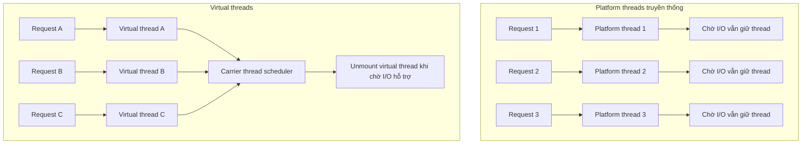

# Bài toán tăng khả năng xử lý đồng thời cho workload chờ I/O

## Mục tiêu

Ứng dụng server thường nhận nhiều request cùng lúc. Mỗi request có thể cần gọi database, đọc file, gửi HTTP request hoặc chờ một dịch vụ bên ngoài phản hồi. Trong thời gian chờ I/O, CPU có thể gần như không làm việc, nhưng luồng xử lý vẫn cần được duy trì để tiếp tục khi dữ liệu sẵn sàng.

Nếu mỗi request chiếm một platform thread trong suốt vòng đời xử lý, số request đồng thời bị giới hạn bởi chi phí tạo và duy trì thread của hệ điều hành. Java 21 cung cấp **virtual threads** để giữ mô hình xử lý tuần tự, blocking quen thuộc nhưng cho phép ứng dụng duy trì số lượng lớn tác vụ chờ I/O với chi phí thread thấp hơn.

Bài học này phân tích vấn đề của workload I/O-bound, cách virtual threads thay đổi khả năng xử lý đồng thời, cách dùng API Java 21 và những giới hạn cần tính đến khi đưa vào ứng dụng thực tế.

## 1. Workload chờ I/O có đặc điểm gì?

Một request web có thể trải qua nhiều bước:

1. Nhận request và kiểm tra dữ liệu đầu vào.
2. Gọi database để đọc thông tin.
3. Gọi một dịch vụ HTTP khác.
4. Kết hợp kết quả và trả response.

Trong các bước gọi database hoặc dịch vụ HTTP, ứng dụng thường phải chờ kết quả. Thời gian chờ có thể dài hơn nhiều so với thời gian CPU thực sự dùng để xử lý dữ liệu.

Đây là workload **I/O-bound**: khả năng xử lý bị chi phối đáng kể bởi thời gian chờ thao tác vào/ra, network hoặc dịch vụ phụ thuộc. Ví dụ:

- API gateway gọi nhiều dịch vụ phía sau.
- Ứng dụng đọc/ghi file hoặc object storage.
- Web server truy vấn database trong mỗi request.
- Tác vụ gửi request đến hệ thống thanh toán, tìm kiếm hoặc dịch vụ nội bộ.

Workload I/O-bound khác với **CPU-bound**. Một tác vụ CPU-bound dành phần lớn thời gian tính toán, mã hóa, nén hoặc xử lý ảnh. Trong trường hợp này, CPU là tài nguyên giới hạn chính; tạo thêm nhiều thread không làm CPU xử lý nhanh hơn.

## 2. Giới hạn của mô hình một request trên một platform thread

Trong mô hình thread-per-request truyền thống, server gán mỗi request đang xử lý cho một platform thread. Platform thread được ánh xạ với thread của hệ điều hành, vì vậy mỗi thread có chi phí tài nguyên và quản lý tương ứng.

Khi request thực hiện blocking I/O, platform thread thường chuyển sang trạng thái chờ. Dù không dùng CPU trong khoảng thời gian đó, thread vẫn tồn tại và chiếm tài nguyên. Nếu số request đồng thời tăng cao, ứng dụng có thể gặp các vấn đề:

- **Giới hạn số thread:** hệ điều hành và JVM không thể tạo vô hạn platform thread.
- **Bộ nhớ:** mỗi thread cần stack và metadata quản lý; tổng chi phí tăng theo số thread.
- **Lập lịch:** quá nhiều thread làm tăng công việc scheduling và có thể tăng context switching.
- **Hàng đợi request:** nếu thread pool chỉ có số worker hữu hạn, request mới phải chờ đến khi worker rảnh.
- **Khó điều chỉnh pool:** tăng kích thước pool có thể đẩy áp lực sang bộ nhớ, hệ điều hành hoặc dịch vụ phụ thuộc.

Ví dụ, một dịch vụ có 200 platform thread và mỗi request chờ một dịch vụ bên ngoài trong vài giây. Khi cả 200 thread đều đang chờ, request tiếp theo có thể phải đợi dù CPU vẫn còn nhiều thời gian rảnh.

Điều này không có nghĩa thread pool là sai. Pool platform thread vẫn hữu ích cho workload CPU-bound, giới hạn tài nguyên và các tác vụ cần số worker cố định. Vấn đề xuất hiện khi dùng một số lượng nhỏ platform thread để đại diện cho rất nhiều request có thời gian chờ I/O dài.

## 3. Virtual threads thay đổi cách sử dụng thread

Virtual thread là thread được JVM quản lý. Nhiều virtual thread có thể được lập lịch chạy trên một số lượng nhỏ hơn các platform thread, còn gọi là *carrier threads*.

Với thao tác blocking mà JDK hỗ trợ cơ chế unmount, khi virtual thread phải chờ, JVM có thể tạm tháo virtual thread khỏi carrier thread. Carrier thread sau đó được dùng để chạy một virtual thread khác. Khi thao tác chờ hoàn tất, virtual thread có thể được lập lịch tiếp tục chạy.

Nhờ vậy, một ứng dụng có thể tạo rất nhiều virtual thread cho các tác vụ có thời gian chờ mà không cần giữ một platform thread riêng cho từng tác vụ trong toàn bộ thời gian chờ.



Sơ đồ mô tả ý tưởng lập lịch: virtual thread đang chờ có thể nhường carrier để một virtual thread khác tiếp tục. Đây là cơ chế giúp tăng khả năng xử lý đồng thời, không phải cách làm cho một thao tác I/O riêng lẻ hoàn tất nhanh hơn.

## 4. Tạo một virtual thread cho mỗi tác vụ

Trong Java 21, cách thuận tiện để chạy nhiều tác vụ độc lập là dùng `Executors.newVirtualThreadPerTaskExecutor()`. Executor này tạo một virtual thread cho mỗi task được submit.

```java
import java.util.concurrent.ExecutorService;
import java.util.concurrent.Executors;
import java.util.concurrent.Future;

class VirtualThreadTaskExample {
    public static void main(String[] args) throws Exception {
        try (ExecutorService executor =
                     Executors.newVirtualThreadPerTaskExecutor()) {

            Future<String> first = executor.submit(() -> loadProfile("user-101"));
            Future<String> second = executor.submit(() -> loadProfile("user-202"));

            System.out.println(first.get());
            System.out.println(second.get());
        }
    }

    private static String loadProfile(String userId) throws InterruptedException {
        // Đại diện cho một thao tác chờ I/O trong ví dụ.
        Thread.sleep(500);
        return "Profile của " + userId;
    }
}
```

`Thread.sleep()` ở đây chỉ mô phỏng khoảng thời gian chờ, không phải thao tác I/O thực tế. Khi chạy, mỗi task được thực thi trên virtual thread riêng. `Future.get()` chờ kết quả theo cách tuần tự trong ví dụ; trong lúc chờ, thread gọi `get()` có thể bị block theo luồng điều khiển của chương trình.

`ExecutorService` được dùng trong try-with-resources. Khi thoát khỏi khối, `close()` yêu cầu executor shutdown và đợi các task đã submit hoàn tất. Cách quản lý vòng đời này giúp tránh để task tiếp tục chạy ngoài phạm vi mà ứng dụng dự kiến.

Có thể tạo virtual thread trực tiếp khi chỉ cần chạy một tác vụ:

```java
class DirectVirtualThreadExample {
    public static void main(String[] args) throws InterruptedException {
        Thread thread = Thread.startVirtualThread(() -> {
            System.out.println("Đang chạy trên virtual thread: "
                    + Thread.currentThread());
        });

        thread.join();
    }
}
```

Với nhiều request hoặc task, `newVirtualThreadPerTaskExecutor()` thường thể hiện rõ mô hình một task một virtual thread và giúp quản lý vòng đời tập trung.

Executor này không phải pool có giới hạn số worker: mỗi task được submit sẽ có một virtual thread mới. Vì vậy, nó không tự giới hạn số request đang chờ hoặc số thao tác truy cập một dependency. Hãy đặt giới hạn admission, timeout và backpressure ở tầng phù hợp với ứng dụng.

## 5. Ví dụ với blocking HTTP I/O

Virtual threads cho phép viết code gọi API theo phong cách blocking quen thuộc. Ví dụ sau gửi nhiều HTTP request đồng thời bằng `HttpClient.send()`:

```java
import java.net.URI;
import java.net.http.HttpClient;
import java.net.http.HttpRequest;
import java.net.http.HttpResponse;
import java.util.List;
import java.util.concurrent.ExecutionException;
import java.util.concurrent.Executors;
import java.util.concurrent.Future;

class ConcurrentHttpRequests {
    private static final HttpClient CLIENT = HttpClient.newHttpClient();

    private static String fetch(URI uri) throws Exception {
        HttpRequest request = HttpRequest.newBuilder(uri).GET().build();
        HttpResponse<String> response = CLIENT.send(
                request, HttpResponse.BodyHandlers.ofString());
        return response.body();
    }

    public static void main(String[] args)
            throws InterruptedException, ExecutionException {
        List<URI> endpoints = List.of(
                URI.create("https://example.com/api/profile/101"),
                URI.create("https://example.com/api/profile/202"),
                URI.create("https://example.com/api/profile/303")
        );

        try (var executor = Executors.newVirtualThreadPerTaskExecutor()) {
            List<Future<String>> results = endpoints.stream()
                    .map(uri -> executor.submit(() -> fetch(uri)))
                    .toList();

            for (Future<String> result : results) {
                System.out.println(result.get());
            }
        }
    }
}
```

Các URL trên chỉ là địa chỉ minh họa; ứng dụng thực tế thay bằng endpoint của mình. `send()` là API đồng bộ nên code có thể đọc tuần tự, trong khi mỗi lời gọi chạy trong virtual thread riêng. Khi request đang chờ network I/O trên các đường thực thi được JDK hỗ trợ, carrier thread có thể được dùng cho công việc khác.

Trong ví dụ này, `fetch()` khai báo `throws Exception` để giữ ngắn phần minh họa. Trong ứng dụng thực tế, nên khai báo và xử lý cụ thể `IOException`, `InterruptedException`, timeout, mã trạng thái HTTP và lỗi nghiệp vụ. Không nên bỏ qua interrupt nếu tác vụ cần hỗ trợ hủy.

## 6. Virtual threads giúp tăng concurrency, không tự tăng năng lực hệ thống phụ thuộc

Virtual threads giảm chi phí duy trì nhiều tác vụ đang chờ. Chúng không làm tăng số kết nối mà database cho phép, không tăng giới hạn request của dịch vụ bên ngoài và không làm network nhanh hơn.

Ví dụ, nếu ứng dụng tạo 20.000 virtual thread và tất cả cùng truy cập một database chỉ cho phép 100 kết nối, database connection pool vẫn chỉ cấp được số kết nối theo cấu hình. Các tác vụ còn lại sẽ chờ lấy connection hoặc có thể gây quá tải nếu hệ thống không kiểm soát.

Vì vậy, cần phân biệt:

- **Concurrency:** số tác vụ có thể đang tiến hành cùng thời điểm.
- **Throughput:** số tác vụ hoàn tất trong một đơn vị thời gian.
- **Latency:** thời gian một tác vụ cần để hoàn thành.
- **Capacity của dependency:** giới hạn mà database, API ngoài, connection pool hoặc dịch vụ khác có thể phục vụ.

Virtual threads chủ yếu giúp tăng khả năng duy trì concurrency với chi phí thấp hơn trong workload chờ I/O. Throughput và latency vẫn phụ thuộc vào thời gian phản hồi, năng lực CPU, giới hạn dịch vụ phụ thuộc và thiết kế ứng dụng.

## 7. Giới hạn concurrency tại tài nguyên phụ thuộc

Không nên dùng số lượng platform thread làm cơ chế giới hạn duy nhất cho database hoặc dịch vụ ngoài. Với virtual threads, có thể có rất nhiều task đang chờ; ứng dụng cần giới hạn trực tiếp tài nguyên có giới hạn.

Ví dụ dùng `Semaphore` để chỉ cho phép tối đa 20 tác vụ đồng thời đi vào một vùng gọi dịch vụ có giới hạn:

```java
import java.util.concurrent.Semaphore;

class DownstreamConcurrencyLimit {
    private static final Semaphore PERMITS = new Semaphore(20);

    static String callDownstream() throws InterruptedException {
        PERMITS.acquire();
        try {
            return performBlockingCall();
        } finally {
            PERMITS.release();
        }
    }

    private static String performBlockingCall() throws InterruptedException {
        // Thay bằng lời gọi database hoặc dịch vụ ngoài thực tế.
        Thread.sleep(300);
        return "completed";
    }
}
```

`Semaphore` giới hạn số tác vụ đồng thời ở vùng tài nguyên cần bảo vệ. Virtual thread có thể chờ permit mà không cần chiếm một platform thread trong toàn bộ thời gian chờ. Trong ứng dụng thực tế, hãy ưu tiên cơ chế quản lý kết nối hoặc giới hạn concurrency phù hợp với dependency, đồng thời thiết lập timeout và xử lý lỗi.

Giới hạn concurrency cũng cần đi cùng chính sách backpressure: nếu tốc độ nhận request lớn hơn tốc độ dependency xử lý trong thời gian dài, hàng đợi chờ có thể tăng và tiêu thụ bộ nhớ. Cần xác định giới hạn số request đang chờ, timeout, từ chối sớm hoặc điều tiết tốc độ nhận việc tùy theo hợp đồng dịch vụ.

## 8. Không dùng virtual thread pool như platform thread pool

Virtual thread được thiết kế theo hướng tạo một thread cho mỗi task, không phải tái sử dụng thread từ một pool có kích thước cố định. Thông thường, hãy dùng:

```java
import java.util.concurrent.Executors;

class VirtualThreadPerTaskUsage {
    public static void main(String[] args) {
        try (var executor = Executors.newVirtualThreadPerTaskExecutor()) {
            executor.submit(() -> processRequest());
        }
    }

    private static void processRequest() {
        // Xử lý một request hoặc task độc lập.
    }
}
```

Không cần tạo pool nhỏ kiểu `newFixedThreadPool(20)` chỉ để tái sử dụng virtual thread. Nếu cần giới hạn số thao tác vào database, API ngoài hoặc tài nguyên khác, hãy giới hạn chính tài nguyên đó bằng connection pool, semaphore hoặc cơ chế backpressure.

Điều này không có nghĩa mọi công việc đều phải chạy trên virtual thread. Platform thread vẫn phù hợp với tác vụ CPU-bound, vòng lặp tính toán dài hoặc thành phần cần kiểm soát worker cố định. Chọn loại thread theo đặc điểm công việc và đo lường trong môi trường thực tế.

## 9. Khi nào virtual threads không giải quyết được nút thắt?

Virtual threads đặc biệt hữu ích khi một ứng dụng có nhiều task độc lập, thời gian chờ I/O đáng kể và code đang dùng API blocking. Chúng ít mang lại lợi ích khi:

- Công việc chủ yếu là tính toán CPU-bound; số lõi CPU là giới hạn chính.
- Dependency bên ngoài đã quá tải hoặc có giới hạn concurrency thấp.
- Mã giữ tài nguyên khan hiếm trong thời gian dài, chẳng hạn connection hoặc lock.
- Một thao tác blocking không cho phép virtual thread nhường carrier theo cơ chế của JVM/JDK.
- Nút thắt nằm ở thuật toán, truy vấn database, network hoặc kích thước payload chứ không phải chi phí thread.

Khi chuyển ứng dụng sang virtual threads, cần quan sát CPU, heap, số virtual thread đang sống, thời gian chờ, số connection đang dùng, hàng đợi và latency của dependency. Tăng số task đồng thời mà không đo các giới hạn này có thể chỉ chuyển nút thắt sang một thành phần khác.

## 10. Cách đánh giá trước và sau khi áp dụng

Một thử nghiệm có ý nghĩa nên dùng workload gần với traffic thực tế và so sánh ít nhất các chỉ số:

| Chỉ số | Điều cần quan sát |
|---|---|
| Throughput | Số request hoàn tất mỗi giây ở cùng điều kiện tải |
| Latency p50/p95/p99 | Thời gian phản hồi trung vị và các percentile cao |
| CPU utilization | CPU có phải nút thắt hay phần lớn thời gian là chờ I/O |
| Heap và allocation | Chi phí bộ nhớ khi có nhiều request đang hoạt động |
| Số platform thread | Mức sử dụng carrier/platform thread của JVM |
| Dependency saturation | Connection pool, request rate, timeout và lỗi từ dịch vụ phụ thuộc |
| Queue/wait time | Thời gian chờ executor, semaphore, connection hoặc hàng đợi request |

So sánh ở cùng mức tải, cùng cấu hình dependency và cùng điều kiện mạng. Nếu chỉ tăng concurrency mà không đo latency và lỗi dependency, kết quả benchmark có thể tạo cảm giác cải thiện trong khi hệ thống thực tế đã tiến gần quá tải.

## 11. Checklist áp dụng virtual threads cho workload I/O

Trước khi chuyển một service sang virtual threads, hãy kiểm tra:

1. Request có dành phần lớn thời gian chờ database, HTTP, file hoặc I/O khác không?
2. Mỗi request/task có thể chạy độc lập trên một virtual thread không?
3. Các API blocking quan trọng có được JDK hỗ trợ để virtual thread nhường carrier khi chờ không?
4. Connection pool và giới hạn concurrency của dependency đã được cấu hình rõ chưa?
5. Có timeout, hủy task, xử lý interrupt và backpressure phù hợp không?
6. Có giới hạn số request đang chờ để tránh tích tụ quá nhiều task không?
7. Đã đo throughput, latency, CPU, heap và mức bão hòa dependency trước/sau thay đổi chưa?
8. Tác vụ CPU-bound có được đánh giá riêng thay vì kỳ vọng virtual threads tự tăng tốc không?

## Kết luận

Workload I/O-bound thường bị giới hạn khi mỗi request phải giữ một platform thread trong suốt thời gian chờ. Virtual threads trong Java 21 cho phép duy trì nhiều tác vụ đồng thời với chi phí thread thấp hơn bằng cách tạm nhường carrier trong các thao tác blocking được hỗ trợ. `Executors.newVirtualThreadPerTaskExecutor()` là cách thực tế để triển khai mô hình một task một virtual thread. Lợi ích chính là khả năng mở rộng concurrency và giữ code blocking dễ đọc; ứng dụng vẫn phải kiểm soát dependency, backpressure, timeout và đo lường hiệu năng. Virtual threads không làm CPU, database hoặc dịch vụ bên ngoài có thêm năng lực xử lý.
