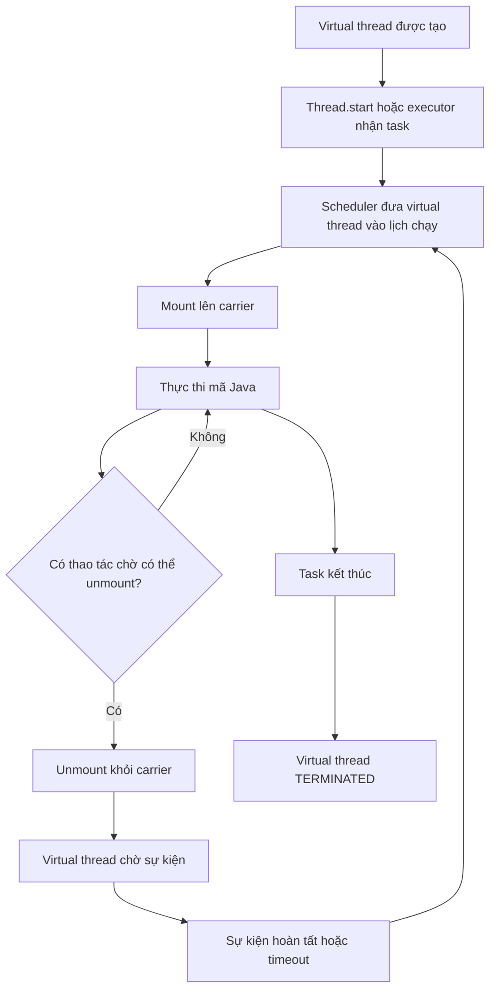

# Vòng đời mount, unmount và tiếp tục thực thi virtual thread

Virtual thread trong Java 21 không gắn cố định với một platform thread. Khi cần chạy, bộ lập lịch virtual thread gắn (mount) virtual thread lên một platform thread đóng vai trò carrier. Khi virtual thread chờ một thao tác blocking mà JDK hỗ trợ unmount, runtime tháo (unmount) nó khỏi carrier để carrier có thể chạy virtual thread khác. Khi điều kiện chờ được đáp ứng, virtual thread trở lại trạng thái có thể chạy và được mount lên một carrier sẵn sàng.

Quá trình mount và unmount có thể lặp lại nhiều lần trong suốt vòng đời của một virtual thread. Danh tính, call stack và trạng thái Java của virtual thread vẫn được duy trì qua các lần chuyển đổi này. Hiểu vòng đời đó giúp giải thích vì sao virtual thread có thể chờ I/O với chi phí thấp hơn, đồng thời nhận biết những trường hợp làm carrier bị giữ lại.

## 1. Virtual thread và carrier thread

Virtual thread là một đối tượng `Thread` được runtime lập lịch trên các platform thread. Platform thread đang thực thi virtual thread được gọi là **carrier thread**.

Ba khái niệm cần phân biệt:

- **Virtual thread:** đại diện cho luồng thực thi của ứng dụng. Nó giữ trạng thái, call stack, tên luồng và các thuộc tính Java như `ThreadLocal`.
- **Carrier thread:** một platform thread thực thi mã của virtual thread trong khoảng thời gian virtual thread được mount.
- **Scheduler:** bộ lập lịch phân phối các virtual thread có thể chạy lên những carrier thread khả dụng.

Trong JDK 21, scheduler mặc định được xây dựng trên một `ForkJoinPool` ở chế độ FIFO. Đây là chi tiết triển khai của JDK; ứng dụng nên dựa vào hợp đồng virtual thread thay vì phụ thuộc vào một carrier cụ thể hoặc thuật toán lập lịch nội bộ.

Một virtual thread không bị ràng buộc với một carrier suốt đời. Nó có thể chạy trên carrier A, unmount khi chờ, rồi tiếp tục trên carrier B. Carrier được tái sử dụng để thực thi các virtual thread khác; runtime không tạo một platform thread riêng cho mỗi lần virtual thread bắt đầu hoặc tiếp tục chạy.

## 2. Mount và unmount diễn ra như thế nào?

**Mount** xảy ra khi scheduler chọn một virtual thread có thể chạy và gắn nó lên một carrier khả dụng. Carrier thực thi phần mã tiếp theo của virtual thread.

**Unmount** xảy ra khi virtual thread đi vào một thao tác chờ mà runtime có thể tạm dừng virtual thread độc lập với carrier. Runtime lưu trạng thái tiếp tục thực thi của virtual thread, tháo nó khỏi carrier và trả carrier về scheduler. Carrier sau đó có thể chạy một virtual thread khác.

Khi sự kiện chờ hoàn tất, chẳng hạn hết thời gian ngủ, dữ liệu socket đã sẵn sàng hoặc một phần tử xuất hiện trong hàng đợi, virtual thread trở lại trạng thái có thể chạy. Scheduler sẽ chọn một carrier để mount nó trở lại. Carrier được chọn không nhất thiết là carrier đã chạy virtual thread trước đó.



Sơ đồ mô tả luồng thông thường. Nếu virtual thread bị pin trong lúc thực hiện thao tác blocking, bước unmount có thể không xảy ra; carrier vẫn bị giữ cho đến khi thao tác hoàn tất.

## 3. Vòng đời từ lúc start đến khi kết thúc

Một virtual thread thường trải qua các giai đoạn sau:

1. **NEW:** virtual thread đã được tạo nhưng chưa được start.
2. **Được lập lịch:** sau `start()` hoặc khi executor bắt đầu task, virtual thread trở thành công việc có thể chạy của scheduler.
3. **Mounted và thực thi:** virtual thread chạy trên một carrier.
4. **Unmounted và chờ:** khi gặp thao tác blocking hỗ trợ unmount, virtual thread tạm dừng mà không chiếm carrier.
5. **Runnable trở lại:** sự kiện chờ hoàn tất; virtual thread được đưa trở lại lịch chạy.
6. **Mounted và tiếp tục:** scheduler có thể mount virtual thread lên cùng carrier cũ hoặc một carrier khác.
7. **TERMINATED:** phương thức `run` hoặc task kết thúc, virtual thread không tiếp tục chạy nữa.

Các bước mount/unmount có thể lặp nhiều lần giữa lúc bắt đầu và kết thúc. Một virtual thread không nhất thiết phải unmount: task ngắn hoặc chỉ tính toán có thể chạy liên tục trên carrier cho đến khi kết thúc.

## 4. Ví dụ: virtual thread unmount khi ngủ và tiếp tục sau đó

`Thread.sleep` là một ví dụ dễ quan sát về thao tác chờ có thể unmount virtual thread. Ví dụ sau tạo một virtual thread cho task, kiểm tra danh tính luồng trước và sau khi ngủ:

```java
import java.util.concurrent.ExecutorService;
import java.util.concurrent.Executors;
import java.util.concurrent.Future;

public class VirtualThreadLifecycle {
    public static void main(String[] args) throws Exception {
        try (ExecutorService executor =
                     Executors.newVirtualThreadPerTaskExecutor()) {

            Future<String> result = executor.submit(() -> {
                Thread current = Thread.currentThread();
                System.out.println("Virtual: " + current.isVirtual());

                Thread.sleep(500); // Virtual thread có thể unmount khi chờ

                // Vẫn là cùng một virtual thread sau khi được mount lại.
                if (Thread.currentThread() != current) {
                    throw new IllegalStateException("Thread identity changed");
                }

                return "Task completed";
            });

            System.out.println(result.get());
        }
    }
}
```

Trong thời gian ngủ, virtual thread chờ timeout và carrier có thể chạy task khác. Khi hết 500 ms, virtual thread được scheduler đưa trở lại lịch chạy và tiếp tục từ câu lệnh sau `Thread.sleep`.

Biến `current` vẫn tham chiếu đến cùng virtual thread. Việc carrier có thể thay đổi không làm thay đổi kết quả của `Thread.currentThread()` trong mã ứng dụng: phương thức này trả về virtual thread đang thực thi, không trả về carrier.

`Executors.newVirtualThreadPerTaskExecutor()` tạo một virtual thread cho mỗi task được submit; nó không tạo một pool để tái sử dụng virtual thread. Đây là mô hình phù hợp với virtual thread: tạo luồng theo task và để scheduler quản lý việc thực thi.

## 5. Những thao tác thường cho phép unmount

Nhiều thao tác blocking trong thư viện JDK đã được tích hợp để virtual thread có thể nhường carrier trong lúc chờ. Các ví dụ phổ biến gồm:

- `Thread.sleep(...)`: chờ đến khi hết thời gian ngủ hoặc bị interrupt.
- `LockSupport.park(...)`: tạm dừng cho đến khi được unpark hoặc có điều kiện đánh thức khác.
- Các thao tác blocking trên socket trong API `java.net` được hỗ trợ cho virtual thread, chẳng hạn chờ nhận dữ liệu hoặc kết nối.
- Các cấu trúc đồng bộ dựa trên cơ chế park, như chờ lấy phần tử từ `BlockingQueue` hoặc chờ semaphore.

Khi thao tác được hỗ trợ, virtual thread có thể unmount trong lúc chờ và carrier được giải phóng để làm việc khác. Điều này đặc biệt hữu ích cho server xử lý nhiều request có thời gian chờ I/O lớn.

Không nên suy luận rằng mọi lời gọi có tên “blocking” đều chắc chắn unmount. Hành vi phụ thuộc vào API và cách implementation thực hiện thao tác. Khi đánh giá một thư viện, cần kiểm tra khả năng tương thích với virtual thread của chính API đó và đo trên workload thực tế.

## 6. Tiếp tục thực thi không có nghĩa là bắt đầu một thread mới

Khi virtual thread unmount, runtime không kết thúc task rồi tạo một thread khác để chạy phần còn lại. Virtual thread vẫn là cùng một đối tượng `Thread` và giữ trạng thái thực thi để tiếp tục tại điểm đã tạm dừng.

Điều này có một số hệ quả:

- Các biến local và call stack của phương thức đang chờ được bảo toàn.
- Luồng điều khiển tiếp tục tại vị trí thao tác blocking trả về hoặc ném exception.
- `Thread.currentThread()` tiếp tục trả về cùng virtual thread.
- `ThreadLocal` thuộc về virtual thread, không bị thay thế chỉ vì virtual thread chuyển sang carrier khác.
- Carrier được giải phóng trong thời gian virtual thread thực sự unmount; virtual thread vẫn tồn tại và có thể giữ tài nguyên heap hoặc tài nguyên ứng dụng khác.

Virtual thread có thể giữ một socket, một kết nối database hoặc một đối tượng nghiệp vụ trong lúc chờ. Unmount giải phóng carrier, không tự động đóng socket, trả connection về pool hoặc giải phóng tài nguyên nghiệp vụ. Ứng dụng vẫn phải quản lý vòng đời tài nguyên đúng cách.

## 7. Thread.State không biểu diễn trực tiếp mount và unmount

Java không bổ sung các giá trị `Thread.State` riêng như `MOUNTED` hoặc `UNMOUNTED`. Virtual thread vẫn sử dụng các trạng thái chuẩn:

| Trạng thái | Ý nghĩa tổng quát |
|---|---|
| `NEW` | Chưa được start |
| `RUNNABLE` | Đang thực thi hoặc có thể được scheduler thực thi |
| `BLOCKED` | Đang chờ lấy monitor intrinsic |
| `WAITING` | Đang chờ vô thời hạn một hành động của thread khác |
| `TIMED_WAITING` | Đang chờ trong một khoảng thời gian xác định |
| `TERMINATED` | Đã kết thúc |

Không nên dùng `Thread.getState()` để suy ra chính xác virtual thread đang được mount lên carrier nào hoặc carrier nào đang bị chiếm dụng. Trạng thái Java mô tả tình trạng thực thi ở mức tổng quát; mount/unmount là cơ chế lập lịch nội bộ của runtime.

`Thread.getState()` cũng chỉ phục vụ giám sát, không phải cơ chế đồng bộ. Nếu cần chờ một task kết thúc, hãy dùng `join`, `Future.get` hoặc cơ chế đồng bộ thích hợp thay vì liên tục đọc trạng thái thread.

## 8. Pinning: trường hợp virtual thread không thể unmount trong Java 21

Virtual thread chỉ giải phóng carrier nếu runtime có thể tách việc chờ khỏi platform thread. Trong Java 21, có những trường hợp virtual thread bị **pin** vào carrier. Khi đó, virtual thread không thể unmount; nếu nó thực hiện thao tác blocking, carrier cũng bị giữ trong suốt thời gian chờ.

Hai trường hợp quan trọng trong Java 21:

1. Virtual thread đang thực thi bên trong một `synchronized` block hoặc `synchronized` method.
2. Virtual thread đang thực thi native method hoặc foreign function.

Ví dụ về monitor pinning trong Java 21:

```java
Object lock = new Object();

Thread virtual = Thread.ofVirtual().start(() -> {
    synchronized (lock) {
        try {
            Thread.sleep(500); // Trong Java 21, virtual thread bị pin ở đây
        } catch (InterruptedException e) {
            Thread.currentThread().interrupt();
        }
    }
});

virtual.join();
```

`Thread.sleep` thông thường cho phép unmount. Nhưng trong Java 21, virtual thread đang giữ monitor của `synchronized`, nên không thể unmount trong thời gian ngủ. Carrier phải chờ cùng virtual thread.

Pinning không làm chương trình sai về mặt kết quả. Vấn đề là nếu nhiều virtual thread thường xuyên block trong khi bị pin, số carrier khả dụng giảm và khả năng mở rộng đồng thời bị ảnh hưởng.

### Lưu ý về phiên bản JDK

Monitor pinning là hành vi cần hiểu khi chạy đúng **Java 21**. Từ JDK 24, JEP 491 thay đổi cách đồng bộ để virtual thread có thể unmount khi bị block trong `synchronized` block hoặc method; vì vậy không nên áp dụng cảnh báo monitor pinning của Java 21 như một quy tắc chung cho các JDK mới hơn. Native method và foreign function vẫn có thể pin virtual thread khi thao tác blocking không thể tách khỏi carrier.

Với dự án mục tiêu Java 21, nên tránh giữ monitor trong lúc thực hiện I/O hoặc thao tác chờ kéo dài nếu có thể thiết kế lại critical section. Không cần thay toàn bộ `synchronized` bằng `ReentrantLock`: hãy chọn cơ chế khóa theo ngữ nghĩa cần thiết và cân nhắc phiên bản JDK thực tế đang chạy.

## 9. Nhận biết và giảm tác động của pinning

Java Flight Recorder cung cấp event `jdk.VirtualThreadPinned` để ghi nhận các trường hợp virtual thread bị pin đủ lâu theo ngưỡng cấu hình của event. Có thể dùng JFR khi điều tra tình trạng carrier bị giữ trong workload nhiều virtual thread.

Khi tìm thấy pinning trong Java 21, nên:

1. Xác định stack trace và đoạn `synchronized` hoặc native/foreign call gây pin.
2. Kiểm tra xem virtual thread có thực hiện I/O, sleep hoặc chờ lâu trong vùng bị pin hay không.
3. Thu hẹp vùng critical section để chỉ bảo vệ phần cập nhật trạng thái cần thiết.
4. Tách thao tác I/O hoặc chờ ra ngoài vùng giữ monitor nếu bảo đảm được tính đúng đắn của dữ liệu.
5. Kiểm tra thư viện native và thư viện bên thứ ba nếu stack trace đi qua mã native.
6. Đo lại throughput, latency và mức sử dụng carrier sau khi điều chỉnh.

Không phải mọi lần mount hoặc unmount đều cần theo dõi thủ công. Chỉ điều tra sâu khi profiling cho thấy pinning hoặc thời gian chờ carrier đang là nút thắt.

## 10. Virtual thread không làm tăng năng lực CPU hoặc tài nguyên bên ngoài

Unmount có lợi khi task chờ I/O hoặc một điều kiện đồng bộ: carrier có thể chạy task khác thay vì ngồi chờ. Nhưng virtual thread không tự làm một phép tính CPU-bound chạy nhanh hơn.

Scheduler không time-slice các virtual thread đang chạy bằng cách cưỡng bức tạm dừng một virtual thread sau một khoảng CPU cố định. Một tác vụ tính toán dài có thể tiếp tục chiếm carrier cho đến khi hoàn tất hoặc nhường quyền theo cơ chế thích hợp. Nếu ứng dụng chủ yếu tính toán, số carrier vẫn là tài nguyên hữu hạn và cần benchmark như các tác vụ CPU-bound thông thường.

Virtual thread cũng không làm tăng giới hạn của database connection pool, số socket mà hệ thống đích chấp nhận hoặc quota của dịch vụ bên ngoài. Nếu có hàng chục nghìn virtual thread cùng chờ lấy một số lượng nhỏ connection, chúng vẫn có thể giữ nhiều task và tạo áp lực lên hệ thống. Hãy dùng pool, semaphore, timeout và backpressure để giới hạn tài nguyên bên ngoài theo năng lực thực tế.

## 11. Các nguyên tắc sử dụng

- Tạo virtual thread theo task bằng `Thread.ofVirtual()` hoặc `Executors.newVirtualThreadPerTaskExecutor()`.
- Để scheduler quản lý carrier; không phụ thuộc vào carrier cụ thể hoặc giả định virtual thread luôn quay lại cùng carrier.
- Dùng API JDK có hỗ trợ virtual thread cho các thao tác blocking phổ biến.
- Với Java 21, tránh blocking kéo dài trong `synchronized` hoặc native/foreign call vì có thể pin carrier.
- Dùng JFR để điều tra pinning khi có dấu hiệu nghẽn, thay vì suy luận từ `Thread.State`.
- Giới hạn tài nguyên bên ngoài như connection pool và request đến dịch vụ bằng cơ chế phù hợp.
- Không dùng virtual thread như cách tăng tốc tác vụ CPU-bound hoặc như một thread pool cần tái sử dụng.

## 12. Tổng kết

Mount gắn virtual thread lên một carrier để thực thi; unmount tháo virtual thread khỏi carrier khi nó chờ một thao tác có thể tạm dừng độc lập; resume đưa virtual thread trở lại lịch chạy để tiếp tục cùng call stack và danh tính ban đầu. Một virtual thread có thể chuyển qua nhiều carrier trong vòng đời của nó.

Trong Java 21, blocking bên trong `synchronized` hoặc native/foreign call có thể pin virtual thread và giữ carrier. Đây là hành vi cần được phân biệt rõ theo phiên bản: JDK 24 đã thay đổi monitor pinning qua JEP 491, còn native/foreign blocking vẫn cần được xem xét. Khi thiết kế và vận hành, hãy tập trung vào các thao tác chờ, thời gian giữ tài nguyên và khả năng unmount của API đang sử dụng.

## Tài liệu tham khảo

- [JEP 444: Virtual Threads](https://openjdk.org/jeps/444) — thiết kế và hành vi virtual thread được hoàn thiện trong Java 21, bao gồm scheduler, mount/unmount và pinning.
- [Java SE 21 API — Thread](https://docs.oracle.com/en/java/javase/21/docs/api/java.base/java/lang/Thread.html) — API tạo, start, kiểm tra và quản lý virtual thread.
- [Java SE 21 API — Executors](https://docs.oracle.com/en/java/javase/21/docs/api/java.base/java/util/concurrent/Executors.html) — `newVirtualThreadPerTaskExecutor()`.
- [JEP 491: Synchronize Virtual Threads without Pinning](https://openjdk.org/jeps/491) — thay đổi monitor pinning từ JDK 24; dùng để phân biệt hành vi Java 21 với các JDK mới hơn.
- [JDK Flight Recorder Runtime Events](https://docs.oracle.com/en/java/javase/21/troubleshoot/diagnostic-tools.html) — công cụ chẩn đoán runtime, bao gồm theo dõi sự kiện virtual thread.
