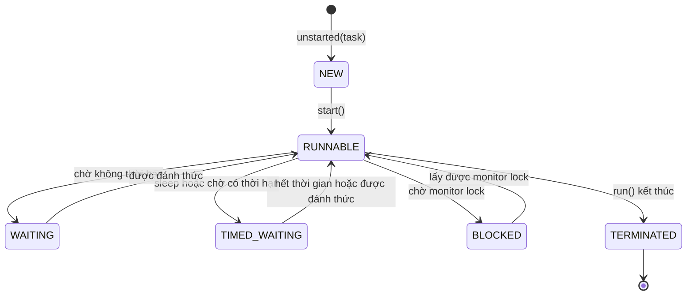

# Tạo thread chưa chạy bằng `unstarted()` và khởi chạy bằng `start()`

## Mục tiêu

Trong Java 21, `Thread.Builder` cho phép cấu hình thread rồi tạo một đối tượng thread chưa bắt đầu chạy bằng `unstarted(Runnable)`. Khi muốn tác vụ thực sự được thực thi, chương trình gọi `start()` trên đối tượng `Thread` đó.

Tách bước tạo và bước khởi chạy giúp ứng dụng chuẩn bị tên thread, loại thread và các thiết lập cần thiết trước khi cho tác vụ chạy. Cách làm này áp dụng cho cả platform thread và virtual thread. Bài học trình bày vòng đời của thread, sự khác nhau giữa `unstarted()`, `start()` và `run()`, cũng như các quy tắc cần tuân thủ khi khởi chạy.

## 1. Hai bước: tạo thread và khởi chạy thread

Một thread được tạo bằng `Thread.Builder.unstarted(task)` ở trạng thái `NEW`. Ở thời điểm này, task đã được gắn với thread nhưng chưa được thực thi.

```java
class UnstartedThreadExample {
    public static void main(String[] args) throws InterruptedException {
        Thread worker = Thread.ofPlatform()
                .name("report-worker")
                .unstarted(() -> System.out.println("Đang tạo báo cáo"));

        System.out.println(worker.getState()); // NEW

        worker.start();
        worker.join();
    }
}
```

Các bước trong ví dụ:

1. `Thread.ofPlatform()` lấy một builder để tạo platform thread.
2. `name("report-worker")` cấu hình tên cho thread.
3. `unstarted(...)` tạo đối tượng `Thread` và gắn task, nhưng chưa khởi chạy.
4. `getState()` trả về `NEW` vì `start()` chưa được gọi.
5. `start()` yêu cầu JVM khởi chạy thread mới để thực thi task.
6. `join()` đợi thread hoàn tất trước khi method `main` tiếp tục.

Điểm cần nhớ: `unstarted()` không thực thi task ngay. Task chỉ bắt đầu khi chương trình gọi `start()` trên thread được trả về.

## 2. Sử dụng `Thread.Builder.unstarted()`

`Thread.Builder` là API cấu hình việc tạo thread. Java 21 cung cấp hai builder chính:

- `Thread.ofPlatform()` trả về `Thread.Builder.OfPlatform` để tạo platform thread.
- `Thread.ofVirtual()` trả về `Thread.Builder.OfVirtual` để tạo virtual thread.

Cả hai builder đều cung cấp `unstarted(Runnable task)`, trả về một đối tượng `Thread` chưa chạy. Có thể cấu hình builder trước khi gọi phương thức này, ví dụ đặt tên hoặc cấu hình `UncaughtExceptionHandler`.

```java
class ConfigureBeforeStartExample {
    public static void main(String[] args) throws InterruptedException {
        Thread worker = Thread.ofPlatform()
                .name("invoice-worker")
                .uncaughtExceptionHandler((thread, error) ->
                        System.err.println(thread.getName() + ": " + error))
                .unstarted(() -> processInvoice());

        // Thread chưa chạy; có thể thực hiện các bước chuẩn bị khác ở đây.
        System.out.println(worker.getName());  // invoice-worker
        System.out.println(worker.getState()); // NEW

        worker.start();
        worker.join();
    }

    private static void processInvoice() {
        System.out.println("Đang xử lý hóa đơn");
    }
}
```

Builder mô tả cách thread sẽ được tạo. Khi đã gọi `unstarted()`, chương trình nhận được đối tượng `Thread` cụ thể và có thể quyết định thời điểm bắt đầu bằng `start()`.

## 3. Khởi chạy bằng `Thread.start()`

`start()` là phương thức trên đối tượng `Thread`. Khi được gọi, nó làm cho thread chuyển từ trạng thái chưa khởi chạy sang vòng đời thực thi. JVM sẽ lập lịch cho thread và gọi phương thức `run()` của nó trên thread mới.

```java
class StartThreadExample {
    public static void main(String[] args) throws InterruptedException {
        Thread worker = Thread.ofPlatform().unstarted(() -> {
            System.out.println("Task chạy trên: "
                    + Thread.currentThread().getName());
        });

        worker.start();
        System.out.println("main tiếp tục thực hiện công việc");

        worker.join();
        System.out.println("worker đã hoàn tất");
    }
}
```

`start()` không đợi task hoàn tất. Sau khi gọi `start()`, thread gọi có thể tiếp tục chạy trong khi worker được JVM lập lịch độc lập. Thứ tự giữa dòng `main tiếp tục...` và dòng được in từ worker không được bảo đảm; kết quả phụ thuộc vào lịch thực thi.

Nếu cần đợi task hoàn tất trước khi tiếp tục, gọi `join()`. `join()` là thao tác chờ, còn `start()` là thao tác khởi chạy; hai phương thức giải quyết hai nhu cầu khác nhau.

## 4. Phân biệt `unstarted()`, `start()` và `run()`

Ba phương thức có vai trò khác nhau:

| Phương thức | Được gọi trên | Hành vi |
|---|---|---|
| `unstarted(task)` | `Thread.Builder` | Tạo đối tượng thread ở trạng thái `NEW`, gắn task nhưng chưa chạy |
| `start()` | Đối tượng `Thread` | Khởi chạy thread mới; JVM thực thi `run()` trên thread đó |
| `run()` | Đối tượng `Thread` | Gọi trực tiếp phương thức `run()` trên thread hiện tại, không tạo thread mới |

Ví dụ sau minh họa khác biệt giữa `run()` và `start()`:

```java
class RunVersusStartExample {
    public static void main(String[] args) throws InterruptedException {
        Thread worker = Thread.ofPlatform().unstarted(() ->
                System.out.println("Đang chạy trên "
                        + Thread.currentThread().getName()));

        worker.run();
        System.out.println(worker.getState()); // Vẫn là NEW

        worker.start();
        worker.join();
    }
}
```

Lần gọi `worker.run()` đầu tiên thực thi task ngay trên thread đang gọi, thường là `main`; nó không thay đổi trạng thái của đối tượng `worker` thành đã khởi chạy. Sau đó, `worker.start()` vẫn khởi chạy thread mới và task được thực thi thêm một lần trên thread đó.

Vì vậy, khi mục tiêu là chạy đồng thời trên một thread riêng, phải gọi `start()`. Gọi `run()` trực tiếp không phải cách thay thế cho `start()`.

## 5. Vòng đời và trạng thái của thread

Một đối tượng thread có các trạng thái được biểu diễn bởi `Thread.State`:

| Trạng thái | Ý nghĩa |
|---|---|
| `NEW` | Đã tạo nhưng chưa gọi `start()` |
| `RUNNABLE` | Đang thực thi trong JVM hoặc sẵn sàng được hệ điều hành cấp CPU |
| `BLOCKED` | Đang chờ lấy monitor lock để vào hoặc tiếp tục một vùng `synchronized` |
| `WAITING` | Đang chờ vô thời hạn một hành động của thread khác |
| `TIMED_WAITING` | Đang chờ trong một khoảng thời gian giới hạn |
| `TERMINATED` | Đã kết thúc thực thi |

Luồng đơn giản của một thread thường là:



Sơ đồ chỉ mô tả một số chuyển trạng thái thường gặp. Thread có thể chuyển qua lại giữa `RUNNABLE`, `BLOCKED`, `WAITING` và `TIMED_WAITING` trong quá trình chạy. Khi task kết thúc, thread chuyển sang `TERMINATED` và không thể khởi chạy lại.

Không nên dựa vào việc đọc `getState()` ngay sau `start()` để kết luận task đã chạy đến đâu. Thread có thể chưa được lập lịch, đang chạy hoặc đã kết thúc trước khi thread gọi kịp quan sát trạng thái.

## 6. Một thread chỉ được `start()` một lần

Một đối tượng `Thread` chỉ có thể được khởi chạy một lần. Nếu gọi `start()` lần thứ hai trên cùng đối tượng, Java ném `IllegalThreadStateException`.

```java
class StartOnlyOnceExample {
    public static void main(String[] args) throws InterruptedException {
        Thread worker = Thread.ofPlatform().unstarted(
                () -> System.out.println("Đang chạy"));

        worker.start();
        worker.join();

        // worker.start(); // IllegalThreadStateException
    }
}
```

Quy tắc này vẫn đúng sau khi thread đã ở trạng thái `TERMINATED`. Không thể dùng lại cùng một đối tượng `Thread` để chạy task lần nữa. Nếu cần thực hiện công việc một lần nữa, hãy tạo một đối tượng thread mới:

```java
class CreateNewThreadForRetry {
    static Thread newWorker(Runnable task) {
        return Thread.ofPlatform().unstarted(task);
    }

    public static void main(String[] args) throws InterruptedException {
        Thread first = newWorker(() -> System.out.println("Lần chạy thứ nhất"));
        first.start();
        first.join();

        Thread second = newWorker(() -> System.out.println("Lần chạy thứ hai"));
        second.start();
        second.join();
    }
}
```

Mỗi lần chạy dùng một đối tượng `Thread` mới. Với ứng dụng cần thực thi nhiều task theo vòng đời quản lý tập trung, `ExecutorService` thường phù hợp hơn việc tự tạo và quản lý từng thread.

## 7. Tạo virtual thread chưa chạy rồi mới khởi chạy

`unstarted()` cũng dùng được với virtual thread. Cách này hữu ích khi muốn chuẩn bị tác vụ trước rồi quyết định thời điểm cho nó bắt đầu:

```java
class UnstartedVirtualThreadExample {
    public static void main(String[] args) throws InterruptedException {
        Thread worker = Thread.ofVirtual()
                .name("remote-call")
                .unstarted(() -> {
                    System.out.println("Virtual thread: "
                            + Thread.currentThread());
                });

        System.out.println(worker.isVirtual()); // true
        System.out.println(worker.getState());  // NEW

        worker.start();
        worker.join();
    }
}
```

Virtual thread vẫn là một đối tượng `Thread` và cũng cần `start()` để bắt đầu thực thi nếu được tạo bằng `unstarted()`. Khác biệt nằm ở cách JVM lập lịch: virtual thread được chạy trên carrier platform thread do JVM quản lý. Virtual thread luôn là daemon thread và không thể đặt priority như platform thread.

Nếu không cần trì hoãn thời điểm khởi chạy, có thể dùng `Thread.ofVirtual().start(task)` để tạo và bắt đầu virtual thread trong một bước. Bài học này dùng `unstarted()` để thể hiện rõ ranh giới giữa chuẩn bị và thực thi.

## 8. `Thread.Builder.start(task)` và `Thread.start()` khác nhau thế nào?

`Thread.Builder` cũng có phương thức `start(Runnable task)`. Phương thức này tạo thread từ builder và khởi chạy ngay, trả về đối tượng `Thread` đã bắt đầu. Còn `unstarted(task)` chỉ tạo thread; chương trình phải gọi `Thread.start()` sau đó.

```java
class BuilderStartComparison {
    public static void main(String[] args) throws InterruptedException {
        Thread createdOnly = Thread.ofPlatform()
                .name("delayed-worker")
                .unstarted(() -> System.out.println("Chạy sau khi gọi start()"));

        // Có thể chuẩn bị hoặc quyết định thời điểm chạy ở đây.
        createdOnly.start();

        Thread createdAndStarted = Thread.ofPlatform()
                .name("immediate-worker")
                .start(() -> System.out.println("Builder đã khởi chạy task"));

        createdOnly.join();
        createdAndStarted.join();
    }
}
```

| Cách gọi | Thời điểm task bắt đầu |
|---|---|
| `builder.unstarted(task)` rồi `thread.start()` | Do chương trình quyết định sau khi tạo thread |
| `builder.start(task)` | Bắt đầu ngay trong lời gọi builder |

Chọn `unstarted()` khi cần trì hoãn, lưu hoặc chuyển giao đối tượng thread trước khi khởi chạy. Chọn `builder.start(task)` khi không cần khoảng chuẩn bị riêng và muốn tạo rồi chạy ngay.

## 9. Quan hệ hiển thị bộ nhớ khi gọi `start()`

Java Memory Model quy định rằng mọi hành động xảy ra trước lời gọi `Thread.start()` có quan hệ *happens-before* với các hành động trong thread mới. Điều này bảo đảm dữ liệu được chuẩn bị trước khi khởi chạy có thể được thread mới nhìn thấy theo quy tắc bộ nhớ của Java.

```java
class StartVisibilityExample {
    private static String message;

    public static void main(String[] args) throws InterruptedException {
        message = "Dữ liệu đã chuẩn bị";

        Thread worker = Thread.ofPlatform().unstarted(() ->
                System.out.println(message));

        worker.start();
        worker.join();
    }
}
```

Gán `message` xảy ra trước `start()`, nên hành động đó happens-before các hành động trong worker. Trong ví dụ, worker nhìn thấy giá trị đã được gán trước khi bắt đầu.

`start()` không tự bảo vệ các lần đọc/ghi đồng thời xảy ra sau khi thread đã chạy. Nếu nhiều thread cùng truy cập và cập nhật mutable state, vẫn cần dùng `synchronized`, `volatile`, lock, atomic variable hoặc cơ chế đồng bộ phù hợp.

## 10. Xử lý interrupt và lỗi trong task

`start()` không truyền kết quả hoặc exception của task về thread gọi. Nếu task bị interrupt trong lúc chờ, code chạy trên worker cần quyết định cách xử lý. Với các method có thể ném `InterruptedException`, không nên nuốt tín hiệu interrupt:

```java
class InterruptAwareWorker {
    public static void main(String[] args) throws InterruptedException {
        Thread worker = Thread.ofPlatform().unstarted(() -> {
            try {
                performWork();
            } catch (InterruptedException e) {
                Thread.currentThread().interrupt();
                System.out.println("Worker nhận yêu cầu dừng");
            }
        });

        worker.start();
        worker.join();
    }

    private static void performWork() throws InterruptedException {
        Thread.sleep(1_000);
    }
}
```

Nếu task ném exception không được xử lý, thread đó kết thúc và JVM gọi `UncaughtExceptionHandler` nếu đã cấu hình. Exception không tự động được ném lại trên thread đã gọi `start()`. Với tác vụ cần thu kết quả và lỗi có cấu trúc, hãy cân nhắc `Future` và `ExecutorService` thay vì tự truyền kết quả giữa các thread.

## 11. Checklist khi dùng `unstarted()` và `start()`

Trước khi khởi chạy thread, hãy kiểm tra:

1. Đã chọn đúng loại thread: platform hay virtual?
2. Đã cấu hình tên và exception handler cần thiết trên builder chưa?
3. Task đã sẵn sàng và dữ liệu cần thiết đã được chuẩn bị trước `start()` chưa?
4. Có đúng một nơi chịu trách nhiệm gọi `start()` cho đối tượng thread đó không?
5. Nếu cần chờ hoàn tất, đã dùng `join()` hoặc cơ chế quản lý task phù hợp chưa?
6. Task có xử lý interrupt và exception theo hợp đồng của ứng dụng không?
7. Có đang nhầm gọi `run()` trực tiếp với việc khởi chạy thread mới không?
8. Có đang cố khởi chạy lại một đối tượng thread đã bắt đầu hoặc đã kết thúc không?

## Kết luận

`Thread.Builder.unstarted(task)` tạo một đối tượng thread ở trạng thái `NEW` mà chưa thực thi task. Khi cần bắt đầu, gọi `Thread.start()`; JVM sẽ lập lịch cho thread mới chạy độc lập. Quy tắc này áp dụng cho cả platform thread và virtual thread trong Java 21. Hãy phân biệt `Thread.start()` với `Thread.run()` và `Thread.Builder.start(task)`, nhớ rằng một đối tượng thread chỉ được khởi chạy một lần, và dùng `join()` khi cần đợi task hoàn tất.
