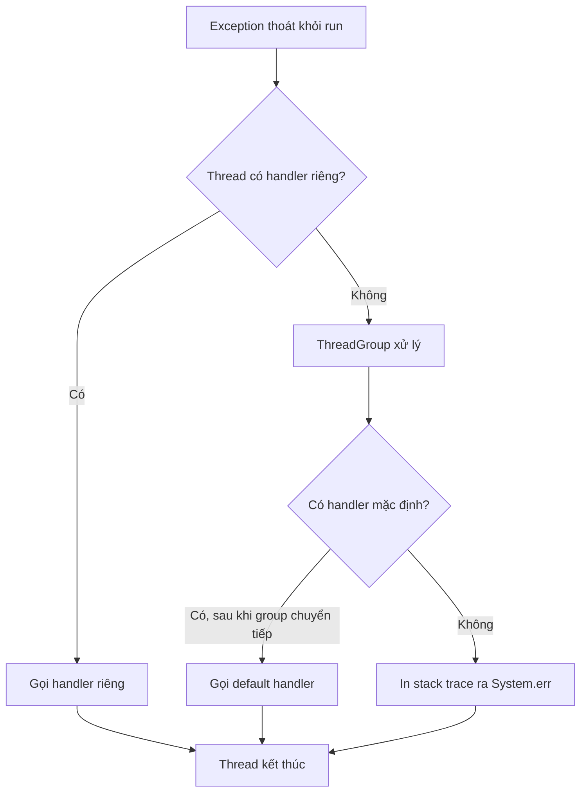

# Thiết lập UncaughtExceptionHandler và quan sát lỗi không được bắt

Khi một thread kết thúc vì một exception thoát khỏi `run()` mà không được xử lý, Java gọi `UncaughtExceptionHandler` để thông báo lỗi cuối cùng của thread đó. Handler nhận thread đã gặp lỗi và đối tượng `Throwable`, nhờ đó ứng dụng có thể ghi log, thu thập thông tin chẩn đoán hoặc gửi cảnh báo.

`UncaughtExceptionHandler` là cơ chế quan sát lỗi ở ranh giới cuối của một thread. Nó không làm thread tiếp tục chạy, không truyền exception ngược về thread đã gọi `start()`, và không thay thế việc xử lý exception tại nơi ứng dụng có thể phục hồi. Trong Java 21, có thể gắn handler cho từng thread, cấu hình handler mặc định cho ứng dụng hoặc cấu hình trực tiếp khi tạo platform thread hay virtual thread bằng `Thread.Builder`.

## 1. Uncaught exception là gì?

Một exception được xem là uncaught khi nó thoát khỏi luồng thực thi của thread mà không có `catch` nào xử lý. Với thread được tạo bằng `Runnable`, điều này thường xảy ra khi một unchecked exception như `RuntimeException` hoặc `Error` thoát khỏi phương thức `run()`.

Ví dụ:

```java
Thread worker = Thread.ofPlatform().start(() -> {
    System.out.println("Worker started");
    throw new IllegalStateException("Cannot process the request");
});
```

`IllegalStateException` không được bắt trong task, vì vậy thread `worker` kết thúc bất thường. JVM sẽ thực hiện cơ chế phân phối uncaught exception cho thread đó. Nếu có handler phù hợp, handler được gọi; nếu không, hành vi mặc định thường là ghi stack trace ra `System.err`.

Exception không tự động truyền sang thread đã gọi `worker.start()`. Lệnh `start()` trả về ngay sau khi bắt đầu thread; thread gọi và thread chạy task có call stack độc lập. Tương tự, `worker.join()` chỉ đợi thread kết thúc, không ném lại exception mà worker đã gặp.

Nếu ứng dụng có thể xử lý lỗi và tiếp tục công việc, hãy dùng `try-catch` ngay tại tầng có đủ ngữ cảnh để phục hồi:

```java
Thread worker = Thread.ofPlatform().start(() -> {
    try {
        processRequest();
    } catch (RecoverableException ex) {
        retryOrRecordFailure(ex);
    }
});
```

Chỉ những exception còn thoát khỏi thread mới đi đến `UncaughtExceptionHandler`.

## 2. UncaughtExceptionHandler hoạt động như thế nào?

`Thread.UncaughtExceptionHandler` là một functional interface với phương thức:

```java
void uncaughtException(Thread t, Throwable e);
```

Hai tham số có ý nghĩa:

- `t`: thread sắp kết thúc vì exception không được bắt.
- `e`: exception hoặc error đã thoát khỏi thread.

Handler được gọi trong quá trình thread kết thúc bất thường. Sau khi handler xử lý xong, thread vẫn kết thúc; handler không có quyền tiếp tục call stack từ nơi exception xảy ra.

Ví dụ handler tối giản:

```java
Thread.UncaughtExceptionHandler handler = (thread, error) -> {
    System.err.printf(
            "Uncaught exception in thread %s (id=%d)%n",
            thread.getName(), thread.threadId());
    error.printStackTrace(System.err);
};
```

`threadId()` là API hiện hành để lấy định danh thread trong Java 21. Handler nhận `Throwable`, vì vậy có thể quan sát cả exception thông thường và các lỗi thuộc nhóm `Error`.

## 3. Thiết lập handler cho một thread

Có thể gắn handler trực tiếp lên đối tượng `Thread` trước khi start:

```java
Thread.UncaughtExceptionHandler handler = (thread, error) -> {
    System.err.println("Thread failed: " + thread.getName());
    error.printStackTrace(System.err);
};

Thread worker = new Thread(() -> {
    throw new IllegalArgumentException("Invalid input");
}, "import-worker");

worker.setUncaughtExceptionHandler(handler);
worker.start();
```

`setUncaughtExceptionHandler` đặt handler riêng cho thread. Khi thread đó gặp uncaught exception, handler riêng được ưu tiên hơn cơ chế handler của thread group.

Trong Java 21, có thể cấu hình handler ngay khi tạo thread bằng `Thread.Builder`. Cách này gom tên thread, loại thread và handler vào cùng một cấu hình:

```java
Thread.UncaughtExceptionHandler handler = (thread, error) -> {
    System.err.printf("Failure in %s%n", thread.getName());
    error.printStackTrace(System.err);
};

Thread worker = Thread.ofPlatform()
        .name("report-worker")
        .uncaughtExceptionHandler(handler)
        .start(() -> {
            throw new IllegalStateException("Report generation failed");
        });
```

`uncaughtExceptionHandler(handler)` đặt handler trên thread được builder tạo ra. Có thể sử dụng cùng phương thức builder với virtual thread:

```java
Thread virtualWorker = Thread.ofVirtual()
        .name("virtual-request")
        .uncaughtExceptionHandler(handler)
        .start(() -> {
            throw new IllegalStateException("Request processing failed");
        });
```

Virtual thread cũng là một `Thread`, vì vậy cơ chế uncaught exception handler được áp dụng cho cả platform thread và virtual thread. Handler nhận chính virtual thread đã gặp lỗi; không nên giả định tham số `thread` là carrier platform thread đang thực thi virtual thread đó.

## 4. Thiết lập handler mặc định cho ứng dụng

Nếu nhiều thread cần cùng một chính sách ghi nhận lỗi, có thể thiết lập default uncaught exception handler:

```java
Thread.setDefaultUncaughtExceptionHandler((thread, error) -> {
    System.err.printf(
            "Unhandled failure: name=%s, id=%d, virtual=%s%n",
            thread.getName(), thread.threadId(), thread.isVirtual());
    error.printStackTrace(System.err);
});
```

`Thread.setDefaultUncaughtExceptionHandler(...)` thiết lập handler mặc định ở phạm vi JVM. Handler này được dùng cho thread không có handler riêng khi cơ chế handler của thread group chuyển lỗi đến default handler.

Có thể đọc handler mặc định hiện tại bằng:

```java
Thread.UncaughtExceptionHandler currentDefault =
        Thread.getDefaultUncaughtExceptionHandler();
```

Truyền `null` vào `setDefaultUncaughtExceptionHandler(null)` sẽ xóa default handler đã cấu hình.

Default handler có phạm vi rộng. Một ứng dụng lớn có thể có framework, thư viện hoặc executor với chính sách log riêng. Vì vậy, hãy thiết lập nó tại điểm khởi tạo ứng dụng nếu thực sự cần một chính sách chung; tránh ghi đè handler mặc định từ một thư viện dùng chung mà không có sự phối hợp.

## 5. Thứ tự chọn handler

Khi thread kết thúc vì uncaught exception, Java tìm handler theo cơ chế sau:

1. Nếu thread có handler được đặt bằng `setUncaughtExceptionHandler` hoặc qua `Thread.Builder`, JVM gọi handler đó.
2. Nếu không có handler riêng, `ThreadGroup` của thread đóng vai trò handler.
3. Với cách xử lý mặc định của `ThreadGroup`, lỗi được chuyển lên thread group cha; ở group gốc, default handler của JVM được gọi nếu đã được cấu hình.
4. Nếu không có default handler, stack trace thường được ghi ra `System.err`.

Có thể hình dung luồng xử lý:



Sơ đồ mô tả cách xử lý mặc định của thread group. Một `ThreadGroup` tùy biến có thể ghi đè cách xử lý của nó; trong mã ứng dụng mới, thường nên dùng handler theo thread hoặc default handler thay vì xây dựng chính sách mới dựa trên kế thừa `ThreadGroup`.

## 6. Handler không phải nơi phục hồi thread

Khi `uncaughtException` được gọi, thread đã đi đến giai đoạn kết thúc do lỗi không được bắt. Handler chỉ có thể quan sát và xử lý thông tin lỗi; nó không thể đưa thread trở lại câu lệnh đã ném exception.

Ví dụ handler có thể ghi log và phát tín hiệu giám sát:

```java
Thread.UncaughtExceptionHandler handler = (thread, error) -> {
    logger.error(
            "Thread {} terminated unexpectedly",
            thread.getName(), error);
    alertingService.recordThreadFailure(thread.threadId(), error);
};
```

Nếu cần retry, hãy thiết kế retry ở tầng quản lý task hoặc tầng nghiệp vụ. Handler không có đủ thông tin để tự khởi động lại đúng công việc, biết transaction đã commit chưa hoặc quyết định request có an toàn để chạy lại hay không.

Không nên thực hiện tác vụ kéo dài, chờ I/O lâu hoặc phụ thuộc nhiều vào các dịch vụ khác trong handler. Handler có thể được gọi đồng thời bởi nhiều thread khác nhau; phần triển khai phải an toàn khi chạy đồng thời và tránh tự ném thêm exception. Theo hợp đồng của JVM, exception phát sinh từ chính phương thức handler sẽ bị bỏ qua.

Một cách triển khai an toàn là giữ handler ngắn gọn: ghi nhận thread, exception và stack trace; sau đó gửi sự kiện chẩn đoán sang một cơ chế logging hoặc monitoring đã được thiết kế để xử lý bất đồng bộ.

## 7. Quan sát lỗi khi dùng ExecutorService

Một điểm dễ nhầm là exception của task chạy qua executor không phải lúc nào cũng trở thành uncaught exception của worker thread. Cách gửi task quyết định exception được xử lý như thế nào.

### Dùng execute(Runnable)

Với `ThreadPoolExecutor`, task được gửi bằng `execute` chạy trực tiếp trong worker. Nếu `Runnable.run()` ném unchecked exception và exception thoát khỏi task, worker có thể kết thúc bất thường; uncaught exception handler của worker thread có thể được gọi.

```java
import java.util.concurrent.ExecutorService;
import java.util.concurrent.Executors;

Thread.UncaughtExceptionHandler handler = (thread, error) -> {
    System.err.println("Worker terminated: " + thread.getName());
    error.printStackTrace(System.err);
};

var threadFactory = Thread.ofPlatform()
        .uncaughtExceptionHandler(handler)
        .factory();

try (ExecutorService executor =
             Executors.newSingleThreadExecutor(threadFactory)) {
    executor.execute(() -> {
        throw new IllegalStateException("Failure in execute task");
    });
}
```

Ví dụ dùng `ThreadFactory` để cấu hình handler cho worker platform thread do executor tạo. Hành vi cụ thể còn phụ thuộc implementation của `ExecutorService`; ví dụ trên dùng executor chuẩn dựa trên `ThreadPoolExecutor`.

### Dùng submit(Runnable) hoặc submit(Callable)

`submit` trả về `Future`. Với các executor chuẩn, task được bọc trong `FutureTask`; exception được bắt và lưu trong `Future`, thay vì thoát khỏi `run()` của worker thread. Vì vậy, uncaught exception handler thường không được gọi cho lỗi của task gửi bằng `submit`.

Ứng dụng phải đọc kết quả `Future` để quan sát lỗi:

```java
import java.util.concurrent.ExecutionException;
import java.util.concurrent.ExecutorService;
import java.util.concurrent.Executors;
import java.util.concurrent.Future;

static void observeSubmittedFailure() throws InterruptedException {
    try (ExecutorService executor = Executors.newSingleThreadExecutor()) {
        Future<?> future = executor.submit(() -> {
            throw new IllegalStateException("Failure in submitted task");
        });

        try {
            future.get();
        } catch (ExecutionException ex) {
            Throwable taskFailure = ex.getCause();
            System.err.println("Task failed: " + taskFailure);
        }
    }
}
```

`Future.get()` ném `ExecutionException` khi task kết thúc bằng exception; exception gốc có thể lấy qua `getCause()`. Nếu không gọi `get()` hoặc không kiểm tra trạng thái hoàn tất theo cách khác, ứng dụng có thể bỏ sót lỗi đã được lưu trong future.

Với `CompletableFuture`, lỗi cũng được lưu trong trạng thái hoàn tất của stage. Hãy quan sát bằng `whenComplete`, `handle`, hoặc các phương thức kết hợp phù hợp thay vì trông đợi uncaught handler của thread chạy stage.

## 8. Virtual thread và UncaughtExceptionHandler

Virtual thread hỗ trợ handler riêng giống platform thread. Có thể gắn handler trực tiếp khi tạo bằng `Thread.ofVirtual()`:

```java
Thread.UncaughtExceptionHandler handler = (thread, error) -> {
    System.err.printf(
            "Virtual thread %s failed: %s%n",
            thread.getName(), error);
};

Thread task = Thread.ofVirtual()
        .name("background-request")
        .uncaughtExceptionHandler(handler)
        .start(() -> {
            throw new IllegalArgumentException("Invalid request");
        });

task.join();
```

Khi virtual thread kết thúc bất thường, handler nhận virtual thread đó. Việc virtual thread đã mount lên carrier nào không làm thay đổi danh tính thread trong tham số handler.

Nếu dùng `Executors.newVirtualThreadPerTaskExecutor()` và gọi `submit`, exception được lưu trong `Future` giống cơ chế submit thông thường. Nếu cần quan sát bằng uncaught handler, hãy hiểu rõ task được start trực tiếp hay được executor bọc trong future. Không dùng default handler để thay thế việc kiểm tra kết quả của các task đã submit.

## 9. Ghi log đủ thông tin để điều tra

Một handler hữu ích nên ghi nhận ít nhất:

- Tên và ID của thread (`getName()` và `threadId()`).
- Thread là virtual hay platform (`isVirtual()`).
- Exception đầy đủ và stack trace, không chỉ ghi `getMessage()`.
- Correlation ID hoặc thông tin ngữ cảnh đã được truyền an toàn nếu ứng dụng có cơ chế đó.
- Thời điểm, service và thành phần chịu trách nhiệm nếu hệ thống logging tự bổ sung các trường này.

Ví dụ dùng `System.err` cho chương trình nhỏ:

```java
Thread.UncaughtExceptionHandler handler = (thread, error) -> {
    System.err.printf(
            "[uncaught] name=%s id=%d virtual=%s%n",
            thread.getName(), thread.threadId(), thread.isVirtual());
    error.printStackTrace(System.err);
};
```

Trong ứng dụng thực tế, nên tích hợp handler với logging framework và hệ thống giám sát đã dùng. Tránh ghi dữ liệu nhạy cảm trong message hoặc stack context; lỗi không được bắt có thể chứa đường dẫn, dữ liệu request hoặc thông tin nội bộ.

## 10. Những lỗi thiết kế thường gặp

| Cách làm | Vấn đề | Cách xử lý phù hợp |
|---|---|---|
| Nghĩ rằng `join()` sẽ ném lại exception của thread con | `join()` chỉ chờ thread kết thúc | Dùng handler để quan sát hoặc dùng `Future` để nhận kết quả/lỗi |
| Dùng uncaught handler để retry task | Thread đã kết thúc, handler không có hợp đồng chạy lại task | Thiết kế retry tại tầng task hoặc nghiệp vụ |
| Chỉ gắn handler cho thread chính | Thread con có handler và vòng đời riêng | Cấu hình handler cho thread được tạo hoặc dùng default handler có chủ đích |
| Mong `submit()` kích hoạt uncaught handler | Exception thường được lưu trong `Future` | Gọi `Future.get()` và xử lý `ExecutionException` |
| Đặt logic blocking dài trong handler | Handler có thể làm chậm quá trình kết thúc và xử lý đồng thời | Ghi nhận tối thiểu, chuyển chẩn đoán sang hệ thống chuyên trách |
| Coi handler mặc định là chính sách retry toàn ứng dụng | Handler chỉ quan sát lỗi cuối cùng của thread | Phân chia rõ logging, retry, transaction và phục hồi |

## 11. Nguyên tắc sử dụng

1. Dùng handler riêng khi một thread có chính sách quan sát lỗi đặc thù.
2. Dùng default handler tại điểm khởi tạo ứng dụng khi cần một chính sách dự phòng chung.
3. Cấu hình handler qua `Thread.Builder` khi tạo platform thread hoặc virtual thread trong Java 21.
4. Xử lý exception tại nơi có thể phục hồi; để uncaught handler làm lớp quan sát cuối cùng.
5. Phân biệt `execute` với `submit`: lỗi của task gửi bằng `submit` cần được đọc từ `Future`.
6. Giữ handler ngắn gọn, an toàn khi nhiều thread gọi đồng thời và không phụ thuộc vào việc thread có thể tiếp tục.
7. Ghi stack trace và định danh thread đủ để điều tra; không chỉ ghi message.

## 12. Tổng kết

`UncaughtExceptionHandler` nhận thông báo khi một thread kết thúc vì exception không được bắt. Java 21 cho phép cấu hình handler riêng qua `Thread.setUncaughtExceptionHandler` hoặc `Thread.Builder.uncaughtExceptionHandler`, và cấu hình default handler qua `Thread.setDefaultUncaughtExceptionHandler`.

Handler là cơ chế quan sát và ghi nhận lỗi, không phải cơ chế phục hồi thread. Cần phân biệt lỗi thoát trực tiếp khỏi `Thread.run()` với lỗi task được executor lưu trong `Future`, đặc biệt khi dùng `submit`. Với virtual thread, handler vẫn nhận chính virtual thread đã gặp lỗi. Thiết kế đúng các ranh giới này giúp ứng dụng không bỏ sót lỗi và có thông tin cần thiết để chẩn đoán.

## Tài liệu tham khảo

- [Java SE 21 API — Thread.UncaughtExceptionHandler](https://docs.oracle.com/en/java/javase/21/docs/api/java.base/java/lang/Thread.UncaughtExceptionHandler.html) — hợp đồng callback khi thread kết thúc do uncaught exception.
- [Java SE 21 API — Thread](https://docs.oracle.com/en/java/javase/21/docs/api/java.base/java/lang/Thread.html) — `setUncaughtExceptionHandler`, default handler, `Thread.Builder`, platform thread và virtual thread.
- [Java SE 21 API — Thread.Builder](https://docs.oracle.com/en/java/javase/21/docs/api/java.base/java/lang/Thread.Builder.html) — cấu hình handler khi tạo thread.
- [Java SE 21 API — ExecutorService](https://docs.oracle.com/en/java/javase/21/docs/api/java.base/java/util/concurrent/ExecutorService.html) — hợp đồng `execute`, `submit`, `Future` và vòng đời executor.
- [Java SE 21 API — Future](https://docs.oracle.com/en/java/javase/21/docs/api/java.base/java/util/concurrent/Future.html) — lấy kết quả và quan sát exception qua `get()`.
- [Java SE 21 API — ThreadPoolExecutor](https://docs.oracle.com/en/java/javase/21/docs/api/java.base/java/util/concurrent/ThreadPoolExecutor.html) — hành vi worker khi task thực thi qua executor.
