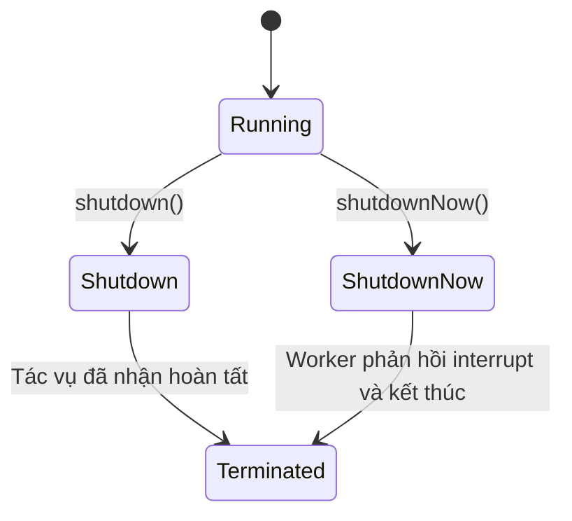

# Quản lý shutdown, shutdownNow và chờ kết thúc executor

Executor giúp tách việc gửi tác vụ khỏi cách tạo và quản lý thread. Nhưng khi ứng dụng dừng, cần có quy trình kết thúc executor rõ ràng: ngừng nhận tác vụ mới, cho các tác vụ đã gửi cơ hội hoàn tất, yêu cầu dừng những tác vụ còn chạy nếu hết thời gian chờ, rồi xác nhận executor đã kết thúc.

Java cung cấp ba phương thức chính cho vòng đời này: `shutdown()`, `shutdownNow()` và `awaitTermination()`. Trong Java 21, `ExecutorService` còn triển khai `AutoCloseable`, vì vậy có thể dùng try-with-resources để đóng executor theo cơ chế orderly shutdown. Mỗi cách có hành vi và mức độ chờ khác nhau; chọn sai có thể làm mất tác vụ đang chờ, giữ ứng dụng không thoát hoặc khiến việc shutdown kéo dài ngoài dự kiến.

## Mục tiêu học tập

Sau bài học, bạn có thể:

- Phân biệt shutdown theo cách graceful và yêu cầu dừng khẩn cấp.
- Giải thích chính xác hành vi của `shutdown()`, `shutdownNow()` và `awaitTermination()`.
- Thiết kế quy trình shutdown có thời hạn chờ và xử lý interruption đúng cách.
- Viết tác vụ có khả năng phản hồi interrupt và giải phóng tài nguyên.
- Hiểu `ExecutorService.close()` trong Java 21 và khi nào nên dùng try-with-resources.
- Tránh các lỗi thường gặp như submit sau shutdown, chờ kết thúc từ chính worker hoặc giả định `shutdownNow()` giết được thread.

## 1. Vòng đời của ExecutorService

Một `ExecutorService` thường trải qua các trạng thái khái quát:

1. **Đang hoạt động:** chấp nhận tác vụ mới và thực thi các tác vụ đã nhận.
2. **Đã shutdown:** không nhận tác vụ mới; các tác vụ đã submit trước đó vẫn được xử lý theo chính sách của executor.
3. **Đã terminated:** mọi tác vụ đã kết thúc và executor không còn worker hoạt động.



Hai phương thức `isShutdown()` và `isTerminated()` cho biết trạng thái:

- `isShutdown()` trả về `true` sau khi đã gọi `shutdown()` hoặc `shutdownNow()`.
- `isTerminated()` chỉ trả về `true` khi quá trình shutdown đã hoàn tất và mọi tác vụ đã kết thúc.

Do đó, `isShutdown() == true` không có nghĩa là executor đã dừng hoàn toàn. Nếu cần xác nhận không còn tác vụ chạy, hãy chờ termination hoặc kiểm tra `isTerminated()` sau khi đã chờ.

## 2. `shutdown()` — ngừng nhận việc mới và hoàn tất việc đã nhận

`shutdown()` bắt đầu quá trình orderly shutdown:

- Executor ngừng nhận tác vụ mới.
- Các tác vụ đã submit trước đó tiếp tục được thực thi.
- Phương thức trả về ngay sau khi khởi tạo shutdown; nó không chờ mọi tác vụ hoàn tất.
- Gọi `submit()` hoặc `execute()` sau shutdown sẽ bị từ chối, thường bằng `RejectedExecutionException`.

Ví dụ:

```java
ExecutorService executor = Executors.newFixedThreadPool(3);

executor.submit(() -> generateReport("monthly"));
executor.submit(() -> generateReport("weekly"));

executor.shutdown();

System.out.println(executor.isShutdown()); // true
// Không thể gửi thêm tác vụ mới vào executor này.
```

Hai tác vụ đã gửi vẫn có cơ hội chạy đến khi hoàn tất. `shutdown()` không chủ động interrupt các worker đang thực thi.

### 2.1. Khi nào dùng shutdown?

Dùng `shutdown()` khi ứng dụng đang dừng bình thường và muốn hoàn tất công việc đã nhận, chẳng hạn:

- Hoàn tất các tác vụ xuất báo cáo đã được tiếp nhận.
- Xử lý nốt các message đã lấy khỏi hàng đợi.
- Hoàn tất ghi dữ liệu hoặc flush các công việc nền.
- Dừng một dịch vụ mà không nhận thêm request mới.

Trong server, thứ tự phối hợp thường là ngừng nhận request mới ở tầng ingress trước, sau đó shutdown executor xử lý request và chờ các request đang chạy kết thúc. Nếu vẫn tiếp tục gửi việc trong lúc shutdown, ứng dụng có thể nhận `RejectedExecutionException`.

## 3. `shutdownNow()` — yêu cầu dừng sớm theo cơ chế best effort

`shutdownNow()` yêu cầu executor dừng càng sớm càng tốt:

- Ngừng nhận tác vụ mới.
- Cố gắng interrupt các thread đang thực thi tác vụ.
- Ngăn các tác vụ đang chờ bắt đầu chạy.
- Trả về danh sách các tác vụ chưa bắt đầu thực thi tại thời điểm xử lý shutdown.

```java
ExecutorService executor = Executors.newFixedThreadPool(2);

executor.submit(() -> processLongTask());
executor.submit(() -> processAnotherTask());

List<Runnable> notStarted = executor.shutdownNow();
System.out.println("Tasks not started: " + notStarted.size());
```

Giá trị trả về không phải danh sách các tác vụ đang chạy bị interrupt. Nó là các tác vụ chưa bắt đầu được thực thi và đã bị loại khỏi hàng đợi của executor. Với tác vụ gửi bằng `submit()`, phần tử trả về có thể là wrapper như `FutureTask`, vì vậy không nên giả định nó luôn là object `Runnable` nghiệp vụ ban đầu.

### 3.1. shutdownNow không giết thread

Tên phương thức có thể khiến người đọc nghĩ rằng mọi thread sẽ bị dừng ngay lập tức. Thực tế, executor chỉ cố gắng interrupt các worker. Java không cưỡng bức kết thúc một thread đang chạy.

Nếu tác vụ:

- Không kiểm tra interrupt flag.
- Bắt `InterruptedException` rồi bỏ qua.
- Đang gọi một API blocking không phản hồi interrupt.
- Đang thực thi một đoạn tính toán dài mà không có điểm kiểm tra hủy.

thì tác vụ có thể tiếp tục chạy sau `shutdownNow()`. Executor chỉ chuyển sang terminated sau khi các worker và tác vụ thực sự kết thúc.

Hãy thiết kế tác vụ có điểm dừng hợp tác, đặt timeout cho I/O và luôn giải phóng tài nguyên trong `finally` hoặc try-with-resources.

## 4. `awaitTermination()` — chờ executor kết thúc

`awaitTermination(timeout, unit)` làm thread gọi phương thức chờ executor kết thúc, tối đa trong khoảng thời gian đã chỉ định. Phương thức này không tự khởi tạo shutdown.

Kết quả:

- Trả về `true` nếu executor đã terminated trong thời gian chờ.
- Trả về `false` nếu hết thời gian mà executor chưa terminated.
- Ném `InterruptedException` nếu thread đang chờ bị interrupt.

Thông thường, gọi `shutdown()` trước rồi mới gọi `awaitTermination()`:

```java
executor.shutdown();

try {
    boolean finished = executor.awaitTermination(30, TimeUnit.SECONDS);
    if (!finished) {
        System.out.println("Executor vẫn còn tác vụ");
    }
} catch (InterruptedException interrupted) {
    Thread.currentThread().interrupt();
}
```

Nếu hết 30 giây và phương thức trả về `false`, executor vẫn ở trạng thái shutdown và các tác vụ còn lại vẫn có thể tiếp tục chạy. Ứng dụng cần quyết định chờ thêm, yêu cầu dừng sớm bằng `shutdownNow()` hoặc ghi nhận shutdown chưa hoàn tất.

### 4.1. Chờ không có nghĩa là hủy

`awaitTermination()` chỉ quan sát và chờ trạng thái. Nó không interrupt tác vụ, không xóa hàng đợi và không thay đổi chính sách shutdown.

Nếu cần yêu cầu dừng sau thời hạn, hãy kết hợp:

1. Gọi `shutdown()` để ngừng nhận việc mới và cho việc đã nhận cơ hội hoàn tất.
2. Gọi `awaitTermination()` trong một khoảng thời gian hợp lý.
3. Nếu hết thời gian, gọi `shutdownNow()` để yêu cầu interrupt worker và loại bỏ tác vụ chưa bắt đầu.
4. Có thể chờ thêm một khoảng thời gian để các tác vụ phản hồi interrupt.

## 5. Mẫu graceful shutdown có giới hạn thời gian

Đây là mẫu thường dùng khi muốn ưu tiên hoàn tất tác vụ, nhưng vẫn có giới hạn thời gian dừng:

```java
static void shutdownAndAwaitTermination(ExecutorService executor) {
    executor.shutdown();

    try {
        if (!executor.awaitTermination(30, TimeUnit.SECONDS)) {
            executor.shutdownNow();

            if (!executor.awaitTermination(30, TimeUnit.SECONDS)) {
                System.err.println("Executor vẫn chưa kết thúc");
            }
        }
    } catch (InterruptedException interrupted) {
        executor.shutdownNow();
        Thread.currentThread().interrupt();
    }
}
```

Trình tự này có hai giai đoạn:

- **Grace period:** chờ các tác vụ hoàn tất tự nhiên sau `shutdown()`.
- **Forced cancellation request:** nếu hết grace period, gọi `shutdownNow()` để yêu cầu dừng các tác vụ còn chạy và loại bỏ các tác vụ chưa bắt đầu.

Nếu lần chờ thứ hai cũng hết thời gian, phương thức ghi nhận executor chưa kết thúc. Không nên báo ứng dụng đã shutdown hoàn toàn trong khi `isTerminated()` vẫn là `false`.

### 5.1. Xử lý InterruptedException khi đang chờ

`awaitTermination()` ném `InterruptedException` khi thread gọi nó bị interrupt. Khi exception được ném, interrupt status của thread bị xóa. Nếu tầng hiện tại không thể tiếp tục truyền `InterruptedException` cho caller, hãy khôi phục trạng thái bằng:

```java
Thread.currentThread().interrupt();
```

Trong quy trình shutdown, nếu thread điều phối bị interrupt, thường nên gọi `shutdownNow()` để yêu cầu dừng executor rồi khôi phục interrupt flag trước khi trả quyền điều khiển cho tầng trên.

Không bắt `InterruptedException` rồi bỏ qua. Làm vậy khiến tầng điều phối phía trên không biết yêu cầu hủy đã xảy ra và có thể tiếp tục chờ hoặc xử lý công việc ngoài dự kiến.

## 6. Viết tác vụ phản hồi interrupt

Để `shutdownNow()` có hiệu quả, tác vụ phải hợp tác với cơ chế interruption.

### 6.1. Vòng lặp kiểm tra interrupt flag

```java
static void consumeMessages() {
    while (!Thread.currentThread().isInterrupted()) {
        Message message = pollNextMessage();
        if (message != null) {
            process(message);
        }
    }
}
```

`isInterrupted()` kiểm tra trạng thái mà không xóa interrupt flag. Nếu tác vụ dùng vòng lặp dài, hãy đặt điểm kiểm tra ở vị trí phù hợp để có thể dừng trong thời gian dự kiến.

### 6.2. Xử lý API ném InterruptedException

Một số API như `Thread.sleep()`, `BlockingQueue.take()` hoặc `BlockingQueue.put()` có thể ném `InterruptedException`:

```java
static void workerLoop(BlockingQueue<Task> queue) {
    try {
        while (true) {
            Task task = queue.take();
            task.run();
        }
    } catch (InterruptedException interrupted) {
        Thread.currentThread().interrupt();
    } finally {
        releaseWorkerResources();
    }
}
```

Khi `take()` bị interrupt, tác vụ thoát vòng lặp và giải phóng tài nguyên. Khôi phục interrupt flag giúp các tầng gọi phía trên có thể quan sát yêu cầu interrupt.

Nếu phương thức hiện tại có thể khai báo `throws InterruptedException`, có thể truyền exception lên thay vì bắt và khôi phục ngay. Điều quan trọng là không nuốt tín hiệu hủy.

### 6.3. Không nuốt interrupt

Tránh mẫu sau:

```java
try {
    Thread.sleep(10_000);
} catch (InterruptedException ignored) {
    // Tiếp tục chạy như chưa có chuyện gì xảy ra.
}
```

Mẫu này bỏ mất yêu cầu dừng. Hãy truyền exception lên hoặc khôi phục interrupt status rồi kết thúc tác vụ:

```java
try {
    Thread.sleep(10_000);
} catch (InterruptedException interrupted) {
    Thread.currentThread().interrupt();
    return;
}
```

Đối với I/O, cần kiểm tra API cụ thể có hỗ trợ interrupt hoặc timeout hay không. Interruption không bảo đảm hủy được mọi lời gọi native, socket hoặc database ngay lập tức.

## 7. Tác vụ đang chờ và Future khi shutdownNow

`shutdownNow()` trả về các `Runnable` chưa bắt đầu chạy. Điều này đặc biệt đáng chú ý với tác vụ gửi bằng `submit()`:

```java
Future<Result> future = executor.submit(this::calculate);
```

Executor có thể lưu một wrapper nội bộ đại diện cho `Future`, nên danh sách trả về từ `shutdownNow()` không nhất thiết chứa trực tiếp phương thức hoặc đối tượng nghiệp vụ đã gửi. Nếu ứng dụng cần theo dõi tác vụ bị loại khỏi hàng đợi, nên tự quản lý task ID hoặc trạng thái nghiệp vụ thay vì ép kiểu phần tử trả về.

Các `Future` tương ứng với tác vụ chưa bắt đầu có thể chưa hoàn tất theo cách ứng dụng mong đợi nếu executor loại bỏ chúng khỏi hàng đợi. Khi cần bảo đảm caller nhận được trạng thái hủy, hãy thiết kế cơ chế cancellation và thông báo kết quả ở tầng ứng dụng, đồng thời kiểm tra hành vi của executor cụ thể.

Với tác vụ đang chạy, `shutdownNow()` yêu cầu interrupt worker. `Future.cancel(true)` cũng yêu cầu interrupt nếu tác vụ đang chạy, nhưng vẫn phụ thuộc tác vụ có phản hồi interrupt hay không. Không coi `cancel(true)` hoặc `shutdownNow()` là bảo đảm tác vụ đã dừng.

## 8. `ExecutorService.close()` và try-with-resources trong Java 21

Từ Java 19, `ExecutorService` mở rộng `AutoCloseable`. Java 21 vì vậy cho phép quản lý executor bằng try-with-resources:

```java
try (ExecutorService executor = Executors.newFixedThreadPool(4)) {
    executor.submit(() -> writeAuditRecord("started"));
    executor.submit(() -> refreshCache());
}
```

Khi rời khỏi khối `try`, `close()` bắt đầu orderly shutdown và chờ các tác vụ đã submit hoàn tất trước khi trả về. Nếu thread đóng executor bị interrupt trong lúc chờ, `close()` chuyển sang yêu cầu dừng sớm bằng `shutdownNow()`, tiếp tục chờ các tác vụ kết thúc và khôi phục interrupt status khi hoàn tất theo hợp đồng của `ExecutorService`.

Điều này làm try-with-resources phù hợp với executor có công việc hữu hạn, chẳng hạn chạy một nhóm tác vụ rồi chờ toàn bộ hoàn tất. Tuy nhiên, `close()` có thể chờ lâu nếu tác vụ bị treo hoặc không phản hồi interruption.

### 8.1. Khi nào dùng try-with-resources?

Dùng khi phạm vi sở hữu executor có ranh giới rõ và muốn đóng executor sau khi gửi xong một nhóm công việc:

```java
static List<Result> calculateAll(List<Input> inputs) throws Exception {
    try (ExecutorService executor = Executors.newVirtualThreadPerTaskExecutor()) {
        List<Future<Result>> futures = new ArrayList<>();

        for (Input input : inputs) {
            futures.add(executor.submit(() -> calculate(input)));
        }

        List<Result> results = new ArrayList<>();
        for (Future<Result> future : futures) {
            results.add(future.get());
        }
        return results;
    }
}
```

`close()` bảo đảm executor được shutdown khi rời khối `try`, kể cả khi có exception trong quá trình lấy kết quả. Nếu phương thức `get()` bị interrupt, try-with-resources vẫn đóng executor theo hợp đồng `close()`.

### 8.2. Khi nào cần shutdown thủ công?

Với executor sống lâu theo vòng đời ứng dụng, thường cần shutdown ở lifecycle hook của ứng dụng hoặc thành phần quản lý. Khi đó, cần một chính sách thời gian chờ cụ thể và khả năng báo cáo nếu executor chưa dừng. Dùng `shutdown()` + `awaitTermination()` + `shutdownNow()` giúp kiểm soát grace period và giới hạn chờ rõ ràng hơn.

Không đặt một executor sống suốt ứng dụng vào try-with-resources của một request hoặc một phương thức ngắn nếu executor cần tiếp tục phục vụ các request sau đó.

## 9. Phân biệt shutdown executor với shutdown ứng dụng

Gọi `shutdown()` chỉ tác động lên executor cụ thể. Nó không tự dừng server, scheduler, message consumer hoặc các executor khác trong ứng dụng.

Một trình tự shutdown ở cấp ứng dụng thường cần:

1. Ngừng nhận request hoặc message mới.
2. Ngừng phát sinh tác vụ nền mới.
3. Gọi `shutdown()` trên các executor sở hữu bởi ứng dụng.
4. Chờ các executor kết thúc trong giới hạn thời gian.
5. Nếu hết thời gian, gọi `shutdownNow()` và chờ thêm theo chính sách.
6. Sau khi worker kết thúc, đóng các tài nguyên dùng chung mà worker cần, ví dụ connection pool hoặc client.
7. Ghi nhận rõ thành phần nào đã terminated và thành phần nào không dừng đúng hạn.

Thứ tự đóng rất quan trọng. Nếu đóng database pool trước khi executor xử lý xong, các tác vụ còn lại có thể lỗi khi lấy connection. Hãy đóng executor trước, chờ worker hoàn tất, rồi mới đóng dependency mà chúng sử dụng.

## 10. Các lỗi thường gặp

| Lỗi | Hậu quả | Cách xử lý |
|---|---|---|
| Chỉ gọi `shutdown()` rồi giả định executor đã dừng | Tác vụ vẫn có thể đang chạy | Dùng `awaitTermination()` hoặc `close()` khi cần chờ |
| Dùng `shutdownNow()` như lệnh kill thread | Tác vụ không phản hồi interrupt vẫn chạy | Thiết kế tác vụ cooperative cancellation và timeout |
| Gọi `awaitTermination()` trước shutdown | Thread chờ nhưng executor vẫn nhận việc | Gọi `shutdown()` hoặc `shutdownNow()` trước |
| Submit sau shutdown | Nhận `RejectedExecutionException` | Dừng producer trước hoặc xử lý rejection |
| Bắt `InterruptedException` rồi bỏ qua | Mất tín hiệu hủy | Truyền exception hoặc khôi phục interrupt status |
| Đóng connection pool trước executor | Tác vụ đang chạy không lấy được connection | Dừng và chờ executor trước khi đóng dependency |
| Chờ termination từ chính worker của executor | Có thể tự chờ chính mình và không kết thúc | Điều phối shutdown từ thread bên ngoài executor |
| Không có giới hạn thời gian chờ | Shutdown có thể kéo dài vô hạn | Dùng timeout và ghi nhận trạng thái chưa kết thúc |

## 11. Ví dụ hoàn chỉnh: quản lý vòng đời một executor

Ví dụ dưới đây minh họa một thành phần sở hữu fixed thread pool, ngừng nhận công việc khi đóng và chờ worker kết thúc với giới hạn thời gian:

```java
import java.util.concurrent.ExecutorService;
import java.util.concurrent.Executors;
import java.util.concurrent.TimeUnit;

final class ReportService implements AutoCloseable {
    private final ExecutorService executor = Executors.newFixedThreadPool(4);

    void submitReport(String reportId) {
        executor.submit(() -> generate(reportId));
    }

    @Override
    public void close() {
        executor.shutdown();

        try {
            if (!executor.awaitTermination(20, TimeUnit.SECONDS)) {
                executor.shutdownNow();

                if (!executor.awaitTermination(10, TimeUnit.SECONDS)) {
                    System.err.println("Report workers did not terminate");
                }
            }
        } catch (InterruptedException interrupted) {
            executor.shutdownNow();
            Thread.currentThread().interrupt();
        }
    }

    private void generate(String reportId) {
        // Tạo báo cáo; các thao tác blocking cần timeout phù hợp.
    }
}
```

Caller có thể dùng:

```java
try (ReportService reports = new ReportService()) {
    reports.submitReport("monthly");
    reports.submitReport("weekly");
}
```

`ReportService.close()` kiểm soát chính sách shutdown của executor. Nếu lần chờ thứ hai vẫn hết thời gian, thành phần ghi log để vận hành nhận biết worker chưa dừng. Trong ứng dụng thực tế, có thể cần trả trạng thái shutdown, phát metric hoặc báo lỗi theo hợp đồng lifecycle của service.

Lưu ý: ví dụ chỉ phù hợp khi `ReportService` thực sự sở hữu executor. Nếu executor được inject từ bên ngoài và chia sẻ với thành phần khác, service không nên tự ý shutdown nó trừ khi hợp đồng ownership quy định rõ.

## 12. Checklist trước khi triển khai shutdown

- Xác định thành phần nào sở hữu executor và chịu trách nhiệm đóng nó.
- Ngừng nguồn phát sinh task mới trước khi shutdown executor.
- Chọn graceful shutdown hay yêu cầu dừng sớm theo loại tác vụ.
- Đặt grace period và thời gian chờ sau `shutdownNow()`.
- Bảo đảm tác vụ phản hồi interrupt và giải phóng tài nguyên.
- Đặt timeout cho I/O có thể chờ lâu hoặc không phản hồi interrupt.
- Xử lý `RejectedExecutionException` nếu có khả năng submit đồng thời với shutdown.
- Khôi phục interrupt status khi bắt `InterruptedException` mà không truyền exception lên.
- Không chờ executor terminate từ một tác vụ đang chạy trong chính executor đó.
- Chờ executor trước khi đóng connection pool, client hoặc dependency mà worker cần.
- Ghi log/metric cho thời gian shutdown, số task bị bỏ lại và executor chưa terminated.
- Dùng `ExecutorService.close()` khi phạm vi executor có vòng đời hữu hạn và hành vi chờ của nó phù hợp.

## 13. Nguyên tắc thiết kế

- Dùng `shutdown()` để ngừng nhận việc mới nhưng cho tác vụ đã nhận hoàn tất.
- Dùng `shutdownNow()` khi cần yêu cầu dừng sớm; hiểu rằng nó chỉ gửi interrupt và không kill thread.
- Dùng `awaitTermination()` để chờ và xác định executor đã dừng trong thời hạn hay chưa.
- Kết hợp graceful period với forced cancellation request để shutdown có giới hạn thời gian.
- Thiết kế task có khả năng phản hồi interruption, timeout và cleanup.
- Không nuốt `InterruptedException`; truyền exception hoặc khôi phục interrupt flag.
- Dùng try-with-resources cho executor có phạm vi sở hữu ngắn; dùng lifecycle management tường minh cho executor sống lâu.
- Chỉ đóng dependency dùng chung sau khi executor đã kết thúc các tác vụ cần dependency đó.

Quản lý shutdown là một phần của thiết kế task execution, không phải thao tác dọn dẹp làm sau cùng. Khi phân biệt rõ shutdown, shutdownNow và awaitTermination, đồng thời viết tác vụ có khả năng hủy hợp tác, ứng dụng có thể dừng có kiểm soát và giảm nguy cơ mất việc hoặc giữ tài nguyên ngoài dự kiến.

## Tài liệu tham khảo

- [Java SE 21 API — `ExecutorService`](https://docs.oracle.com/en/java/javase/21/docs/api/java.base/java/util/concurrent/ExecutorService.html): `shutdown`, `shutdownNow`, `awaitTermination`, `close` và vòng đời executor.
- [Java SE 21 API — `Executor`](https://docs.oracle.com/en/java/javase/21/docs/api/java.base/java/util/concurrent/Executor.html): hợp đồng thực thi tác vụ.
- [Java SE 21 API — `Future`](https://docs.oracle.com/en/java/javase/21/docs/api/java.base/java/util/concurrent/Future.html): trạng thái hoàn tất và cancellation bằng interrupt.
- [Java SE 21 API — `Thread`](https://docs.oracle.com/en/java/javase/21/docs/api/java.base/java/lang/Thread.html): interrupt status và cơ chế interruption.
- [Java SE 21 API — `Executors`](https://docs.oracle.com/en/java/javase/21/docs/api/java.base/java/util/concurrent/Executors.html): các factory method tạo executor, bao gồm virtual-thread-per-task executor.
