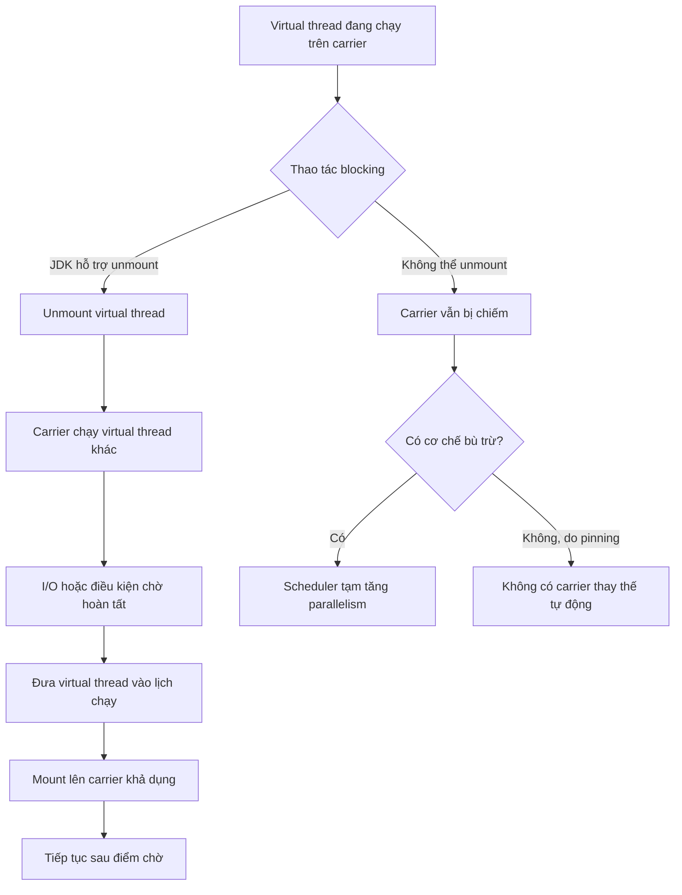

# Phân biệt I/O có thể unmount với thao tác còn chiếm carrier trên JDK 21

Virtual thread giúp ứng dụng xử lý nhiều tác vụ đồng thời khi phần lớn thời gian của mỗi tác vụ là chờ I/O. Tuy nhiên, **không phải mọi thao tác blocking đều giải phóng carrier**. Trên JDK 21, nhiều thao tác socket trong `java.net` và `java.nio.channels` được tích hợp để virtual thread unmount khi chờ. Ngược lại, nhiều thao tác filesystem vẫn giữ platform thread trong lúc hệ điều hành xử lý I/O; một số thao tác khác còn giữ carrier vì virtual thread đang bị pin.

Ba tình huống này cần được phân biệt khi thiết kế ứng dụng:

1. **Unmount được:** virtual thread tạm dừng và nhả carrier; scheduler có thể dùng carrier đó cho virtual thread khác.
2. **Không unmount nhưng scheduler bù trừ:** thao tác vẫn chiếm carrier, nhưng một số thao tác được JDK nhận diện sẽ khiến scheduler tạm thời tăng số platform thread để bù phần carrier bị giữ.
3. **Pinning:** virtual thread không thể unmount vì đang ở vùng thực thi bị pin; scheduler không tăng parallelism để bù carrier bị giữ.

Bài viết tập trung vào hành vi của JDK 21, đồng thời đánh dấu các thay đổi ở JDK mới hơn khi chúng ảnh hưởng đến lời khuyên vận hành.

## 1. Carrier được giải phóng khi nào?

Virtual thread được scheduler mount lên một platform thread gọi là carrier. Khi virtual thread đi vào một thao tác chờ mà JDK có thể tạm dừng độc lập với carrier, runtime lưu trạng thái thực thi, unmount virtual thread và trả carrier về scheduler.

Khi thao tác hoàn tất, virtual thread được đưa trở lại lịch chạy và mount lên một carrier khả dụng. Nó tiếp tục cùng call stack và danh tính `Thread` ban đầu; carrier được chọn có thể khác carrier trước đó.



Việc một phương thức được mô tả là blocking chỉ cho biết lời gọi có thể chờ. Nó không tự chứng minh virtual thread sẽ unmount. Cần biết API và implementation cụ thể có tích hợp với cơ chế virtual thread của JDK hay không.

## 2. Nhóm I/O mạng thường có thể unmount

JDK 21 cập nhật các API mạng trong `java.net` và `java.nio.channels` để hoạt động tốt với virtual thread. Khi virtual thread thực hiện thao tác mạng blocking được hỗ trợ, chẳng hạn chờ kết nối socket hoặc chờ dữ liệu socket, runtime có thể unmount nó khỏi carrier.

Các trường hợp tiêu biểu:

- `Socket.connect(...)`: chờ thiết lập kết nối TCP.
- `Socket` input/output stream: chờ đọc hoặc ghi dữ liệu socket.
- `ServerSocket.accept()`: chờ client kết nối đến server.
- `DatagramSocket.receive(...)`: chờ datagram đến.
- Các thao tác blocking tương ứng trên socket channel trong `java.nio.channels`.

Trong lúc virtual thread chờ socket, carrier có thể thực thi request khác. Đây là lý do mô hình thread-per-request với virtual thread có thể tăng throughput cho server I/O-bound mà không cần chuyển toàn bộ code sang callback hoặc non-blocking style.

### Ví dụ đọc socket bằng blocking API

```java
import java.io.BufferedReader;
import java.io.IOException;
import java.io.InputStreamReader;
import java.net.InetSocketAddress;
import java.net.Socket;
import java.nio.charset.StandardCharsets;

static String readFirstLine(String host, int port) throws IOException {
    try (Socket socket = new Socket()) {
        socket.connect(new InetSocketAddress(host, port), 2_000);
        socket.setSoTimeout(3_000);

        try (BufferedReader reader = new BufferedReader(
                new InputStreamReader(
                        socket.getInputStream(), StandardCharsets.UTF_8))) {
            return reader.readLine();
        }
    }
}
```

Có thể gọi phương thức này từ virtual thread:

```java
Thread request = Thread.ofVirtual().start(() -> {
    try {
        String response = readFirstLine("example.com", 80);
        System.out.println(response);
    } catch (IOException ex) {
        System.err.println("Network request failed: " + ex.getMessage());
    }
});

request.join();
```

Khi `connect` hoặc `readLine` phải chờ mạng, virtual thread có thể unmount; carrier được giải phóng trong thời gian chờ. `setSoTimeout` giới hạn thời gian chờ đọc socket, còn timeout truyền vào `connect` giới hạn thời gian thiết lập kết nối. Timeout giúp task không chờ vô hạn; nó không thay đổi bản chất unmount của thao tác.

Trong Java 21, các phương thức blocking trên `Socket`, `ServerSocket` và `DatagramSocket` được quy định có thể interrupt khi được gọi từ virtual thread. Interrupt virtual thread đang chờ socket sẽ đánh thức thread và đóng socket tương ứng. Vì vậy, cần xử lý `IOException` và quản lý vòng đời socket đúng cách khi dùng interrupt để hủy request.

## 3. I/O filesystem: có thể vẫn chiếm carrier trên JDK 21

Nhiều thao tác filesystem không có cơ chế chờ readiness giống socket. Tùy hệ điều hành và filesystem provider, lời gọi đọc/ghi file có thể chặn platform thread cho đến khi thao tác hệ thống hoàn tất. Trong trường hợp này, virtual thread **không unmount** khỏi carrier trong lúc file I/O đang chặn.

Ví dụ thường gặp:

- Đọc hoặc ghi file bằng `FileInputStream` và `FileOutputStream`.
- Đọc hoặc ghi file qua `Files.newInputStream`, `Files.newOutputStream` hoặc `Files.readString`.
- Các thao tác đồng bộ trên `FileChannel` và những thao tác filesystem khác phụ thuộc hệ điều hành.

Điều này không có nghĩa mọi lời gọi file đều luôn chặn lâu. Cache của hệ điều hành, loại thiết bị, filesystem, kích thước dữ liệu và trạng thái I/O đều ảnh hưởng thời gian thực tế. Điểm quan trọng là không được mặc định một file API blocking sẽ unmount virtual thread như socket API.

Ví dụ:

```java
import java.io.IOException;
import java.nio.file.Files;
import java.nio.file.Path;

static String readConfig(Path path) throws IOException {
    return Files.readString(path);
}
```

Nếu gọi `readConfig` từ virtual thread, thao tác file vẫn có thể giữ carrier trong thời gian hệ điều hành thực hiện I/O. JDK 21 có cơ chế bù trừ cho một số thao tác blocking không thể unmount: scheduler tạm thời tăng parallelism để có thêm platform thread phục vụ virtual thread khác. Vì vậy, trường hợp file I/O này khác với pinning.

### Cơ chế bù trừ trên JDK 21

JEP 444 mô tả rằng một số thao tác blocking do giới hạn hệ điều hành (ví dụ nhiều thao tác filesystem) hoặc giới hạn của JDK không thể unmount virtual thread. JDK bù trừ việc platform thread bị chiếm bằng cách tạm thời mở rộng parallelism của scheduler. Số platform thread trong `ForkJoinPool` của scheduler vì vậy có thể vượt số processor khả dụng. Ngoài I/O, JEP cũng nêu `Object.wait()` là một ví dụ về thao tác blocking do giới hạn của JDK; đây là trường hợp đồng bộ hóa riêng, không phải filesystem I/O.

Giới hạn tối đa số platform thread scheduler có thể sử dụng được cấu hình qua system property:

```text
-Djdk.virtualThreadScheduler.maxPoolSize=<maximum>
```

Đây là giới hạn kỹ thuật của scheduler, không phải cách biến file I/O thành thao tác unmount được. Không nên tăng giá trị này như biện pháp mặc định: nhiều carrier hơn cũng tiêu thụ thêm tài nguyên hệ điều hành. Trước hết hãy đo mức độ file I/O, thời gian chờ và tác động lên throughput.

## 4. Phân biệt carrier bị giữ do I/O với pinning

Hai tình huống đều có thể khiến carrier không phục vụ virtual thread khác trong một khoảng thời gian, nhưng cơ chế và cách xử lý khác nhau.

| Tình huống trên JDK 21 | Virtual thread unmount? | Scheduler tự bù bằng cách tăng parallelism? | Ví dụ |
|---|---|---|---|
| Blocking socket I/O được hỗ trợ | Có | Không cần | `Socket.read`, `ServerSocket.accept` |
| Một số blocking operation không thể unmount do giới hạn OS/JDK | Không | Có, tạm thời | Nhiều filesystem operations |
| Blocking khi virtual thread bị pin | Không | Không | I/O trong `synchronized`, blocking trong native/foreign call |
| Tính toán CPU-bound | Không có thao tác chờ để unmount | Không | Vòng lặp tính toán dài |

**Carrier capture do thao tác blocking không unmount** là giới hạn của chính thao tác. JDK 21 nhận diện một số trường hợp và có cơ chế bù trừ.

**Pinning** là trạng thái virtual thread không thể unmount vì đang ở vùng thực thi cần giữ nguyên carrier. Trong Java 21, hai nguyên nhân chính là:

1. Virtual thread đang thực thi bên trong `synchronized` block hoặc `synchronized` method.
2. Virtual thread đang thực thi native method hoặc foreign function.

Nếu một thao tác I/O blocking xảy ra trong lúc pinning, carrier bị giữ cho đến khi thao tác hoàn tất. Scheduler không bù cho pinning bằng cách tăng parallelism. Pinning ngắn hoặc không có thao tác chờ không nhất thiết gây vấn đề; pinning kéo dài và lặp lại thường xuyên mới làm giảm khả năng mở rộng đáng kể.

Ví dụ pinning trong Java 21:

```java
Object lock = new Object();

Thread virtual = Thread.ofVirtual().start(() -> {
    synchronized (lock) {
        try {
            // Trong Java 21, carrier bị giữ khi virtual thread ngủ tại đây.
            Thread.sleep(1_000);
        } catch (InterruptedException ex) {
            Thread.currentThread().interrupt();
        }
    }
});

virtual.join();
```

`Thread.sleep` thông thường cho phép unmount. Nhưng trong Java 21, virtual thread đang giữ monitor nên bị pin; carrier không được giải phóng trong thời gian ngủ.

## 5. Lưu ý riêng với java.io trong Java 21

JDK 21 điều chỉnh một số lớp `java.io` để tránh pinning do chính các monitor nội bộ của lớp. Khi được dùng trực tiếp, `BufferedInputStream`, `BufferedOutputStream`, `BufferedReader`, `BufferedWriter`, `PrintStream` và `PrintWriter` sử dụng explicit lock thay vì monitor intrinsic.

Thay đổi này giúp tránh một nguồn pinning không cần thiết khi virtual thread dùng các wrapper stream. Tuy nhiên, nó **không đảm bảo thao tác file bên dưới có thể unmount**. Ví dụ, `BufferedReader` đọc từ socket có thể hưởng lợi từ cơ chế socket I/O hỗ trợ virtual thread; `BufferedReader` đọc từ file vẫn có thể gọi filesystem operation khiến carrier bị chiếm.

Vì vậy, cần phân biệt:

- Lớp wrapper có dùng monitor khiến virtual thread bị pin hay không.
- I/O thực tế bên dưới có được JDK hỗ trợ unmount hay vẫn chặn platform thread.

Không nên kết luận chỉ từ kiểu stream ở ngoài cùng. Cần xét nguồn dữ liệu và implementation của thao tác I/O cuối cùng.

## 6. I/O qua thư viện và JDBC

Một thư viện có API đồng bộ không tự động bảo đảm mọi thao tác bên trong đều unmount. Nếu thư viện dùng socket API tương thích với virtual thread, thao tác chờ mạng có thể unmount. Nhưng nếu nó gọi native code, thực hiện filesystem I/O, giữ monitor trong khi blocking hoặc dùng một cơ chế riêng không tích hợp với scheduler, carrier có thể vẫn bị chiếm.

Với JDBC, kết quả phụ thuộc driver và đường đi thực tế của lệnh. Một truy vấn thường chờ phản hồi qua socket có thể tận dụng socket I/O hỗ trợ virtual thread. Tuy nhiên, không nên mặc định toàn bộ thời gian `executeQuery()` đều unmount: driver có thể thực hiện xử lý CPU, file I/O, native call hoặc giữ lock trong quá trình đó.

Khi kiểm tra thư viện:

1. Xác định các API blocking mà thư viện gọi ở bên trong.
2. Kiểm tra phiên bản driver và ghi chú tương thích virtual thread của nhà cung cấp.
3. Dùng workload thực tế để đo throughput, latency và mức sử dụng carrier.
4. Kiểm tra pinning và thread dump khi có dấu hiệu carrier bị giữ lâu.

Đừng tạo một pool platform thread chỉ để che mọi thao tác blocking mà chưa xác định nguyên nhân. Nếu một thư viện cần giới hạn số tác vụ đồng thời, hãy dùng semaphore hoặc giới hạn tài nguyên chuyên biệt. Với database, connection pool vốn đã giới hạn số kết nối đồng thời; tránh thêm một tầng giới hạn trùng lặp nếu không có lý do rõ ràng.

## 7. CPU-bound không phải blocking I/O

Một virtual thread đang chạy vòng lặp tính toán không chờ I/O và cũng không tự unmount chỉ vì đã dùng CPU một thời gian. Scheduler virtual thread của JDK 21 không time-slice cưỡng bức các virtual thread đang chạy. Vì vậy, một tác vụ CPU-bound dài có thể tiếp tục chiếm carrier cho đến khi kết thúc hoặc tự đi vào một điểm chờ phù hợp.

Virtual thread hướng đến khả năng mở rộng khi có nhiều task đồng thời thường xuyên chờ I/O. Nó không làm phép tính chạy nhanh hơn và không thay thế việc quản lý số tác vụ CPU-bound theo số lõi khả dụng.

## 8. Timeout, cancellation và giới hạn tài nguyên

Unmount giải phóng carrier, nhưng virtual thread đang chờ vẫn tồn tại và có thể giữ socket, buffer, request context hoặc một connection database. Do đó, một ứng dụng có thể tạo rất nhiều virtual thread nhưng vẫn cạn tài nguyên bên ngoài nếu không giới hạn số request đồng thời.

Nên kết hợp:

- **Timeout:** giới hạn thời gian connect, read và tổng thời gian xử lý request.
- **Cancellation:** interrupt virtual thread hoặc đóng tài nguyên phù hợp để hủy I/O đang chờ.
- **Semaphore:** giới hạn số tác vụ đồng thời truy cập một dịch vụ có quota.
- **Connection pool:** giới hạn số kết nối database hoặc dịch vụ có chi phí cao.
- **Backpressure:** tránh nhận nhiều công việc hơn khả năng xử lý của hệ thống.

Ví dụ dùng semaphore để giới hạn số request đến một dịch vụ:

```java
import java.util.concurrent.Semaphore;

final class RemoteService {
    private final Semaphore permits = new Semaphore(20);

    Result call() throws InterruptedException {
        permits.acquire();
        try {
            return performBlockingNetworkCall();
        } finally {
            permits.release();
        }
    }
}
```

Virtual thread chờ `acquire()` có thể unmount. Chỉ tối đa 20 task đi vào phần gọi dịch vụ cùng lúc; các task còn lại chờ permit mà không cần giữ một platform thread riêng. Cần bảo đảm `release()` nằm trong `finally` để không làm mất permit khi có exception.

## 9. Chẩn đoán trên JDK 21

Không nên chỉ nhìn số lượng virtual thread để kết luận ứng dụng đang tận dụng I/O tốt. Hãy quan sát cả virtual thread, carrier và loại thao tác đang chặn.

### Java Flight Recorder

JFR cung cấp các event liên quan đến virtual thread:

- `jdk.VirtualThreadStart` và `jdk.VirtualThreadEnd`: vòng đời bắt đầu/kết thúc của virtual thread.
- `jdk.VirtualThreadPinned`: virtual thread bị pin trong lúc blocking đủ lâu theo ngưỡng event; trên cấu hình mặc định JDK 21, ngưỡng là 20 ms.
- `jdk.VirtualThreadSubmitFailed`: lỗi khi submit hoặc unpark virtual thread, có thể liên quan đến tài nguyên.

`jdk.VirtualThreadPinned` tập trung vào pinning. Nó không phải bộ đếm tổng quát cho mọi filesystem operation làm carrier bị chiếm. Vì vậy, không có event pinning không đồng nghĩa mọi I/O đều đã unmount.

### Theo dõi thread dump và stack trace

Có thể dùng `jcmd` để lấy thread dump khi ứng dụng đang chạy:

```bash
jcmd <pid> Thread.dump_to_file -format=text threads.txt
```

Quan sát các carrier đang thực thi virtual thread và stack trace của chúng. Nếu nhiều carrier cùng dừng trong file operation hoặc native call, hãy xác định API và thư viện tương ứng.

Trong Java 21, tùy chọn sau có thể in stack trace khi virtual thread block trong trạng thái pinned:

```bash
-Djdk.tracePinnedThreads=full
```

Tùy chọn này giúp tìm pinning, không phải công cụ tổng quát để phát hiện mọi blocking I/O không unmount. JFR và thread dump cần được đọc cùng nhau để phân biệt pinning với carrier capture do filesystem hoặc giới hạn khác.

## 10. Những thay đổi ở JDK mới hơn cần biết

Nội dung chính của bài áp dụng cho Java 21. Một số hành vi đã thay đổi trong các JDK mới hơn:

- **JDK 24 / JEP 491:** virtual thread có thể unmount khi blocking trong `synchronized` block hoặc method; monitor pinning kiểu Java 21 được loại bỏ. Native method và foreign function vẫn có thể gây pinning.
- **Filesystem I/O:** khả năng unmount và cơ chế bù trừ phụ thuộc phiên bản JDK, hệ điều hành và loại operation. Không suy rộng mô tả JDK 21 cho mọi JDK mới hơn; kiểm tra tài liệu và đo trên đúng runtime triển khai.
- **Chẩn đoán:** các tùy chọn và event JFR có thể thay đổi qua phiên bản. Dùng tài liệu của JDK đang chạy khi cấu hình production diagnostics.

Nếu ứng dụng biên dịch với `--release 21` nhưng chạy trên JDK mới hơn, hành vi runtime phụ thuộc JDK thực tế, không phụ thuộc riêng mức source/target. Khi điều tra carrier, luôn ghi nhận cả phiên bản runtime.

## 11. Quy trình đánh giá một thao tác blocking

Khi gặp một API I/O trong virtual thread, có thể lần lượt trả lời các câu hỏi sau:

1. API đó thuộc nhóm socket/network hay filesystem/native?
2. JDK 21 có hỗ trợ unmount cho thao tác blocking cụ thể này không?
3. Nếu không unmount, JDK có cơ chế bù trừ carrier cho operation đó không?
4. Virtual thread có đang giữ monitor hoặc ở trong native/foreign call khiến nó bị pin không?
5. Có timeout, cancellation và giới hạn số request phù hợp không?
6. JFR, thread dump và benchmark có xác nhận carrier đang bị giữ lâu hoặc throughput bị ảnh hưởng không?

Không nên thay một API blocking bằng asynchronous API chỉ vì thấy từ “blocking”. Với socket I/O được JDK hỗ trợ, blocking style trong virtual thread thường đơn giản và có khả năng mở rộng tốt. Chỉ thay đổi kiến trúc khi số liệu đo hoặc yêu cầu tài nguyên cho thấy cần thiết.

## 12. Tổng kết

Trên JDK 21, blocking socket I/O trong các API mạng được hỗ trợ thường cho phép virtual thread unmount và trả carrier về scheduler. Nhiều filesystem operation không unmount, nên carrier vẫn bị chiếm; JDK có thể tạm tăng parallelism để bù một số trường hợp này. Nếu virtual thread bị pin do `synchronized` hoặc native/foreign call, carrier cũng bị giữ và scheduler không bù bằng cách mở rộng parallelism.

Vì vậy, khi đánh giá một ứng dụng virtual thread, hãy phân biệt thao tác unmount được, thao tác không unmount có bù trừ và pinning. Kết hợp timeout, cancellation, giới hạn tài nguyên, JFR và thread dump để xác định đúng nguyên nhân. Luôn đối chiếu phiên bản runtime thực tế, vì hành vi pinning và một số cơ chế I/O đã thay đổi sau Java 21.

## Tài liệu tham khảo

- [JEP 444: Virtual Threads](https://openjdk.org/jeps/444) — scheduler, mount/unmount, blocking operations, filesystem limitations, compensation và pinning trong Java 21.
- [Oracle Java 21 — Virtual Threads](https://docs.oracle.com/en/java/javase/21/core/virtual-threads.html) — hướng dẫn sử dụng virtual thread, network I/O, pinning và chẩn đoán.
- [Java SE 21 API — Socket](https://docs.oracle.com/en/java/javase/21/docs/api/java.base/java/net/Socket.html), [ServerSocket](https://docs.oracle.com/en/java/javase/21/docs/api/java.base/java/net/ServerSocket.html) và [DatagramSocket](https://docs.oracle.com/en/java/javase/21/docs/api/java.base/java/net/DatagramSocket.html) — API socket blocking và interrupt behavior.
- [JDK-8295817: Virtual Threads](https://bugs.java.com/bugdatabase/view_bug?bug_id=8295817) — chi tiết triển khai về các thao tác blocking không unmount, filesystem operations, scheduler compensation và networking APIs.
- [JEP 491: Synchronize Virtual Threads without Pinning](https://openjdk.org/jeps/491) — thay đổi monitor pinning từ JDK 24.
- [JDK Flight Recorder Runtime Events](https://docs.oracle.com/en/java/javase/21/troubleshoot/diagnostic-tools.html) — event chẩn đoán runtime và virtual thread trên JDK 21.
