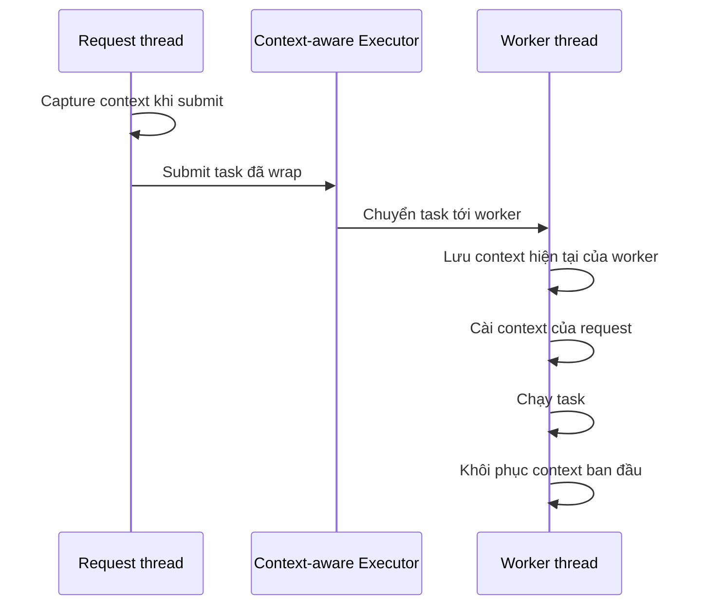

# Truyền MDC, tracing và security context qua executor phù hợp

Khi một request được xử lý bất đồng bộ, công việc có thể chuyển từ thread nhận request sang worker của một `ExecutorService`. Các dữ liệu gắn với thread hiện tại như MDC, tracing context hoặc security context không tự động xuất hiện ở worker. Nếu không truyền đúng cách, log mất request ID, trace bị đứt đoạn hoặc tác vụ chạy với danh tính bảo mật không như mong đợi.

Giải pháp là xác định context nào cần đi theo tác vụ, chụp context tại thời điểm submit, cài context trong lúc task chạy và khôi phục trạng thái worker sau khi task kết thúc. Java 21 vẫn sử dụng các API executor tiêu chuẩn; thư viện logging, tracing và security cung cấp wrapper phù hợp cho từng loại context.

## Mục tiêu học tập

Sau bài học, bạn có thể:

- Giải thích vì sao `ThreadLocal` không tự truyền context qua executor.
- Truyền MDC của SLF4J qua `Executor` và tránh rò rỉ context giữa các task.
- Truyền OpenTelemetry `Context` để giữ liên kết trace và span qua tác vụ bất đồng bộ.
- Dùng `DelegatingSecurityContextExecutor` để truyền security context trong Spring Security.
- Chọn Micrometer Context Propagation hoặc cơ chế do framework quản lý khi cần nhiều loại context.
- Xử lý context ở `CompletableFuture`, virtual thread và các ranh giới async lồng nhau.
- Giới hạn dữ liệu bảo mật được truyền và kiểm thử việc khôi phục context.

## 1. Vì sao context bị mất khi chuyển executor?

`ThreadLocal` lưu giá trị theo từng đối tượng `Thread`. Khi một request thread đặt request ID vào MDC hoặc `SecurityContextHolder`, giá trị đó thuộc về request thread. Khi gửi một `Runnable` sang thread pool, worker có thể là một Java thread khác và không tự nhận các giá trị này.

```java
MDC.put("requestId", "req-42");
SecurityContextHolder.getContext().setAuthentication(authentication);

executor.execute(() -> {
    logger.info("Đang xử lý tác vụ nền");
    // Không thể giả định MDC hoặc SecurityContext của request có mặt ở đây.
});
```

Worker trong pool còn được tái sử dụng. Nếu một task tự đặt `ThreadLocal` rồi không xóa, task tiếp theo có thể đọc nhầm dữ liệu của task trước. Vì vậy, propagation cần hai phần: đưa context của task vào worker và khôi phục context mà worker đã có trước đó.



Một executor Java thông thường không định nghĩa chính sách truyền MDC, tracing hoặc security context. Cần dùng wrapper hoặc integration do thư viện/framework cung cấp.

## 2. Quy tắc chung: capture, install, restore

Một cơ chế truyền context an toàn thường tuân theo trình tự:

1. **Capture:** chụp các giá trị cần truyền tại thời điểm submit task.
2. **Install:** trước khi chạy task, cài các giá trị đó vào context mechanism của worker.
3. **Execute:** chạy phần việc nghiệp vụ.
4. **Restore:** trong `finally`, khôi phục context worker trước đó hoặc xóa context nếu trước đó không có.

Thời điểm capture rất quan trọng. Nếu chụp context khi task bắt đầu chạy trên worker, lúc đó context request có thể đã không còn hiện diện. Context phải được chụp ở thread đang gửi task.

Chỉ truyền dữ liệu mà task thực sự cần. Request ID, tenant ID hoặc trace context thường phù hợp để truyền; không nên mặc định truyền mọi `ThreadLocal`, object request lớn hoặc toàn bộ trạng thái bảo mật sang mọi tác vụ nền.

## 3. Truyền MDC của SLF4J

MDC (Mapped Diagnostic Context) lưu các cặp key/value dùng để bổ sung thông tin vào log, chẳng hạn `requestId`, `tenantId` hoặc `jobId`. API `org.slf4j.MDC` cung cấp `getCopyOfContextMap()`, `setContextMap()` và `clear()` để đọc, cài và xóa map hiện tại.

MDC thường được backing bởi logging implementation. Hãy xác nhận backend đang dùng hỗ trợ MDC; API SLF4J có thể hoạt động như no-op với một số provider không có MDC.

### 3.1. Wrap một Runnable thủ công

Ví dụ dưới đây chụp MDC ở thread submit, cài nó khi task chạy và khôi phục MDC của worker trong `finally`:

```java
import org.slf4j.MDC;

import java.util.Map;

static Runnable withMdc(Runnable task) {
    Map<String, String> captured = MDC.getCopyOfContextMap();

    return () -> {
        Map<String, String> previous = MDC.getCopyOfContextMap();
        try {
            if (captured == null) {
                MDC.clear();
            } else {
                MDC.setContextMap(captured);
            }

            task.run();
        } finally {
            if (previous == null) {
                MDC.clear();
            } else {
                MDC.setContextMap(previous);
            }
        }
    };
}
```

Sử dụng:

```java
MDC.put("requestId", requestId);
try {
    executor.execute(withMdc(() -> {
        logger.info("Bắt đầu xử lý đơn hàng");
        processOrder(orderId);
    }));
} finally {
    MDC.remove("requestId");
}
```

`getCopyOfContextMap()` trả về bản sao của MDC map hiện tại và có thể trả `null` nếu không có context. `setContextMap()` thay map hiện tại bằng map được truyền vào. Việc khôi phục map trước đó giúp wrapper hoạt động đúng cả khi worker đã có context riêng hoặc task được thực thi lồng nhau.

### 3.2. Wrap Executor để mọi task đều được truyền MDC

Nếu nhiều thành phần cùng gửi task, có thể tạo một `Executor` decorator:

```java
import java.util.concurrent.Executor;

static Executor mdcPropagating(Executor delegate) {
    return task -> delegate.execute(withMdc(task));
}

Executor mdcExecutor = mdcPropagating(delegateExecutor);

mdcExecutor.execute(() -> processOrder(orderId));
```

Wrapper chụp MDC mỗi lần gọi `execute()`, vì vậy mỗi task nhận context của nơi gửi chính nó. Nếu dùng `ExecutorService.submit()` hoặc các overload nhận `Callable`, cần wrapper tương ứng cho `Callable`; decorator chỉ triển khai `Executor` ở ví dụ trên không tự bao phủ toàn bộ API `ExecutorService`.

### 3.3. MDC không đồng nghĩa với tracing context

MDC là dữ liệu chẩn đoán dạng key/value để logging backend in vào log. Trace ID và span ID có thể được đưa vào MDC bởi OpenTelemetry instrumentation hoặc logging integration, nhưng bản thân MDC không quản lý quan hệ cha/con của span.

Nếu instrumentation đã tự thêm trace/span ID vào MDC, không cần tự ghi đè cùng key bằng một cơ chế thứ hai. Khi cần giữ quan hệ tracing, hãy truyền OpenTelemetry `Context`; MDC có thể được đồng bộ với context đó bởi integration phù hợp.

Ví dụ trên chụp MDC map. Nếu ứng dụng sử dụng MDC deque qua `pushByKey()`/`popByKey()`, cần xác định và truyền cả stack context tương ứng; map snapshot không tự bao gồm các deque này.

## 4. Truyền OpenTelemetry Context

OpenTelemetry lưu span hiện tại, baggage và các dữ liệu liên quan trong `io.opentelemetry.context.Context`. Context được gắn vào phạm vi thực thi bằng `makeCurrent()` và được khôi phục khi đóng `Scope`.

Khi chuyển tác vụ sang executor khác, dùng `Context.wrap()` hoặc `Context.taskWrapping()` để truyền context hiện tại.

### 4.1. Wrap từng task

```java
import io.opentelemetry.context.Context;

Context captured = Context.current();
executor.execute(captured.wrap(() -> {
    processOrder(orderId);
}));
```

`captured.wrap()` tạo một `Runnable` sẽ đặt context đó thành current trong lúc chạy. Khi task hoàn tất, scope được đóng và context trước đó trên worker được khôi phục, kể cả khi task ném exception.

### 4.2. Wrap toàn bộ ExecutorService

Nếu muốn context hiện tại được chụp cho mỗi lần submit hoặc execute, có thể bọc executor:

```java
import io.opentelemetry.context.Context;

ExecutorService tracedExecutor = Context.taskWrapping(delegateExecutor);

tracedExecutor.submit(() -> processOrder(orderId));
```

`Context.taskWrapping(ExecutorService)` trả về một `ExecutorService` ủy quyền cho executor gốc và wrap các lời gọi thực thi task bằng context hiện tại tại thời điểm gọi. Nếu dùng wrapper này làm đối tượng sở hữu trong try-with-resources, việc đóng wrapper sẽ đóng executor được ủy quyền; không đóng hai lần cả wrapper và delegate.

Ví dụ với executor có vòng đời ngắn:

```java
try (ExecutorService tracedExecutor = Context.taskWrapping(
        Executors.newFixedThreadPool(4))) {
    tracedExecutor.submit(() -> processOrder(orderId));
}
```

Với executor sống lâu của ứng dụng, hãy quản lý shutdown theo lifecycle của executor gốc và wrapper theo đúng ownership. Không tạo một executor mới cho mỗi request chỉ để truyền context.

### 4.3. Giữ context qua CompletableFuture

Mỗi ranh giới async cần dùng executor có propagation hoặc wrap task tương ứng:

```java
ExecutorService pool = Executors.newFixedThreadPool(4);
Executor tracedExecutor = Context.taskWrapping(pool);

CompletableFuture.supplyAsync(
        () -> loadOrder(orderId), tracedExecutor)
    .thenApplyAsync(this::enrichOrder, tracedExecutor)
    .thenAcceptAsync(this::publishOrder, tracedExecutor);
```

Không giả định mọi callback của `CompletableFuture` đều chạy trên cùng thread. Callback không có hậu tố `Async` có thể chạy trên thread hoàn tất stage trước đó hoặc thread đăng ký callback, tùy thời điểm hoàn tất. Khi cần executor và context rõ ràng, chỉ định executor cho các stage async và dùng wrapper propagation.

OpenTelemetry instrumentation có thể đã tự truyền context qua một số executor hoặc framework được hỗ trợ. Trước khi bọc thủ công, kiểm tra integration hiện có để tránh capture lặp, tạo span không mong muốn hoặc ghi log trùng.

## 5. Truyền Spring Security SecurityContext

Trong Spring Security, `SecurityContextHolder` thường lưu `SecurityContext` theo thread. Khi task chạy trên worker khác, context của request không tự xuất hiện. Spring Security cung cấp các wrapper concurrency để truyền context và dọn nó sau khi task kết thúc.

### 5.1. Dùng DelegatingSecurityContextExecutor

```java
import org.springframework.security.concurrent.DelegatingSecurityContextExecutor;

Executor securedExecutor = new DelegatingSecurityContextExecutor(delegateExecutor);

securedExecutor.execute(() -> {
    securedService.processCurrentUserData();
});
```

Constructor chỉ nhận delegate sẽ dùng `SecurityContext` hiện tại từ `SecurityContextHolder` tại thời điểm task được submit. Wrapper chạy task với context đó và dọn `SecurityContextHolder` sau khi hoàn tất, giúp worker được tái sử dụng không mang context của task trước sang task sau.

Nếu cần chạy task với một security context cố định, có thể truyền context rõ ràng:

```java
SecurityContext systemContext = createBackgroundJobSecurityContext();

Executor systemExecutor = new DelegatingSecurityContextExecutor(
    delegateExecutor,
    systemContext
);
```

Đây là lựa chọn phù hợp cho một nhóm tác vụ nền được thiết kế để chạy dưới một danh tính hệ thống cụ thể. Cần tạo context theo chính sách bảo mật của ứng dụng và giới hạn quyền ở mức tối thiểu.

### 5.2. Không truyền danh tính người dùng theo mặc định

Truyền security context có nghĩa là task có thể thực thi dưới quyền của người dùng đã gửi nó. Trước khi truyền, hãy xác định:

- Tác vụ có thực sự cần quyền của người dùng ban đầu không?
- Tác vụ chạy ngay hay được lưu vào hàng đợi để thực thi sau khi request kết thúc?
- Quyền của người dùng có thể bị thu hồi trước lúc task chạy không?
- Tác vụ nền nên chạy bằng user context, service account hay một authorization decision đã được ghi nhận?
- Có cần kiểm tra tenant, ownership hoặc quyền truy cập lại ngay trước thao tác nhạy cảm không?

Đối với tác vụ chạy lâu hoặc được lưu bền vững để xử lý sau, không nên serialize toàn bộ `SecurityContext` của request rồi sử dụng vô thời hạn. Hãy lưu danh tính/tenant và metadata nghiệp vụ cần thiết, sau đó xác thực hoặc ủy quyền theo chính sách tại thời điểm thực thi.

Không bật `MODE_INHERITABLETHREADLOCAL` như một cách truyền security context chung cho thread pool. Worker có thể được tạo trước request, được tái sử dụng cho nhiều người dùng và làm phát sinh rò rỉ quyền nếu vòng đời context không được quản lý đúng. Dùng wrapper Spring Security hoặc cơ chế context propagation được framework hỗ trợ.

## 6. Dùng Micrometer Context Propagation khi có nhiều loại context

Một ứng dụng có thể cần truyền nhiều loại dữ liệu cùng lúc: MDC, observation, tracing hoặc một số `ThreadLocal` của framework. Tự viết một wrapper riêng cho từng loại dễ dẫn đến nhiều lớp lồng nhau và thiếu bước cleanup.

Micrometer Context Propagation cung cấp các abstraction:

- `ThreadLocalAccessor`: mô tả cách đọc, cài và reset một loại `ThreadLocal`.
- `ContextAccessor`: đọc/ghi context từ các cấu trúc dạng map hoặc context của framework.
- `ContextRegistry`: đăng ký các accessor được phép tham gia propagation.
- `ContextSnapshot`: giữ snapshot các context đã capture và có thể wrap task.
- `ContextSnapshotFactory`: tạo snapshot theo registry và chính sách capture đã cấu hình.

Ví dụ tổng quát:

```java
import io.micrometer.context.ContextSnapshot;
import io.micrometer.context.ContextSnapshotFactory;

ContextSnapshotFactory snapshotFactory = ContextSnapshotFactory.builder()
    .build();

ContextSnapshot snapshot = snapshotFactory.captureAll();
executor.execute(snapshot.wrap(() -> processOrder(orderId)));
```

Snapshot được capture tại thread gửi task. Khi task chạy, `snapshot.wrap()` khôi phục các context có accessor đã đăng ký và dùng scope để phục hồi trạng thái worker sau khi task kết thúc.

Micrometer không tự biết mọi `ThreadLocal` trong ứng dụng. Chỉ những context có accessor được đăng ký và được factory cho phép capture mới được truyền. Hãy cấu hình registry rõ ràng và kiểm tra integration của logging, tracing, security hoặc Reactor mà ứng dụng đang dùng.

Nếu framework như Spring đã cấu hình context propagation cho executor hoặc task decorator, ưu tiên dùng cấu hình đó. Tránh áp dụng cả wrapper thủ công và wrapper tự động lên cùng một context nếu chưa xác định thứ tự và ngữ nghĩa.

## 7. Chọn cơ chế phù hợp cho từng loại context

| Context | Cơ chế nên ưu tiên | Điều cần chú ý |
|---|---|---|
| MDC/log correlation | SLF4J MDC wrapper hoặc integration của logging framework | Capture map khi submit; restore map worker; kiểm tra MDC deque nếu có dùng |
| Trace/span/baggage | OpenTelemetry `Context.wrap()` hoặc `Context.taskWrapping()` | Scope phải được đóng; không tạo trace mới chỉ để chuyển context |
| Spring Security | `DelegatingSecurityContextExecutor` hoặc integration do Spring quản lý | Chỉ truyền quyền cần thiết; context được dọn sau task |
| Nhiều ThreadLocal/framework context | Micrometer Context Propagation hoặc context propagation của runtime | Đăng ký accessor và xác định chính sách propagated/cleared |
| Context nghiệp vụ riêng | Truyền value object bất biến qua tham số | Rõ dependency, dễ kiểm thử và không phụ thuộc thread hiện tại |

Không có một wrapper duy nhất tự động giải quyết mọi context. Có thể kết hợp nhiều wrapper nếu ứng dụng cần, nhưng nên ưu tiên integration thống nhất của framework để tránh nhiều lớp propagation chồng lấp.

## 8. Kết hợp context wrappers đúng thứ tự

Nếu ứng dụng phải tự kết hợp nhiều cơ chế, mỗi wrapper nên chịu trách nhiệm đúng loại context của nó. Ví dụ, có thể bọc executor gốc bằng MDC decorator và sau đó dùng OpenTelemetry hoặc Spring Security wrapper ở lớp ngoài.

```java
Executor mdcExecutor = mdcPropagating(delegateExecutor);
Executor tracedExecutor = Context.taskWrapping(mdcExecutor);
Executor securedExecutor = new DelegatingSecurityContextExecutor(tracedExecutor);

securedExecutor.execute(() -> processSensitiveOrder(orderId));
```

Ở ví dụ này, `securedExecutor` chụp security context khi submit; `tracedExecutor` chụp OpenTelemetry context khi delegate được gọi; `mdcExecutor` chụp MDC ở cùng ranh giới submit. Khi chạy, mỗi wrapper cài context của nó và khôi phục trạng thái trước đó trong `finally` hoặc scope tương ứng.

Thứ tự thực tế cần được kiểm tra với framework và instrumentation đang dùng. Một integration có thể đã truyền MDC từ trace context hoặc đã truyền security context thông qua task decorator. Nếu có propagation tự động, không thêm wrapper thứ hai một cách máy móc.

Với executor sống lâu, giữ một wrapper đã cấu hình và tái sử dụng nó. Quản lý shutdown qua executor gốc theo ownership của ứng dụng; wrapper `Executor` không nhất thiết cung cấp API quản lý vòng đời.

## 9. Virtual thread và context propagation

Virtual thread là một Java `Thread` riêng, vì vậy `ThreadLocal` và các context gắn với Java thread có thể được dùng trong phạm vi virtual thread. Tuy nhiên, context không tự truyền sang một task khác chỉ vì task đó cũng chạy bằng virtual thread.

Ví dụ:

```java
try (ExecutorService executor = Executors.newVirtualThreadPerTaskExecutor()) {
    executor.submit(() -> processOrder(orderId));
}
```

Đoạn mã trên không tự sao chép MDC, OpenTelemetry context hoặc Spring Security context từ thread gửi task. Hãy wrap task hoặc dùng executor có context propagation như với platform thread pool.

Không dùng `InheritableThreadLocal` như cơ chế propagation tổng quát. Kế thừa diễn ra khi tạo thread, không phải theo một chính sách capture/restore cho mỗi tác vụ. Với executor thread-per-task, việc kế thừa có thể xuất hiện tùy builder và cấu hình; với pool tái sử dụng, context không tương ứng với từng lần submit. Truyền tường minh hoặc dùng framework wrapper giúp ngữ nghĩa rõ hơn.

Virtual thread per task có thể tạo số lượng thread lớn. Không nên gắn các object lớn, connection, request body hoặc tài nguyên đắt tiền vào `ThreadLocal` chỉ để tiện truy cập. Chỉ truyền các giá trị cần thiết và giới hạn vòng đời của chúng.

## 10. CompletableFuture và các ranh giới async lồng nhau

`CompletableFuture` có thể chạy các stage trên nhiều executor. Context cần được truyền ở mỗi ranh giới mà task chuyển sang executor khác.

```java
Executor contextAware = Context.taskWrapping(delegateExecutor);

CompletableFuture.supplyAsync(this::loadOrder, contextAware)
    .thenApplyAsync(this::validateOrder, contextAware)
    .thenApplyAsync(this::calculateTotal, contextAware)
    .thenAcceptAsync(this::saveOrder, contextAware);
```

Các stage async dùng executor đã wrap để context hiện tại tại thời điểm submit được cài trong lúc callback chạy. Nếu một stage lại submit công việc sang một executor không được wrap, context có thể mất ở ranh giới tiếp theo.

Đối với stage không có `Async`, callback có thể chạy ngay trên thread hoàn tất stage trước hoặc thread đăng ký callback. Không dựa vào việc callback luôn chạy trên request thread. Nếu callback cần context xác định hoặc có thể blocking, chỉ định executor rõ ràng và dùng wrapper tương ứng.

Với tracing, cần giữ parent span còn hiệu lực cho tới khi các tác vụ con hoàn tất theo mô hình span của ứng dụng. Không kết thúc span cha ngay sau khi submit task nếu task con vẫn cần nằm trong trace đó. Dùng instrumentation hoặc API span lifecycle để xác định thời điểm kết thúc chính xác.

## 11. Tránh rò rỉ context và quyền truy cập

Rò rỉ context thường xảy ra khi worker được tái sử dụng và task không khôi phục trạng thái trước đó. Các biện pháp quan trọng:

- Capture context từ thread submit, không đọc context request sau khi task đã chuyển sang worker.
- Cài context ngay trước khi gọi task.
- Dùng `finally` hoặc `Scope.close()` để khôi phục trạng thái kể cả khi có exception.
- Không chỉ `clear()` một cách vô điều kiện nếu worker có thể đang sở hữu context lồng nhau hợp lệ; ưu tiên restore snapshot trước đó.
- Không truyền security context nếu tác vụ không cần quyền của người dùng.
- Không lưu credential, token bí mật hoặc dữ liệu nhạy cảm trong MDC.
- Không truyền context request hết hạn cho job chạy nền dài hạn.
- Không dùng `InheritableThreadLocal` để thay thế executor wrapper.
- Không áp dụng nhiều cơ chế propagation cho cùng một context khi chưa hiểu cách chúng tương tác.

MDC thường chỉ nên chứa dữ liệu tương quan an toàn như request ID hoặc tenant ID đã được chuẩn hóa. Security context phải được xử lý như dữ liệu quyền hạn; logging context không phải nơi lưu thông tin xác thực.

## 12. Kiểm thử context propagation

Kiểm thử không chỉ xác nhận task nhìn thấy context đúng; cần xác nhận worker không giữ lại context sau khi task kết thúc.

Một bài test nên kiểm tra:

1. Task được submit dưới request A nhìn thấy MDC, trace và security context của A.
2. Task được submit dưới request B nhìn thấy context của B, không phải A.
3. Worker không có context trước task thì sau task cũng không còn context của task vừa chạy.
4. Worker có context nền trước task thì context nền được khôi phục sau task.
5. Nếu task ném exception, context vẫn được restore.
6. Các stage `CompletableFuture` dùng executor khác nhau đều nhận context theo thiết kế.
7. Tác vụ nền không vô tình chạy dưới quyền của người dùng request khi chỉ cần service identity.
8. Virtual-thread-per-task và platform-thread-pool có kết quả propagation như nhau theo hợp đồng đã chọn.

Nên dùng một executor một worker trong một số test để buộc nhiều task dùng lại cùng worker; cách này dễ phát hiện lỗi context còn sót. Có thể dùng latch hoặc barrier để kiểm soát thứ tự chạy thay vì dựa vào `sleep()`.

## 13. Checklist triển khai

- Xác định rõ dữ liệu nào là logging context, tracing context, security context và dữ liệu nghiệp vụ.
- Capture context tại thời điểm submit task.
- Chọn wrapper tương ứng: MDC, OpenTelemetry, Spring Security hoặc Micrometer.
- Bảo đảm wrapper restore trạng thái trong `finally`/scope.
- Kiểm tra mọi ranh giới async và executor lồng nhau.
- Kiểm tra integration tự động để tránh propagation trùng.
- Không dựa vào `InheritableThreadLocal` cho worker pool.
- Chỉ truyền security identity khi nghiệp vụ cần và quyền được giới hạn.
- Không để credential hoặc dữ liệu nhạy cảm trong MDC.
- Kiểm thử exception, worker reuse, CompletableFuture và virtual thread.
- Quản lý lifecycle executor và shutdown theo đúng ownership.

## 14. Nguyên tắc thiết kế

- Xem context là dữ liệu của tác vụ cần được capture và restore có chủ đích.
- Dùng SLF4J MDC cho dữ liệu log; dùng OpenTelemetry Context cho trace/span/baggage.
- Dùng `DelegatingSecurityContextExecutor` hoặc integration Spring Security để truyền security context.
- Dùng Micrometer Context Propagation khi cần phối hợp nhiều context mechanism đã đăng ký accessor.
- Ưu tiên truyền value object bất biến tường minh cho dữ liệu nghiệp vụ.
- Không giả định `ExecutorService`, `CompletableFuture` hoặc virtual thread tự truyền mọi `ThreadLocal`.
- Luôn dọn hoặc khôi phục context để worker không rò rỉ dữ liệu giữa các task.
- Chỉ truyền security context trong phạm vi quyền hạn và thời gian mà tác vụ cần.

Truyền context qua executor là một phần của thiết kế bất đồng bộ. Khi mỗi loại dữ liệu dùng đúng cơ chế, được capture tại thời điểm submit và được restore sau khi task kết thúc, log giữ được thông tin tương quan, trace không bị đứt đoạn và tác vụ chạy với security context được kiểm soát.

## Tài liệu tham khảo

- [SLF4J API — `MDC`](https://www.slf4j.org/apidocs/org/slf4j/MDC.html): đọc, sao chép, cài đặt và xóa MDC context map.
- [OpenTelemetry Java API — Context propagation](https://opentelemetry.io/docs/languages/java/api/): `Context.current`, `makeCurrent`, `wrap` và truyền context qua executor.
- [OpenTelemetry Java — `Context`](https://javadoc.io/doc/io.opentelemetry/opentelemetry-context/latest/io/opentelemetry/context/Context.html): API wrap task và executor.
- [Spring Security — Concurrency Support](https://docs.spring.io/spring-security/reference/servlet/integrations/concurrency.html): `DelegatingSecurityContextRunnable` và `DelegatingSecurityContextExecutor`.
- [Micrometer Context Propagation — Purpose](https://docs.micrometer.io/context-propagation/reference/purpose.html): ThreadLocalAccessor, ContextSnapshot và propagation giữa imperative/reactive context.
- [Micrometer Context Propagation — Reference](https://docs.micrometer.io/context-propagation/reference/index.html): registry, snapshot và tích hợp context propagation.
- [Java SE 21 API — `ExecutorService`](https://docs.oracle.com/en/java/javase/21/docs/api/java.base/java/util/concurrent/ExecutorService.html): thực thi tác vụ và vòng đời executor.
- [Java SE 21 API — `ThreadLocal`](https://docs.oracle.com/en/java/javase/21/docs/api/java.base/java/lang/ThreadLocal.html): giá trị gắn với từng Java thread.
