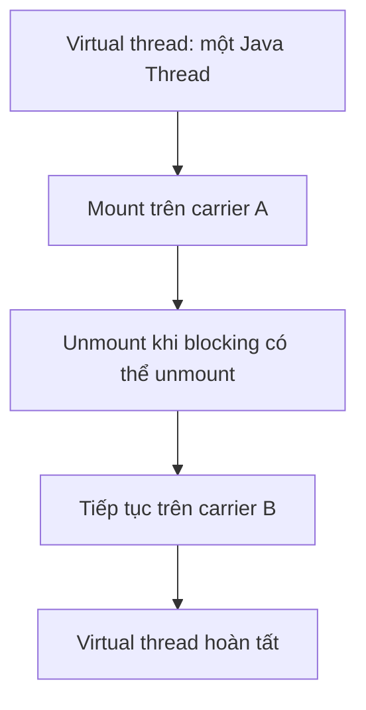

# Tích hợp thư viện cần thread affinity và nhận diện giới hạn

Một số thư viện Java hoặc native library yêu cầu các thao tác trên cùng một tài nguyên phải được thực hiện bởi cùng một thread. Yêu cầu này thường được gọi là *thread affinity*. Ví dụ có thể gặp trong thư viện giao diện người dùng, event loop, driver native, context đồ họa, thư viện mã hóa hoặc framework lưu transaction context theo thread.

Java 21 hỗ trợ virtual thread để tổ chức nhiều tác vụ blocking với chi phí thấp. Tuy nhiên, virtual thread không đồng nghĩa với một OS thread cố định: trong suốt vòng đời, nó có thể được mount lên các carrier thread khác nhau. Vì vậy, cần xác định thư viện đang yêu cầu cùng một đối tượng `Thread` của Java, cùng một vùng `ThreadLocal`, hay cùng một OS thread. Ba yêu cầu này không giống nhau và quyết định cách tích hợp.

## Mục tiêu học tập

Sau bài học, bạn có thể:

- Phân biệt thread affinity, thread confinement, thread safety và context propagation.
- Giải thích mối quan hệ giữa virtual thread, carrier thread và `ThreadLocal` trong Java 21.
- Nhận diện thư viện cần cùng Java thread hoặc cùng OS thread.
- Chọn virtual thread, single-thread executor hoặc dedicated platform thread theo hợp đồng của thư viện.
- Quản lý context gắn với thread và dọn `ThreadLocal` đúng thời điểm.
- Xác minh giới hạn của thư viện bằng tài liệu nhà cung cấp, kiểm thử và công cụ chẩn đoán.

## 1. Bốn khái niệm không nên nhầm lẫn

### 1.1. Thread affinity

Thread affinity là yêu cầu một thao tác hoặc tài nguyên phải được truy cập từ một thread cụ thể hoặc từ cùng một thread đã tạo ra nó. Thư viện có thể kiểm tra thread hiện tại, lưu trạng thái theo thread, hoặc phụ thuộc vào trạng thái của OS thread.

Ví dụ, một native context được tạo trên một OS thread có thể chỉ được phép sử dụng và giải phóng trên chính OS thread đó. Một thư viện khác có thể chỉ yêu cầu các lời gọi Java thực hiện trên cùng một đối tượng `Thread`.

### 1.2. Thread confinement

Thread confinement là cách thiết kế trong đó một trạng thái mutable chỉ được một thread truy cập. Không có nhiều thread cùng thao tác trên trạng thái đó, vì vậy có thể giảm nhu cầu đồng bộ hóa. Thread confinement thường đi cùng thread affinity, nhưng trọng tâm là quyền sở hữu trạng thái.

### 1.3. Thread safety

Thread safety cho biết một đối tượng có thể được nhiều thread sử dụng đồng thời mà vẫn giữ đúng hợp đồng hay không. Một thư viện thread-safe không nhất thiết có affinity; ngược lại, một thư viện có affinity có thể không cho phép truy cập đồng thời.

### 1.4. Context propagation

Context propagation là việc chuyển dữ liệu theo yêu cầu hoặc tác vụ qua các ranh giới thực thi, ví dụ request ID, security principal, tracing context hoặc transaction metadata. `ThreadLocal` chỉ gắn dữ liệu với một Java thread; nó không tự động bảo đảm context xuất hiện ở mọi thread mà tác vụ có thể chuyển sang.

| Khái niệm | Câu hỏi cần trả lời |
|---|---|
| Thread affinity | Các thao tác có phải chạy trên cùng thread không? |
| Thread confinement | Trạng thái mutable có chỉ được một thread sở hữu không? |
| Thread safety | Nhiều thread có thể truy cập đồng thời an toàn không? |
| Context propagation | Dữ liệu của tác vụ có được mang theo qua ranh giới thread/executor không? |

Trước khi tích hợp một thư viện, hãy đọc rõ hợp đồng của nó. Cụm từ “thread-safe”, “single-threaded”, “thread-local” và “must be called from the creating thread” mô tả những ràng buộc khác nhau.

## 2. Virtual thread và carrier thread trong Java 21

Virtual thread là một đối tượng `Thread` của Java, nhưng không sở hữu một OS thread cố định trong suốt vòng đời. JVM lập lịch virtual thread trên các platform thread được gọi là *carrier thread*. Khi virtual thread thực hiện một thao tác blocking được hỗ trợ và có thể unmount, JVM tạm dừng virtual thread, giải phóng carrier để chạy công việc khác. Khi tiếp tục, virtual thread có thể được mount trên một carrier khác.



Điều quan trọng:

- Danh tính Java của virtual thread không đổi trong suốt vòng đời thread.
- `Thread.currentThread()` bên trong tác vụ trả về virtual thread đang thực thi.
- `ThreadLocal` gắn với virtual thread, không gắn với carrier hiện tại.
- Carrier OS thread có thể thay đổi giữa các đoạn thực thi của cùng virtual thread.
- Không được giả định `Thread.currentThread().threadId()` của virtual thread là OS thread ID.

Vì vậy, thư viện dựa trên `ThreadLocal` của Java có thể hoạt động đúng trong một virtual thread nếu toàn bộ thao tác cần context diễn ra trong cùng virtual thread. Nhưng thư viện native cần cùng OS thread có thể không tương thích với mô hình carrier có thể thay đổi.

## 3. `ThreadLocal` không phải OS thread-local storage

`ThreadLocal<T>` lưu một giá trị riêng cho từng đối tượng Java `Thread`. Khi một virtual thread gọi `set()`, giá trị đó thuộc về virtual thread, ngay cả khi virtual thread được mount lần lượt lên nhiều carrier khác nhau.

```java
private static final ThreadLocal<String> REQUEST_ID = new ThreadLocal<>();

static void handleRequest(String requestId) {
    REQUEST_ID.set(requestId);
    try {
        callLibrary();
    } finally {
        REQUEST_ID.remove();
    }
}
```

Nếu `handleRequest` chạy trong một virtual thread và `callLibrary()` chạy đồng bộ trong cùng virtual thread, thư viện có thể đọc cùng giá trị `REQUEST_ID` thông qua `ThreadLocal`.

Tuy nhiên, `ThreadLocal` của Java không bảo đảm dữ liệu được đặt vào thread-local storage của OS thread đang làm carrier. Nếu thư viện native gọi `pthread_getspecific`, dùng TLS của C/C++ hoặc kiểm tra OS thread ID, nó đang sử dụng một cơ chế khác.

Không nên dùng `ThreadLocal` như bằng chứng rằng native library có thread affinity tương thích với virtual thread. Hãy kiểm tra tài liệu native API hoặc hỏi nhà cung cấp xem ràng buộc của họ áp dụng ở cấp Java thread hay OS thread.

## 4. Nhận diện loại thư viện và ràng buộc của nó

Các trường hợp thường gặp:

| Loại thư viện | Ràng buộc có thể gặp | Hướng tích hợp cần xem xét |
|---|---|---|
| Thư viện dùng `ThreadLocal` Java | Context nằm trên Java `Thread` | Giữ chuỗi thao tác trong cùng Java thread; kiểm tra context propagation |
| Framework transaction imperative | Transaction/context gắn với thread trong phạm vi lời gọi | Giữ transaction trong cùng luồng thực thi; không tự ý chuyển giữa executor |
| UI toolkit | Chỉ UI thread được phép thao tác component | Dispatch về UI thread theo API của toolkit |
| Event-loop framework | Channel hoặc event-loop state thuộc một event loop | Gửi thao tác về đúng event loop; tránh blocking event loop |
| Native library dùng OS TLS hoặc OS thread ID | Tài nguyên gắn với OS thread cụ thể | Dedicated platform thread nếu nhà cung cấp yêu cầu |
| Context đồ họa hoặc thiết bị | Context phải được current trên thread phù hợp | Tạo, sử dụng và giải phóng trên thread/context được chỉ định |

Đây là các ví dụ về kiểu ràng buộc, không phải khẳng định rằng mọi thư viện trong một nhóm đều có cùng hợp đồng. Hãy xác minh tài liệu của đúng thư viện và phiên bản đang triển khai.

### 4.1. Câu hỏi cần tìm trong tài liệu thư viện

- Đối tượng có thể được tạo trên một thread và dùng trên thread khác không?
- Có thể dùng đồng thời từ nhiều thread không?
- Việc đóng hoặc giải phóng tài nguyên phải diễn ra trên thread tạo ra nó không?
- Thư viện lưu trạng thái bằng `ThreadLocal` Java, native TLS hay một event loop riêng?
- Thư viện có hỗ trợ virtual thread trong JDK 21 không?
- API blocking có thể unmount virtual thread, hay gọi native code/synchronization khiến virtual thread bị pin?
- Có API dispatch, scheduler hoặc executor riêng để chuyển thao tác về thread sở hữu không?

Đừng suy luận từ việc thư viện biên dịch hoặc chạy được trong một test đơn giản rằng nó hỗ trợ mọi mô hình concurrency.

## 5. Khi thư viện gắn context với Java Thread

Nếu thư viện chỉ yêu cầu các lời gọi liên quan được thực hiện trong cùng Java thread và context của nó nằm trong `ThreadLocal`, virtual thread có thể là lựa chọn phù hợp. Hãy giữ toàn bộ chuỗi thao tác trong một tác vụ đồng bộ và dọn context khi hoàn tất.

```java
static final ThreadLocal<ClientContext> CLIENT_CONTEXT = new ThreadLocal<>();

static Result executeWithContext(ClientContext context, Request request) {
    CLIENT_CONTEXT.set(context);
    try {
        return libraryClient.execute(request);
    } finally {
        CLIENT_CONTEXT.remove();
    }
}
```

Có thể gọi phương thức trên từ virtual thread:

```java
try (var executor = Executors.newVirtualThreadPerTaskExecutor()) {
    var result = executor.submit(() ->
        executeWithContext(context, request));
    return result.get();
}
```

`ThreadLocal` thuộc về virtual thread xử lý tác vụ. Nếu thư viện chỉ dựa trên Java `ThreadLocal` và không đòi hỏi OS thread cố định, việc virtual thread chuyển carrier không làm thay đổi giá trị đó.

### 5.1. Không để context rò rỉ qua vòng đời thread

Với platform thread pool, worker được tái sử dụng cho nhiều tác vụ. Nếu không gọi `remove()`, giá trị từ tác vụ trước có thể còn lại và bị tác vụ tiếp theo đọc nhầm. Vì vậy, đặt và xóa context trong `try/finally`.

Virtual thread thường kết thúc sau một tác vụ, nhưng vẫn nên giới hạn vòng đời context và gọi `remove()` trong `finally` khi dùng `ThreadLocal` để biểu diễn trạng thái tạm thời. Điều này làm hợp đồng cleanup rõ ràng và tránh giữ tham chiếu lâu hơn cần thiết.

Không nên dùng `ThreadLocal` để giữ một bản sao lớn hoặc một tài nguyên đắt tiền cho mọi virtual thread. Ứng dụng có thể tạo số lượng virtual thread rất lớn; mỗi thread có thể mang bộ giá trị thread-local riêng, làm tăng bộ nhớ hoặc số tài nguyên được tạo. Đặc biệt, không dùng `ThreadLocal` để giả lập pool connection theo virtual thread. Hãy lấy connection từ `DataSource`/pool theo từng tác vụ và trả lại đúng vòng đời.

## 6. `InheritableThreadLocal` và giới hạn kế thừa context

`InheritableThreadLocal` truyền giá trị từ thread cha sang thread con khi thread con được tạo. Cơ chế này không tương đương với truyền context cho mọi tác vụ được submit vào một executor.

Điểm cần lưu ý:

- Việc kế thừa xảy ra tại thời điểm tạo thread, không phải mỗi lần gửi task.
- Giá trị mặc định của `childValue()` là cùng tham chiếu đối tượng; nó không tự deep-copy object mutable.
- Thread pool có thể tạo worker trước khi request context được đặt, nên worker không tự nhận context của request gửi sau đó.
- Virtual thread mới thường kế thừa inheritable thread-local theo cấu hình builder mặc định; có thể tắt việc này bằng `inheritInheritableThreadLocals(false)`.

Ví dụ tạo virtual thread không kế thừa inheritable thread-local:

```java
Thread thread = Thread.ofVirtual()
    .inheritInheritableThreadLocals(false)
    .name("isolated-task")
    .start(this::runTask);
```

Chỉ tắt kế thừa khi ứng dụng đã có cách truyền context tường minh. Nếu thư viện cần context, hãy dùng tham số bất biến, wrapper task hoặc cơ chế context propagation được framework hỗ trợ.

Tránh đặt object mutable dùng chung trong `InheritableThreadLocal` rồi cho nhiều thread con cùng sửa. Việc kế thừa tham chiếu không tạo ra bản sao an toàn.

## 7. Khi thư viện yêu cầu cùng OS thread: dùng dedicated platform thread

Nếu nhà cung cấp xác nhận một native resource phải được tạo, sử dụng và giải phóng trên cùng OS thread, không chạy các thao tác đó trên virtual thread rồi giả định carrier sẽ giữ nguyên. Dùng một platform thread chuyên trách làm owner và gửi lệnh đến nó qua hàng đợi.

Mô hình này thường được gọi là actor hoặc thread-affine worker:


Ví dụ minh họa vòng đời tài nguyên trên một thread:

```java
interface NativeCommand {
    void execute(NativeSession session) throws Exception;
}

BlockingQueue<NativeCommand> commands = new LinkedBlockingQueue<>();

Thread owner = Thread.ofPlatform()
    .name("native-session-owner")
    .start(() -> {
        try (NativeSession session = NativeSession.open()) {
            while (!Thread.currentThread().isInterrupted()) {
                NativeCommand command = commands.take();
                command.execute(session);
            }
        } catch (InterruptedException interrupted) {
            Thread.currentThread().interrupt();
        } catch (Exception failure) {
            reportNativeFailure(failure);
        }
    });
```

Các request đưa lệnh vào `commands`; chỉ `owner` gọi phương thức trên `NativeSession`. Đoạn mã minh họa phần lõi của mô hình, nên ứng dụng thực tế cần bổ sung cơ chế đóng có kiểm soát, poison command hoặc shutdown signal, phản hồi kết quả cho bên gửi và chính sách khi owner thread lỗi.

Vì `NativeSession.open()`, các lệnh `execute()` và `close()` đều chạy trong thân của cùng platform thread, thư viện có thể đáp ứng yêu cầu cùng OS thread nếu platform thread được ánh xạ một-một với OS thread như mô hình của Java. Không để request thread gọi trực tiếp vào `NativeSession`.

### 7.1. Dùng single-thread executor khi hợp đồng phù hợp

Một `Executors.newSingleThreadExecutor(threadFactory)` có thể tuần tự hóa các tác vụ trên một worker thread. Đây là lựa chọn tiện lợi khi thư viện chỉ cần các tác vụ được chạy tuần tự trên cùng worker.

Tuy nhiên, executor có thể thay worker nếu worker hiện tại kết thúc bất thường. Nếu native resource gắn chặt với thread đã tạo nó, đừng khởi tạo resource trong một task rồi giả định các task tương lai luôn chạy trên cùng thread sau mọi lỗi. Hãy quản lý resource và vòng đời worker như một đơn vị, hoặc dùng một vòng lặp owner dài hạn như ví dụ trước.

Đảm bảo việc tạo, sử dụng và đóng resource diễn ra trong cùng worker. Khi shutdown, gửi tín hiệu dừng và chờ owner hoàn tất trước khi ứng dụng giải phóng các dependency mà owner cần.

## 8. Không dùng pinning như cơ chế bảo đảm affinity

Trong Java 21, virtual thread có thể bị pin vào carrier khi blocking trong một số tình huống, chẳng hạn đang giữ intrinsic monitor (`synchronized`) hoặc đang thực thi native/foreign call. Khi bị pin, virtual thread không thể unmount carrier trong khoảng thời gian đó.

Pinning không phải hợp đồng giữ nguyên carrier cho toàn bộ vòng đời virtual thread. Sau khi thoát khỏi vùng pin, virtual thread vẫn có thể unmount và tiếp tục trên carrier khác. Vì vậy, không cố tình thêm `synchronized` hoặc native call để “giữ” virtual thread trên một OS thread.

Có thể bật chẩn đoán trong JDK 21:

```bash
java -Djdk.tracePinnedThreads=full -jar application.jar
```

Java Flight Recorder cũng có event `jdk.VirtualThreadPinned`. Dùng các công cụ này để tìm vùng code pinning khi kiểm thử tải. Chúng giúp phát hiện chi phí hoặc vấn đề tương thích; chúng không chứng minh một thư viện đã đáp ứng thread affinity.

## 9. Event loop và UI thread có owner riêng

Một số framework không yêu cầu một OS thread cố định cho từng tài nguyên, nhưng yêu cầu thao tác được thực hiện trên event loop hoặc UI thread cụ thể.

Ví dụ, với Swing, cập nhật component phải được chuyển về Event Dispatch Thread (EDT):

```java
SwingUtilities.invokeLater(() -> {
    statusLabel.setText("Completed");
});
```

Virtual thread có thể thực hiện công việc nền, nhưng không thay thế EDT. Khi hoàn tất, gửi kết quả về UI thread bằng API dispatch của framework.

Với framework event-loop như Netty, hãy dùng event loop hoặc executor gắn với channel để thực hiện thao tác yêu cầu đúng event loop. Không block event loop bằng truy vấn JDBC dài; chuyển blocking work sang executor phù hợp rồi quay lại event loop để cập nhật state.

Luôn dùng API dispatch chính thức của framework. Tự tạo một platform thread riêng không tự động tương đương với UI thread hoặc event loop mà framework quản lý.

## 10. Context transaction, logging và tracing qua ranh giới thread

Nhiều framework imperative lưu transaction, logging MDC hoặc tracing context trong `ThreadLocal`. Khi toàn bộ lời gọi diễn ra đồng bộ trong cùng Java thread, context thường được đọc nhất quán. Khi gửi một phần công việc sang executor khác, context có thể không được truyền sang.

Ví dụ, không nên giả định đoạn mã sau luôn mang MDC của request sang worker:

```java
executor.submit(() -> {
    logger.info("Processing background task");
});
```

Nếu executor dùng worker đã tồn tại, `ThreadLocal` ở request thread không tự xuất hiện ở worker. Cần dùng cơ chế context propagation của logging/tracing framework hoặc truyền context tường minh.

Transaction imperative cũng thường gắn với thread trong phạm vi transaction. Không tách các câu lệnh của cùng transaction sang các virtual thread độc lập nếu framework không cung cấp cơ chế truyền transaction context được hỗ trợ. Giữ transaction trong một luồng thực thi đồng bộ hoặc dùng API transaction/context propagation chính thức.

Với request context, cách đơn giản và dễ kiểm soát là truyền một value object bất biến qua tham số:

```java
record RequestContext(String requestId, String tenantId) {}

executor.submit(() -> processOrder(context, order));
```

Truyền context tường minh giúp phụ thuộc của phương thức rõ ràng, không phụ thuộc thread hiện tại hoặc thời điểm worker được tạo.

## 11. Kiểm tra tương thích của thư viện

Trước khi chạy thư viện trên virtual thread hoặc đưa nó vào mô hình concurrency mới, hãy xác minh:

1. **Đọc tài liệu:** tìm yêu cầu thread-safe, thread-confined, thread-affine, event-loop hoặc OS-thread affinity.
2. **Xác định loại context:** thư viện dùng Java `ThreadLocal`, `InheritableThreadLocal`, native TLS, thread ID hay scheduler riêng.
3. **Kiểm tra vòng đời:** tạo, sử dụng, reset và đóng tài nguyên có phải chạy trên cùng thread không.
4. **Kiểm thử đồng bộ:** chạy nhiều lời gọi đồng thời và kiểm tra thư viện có hỗ trợ hay cần serialize.
5. **Kiểm thử chuyển thread:** tạo resource trên một thread rồi thử sử dụng/đóng trên thread khác trong môi trường kiểm thử riêng.
6. **Kiểm thử virtual thread:** chạy workload đại diện trên JDK 21 và quan sát kết quả, lỗi, latency và pinning.
7. **Kiểm tra phiên bản:** xác nhận phiên bản thư viện, native dependency và framework hỗ trợ JDK 21 cũng như mô hình thread dự định dùng.

Không thử phá vỡ thread affinity trên dữ liệu production. Thử nghiệm chuyển thread cần dùng môi trường cô lập và tài nguyên có thể hủy bỏ.

### 11.1. Ghi nhận Java thread identity

Trong code Java, có thể ghi lại đối tượng thread hoặc `threadId()` để phát hiện một đoạn xử lý chuyển sang Java thread khác:

```java
Thread owner = Thread.currentThread();
long ownerId = owner.threadId();

void verifyJavaThread() {
    if (Thread.currentThread() != owner) {
        throw new IllegalStateException("Sai Java thread sở hữu tài nguyên");
    }
}
```

Đây chỉ là kiểm tra Java thread identity. `threadId()` không phải OS thread ID, vì vậy nó không đủ để xác minh yêu cầu native thread affinity. Nếu thư viện cần OS thread ID, dùng cơ chế kiểm tra hoặc diagnostic được nhà cung cấp hỗ trợ.

## 12. Ma trận quyết định

| Hợp đồng của thư viện | Mô hình nên cân nhắc | Điểm cần xác minh |
|---|---|---|
| Thread-safe, không có affinity | Virtual thread hoặc executor phù hợp | Giới hạn tài nguyên và concurrency |
| Dùng Java `ThreadLocal`, chuỗi lời gọi nằm trong một task | Virtual thread có thể phù hợp | Context có được dọn và có qua ranh giới async không |
| Cần cùng Java Thread cho nhiều lời gọi | Giữ toàn bộ thao tác trong cùng virtual hoặc platform thread | Không chia chuỗi thao tác sang executor khác |
| Cần cùng OS thread | Dedicated platform thread | Tạo, dùng và đóng native resource trên owner thread |
| Chỉ cho phép thao tác trên event loop/UI thread | Dispatch về event loop/UI thread chính thức | Không block event loop và không thay thế thread framework |
| Không thread-safe nhưng không có affinity | Serialize truy cập bằng lock hoặc single-thread executor | Phạm vi khóa, thứ tự và throughput |

Không chọn mô hình chỉ dựa vào việc virtual thread có thể chạy nhiều tác vụ. Hợp đồng của thư viện và tài nguyên mà nó quản lý mới là yếu tố quyết định.

## 13. Nguyên tắc thiết kế

- Xác định thư viện cần cùng Java Thread hay cùng OS thread trước khi chọn executor.
- Nhớ rằng virtual thread giữ Java identity và `ThreadLocal`, nhưng có thể chuyển carrier.
- Không xem `ThreadLocal` là OS TLS hoặc cơ chế truyền context qua mọi executor.
- Dùng `try/finally` để xóa context tạm thời và tránh rò rỉ qua worker được tái sử dụng.
- Dùng dedicated platform thread cho native resource có OS-thread affinity đã được xác nhận.
- Quản lý việc tạo, sử dụng và đóng resource trên cùng owner thread.
- Dùng API dispatch của UI/event-loop framework thay vì tự tạo thread thay thế.
- Không dựa vào pinning để cố định carrier; pinning chỉ là trạng thái thực thi có giới hạn.
- Truyền context bất biến tường minh hoặc dùng cơ chế propagation được framework hỗ trợ.
- Đọc tài liệu và kiểm thử đúng phiên bản thư viện trên JDK 21 trước khi triển khai.

Java 21 cho phép kết hợp virtual thread với nhiều thư viện blocking, nhưng không loại bỏ các hợp đồng thread affinity vốn có. Khi phân biệt được Java thread identity, OS thread identity và context propagation, ta có thể chọn đúng executor, bảo vệ vòng đời tài nguyên và tránh những lỗi chỉ xuất hiện khi ứng dụng chạy đồng thời ở quy mô lớn.

## Tài liệu tham khảo

- [Java SE 21 API — `Thread`](https://docs.oracle.com/en/java/javase/21/docs/api/java.base/java/lang/Thread.html): Java thread, platform thread, virtual thread và `threadId()`.
- [Java SE 21 API — `ThreadLocal`](https://docs.oracle.com/en/java/javase/21/docs/api/java.base/java/lang/ThreadLocal.html): giá trị gắn với từng Java thread.
- [Java SE 21 API — `InheritableThreadLocal`](https://docs.oracle.com/en/java/javase/21/docs/api/java.base/java/lang/InheritableThreadLocal.html): cơ chế kế thừa thread-local khi tạo thread con.
- [Java SE 21 API — `Thread.Builder`](https://docs.oracle.com/en/java/javase/21/docs/api/java.base/java/lang/Thread.Builder.html): cấu hình kế thừa inheritable thread-local.
- [Java SE 21 API — `Executors`](https://docs.oracle.com/en/java/javase/21/docs/api/java.base/java/util/concurrent/Executors.html): single-thread executor và virtual-thread-per-task executor.
- [JEP 444 — Virtual Threads](https://openjdk.org/jeps/444): virtual thread, carrier thread, thread-local support và pinning trong Java 21.
