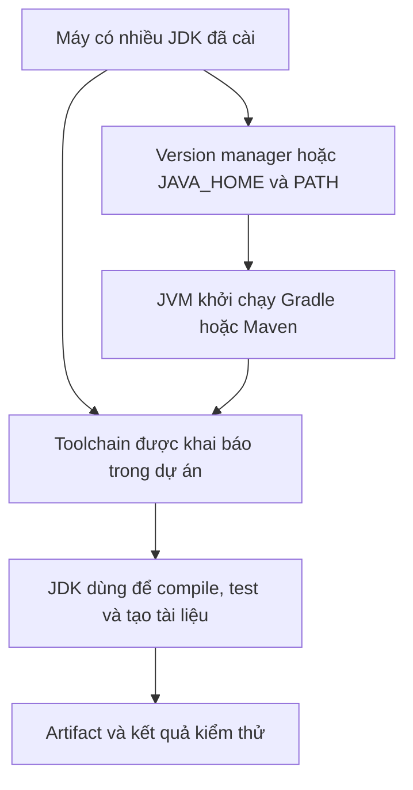

# Quản lý nhiều JDK trên máy phát triển và trong môi trường CI

Một máy phát triển có thể cần nhiều JDK cùng lúc: dự án hiện tại dùng Java 21, một dịch vụ khác đang duy trì Java 17, còn pipeline cần kiểm tra khả năng chạy trên một JDK mới hơn. Nếu chỉ đổi `JAVA_HOME` thủ công, cấu hình shell, IDE, Gradle, Maven và CI rất dễ lệch nhau.

Java 21 vẫn là một dòng LTS được sử dụng rộng rãi. Mục tiêu của bài này là chọn đúng JDK cho từng dự án, giúp mọi thành viên và máy CI dùng cùng quy tắc, đồng thời nhận biết chính xác JDK nào đang chạy build, biên dịch và kiểm thử.

## Mục tiêu học tập

Sau bài học, bạn có thể:

- Phân biệt JDK được cài trên máy, JDK mặc định của shell và JDK mà build tool chọn cho dự án.
- Cài đặt, chuyển đổi và ghim phiên bản JDK bằng công cụ quản lý phiên bản phù hợp.
- Khai báo Java toolchain trong Gradle hoặc Maven để build không phụ thuộc vào JDK mặc định của máy.
- Cấu hình CI để cài đúng JDK, lưu cache phù hợp và kiểm tra nhiều phiên bản khi cần.
- Chẩn đoán lỗi do `JAVA_HOME`, `PATH`, IDE, Gradle daemon hoặc Maven toolchain không đồng nhất.

## 1. Vì sao cần quản lý nhiều JDK?

Một tổ chức thường duy trì nhiều ứng dụng với vòng đời khác nhau. Dự án mới có thể dùng Java 21, ứng dụng đang vận hành có thể vẫn cần một dòng Java khác, còn một nhóm thư viện cần xác minh rằng mã nguồn tương thích với JDK mới hơn. Cài một JDK duy nhất rồi thay đổi nó mỗi khi chuyển dự án tạo ra nhiều rủi ro:

- Build có thể thành công trên máy của một thành viên nhưng thất bại trên máy khác vì họ đang dùng JDK khác.
- IDE có thể dùng một JDK trong khi terminal dùng JDK khác.
- Maven hoặc Gradle có thể chạy bằng một JVM nhưng gọi compiler hoặc test launcher từ một JDK khác.
- CI có thể vô tình lấy phiên bản mới nhất thay vì phiên bản mà dự án đã kiểm thử.
- Việc nâng bản vá bảo mật có thể làm thay đổi kết quả build nếu phiên bản JDK không được quản lý rõ ràng.

Quản lý nhiều JDK giúp mỗi dự án khai báo yêu cầu của chính nó. Nhà phát triển có thể chuyển dự án mà không phải gỡ cài đặt JDK của dự án trước; build tool và CI sẽ chọn đúng bộ công cụ theo cấu hình đã thống nhất.

## 2. Phân biệt các lớp cấu hình Java

Trước khi cài đặt hoặc đổi phiên bản, cần phân biệt bốn lớp sau:

| Lớp | Vai trò | Ví dụ |
|---|---|---|
| Bản phân phối và JDK đã cài | Cung cấp compiler, runtime và các công cụ phát triển | Eclipse Temurin 21, Amazon Corretto 21, Azul Zulu 21 |
| JDK mặc định của tiến trình | Quyết định lệnh `java`, `javac` và công cụ Java nào được gọi từ shell | `JAVA_HOME` và thứ tự thư mục trong `PATH` |
| Toolchain của dự án | Chọn JDK cho tác vụ compile, test, javadoc hoặc tác vụ build tương ứng | Gradle Java toolchain, Maven Toolchains |
| JVM chạy build tool | Chạy chính Gradle hoặc Maven và các daemon của chúng | Gradle JVM trong IDE, JVM hiển thị bởi `mvn -v` |

Các lớp này có liên quan nhưng không thay thế lẫn nhau. Đổi `JAVA_HOME` thường đổi JVM dùng để khởi động Maven hoặc Gradle, nhưng cấu hình toolchain của dự án vẫn có thể chọn một JDK khác cho compiler và test. Tương tự, đặt `--release 21` chỉ giới hạn ngôn ngữ, bytecode và API Java mục tiêu; nó không cài đặt hoặc chọn JDK 21.



Một JDK đầy đủ có cả `java` và `javac`. Môi trường chỉ có runtime có thể chạy ứng dụng nhưng không đáp ứng nhu cầu biên dịch. Máy phát triển và máy build nên cài JDK phù hợp với yêu cầu của dự án.

## 3. Cài đặt và chuyển đổi JDK

### 3.1. Chọn bản phân phối

Nhiều nhà cung cấp phát hành bản build của OpenJDK, chẳng hạn Eclipse Temurin, Amazon Corretto, Azul Zulu, Microsoft Build of OpenJDK và Oracle JDK. Khi chọn, hãy xét:

- Chính sách cập nhật bảo mật và thời gian hỗ trợ của nhà cung cấp.
- Hệ điều hành, kiến trúc CPU và loại package cần dùng.
- Điều khoản sử dụng và yêu cầu hỗ trợ của tổ chức.
- Việc dự án có cần một vendor cụ thể để tái tạo môi trường build hay không.

Đối với dự án Java 21, hãy chọn rõ dòng JDK 21 và thống nhất vendor trong nhóm nếu điều đó quan trọng với môi trường triển khai. Không nên dùng bí danh trôi nổi như `latest` trong pipeline build phát hành vì cùng một cấu hình có thể chọn một major version khác vào thời điểm chạy sau này.

### 3.2. Dùng mise để quản lý phiên bản theo dự án

`mise` có backend Java, có thể cài JDK từ nhiều vendor và đặt `JAVA_HOME` theo cấu hình dự án. Tại thư mục dự án, chạy:

```bash
mise use java@temurin-21
mise exec -- java -version
mise exec -- javac -version
```

Lệnh `mise use` ghi lựa chọn vào `mise.toml`. Việc ghi rõ `temurin-21` giúp các máy trong nhóm thống nhất vendor và major version thay vì phụ thuộc vào vendor mặc định trên từng máy. Nếu cần khóa cả bản cập nhật cụ thể, tạo hoặc cập nhật lockfile rồi cài theo lockfile:

```bash
mise lock
mise install --locked
```

Lockfile giúp các máy dùng cùng bản JDK đã được giải quyết. Khi muốn nâng bản vá, nhóm chủ động cập nhật lockfile, kiểm thử rồi đưa thay đổi vào repository. Có thể xem các phiên bản Temurin hiện có bằng `mise ls-remote java temurin-21`.

### 3.3. Dùng SDKMAN trên môi trường Unix-like

SDKMAN phù hợp với Linux, macOS và môi trường WSL có Bash hoặc Zsh. Liệt kê các bản Java có thể cài:

```bash
sdk list java
```

Chọn mã phiên bản hiển thị trong danh sách để cài và chuyển đổi trong shell hiện tại:

```bash
sdk install java <version-id>
sdk use java <version-id>
sdk current java
```

Để đặt phiên bản mặc định cho các shell mới, dùng `sdk default java <version-id>`. Để mỗi lần làm việc với một repository có thể khôi phục đúng JDK, tạo file `.sdkmanrc` bằng `sdk env init`, kiểm tra dòng `java=...` trong file rồi chạy:

```bash
sdk env
sdk env install
```

`sdk env` chuyển shell hiện tại sang các phiên bản khai báo trong `.sdkmanrc`; `sdk env install` cài các phiên bản còn thiếu. Thành viên trong nhóm cần dùng cùng mã phiên bản được commit trong repository.

### 3.4. Cài đặt trên Windows

Trên Windows, có thể cài nhiều JDK bằng bộ cài của vendor hoặc package manager được tổ chức chấp thuận. Mỗi bản nên nằm trong thư mục riêng, ví dụ `C:\Java\temurin-21` và `C:\Java\corretto-21`. Sau đó chọn JDK mặc định cho terminal bằng `JAVA_HOME` và `PATH`, hoặc để build tool chọn qua toolchain.

Không ghi đường dẫn tuyệt đối của máy cá nhân vào `build.gradle`, `pom.xml` hoặc file cấu hình được commit. Đường dẫn cài đặt trên máy của từng thành viên có thể khác nhau; toolchain nên chọn theo phiên bản và vendor, còn đường dẫn cụ thể được cấu hình tại máy hoặc môi trường CI.

## 4. Thiết lập `JAVA_HOME` và `PATH`

`JAVA_HOME` nên trỏ đến thư mục gốc của JDK, không phải thư mục `bin`. Thư mục `bin` của JDK được đưa lên đầu `PATH` để lệnh `java` và `javac` gọi đúng bản cài đặt.

Trên Linux hoặc macOS, có thể đặt tạm trong shell hiện tại:

```bash
export JAVA_HOME=/opt/jdks/temurin-21
export PATH="$JAVA_HOME/bin:$PATH"
```

Trên PowerShell, có thể đặt tạm trong phiên terminal hiện tại:

```powershell
$env:JAVA_HOME = 'C:\Java\temurin-21'
$env:Path = "$env:JAVA_HOME\bin;$env:Path"
```

Muốn cấu hình lâu dài trên Windows, cập nhật biến môi trường người dùng hoặc hệ thống bằng giao diện cài đặt của Windows hay công cụ quản trị được tổ chức sử dụng. Trên Linux/macOS, cấu hình trong file khởi tạo shell phù hợp nếu không dùng version manager.

Kiểm tra cả compiler lẫn runtime và vị trí thực tế của executable:

```bash
java -version
javac -version
echo "$JAVA_HOME"
command -v java
command -v javac
```

Trên PowerShell:

```powershell
java -version
javac -version
$env:JAVA_HOME
Get-Command java | Select-Object -ExpandProperty Source
where.exe java
```

Nếu `java` và `javac` đến từ hai thư mục JDK khác nhau, thứ tự `PATH` đang không nhất quán. Hãy sửa `JAVA_HOME` và `PATH`, mở terminal mới rồi kiểm tra lại. Việc chỉ chạy `java -version` chưa đủ để xác nhận compiler đang dùng cùng JDK.

## 5. Chọn JDK bằng Gradle Java Toolchains

Gradle Java Toolchains cho phép khai báo JDK mà dự án cần, độc lập với JDK mặc định dùng để khởi chạy Gradle. Với dự án Java 21, cấu hình trong `build.gradle` như sau:

```groovy
java {
    toolchain {
        languageVersion = JavaLanguageVersion.of(21)
    }
}

tasks.withType(JavaCompile).configureEach {
    options.release = 21
}
```

`languageVersion` yêu cầu Gradle tìm JDK 21 cho các tác vụ Java tương ứng. `options.release` yêu cầu compiler tuân thủ API và định dạng đầu ra của Java 21. Khi dự án biên dịch bằng JDK mới hơn nhưng vẫn phải tạo artifact tương thích Java 21, `--release` giúp ngăn việc vô tình gọi API chỉ có ở bản Java mới hơn.

Có thể khai báo vendor khi dự án cần đồng nhất bản phân phối:

```groovy
java {
    toolchain {
        languageVersion = JavaLanguageVersion.of(21)
        vendor = JvmVendorSpec.ADOPTIUM
    }
}
```

Chỉ đặt vendor khi dự án thực sự cần ràng buộc đó. Nếu không, Gradle có thể chọn bất kỳ JDK 21 phù hợp nào đã được phát hiện.

### 5.1. Kiểm tra các toolchain Gradle tìm thấy

Chạy task tích hợp để xem các JDK mà Gradle phát hiện và nguồn phát hiện:

```bash
./gradlew -q javaToolchains
./gradlew -version
```

`javaToolchains` hiển thị các toolchain có thể dùng cho dự án. `-version` hiển thị JVM chạy Gradle. Hai kết quả có thể khác nhau: Gradle daemon có thể chạy bằng một JDK, trong khi compile và test dùng JDK 21 đã chọn qua toolchain.

Trong IDE, hãy kiểm tra riêng Gradle JVM và Project SDK. Ví dụ, IntelliJ IDEA có thiết lập Gradle JVM trong phần cấu hình Gradle; Eclipse có Gradle JDK. Việc chọn Project SDK không tự động bảo đảm Gradle daemon và mọi tác vụ build đều dùng cùng JDK.

### 5.2. Tự động tải JDK khi thiếu

Gradle có thể tự tải JDK phù hợp nếu dự án đã cấu hình một toolchain download repository. Một lựa chọn phổ biến là Foojay Toolchains Resolver. Khai báo plugin trong `settings.gradle`:

```groovy
plugins {
    id 'org.gradle.toolchains.foojay-resolver-convention' version '1.0.0'
}
```

Khi có resolver, Gradle có thể tìm và tải JDK đáp ứng yêu cầu toolchain nếu máy chưa cài bản phù hợp. Nếu không cấu hình repository resolver, chỉ khai báo `languageVersion` không có nghĩa Gradle sẽ tự tải JDK từ Internet. Với môi trường doanh nghiệp, cần kiểm soát nguồn tải, vendor được phép và cache JDK theo chính sách nội bộ.

Sau khi thay đổi cấu hình toolchain hoặc vị trí JDK, nếu Gradle vẫn giữ thông tin cũ, dừng daemon rồi chạy lại:

```bash
./gradlew --stop
./gradlew -q javaToolchains
```

### 5.3. Khi nào cần tách JVM chạy Gradle và JDK của dự án?

JVM chạy Gradle phải đáp ứng yêu cầu của phiên bản Gradle và các plugin đang dùng. JDK toolchain lại đáp ứng yêu cầu của mã nguồn và tác vụ Java trong dự án. Hai phiên bản có thể giống nhau hoặc khác nhau.

Ví dụ, một dự án có thể chạy Gradle bằng JDK được tổ chức hỗ trợ cho build tool, nhưng dùng JDK 21 để compile, test và tạo Javadoc. Hãy cấu hình Gradle JVM trong IDE hoặc dùng cơ chế Daemon JVM criteria khi cần cố định JVM chạy Gradle cho cả nhóm. Đừng nhầm thiết lập này với `java.toolchain` trong build script.

## 6. Chọn JDK bằng Maven Toolchains

Maven cũng có hai khái niệm riêng: JVM chạy Maven và JDK mà các plugin hỗ trợ toolchain sử dụng. `mvn -v` hiển thị JVM chạy Maven; Maven Toolchains cho phép compiler, Surefire, Failsafe và các plugin tương thích sử dụng JDK được dự án yêu cầu.

### 6.1. Khai báo mức tương thích Java 21

Trong `pom.xml`, khai báo `release` và phiên bản plugin compiler được quản lý rõ ràng:

```xml
<properties>
    <maven.compiler.release>21</maven.compiler.release>
</properties>

<build>
    <plugins>
        <plugin>
            <groupId>org.apache.maven.plugins</groupId>
            <artifactId>maven-compiler-plugin</artifactId>
            <version>3.16.0</version>
        </plugin>
    </plugins>
</build>
```

`maven.compiler.release` cấu hình `javac --release 21`: compiler kiểm tra cú pháp, bytecode và API Java SE mà chương trình được phép sử dụng. Thuộc tính này không tự chọn một thư mục JDK 21 khác với JVM đang chạy Maven.

### 6.2. Chọn một JDK khác với JVM chạy Maven

Để yêu cầu các plugin tương thích dùng JDK 21 của Temurin, thêm Maven Toolchains Plugin vào `pom.xml`:

```xml
<plugin>
    <groupId>org.apache.maven.plugins</groupId>
    <artifactId>maven-toolchains-plugin</artifactId>
    <version>3.3.0</version>
    <executions>
        <execution>
            <goals>
                <goal>toolchain</goal>
            </goals>
        </execution>
    </executions>
    <configuration>
        <toolchains>
            <jdk>
                <version>21</version>
                <vendor>temurin</vendor>
            </jdk>
        </toolchains>
    </configuration>
</plugin>
```

Tiếp theo, khai báo đường dẫn JDK đã cài trong file `~/.m2/toolchains.xml` trên máy build:

```xml
<?xml version="1.0" encoding="UTF-8"?>
<toolchains>
    <toolchain>
        <type>jdk</type>
        <provides>
            <version>21</version>
            <vendor>temurin</vendor>
        </provides>
        <configuration>
            <jdkHome>/path/to/temurin-21</jdkHome>
        </configuration>
    </toolchain>
</toolchains>
```

Thay `/path/to/temurin-21` bằng đường dẫn JDK thực tế trên từng máy. File này thường thuộc cấu hình cá nhân hoặc máy CI, không nên commit đường dẫn riêng của một nhà phát triển vào repository. Maven Toolchains Plugin tìm một mục có các thuộc tính `version` và `vendor` khớp với yêu cầu trong POM; nếu không có mục phù hợp, build sẽ báo không tìm thấy toolchain.

Từ Maven Toolchains Plugin 3.2.0, plugin còn có cơ chế tự phát hiện JDK ở các vị trí quen thuộc. Có thể liệt kê JDK được phát hiện bằng:

```bash
mvn org.apache.maven.plugins:maven-toolchains-plugin:3.3.0:display-discovered-jdk-toolchains
```

Để dùng cơ chế chọn JDK tự động, xem goal `toolchains:select-jdk-toolchain` trong tài liệu plugin và cấu hình điều kiện chọn phù hợp. Với môi trường có đường dẫn cài đặt đặc thù, file `toolchains.xml` vẫn là cách khai báo tường minh, dễ kiểm tra.

### 6.3. Kiểm tra Maven đang dùng JDK nào

```bash
mvn -v
mvn verify
```

`mvn -v` cho biết Maven đang chạy bằng Java nào và `Java home` ở đâu. Khi build có cấu hình toolchain, xem log của Maven Toolchains Plugin để xác nhận JDK được chọn. Nếu Maven khởi chạy đúng nhưng compiler dùng sai JDK, kiểm tra cả `toolchains.xml`, điều kiện `version`/`vendor` trong POM và plugin đang sử dụng có hỗ trợ toolchain hay không.

## 7. Cấu hình JDK trong CI

Máy CI nên cài JDK theo cấu hình được commit cùng dự án. Ví dụ sau dùng GitHub Actions để build dự án Gradle bằng Temurin 21 và cache dependency:

```yaml
name: Java 21 CI

on:
  push:
  pull_request:

jobs:
  verify:
    runs-on: ubuntu-latest
    steps:
      - uses: actions/checkout@v7

      - uses: actions/setup-java@v6
        with:
          distribution: temurin
          java-version: '21'
          cache: gradle

      - name: Verify JDK
        run: |
          java --version
          javac --version

      - name: Build and test
        run: ./gradlew --no-daemon clean check
```

`actions/setup-java` cài JDK được yêu cầu, thiết lập `JAVA_HOME` và `PATH`, đồng thời có thể cache dependency của Gradle hoặc Maven. Dự án nên dùng Gradle Wrapper để phiên bản Gradle cũng được kiểm soát bằng repository. Wrapper và JDK là hai cấu hình độc lập: Wrapper cố định build tool, còn `java.toolchain` xác định JDK cho tác vụ Java.

Với dự án Maven, thay cấu hình cache và lệnh build như sau:

```yaml
- uses: actions/setup-java@v6
  with:
    distribution: temurin
    java-version: '21'
    cache: maven

- run: ./mvnw --batch-mode --no-transfer-progress verify
```

Nếu POM dùng Maven Toolchains và `actions/setup-java` cài JDK, action có thể tạo cấu hình Maven Toolchains tương ứng. Khi cài nhiều JDK trong cùng một job, `setup-java` hỗ trợ khai báo nhiều dòng trong `java-version`; JDK cuối cùng trở thành mặc định của `PATH`, còn các JDK khác có biến môi trường riêng và được ghi vào cấu hình Maven Toolchains. Hãy chọn đúng toolchain trong POM thay vì dựa vào thứ tự cài đặt.

### 7.1. Kiểm thử trên nhiều JDK bằng matrix

Nếu thư viện hoặc ứng dụng cần xác minh trên cả Java 21 và Java 25, có thể tạo matrix. Với Gradle, tham số hóa toolchain để mỗi job thực sự dùng JDK tương ứng; nếu build script luôn cố định toolchain 21 thì việc đổi `JAVA_HOME` trong matrix không làm compiler và test tự chuyển sang 25.

Ví dụ trong `build.gradle`:

```groovy
def selectedJdk = providers.gradleProperty('jdkVersion')
    .map { it.toInteger() }
    .getOrElse(21)

java {
    toolchain {
        languageVersion = JavaLanguageVersion.of(selectedJdk)
    }
}

tasks.withType(JavaCompile).configureEach {
    options.release = 21
}
```

Workflow matrix:

```yaml
jobs:
  verify:
    runs-on: ubuntu-latest
    strategy:
      matrix:
        jdk: ['21', '25']
    steps:
      - uses: actions/checkout@v7

      - uses: actions/setup-java@v6
        with:
          distribution: temurin
          java-version: ${{ matrix.jdk }}
          cache: gradle

      - run: ./gradlew --no-daemon -PjdkVersion=${{ matrix.jdk }} check
```

Trong ví dụ này, `release = 21` giữ mức API và bytecode mục tiêu ở Java 21, còn toolchain được chọn theo từng job để kiểm tra compiler và runtime trên JDK 21 hoặc 25. Matrix nên phản ánh các phiên bản mà dự án cam kết hỗ trợ; không cần kiểm thử mọi JDK đang tồn tại nếu sản phẩm không có yêu cầu đó.

Với Maven, có thể dùng matrix tương tự và truyền phiên bản vào điều kiện chọn toolchain, đồng thời bảo đảm mỗi job có JDK tương ứng trong `toolchains.xml`. Nếu muốn kiểm tra nhiều runtime trong cùng một job, cài nhiều JDK và cấu hình rõ JDK cho Surefire/Failsafe; chỉ cài nhiều bản Java không tự động tạo ra nhiều lượt kiểm thử.

## 8. Đồng bộ IDE, terminal và build tool

Khi một dự án chạy tốt từ terminal nhưng lỗi khi bấm Build trong IDE, hãy kiểm tra lần lượt:

1. Project SDK của IDE có đúng major version mà dự án yêu cầu không.
2. JVM chạy Gradle hoặc Maven trong IDE có tương thích với phiên bản build tool không.
3. Build script có khai báo toolchain riêng không; nếu có, JDK đó đã được cài hoặc được phép tự tải chưa.
4. Run configuration của ứng dụng và test có dùng đúng JDK runtime không.
5. Terminal tích hợp trong IDE có nạp cùng shell profile hoặc version manager như terminal bên ngoài không.

Sau khi đổi JDK, có thể cần khởi động lại terminal hoặc IDE để chúng đọc lại biến môi trường. Với Gradle, dùng `./gradlew --stop` để dừng daemon cũ trước khi xác minh lại toolchain.

## 9. Chẩn đoán các lỗi thường gặp

| Triệu chứng | Nguyên nhân thường gặp | Cách kiểm tra và xử lý |
|---|---|---|
| `java -version` đúng nhưng biên dịch báo thiếu compiler | Máy đang trỏ đến runtime hoặc `javac` không nằm trong `PATH` | Kiểm tra `javac -version`, `JAVA_HOME` và đường dẫn executable; cài JDK đầy đủ |
| `java` và `javac` báo hai phiên bản khác nhau | Có nhiều thư mục Java trong `PATH` và thứ tự ưu tiên không đúng | Dùng `command -v`/`where.exe`, đưa `JAVA_HOME/bin` lên trước và mở terminal mới |
| `mvn -v` hiển thị JDK khác mong đợi | Maven được khởi chạy bằng `JAVA_HOME` hoặc `PATH` khác | Kiểm tra Java home trong `mvn -v`; kiểm tra cấu hình terminal và IDE |
| Gradle chạy bằng JDK khác với JDK compile | Nhầm Gradle JVM với project toolchain | So sánh `./gradlew -version` và `./gradlew -q javaToolchains` |
| Gradle báo không tìm thấy JDK 21 | Chưa cài JDK phù hợp, Gradle không phát hiện đường dẫn hoặc chưa cấu hình resolver | Cài JDK, cấu hình vị trí hoặc toolchain resolver, sau đó chạy `./gradlew --stop` |
| Maven báo không tìm được toolchain | `version`, `vendor` hoặc `jdkHome` không khớp | Đối chiếu yêu cầu trong POM với mục trong `~/.m2/toolchains.xml` và kiểm tra thư mục JDK tồn tại |
| CI thành công nhưng máy cá nhân thất bại | Máy cá nhân chọn JDK khác, thiếu JDK hoặc khác cấu hình IDE | So sánh log phiên bản, toolchain và wrapper giữa hai môi trường |

Khi điều tra, hãy ghi lại ít nhất `java -version`, `javac -version`, `JAVA_HOME`, `mvn -v` hoặc `./gradlew -version`, và kết quả liệt kê toolchain. Những thông tin này giúp xác định lỗi nằm ở lớp cài đặt, lớp khởi chạy build tool hay toolchain của dự án.

## 10. Quy tắc vận hành cho nhóm

- **Ghim major version và vendor khi cần.** Dùng cấu hình dự án để thành viên mới có thể cài đúng dòng JDK mà không phải hỏi từng người.
- **Khóa bản cụ thể khi yêu cầu tái lập nghiêm ngặt.** Có thể dùng lockfile của version manager hoặc phiên bản JDK cụ thể trong pipeline. Với cấu hình chỉ ghim major, chủ động cập nhật các bản vá bảo mật và kiểm thử lại.
- **Không dùng `latest` cho build phát hành.** Bí danh này thay đổi theo thời gian và có thể đưa major version mới vào pipeline ngoài kế hoạch.
- **Không commit đường dẫn JDK của máy cá nhân.** Để đường dẫn trong cấu hình máy hoặc CI; repository lưu yêu cầu về phiên bản và vendor.
- **Đồng bộ IDE và build tool.** Tài liệu onboarding nên nêu Project SDK, Gradle JVM hoặc Maven JVM nếu dự án có yêu cầu riêng.
- **Kiểm tra phiên bản trong CI.** In `java --version`, `javac --version` và phiên bản build tool để log có thể truy vết.
- **Cập nhật JDK có kiểm soát.** Theo dõi thông báo bảo mật từ vendor, cập nhật bản vá trong một thay đổi có thể review và chạy lại test trước khi phát hành.
- **Tách yêu cầu build và runtime triển khai.** JDK dùng để biên dịch, JVM chạy test và JVM trên production có thể khác nhau; hãy kiểm thử trên runtime mà sản phẩm cam kết hỗ trợ.

## 11. Quy trình mẫu khi thêm một dự án Java 21

1. Chọn vendor JDK 21 theo chính sách hỗ trợ và cài bằng version manager hoặc package manager.
2. Ghi phiên bản dự án vào `mise.toml`, `.sdkmanrc` hoặc cơ chế quản lý môi trường mà nhóm đã thống nhất.
3. Khai báo `java.toolchain` trong Gradle hoặc Maven Toolchains trong Maven; khai báo `--release 21` để kiểm soát API và bytecode mục tiêu.
4. Cấu hình IDE dùng đúng Project SDK và JVM chạy build tool.
5. Cấu hình CI cài cùng vendor và major version, chạy wrapper, in phiên bản JDK và thực hiện `check` hoặc `verify`.
6. Nếu sản phẩm cần tương thích với JDK mới hơn, bổ sung job matrix và cấu hình toolchain theo từng phiên bản trong matrix.
7. Khi nâng bản vá JDK, cập nhật lockfile hoặc cấu hình CI, review thay đổi và chạy lại toàn bộ kiểm thử liên quan.

## Tài liệu tham khảo

- [Gradle — Toolchains for JVM projects](https://docs.gradle.org/current/userguide/toolchains.html): cấu hình Java toolchain, `--release`, phát hiện JDK và tự động tải toolchain.
- [Apache Maven — Guide to Using Toolchains](https://maven.apache.org/guides/mini/guide-using-toolchains): khai báo JDK trong POM và `toolchains.xml`.
- [Apache Maven — Setting the `--release` of the Java Compiler](https://maven.apache.org/components/plugins/maven-compiler-plugin/examples/set-compiler-release.html): giới hạn ngôn ngữ, bytecode và API theo Java release.
- [Apache Maven Toolchains Plugin](https://maven.apache.org/plugins/maven-toolchains-plugin/): cơ chế phát hiện và chọn JDK toolchain.
- [GitHub Actions — actions/setup-java](https://github.com/actions/setup-java): cài nhiều JDK, cấu hình Maven Toolchains và cache dependency trong CI.
- [mise — Java](https://mise.jdx.dev/lang/java.html): quản lý JDK theo dự án, chọn vendor và sử dụng lockfile.
- [SDKMAN! — Usage](https://sdkman.io/usage/): cài, chuyển đổi và khai báo phiên bản SDK theo dự án bằng `.sdkmanrc`.
