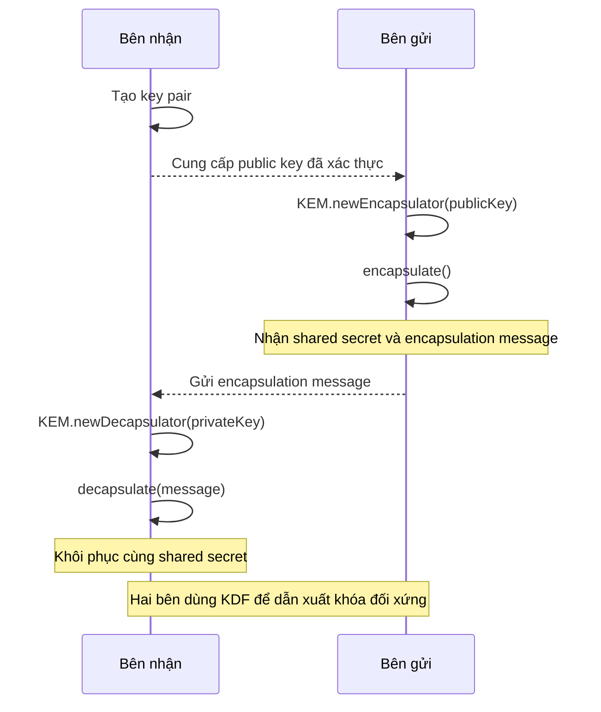

# `javax.crypto.KEM` và mô hình lựa chọn security provider

## Mục tiêu

Java 21 bổ sung API `javax.crypto.KEM` để thực hiện **Key Encapsulation Mechanism (KEM)** thông qua kiến trúc Java Cryptography Architecture (JCA). KEM cho phép bên gửi dùng public key của bên nhận để tạo một shared secret và một thông điệp encapsulation. Bên nhận dùng private key tương ứng cùng thông điệp đó để khôi phục cùng shared secret.

API `KEM` là lớp giao tiếp chuẩn; thuật toán cụ thể được cung cấp bởi security provider. Vì vậy, việc gọi `KEM.getInstance("DHKEM")` mới chỉ chọn tên thuật toán. Khả năng tạo encapsulator hoặc decapsulator còn phụ thuộc provider, loại key, tham số và cấu hình của runtime.

Bài học này trình bày luồng encapsulation/decapsulation, các kiểu dữ liệu của API, cách lựa chọn và kiểm tra provider, giới hạn hỗ trợ thuật toán trên Java 21 và những yêu cầu bảo mật khi đưa KEM vào một giao thức thực tế.

## 1. KEM giải quyết vấn đề gì?

KEM là cơ chế thiết lập một secret key chung dựa trên public-key cryptography. Bên gửi không cần biết trước secret key; họ chỉ cần public key đã được xác thực của bên nhận.

Luồng cơ bản gồm hai phía:

1. Bên nhận tạo một key pair và công bố public key qua một kênh đáng tin cậy. Private key được giữ bí mật.
2. Bên gửi dùng public key để encapsulate, tạo ra một shared secret và một encapsulation message.
3. Bên gửi chuyển encapsulation message cho bên nhận. Message này không phải shared secret.
4. Bên nhận dùng private key và encapsulation message để decapsulate, khôi phục cùng shared secret.
5. Hai bên đưa shared secret vào một key derivation function (KDF) để tạo khóa đối xứng dùng cho mã hóa dữ liệu.



KEM không phải là API mã hóa trực tiếp một payload tùy ý. Encapsulation message mang dữ liệu cần thiết để bên nhận khôi phục shared secret; dữ liệu ứng dụng được mã hóa ở bước tiếp theo bằng thuật toán đối xứng như AES-GCM hoặc ChaCha20-Poly1305.

## 2. Phân biệt KEM với key agreement và encryption

Các cơ chế này có liên quan nhưng có hợp đồng khác nhau:

| Cơ chế | Vai trò | Kết quả chính |
|---|---|---|
| KEM | Bên gửi encapsulate cho public key của bên nhận; bên nhận decapsulate bằng private key | Shared secret và encapsulation message |
| Key agreement, ví dụ ECDH | Hai bên thực hiện các bước thỏa thuận khóa dựa trên private/public key material của mỗi bên | Shared secret từ phép thỏa thuận khóa |
| Public-key encryption | Mã hóa plaintext bằng public key và giải mã ciphertext bằng private key | Plaintext được khôi phục |
| Symmetric encryption | Dùng cùng khóa bí mật để mã hóa và giải mã dữ liệu | Ciphertext và plaintext |

KEM thường được dùng để thiết lập khóa đối xứng, sau đó dùng khóa đó bảo vệ dữ liệu có kích thước tùy ý. KEM API không tự cung cấp toàn bộ giao thức trao đổi khóa, xác thực danh tính, dẫn xuất khóa và mã hóa dữ liệu.

## 3. Các thành phần chính của `javax.crypto.KEM`

Java 21 cung cấp các kiểu chính sau trong package `javax.crypto`:

| Kiểu | Vai trò |
|---|---|
| `KEM` | Factory và điểm vào để tạo encapsulator/decapsulator cho thuật toán KEM |
| `KEM.Encapsulator` | Thực hiện encapsulation ở phía gửi |
| `KEM.Decapsulator` | Thực hiện decapsulation ở phía nhận |
| `KEM.Encapsulated` | Chứa shared secret, encapsulation message và optional parameters |
| `KEMSpi` | Service Provider Interface để provider triển khai thuật toán KEM |

Một số method quan trọng:

| API | Mục đích |
|---|---|
| `KEM.getInstance(algorithm)` | Tìm provider có hỗ trợ thuật toán được yêu cầu |
| `KEM.getInstance(algorithm, provider)` | Tạo KEM từ một provider cụ thể |
| `newEncapsulator(publicKey)` | Tạo encapsulator cho public key của bên nhận |
| `newDecapsulator(privateKey)` | Tạo decapsulator cho private key của bên nhận |
| `encapsulate()` | Sinh shared secret và encapsulation message |
| `decapsulate(encapsulation)` | Khôi phục shared secret từ message |
| `providerName()` | Cho biết provider thực tế của encapsulator hoặc decapsulator |

`KEM`, `KEM.Encapsulator` và `KEM.Decapsulator` là các đối tượng immutable theo hợp đồng API. Có thể gọi nhiều thao tác tạo encapsulator/decapsulator hoặc encapsulate/decapsulate đồng thời trên cùng instance theo quy định của API.

## 4. Ví dụ hoàn chỉnh với DHKEM và X25519

Java 21 có thể dùng thuật toán `DHKEM`. Ví dụ dưới đây tạo key pair X25519 cho bên nhận, sau đó mô phỏng bên gửi encapsulate và bên nhận decapsulate:

```java
import java.security.KeyPair;
import java.security.KeyPairGenerator;
import java.security.MessageDigest;
import java.util.Arrays;

import javax.crypto.KEM;
import javax.crypto.SecretKey;

class DhkemRoundTripExample {
    public static void main(String[] args) throws Exception {
        // Bên nhận tạo key pair và giữ private key bí mật.
        KeyPairGenerator keyPairGenerator = KeyPairGenerator.getInstance("X25519");
        KeyPair recipientKeys = keyPairGenerator.generateKeyPair();

        // Bên gửi chỉ cần public key đã được xác thực của bên nhận.
        KEM kem = KEM.getInstance("DHKEM");
        KEM.Encapsulator encapsulator = kem.newEncapsulator(recipientKeys.getPublic());
        KEM.Encapsulated result = encapsulator.encapsulate();

        SecretKey senderSecret = result.key();
        byte[] encapsulationMessage = result.encapsulation();

        // Chỉ truyền encapsulation message cho bên nhận, không truyền shared secret.
        KEM.Decapsulator decapsulator = kem.newDecapsulator(recipientKeys.getPrivate());
        SecretKey receiverSecret = decapsulator.decapsulate(encapsulationMessage);

        System.out.println("Encapsulator provider: " + encapsulator.providerName());
        System.out.println("Decapsulator provider: " + decapsulator.providerName());

        // So sánh bytes chỉ để minh họa với software provider có key exportable.
        // Production code không nên yêu cầu export shared secret nếu không cần.
        byte[] senderBytes = senderSecret.getEncoded();
        byte[] receiverBytes = receiverSecret.getEncoded();
        if (senderBytes == null || receiverBytes == null) {
            throw new IllegalStateException("Provider không cho export shared secret");
        }

        try {
            System.out.println("Shared secrets match: "
                    + MessageDigest.isEqual(senderBytes, receiverBytes));
        } finally {
            Arrays.fill(senderBytes, (byte) 0);
            Arrays.fill(receiverBytes, (byte) 0);
        }
    }
}
```

Trong ví dụ:

- `KeyPairGenerator.getInstance("X25519")` tạo key pair của bên nhận. Private key không được gửi cho bên gửi.
- `KEM.getInstance("DHKEM")` yêu cầu provider triển khai thuật toán DHKEM.
- `newEncapsulator(recipientKeys.getPublic())` tạo đối tượng phía gửi.
- `encapsulate()` trả về `KEM.Encapsulated`, gồm shared secret và encapsulation message.
- `newDecapsulator(recipientKeys.getPrivate())` tạo đối tượng phía nhận.
- `decapsulate(encapsulationMessage)` khôi phục shared secret tương ứng.

Đây là ví dụ minh họa hai phía trong cùng một tiến trình. Ứng dụng thực tế cần truyền public key qua kênh có xác thực và chuyển encapsulation message qua giao thức có định dạng rõ ràng. Không gửi shared secret qua mạng.

`SecretKey.getEncoded()` có thể trả về `null` nếu provider không cho export key material, chẳng hạn khi khóa được quản lý bởi phần cứng hoặc HSM. Đoạn so sánh byte ở trên chỉ dành cho demo với software provider; production nên chuyển `SecretKey` cho KDF hoặc dịch vụ mật mã có thể sử dụng key object mà không cần xuất bytes.

## 5. Nội dung của `KEM.Encapsulated`

`encapsulate()` trả về một `KEM.Encapsulated` có ba thành phần:

| Thành phần | Method | Ý nghĩa |
|---|---|---|
| Shared secret | `key()` | `SecretKey` chứa secret mà hai bên cùng khôi phục |
| Encapsulation message | `encapsulation()` | Byte array được gửi đến bên nhận để decapsulate; đôi khi còn được gọi là ciphertext |
| Optional parameters | `params()` | Byte array chứa tham số bổ sung nếu thuật toán/provider yêu cầu |

Encapsulation message không phải secret key. Nó được thiết kế để truyền cho bên nhận. Ngược lại, giá trị trả về từ `key()` là key material nhạy cảm và cần được bảo vệ như khóa bí mật.

Với thuật toán không cần tham số bổ sung, `params()` có thể là `null`. Nếu provider/algorithm dùng `AlgorithmParameterSpec` và tham số cần được gửi sang phía nhận, ứng dụng phải truyền cả `params()` trong thông điệp giao thức và khôi phục đúng `AlgorithmParameterSpec` trước khi gọi `newDecapsulator(privateKey, spec)`.

Các byte array do `encapsulation()` và `params()` trả về là bản sao mới theo hợp đồng API. Khi đóng gói message để truyền qua mạng, cần có framing hoặc length prefix rõ ràng, phiên bản giao thức, định danh thuật toán và key identifier phù hợp. Không tự ghép các byte array mà không định nghĩa cách phân tách ở phía nhận.

## 6. Thuật toán KEM và phạm vi hỗ trợ trong Java 21

Tên thuật toán là một phần của Java Security Standard Algorithm Names. Tuy nhiên, một tên chuẩn không có nghĩa mọi provider hoặc mọi JDK đều triển khai nó.

Trong tài liệu chuẩn tên thuật toán Java 21, `DHKEM` là tên KEM được liệt kê. Oracle JDK 21 ghi nhận `SunJCE` cung cấp `DHKEM`; implementation này chấp nhận:

- EC keys trên các đường cong `secp256r1`, `secp384r1` và `secp521r1`.
- XDH keys trên `Curve25519` và `Curve448`, thường được dùng qua tên key algorithm `X25519` và `X448`.

Hỗ trợ cụ thể còn tùy JDK distribution, bản cập nhật và provider được cài đặt. Một JDK khác hoặc provider bên thứ ba có thể hỗ trợ thêm thuật toán, kiểu key hoặc tham số khác.

ML-KEM theo FIPS 203 là thuật toán hậu lượng tử hiện đại, nhưng không được liệt kê như thuật toán KEM mặc định trong tài liệu chuẩn tên thuật toán Java 21 và danh sách SunJCE của Oracle JDK 21. Các runtime/provider mới hơn có thể bổ sung ML-KEM. Khi ứng dụng bắt buộc chạy trên Java 21, hãy xác minh provider thực tế thay vì giả định `KEM.getInstance("ML-KEM")` luôn hoạt động.

| Trường hợp | Cách đánh giá |
|---|---|
| Java 21 với Oracle JDK và SunJCE | Có hỗ trợ DHKEM theo tài liệu provider; kiểm tra loại key được hỗ trợ |
| Java 21 với JDK distribution khác | Kiểm tra danh sách provider và thuật toán của distribution đó |
| Java 21 với provider bên thứ ba | Xác minh thuật toán, key type, parameter spec và interoperability |
| Runtime mới hơn có ML-KEM | Kiểm tra phiên bản JDK/provider và bộ parameter set được hỗ trợ |

Không nên chọn thuật toán chỉ dựa vào tên. Hãy đối chiếu tiêu chuẩn, yêu cầu bảo mật, loại key, khả năng tương thích của hai phía và chính sách triển khai của hệ thống.

## 7. Mô hình lựa chọn provider trong JCA

JCA tách API mật mã khỏi implementation. Ứng dụng gọi API `KEM`; provider đăng ký implementation của một hoặc nhiều thuật toán KEM. Provider được chọn theo danh sách provider đã đăng ký và khả năng hỗ trợ yêu cầu cụ thể.

Với lời gọi:

```java
KEM kem = KEM.getInstance("DHKEM");
```

ứng dụng yêu cầu implementation của thuật toán `DHKEM` mà không chỉ định provider. Đây thường là lựa chọn phù hợp cho ứng dụng tổng quát vì runtime có thể dùng provider thích hợp trong môi trường hiện tại.

Điểm đặc biệt của `KEM`: nếu không chỉ định provider khi gọi `getInstance()`, provider được chọn cho `newEncapsulator()` và `newDecapsulator()` có thể khác nhau. Việc lựa chọn implementation tiếp tục dựa trên public/private key và `AlgorithmParameterSpec` truyền vào các method này.

Do đó, `KEM` instance không phải lúc nào cũng cho biết duy nhất provider cuối cùng. Hãy kiểm tra:

- `KEM.Encapsulator.providerName()` sau khi tạo encapsulator.
- `KEM.Decapsulator.providerName()` sau khi tạo decapsulator.

Điều này đặc biệt quan trọng khi ứng dụng chạy trên môi trường có nhiều provider, có HSM, PKCS#11 hoặc provider tùy chỉnh.

## 8. Kiểm tra provider đang cung cấp thuật toán

Có thể duyệt các provider đã đăng ký và kiểm tra service `KEM` cho thuật toán mong muốn:

```java
import java.security.Provider;
import java.security.Security;

class KemProviderDiscovery {
    public static void main(String[] args) {
        String algorithm = "DHKEM";

        for (Provider provider : Security.getProviders()) {
            Provider.Service service = provider.getService("KEM", algorithm);
            if (service != null) {
                System.out.println("Provider: " + provider.getName());
                System.out.println("Service: " + service.getType()
                        + "." + service.getAlgorithm());
                System.out.println("Implementation: " + service.getClassName());
            }
        }
    }
}
```

Đoạn code này giúp quan sát provider đã đăng ký service tương ứng. Tuy nhiên, tìm thấy service không bảo đảm provider chấp nhận mọi public/private key hoặc mọi `AlgorithmParameterSpec`. Bước kiểm tra thực tế vẫn là tạo encapsulator/decapsulator với đúng key và tham số của ứng dụng.

Không nên chỉ kiểm tra `KEM.getInstance()` rồi kết luận toàn bộ luồng sẽ chạy. `newEncapsulator()` có thể thất bại nếu key không hợp lệ hoặc provider không hỗ trợ key type đó; `newDecapsulator()` cũng cần key tương thích.

## 9. Khi nào chỉ định provider tường minh?

Có thể yêu cầu một provider cụ thể bằng overload nhận `Provider` hoặc tên provider:

```java
import java.security.Provider;
import java.security.Security;

import javax.crypto.KEM;

class ExplicitKemProvider {
    static KEM createDHKEM() throws Exception {
        Provider provider = Security.getProvider("SunJCE");
        if (provider == null) {
            throw new IllegalStateException("SunJCE không có trong runtime này");
        }

        return KEM.getInstance("DHKEM", provider);
    }
}
```

Chỉ định provider tường minh phù hợp khi có yêu cầu rõ ràng như:

- Chính sách compliance yêu cầu một implementation đã được phê duyệt.
- Khóa nằm trong HSM hoặc thiết bị PKCS#11 cụ thể.
- Hệ thống cần kiểm soát implementation và hành vi provider trong một môi trường triển khai cố định.
- Kiểm thử interoperability cần khóa chính xác implementation để tái hiện kết quả.

Với ứng dụng tổng quát, không nên hard-code tên provider nếu không có yêu cầu. Việc khóa vào `SunJCE` hoặc một provider cụ thể làm giảm tính di động và có thể ngăn runtime chọn implementation khác, chẳng hạn provider truy cập phần cứng hoặc provider tối ưu cho hệ điều hành.

Nếu dùng overload nhận tên provider dạng `String`, tên provider phải được đăng ký trong security provider list; nếu không, method có thể ném `NoSuchProviderException`. Nếu provider tồn tại nhưng không hỗ trợ thuật toán, lời gọi có thể ném `NoSuchAlgorithmException`.

## 10. Provider có thể khác nhau giữa KEM, key generation và KDF

Một luồng KEM có thể sử dụng nhiều engine mật mã:

- `KeyPairGenerator` tạo public/private key.
- `KEM` thực hiện encapsulation/decapsulation.
- KDF tạo khóa dẫn xuất từ shared secret.
- `Cipher` thực hiện mã hóa/giải mã dữ liệu.

Mỗi engine có thể được cung cấp bởi provider khác nhau. Ví dụ, trong Oracle JDK 21, `X25519` key pair generation được cung cấp bởi `SunEC`, trong khi `DHKEM` được cung cấp bởi `SunJCE`. Đây là mô hình bình thường của JCA.

Không nên giả định rằng việc chỉ định provider cho `KEM` cũng tự động chỉ định provider cho `KeyPairGenerator`, `Mac`, `Cipher` hoặc các engine khác. Nếu yêu cầu triển khai mật mã cần một provider cụ thể xuyên suốt, hãy cấu hình và xác minh từng engine liên quan theo chính sách đó.

## 11. `KEMSpi` và trách nhiệm của provider

`KEMSpi` là giao diện SPI mà security provider triển khai để cung cấp thuật toán KEM. Provider đăng ký service loại `KEM` cùng tên thuật toán, sau đó JCA có thể tìm implementation qua `KEM.getInstance()`.

SPI cung cấp các điểm tạo encapsulator/decapsulator nội bộ dựa trên:

- Public key hoặc private key.
- `AlgorithmParameterSpec` tùy chọn.
- `SecureRandom` dùng trong encapsulation.

Provider phải kiểm tra key và tham số, triển khai thuật toán theo đặc tả và trả về các SPI object có kích thước secret/encapsulation nhất quán cho cấu hình tương ứng. Nếu tham số bổ sung cần truyền sang phía nhận, provider có thể cung cấp `AlgorithmParameters` cùng tên thuật toán để serialize/restore tham số.

Ứng dụng thông thường không cần triển khai `KEMSpi`. Chỉ provider author hoặc nhóm tích hợp HSM/cryptographic module mới cần làm việc trực tiếp với SPI này. Với ứng dụng nghiệp vụ, hãy dùng API `KEM` thay vì phụ thuộc vào class implementation riêng của provider.

## 12. Key, randomness và tham số phải tương thích

KEM cần đúng public key ở phía encapsulation và private key tương ứng ở phía decapsulation. Nếu hai phía dùng key không thuộc cùng key pair hoặc khác cấu hình thuật toán, decapsulation sẽ thất bại hoặc không tạo ra secret mong muốn theo đặc tả.

`newEncapsulator()` có overload nhận `SecureRandom`. Nếu truyền `null`, implementation dùng nguồn randomness mặc định của nó. Với ứng dụng thông thường, có thể dùng nguồn mặc định đã được provider/JDK quản lý; nếu có yêu cầu kiểm soát randomness, hãy truyền một `SecureRandom` phù hợp và đã được đánh giá.

Một số thuật toán có thể yêu cầu `AlgorithmParameterSpec`. Khi đó:

- Bên gửi truyền spec vào `newEncapsulator(publicKey, spec, secureRandom)`.
- Nếu cần, tham số được serialize vào `KEM.Encapsulated.params()`.
- Bên nhận khôi phục spec tương ứng và truyền vào `newDecapsulator(privateKey, spec)`.

Không tự tạo tham số khác nhau ở hai phía hoặc bỏ qua `params()` nếu thuật toán yêu cầu chúng. Hãy dùng cùng thuật toán, parameter set, key format và protocol identifier theo đặc tả trao đổi.

## 13. Xử lý lỗi và kiểm tra tương thích

Các lỗi thường gặp xuất hiện ở nhiều giai đoạn:

| Giai đoạn | Exception hoặc vấn đề | Nguyên nhân thường gặp |
|---|---|---|
| `KEM.getInstance()` | `NoSuchAlgorithmException` | Không provider nào hỗ trợ tên thuật toán |
| `KEM.getInstance(algorithm, providerName)` | `NoSuchProviderException` | Provider name chưa được đăng ký |
| `newEncapsulator()` | `InvalidKeyException` | Public key null, sai loại hoặc không hợp lệ |
| `newEncapsulator()` | `InvalidAlgorithmParameterException` | Parameter spec sai hoặc không được hỗ trợ |
| `newDecapsulator()` | `InvalidKeyException` | Private key không phù hợp |
| `encapsulate()` | Lỗi runtime/provider cụ thể | Provider không thực hiện được cấu hình đã chọn |
| `decapsulate()` | `DecapsulateException` | Encapsulation message sai kích thước hoặc không hợp lệ |
| Hai bên tạo secret khác nhau | Lỗi giao thức/cấu hình | Khác key, algorithm, parameters hoặc provider implementation không tương thích |

Khi triển khai, nên kiểm tra lần lượt: tên thuật toán, provider service, key algorithm, key pair, parameter spec, kích thước encapsulation và provider thực tế của encapsulator/decapsulator. Log tên provider và thuật toán có thể hữu ích; tuyệt đối không log private key, shared secret hoặc dữ liệu nhạy cảm.

## 14. Từ shared secret đến mã hóa dữ liệu

Kết quả `KEM.Encapsulated.key()` và `KEM.Decapsulator.decapsulate()` thường là `SecretKey` có tên thuật toán `Generic`. Theo hợp đồng API, key này thường được dùng làm input keying material cho KDF.

Một giao thức hoàn chỉnh thường thực hiện:

1. Encapsulate/decapsulate để tạo cùng shared secret.
2. Dùng KDF đã được chuẩn hóa và cấu hình phù hợp để dẫn xuất một hoặc nhiều key theo context của giao thức.
3. Dùng AEAD như AES-GCM hoặc ChaCha20-Poly1305 để mã hóa payload.
4. Quản lý nonce/IV, associated data, phiên bản giao thức và key identifier theo đặc tả.

Không nên dùng trực tiếp shared secret thô làm khóa mã hóa dữ liệu nếu giao thức yêu cầu KDF. Cũng không nên tự cắt byte hoặc tự ghép các thành phần khóa theo cách chưa được đặc tả. Overload `encapsulate(from, to, algorithm)` và `decapsulate(encapsulation, from, to, algorithm)` có thể tạo `SecretKey` từ một đoạn của shared secret, nhưng provider không bắt buộc hỗ trợ mọi tổ hợp; đây không phải lý do để bỏ qua yêu cầu KDF của giao thức.

KEM cũng không tự xác thực danh tính bên gửi. Public key của bên nhận phải được xác thực; nếu cần xác thực bên gửi, cần chữ ký số hoặc một giao thức đã được thiết kế để cung cấp authentication. Không tự ghép KEM, KDF và AEAD thành giao thức mới nếu chưa có review mật mã chuyên môn. Nếu cần một giao thức hybrid public key encryption hoàn chỉnh, hãy đánh giá một chuẩn như HPKE và implementation tương thích thay vì coi `javax.crypto.KEM` là HPKE.

## 15. Các lỗi thiết kế thường gặp

| Lỗi | Hệ quả | Cách xử lý |
|---|---|---|
| Nghĩ KEM mã hóa trực tiếp payload | Dùng sai vai trò của encapsulation message | Dùng KEM để thiết lập secret, sau đó KDF và AEAD để bảo vệ payload |
| Gửi shared secret qua mạng | Làm mất mục đích bảo mật của KEM | Chỉ gửi encapsulation message và tham số giao thức cần thiết |
| Không xác thực public key của bên nhận | Có nguy cơ thiết lập secret với khóa của kẻ tấn công | Xác thực public key qua certificate, pinning hoặc kênh tin cậy |
| Nghĩ KEM tự xác thực bên gửi | Không có bảo đảm danh tính người gửi | Dùng giao thức có authentication hoặc chữ ký phù hợp |
| Hard-code provider không cần thiết | Giảm portability và khả năng dùng hardware provider | Để JCA chọn provider mặc định trừ khi có yêu cầu rõ ràng |
| Chỉ kiểm tra `KEM.getInstance()` | Bỏ sót key type/parameter không được hỗ trợ | Thử tạo encapsulator/decapsulator với key thực tế |
| Giả định provider của KEM object luôn là một provider duy nhất | Bỏ qua lựa chọn implementation theo key/parameters | Kiểm tra `providerName()` trên cả hai phía |
| Giả định mọi JDK 21 hỗ trợ ML-KEM | Gặp `NoSuchAlgorithmException` trên runtime không có provider phù hợp | Kiểm tra provider và phiên bản triển khai trước khi chọn thuật toán |
| Log `SecretKey.getEncoded()` hoặc encapsulation kèm dữ liệu bí mật | Có thể lộ key material | Không log secret; bảo vệ private key và quản lý key lifecycle |

## 16. Checklist triển khai `javax.crypto.KEM`

Trước khi đưa KEM vào production, hãy xác nhận:

1. Thuật toán KEM đã được chọn theo tiêu chuẩn và chính sách bảo mật của hệ thống chưa?
2. Runtime Java 21 và provider triển khai có hỗ trợ thuật toán, key type và parameter set cần dùng không?
3. Public key của bên nhận được xác thực và private key được bảo vệ đúng cách chưa?
4. Hai phía có cùng algorithm identifier, key format, parameters và protocol version không?
5. Encapsulation message và optional parameters có định dạng truyền nhận rõ ràng không?
6. Đã ghi nhận provider thực tế bằng `providerName()` và xác minh chính sách triển khai chưa?
7. Shared secret có được đưa qua KDF phù hợp trước khi dùng cho AEAD không?
8. Nonce, associated data, authentication và key lifecycle đã được xử lý theo giao thức chưa?
9. Có tránh export hoặc log shared secret/private key không?
10. Có kiểm thử interoperability giữa đúng các provider/JDK mà hai đầu sẽ sử dụng không?

## Tài liệu tham khảo

- [Java SE 21 API: `javax.crypto.KEM`](https://docs.oracle.com/en/java/javase/21/docs/api/java.base/javax/crypto/KEM.html)
- [Java SE 21 API: `KEM.Encapsulated`](https://docs.oracle.com/en/java/javase/21/docs/api/java.base/javax/crypto/KEM.Encapsulated.html)
- [Java SE 21 API: `KEM.Encapsulator`](https://docs.oracle.com/en/java/javase/21/docs/api/java.base/javax/crypto/KEM.Encapsulator.html)
- [Java SE 21 API: `KEM.Decapsulator`](https://docs.oracle.com/en/java/javase/21/docs/api/java.base/javax/crypto/KEM.Decapsulator.html)
- [Java Security Standard Algorithm Names — Java 21](https://docs.oracle.com/en/java/javase/21/docs/specs/security/standard-names.html)
- [JDK Providers Documentation — Java 21](https://docs.oracle.com/en/java/javase/21/security/oracle-providers.html)

## Kết luận

`javax.crypto.KEM` trong Java 21 cung cấp API chuẩn để encapsulate và decapsulate shared secret, còn implementation thuật toán được cung cấp bởi JCA security provider. `KEM.getInstance()` chọn thuật toán; provider thực tế cho encapsulator và decapsulator có thể được quyết định theo key và parameters, vì vậy cần kiểm tra `providerName()` ở cả hai phía. Trên Oracle JDK 21, `SunJCE` hỗ trợ DHKEM với các loại key được tài liệu provider công bố; các thuật toán khác như ML-KEM phải được xác minh theo runtime/provider cụ thể. Trong giao thức thực tế, hãy xác thực public key, chuyển encapsulation message an toàn, dùng KDF và AEAD để bảo vệ payload, đồng thời không xem KEM là một giao thức xác thực hay mã hóa dữ liệu hoàn chỉnh.
