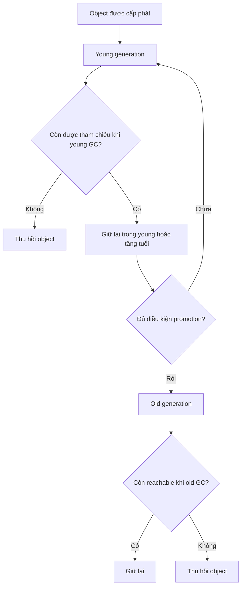

# Mục tiêu giảm độ trễ và mô hình young, old generation

## 1. Generational ZGC là gì?

Generational ZGC là chế độ thu gom rác theo thế hệ của Z Garbage Collector (ZGC), được đưa vào Java 21. ZGC hướng đến ứng dụng cần độ trễ thấp, kể cả khi heap lớn và có nhiều tác vụ chạy đồng thời. Chế độ generational bổ sung cách phân loại object theo tuổi để giảm công việc phải thực hiện trong mỗi lần thu gom.

Ý tưởng cốt lõi dựa trên đặc điểm thường gặp của ứng dụng Java: **phần lớn object được tạo ra sẽ trở nên không còn được sử dụng sau thời gian ngắn**, trong khi một phần nhỏ tồn tại lâu hơn. Vì vậy, collector có thể thu gom vùng chứa object mới thường xuyên hơn và xử lý object sống lâu theo nhịp riêng.

Generational ZGC chia heap thành hai thế hệ logic:

- **Young generation**: nơi chứa object mới được cấp phát và các object còn sống sau một số lần thu gom young.
- **Old generation**: nơi chứa object sống lâu hơn, đã được giữ lại đủ lâu để được chuyển sang thế hệ cũ.

Hai thế hệ này có vai trò và chu kỳ thu gom khác nhau. Young generation được thu gom thường xuyên vì có nhiều object chết sớm. Old generation được thu gom ít thường xuyên hơn, phù hợp với object có vòng đời dài.

## 2. Mục tiêu: giảm độ trễ và chi phí thu gom

Một ứng dụng có thể tạo ra hàng triệu object trong thời gian ngắn: object request, DTO, chuỗi tạm, collection trung gian, buffer và object phục vụ xử lý nghiệp vụ. Nếu collector phải xem xét toàn bộ heap cho mỗi đợt thu gom, công việc cần thiết có thể lớn hơn nhiều so với số object thực sự còn sống.

Generational ZGC tận dụng vòng đời object để tập trung công việc vào young generation:

1. Object mới thường được cấp phát vào young generation.
2. Nhiều object trở nên unreachable trước lần thu gom young tiếp theo và có thể được thu hồi.
3. Object còn được tham chiếu sau các lần thu gom young có thể được giữ lại hoặc chuyển sang old generation theo chính sách tuổi của collector.
4. Old generation được thu gom theo chu kỳ riêng, thay vì buộc mỗi lần thu gom young phải xử lý toàn bộ object sống lâu.

Nhờ đó, collector có thể giảm lượng công việc lặp lại trên các object lâu đời trong những đợt thu gom young thường xuyên. Mục tiêu là giảm CPU overhead của GC và cải thiện khả năng đáp ứng của ứng dụng, đồng thời duy trì đặc tính pause time thấp của ZGC.

Không nên hiểu mục tiêu này là mọi lần GC đều không có pause hoặc mọi ứng dụng đều nhanh hơn trong mọi tình huống. Thời gian dừng thực tế và throughput còn phụ thuộc allocation rate, tỷ lệ object sống sót, kích thước heap, tốc độ CPU, tải I/O và cấu hình ứng dụng.

## 3. Vì sao chia object thành young và old?

Hãy xét một service xử lý request. Mỗi request tạo ra nhiều object tạm để parse JSON, kiểm tra dữ liệu, xây response và ghi log. Phần lớn các object này chỉ cần tồn tại trong thời gian xử lý request. Sau khi response được gửi, chúng không còn được tham chiếu và có thể được thu gom.

Trong khi đó, một số object như cache, cấu hình, metadata, connection pool hoặc dữ liệu dùng chung có thể tồn tại trong phần lớn vòng đời ứng dụng. Những object này không cần bị xem xét lại với cùng tần suất như object tạm của request.

| Đặc điểm | Young generation | Old generation |
|---|---|---|
| Loại object điển hình | Object mới, object tạm của request | Object sống lâu, cache và trạng thái dùng chung |
| Tỷ lệ object chết | Thường cao | Thường thấp hơn |
| Nhịp thu gom | Thường xuyên hơn | Ít thường xuyên hơn |
| Mục tiêu | Thu hồi nhanh object ngắn hạn | Thu hồi object lâu đời khi không còn reachable |
| Ảnh hưởng nếu có nhiều object sống sót | Tăng công việc giữ lại/di chuyển và promotion | Tăng lượng dữ liệu cần theo dõi trong các chu kỳ old |

Đây là mô hình khái niệm. Ứng dụng không tự khai báo object nào thuộc young hay old. JVM tự quản lý việc cấp phát, theo dõi tuổi và chuyển object giữa các thế hệ.

Không nên suy diễn mô hình này thành đúng bố cục Eden và hai Survivor space như một số collector khác. Generational ZGC quản lý các generation bằng cơ chế page và chính sách nội bộ của ZGC; ứng dụng không cấu hình hay thao tác trực tiếp các vùng đó.

## 4. Vòng đời object qua hai thế hệ

Mô hình đơn giản hóa của một object có thể mô tả như sau:



Diễn giải:

- Khi chương trình tạo object, JVM cấp phát object trong young generation.
- Trong một đợt young collection, object không còn reachable sẽ được thu hồi.
- Object vẫn còn reachable có thể tiếp tục ở young generation để được đánh giá ở các chu kỳ sau.
- Object tồn tại đủ lâu có thể được promotion sang old generation.
- Khi object ở old generation không còn reachable, một đợt old collection có thể thu hồi nó.

Sơ đồ chỉ mô tả nguyên tắc generational. Điều kiện promotion, thời điểm collection và cách bố trí page là chi tiết triển khai của JVM; không nên viết logic ứng dụng phụ thuộc vào một số lần GC cố định hoặc một tuổi object cụ thể.

## 5. Young collection và old collection

Generational ZGC có các hoạt động thu gom riêng cho young và old generation. Chúng phối hợp để duy trì tính đúng đắn của đồ thị tham chiếu, trong khi tránh phải quét toàn bộ heap ở mọi đợt thu gom young.

### 5.1. Young collection

Young collection tập trung vào object thuộc young generation. Do nhiều object mới chết sớm, collector thường có thể thu hồi phần lớn vùng này mà không phải xử lý mọi object sống lâu trong old generation.

Trong khi thu gom, collector phải xác định object young nào còn reachable, giữ lại các object đó và thu hồi phần còn lại. Những object sống sót có thể được giữ lại hoặc promotion khi phù hợp.

### 5.2. Old collection

Old collection xử lý object thuộc old generation. Vì các object ở đây thường tồn tại lâu hơn, việc thu gom có thể diễn ra ít thường xuyên hơn young collection. Old generation vẫn cần được thu gom: object từng sống lâu cũng có thể trở nên unreachable khi cache bị xóa, session hết hạn hoặc cấu trúc dữ liệu được thay thế.

### 5.3. Các hoạt động concurrent

ZGC được thiết kế để thực hiện phần lớn công việc thu gom đồng thời với các thread ứng dụng. Điều này giúp hạn chế thời gian ứng dụng phải dừng để chờ GC. Tuy nhiên, “concurrent” không có nghĩa không bao giờ có stop-the-world pause. Một số pha ngắn vẫn có thể cần đồng bộ với thread ứng dụng.

Generational ZGC cũng phải thực hiện các công việc như đánh dấu object sống, xử lý tham chiếu, di chuyển object khi cần và duy trì tính nhất quán của tham chiếu. Mục tiêu của thiết kế là thực hiện phần lớn các công việc đó đồng thời, không phải loại bỏ hoàn toàn chi phí GC.

ZGC tự điều chỉnh kích thước các generation, số GC thread và ngưỡng tenuring theo workload. Vì vậy, bước tuning đầu tiên thường là đo allocation rate, live set, heap headroom và GC CPU thay vì cố định kích thước young/old theo một tỷ lệ tùy ý.

## 6. Tham chiếu từ old generation đến young generation

Một thách thức của collector generational là object cũ có thể giữ tham chiếu đến object mới. Nếu young collection chỉ nhìn vào các object trong young generation mà bỏ qua các tham chiếu từ old generation, nó có thể thu hồi nhầm object vẫn còn được sử dụng.

Ví dụ:

```java
final class SessionRegistry {
    // Registry có thể sống lâu và được promotion sang old generation.
    private final Map<String, Session> activeSessions = new HashMap<>();

    void register(String id, Session session) {
        activeSessions.put(id, session);
    }
}

final class Session {
    private final byte[] temporaryState = new byte[1024];
}
```

`SessionRegistry` có thể sống lâu trong old generation, trong khi một `Session` mới được tạo nằm trong young generation. Tham chiếu từ registry đến session khiến session vẫn reachable.

Để xử lý trường hợp này mà không phải quét toàn bộ old generation ở mỗi young collection, generational collector duy trì thông tin về tham chiếu xuyên thế hệ, thường được gọi là **remembered set**. Các barrier trong quá trình thực thi giúp ghi nhận hoặc duy trì thông tin cần thiết khi tham chiếu được tạo hay thay đổi.

Khi thu gom young generation, collector có thể sử dụng remembered set để tìm các tham chiếu từ old generation vào young generation. Nhờ vậy, nó biết những object young nào còn được giữ bởi object cũ.

Remembered set và barrier là chi tiết nội bộ của JVM. Ứng dụng không cần tự ghi nhận tham chiếu xuyên thế hệ hoặc thay đổi cách viết Java object graph để hỗ trợ collector.

## 7. Vai trò của barrier và cơ chế di chuyển object

ZGC sử dụng colored pointers và load barriers để hỗ trợ quản lý trạng thái object, xử lý tham chiếu và di chuyển object đồng thời. Trong chế độ generational, collector cần thêm thông tin và công việc theo dõi quan hệ giữa hai thế hệ, bao gồm các tham chiếu old-to-young.

Ở mức khái niệm:

- **Load barrier** cho phép JVM kiểm tra và xử lý tham chiếu khi ứng dụng đọc object reference, bao gồm trường hợp object đã được di chuyển.
- **Store barrier** hỗ trợ theo dõi thay đổi tham chiếu cần thiết cho hoạt động generational, chẳng hạn duy trì remembered set.
- **Colored pointers** mang metadata mà ZGC sử dụng để quản lý trạng thái tham chiếu và hỗ trợ các pha GC concurrent.

Những cơ chế này cho phép collector phối hợp với ứng dụng đang chạy để duy trì tính đúng đắn của tham chiếu. Chúng là chi tiết triển khai của ZGC, không phải API mà chương trình ứng dụng gọi trực tiếp.

Không nên cố tối ưu code bằng cách dựa vào bit layout của colored pointer, địa chỉ object hoặc thời điểm relocation. Những chi tiết đó có thể thay đổi giữa các bản JDK và không thuộc hợp đồng ngôn ngữ Java.

## 8. Bật Generational ZGC trong Java 21

Trong Java 21, có thể bật ZGC generational bằng các JVM option sau:

```bash
java -XX:+UseZGC -XX:+ZGenerational -Xms4g -Xmx4g -Xlog:gc -jar application.jar
```

Ý nghĩa:

- `-XX:+UseZGC`: chọn Z Garbage Collector.
- `-XX:+ZGenerational`: bật chế độ generational của ZGC trong Java 21.
- `-Xms4g`: đặt heap ban đầu là 4 GB.
- `-Xmx4g`: đặt giới hạn heap tối đa là 4 GB.
- `-Xlog:gc`: ghi log các sự kiện GC để quan sát hoạt động.

Hai tùy chọn `-Xms` và `-Xmx` trong ví dụ chỉ là giá trị minh họa, không phải cấu hình khuyến nghị cho mọi ứng dụng. Hãy chọn heap dựa trên footprint, allocation rate, lượng object sống và giới hạn bộ nhớ của môi trường triển khai.

Vì ZGC thực hiện phần lớn công việc đồng thời với ứng dụng, heap cần đủ chỗ cho live set và cho các allocation tiếp tục phát sinh trong khi GC đang chạy. Nếu heap tối đa quá sát lượng object sống hoặc allocation rate cao, ứng dụng có thể phải chờ GC phục hồi đủ dung lượng. Đây là lý do cần đánh giá headroom và không chỉ nhìn vào pause time.

Trong Java 21, cần chỉ định `-XX:+ZGenerational` để bật chế độ này. Khi triển khai trên phiên bản JDK khác, hãy kiểm tra tài liệu của đúng phiên bản vì trạng thái mặc định và các tùy chọn GC có thể thay đổi theo release. Không sao chép flag của Java 21 sang JDK mới hơn mà không xác minh.

## 9. Quan sát hoạt động của Generational ZGC

Sau khi bật GC logging, có thể quan sát tần suất và thời gian các đợt thu gom:

```bash
java -XX:+UseZGC -XX:+ZGenerational -Xlog:gc* -jar application.jar
```

Khi phân tích log, nên quan tâm:

- Tần suất và thời gian của young collection.
- Tần suất và thời gian của old collection.
- Dung lượng young/old trước và sau các chu kỳ thu gom.
- Số lượng object sống sót và xu hướng promotion.
- Heap occupancy và tốc độ tăng heap giữa các chu kỳ.
- Thời gian pause và CPU time mà GC sử dụng.
- Dấu hiệu allocation stall hoặc áp lực bộ nhớ khi allocation rate cao.

Không chỉ nhìn vào pause time. Một collector có pause thấp nhưng sử dụng quá nhiều CPU hoặc để heap tăng đến giới hạn vẫn có thể ảnh hưởng đến throughput và độ ổn định của service.

Có thể kết hợp Java Flight Recorder (JFR), GC log, application metrics và load test để so sánh theo cùng workload. Khi benchmark, hãy giữ ổn định dữ liệu đầu vào, concurrency, heap limit, CPU quota và thời gian warm-up; nếu thay đổi nhiều yếu tố cùng lúc thì khó xác định nguyên nhân cải thiện hoặc suy giảm.

## 10. Workload nào có thể hưởng lợi?

Generational ZGC thường đáng đánh giá với ứng dụng có các đặc điểm:

- Allocation rate cao: tạo nhiều object trong quá trình xử lý request hoặc message.
- Tỷ lệ object ngắn hạn lớn: nhiều object trở nên unreachable nhanh.
- Có một tập object sống lâu tương đối ổn định như cache, metadata hoặc cấu hình.
- Cần pause time thấp và latency ổn định, đặc biệt ở percentile cao như p99.
- Heap đủ lớn để chi phí quét object sống lâu thường xuyên trở thành đáng kể.

Các ví dụ có thể gồm API server, hệ thống xử lý event, dịch vụ dữ liệu và ứng dụng có nhiều request đồng thời. Tuy nhiên, tên loại ứng dụng không đủ để kết luận collector nào tốt hơn; cần đo trên workload thực tế.

### 10.1. Trường hợp cần benchmark kỹ

Nếu phần lớn heap là object sống lâu, tỷ lệ object sống sót ở young generation cao hoặc ứng dụng thường xuyên sửa tham chiếu giữa old và young, lợi ích của việc thu gom young riêng có thể giảm. Remembered set và barrier cũng có chi phí CPU và bộ nhớ.

Nếu ứng dụng bị giới hạn bởi CPU, I/O, lock hoặc dịch vụ bên ngoài, đổi collector có thể không cải thiện bottleneck chính. GC tuning không thay thế việc tối ưu query, giảm allocation không cần thiết, giới hạn concurrency hoặc xử lý backpressure.

## 11. Generational ZGC không thay thế việc quản lý bộ nhớ ứng dụng

Generational ZGC tự động thu hồi object không còn reachable, nhưng không thể thu hồi object vẫn còn được giữ bởi reference từ ứng dụng. Một cache không giới hạn, listener không được deregister, collection giữ lịch sử vô hạn hoặc static map tích lũy dữ liệu vẫn có thể làm heap tăng liên tục.

Khi nghi ngờ memory leak:

1. Theo dõi heap occupancy sau các chu kỳ GC tương đương.
2. Xem object nào đang sống lâu và giữ reference chain đến GC root.
3. Kiểm tra cache, static field, listener, ThreadLocal và collection tăng không giới hạn.
4. Dùng heap dump hoặc profiler phù hợp để tìm dominator và retained size.
5. Sửa vòng đời reference ở ứng dụng; không chỉ tăng heap hoặc đổi collector.

Collector có thể thu gom object chết nhanh hơn, nhưng không thay đổi tính reachable của object. Phân biệt allocation cao với memory leak là bước quan trọng khi đánh giá hiệu quả của generational GC.

## 12. Những hiểu lầm thường gặp

| Hiểu lầm | Cách hiểu đúng |
|---|---|
| Young generation chỉ chứa object mới tạo trong đúng một khoảng thời gian cố định | Object sống sót có thể ở lại young qua nhiều chu kỳ trước khi promotion |
| Mọi object sống lâu đều được giữ vĩnh viễn trong old generation | Object old vẫn được thu gom khi không còn reachable |
| Generational ZGC không có stop-the-world pause | ZGC thực hiện phần lớn công việc concurrent nhưng vẫn có thể có pause ngắn |
| Dùng ZGC nghĩa là không cần quan tâm heap size | Heap vẫn có giới hạn; allocation rate và lượng object sống vẫn quan trọng |
| Ứng dụng phải tự phân loại object vào young/old | JVM tự quản lý thế hệ và promotion |
| Remembered set là collection do ứng dụng quản lý | Đây là cấu trúc nội bộ của collector |
| Generational ZGC luôn nhanh hơn mọi collector khác | Hiệu quả phụ thuộc workload, heap, CPU và yêu cầu latency/throughput |
| Pause time thấp đồng nghĩa không thể xảy ra allocation stall | Áp lực cấp phát và thiếu headroom vẫn có thể làm ứng dụng phải chờ |

## 13. Checklist đánh giá Generational ZGC

Trước khi bật trong production, hãy kiểm tra:

1. Ứng dụng đang chạy đúng JDK 21 update được hỗ trợ và flag `-XX:+ZGenerational` được nhận diện.
2. Heap limit phù hợp với container hoặc máy chủ, có đủ headroom cho native memory và các thành phần ngoài heap.
3. Workload tạo nhiều object ngắn hạn hay chủ yếu giữ object sống lâu?
4. Allocation rate, promotion và old-generation occupancy có được quan sát không?
5. GC log/JFR đã được bật trong môi trường benchmark đại diện chưa?
6. Đã so sánh p95/p99 latency, throughput, GC CPU và heap occupancy dưới cùng tải chưa?
7. Có memory leak hoặc cache không giới hạn cần sửa ở ứng dụng không?
8. Đã có kế hoạch rollback và theo dõi sau khi triển khai chưa?

## 14. Tài liệu tham khảo chính thức

- [JEP 439 — Generational ZGC](https://openjdk.org/jeps/439): mục tiêu, mô hình generational và thiết kế kỹ thuật được đưa vào JDK 21.
- [Java 21 — Z Garbage Collector](https://docs.oracle.com/en/java/javase/21/gctuning/z-garbage-collector.html): cách sử dụng và cấu hình ZGC trong Java 21.
- [Java 21 — Garbage Collection Tuning](https://docs.oracle.com/en/java/javase/21/gctuning/): hướng dẫn quan sát và điều chỉnh hoạt động GC.
- [Java 21 — Unified Logging](https://docs.oracle.com/en/java/javase/21/docs/specs/man/java.html): cú pháp `-Xlog` để ghi nhận sự kiện runtime.

Generational ZGC giảm công việc thu gom lặp lại trên object sống lâu bằng cách xử lý young và old generation theo nhịp riêng. Young collection tập trung vào object mới và thường thu hồi được nhiều object ngắn hạn; old collection xử lý object tồn tại lâu hơn. Cơ chế này hướng đến giảm GC overhead và duy trì độ trễ thấp, nhưng hiệu quả cần được xác minh bằng GC log, JFR và benchmark theo workload thực tế. Trong Java 21, bật chế độ này bằng `-XX:+UseZGC -XX:+ZGenerational`.
