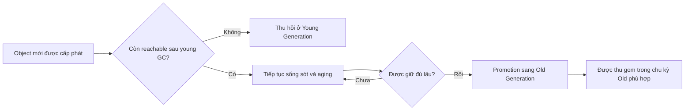

# Phân tích promotion, object lifetime và tải cấp phát

Generational ZGC chia heap thành hai thế hệ: Young Generation và Old Generation. Thiết kế này tận dụng đặc điểm phổ biến của ứng dụng Java: nhiều object chỉ tồn tại trong thời gian ngắn, trong khi một phần nhỏ sống lâu và tiếp tục được tham chiếu. Thu gom Young Generation thường xuyên giúp xử lý phần lớn object đã chết mà không phải quét toàn bộ tập dữ liệu sống lâu trong mọi chu kỳ.

Để phân tích hiệu năng, cần nhìn đồng thời vào tốc độ cấp phát, tỷ lệ object sống sót qua các lần young collection, lượng dữ liệu được giữ lại ở old generation và khoảng trống heap mà collector cần để làm việc đồng thời. Chỉ nhìn thời gian pause thấp chưa đủ để kết luận GC đang hoạt động tốt: ứng dụng vẫn có thể chịu áp lực cấp phát, tốn CPU cho GC hoặc gặp allocation stall.

## Mục tiêu học tập

Sau bài học, bạn có thể:

- Giải thích object lifetime, weak generational hypothesis và ý nghĩa của promotion.
- Phân biệt allocation rate, survival rate, promotion pressure và live set.
- Mô tả vai trò của Young Generation, Old Generation và remembered set trong Generational ZGC.
- Nhận diện workload cấp phát nhiều object ngắn hạn, object sống trung hạn và object sống dài hạn.
- Phân tích dấu hiệu allocation pressure, old-generation growth và allocation stall.
- Thu thập GC log, JFR và heap evidence để tìm nguồn cấp phát hoặc object bị giữ lại.
- Chọn cách điều chỉnh heap và workload mà không áp dụng nhầm tham số của collector khác.

## 1. Trạng thái Generational ZGC theo phiên bản JDK

Generational ZGC được đưa vào Java 21 theo JEP 439. Trên Java 21, phải bật rõ chế độ generational:

```bash
java -XX:+UseZGC -XX:+ZGenerational -jar application.jar
```

Lịch sử mặc định thay đổi ở các bản JDK sau, vì vậy cần dùng đúng cờ theo runtime triển khai:

| Phiên bản JDK | Hành vi của ZGC |
|---|---|
| JDK 21 và 22 | Có cả chế độ cũ không phân thế hệ và Generational ZGC; muốn dùng Generational ZGC phải thêm `-XX:+ZGenerational` |
| JDK 23 | Generational ZGC trở thành chế độ mặc định; chế độ không phân thế hệ bị deprecated |
| JDK 24 trở lên | Chỉ còn Generational ZGC; chế độ không phân thế hệ và tùy chọn `ZGenerational` đã bị loại bỏ |

Do đó, ví dụ lệnh trong bài dành cho Java 21. Khi chạy trên JDK 24 trở lên, dùng `-XX:+UseZGC`; không sao chép `-XX:+ZGenerational` vào cấu hình runtime mới.

## 2. Object lifetime và weak generational hypothesis

Object chỉ có thể được thu hồi khi không còn reachable từ bất kỳ GC root hoặc object sống nào. GC không dựa trên việc một biến đã ra khỏi một dòng lệnh hay một request đã kết thúc; điều quyết định là còn đường tham chiếu nào tới object hay không.

Weak generational hypothesis quan sát rằng phần lớn object trong nhiều ứng dụng có lifetime ngắn: chúng được tạo ra để xử lý một thao tác rồi nhanh chóng không còn được sử dụng. Ví dụ:

- Iterator, stream pipeline object hoặc object trung gian trong một vòng lặp.
- DTO, buffer và chuỗi tạm thời khi parse request.
- Object kết quả truy vấn chỉ dùng để tạo response.
- Wrapper, lambda hoặc collection tạm trong một phép biến đổi dữ liệu.

Một số object sống lâu hơn:

- Cache, cấu hình ứng dụng và metadata.
- Session hoặc state của người dùng đang hoạt động.
- Connection pool, client và các service singleton.
- Dữ liệu được giữ trong queue, listener registry hoặc map dùng chung.

Có thể hình dung phân bố lifetime thành ba nhóm:



Sơ đồ mô tả ý tưởng của generational collection. Promotion thực tế do heuristic của collector quyết định; không nên hiểu rằng mọi object phải sống đúng một số giây cố định hoặc phải qua một số lần GC cố định do ứng dụng quy định.

## 3. Young Generation, Old Generation và promotion

### 3.1. Young Generation

Object mới thường được cấp phát vào Young Generation. Generational ZGC tập trung thu gom thế hệ này thường xuyên vì đây là nơi có tỷ lệ object chết cao. Nếu phần lớn object biến mất trước hoặc trong các young collection, collector có thể thu hồi nhiều bộ nhớ với lượng dữ liệu sống cần xử lý tương đối nhỏ.

Young collection không có nghĩa là toàn bộ ứng dụng bị dừng để quét heap. ZGC thực hiện phần lớn công việc GC đồng thời với application thread; vẫn có các pause ngắn cho những bước cần phối hợp với mutator.

### 3.2. Object sống sót và promotion

Nếu object vẫn reachable qua nhiều lần young collection, nó có thể được giữ lại và cuối cùng được promote sang Old Generation. Promotion là điều bình thường: object cấu hình, cache entry hoặc session đang hoạt động có lý do để sống lâu.

Điều cần theo dõi là xu hướng của lượng object được giữ lại:

- Promotion tăng trong lúc tải tăng nhưng old live set ổn định sau các chu kỳ old collection có thể là hành vi bình thường.
- Old live set tăng dần qua nhiều chu kỳ và không trở về mức ổn định có thể cho thấy ứng dụng giữ thêm dữ liệu, cache không giới hạn hoặc memory leak.
- Promotion cao cùng allocation rate cao làm old generation chịu áp lực lớn hơn và có thể làm tăng công việc GC.

Generational ZGC tự điều chỉnh kích thước các generation và ngưỡng aging/tenuring theo workload. Không áp dụng máy móc cách đặt tuổi object của G1 hoặc Parallel GC cho ZGC.

### 3.3. Old Generation

Old Generation chứa các object đã sống đủ lâu để collector xem là dữ liệu dài hạn hơn. Old collection diễn ra theo heuristic của ZGC và thường ít thường xuyên hơn young collection. Vì object ở đây có xu hướng sống lâu, việc thu gom nó đòi hỏi xử lý tập tham chiếu dài hạn lớn hơn.

Old Generation không phải nơi chỉ chứa object bất biến. Cache hoặc registry ở old generation vẫn có thể trỏ đến object trẻ được tạo sau đó. Đây là lý do Generational ZGC cần theo dõi tham chiếu đi từ old sang young.

## 4. Remembered set và tham chiếu old-to-young

Giả sử một cache sống lâu đã nằm trong Old Generation, sau đó ứng dụng thêm một payload mới vào cache:

```java
final class ResponseCache {
    private final Map<String, Payload> entries = new HashMap<>();

    void put(String key, Payload payload) {
        entries.put(key, payload);
    }
}
```

`ResponseCache` và map của nó có thể đã thuộc Old Generation, còn `payload` mới được cấp phát ở Young Generation. Nếu young collection chỉ xét các object trẻ mà bỏ qua tham chiếu từ cache cũ, nó có thể kết luận nhầm rằng payload không còn được sử dụng.

Generational ZGC dùng store barrier và remembered set để ghi nhận các vị trí tham chiếu từ object cũ sang object trẻ. Khi thu gom Young Generation, collector có thể xem các tham chiếu này như những điểm bắt đầu bổ sung để tìm object trẻ còn sống, thay vì phải quét toàn bộ Old Generation mỗi lần.

Store barrier là chi phí runtime cần thiết để duy trì thông tin liên thế hệ. Nó được JVM/JIT quản lý; ứng dụng không cần tự viết barrier. Tuy nhiên, workload có nhiều thao tác ghi reference có thể có đặc tính throughput khác với workload chủ yếu đọc hoặc ghi primitive. Hãy đo trên ứng dụng thật trước khi kết luận chi phí barrier có đáng kể hay không.

## 5. Các chỉ số cần phân biệt

Khi phân tích Generational ZGC, không gộp mọi biểu hiện bộ nhớ thành một khái niệm “heap tăng”. Nên phân biệt:

| Chỉ số | Ý nghĩa | Câu hỏi chẩn đoán |
|---|---|---|
| Allocation rate | Số byte/object được cấp phát trong một đơn vị thời gian | Ứng dụng tạo object nhanh đến mức nào? |
| Object lifetime | Khoảng thời gian hoặc số chu kỳ mà object còn reachable | Object biến mất nhanh hay sống lâu? |
| Young survival | Phần object/byte còn sống sau young collection | Bao nhiêu dữ liệu tạm thực sự được giữ lại? |
| Promotion pressure | Tốc độ object sống sót chuyển sang Old Generation | Old Generation nhận thêm dữ liệu nhanh đến đâu? |
| Old live set | Lượng dữ liệu cũ vẫn reachable sau khi collector xử lý | Ứng dụng đang giữ lại bao nhiêu dữ liệu dài hạn? |
| Heap headroom | Khoảng trống heap còn lại để cấp phát trong lúc GC chạy | GC còn đủ thời gian và không gian để bắt kịp không? |
| GC CPU | CPU dành cho công việc thu gom và barrier | GC có chiếm quá nhiều năng lực xử lý không? |
| Allocation stall | Thread ứng dụng phải chờ vì GC chưa thu hồi/chuẩn bị đủ bộ nhớ cho cấp phát | Tải cấp phát có vượt khả năng cấp phát lại bộ nhớ không? |

Allocation rate và promotion rate không phải cùng một đại lượng. Ứng dụng có thể cấp phát hàng GB mỗi phút nhưng phần lớn object chết ngay, khiến promotion thấp. Ngược lại, một workload cấp phát vừa phải nhưng giữ gần như toàn bộ object có thể làm old live set tăng nhanh.

Không phải mọi bản build đều xuất một metric promotion rate duy nhất theo cùng tên hoặc cùng định dạng. Có thể cần kết hợp GC log, JFR, heap summary và dữ liệu tải để suy ra xu hướng sống sót/promotion.

## 6. Allocation pressure và allocation stall

ZGC làm phần lớn công việc đồng thời với application thread. Để làm được điều đó, collector cần đủ khoảng trống heap để ứng dụng tiếp tục cấp phát trong khi marking và relocation đang diễn ra.

Allocation pressure tăng khi:

- Allocation rate tăng đột ngột hoặc duy trì ở mức cao.
- Nhiều object sống sót khiến lượng bộ nhớ thu hồi sau mỗi chu kỳ thấp.
- Old live set lớn và tiếp tục tăng.
- Heap headroom không đủ để hấp thụ cấp phát trong thời gian GC cần để hoàn tất công việc.
- CPU bị cạnh tranh, khiến GC không có đủ tài nguyên để theo kịp workload.

Allocation stall xảy ra khi ứng dụng cần cấp phát nhưng ZGC chưa thể cung cấp vùng nhớ phù hợp kịp thời. Đây là vấn đề khác với thời gian pause: GC có thể duy trì pause rất ngắn nhưng ứng dụng vẫn phải chờ cấp phát trong một số tình huống áp lực bộ nhớ.

Generational ZGC giảm nguy cơ này bằng cách thu gom object trẻ thường xuyên và hiệu quả hơn, qua đó giảm công việc quét object sống lâu trong mỗi chu kỳ. Tuy nhiên, nó không thể thu hồi object còn reachable và không thể bù cho heap quá nhỏ so với live set và allocation rate của ứng dụng.

## 7. Nhận diện các kiểu workload

### 7.1. Allocation rate cao, young survival thấp

Ví dụ: một API tạo nhiều object parse request, validate dữ liệu, serialize response rồi bỏ tham chiếu khi trả kết quả.

Dấu hiệu thường gặp:

- Allocation rate cao.
- Young collection xuất hiện thường xuyên.
- Phần dữ liệu sống sót sau young collection thấp.
- Old live set tương đối ổn định.
- CPU dành cho allocation/GC có thể tăng, nhưng không nhất thiết có memory leak.

Hướng xử lý:

- Đo allocation theo class và call stack để tìm nơi tạo object nhiều nhất.
- Xem có thể tránh tạo object trung gian dư thừa hay không, nhưng chỉ tối ưu khi profiling chứng minh đây là bottleneck.
- Kiểm tra kích thước request, batch và burst traffic.
- Không giảm cấp phát bằng cách tái sử dụng object mutable toàn cục nếu điều đó tạo lỗi concurrency hoặc giữ dữ liệu lâu hơn.

### 7.2. Allocation rate vừa phải, promotion pressure cao

Ví dụ: ứng dụng tạo cache entry, session, subscription hoặc object state rồi giữ chúng lâu hơn dự kiến.

Dấu hiệu:

- Object sống sót qua nhiều young collection.
- Old live set tăng theo số request hoặc số người dùng.
- Heap sau các chu kỳ old collection không quay về vùng ổn định.
- Một số class chiếm tỷ trọng lớn trong heap dump.

Hướng xử lý:

- Kiểm tra cache có giới hạn kích thước, TTL hoặc eviction policy không.
- Kiểm tra listener, callback, queue và map static có giữ tham chiếu ngoài ý muốn không.
- Kiểm tra `ThreadLocal`, session và request context có được xóa khi hoàn tất không.
- Dùng heap dump và dominator tree để tìm đường tham chiếu giữ object.
- Phân biệt dữ liệu nghiệp vụ thực sự cần giữ với object bị giữ do lỗi vòng đời.

Promotion cao không tự động chứng minh memory leak. Cache tăng theo tải có thể là hành vi dự kiến; cần so sánh với giới hạn nghiệp vụ và mức ổn định sau khi tải giảm.

### 7.3. Allocation rate cao và old live set tiếp tục tăng

Đây là tình huống cần điều tra kỹ vì collector vừa phải phục vụ lượng cấp phát mới, vừa xử lý tập dữ liệu dài hạn ngày càng lớn.

Hãy kiểm tra:

- Tải có tăng thật hay không; so sánh theo request/transaction thay vì chỉ nhìn tổng byte/giây.
- Tỷ lệ object sống sót và class nào được giữ lại.
- Cache hoặc queue có tăng không giới hạn không.
- Có backlog khiến task và payload bị giữ lâu không.
- Heap có đủ headroom cho live set và cấp phát trong lúc GC chạy không.
- GC CPU có bị giới hạn bởi container hoặc cạnh tranh với application thread không.

Nếu old live set thực sự cần thiết, tăng `-Xmx` có thể cung cấp thêm headroom. Nếu dữ liệu tăng do retention ngoài ý muốn, tăng heap chỉ trì hoãn thời điểm gặp vấn đề.

### 7.4. Old object thường xuyên tham chiếu đến object mới

Ví dụ cache hoặc registry cũ liên tục nhận payload mới. Các tham chiếu old-to-young cần được ghi nhận để young collection xử lý chính xác.

Hãy xem workload có đang:

- Cập nhật các cấu trúc dữ liệu dài hạn ở tần suất rất cao không.
- Giữ payload tạm trong cache sau khi request đã hoàn tất không.
- Tạo quá nhiều object nhỏ rồi gắn chúng vào object sống lâu không.
- Có thể thay bằng batch hoặc cấu trúc dữ liệu có vòng đời rõ hơn không.

Không nên né store barrier bằng cách thiết kế dữ liệu khó hiểu hoặc tái sử dụng object mutable thiếu an toàn. Barrier là một phần của cơ chế đúng đắn của collector; tối ưu cần dựa trên profiling và tính đúng đắn của chương trình.

## 8. Thu thập GC log trên Java 21

Unified Logging là cách hiện hành để ghi GC log. Với Java 21 và Generational ZGC, có thể khởi chạy ứng dụng với:

```bash
java \
  -XX:+UseZGC \
  -XX:+ZGenerational \
  -Xmx8g \
  -Xlog:gc*,safepoint:file=gc.log:time,uptime,level,tags:filecount=5,filesize=20M \
  -jar application.jar
```

Trong ví dụ, `-Xmx8g` chỉ là giá trị minh họa; hãy chọn theo live set, allocation rate, giới hạn bộ nhớ của máy/container và yêu cầu vận hành. `gc*` thu thập thông tin GC ở nhiều mức tag; `safepoint` giúp đối chiếu các điểm dừng ứng dụng. File rotation tránh để log tăng vô hạn.

Khi đọc log, tập trung vào xu hướng theo thời gian:

- Tần suất và thời lượng young/old collection.
- Heap occupancy trước và sau các chu kỳ GC.
- Thời gian các pha concurrent và pause.
- Thay đổi trong old generation qua nhiều chu kỳ.
- Dấu hiệu allocation stall hoặc GC phải làm việc liên tục.
- Thời điểm log GC trùng với latency tăng hoặc throughput giảm.

Định dạng log chi tiết có thể thay đổi giữa các bản JDK và vendor. Dùng `java -Xlog:help` trên đúng runtime để xem tag và mức log khả dụng. Tránh dựa vào một dòng log đơn lẻ; hãy xem chuỗi sự kiện cùng với tải ứng dụng.

## 9. Dùng JFR để phân tích allocation và GC

Java Flight Recorder (JFR) thu thập dữ liệu runtime với overhead được thiết kế cho profiling và quan sát production có kiểm soát. Có thể bật recording khi khởi chạy:

```bash
java \
  -XX:+UseZGC \
  -XX:+ZGenerational \
  -XX:StartFlightRecording=filename=generational-zgc.jfr,settings=profile,dumponexit=true \
  -jar application.jar
```

Mở file recording bằng Java Mission Control (JMC) để phân tích:

- Allocation sample theo class và stack trace.
- Các sự kiện GC và thời gian các pha.
- CPU load và thread activity.
- Các khoảng thời gian allocation tăng đột biến.
- Mối liên hệ giữa GC, CPU và latency của workload.

Allocation sampling là dữ liệu lấy mẫu có trọng số, không phải danh sách đầy đủ mọi object đã được tạo. Dùng nó để tìm call path đáng chú ý rồi xác minh bằng benchmark hoặc phép đo bổ sung.

Nếu cần tìm object sống lâu và đường tham chiếu giữ chúng, có thể dùng JFR event phù hợp khi được cấu hình hoặc tạo heap dump trong môi trường kiểm soát. Phân tích dominator tree và path to GC roots để biết object nào giữ phần lớn heap. Heap dump có thể tốn thời gian, I/O và bộ nhớ; cần cân nhắc ảnh hưởng trước khi lấy trên production.

## 10. Quy trình phân tích promotion và lifetime

Một quy trình thực tế có thể thực hiện như sau:

1. **Xác định baseline:** ghi nhận JDK/vendor, collector, `-Xms`, `-Xmx`, giới hạn container, phiên bản ứng dụng và cấu hình workload.
2. **Đo tải:** thu thập request rate, throughput, payload size, concurrency và latency p50/p95/p99.
3. **Bật GC log:** dùng unified logging để xem tần suất young/old collection, heap occupancy và thời gian GC.
4. **Ghi JFR:** tìm class và call path tạo nhiều object, đồng thời quan sát GC phase và CPU.
5. **Phân nhóm lifetime:** xác định object chết nhanh, object sống qua nhiều young collection và object được giữ dài hạn.
6. **Đối chiếu old live set:** kiểm tra lượng dữ liệu còn reachable sau các chu kỳ old collection; phân biệt cache hợp lệ với retention ngoài dự kiến.
7. **Tìm đường giữ object:** dùng heap dump/JMC để xem dominator và GC root khi old live set tăng bất thường.
8. **Thay đổi từng yếu tố:** điều chỉnh cache policy, batch, payload lifetime, heap headroom hoặc concurrency; không thay nhiều biến cùng lúc.
9. **Chạy lại cùng workload:** so sánh allocation rate, old live set, GC CPU, allocation stalls và latency tail.

Để phép so sánh có ý nghĩa, giữ workload, thời gian warm-up, dữ liệu đầu vào và môi trường càng giống nhau càng tốt. Ghi rõ cả throughput lẫn latency; một thay đổi giảm pause nhưng làm GC CPU tăng đáng kể vẫn có thể không phù hợp với mục tiêu của ứng dụng.

## 11. Heap sizing và các nút điều chỉnh phù hợp với ZGC

Oracle mô tả ZGC là collector thích nghi, tự điều chỉnh kích thước generation, số GC thread và tenuring threshold. Nút điều chỉnh quan trọng nhất thường là maximum heap size (`-Xmx`). Heap cần chứa live set và còn đủ headroom để phục vụ cấp phát trong lúc GC chạy.

Ví dụ:

```bash
java \
  -XX:+UseZGC \
  -XX:+ZGenerational \
  -Xmx8g \
  -XX:SoftMaxHeapSize=6g \
  -jar application.jar
```

`SoftMaxHeapSize` là giới hạn mềm mà ZGC cố gắng duy trì. Collector vẫn có thể vượt mức mềm, tối đa đến `-Xmx`, nếu cần để tránh ứng dụng bị stall vì thiếu không gian cấp phát. Giá trị 6 GB và 8 GB ở đây chỉ minh họa cách dùng, không phải cấu hình khuyến nghị cho mọi ứng dụng.

Không lấy các tham số sizing của G1 hoặc Parallel GC như `-Xmn`, `-XX:NewSize`, `-XX:MaxNewSize`, `-XX:NewRatio` hoặc `-XX:MaxTenuringThreshold` làm hướng tuning mặc định cho Generational ZGC. ZGC tự điều chỉnh generation; trước hết hãy đo allocation rate, live set và heap headroom rồi mới thay đổi cấu hình có tài liệu hỗ trợ cho ZGC.

## 12. Khi nào cần tối ưu code cấp phát?

Không phải mọi allocation đều là vấn đề. Cấp phát object ngắn hạn là cách viết Java tự nhiên và Generational ZGC được thiết kế để xử lý loại workload này hiệu quả.

Chỉ cân nhắc tối ưu khi số liệu chỉ ra allocation đang gây chi phí đáng kể, chẳng hạn:

- Một parser tạo nhiều object trung gian có thể tránh mà không làm code khó bảo trì.
- Một vòng lặp tạo collection mới dù có thể dùng cấu trúc cục bộ phù hợp.
- Serialization tạo nhiều bản sao buffer không cần thiết.
- Cache giữ object quá lâu dù dữ liệu có thể hết hạn sớm hơn.
- Queue giữ backlog lớn khiến payload tồn tại lâu sau khi đã được tạo.

Không tái sử dụng object mutable toàn cục chỉ để giảm allocation nếu điều đó làm tăng contention, cần đồng bộ phức tạp hoặc gây rò rỉ trạng thái giữa request. Đôi khi object mới sống ngắn rẻ hơn một object pool sống lâu và khó quản lý.

## 13. Ma trận chẩn đoán

| Quan sát | Khả năng cần kiểm tra | Bước tiếp theo |
|---|---|---|
| Allocation rate cao, old live set ổn định | Nhiều object ngắn hạn | JFR allocation sample; kiểm tra CPU/GC overhead |
| Young survival tăng theo tải | Nhiều object sống qua request hoặc batch | Xem object nào còn được tham chiếu và vì sao |
| Old live set tăng qua nhiều old collection | Cache/queue/session tăng hoặc memory leak | Heap dump, dominator tree, GC roots |
| Heap gần `-Xmx`, allocation rate cao | Thiếu heap headroom hoặc GC không theo kịp | Kiểm tra GC CPU, live set, allocation burst và container limit |
| Pause thấp nhưng latency tail tăng | Allocation stall, CPU contention, I/O hoặc lock | Đối chiếu JFR, GC log, request trace và CPU |
| GC CPU cao dù live set không lớn | Allocation churn, barrier workload hoặc cấu hình tài nguyên | Profile call path cấp phát và phép ghi reference nóng |
| Old generation tăng rồi giảm sau old collection | Dữ liệu tạm sống lâu hơn dự kiến hoặc chu kỳ GC chưa hoàn tất | Theo dõi nhiều chu kỳ và đối chiếu thời điểm tải |

Không kết luận memory leak chỉ từ heap occupancy cao tại một thời điểm. Cần quan sát sau collection và theo thời gian, đồng thời xác định dữ liệu đó có còn cần thiết theo nghiệp vụ hay không.

## 14. Checklist vận hành

- Xác nhận runtime thực sự dùng Generational ZGC; trên Java 21 cần `-XX:+UseZGC -XX:+ZGenerational`.
- Không mang cờ `-XX:+ZGenerational` sang JDK 24 trở lên, nơi tùy chọn này đã bị loại bỏ.
- Đo allocation rate theo thời gian và theo request/transaction.
- Phân biệt object chết trẻ với object sống sót và được promote.
- Theo dõi old live set sau nhiều chu kỳ old collection.
- Kiểm tra cache, queue, listener, session và `ThreadLocal` có giữ object ngoài dự kiến không.
- Đọc GC log và JFR cùng với throughput, CPU và latency tail.
- Đảm bảo `-Xmx` đủ cho live set cộng headroom cấp phát.
- Không tuning generation theo tham số của G1/Parallel khi chưa có tài liệu cho ZGC.
- Kiểm thử lại trên đúng JDK, vendor, container và workload production.

## 15. Nguyên tắc thiết kế

- Xem promotion là hệ quả bình thường của object còn reachable, không phải tự thân là lỗi.
- Phân biệt allocation rate với promotion pressure và old live set.
- Tận dụng Young Generation cho object ngắn hạn; điều tra object sống lâu theo đường tham chiếu thực tế.
- Theo dõi old-to-young reference trong các cấu trúc dữ liệu sống lâu và thường xuyên cập nhật.
- Nhớ rằng Generational ZGC giảm nguy cơ allocation stall nhưng không loại bỏ giới hạn của heap và live set.
- Dùng GC log và JFR để xác định xu hướng, sau đó dùng heap evidence để xác minh retention.
- Ưu tiên điều chỉnh vòng đời dữ liệu và heap headroom dựa trên số liệu; không áp dụng flag tuning theo thói quen của collector khác.
- Đo cả throughput, CPU, allocation stall và latency tail thay vì chỉ nhìn pause time.

Generational ZGC phát huy lợi thế khi phần lớn object chết trẻ và tập dữ liệu sống lâu có thể được quản lý ổn định. Phân tích đúng promotion, lifetime và allocation pressure giúp xác định vấn đề nằm ở churn, retention, heap headroom hay năng lực GC. Từ đó có thể tối ưu dựa trên bằng chứng thay vì chỉ tăng heap hoặc thay đổi tham số một cách phỏng đoán.

## Tài liệu tham khảo

- [JEP 439 — Generational ZGC](https://openjdk.org/jeps/439): mục tiêu thiết kế Generational ZGC được giới thiệu trong JDK 21.
- [Oracle — Java SE 21 HotSpot VM Garbage Collection Tuning Guide, Generational GC](https://docs.oracle.com/en/java/javase/21/gctuning/hotspot-virtual-machine-garbage-collection-tuning-guide.pdf): weak generational hypothesis, lifetime, generations và các chỉ số hiệu năng.
- [Oracle — Java SE 21 HotSpot VM Garbage Collection Tuning Guide, ZGC](https://docs.oracle.com/en/java/javase/21/gctuning/hotspot-virtual-machine-garbage-collection-tuning-guide.pdf): heap sizing, live set, allocation rate, headroom và `SoftMaxHeapSize`.
- [Oracle — Java 21 Release Notes, Generational ZGC](https://www.oracle.com/java/technologies/javase/21-relnote-issues.html): cách bật Generational ZGC trong Java 21.
- [JEP 474 — ZGC: Generational Mode by Default](https://openjdk.org/jeps/474): generational mode trở thành mặc định từ JDK 23.
- [JEP 490 — ZGC: Remove the Non-Generational Mode](https://openjdk.org/jeps/490): loại bỏ chế độ không phân thế hệ từ JDK 24.
- [Oracle — Significant Changes in JDK 24](https://docs.oracle.com/en/java/javase/24/migrate/significant-changes-jdk-24.html): xác nhận ZGC chỉ còn generational mode trong JDK 24.
- [Inside.java — Introducing Generational ZGC](https://inside.java/2023/11/28/gen-zgc-explainer/): giải thích weak generational hypothesis, allocation stalls và quá trình chuyển chế độ theo phiên bản.
