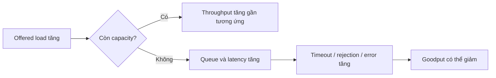

# Đo throughput cùng percentile latency và tỷ lệ lỗi

Một phép đo hiệu năng có ý nghĩa cần trả lời đồng thời ba câu hỏi: hệ thống hoàn thành được bao nhiêu công việc trong một đơn vị thời gian, người dùng phải chờ bao lâu và có bao nhiêu yêu cầu thất bại. Throughput cao nhưng p99 latency tăng mạnh có thể cho thấy hệ thống đang tiến gần giới hạn; latency thấp nhưng error rate tăng cũng không phải kết quả tốt.

Trong ứng dụng Java 21, các chỉ số này cần được đo ở đúng ranh giới nghiệp vụ và đối chiếu với tải thực tế, JVM, GC, CPU, connection pool và dịch vụ phụ thuộc. JMH phù hợp để đo một đoạn code nhỏ trong JVM; load test end-to-end mới cho biết hệ thống hoàn chỉnh xử lý được bao nhiêu request với latency và error rate ra sao.

## Mục tiêu học tập

Sau bài học, bạn có thể:

- Phân biệt offered load, throughput và goodput.
- Đọc p50, p95, p99 và hiểu vì sao average latency có thể che khuất tail latency.
- Định nghĩa error rate với mẫu số và phạm vi lỗi rõ ràng.
- Chọn open workload hoặc closed workload phù hợp với mục tiêu đo.
- Tránh coordinated omission và lỗi tổng hợp percentile giữa nhiều instance.
- Đo latency bằng timer/histogram và tạo metric có cardinality hợp lý.
- Thiết kế load test có warm-up, steady-state, ramp-up và dữ liệu đại diện.
- Kết hợp JMH, Micrometer/Prometheus và JFR để phân tích hiệu năng Java 21.

## 1. Ba nhóm chỉ số phải đọc cùng nhau

### 1.1. Throughput

Throughput là số thao tác hoàn tất trong một đơn vị thời gian. Với HTTP service, thường biểu diễn bằng requests per second (RPS); với hệ thống xử lý message, có thể dùng messages per second; với batch, dùng records per second.

Trong một cửa sổ đo dài T giây:

\[
\text{Throughput} = \frac{\text{Số thao tác hoàn tất trong cửa sổ}}{T}
\]

Ví dụ, 120.000 request hoàn tất trong 60 giây tương ứng 2.000 request/giây. Cần nêu rõ đang tính mọi request hoàn tất hay chỉ request thành công.

### 1.2. Percentile latency

Latency là thời gian từ điểm bắt đầu đến điểm kết thúc đã chọn của một thao tác. Percentile mô tả phân bố thời gian đó:

- **p50:** 50% thao tác có latency nhỏ hơn hoặc bằng giá trị này; gần với median.
- **p95:** 95% thao tác hoàn tất trong hoặc dưới giá trị này.
- **p99:** 99% thao tác hoàn tất trong hoặc dưới giá trị này; thể hiện phần đuôi chậm hơn.
- **p99.9:** hữu ích với hệ thống có yêu cầu tail latency nghiêm ngặt, nhưng cần số mẫu đủ lớn.

Ví dụ: p50 = 35 ms, p95 = 180 ms, p99 = 750 ms. Phần lớn request phản hồi nhanh, nhưng một nhóm nhỏ phải chờ lâu. Chỉ nhìn average hoặc p50 sẽ không cho thấy rõ vấn đề này.

Percentile luôn phụ thuộc vào ranh giới đo. Có thể đo từ lúc client gửi request đến lúc nhận response, từ lúc server nhận request đến lúc trả response, hoặc thời gian của một method. Không so sánh hai percentile nếu chúng đo hai khoảng khác nhau.

### 1.3. Error rate

Error rate là tỷ lệ thao tác thất bại trong tập thao tác được xác định:

\[
\text{Error rate} = \frac{\text{Số thao tác được tính là lỗi}}{\text{Tổng số thao tác trong phạm vi đo}} \times 100\%
\]

Phải định nghĩa rõ lỗi bao gồm những gì. Với một HTTP API, có thể tính timeout, lỗi kết nối, request bị từ chối do quá tải và phản hồi server error; một số hệ thống còn tính lỗi nghiệp vụ dù HTTP status là 2xx. Không mặc định mọi 4xx đều là lỗi server: request sai đầu vào có thể là kết quả nghiệp vụ được dự kiến.

Ví dụ, trong 100.000 request được gửi, 1.200 request timeout hoặc thất bại theo hợp đồng SLI: error rate = 1,2%. Nếu chỉ đếm 5xx mà bỏ timeout ở client, tỷ lệ có thể thấp giả tạo.

## 2. Phân biệt offered load, throughput và goodput

Ba đại lượng này có liên quan nhưng không đồng nghĩa:

| Đại lượng | Ý nghĩa | Ví dụ |
|---|---|---|
| Offered load / arrival rate | Số thao tác client cố gắng đưa vào hệ thống mỗi giây | Generator phát 3.000 request/s |
| Throughput | Số thao tác hệ thống hoàn tất mỗi giây | Server hoàn tất 2.700 request/s |
| Successful throughput | Số thao tác kết thúc thành công mỗi giây | 2.650 response thành công/s |
| Goodput | Lượng công việc hữu ích được hoàn tất theo định nghĩa nghiệp vụ | 2.500 đơn hợp lệ được xử lý/s |

Khi hệ thống chưa bão hòa, throughput thường tăng theo offered load. Khi chạm giới hạn CPU, database, pool hoặc queue, throughput có thể đi ngang trong khi latency và error rate tăng. Nếu tiếp tục tăng offered load, hàng đợi có thể dài hơn mà không tạo thêm công việc hữu ích.



Mục tiêu không phải đẩy RPS cao nhất bằng mọi giá. Hãy tìm vùng tải mà throughput/goodput đáp ứng nhu cầu, latency percentile còn trong SLO và error rate nằm trong ngưỡng chấp nhận.

## 3. Vì sao cần percentile thay vì chỉ average?

Giả sử 99 request mất 20 ms và một request mất 2.000 ms. Average là 39,8 ms, trong khi p100 là 2.000 ms. Giá trị p99 của tập nhỏ này phụ thuộc quy tắc tính quantile của công cụ; với chỉ 100 quan sát, p99 chịu ảnh hưởng rất mạnh từ một vài quan sát cuối và chưa phải ước lượng tail latency ổn định. Nếu một nhóm nhỏ request rất chậm xuất hiện thường xuyên hơn khi tải cao, average có thể che khuất trải nghiệm của nhóm người dùng đó.

Percentile giúp nhìn phần đuôi phân bố. Tuy nhiên, p99 không có nghĩa “mọi request đều hoàn tất trong p99”; khoảng 1% quan sát nằm trên ngưỡng p99 theo cách định nghĩa quantile và quy tắc nội suy của công cụ.

Nên theo dõi ít nhất:

- p50 để biết trải nghiệm điển hình.
- p95 để nhìn phần đuôi có ảnh hưởng tới nhiều người dùng hơn.
- p99 hoặc p99.9 nếu SLO và số lượng mẫu đủ hỗ trợ.
- Maximum như một tín hiệu bổ sung, không dùng một giá trị max duy nhất làm kết luận ổn định.
- Count và throughput để biết percentile được tính trên bao nhiêu quan sát.

Percentile ở một cửa sổ có ít request có độ bất định lớn. Với 100 quan sát, p99 gần như bị quyết định bởi một hoặc hai quan sát cuối, tùy quy tắc quantile; một vài outlier có thể làm giá trị thay đổi mạnh. Khi cần đánh giá tail latency, thu thập đủ mẫu và chạy nhiều lần trong điều kiện tương đương.

## 4. Định nghĩa ranh giới latency trước khi đo

Latency phải bắt đầu và kết thúc ở hai điểm được xác định. Một request end-to-end có thể bao gồm:

1. Client chuẩn bị và gửi request.
2. Network và load balancer chuyển request.
3. Server parse, xác thực và xử lý middleware.
4. Ứng dụng thực hiện nghiệp vụ và gọi database/service khác.
5. Server serialize response và gửi về.
6. Client nhận đủ response theo tiêu chí đo.

Client-side latency thường phản ánh trải nghiệm người dùng tốt hơn vì bao gồm network và các tầng trung gian. Server-side latency hữu ích để tách thời gian xử lý trong service. Đo method-level latency giúp tìm bottleneck trong code. Nên đặt tên metric theo ranh giới rõ ràng, ví dụ `http.server.request.duration` và `order.persistence.duration`.

Không trộn latency của request thành công với thời gian timeout mà không ghi rõ chính sách. Một request timeout sau 2 giây có thể không có response server để đo; nhưng từ góc nhìn client, đó vẫn là một lần thất bại đã tiêu tốn 2 giây. Theo dõi riêng latency thành công, latency lỗi và timeout để không che khuất trải nghiệm thất bại.

## 5. Đo thời gian đúng trong Java

Khi đo khoảng thời gian trong code Java, dùng `System.nanoTime()` vì đây là nguồn thời gian đơn điệu phù hợp để tính elapsed time. Không dùng `System.currentTimeMillis()` để đo duration vì đồng hồ hệ thống có thể được điều chỉnh.

```java
long started = System.nanoTime();
try {
    processOrder(orderId);
} finally {
    long elapsedNanos = System.nanoTime() - started;
    long elapsedMillis = TimeUnit.NANOSECONDS.toMillis(elapsedNanos);
    logger.debug("processOrder took {} ms", elapsedMillis);
}
```

Đo thủ công phù hợp cho chẩn đoán đơn giản, nhưng không nên chỉ log từng request để xây phân bố latency ở tải cao. Logging mỗi thao tác có thể làm thay đổi chính workload đang đo, tạo I/O và lock contention. Dùng metrics histogram hoặc tracing sampling để thu thập dữ liệu tổng hợp.

Độ phân giải `nanoTime()` không có nghĩa phép đo có độ chính xác nanosecond. Kết quả vẫn chịu ảnh hưởng scheduler, JIT, GC, hệ điều hành, clock implementation và overhead của chính phép đo.

## 6. Instrument latency bằng Micrometer Timer

Micrometer `Timer` ghi nhận số lần thực hiện và thời gian của thao tác. Có thể cấu hình percentile và histogram tùy backend:

```java
Timer successTimer = Timer.builder("order.process")
    .tag("outcome", "success")
    .publishPercentileHistogram()
    .register(registry);

Timer errorTimer = Timer.builder("order.process")
    .tag("outcome", "error")
    .publishPercentileHistogram()
    .register(registry);

void processMeasured(Order order) {
    Timer.Sample sample = Timer.start(registry);
    try {
        processOrder(order);
        sample.stop(successTimer);
    } catch (RuntimeException failure) {
        sample.stop(errorTimer);
        throw failure;
    }
}
```

Ví dụ tách timer theo outcome để có thể xem count và latency của request thành công/lỗi. Trong ứng dụng thực tế, cần xử lý đầy đủ các loại exception theo hợp đồng nghiệp vụ và tránh phân loại mọi exception thành cùng một nhóm nếu điều đó làm mất thông tin cần thiết.

Micrometer có thể xuất percentile được tính trong process hoặc histogram bucket để backend tổng hợp. Percentile tính riêng ở từng instance không thể cộng hoặc lấy trung bình để tạo percentile toàn cụm. Khi cần quantile tổng hợp qua nhiều instance, xuất histogram bucket và tính quantile từ bucket đã được cộng gộp.

### 6.1. Đếm lỗi và tính error rate

Có thể dùng counter riêng cho lỗi, hoặc phân loại Timer bằng tag `outcome`. Nếu dùng metric riêng, mẫu số phải đếm cùng tập request và cùng cửa sổ thời gian:

```java
Counter failedOperations = Counter.builder("order.process.failures")
    .register(registry);

failedOperations.increment(); // Gọi tại nhánh đã phân loại là lỗi.
```

Tăng counter khi thao tác được phân loại là lỗi. Khi tính error rate, chia tốc độ tăng counter lỗi cho tốc độ tăng tổng số thao tác. Không chia số lỗi trong 5 phút cho tổng request tích lũy từ lúc process khởi động.

### 6.2. Cardinality của metric

Chỉ dùng tag có số lượng giá trị hữu hạn và được kiểm soát, ví dụ:

- `outcome=success|error|timeout`
- `method=GET|POST|PUT|DELETE`
- `route=/orders/{id}` thay vì URL chứa ID thật
- `status=2xx|4xx|5xx` nếu cách phân nhóm này đủ cho mục tiêu

Không đưa `userId`, `requestId`, email, session ID hoặc URL động vào label/tag. Mỗi giá trị mới có thể tạo một time series mới, làm tăng bộ nhớ và tải của metrics backend. Request ID nên nằm trong log hoặc trace, không phải label của metric.

## 7. Histogram và tổng hợp percentile qua nhiều instance

Histogram chia latency thành các bucket. Với classic Prometheus histogram, mỗi bucket lưu số quan sát có giá trị nhỏ hơn hoặc bằng ranh giới `le`; bucket là cumulative. Có thể cộng bucket count từ nhiều instance rồi tính quantile ở cấp service.

Ví dụ PromQL cho p95 theo route:

```promql
histogram_quantile(
  0.95,
  sum by (le, route) (
    rate(http_server_request_duration_seconds_bucket[5m])
  )
)
```

Metric name trong ví dụ là tên minh họa; tên thực tế phụ thuộc instrumentation và exporter. Với native histogram hoặc backend khác, cú pháp truy vấn có thể khác.

Không làm như sau:

```text
(p95_instance_A + p95_instance_B + p95_instance_C) / 3
```

Trung bình các p95 riêng lẻ không phải p95 toàn cụm. Tương tự, không lấy trung bình p99 của các pod để báo p99 service. Hãy tổng hợp histogram bucket hoặc dữ liệu quan sát gốc theo cách backend hỗ trợ.

### 7.1. Percentile summary và histogram khác nhau

| Loại dữ liệu | Có thể tổng hợp giữa instance? | Ghi chú |
|---|---|---|
| Percentile đã tính tại từng instance | Không theo cách cộng/trung bình đơn giản | Mỗi instance có phân bố và số mẫu khác nhau |
| Histogram bucket count | Có | Cộng bucket tương ứng trước khi tính quantile |
| Raw observations | Có, nếu backend giữ và xử lý được toàn bộ dữ liệu | Tốn lưu trữ và băng thông hơn |
| Average/total count/total time | Có thể tổng hợp | Không đủ để khôi phục p95/p99 |

Histogram bucket boundaries nên phản ánh ngưỡng SLO và đặc tính latency của hệ thống. Nếu tất cả bucket quá rộng ở vùng quan tâm, percentile ước lượng sẽ kém chính xác. Nếu quá nhiều bucket, cardinality và chi phí lưu trữ tăng.

## 8. Định nghĩa error rate đúng với nghiệp vụ

Trước khi viết dashboard hoặc SLI, xác định:

- **Đơn vị tính:** HTTP request, RPC, message, transaction hay business operation.
- **Mẫu số:** request được gửi, request server nhận, hay thao tác đã hoàn tất.
- **Quy tắc loại trừ khỏi mẫu số:** health check, synthetic check, request bị client hủy, request bị từ chối trước khi vào service?
- **Tiêu chí xác định lỗi:** timeout, network error, server error, validation error, business rejection hay kết quả không đúng?
- **Retry:** đếm mỗi attempt hay mỗi logical request? Cần theo dõi cả hai nếu retry ảnh hưởng tải.

Nếu đo từ client, mẫu số có thể là mọi thao tác đã được schedule hoặc gửi, kể cả thao tác timeout trước khi server ghi nhận. Nếu đo ở server, mẫu số thường chỉ gồm request đã tới điểm instrumentation. Hãy ghi rõ góc nhìn này để hai dashboard không đưa ra error rate khác nhau mà không có lời giải thích.

Ví dụ với một API tạo đơn:

| Kết quả | Có thể phân loại | Lý do |
|---|---|---|
| Tạo đơn thành công | Success | Hoàn tất nghiệp vụ |
| Request sai dữ liệu và trả 400 | Client/business error | Có thể là kết quả hợp lệ của validation; tùy SLI |
| Không đủ tồn kho và trả 409 | Business rejection | Không nhất thiết là lỗi hệ thống |
| Server trả 500 | Error | Thao tác không hoàn tất như cam kết |
| Client timeout | Error từ góc nhìn client | Người dùng không nhận kết quả đúng hạn |
| Connection reset | Error | Không hoàn tất giao dịch |
| Request bị rate limit | Rejected | Cần theo dõi riêng; tùy SLO có thể tính vào lỗi |

Nếu server đã xử lý xong nhưng client timeout trước khi nhận response, client và server có thể phân loại khác nhau. Với SLO trải nghiệm người dùng, nên đo từ client hoặc gateway và tính timeout vào kết quả thất bại.

### 8.1. Retry có thể che error rate

Giả sử 1.000 logical request, mỗi request trung bình cần 1,2 attempt do retry. Nếu 100 attempt đầu thất bại nhưng lần retry thành công, attempt-level error rate có thể cao trong khi logical-operation success rate vẫn tốt. Ngược lại, retry có thể làm tăng tải lên dependency và khiến hệ thống bão hòa.

Theo dõi riêng:

- Logical request success/error rate.
- Attempt count và retry rate.
- Timeout/rejection rate.
- Successful throughput/goodput.

Không chỉ báo cáo tỷ lệ attempt thành công nếu người dùng quan tâm kết quả cuối cùng của một thao tác nghiệp vụ.

## 9. Chọn mô hình tải: open workload và closed workload

### 9.1. Closed workload

Trong mô hình closed, một số lượng client cố định gửi request rồi chờ response trước khi gửi request tiếp theo. Khi server chậm, client cũng tự động gửi ít request hơn.

Mô hình này hữu ích khi muốn mô phỏng một tập người dùng có hành vi chờ phản hồi, nhưng có thể che khuất độ trễ khi hệ thống bắt đầu quá tải.

### 9.2. Open workload

Trong mô hình open, generator tạo request theo arrival rate đã định, không đợi request trước hoàn tất mới phát request tiếp theo. Mô hình này phù hợp khi cần mô phỏng lượng request đến hệ thống độc lập với tốc độ xử lý của server.

Khi server chậm, số request đang chờ tăng. Điều này giúp quan sát queueing và saturation rõ hơn, nhưng load generator phải đủ năng lực và phải ghi nhận request bị bỏ lỡ hoặc phát muộn.

| Đặc điểm | Closed workload | Open workload |
|---|---|---|
| Tạo request tiếp theo | Sau khi request trước hoàn tất | Theo arrival schedule |
| Khi server chậm | Offered load tự giảm | Offered load giữ theo lịch nếu generator đủ sức |
| Hữu ích cho | Mô hình người dùng có think time | API nhận traffic theo arrival rate |
| Rủi ro đo | Có thể đánh giá thấp tail latency khi tải tự giảm | Generator có thể quá tải hoặc tạo queue quá lớn |

Chọn mô hình dựa trên traffic production. Có thể cần cả hai để trả lời các câu hỏi khác nhau.

## 10. Coordinated omission

Coordinated omission xảy ra khi load generator chỉ đo thời gian của request thực sự được gửi và bỏ qua khoảng thời gian mà request đáng lẽ phải được gửi nhưng bị trì hoãn do generator đang chờ response trước đó.

Ví dụ: generator muốn gửi 100 request/s nhưng dùng một client đồng bộ. Khi server mất 2 giây mới phản hồi, client không gửi request mới trong 2 giây đó. Báo cáo chỉ chứa các request đã gửi có thể bỏ sót thời gian chờ và không phản ánh đúng trải nghiệm dưới arrival rate dự kiến.

Để giảm sai lệch:

- Dùng load generator hỗ trợ open model hoặc arrival-rate schedule khi đó là mục tiêu.
- Chọn công cụ có cách xử lý coordinated omission được tài liệu hóa.
- Ghi nhận scheduled time và actual send time nếu cần đánh giá độ trễ so với lịch gửi.
- Theo dõi generator CPU, network, connection limit và dropped iteration để biết chính generator có bị nghẽn không.
- Không tăng concurrency vô hạn để bù cho generator thiếu năng lực; kiểm tra nguyên nhân trước.

Coordinated omission không có nghĩa mọi closed workload đều sai. Nó có nghĩa kết quả phải được diễn giải theo mô hình tải đã dùng. Nếu mục tiêu là dự đoán hành vi khi traffic đến độc lập với latency, hãy dùng open workload và ghi rõ arrival rate.

## 11. Little's Law và quan hệ giữa concurrency, throughput, latency

Trong hệ thống ổn định, Little's Law mô tả:

\[
L = \lambda W
\]

Trong đó:

- L: số thao tác trung bình đang ở trong hệ thống (in-flight/concurrency).
- lambda: throughput trung bình, thao tác/giây.
- W: latency trung bình, giây.

Ví dụ, service hoàn tất trung bình 500 request/s và thời gian trung bình một request là 0,2 giây. Số request trung bình trong hệ thống xấp xỉ 100.

Không thay W bằng p95 hoặc p99 trong công thức này; định luật sử dụng giá trị trung bình trong một hệ thống ổn định. Nếu hệ thống chưa ổn định, queue tăng liên tục hoặc workload bị giới hạn bởi generator, cần thận trọng khi áp dụng.

Little's Law giúp kiểm tra tính hợp lý của concurrency và throughput, nhưng không tự cho biết capacity tối đa. Cần load test để xác định điểm throughput bắt đầu đi ngang và latency/error tăng nhanh.

## 12. Thiết kế một bài load test có thể tin cậy

Một bài đo nên có các giai đoạn rõ ràng:

1. **Environment check:** cố định JDK 21 vendor/build, heap, container CPU/memory limit, cấu hình GC, dependency và dữ liệu.
2. **Warm-up:** gửi tải đủ để JVM nạp class, JIT compile và cache ổn định; không lấy giai đoạn này làm steady-state result.
3. **Ramp-up:** tăng dần arrival rate hoặc concurrency để tránh một cú spike không đại diện.
4. **Steady-state:** giữ tải mục tiêu đủ lâu để thu thập count, throughput, histogram và error rate.
5. **Stress/capacity:** tăng tải có kiểm soát để tìm saturation point và hành vi khi vượt capacity.
6. **Soak:** giữ tải trong thời gian dài để phát hiện memory retention, queue growth, connection leak hoặc degradation.
7. **Cool-down:** giảm tải và kiểm tra hệ thống có phục hồi, backlog có được xử lý hết hay không.

Giữ cùng dữ liệu, mix endpoint, payload size, auth, TLS, cache state và dependency configuration khi so sánh hai bản build. Nếu một biến thay đổi, ghi lại để tránh gán nhầm nguyên nhân cho code.

### 12.1. Không để load generator trở thành bottleneck

Kiểm tra load generator có đủ CPU, memory, socket/ephemeral port, file descriptor và network bandwidth. Nếu generator bị CPU throttling hoặc không tạo đủ arrival rate, server có thể trông nhanh hơn thực tế.

Ghi nhận:

- Target arrival rate và actual arrival rate.
- Số iteration/request được schedule, gửi, hoàn tất và dropped.
- CPU và memory của generator.
- Connection reuse và giới hạn socket.
- Latency từ client, không chỉ timer ở server.

## 13. JMH và end-to-end load test trả lời hai câu hỏi khác nhau

JMH là harness dành cho microbenchmark trên JVM. Nó xử lý nhiều vấn đề như warm-up, measurement iteration, fork và dead-code elimination. Dùng JMH để đo một method hoặc một cấu trúc dữ liệu trong điều kiện có kiểm soát.

Ví dụ benchmark tối giản:

```java
import org.openjdk.jmh.annotations.Benchmark;
import org.openjdk.jmh.annotations.Param;
import org.openjdk.jmh.annotations.Scope;
import org.openjdk.jmh.annotations.State;

@State(Scope.Thread)
public class PricingBenchmark {
    @Param({"120", "240", "360"})
    public int quantity;

    @Param({"15", "20"})
    public int discount;

    @Benchmark
    public long calculatePrice() {
        return Pricing.calculate(quantity, discount);
    }
}
```

Benchmark thực tế cần cấu hình warm-up, measurement, fork, input và tiêu thụ kết quả đúng cách. Không dùng một vòng lặp `System.nanoTime()` tự viết để thay thế JMH cho phép đo microbenchmark cần độ tin cậy.

JMH không đo end-to-end HTTP throughput, network latency, database pool, load balancer hoặc hành vi nhiều service. Dùng load testing tool phù hợp để đo hệ thống hoàn chỉnh. Sau đó dùng JMH để kiểm tra một method đã được profiling xác định là nóng.

| Câu hỏi | Công cụ phù hợp |
|---|---|
| Một method xử lý bao nhiêu operation/s trong JVM? | JMH |
| API hoàn tất bao nhiêu request/s ở p95/p99 nào? | End-to-end load test và metrics |
| CPU đang chạy method nào? | JFR/Profiler |
| Object được cấp phát ở đâu? | JFR allocation events và profiler |
| Database/pool làm tăng latency ở đâu? | Tracing, pool metrics và database telemetry |

## 14. Java 21 Virtual Threads và cách đọc kết quả tải

Virtual thread giúp tổ chức nhiều tác vụ blocking với chi phí thread thấp hơn trong nhiều workload I/O-bound. Nhưng việc dùng virtual thread không tự làm tăng capacity của database, remote API, CPU hoặc connection pool.

Khi so sánh platform thread và virtual thread:

- Dùng cùng workload, dữ liệu, arrival rate và timeout.
- Giữ nguyên giới hạn connection pool và tài nguyên downstream.
- Theo dõi số virtual thread, carrier/platform thread, queue và concurrency thực tế.
- Đo throughput, p50/p95/p99 và error rate cùng lúc.
- Theo dõi CPU, allocation, GC, pinning và thời gian chờ pool.
- Không tạo một pool nhỏ virtual thread chỉ để tái sử dụng chúng; dùng mô hình virtual-thread-per-task và giới hạn tài nguyên khan hiếm ở đúng tầng.

Nếu throughput không tăng nhưng số tác vụ chờ connection tăng, bottleneck có thể nằm ở pool/database. Nếu CPU cao và p99 tăng, cần profile code và GC. Nếu latency cao nhưng CPU thấp, điều tra I/O, lock, queue và downstream dependency.

## 15. Dashboard và ví dụ PromQL

Một dashboard hiệu năng nên đặt các chỉ số trên cùng timeline:

- Offered request rate.
- Completed request throughput.
- Successful throughput/goodput.
- p50, p95 và p99 latency.
- Error rate, timeout rate, rejection rate và retry rate.
- In-flight request và queue depth.
- CPU, memory, GC, thread và pool utilization.

Ví dụ PromQL với classic histogram và metric name minh họa:

Throughput theo route:

```promql
sum by (route) (
  rate(http_server_request_duration_seconds_count[1m])
)
```

p99 theo route:

```promql
histogram_quantile(
  0.99,
  sum by (le, route) (
    rate(http_server_request_duration_seconds_bucket[5m])
  )
)
```

Error rate nếu metric có label `outcome="error"`:

```promql
sum(rate(http_server_request_duration_seconds_count{outcome="error"}[5m]))
/
sum(rate(http_server_request_duration_seconds_count[5m]))
```

Tên metric và label phải khớp với exporter thực tế. Nếu metric chỉ có status code, hãy định nghĩa nhóm status được tính lỗi theo SLI của ứng dụng. Tránh chia cho 0 ở dashboard hoặc trong thời điểm chưa có request; có thể hiển thị “no data” thay vì diễn giải thành error rate bằng 0.

## 16. Cách đọc một kết quả load test

Giả sử một bài test 10 phút cho kết quả:

| Chỉ số | Kết quả |
|---|---:|
| Offered load | 2.500 request/s |
| Completed throughput | 2.350 request/s |
| Successful throughput | 2.310 request/s |
| p50 | 42 ms |
| p95 | 210 ms |
| p99 | 920 ms |
| Error rate | 1,7% |
| Timeout rate | 0,9% |

Các số liệu chỉ là ví dụ minh họa. Có thể rút ra các câu hỏi điều tra:

- Throughput thấp hơn offered load: có queue, dropped request hoặc request chưa hoàn tất không?
- p99 cao hơn nhiều p50: nhóm request nào tạo tail latency? Có dependency chậm, lock hoặc GC event trùng thời điểm không?
- Error rate 1,7%: phần lỗi là timeout, server error, rejection hay business rejection?
- Successful throughput thấp hơn completed throughput: bao nhiêu thao tác hoàn tất nhưng thất bại?
- Timeout rate chiếm 0,9%: timeout phát sinh ở client, gateway, server hay downstream?

Không thể kết luận nguyên nhân chỉ từ bảng tổng hợp. Cần phân rã theo route, dependency, instance, status class và trace; đồng thời kiểm tra load generator có đạt arrival rate mục tiêu không.

## 17. Những sai lầm thường gặp

| Sai lầm | Vì sao gây hiểu nhầm | Cách làm tốt hơn |
|---|---|---|
| Chỉ báo cáo average latency | Che khuất tail latency | Báo p50/p95/p99 cùng count |
| Lấy trung bình p95 của từng pod | Percentile không cộng/trung bình được | Tổng hợp histogram bucket rồi tính quantile |
| Chỉ đếm HTTP 5xx | Bỏ timeout, network failure hoặc rejection | Định nghĩa error theo SLI và đo từ client khi cần |
| Không tính retry | Che số lần attempt thất bại và tải phát sinh | Theo dõi logical operation và attempt riêng |
| Dùng closed loop cho mọi mục tiêu | Offered load giảm khi server chậm | Chọn open/closed model theo traffic thực |
| Bỏ qua coordinated omission | Đánh giá thấp latency dưới tải cao | Dùng arrival schedule và load generator có hỗ trợ |
| Đo trong warm-up | JIT/class loading làm kết quả không ổn định | Tách warm-up khỏi measurement window |
| Load generator không đủ capacity | Server không nhận được tải mục tiêu | Đo actual arrival rate và tài nguyên generator |
| Dùng JMH để kết luận API capacity | Microbenchmark không bao gồm network/dependency | Dùng load test end-to-end |
| Gắn request ID làm metric label | Cardinality tăng không giới hạn | Dùng log/trace cho ID, metric dùng tag bounded |

## 18. Checklist đo throughput, latency và error rate

- Xác định operation và ranh giới đo end-to-end.
- Định nghĩa offered load, completed throughput và successful throughput.
- Định nghĩa mẫu số/mẫu số lỗi cho error rate; bao gồm timeout theo góc nhìn cần đo.
- Thu thập p50/p95/p99 và số mẫu trong cùng measurement window.
- Dùng histogram nếu cần tổng hợp percentile giữa nhiều instance.
- Không lấy trung bình percentile đã tính riêng ở từng instance.
- Chọn open hoặc closed workload phù hợp và ghi rõ mô hình.
- Kiểm soát coordinated omission và theo dõi dropped/scheduled request.
- Tách warm-up, ramp-up, steady-state, stress và soak.
- Xác minh load generator không phải bottleneck.
- Dùng JMH cho microbenchmark, load test cho hệ thống hoàn chỉnh.
- Đo trên đúng JDK 21, cấu hình JVM, container, dữ liệu và dependency gần production.
- Với virtual thread, theo dõi pool và downstream capacity thay vì chỉ tăng concurrency.
- Kết hợp metrics với JFR, GC log, tracing và log để xác định nguyên nhân.

## 19. Nguyên tắc thiết kế

- Đánh giá hiệu năng bằng throughput, percentile latency và error rate cùng lúc.
- Luôn phân biệt offered load với throughput và goodput.
- Đo latency theo ranh giới được công bố và dùng `System.nanoTime()` cho elapsed time trong code Java.
- Theo dõi tail latency bằng histogram và đủ số lượng mẫu.
- Tổng hợp histogram bucket trước khi tính percentile toàn cụm.
- Định nghĩa lỗi theo trải nghiệm và cam kết nghiệp vụ, không chỉ theo HTTP status.
- Chọn workload model phù hợp; hiểu tác động của coordinated omission.
- Dùng JMH và end-to-end load test cho hai mục tiêu đo khác nhau.
- Không coi virtual thread là cách tăng capacity vô hạn cho dependency.
- Đối chiếu metric với JFR, GC, CPU, queue và dependency telemetry trước khi tối ưu.

Throughput cho biết hệ thống hoàn thành được bao nhiêu việc, percentile latency cho biết người dùng phải chờ bao lâu và error rate cho biết bao nhiêu thao tác không đạt kết quả mong muốn. Khi đo ba nhóm chỉ số trong cùng một mô hình tải có kiểm soát và tổng hợp histogram đúng cách, kết quả sẽ phản ánh capacity và trải nghiệm thực tế đáng tin cậy hơn.

## Tài liệu tham khảo

- [OpenJDK JMH](https://github.com/openjdk/jmh): harness hiện hành cho JVM microbenchmark, gồm warm-up, measurement và fork.
- [Micrometer — Timers](https://docs.micrometer.io/micrometer/reference/concepts/timers.html): đo thời gian, count, percentile và histogram.
- [Prometheus — Histograms and summaries](https://prometheus.io/docs/practices/histograms/): tổng hợp histogram và tính quantile; giới hạn của summary percentile.
- [Prometheus — Query functions](https://prometheus.io/docs/prometheus/latest/querying/functions/): `rate()` và `histogram_quantile()`.
- [OpenTelemetry — Metrics data model](https://opentelemetry.io/docs/specs/otel/metrics/data-model/): histogram, aggregation và metric temporality.
- [Gil Tene — How NOT to Measure Latency](https://www.youtube.com/watch?v=lJ8ydIuPFeU): coordinated omission và sai lệch trong đo latency.
- [Java SE 21 API — `System.nanoTime()`](https://docs.oracle.com/en/java/javase/21/docs/api/java.base/java/lang/System.html#nanoTime()): đo thời gian trôi qua bằng đồng hồ đơn điệu.
- [JEP 444 — Virtual Threads](https://openjdk.org/jeps/444): mô hình virtual thread trong Java 21 và tác động tới tổ chức tác vụ blocking.
