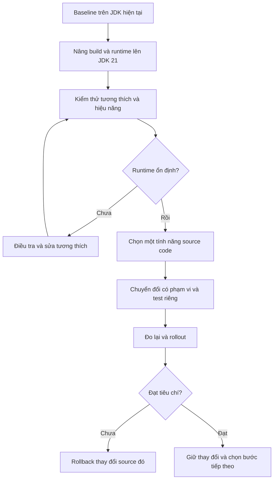

# Tách nâng runtime khỏi chuyển đổi sang pattern hoặc virtual thread

Nâng một ứng dụng lên Java 21 gồm nhiều loại thay đổi có mức độ rủi ro khác nhau. Đổi JDK chạy ứng dụng là một thay đổi về runtime, thư viện, build, bảo mật và môi trường triển khai. Chuyển code sang pattern matching hoặc virtual thread lại là thay đổi về cách viết và cách thực thi chương trình. Nếu thực hiện tất cả trong cùng một lần, khi test thất bại hoặc hiệu năng thay đổi sẽ khó xác định nguyên nhân.

Một lộ trình dễ kiểm soát là nâng runtime trước, giữ nguyên hành vi và cấu trúc code ở mức tối đa, sau đó mới áp dụng từng tính năng Java 21 theo nhu cầu. Mỗi giai đoạn cần có baseline, tiêu chí chấp nhận và khả năng rollback riêng. Cách làm này vẫn phù hợp khi tiếp tục nâng từ Java 21 lên các JDK mới hơn.

## Mục tiêu học tập

Sau bài học, bạn có thể:

- Phân biệt nâng runtime/toolchain với chuyển đổi source code sang tính năng Java mới.
- Lập baseline trước khi thay JDK và xác định phạm vi tương thích.
- Cấu hình build rõ ràng bằng toolchain và `--release`.
- Kiểm tra dependency, agent, native library, reflection và hành vi runtime.
- Triển khai Java 21 trước khi thay đổi pattern matching hoặc concurrency model.
- Chuyển từng nhánh code sang pattern matching for switch, record patterns hoặc virtual threads có kiểm soát.
- Đo lại throughput, percentile latency, error rate và tài nguyên sau từng giai đoạn.
- Thiết kế rollout, canary và rollback mà không trộn nhiều nguyên nhân thay đổi.

## 1. Hai trục thay đổi độc lập

### 1.1. Nâng runtime

Nâng runtime nghĩa là ứng dụng được build/chạy với một JDK mới hơn. Với Java 21, công việc thường bao gồm:

- Chọn JDK 21 vendor và bản cập nhật phù hợp.
- Cập nhật CI image, build tool, compiler toolchain và runtime/container image.
- Xác minh thư viện, framework, driver, agent và native library tương thích.
- Kiểm tra thay đổi mặc định về charset, TLS, security provider, GC, JIT và reflection.
- Chạy lại test chức năng, integration, security và performance trên runtime mới.

Mục tiêu của giai đoạn này là giữ nguyên hành vi nghiệp vụ trong khi thay đổi môi trường thực thi.

### 1.2. Hiện đại hóa source code

Sau khi runtime ổn định, có thể chọn các thay đổi source code phù hợp:

- Pattern matching for `switch` để diễn đạt xử lý theo kiểu dữ liệu.
- Record patterns để tách component của record trong điều kiện kiểm tra kiểu.
- Virtual threads để tổ chức nhiều tác vụ blocking với chi phí thread thấp hơn trong workload phù hợp.
- Sequenced Collections hoặc API Java 21 khác khi code có nhu cầu tương ứng.

Các thay đổi này không bắt buộc chỉ vì đã nâng runtime. Chúng cần lý do kỹ thuật, test riêng và phép đo chứng minh lợi ích.



Tách hai trục giúp xác định rõ một regression đến từ runtime mới hay từ thay đổi logic/concurrency.

## 2. Lập baseline trước khi nâng runtime

Trước khi sửa build hoặc source code, ghi nhận trạng thái hiện tại. Baseline là mốc để so sánh sau khi đổi JDK.

### 2.1. Ghi nhận môi trường

Lưu các thông tin sau:

- JDK vendor, version, build và kiến trúc CPU.
- JVM flags, heap size, GC, container CPU/memory limit.
- Build tool và plugin version.
- Framework, dependency, JDBC driver, native library và Java agent.
- Base image, OS image, timezone, locale và cấu hình TLS/certificate.
- Cách chạy ứng dụng ở local, CI, staging và production.

Đừng chỉ ghi `java -version` ở máy developer. Build daemon, test fork, container runtime và production process có thể đang dùng các JDK khác nhau.

### 2.2. Ghi nhận hành vi và hiệu năng

Chọn tập kịch bản đại diện và lưu:

| Nhóm | Baseline cần có |
|---|---|
| Chức năng | Kết quả nghiệp vụ, API contract, serialization và dữ liệu đầu ra |
| Hiệu năng | Throughput, p50/p95/p99 latency, error/timeout rate |
| JVM | Heap occupancy, allocation rate, GC pause/CPU, thread count |
| Tài nguyên | CPU, memory, file descriptor, socket và connection pool |
| Vận hành | Startup time, shutdown time, readiness, health check và log |
| Bảo mật | TLS handshake, certificate, provider, thuật toán bị vô hiệu hóa |

So sánh trong cùng workload, dữ liệu, thời gian warm-up và cấu hình hạ tầng. Một lần chạy đơn lẻ không đủ để kết luận regression hiệu năng.

## 3. Xác định chính xác JDK dùng để build và chạy

Build JDK, compiler target và runtime JDK là ba khái niệm liên quan nhưng khác nhau.

- **Build JDK:** JDK chạy Maven/Gradle và compiler.
- **Compile release:** phiên bản Java mà source code được phép dùng và phiên bản bytecode/API đích.
- **Runtime JDK:** JDK thực sự chạy ứng dụng.

Để build ứng dụng Java 21 và chạy trên Java 21, hãy cấu hình toolchain và release 21 một cách rõ ràng.

### 3.1. `--release` và bytecode version

Ví dụ với `javac`:

```bash
javac --release 21 -d out src/com/example/Main.java
```

`--release 21` cấu hình source language level, bytecode target và tập API Java SE được phép sử dụng cho release 21. Nó giúp tránh vô tình gọi API chỉ có ở JDK mới hơn trong khi tạo artifact dành cho Java 21.

Class file của Java 21 có major version 65. Runtime cũ hơn Java 21 không thể chạy class file version 65. Vì vậy, nếu production runtime vẫn là Java 17, chỉ cài JDK 21 ở build server không có nghĩa artifact đã trở thành ứng dụng Java 21.

Không dùng riêng `-source` và `-target` như thay thế đầy đủ cho `--release` khi cần ràng buộc API nền tảng. Nếu cần duy trì runtime cũ, chọn `--release` tương ứng với runtime đó và xác định rõ đây chưa phải bước chuyển runtime lên Java 21.

### 3.2. Maven

Ví dụ cấu hình compiler release:

```xml
<properties>
    <maven.compiler.release>21</maven.compiler.release>
</properties>
```

Đảm bảo Maven Compiler Plugin và các plugin liên quan hỗ trợ JDK 21. Nếu build phải chạy trên nhiều máy, có thể dùng Maven Toolchains để chọn JDK compiler nhất quán thay vì phụ thuộc vào `JAVA_HOME` ngẫu nhiên của agent CI.

### 3.3. Gradle

Khai báo Java toolchain trong Gradle Kotlin DSL:

```kotlin
java {
    toolchain {
        languageVersion = JavaLanguageVersion.of(21)
    }
}

tasks.withType<JavaCompile>().configureEach {
    options.release = 21
}
```

Toolchain chọn JDK cho compile/test task theo cấu hình build. Cần kiểm tra Gradle wrapper và plugin đang dùng có hỗ trợ Java 21; đồng thời xác nhận test task thực sự chạy bằng runtime dự kiến.

### 3.4. Xác minh artifact

Trong pipeline, ghi log `java -version`, thông tin compiler và runtime test. Kiểm tra artifact được build với release đúng, sau đó chạy chính artifact đó trong image Java 21. Tránh build một artifact ở môi trường này rồi vô tình deploy một artifact khác từ cache hoặc pipeline cũ.

## 4. Kiểm tra tương thích trước khi sửa source code

Nâng JDK có thể làm lộ vấn đề trong dependency hoặc giả định môi trường dù source code không thay đổi.

### 4.1. Dependency và framework

Lập danh sách các thành phần quan trọng:

- Framework web, dependency injection và persistence.
- JDBC driver, database client, messaging client.
- JSON/XML serialization và validation library.
- Logging, metrics, tracing và APM agent.
- Bytecode generation, mocking và coverage tool.
- Native/JNI library và thư viện gọi API hệ điều hành.

Kiểm tra ma trận hỗ trợ Java 21 của từng thành phần, sau đó nâng các dependency không tương thích trong một thay đổi được kiểm soát. Không nâng toàn bộ dependency lên phiên bản mới nhất cùng lúc nếu mục tiêu đang là cô lập rủi ro runtime.

### 4.2. JDK internals và reflection

Ứng dụng hoặc thư viện cũ có thể truy cập package nội bộ của JDK hoặc dùng reflection sâu vào module không được mở. Hãy kiểm tra dependency bằng công cụ phân tích như:

```bash
jdeps --jdk-internals application.jar
```

Kết quả giúp tìm tham chiếu tới API nội bộ cần thay bằng API công khai hoặc thư viện được hỗ trợ. Nếu đang dùng `--add-opens` để chạy tạm, ghi rõ module/package, dependency sở hữu và kế hoạch loại bỏ. Không coi việc mở rộng module toàn cục là giải pháp lâu dài.

Không dựa vào tùy chọn `--illegal-access` cũ để khắc phục reflection. Cấu hình đó không phải cách sửa tương thích hiện hành. Hãy cập nhật thư viện hoặc dùng API được hỗ trợ.

### 4.3. Thay đổi mặc định của runtime

Một số khác biệt cần kiểm tra khi chuyển từ JDK cũ lên Java 21:

- Default charset là UTF-8 từ JDK 18; code dựa vào charset mặc định của máy có thể đọc/ghi dữ liệu khác trước. Hãy chỉ định charset rõ ràng tại ranh giới file, network và protocol.
- TLS, certificate, disabled algorithm và security provider có thể khác theo bản JDK/security update.
- Timezone database, locale data và hành vi định dạng có thể thay đổi theo dữ liệu đi kèm JDK.
- JIT, GC và class loading có thể làm startup, throughput hoặc latency khác dù source không đổi.
- Container detection và giới hạn CPU/memory có thể ảnh hưởng cách JVM chọn tài nguyên.

Kiểm thử dữ liệu thực tế, đặc biệt file có encoding cũ, timestamp, certificate nội bộ và kết nối tới dịch vụ ngoài.

### 4.4. Java agent và công cụ vận hành

Kiểm tra profiler, APM, coverage và mocking framework có tương thích với JDK 21. JEP 451 khiến HotSpot JDK 21 cảnh báo khi agent được nạp động; nếu muốn kiểm tra ứng dụng không phụ thuộc dynamic agent loading, chạy test JVM với `-XX:-EnableDynamicAgentLoading`. Agent cần thiết nên được khai báo minh bạch từ startup bằng cơ chế mà công cụ hỗ trợ.

Không nhầm cấm dynamic agent loading với tắt toàn bộ Attach Mechanism. Chỉ thay đổi chính sách attach khi có yêu cầu vận hành cụ thể và đã kiểm tra ảnh hưởng tới công cụ chẩn đoán.

## 5. Giai đoạn A: nâng runtime mà chưa chuyển source code

Sau khi có baseline và kiểm tra dependency, tạo một nhánh thay đổi tập trung vào runtime.

Các bước thường gồm:

1. Cập nhật JDK trong CI/build image và toolchain.
2. Cập nhật compiler release lên 21 nếu artifact đích là Java 21.
3. Cập nhật test JVM, integration test và công cụ chạy test.
4. Cập nhật runtime/container image lên Java 21.
5. Giữ nguyên logic nghiệp vụ và cấu trúc concurrency hiện tại.
6. Chạy unit, integration, contract, security và smoke test.
7. Chạy load test so với baseline.
8. Deploy canary/staging, quan sát error rate, latency, GC và resource usage.

Nếu test thất bại, phân loại lỗi theo compile, linkage, dependency, runtime behavior, security, environment hoặc performance. Sửa các vấn đề tương thích trước khi chuyển source sang tính năng mới.

### 5.1. Tiêu chí hoàn tất giai đoạn runtime

Có thể xem giai đoạn này đạt khi:

- Artifact chạy trên JDK 21 đúng như cấu hình.
- Các luồng nghiệp vụ quan trọng và contract không thay đổi ngoài dự kiến.
- Dependency và agent cần thiết hoạt động trên runtime mới.
- Không có lỗi mới về charset, TLS, serialization hoặc reflection.
- Startup, shutdown và health check đạt tiêu chí vận hành.
- Throughput, p95/p99 và error rate nằm trong ngưỡng đã thống nhất.
- Có phương án quay lại image/runtime trước đó nếu rollout gặp sự cố.

Sau khi runtime ổn định, tạo mốc phát hành riêng. Mốc này giúp các thay đổi pattern hoặc virtual thread sau đó có thể được đánh giá độc lập.

## 6. Giai đoạn B: chuyển sang pattern matching khi có lợi ích rõ ràng

Pattern matching for `switch` và record patterns là các tính năng đã final trong Java 21. Chúng có thể làm code xử lý kiểu dữ liệu rõ hơn, đặc biệt khi domain model dùng sealed hierarchy hoặc record.

### 6.1. Chuyển chuỗi `instanceof` sang pattern matching

Code cũ thường lặp kiểm tra kiểu và ép kiểu:

```java
static String describe(Object value) {
    if (value instanceof String) {
        String text = (String) value;
        return "text: " + text;
    }
    if (value instanceof Integer) {
        Integer number = (Integer) value;
        return "number: " + number;
    }
    return "other";
}
```

Có thể dùng pattern variable. Lưu ý pattern matching cho `instanceof` đã final từ Java 16; đây là một kỹ thuật hiện hành có thể dùng trong code Java 21, không phải tính năng mới được giới thiệu ở Java 21:

```java
static String describe(Object value) {
    if (value instanceof String text) {
        return "text: " + text;
    }
    if (value instanceof Integer number) {
        return "number: " + number;
    }
    return "other";
}
```

Đây là thay đổi cục bộ, không cần thay đổi kiến trúc hoặc concurrency. Kiểm tra lại phạm vi biến và nhánh `null`: `instanceof` trả `false` với `null`, vì vậy nhánh fallback trước đây có thể xử lý null. Giữ nguyên hành vi đó khi refactor.

### 6.2. Dùng pattern matching for switch

Khi nhiều nhánh xử lý theo kiểu, pattern switch có thể giảm chuỗi `if/else`:

```java
static String describe(Object value) {
    return switch (value) {
        case null -> "null";
        case String text -> "text: " + text;
        case Integer number when number >= 0 -> "positive: " + number;
        case Integer number -> "integer: " + number;
        default -> "other";
    };
}
```

Trong Java 21, guard của pattern switch dùng từ khóa `when`. Thứ tự pattern có ý nghĩa: pattern rộng đặt trước có thể làm pattern hẹp phía sau trở thành unreachable/dominated và khiến compile thất bại.

Đặc biệt, pattern switch cần được xem xét kỹ với `null`. Nếu selector là null và không có `case null`, switch có thể ném `NullPointerException`; `default` không tự thay thế `case null`. Khi chuyển từ `if/else instanceof`, hãy viết test cho null và từng kiểu dữ liệu.

### 6.3. Dùng record patterns

Record pattern cho phép kiểm tra kiểu record và tách component trong cùng một nhánh:

```java
record Point(int x, int y) {}

static int manhattanDistance(Object value) {
    if (value instanceof Point(int x, int y)) {
        return Math.abs(x) + Math.abs(y);
    }
    return -1;
}
```

Hoặc kết hợp với pattern switch:

```java
static String describePoint(Object value) {
    return switch (value) {
        case Point(int x, int y) -> "Point(" + x + ", " + y + ")";
        case null -> "null";
        default -> "not a point";
    };
}
```

Chỉ dùng record patterns khi component của record thực sự là dữ liệu cần xử lý. Đừng chuyển đổi mọi DTO hoặc tạo record chỉ để tận dụng cú pháp mới; thiết kế domain model vẫn phải ưu tiên tính bất biến, contract và ý nghĩa nghiệp vụ.

### 6.4. Tận dụng sealed hierarchy nhưng giữ exhaustiveness có chủ đích

Với hierarchy được giới hạn bằng `sealed`, compiler có thể kiểm tra switch expression đã bao phủ các subtype được phép hay chưa:

```java
sealed interface PaymentResult permits Paid, Declined {}
record Paid(String receiptId) implements PaymentResult {}
record Declined(String reason) implements PaymentResult {}

static String message(PaymentResult result) {
    return switch (result) {
        case Paid(String receiptId) -> "Paid: " + receiptId;
        case Declined(String reason) -> "Declined: " + reason;
    };
}
```

Khi hierarchy thay đổi, compiler có thể buộc code xử lý bổ sung subtype mới. Đây là lợi ích về khả năng phát hiện thay đổi, nhưng cần kiểm tra API boundary, dữ liệu deserialize và phiên bản module khi subtype có thể được mở rộng ở nơi khác.

### 6.5. Checklist refactor pattern

- Giữ nguyên thứ tự ưu tiên của các điều kiện.
- Viết test cho null, subtype cụ thể và giá trị không được hỗ trợ.
- Kiểm tra guard `when` và thứ tự pattern để tránh dominance.
- Kiểm tra switch expression có exhaustive đúng theo domain không.
- Giữ nguyên exception và kết quả fallback nếu đó là contract hiện tại.
- Chỉ refactor khu vực có lợi ích về khả năng đọc hoặc kiểm tra exhaustiveness.
- Chạy test và benchmark liên quan sau khi thay đổi.

## 7. Giai đoạn C: chuyển workload phù hợp sang virtual threads

Virtual threads là tính năng final từ Java 21. Chúng phù hợp với ứng dụng có nhiều tác vụ đồng thời thường xuyên chờ I/O hoặc blocking operation. Virtual thread giúp giảm chi phí duy trì số lượng lớn tác vụ so với mô hình một platform thread cho mỗi tác vụ trong nhiều workload.

Virtual thread không làm một đoạn tính toán CPU-bound chạy nhanh hơn và không làm tăng capacity của database, remote service hoặc connection pool.

### 7.1. Giữ mô hình task, đổi executor có kiểm soát

Ví dụ chạy mỗi tác vụ trên một virtual thread:

```java
try (ExecutorService executor = Executors.newVirtualThreadPerTaskExecutor()) {
    Future<Order> order = executor.submit(() -> loadOrder(orderId));
    Future<Customer> customer = executor.submit(() -> loadCustomer(customerId));

    return combine(order.get(), customer.get());
}
```

Try-with-resources gọi `close()` khi rời block; executor ngừng nhận task mới và chờ các task đã gửi hoàn tất theo hợp đồng `ExecutorService`. Với service sống lâu, executor cần được quản lý bởi lifecycle của service thay vì tạo/đóng theo từng request.

Trước khi chuyển, tách phần tạo executor khỏi logic nghiệp vụ để có thể kiểm thử và rollout riêng. Không thay mọi `newFixedThreadPool()` bằng virtual-thread-per-task một cách tự động; một số pool cũ có thể đang giới hạn tài nguyên hoặc bảo vệ dependency.

### 7.2. Không pool virtual thread

Virtual thread được thiết kế theo mô hình tạo cho mỗi task, không phải tạo một pool nhỏ rồi tái sử dụng. Nếu cần giới hạn concurrency, hãy giới hạn tài nguyên khan hiếm hoặc số thao tác đi vào dependency.

Ví dụ dùng semaphore để giới hạn số thao tác gọi một dịch vụ ngoài:

```java
private final Semaphore remoteSlots = new Semaphore(100);

Result callRemote(Request request) throws InterruptedException {
    remoteSlots.acquire();
    try {
        return remoteClient.call(request);
    } finally {
        remoteSlots.release();
    }
}
```

Nếu remote client hoặc connection pool đã có giới hạn phù hợp, tránh thêm semaphore trùng lặp. Mục tiêu là bảo vệ capacity downstream, không phải giới hạn số virtual thread tồn tại.

### 7.3. Kiểm tra ThreadLocal và context

Virtual thread vẫn là Java `Thread`, vì vậy `ThreadLocal` có thể hoạt động trong phạm vi virtual thread. Nhưng nếu ứng dụng tạo rất nhiều virtual thread, mỗi thread giữ một object lớn hoặc tài nguyên đắt tiền có thể làm tăng memory footprint đáng kể.

- Không dùng `ThreadLocal` để giữ connection hoặc pool resource theo từng virtual thread.
- Không lưu request body lớn hoặc cache không giới hạn trong thread-local context.
- Xóa context tạm thời trong `finally` khi API/framework yêu cầu cleanup.
- Truyền context qua executor boundary bằng cơ chế propagation đã chọn; không giả định mọi `ThreadLocal` tự được truyền.

### 7.4. Kiểm tra pinning và native call theo runtime đích

Trên Java 21, virtual thread có thể bị pin vào carrier trong một số trường hợp blocking bên trong `synchronized` hoặc native/foreign call. Từ JDK 24, JEP 491 loại bỏ việc pin chỉ do blocking trong `synchronized`; native/foreign call vẫn cần được đánh giá theo runtime và thư viện cụ thể. Nếu workload Java 21 bị ảnh hưởng, dùng JFR hoặc chẩn đoán runtime để xác định call site và đo mức ảnh hưởng.

Không chuyển mọi `synchronized` thành `ReentrantLock` theo một quy tắc máy móc. Trước hết hãy xác định đoạn code có blocking trong monitor hay không và kiểm tra runtime đích. Các JDK mới hơn đã cải thiện hành vi monitor pinning, nên không áp dụng giới hạn riêng của Java 21 cho mọi phiên bản hiện hành.

### 7.5. Workload nào nên giữ platform thread?

Virtual thread thường hữu ích cho nhiều tác vụ blocking. Với tác vụ CPU-bound, số worker chạy đồng thời nên tương ứng với năng lực CPU và workload; một pool platform thread có giới hạn có thể là lựa chọn phù hợp hơn.

Đánh giá theo dữ liệu:

- Nếu task chủ yếu chờ socket/database và số concurrent request lớn, thử virtual thread.
- Nếu task chủ yếu tính toán CPU, không kỳ vọng virtual thread làm tăng throughput.
- Nếu dependency có connection limit thấp, giới hạn concurrency tại dependency.
- Nếu thư viện native hoặc driver có ràng buộc thread riêng, kiểm tra hợp đồng trước khi chuyển.
- Nếu task phụ thuộc thread affinity hoặc thread-local state đặc biệt, kiểm thử riêng.

## 8. Không gộp preview feature vào migration production

Java 21 có một số API/tính năng ở trạng thái preview trong release đó. Preview feature yêu cầu bật `--enable-preview` khi compile và chạy theo JDK tương ứng; API/cú pháp preview có thể thay đổi hoặc bị rút lại ở release sau.

Khi nâng runtime production, phân biệt rõ:

- Tính năng final trong Java 21 như pattern matching for switch, record patterns, virtual threads và sequenced collections.
- Tính năng preview của Java 21 như Structured Concurrency hoặc Scoped Values ở thời điểm Java 21.

Không đưa preview feature vào cùng đợt nâng runtime chỉ vì chúng xuất hiện trong JDK 21. Nếu có nhu cầu thử nghiệm, tạo nhánh/prototype riêng, đánh giá trạng thái của tính năng trên JDK đích hiện tại và không xem preview API là contract ổn định cho production.

## 9. Tổ chức thay đổi để dễ review và rollback

Nên chia thành các thay đổi độc lập:

| Thay đổi | Phạm vi | Tiêu chí review |
|---|---|---|
| Build/toolchain | JDK compiler, `--release`, plugin và CI | Artifact đúng release, build tái lập |
| Runtime deployment | JDK image, JVM flags, startup/shutdown | Smoke/integration test và telemetry đạt |
| Dependency compatibility | Framework, driver, agent, native library | Ma trận hỗ trợ và test tích hợp đạt |
| Pattern refactor | Một module hoặc một hierarchy | Contract, null behavior, exhaustiveness và test đạt |
| Virtual thread | Một workload hoặc endpoint phù hợp | Throughput, p95/p99, error rate và resource usage đạt |

Không trộn thay đổi JDK, dependency major upgrade, pattern refactor và concurrency rewrite trong một commit lớn. Khi review hoặc rollback, mỗi thay đổi cần chỉ ra lý do, hành vi trước/sau và bằng chứng test.

### 9.1. Feature switch cho thay đổi concurrency

Nếu kiến trúc cho phép, tách việc chọn executor khỏi code nghiệp vụ:

```java
interface TaskExecutorFactory {
    ExecutorService create();
}

final class PlatformTaskExecutorFactory implements TaskExecutorFactory {
    @Override
    public ExecutorService create() {
        return Executors.newFixedThreadPool(32);
    }
}

final class VirtualTaskExecutorFactory implements TaskExecutorFactory {
    @Override
    public ExecutorService create() {
        return Executors.newVirtualThreadPerTaskExecutor();
    }
}
```

Đây là ví dụ minh họa cho việc cô lập chính sách executor. Factory thực tế cần có ownership/lifecycle rõ ràng; không tạo một executor mới cho mỗi lần gọi factory nếu service cần dùng lâu dài. Có thể chọn implementation qua cấu hình để canary và rollback nhanh.

## 10. Kiểm thử và so sánh sau từng giai đoạn

### 10.1. Test chức năng và tương thích

- Unit test và integration test trên JDK 21.
- Contract test cho API, serialization và message schema.
- Test encoding với dữ liệu UTF-8 và dữ liệu legacy được hỗ trợ.
- Test TLS/certificate và kết nối database/message broker.
- Test startup agent, monitoring, tracing và shutdown.
- Test null, sealed subtype và pattern guard khi refactor switch.
- Test cancellation, timeout, context propagation và resource cleanup khi chuyển virtual thread.

### 10.2. Test hiệu năng

Chạy cùng workload và so sánh:

| Chỉ số | Câu hỏi |
|---|---|
| Throughput/goodput | Số công việc hoàn tất có tăng/giảm không? |
| p50/p95/p99 latency | Tail latency có xấu đi không? |
| Error/timeout rate | Có thêm lỗi do timeout, rejection hoặc race không? |
| CPU | JIT, GC hoặc synchronization có làm CPU tăng không? |
| Heap/allocation/GC | Allocation rate, live set và GC overhead thay đổi ra sao? |
| Thread/queue | Có queue tăng, thread leak hoặc pool saturation không? |
| Downstream | Connection pool, DB và remote service có bị quá tải không? |

JMH dùng để so sánh một đoạn code nhỏ sau khi đã xác định hotspot. Load test end-to-end dùng để đánh giá capacity và trải nghiệm của hệ thống hoàn chỉnh. Không dùng kết quả JMH để kết luận API production có thể tăng bao nhiêu RPS.

### 10.3. Canary và rollback

Triển khai runtime Java 21 ở một nhóm instance trước. Theo dõi health, error rate, p95/p99, GC, CPU, memory và downstream pool. Khi runtime ổn định, mới bật từng thay đổi source code trên phạm vi nhỏ.

Rollback phải xác định được artifact và runtime trước đó, cấu hình JVM, schema/data compatibility và cách chuyển traffic. Nếu đã thay đổi định dạng dữ liệu hoặc contract không tương thích ngược, rollback binary đơn thuần có thể không đủ; cần thiết kế migration dữ liệu theo hướng tương thích hai chiều.

## 11. Ví dụ lộ trình theo từng release

Một dự án đang chạy trên JDK 17 có thể chia lộ trình như sau:

**Release A — Runtime Java 21:** cập nhật CI/toolchain, dependency cần thiết và production image; giữ logic `instanceof`, executor và platform thread hiện có. Chạy test và load test so với baseline.

**Release B — Pattern modernization:** chuyển một hierarchy sealed hoặc record-based sang pattern switch/record patterns. Giữ nguyên API, test null và mọi nhánh subtype, benchmark chỉ khi khu vực đó có ảnh hưởng hiệu năng.

**Release C — Virtual threads thử nghiệm:** chọn một endpoint I/O-bound có workload đo được. Thay chính sách executor ở phạm vi nhỏ, giữ giới hạn database/remote service, kiểm tra context propagation và cancellation.

**Release D — Mở rộng có bằng chứng:** chỉ mở rộng pattern/virtual thread khi số liệu cho thấy khả năng bảo trì hoặc capacity tốt hơn mà không vi phạm SLO. Gỡ code path cũ sau khi rollout ổn định và hết nhu cầu rollback.

Lộ trình này là ví dụ; số release và thứ tự cụ thể phụ thuộc độ lớn ứng dụng, yêu cầu compliance và khả năng triển khai.

## 12. Những lỗi migration thường gặp

| Lỗi | Hậu quả | Cách phòng tránh |
|---|---|---|
| Chỉ nâng JDK ở máy developer | CI/production vẫn dùng runtime khác | Khai báo toolchain và runtime image rõ ràng |
| Build bằng JDK 21 nhưng không khóa release | Có thể vô tình dùng API mới hơn runtime đích | Dùng `--release` đúng mục tiêu |
| Nâng runtime và refactor source cùng lúc | Khó tìm nguyên nhân regression | Chia thành các giai đoạn độc lập |
| Cập nhật mọi dependency cùng lúc | Khó xác định thay đổi gây lỗi | Nâng theo nhóm tương thích có kiểm soát |
| Bỏ qua charset/TLS/security behavior | Lỗi chỉ xuất hiện trên dữ liệu hoặc môi trường thật | Test encoding, certificate và protocol |
| Chuyển mọi `if/instanceof` sang switch | Có thể đổi hành vi null/fallback | Refactor theo từng hierarchy và test biên |
| Thay mọi thread pool bằng virtual thread | Có thể làm quá tải database hoặc service ngoài | Giới hạn tài nguyên khan hiếm tại đúng tầng |
| Pool virtual thread | Đi ngược mô hình sử dụng được thiết kế | Dùng virtual thread per task |
| Bỏ cleanup ThreadLocal/context | Rò rỉ dữ liệu hoặc tăng memory | Capture/restore/clear theo lifecycle |
| Đánh giá virtual thread chỉ bằng thread count | Không phản ánh throughput và tail latency | Đo toàn bộ workload và downstream |
| Dùng preview API như API final | Phát sinh rủi ro thay đổi ở JDK sau | Kiểm tra trạng thái feature trên runtime đích |

## 13. Checklist migration Java 21

**Trước khi nâng runtime**

- Ghi lại JDK/vendor/build, JVM flags, dependency và runtime image hiện tại.
- Có baseline chức năng, throughput, p50/p95/p99, error rate và tài nguyên.
- Kiểm tra hỗ trợ Java 21 của build tool, framework, driver, agent và native library.
- Quét JDK internals và reflection sâu; có kế hoạch loại bỏ `--add-opens` không cần thiết.
- Kiểm tra charset, TLS, certificate, timezone, locale và container limits.

**Khi nâng runtime**

- Cấu hình toolchain và `--release 21` nếu artifact đích là Java 21.
- Xác minh build JVM, test JVM và production JVM.
- Chạy unit, integration, contract, security và smoke test.
- Chạy load test trên JDK 21 với workload tương đương baseline.
- Rollout canary và chuẩn bị rollback runtime/image.

**Khi hiện đại hóa source**

- Chọn một tính năng và một phạm vi code cụ thể.
- Với pattern: test null, guard, subtype, fallback và exhaustiveness.
- Với virtual thread: chọn workload blocking, giữ giới hạn downstream và kiểm tra cleanup/cancellation/context.
- Không pool virtual thread hoặc giả định chúng tăng capacity của dependency.
- Không đưa preview feature vào production migration nếu chưa đánh giá trạng thái trên JDK đích.
- Đo lại throughput, latency percentile, error rate và tài nguyên.

## 14. Nguyên tắc thiết kế

- Xem nâng runtime và hiện đại hóa source code là hai quyết định có thể triển khai độc lập.
- Nâng runtime trước với thay đổi code tối thiểu để tạo baseline Java 21 ổn định.
- Dùng toolchain và `--release` để kiểm soát build một cách tái lập.
- Xác minh dependency, agent, native library, charset, TLS và reflection trước production rollout.
- Chuyển sang pattern matching khi làm rõ domain logic hoặc tăng khả năng kiểm tra exhaustiveness.
- Chuyển sang virtual thread khi workload blocking và concurrency phù hợp; giới hạn tài nguyên ở dependency.
- Đo hiệu năng bằng cùng workload và so sánh throughput, p95/p99, error rate cùng tài nguyên.
- Tách commit, release và rollback cho từng nhóm thay đổi.
- Kiểm tra trạng thái final/preview của tính năng trên JDK đích, không chỉ dựa vào phiên bản đầu tiên giới thiệu nó.

Nâng runtime tạo nền tảng chạy ứng dụng trên Java 21; pattern matching và virtual threads là các lựa chọn hiện đại hóa tiếp theo. Khi triển khai từng thay đổi độc lập, có baseline và tiêu chí đo rõ ràng, nhóm phát triển sẽ biết chính xác lợi ích, rủi ro và nguyên nhân của mỗi khác biệt.

## Tài liệu tham khảo

- [Oracle — JDK 21 Migration Guide](https://docs.oracle.com/en/java/javase/21/migrate/): thay đổi runtime, API, công cụ và các bước chuẩn bị khi chuyển lên JDK 21.
- [Oracle — `javac` Command, Java SE 21](https://docs.oracle.com/en/java/javase/21/docs/specs/man/javac.html): `--release`, source level và target bytecode.
- [Oracle — Java Toolchains, Maven](https://maven.apache.org/guides/mini/guide-using-toolchains.html): chọn JDK toolchain nhất quán cho Maven build.
- [Gradle — Java Toolchains](https://docs.gradle.org/current/userguide/toolchains.html): cấu hình JDK dùng cho compile/test task.
- [JEP 441 — Pattern Matching for switch](https://openjdk.org/jeps/441): pattern switch final trong Java 21.
- [JEP 440 — Record Patterns](https://openjdk.org/jeps/440): record patterns final trong Java 21.
- [JEP 444 — Virtual Threads](https://openjdk.org/jeps/444): virtual threads final trong Java 21 và mô hình sử dụng.
- [JEP 491 — Synchronize Virtual Threads without Pinning](https://openjdk.org/jeps/491): thay đổi monitor pinning được đưa vào JDK 24.
- [JEP 451 — Prepare to Disallow the Dynamic Loading of Agents](https://openjdk.org/jeps/451): cảnh báo dynamic agent loading trong JDK 21.
- [Oracle — `jdeps` Command, Java SE 21](https://docs.oracle.com/en/java/javase/21/docs/specs/man/jdeps.html): phân tích dependency và JDK internal API.
