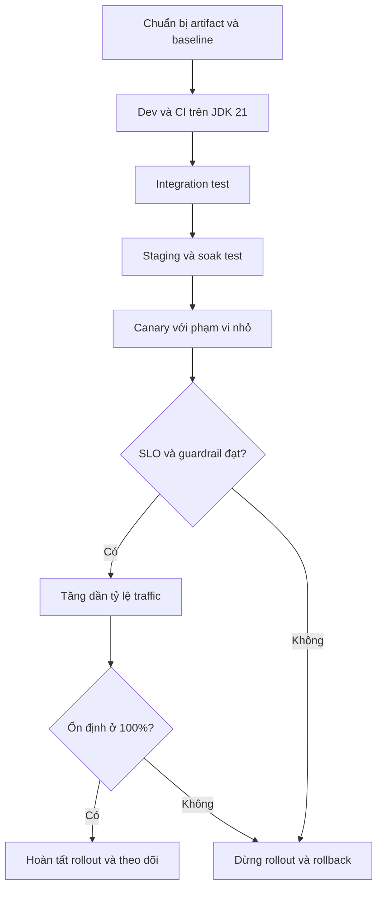

# Triển khai theo giai đoạn, theo dõi hồi quy và chuẩn bị rollback

## 1. Vì sao không nên nâng cấp toàn bộ hệ thống trong một lần?

Nâng cấp ứng dụng lên Java 21 tác động đến runtime, build artifact, dependency, agent, garbage collector, thread scheduling và cách ứng dụng tương tác với hệ điều hành hoặc dịch vụ bên ngoài. Một lỗi có thể chỉ xuất hiện ở một endpoint ít dùng, một job chạy ban đêm, một loại payload hoặc khi tải tăng cao.

Triển khai theo giai đoạn giúp giới hạn phạm vi ảnh hưởng, thu thập bằng chứng dưới tải thật và dừng rollout trước khi lỗi lan rộng. Mỗi giai đoạn cần có điều kiện vào, điều kiện hoàn tất, người chịu trách nhiệm và phương án quay lại phiên bản đã biết hoạt động.

Mục tiêu của kế hoạch không chỉ là đưa JVM Java 21 vào production. Cần chứng minh ứng dụng giữ được correctness, latency, throughput, độ ổn định và khả năng vận hành trong điều kiện thực tế.

## 2. Chuẩn bị trước khi triển khai

Trước ngày release, hoàn tất các đầu việc sau:

- Migration inventory có đủ ứng dụng, job, dependency, build plugin, Java agent, native library và runtime image.
- Build và test chạy trên đúng JDK 21 vendor/build dự kiến triển khai.
- Có baseline từ phiên bản đang chạy: throughput, p50/p95/p99 latency, error rate, CPU, RSS, heap, GC, queue và downstream metrics.
- Các luồng nghiệp vụ quan trọng có smoke test và integration test.
- Đã kiểm tra tương thích dữ liệu, schema database, message format, cache và session giữa phiên bản cũ/mới.
- Artifact cũ và cấu hình cũ vẫn được lưu để rollback.
- Có dashboard, alert, log, tracing và quyền truy cập để quan sát từng instance/canary.
- Runbook rollout/rollback đã được review và người trực vận hành biết cách thực hiện.

Không bắt đầu rollout production nếu chưa biết chính xác artifact nào đang chạy, artifact nào sẽ được triển khai và làm thế nào để khôi phục phiên bản trước.

## 3. Tách các biến thay đổi để dễ xác định nguyên nhân

Nếu cùng lúc đổi JDK, framework, executor, GC, dependency và cấu trúc code lớn, khi có hồi quy sẽ khó xác định biến nào gây ra lỗi. Nên chia migration thành các nhóm thay đổi có thể kiểm chứng độc lập.

| Nhóm thay đổi | Nội dung | Cách xác minh riêng |
|---|---|---|
| Runtime | Chạy artifact tương thích trên JDK 21 | Startup, integration, smoke và runtime compatibility |
| Dependency/plugin | Nâng framework, driver, test/build plugin | Dependency tests, integration tests và compatibility evidence |
| Code migration | API, language features hoặc hành vi mới | Unit tests, contract tests và review semantics |
| Concurrency | Executor, virtual thread, synchronization | Load test, queue/concurrency metrics và downstream capacity |
| Garbage collector | G1 hoặc Generational ZGC trên Java 21 | GC log, JFR, latency và memory benchmark |
| Deployment | Base image, JVM flags, resource limits, startup/shutdown | Container smoke, readiness, graceful shutdown và rollback drill |

Có thể gộp một số thay đổi nếu đã có bằng chứng tương thích và rủi ro thấp, nhưng phải ghi rõ những biến đã đổi trong release. Với một sự cố, thông tin này giúp thu hẹp phạm vi điều tra.

## 4. Tạo artifact bất biến và lưu phiên bản rollback

Build artifact một lần rồi promote cùng artifact qua các môi trường. Không build lại source riêng cho staging và production nếu mục tiêu là kiểm chứng cùng một binary; cấu hình môi trường nên được cung cấp bên ngoài artifact theo quy trình đã kiểm soát.

Mỗi release cần lưu tối thiểu:

- Git commit/tag và build number.
- Artifact checksum (ví dụ SHA-256) hoặc container image digest.
- JDK vendor, phiên bản đầy đủ và build/update.
- JVM arguments, GC, heap, system properties và environment variables liên quan.
- Dependency lock/SBOM và danh sách agent được nạp.
- Cấu hình triển khai, resource requests/limits và feature flag state.
- Artifact, image digest và cấu hình của phiên bản cuối cùng đã được xác nhận ổn định.

Không dựa vào tag container có thể bị ghi đè như `latest` để xác định bản rollback. Hãy giữ image digest hoặc artifact version bất biến để chắc chắn rollback đúng binary đã được kiểm chứng.

### 4.1. Chú ý tương thích bytecode khi rollback JDK

Class file được biên dịch cho Java 21 có major version 65; Java 17 hỗ trợ đến major version 61. Vì vậy, không thể lấy artifact đã biên dịch cho Java 21 rồi đổi runtime về Java 17 để chạy như bình thường. JVM cũ có thể báo `UnsupportedClassVersionError`; việc dùng `--add-opens` hay thay JVM flag không giải quyết được khác biệt class-file version.

Nếu rollback về Java 17, phải triển khai lại artifact cũ tương thích Java 17 cùng runtime/image tương ứng. Nếu ứng dụng cần duy trì khả năng chạy trên cả hai runtime trong một giai đoạn, phải có build target và kiểm thử riêng; `--release 17` cũng không cho phép dùng API hoặc syntax chỉ có ở Java 21.

### 4.2. Ghi nhận cấu hình runtime cùng artifact

JDK 21 có thể chạy với các cấu hình khác nhau như G1 hoặc Generational ZGC, heap limit khác nhau, agent khác nhau hoặc virtual-thread feature được bật ở tầng ứng dụng. Lưu JVM arguments và config hash để có thể khôi phục chính xác cấu hình đã ổn định, không chỉ khôi phục JAR/container.

## 5. Kiểm tra tương thích dữ liệu trước rollout

Rollback ứng dụng chỉ an toàn khi phiên bản cũ vẫn đọc/ghi được dữ liệu do phiên bản mới tạo ra. Đây là một trong các điều kiện quan trọng nhất khi triển khai rolling hoặc canary, vì hai phiên bản có thể cùng chạy trong một khoảng thời gian.

### 5.1. Database schema: expand-and-contract

Ưu tiên migration schema theo hai bước:

1. **Expand**: thêm cột, bảng hoặc index theo cách tương thích ngược; giữ cấu trúc cũ trong khi cả phiên bản cũ và mới vẫn hoạt động.
2. Triển khai ứng dụng mới và chuyển dần traffic; xác minh cả phiên bản cũ lẫn mới có thể hoạt động với schema trong giai đoạn chuyển tiếp.
3. **Contract**: chỉ xóa cột cũ hoặc loại bỏ cấu trúc tương thích sau khi phiên bản cũ không còn được dùng và rollback window đã đóng.

Không chạy migration phá hủy dữ liệu trước khi rollout ổn định. Nếu phiên bản mới ghi dữ liệu mà phiên bản cũ không thể đọc, rollback binary có thể khiến ứng dụng cũ lỗi ngay khi khởi động hoặc xử lý request.

### 5.2. Message, cache và session

Kiểm tra thêm:

- Message trên Kafka/RabbitMQ hoặc queue có schema/version mà consumer cũ hiểu được không?
- Cache key, serialized value và format session có thay đổi không?
- Rolling deployment có thể khiến producer mới gửi payload mà consumer cũ không đọc được không?
- Background job có thể chạy đồng thời hai phiên bản và xử lý trùng một record không?
- Distributed lock, leader election và ownership của partition có an toàn khi phiên bản cũ/mới cùng tồn tại không?

Với message format, ưu tiên thay đổi tương thích ngược/tiến trong giai đoạn chuyển tiếp, ví dụ consumer đọc được cả schema cũ và mới trước khi producer bắt đầu phát schema mới. Với job có side effect, dùng idempotency key, transaction hoặc cơ chế claim/lease phù hợp để tránh chạy trùng.

## 6. Các giai đoạn triển khai

Một lộ trình tổng quát có thể đi theo thứ tự dưới đây. Thời gian giữ ở mỗi giai đoạn phụ thuộc traffic, chu kỳ nghiệp vụ và khả năng phát hiện lỗi; không có một số giờ cố định phù hợp cho mọi service.

### 6.1. Giai đoạn 1 — Development và CI

Mục tiêu là phát hiện lỗi sớm trước khi tạo release candidate:

- Build bằng JDK 21 và compiler target đã chọn.
- Chạy unit test, static analysis, formatting, packaging và dependency checks.
- Chạy test worker với đúng JVM arguments, Java agent và module options.
- Xác minh startup agent/dynamic agent, native library và annotation processor.
- Kiểm tra preview/incubator feature nếu dự án có chủ đích sử dụng.
- Tạo artifact bất biến, checksum/SBOM và lưu build metadata.

Điều kiện hoàn tất: build tái lập được, test bắt buộc pass, warning/lỗi instrumentation được giải thích, artifact có thể triển khai và rollback artifact cũ vẫn sẵn sàng.

### 6.2. Giai đoạn 2 — Integration test

Chạy ứng dụng Java 21 với các dependency gần production nhất có thể:

- Database/JDBC driver, ORM và migration script.
- HTTP client, TLS, proxy, DNS và dịch vụ ngoài.
- Messaging producer/consumer và schema thực tế.
- Authentication, authorization, serialization và file I/O.
- Executor, virtual thread, timeout, cancellation và graceful shutdown nếu ứng dụng sử dụng.
- Agent, profiler hoặc observability exporter được bật trong production.

Kiểm tra cả lỗi mạng, dependency chậm, retry, timeout, pool exhaustion và restart. Build pass không chứng minh runtime integration pass.

### 6.3. Giai đoạn 3 — Staging và soak test

Staging nên dùng cùng loại runtime image, JDK update, JVM flags, resource limit và cấu hình observability như production. Dataset và dependency có thể được thay bằng dữ liệu kiểm thử, nhưng đặc điểm tải và đường đi request cần gần thực tế.

Chạy smoke test sau deploy, sau đó chạy soak test đủ lâu để quan sát:

- Memory/RSS có tăng dần không?
- Heap occupancy sau GC có trở về vùng ổn định không?
- Có thread/task, connection hoặc stream bị giữ lâu không?
- Queue depth và pending request có tăng liên tục không?
- Có lỗi chỉ xuất hiện theo chu kỳ, ví dụ scheduler, token refresh hoặc job định kỳ không?
- Shutdown/restart có hoàn tất trong thời gian cho phép không?

Điều kiện hoàn tất: các luồng chính hoạt động, không có xu hướng rò rỉ tài nguyên, latency/error/throughput nằm trong ngưỡng đã thống nhất và runbook triển khai/rollback đã được diễn tập.

### 6.4. Giai đoạn 4 — Canary

Canary triển khai phiên bản Java 21 lên một phần nhỏ instance hoặc traffic trong khi phần còn lại tiếp tục chạy phiên bản ổn định. Bắt đầu với phạm vi đủ nhỏ để giới hạn ảnh hưởng nhưng đủ lớn để tạo ra tín hiệu quan sát có ý nghĩa.

Ví dụ tỷ lệ tăng traffic minh họa:

| Bước | Traffic tới Java 21 | Điều kiện chuyển bước |
|---|---:|---|
| Canary đầu | 1–5% | Smoke pass, không có lỗi nghiêm trọng, health ổn định |
| Mở rộng 1 | 10–25% | Error rate, p95/p99 và saturation trong guardrail |
| Mở rộng 2 | 50% | Không có hồi quy theo endpoint/tenant/instance; downstream còn capacity |
| Mở rộng 3 | 100% | Các bước trước ổn định đủ thời gian quan sát và không có blocker |

Các tỷ lệ chỉ là ví dụ; chọn theo số instance, traffic, khả năng routing và mức rủi ro. Nếu service có ít instance hoặc traffic thấp, tỷ lệ phần trăm có thể không tạo được canary có ý nghĩa; khi đó dùng một instance, một tenant nội bộ hoặc một nhóm request kiểm soát.

Không chỉ so sánh tổng thể. Phân tách metric theo version, instance, zone, endpoint và nhóm request để tránh việc lỗi ở canary bị che bởi phần traffic cũ lớn hơn.

### 6.5. Giai đoạn 5 — Ramp-up và hoàn tất

Sau mỗi lần tăng traffic, giữ một khoảng quan sát đủ dài để bao phủ chu kỳ tải và các tác vụ nền liên quan. Chỉ chuyển bước khi dashboard và alert không cho thấy hồi quy đáng kể.

Sau khi đạt 100%:

- Giữ phiên bản cũ và rollback artifact trong khoảng rollback window đã thống nhất.
- Tiếp tục theo dõi qua peak traffic, batch window, scheduled jobs và chu kỳ business quan trọng.
- Xác nhận tất cả instance đang chạy đúng image digest/JDK build.
- Chỉ loại bỏ hạ tầng tương thích cũ và chạy schema contract migration sau khi rollback window đóng.
- Cập nhật tài liệu vận hành, inventory và ownership.

## 7. Chọn chiến lược rollout phù hợp

| Chiến lược | Cách hoạt động | Điểm mạnh | Điều cần kiểm soát |
|---|---|---|---|
| Rolling deployment | Thay instance cũ bằng instance mới theo từng nhóm | Dùng tài nguyên hạ tầng hiệu quả | Mixed-version compatibility, capacity còn lại và drain connection |
| Blue-green | Dựng môi trường mới song song rồi chuyển traffic | Chuyển hướng nhanh và có thể giữ môi trường cũ | Tài nguyên gấp đôi trong thời gian chuyển, schema/data dùng chung |
| Canary | Chuyển một phần traffic sang phiên bản mới rồi tăng dần | Giới hạn blast radius và so sánh trực tiếp | Routing, phân nhóm metric và đủ traffic để quan sát |
| Tenant/worker cohort | Chuyển một nhóm tenant, partition hoặc worker | Phù hợp hệ thống nhiều tenant hoặc background workload | Data isolation, ownership, duplicate processing và fairness |

Có thể kết hợp rolling với canary hoặc blue-green với traffic shifting. Lựa chọn phụ thuộc kiến trúc, khả năng routing, statefulness và chi phí chạy song song.

### 7.1. Mixed-version compatibility

Trong rolling/canary, phiên bản cũ và mới có thể cùng xử lý request hoặc message. Cần bảo đảm:

- API contract và message schema tương thích trong thời gian chuyển tiếp.
- Cả hai phiên bản hiểu được trạng thái database và cache.
- Session affinity không khiến một nhóm user bị chuyển qua lại giữa hai phiên bản không tương thích.
- Worker cũ/mới không cùng xử lý một công việc nếu không có cơ chế claim/idempotency.
- Health check và readiness không báo healthy khi instance chưa hoàn tất khởi tạo hoặc chưa thể nhận traffic.

Nếu không thể bảo đảm mixed-version compatibility, dùng chiến lược chuyển đổi có kiểm soát như maintenance window, drain toàn bộ consumer hoặc blue-green với bước đồng bộ dữ liệu phù hợp.

## 8. Theo dõi hồi quy bằng SLO và guardrail

Trước rollout, xác định metric nào quyết định tiếp tục, tạm dừng hoặc rollback. Guardrail phải gắn với SLO, baseline và tác động nghiệp vụ; tránh đặt một ngưỡng tùy ý không phản ánh yêu cầu service.

### 8.1. Golden signals

| Nhóm | Metric nên theo dõi | Dấu hiệu hồi quy |
|---|---|---|
| Traffic | Request rate, task completion, message consumption | Throughput giảm hoặc backlog tăng |
| Errors | 4xx/5xx theo loại, exception, timeout, retry, crash/restart | Error/timeout tăng so với baseline hoặc control |
| Latency | p50/p95/p99 theo endpoint và dependency | Tail latency tăng hoặc có nhóm request chậm bất thường |
| Saturation | CPU, throttling, RSS, heap, queue, connection pool | Tài nguyên chạm giới hạn, pending tăng liên tục |
| Correctness | Business success, duplicate, data mismatch, reconciliation | Request trả thành công nhưng kết quả nghiệp vụ sai |

### 8.2. Metric đặc thù Java 21

Theo dõi thêm các metric phù hợp với thay đổi trong migration:

- JVM version/build, startup time và startup failure.
- Heap occupancy, allocation rate, GC pause, GC CPU và allocation stall.
- RSS/native memory, direct buffer và file descriptor.
- Số platform thread, virtual thread đang hoạt động và event virtual thread pinning nếu dùng virtual thread.
- Executor queue/wait, semaphore wait, task rejection và cancellation.
- Database connection acquisition, active/pending connection và transaction duration.
- HTTP connection/request pending, connect/read timeout và upstream status.
- Agent load warning/error, telemetry exporter failure và JFR event nếu có.

Với Java 21 Generational ZGC, dùng GC log/JFR để theo dõi young/old collection và heap headroom. Với virtual thread, không chỉ đếm thread; cần đo request đang chờ, số tác vụ in-flight và giới hạn tài nguyên downstream.

### 8.3. So sánh canary với control

So sánh instance Java 21 với instance phiên bản cũ trong cùng khoảng thời gian, cùng loại traffic và cùng vùng triển khai nếu có thể. Chuẩn hóa theo request type, payload, tenant và mức tải. Nếu canary nhận phần traffic khác hẳn control, số liệu tổng thể có thể gây kết luận sai.

Đánh giá cả giá trị tuyệt đối và thay đổi tương đối. Ví dụ p99 tăng từ 100 ms lên 110 ms có thể đáng kể nếu SLO là 100 ms; cùng mức tăng 10 ms có ý nghĩa khác khi p99 ban đầu là 2 giây. Luôn đối chiếu SLO và error budget.

## 9. Điều kiện dừng rollout và rollback

Quyết định rollback nên dựa trên trigger đã được thống nhất trước. Một số trigger thường gặp:

- Ứng dụng không khởi động, crash loop hoặc readiness thất bại trên nhiều instance.
- Error rate/timeout vượt ngưỡng SLO hoặc error budget burn rate tăng bất thường.
- p95/p99 vượt guardrail trong khoảng quan sát đủ tin cậy.
- Throughput giảm trong khi request/queue backlog tăng.
- CPU throttling, RSS, heap hoặc GC pressure vượt ngân sách vận hành.
- Database/HTTP pool cạn, upstream bị throttling hoặc retry storm.
- Có sai lệch dữ liệu, duplicate side effect, lỗi authorization hoặc vấn đề bảo mật.
- Agent/native library không hoạt động, telemetry mất hoặc không còn khả năng quan sát cần thiết.

Sự cố correctness, mất dữ liệu hoặc bảo mật có thể cần dừng rollout ngay, không cần chờ hết cửa sổ đo. Với metric hiệu năng, cần tránh phản ứng với một spike đơn lẻ nếu chưa có tác động; kiểm tra mức kéo dài, phạm vi ảnh hưởng và control group. Ngưỡng và thời gian xác nhận phải được định nghĩa theo từng service.

### 9.1. Phân biệt pause rollout và rollback

- **Pause rollout**: giữ nguyên tỷ lệ hiện tại để điều tra khi tín hiệu chưa đủ rõ hoặc có sự kiện hạ tầng bên ngoài.
- **Rollback canary**: chuyển traffic khỏi phiên bản mới và khôi phục artifact cũ khi có trigger nghiêm trọng hoặc hồi quy được xác nhận.
- **Roll forward**: triển khai bản sửa mới khi rollback không giải quyết được nguyên nhân hoặc dữ liệu đã chuyển sang trạng thái chỉ phiên bản mới hiểu được; cần quyết định có chủ đích và kiểm thử kỹ.

Không tăng tỷ lệ traffic chỉ vì đã hết thời gian chờ. Nếu metric thiếu, dashboard lỗi hoặc telemetry không đáng tin, dừng rollout cho đến khi quan sát được tình trạng thực tế.

## 10. Runbook rollback

Runbook phải cụ thể theo nền tảng triển khai, nhưng trình tự tổng quát gồm:

1. **Kích hoạt quyết định**: ghi nhận trigger, thời điểm, người quyết định và phạm vi instance/tenant bị ảnh hưởng.
2. **Dừng mở rộng**: khóa rollout pipeline hoặc đặt rollout ở trạng thái paused để không có instance Java 21 mới được đưa vào.
3. **Bảo vệ dữ liệu**: dừng job có nguy cơ ghi dữ liệu không tương thích; giữ message/queue và trạng thái transaction theo chính sách phục hồi.
4. **Chuyển traffic**: route traffic khỏi canary/blue environment hoặc thay instance mới bằng artifact ổn định trước đó.
5. **Khôi phục runtime/config**: triển khai đúng image digest, JDK build, JVM arguments, agent và config của bản ổn định.
6. **Kiểm tra health**: readiness/liveness, smoke test, error rate, queue, database và upstream.
7. **Xác minh dữ liệu**: kiểm tra schema, message, cache, session và business invariant sau chuyển đổi.
8. **Giữ bằng chứng**: lưu log, JFR, GC log, thread dump, trace, image digest và thời điểm rollback để điều tra.
9. **Thông báo và cập nhật trạng thái**: ghi nhận incident/change record và người chịu trách nhiệm theo quy trình nội bộ.
10. **Chỉ tiếp tục migration sau khi có nguyên nhân và kế hoạch khắc phục**: không tự động chạy lại rollout cũ.

Rollback hoàn tất khi traffic đã phục vụ bởi phiên bản ổn định, health và business checks đạt, backlog được xử lý theo kế hoạch và không còn ghi nhận lỗi mới thuộc phạm vi incident.

## 11. Database rollback và dữ liệu không tương thích

Không đồng nhất rollback ứng dụng với rollback database schema. Binary có thể quay lại nhanh, nhưng schema hoặc dữ liệu đã thay đổi có thể không thể quay lại an toàn.

Ưu tiên:

- Thiết kế migration theo expand-and-contract.
- Giữ cột/field cũ trong rollback window.
- Khi cần thay format dữ liệu, hỗ trợ đọc song song hoặc dual-read/dual-write có kiểm soát trong giai đoạn chuyển tiếp.
- Đảm bảo message producer/consumer tương thích giữa hai phiên bản.
- Có backup/restore đã kiểm tra cho trường hợp cần phục hồi dữ liệu, đồng thời hiểu RPO/RTO.
- Dùng forward-fix hoặc roll-forward migration khi schema mới đã nhận dữ liệu không thể chuyển ngược.

Không chạy script `down` phá hủy dữ liệu chỉ vì ứng dụng được rollback. Trước khi thay đổi schema production, cần biết phiên bản cũ có thể chạy với schema mới trong bao lâu và điều kiện nào cho phép contract.

## 12. Draining và graceful shutdown

Khi thay instance, cần ngừng nhận công việc mới và cho công việc đang chạy hoàn tất trong thời hạn được kiểm soát:

- Đánh dấu instance không còn nhận traffic mới (readiness false hoặc remove khỏi routing).
- Chờ load balancer/service mesh ngừng gửi request mới.
- Hoàn tất request đang chạy trong shutdown grace period.
- Dừng nhận message mới, commit/ack theo đúng semantics của consumer.
- Đóng HTTP client, database pool, executor và các tài nguyên sở hữu theo thứ tự phù hợp.
- Nếu hết grace period, xử lý task còn lại theo chính sách cancellation/retry/idempotency.

Với virtual thread, không giả định mọi tác vụ sẽ tự dừng chỉ vì process nhận signal. Cần timeout cho I/O, cancellation có phối hợp và cơ chế khôi phục task chưa hoàn tất. Với batch job hoặc consumer, bảo đảm task bị ngắt không để lại trạng thái nghiệp vụ nửa chừng.

## 13. Feature flag và rollback chức năng

Feature flag có thể tách việc triển khai binary khỏi việc bật hành vi mới. Ví dụ, ứng dụng đã chạy trên Java 21 nhưng tính năng mới hoặc đường xử lý mới chỉ bật cho canary/nhóm tenant nhỏ.

Feature flag phù hợp khi:

- Hành vi mới có thể tắt an toàn mà không cần thay binary.
- Cả hai đường code cùng tồn tại và được test.
- Flag có owner, giá trị mặc định, audit và thời hạn loại bỏ.
- Dữ liệu được ghi bởi đường mới vẫn tương thích với đường cũ.

Feature flag không thể biến runtime Java 21 thành Java 17. Nếu binary dùng class file/API Java 21, tắt một flag không làm nó chạy được trên JDK cũ. Rollback runtime vẫn cần artifact tương thích với JDK cũ.

Không để flag tạo hai semantics dữ liệu không tương thích trong thời gian dài. Khi flag đã ổn định, loại bỏ nhánh cũ theo một release riêng và cập nhật inventory.

## 14. Theo dõi sau khi hoàn tất rollout

Sau khi đạt 100%, tiếp tục quan sát qua các chu kỳ tải và nghiệp vụ:

- Peak traffic và giờ cao điểm.
- Batch/cron jobs, scheduled report và tác vụ cleanup.
- Token/certificate refresh, cache expiry và connection recycling.
- Message rebalance, retry queue và consumer recovery.
- GC behavior khi heap tiến gần vùng tải cao.
- Restart, autoscaling, node drain và deployment tiếp theo.

Không đóng rollback window ngay sau khi canary xanh trong vài phút. Chọn thời gian theo chu kỳ nghiệp vụ và khả năng phát hiện lỗi trễ. Khi rollback window kết thúc, ghi nhận quyết định, lưu artifact theo retention policy và mới thực hiện contract migration hoặc xóa cấu hình chuyển tiếp.

## 15. Mẫu release decision record

Mỗi bước rollout nên có một record ngắn để người trực ca có thể quyết định dựa trên bằng chứng:

| Trường | Nội dung cần ghi |
|---|---|
| Release | Version, commit, artifact checksum/image digest |
| Runtime | JDK vendor/build, JVM flags, GC và agent |
| Scope | Environment, zone, instance, tenant hoặc traffic percentage |
| Observation window | Thời gian bắt đầu/kết thúc và loại tải đã đi qua |
| Baseline/control | Phiên bản đối chứng và khoảng thời gian so sánh |
| SLO/guardrail | Ngưỡng latency, error, saturation và correctness |
| Actual metrics | Throughput, p50/p95/p99, errors, CPU, RSS, GC, queue, downstream |
| Decision | Continue / pause / rollback |
| Evidence | Dashboard, log, trace, JFR, GC log và incident link |
| Approver/owner | Người quyết định và người thực hiện bước tiếp theo |

Ví dụ quyết định (số liệu minh họa): canary Java 21 nhận 5% traffic trong 30 phút; p99 tăng 35% so với control, timeout database tăng và pending connection liên tục chạm ngưỡng. Quyết định hợp lý là pause rollout, kiểm tra pool/query và rollback canary nếu guardrail đã vượt ngưỡng được định nghĩa. Không nên tăng lên 25% chỉ vì error rate HTTP tổng thể vẫn thấp.

## 16. Checklist trước, trong và sau rollout

### Trước rollout

- [ ] Artifact Java 21 và artifact rollback đã được build, lưu và xác minh checksum.
- [ ] JDK vendor/build, JVM arguments, image digest và config đã được ghi nhận.
- [ ] Baseline, SLO, guardrail và observation window đã thống nhất.
- [ ] Integration/staging/soak test pass trên runtime tương ứng.
- [ ] Database, message, cache và session tương thích mixed-version.
- [ ] Dashboard, alert, logs, tracing và quyền vận hành sẵn sàng.
- [ ] Runbook rollback đã được diễn tập và owner đã được xác định.

### Trong rollout

- [ ] Bắt đầu từ phạm vi nhỏ và tăng traffic theo từng bước.
- [ ] So sánh canary với control theo cùng endpoint/traffic/zone.
- [ ] Theo dõi throughput, p95/p99, errors, CPU, RSS, heap, GC và downstream.
- [ ] Kiểm tra correctness, duplicate processing và backlog.
- [ ] Pause khi thiếu telemetry hoặc có dấu hiệu vượt guardrail.
- [ ] Ghi lại quyết định continue/pause/rollback và bằng chứng.

### Sau rollout

- [ ] Tất cả instance chạy đúng artifact và JDK đã phê duyệt.
- [ ] Theo dõi qua peak traffic và scheduled jobs.
- [ ] Xác minh không có memory/resource leak hoặc queue tăng dần.
- [ ] Giữ rollback artifact và cấu hình đến hết rollback window.
- [ ] Chỉ contract schema và xóa compatibility path sau khi được phê duyệt.
- [ ] Cập nhật inventory, runbook và bài học từ rollout.

## 17. Tài liệu tham khảo chính thức

- [Java SE 21 Migration Guide](https://docs.oracle.com/en/java/javase/21/migrate/): thay đổi runtime/API cần kiểm tra khi nâng cấp.
- [Java SE 21 `javac` documentation](https://docs.oracle.com/en/java/javase/21/docs/specs/man/javac.html): `--release` và biên dịch theo nền tảng mục tiêu.
- [JEP 444 — Virtual Threads](https://openjdk.org/jeps/444): mô hình virtual thread trong Java 21 và lưu ý khi vận hành.
- [JEP 439 — Generational ZGC](https://openjdk.org/jeps/439): Generational ZGC trong Java 21.
- [Java 21 Garbage Collection Tuning Guide](https://docs.oracle.com/en/java/javase/21/gctuning/): GC log, cấu hình và theo dõi collector.
- [Java SE 21 `jcmd` documentation](https://docs.oracle.com/en/java/javase/21/docs/specs/man/jcmd.html): thu thập thông tin runtime và JFR.

Triển khai Java 21 an toàn cần đi từ CI và integration test qua staging/soak, sau đó canary và ramp-up có guardrail. Hãy promote artifact bất biến, theo dõi correctness cùng latency/throughput/resource metrics, bảo đảm dữ liệu tương thích giữa phiên bản cũ và mới, và giữ sẵn artifact/runtime cũ để rollback. Rollback chỉ hoàn tất khi health và nghiệp vụ đã ổn định; thay đổi schema phá hủy hoặc loại bỏ đường tương thích chỉ nên thực hiện sau khi rollback window đóng.
