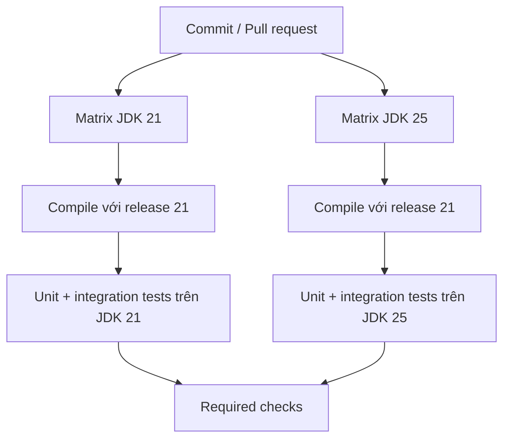
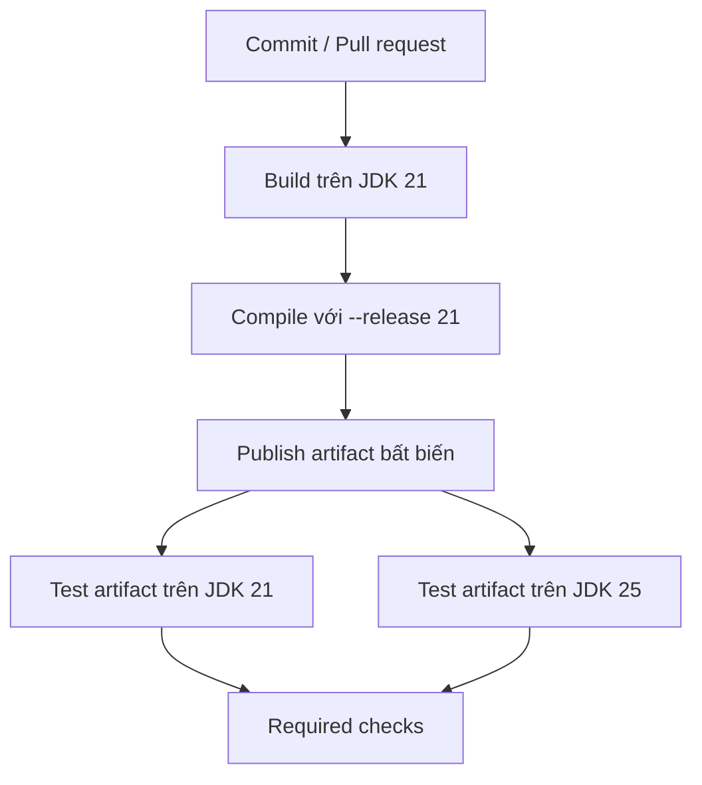

# Chạy ma trận CI với các runtime nằm trong phạm vi hỗ trợ

Một thư viện hoặc ứng dụng Java có thể cam kết chạy trên nhiều phiên bản JDK. Khi đó, CI cần kiểm tra code trên từng runtime mà dự án thực sự hỗ trợ. Một lần build thành công trên JDK 21 không chứng minh ứng dụng hoạt động đúng trên JDK mới hơn; ngược lại, chạy test trên JDK mới nhất cũng không chứng minh artifact còn chạy được trên runtime tối thiểu mà sản phẩm cam kết.

Ma trận CI tốt bắt đầu từ chính sách hỗ trợ runtime của dự án. Cần phân biệt JDK dùng để build, Java release mà source/API được phép sử dụng và JDK chạy test. Sau đó chọn cách kiểm thử phù hợp: build/test trên từng JDK, hoặc build một artifact cố định rồi chạy chính artifact đó trên mọi runtime được hỗ trợ. Cách thứ hai đặc biệt hữu ích để xác minh tính tương thích của cùng một binary.

## Mục tiêu học tập

Sau bài học, bạn có thể:

- Xác định runtime tối thiểu và tập JDK mà sản phẩm cam kết hỗ trợ.
- Phân biệt build JDK, `--release`, test runtime và production runtime.
- Thiết kế CI matrix để kiểm thử tất cả runtime bắt buộc.
- Phân biệt ma trận build/test từng JDK với mô hình build một lần, test nhiều runtime.
- Cấu hình Maven, Gradle và CI pipeline cho Java 21.
- Tránh vô tình biên dịch bằng API mới hơn runtime tối thiểu.
- Quản lý cache, artifact, test report và failure trong ma trận.
- Chọn kiểm thử pull request, nightly và release phù hợp với chi phí CI.
- Mở rộng hoặc loại bỏ runtime khỏi ma trận theo chính sách hỗ trợ có kiểm soát.

## 1. Xác định phạm vi runtime được hỗ trợ

Trước khi viết CI matrix, cần xác định sản phẩm hỗ trợ những runtime nào. Ma trận phản ánh cam kết tương thích của dự án, không phải danh sách tất cả JDK từng được phát hành.

Chính sách có thể quy định:

- Runtime tối thiểu mà ứng dụng hoặc thư viện phải chạy được.
- Các bản LTS được chứng nhận.
- Một số bản JDK khác nếu khách hàng hoặc môi trường triển khai yêu cầu.
- JDK vendor/build cụ thể nếu dự án phụ thuộc native library, provider hoặc hành vi đặc thù.
- Thời điểm bắt đầu và kết thúc hỗ trợ mỗi runtime.

Ví dụ, một ứng dụng dùng cú pháp và API Java 21 có thể công bố runtime tối thiểu là 21. Nếu chính sách hiện tại yêu cầu chứng nhận cả JDK 21 và 25, ma trận runtime có thể gồm `[21, 25]`. Đây chỉ là ví dụ; hãy dùng đúng tập phiên bản đã được dự án và dependency xác nhận hỗ trợ.

Không thêm một JDK vào ma trận chỉ vì phiên bản đó tồn tại. Một phiên bản đã hết hỗ trợ, không còn được dependency chính hỗ trợ hoặc nằm ngoài cam kết sản phẩm sẽ làm tăng chi phí CI mà không cải thiện cam kết tương thích hiện hành.

### 1.1. Runtime tối thiểu và runtime mới nhất được chứng nhận

Với thư viện, runtime tối thiểu thường là một phần của contract công khai. Người dùng cần biết artifact chạy được từ phiên bản Java nào. Với ứng dụng nội bộ, runtime tối thiểu có thể do platform hoặc môi trường production quy định.

Với code sử dụng tính năng Java 21:

- Pattern matching for `switch`, record patterns và virtual threads yêu cầu Java 21 trở lên.
- Class file Java 21 có major version 65.
- Runtime cũ hơn Java 21 không chạy được class file version 65.
- Khi compile bằng JDK mới hơn, `--release 21` giới hạn source/API và bytecode ở mức Java 21.

Vì vậy, nếu sản phẩm đã chọn Java 21 làm baseline source, không thêm JDK 17 vào runtime matrix với kỳ vọng cùng artifact sẽ chạy được. Muốn hỗ trợ runtime thấp hơn, phải giữ source/API trong phạm vi release thấp hơn hoặc duy trì một chiến lược source set/artifact riêng.

### 1.2. Ma trận runtime không đồng nghĩa ma trận vendor

Một chiều matrix thường là phiên bản JDK. Vendor là chiều riêng và chỉ nên thêm khi dự án cam kết hỗ trợ nhiều distribution hoặc có lý do kiểm thử cụ thể.

Ví dụ:

| Chiều kiểm thử | Ví dụ | Khi nên thêm |
|---|---|---|
| JDK version | 21, 25 | Sản phẩm hỗ trợ các runtime này |
| JDK vendor | Temurin, Oracle JDK, OpenJDK distribution khác | Có cam kết hoặc khác biệt provider/native cần xác minh |
| OS/architecture | Linux x64, Linux ARM64, Windows | Có artifact/native dependency hoặc môi trường triển khai tương ứng |
| Database/service | Các phiên bản được hỗ trợ | Integration contract cần xác minh tương thích |

Không nhân tất cả chiều thành một tích Descartes lớn nếu không có nhu cầu. Chọn các tổ hợp đại diện và ghi rõ tổ hợp nào là bắt buộc.

## 2. Phân biệt build JDK, compile release và test runtime

Ba khái niệm này cần được cấu hình riêng trong đầu:

| Khái niệm | Vai trò | Ví dụ |
|---|---|---|
| Build JDK | JDK chạy Maven/Gradle, compiler và plugin | JDK 21 |
| Compile release | Source level, bytecode và API Java SE được phép dùng | `--release 21` |
| Test runtime | JDK thực thi unit/integration test hoặc ứng dụng | JDK 21 và JDK 25 |
| Production runtime | JDK chạy artifact sau khi deploy | Một runtime đã được chứng nhận trong chính sách |

Build JDK có thể khác test runtime. Ví dụ, build một artifact trên JDK 21, đặt `--release 21`, sau đó chạy cùng artifact trên JDK 21 và JDK 25. Điều này kiểm tra binary Java 21 hoạt động trên cả runtime tối thiểu lẫn runtime mới hơn.

Nếu compile trên JDK 25 mà không đặt `--release`, compiler có thể cho phép dùng API chỉ tồn tại từ Java 25. Artifact đó sẽ không chạy trên Java 21 dù CI đã có job JDK 21 ở một bước khác. Luôn ràng buộc compile release theo runtime tối thiểu mà artifact cần hỗ trợ.

## 3. Hai kiểu ma trận CI chính

### 3.1. Build và test riêng trên từng JDK

Mỗi job chọn một JDK, chạy build và test trên cùng runtime đó:



Ưu điểm:

- Kiểm tra build tool và plugin trên từng JDK.
- Phát hiện khác biệt compiler/runtime có ảnh hưởng tới test.
- Dễ cấu hình với CI matrix tiêu chuẩn.

Hạn chế: mỗi job có thể tạo artifact khác nhau do compiler, plugin hoặc generated source khác nhau. Cách này xác nhận từng JDK có thể build và test project, nhưng không chứng minh một binary duy nhất chạy giống nhau trên mọi runtime.

### 3.2. Build một lần, test cùng artifact trên nhiều runtime

Một job build tạo artifact có bytecode/API mục tiêu cố định. Các job tiếp theo tải đúng artifact đó và chạy trên từng JDK:



Ưu điểm:

- Mọi runtime được kiểm tra trên cùng một binary.
- Dễ chứng minh artifact phát hành chính là artifact đã qua ma trận runtime.
- Giảm khả năng khác biệt do mỗi job build lại source.

Hạn chế: chỉ build trên một JDK nên không kiểm tra build tool/plugin trên các JDK còn lại. Có thể bổ sung một job build compatibility riêng trên runtime khác nếu đó là cam kết của dự án.

### 3.3. Kết hợp hai kiểu

Nhiều dự án dùng build-once/test-many làm đường kiểm tra tương thích bắt buộc, sau đó chạy một ma trận build bổ sung theo lịch nightly hoặc trước release để xác minh build tool trên các JDK được hỗ trợ.

Không nhất thiết chạy mọi phép thử nặng trên mọi tổ hợp. Hãy xác định rõ mục tiêu của từng job và giữ các runtime bắt buộc làm required check.

## 4. Cấu hình compile cho Java 21

Nếu Java 21 là runtime tối thiểu, cấu hình compiler release 21 dù compiler chạy trên JDK 21 hay JDK mới hơn.

### 4.1. `javac`

```bash
javac --release 21 -d build/classes src/main/java/com/example/Main.java
```

`--release 21` giới hạn:

- Cú pháp ngôn ngữ Java được phép.
- Phiên bản class file được sinh.
- API Java SE có thể tham chiếu trong quá trình compile.

Không nhầm `--release` với việc chọn runtime chạy test. Nó kiểm soát compile contract; CI vẫn cần chạy artifact trên các runtime được hỗ trợ.

### 4.2. Maven

Trong `pom.xml`:

```xml
<properties>
    <maven.compiler.release>21</maven.compiler.release>
</properties>
```

Chạy build:

```bash
./mvnw -B -ntp clean verify
```

Đảm bảo Maven Wrapper, Maven Compiler Plugin, Surefire và Failsafe có phiên bản hỗ trợ JDK trong ma trận. Nếu dùng Maven Toolchains, cấu hình JDK compiler một cách rõ ràng; đừng giả định `JAVA_HOME` của process Maven cũng là compiler JDK được chọn khi toolchain được bật.

Khi job chạy Maven trên từng JDK, kiểm tra cả:

- JDK đang chạy Maven.
- JDK compiler được Toolchains chọn (nếu có).
- JDK mà Surefire/Failsafe dùng để fork test process.

Các giá trị này có thể khác nhau. In `mvn -version`, thông tin toolchain và `java -version` trong CI để phát hiện cấu hình không như dự định.

### 4.3. Gradle

Đặt compile release rõ ràng:

```kotlin
java {
    toolchain {
        languageVersion = JavaLanguageVersion.of(21)
    }
}

tasks.withType<JavaCompile>().configureEach {
    options.release = 21
}
```

Cấu hình trên cố định toolchain compile ở JDK 21. Gradle Java plugin thường cũng dùng toolchain cho test launcher; vì vậy nếu muốn chạy test trên JDK khác, cần cấu hình `Test.javaLauncher` riêng hoặc dùng một cấu hình toolchain theo job.

Ví dụ chọn runtime test qua Gradle property trong khi vẫn compile với release 21:

```kotlin
val testRuntime = providers.gradleProperty("testRuntime")
    .map { JavaLanguageVersion.of(it.toInt()) }
    .orElse(JavaLanguageVersion.of(21))

tasks.withType<Test>().configureEach {
    javaLauncher = javaToolchains.launcherFor {
        languageVersion = testRuntime.get()
    }
}
```

Job JDK 25 có thể gọi:

```bash
./gradlew clean test -PtestRuntime=25
```

Trong ví dụ, compiler vẫn dùng toolchain 21 và test JVM dùng launcher được chọn. Đảm bảo các JDK cần thiết được cài đặt hoặc CI có cấu hình toolchain download phù hợp. Nếu dự án muốn build/test hoàn toàn trên từng JDK, có thể chọn toolchain theo property của job và vẫn giữ `options.release = 21`.

## 5. Ví dụ ma trận runtime trong CI

Ví dụ YAML pseudocode dưới đây minh họa cấu trúc matrix cho JDK 21 và 25; đây không phải workflow có thể chạy nguyên trạng. Các bước checkout và cài JDK được viết khái quát, cần thay bằng action/task tương ứng với nền tảng CI của dự án và phiên bản action đang được duy trì.

```yaml
jobs:
  build-and-test:
    strategy:
      fail-fast: false
      matrix:
        java: [21, 25]

    steps:
      - checkout source
      - setup JDK: ${{ matrix.java }}
      - run: java -version
      - run: ./mvnw -B -ntp clean verify
```

`fail-fast: false` cho phép các job còn lại tiếp tục để thu thập kết quả của mọi runtime khi một job thất bại. Với runtime bắt buộc, job phải làm CI check thất bại nếu test không đạt.

### 5.1. Ma trận build-once/test-many

Ví dụ workflow khái quát:

```yaml
jobs:
  build:
    runs-on: linux
    steps:
      - checkout source
      - setup JDK: 21
      - run: ./mvnw -B -ntp clean verify
      - upload artifact: application.jar

  runtime-test:
    needs: build
    strategy:
      fail-fast: false
      matrix:
        java: [21, 25]
    steps:
      - download artifact: application.jar
      - setup JDK: ${{ matrix.java }}
      - run: java -version
      - run: ./ci/smoke-test.sh application.jar
```

`smoke-test.sh` là script thuộc dự án: khởi chạy artifact, đợi readiness, gọi các luồng kiểm tra và dừng process có kiểm soát. Đây là ví dụ cho runtime smoke test. Nếu cần chạy unit/integration suite trên mọi runtime mà vẫn giữ mô hình build-once, build job có thể đóng gói cả test classes/test harness; runtime job chạy chính test bundle đó trên artifact đã build. Với Maven, cần cấu hình Surefire/Failsafe fork test JVM theo runtime matrix trong khi giữ compiler/toolchain và `--release` cố định. Điểm quan trọng là không compile lại application source trong runtime job.

Nếu artifact là container image, build image một lần, push vào registry của CI và truyền digest bất biến cho các runtime job. Không dùng tag có thể bị ghi đè như `latest` làm bằng chứng rằng các job đã test cùng một image.

### 5.2. Ma trận runtime bắt buộc và runtime thử nghiệm

Runtime trong support policy phải là required checks. Một JDK mới đang đánh giá có thể được đưa vào job thử nghiệm riêng:

```yaml
strategy:
  fail-fast: false
  matrix:
    include:
      - java: 21
        required: true
      - java: 25
        required: true
      - java: 26
        required: false
```

Ví dụ trên chỉ minh họa cách biểu diễn. Trường `required` là metadata để workflow sử dụng, CI không tự hiểu trường này; cần ánh xạ nó vào điều kiện job hoặc chính sách required check của nền tảng. Chỉ thêm runtime thử nghiệm khi có lý do và đã kiểm tra release/JDK support; không để job thử nghiệm được phép thất bại làm mất tín hiệu của runtime bắt buộc. Với phiên bản thử nghiệm, có thể dùng `continue-on-error` có chủ đích và theo dõi riêng, nhưng không áp dụng cho runtime đã cam kết hỗ trợ.

## 6. Chọn test phù hợp cho từng runtime

Không phải job nào cũng cần chạy toàn bộ test nặng. Hãy chia theo mục tiêu:

| Loại test | Mục tiêu | Ma trận nên chạy |
|---|---|---|
| Compile/API compatibility | Source chỉ dùng API của release mục tiêu | Build job với `--release` cố định |
| Unit test | Hành vi logic trên runtime | Mọi runtime bắt buộc hoặc build-once/test-many |
| Integration test | Driver, TLS, database, broker và framework | Mọi runtime được chứng nhận; có thể chọn tập đại diện ở PR |
| Smoke test artifact | Binary/container khởi động và xử lý luồng chính | Cùng artifact trên mọi runtime |
| Performance test | Throughput, latency, GC và resource | Nightly/release trên runtime mục tiêu, cùng workload |
| Security test | TLS, provider, serialization và agent | Các runtime/vendor triển khai thực tế |
| Native compatibility | JNI/JNA và native dependency | Theo OS/architecture/vendor được hỗ trợ |

Test phải thực sự chạy bằng runtime đang được ghi ở matrix. Chỉ đổi `JAVA_HOME` nhưng test runner, daemon hoặc container con vẫn dùng JDK khác thì ma trận không có giá trị.

## 7. Quản lý build cache và artifact

Cache giúp giảm thời gian CI nhưng có thể che lỗi nếu key không phản ánh môi trường hoặc thay đổi dependency.

### 7.1. Cache dependency, không dùng cache thay cho artifact contract

Cache Maven/Gradle dependency có thể chia sẻ giữa job nếu tool và dependency tương thích. Key cache nên xét các yếu tố như:

- Hệ điều hành và kiến trúc khi cache có dữ liệu phụ thuộc nền tảng.
- JDK hoặc toolchain nếu cache chứa output phụ thuộc compiler/runtime.
- Maven/Gradle wrapper và cấu hình build.
- Lockfile, dependency constraints hoặc file khai báo dependency.
- Phiên bản compiler/plugin và build options.

Không cache `build/`, `target/` hoặc output compile giữa các JDK một cách mù quáng. Nếu cache output, phải đảm bảo key chứa mọi đầu vào ảnh hưởng đến bytecode và generated source.

### 7.2. Giữ artifact bất biến

Với build-once/test-many:

- Upload artifact một lần sau build.
- Dùng cùng file hoặc cùng image digest trong mọi runtime job.
- Lưu checksum/digest để đối chiếu khi cần.
- Không tải lại dependency rồi build lại trong runtime test job.
- Lưu test report gắn với JDK đã chạy.

Với build matrix từng JDK, ghi nhận JDK/compiler và checksum của artifact từng job. Không giả định artifact từ hai compiler job là cùng một binary.

### 7.3. Dependency resolution ổn định

Giữ dependency version có thể tái lập bằng lockfile hoặc cơ chế quản lý dependency tương ứng. Nếu dependency thay đổi giữa hai job, kết quả matrix không còn so sánh cùng đầu vào. Với Gradle, dùng dependency locking/verification khi phù hợp; với Maven, quản lý version và repository policy nhất quán.

## 8. Quản lý failure và required checks

Một matrix có thể có nhiều job chạy song song. Cần phân biệt lỗi thật của runtime bắt buộc với lỗi hạ tầng hoặc job thử nghiệm.

- Runtime bắt buộc: test thất bại phải làm pull request không đạt.
- Runtime đang đánh giá: kết quả được báo riêng, không tự động thay thế runtime bắt buộc.
- Lỗi runner/registry/network: phân loại là lỗi hạ tầng, retry theo chính sách CI và giữ log.
- Test flaky: điều tra và sửa nguyên nhân; không dùng retry vô hạn để biến test đỏ thành xanh.
- Một runtime thất bại: `fail-fast: false` giúp các runtime còn lại vẫn trả kết quả hữu ích.

Đặt tên job có cả mục tiêu và runtime, ví dụ `unit-tests-jdk21`, `unit-tests-jdk25`, `artifact-smoke-jdk21`. Điều này giúp reviewer và branch protection hiểu check nào bắt buộc.

Không đặt `continue-on-error` cho toàn bộ matrix nếu runtime trong đó là cam kết hỗ trợ. Làm vậy có thể khiến CI xanh dù một phần contract đã hỏng.

## 9. Tối ưu chi phí CI mà không bỏ sót runtime

Ma trận đầy đủ trên mọi pull request có thể tốn thời gian. Có thể chia tầng:

### Pull request

- Compile với release tối thiểu được hỗ trợ.
- Unit test trên runtime tối thiểu và runtime mới nhất được chứng nhận.
- Smoke test artifact trên các runtime bắt buộc.
- Integration test quan trọng theo tập dịch vụ đại diện.

### Nightly

- Chạy toàn bộ integration/contract suite trên mọi runtime bắt buộc.
- Chạy thêm vendor/OS/architecture matrix nếu dự án hỗ trợ.
- Kiểm tra dependency update và build reproducibility.
- Chạy test stress/soak có thời lượng dài.

### Trước release

- Chạy full matrix trên đúng artifact dự kiến phát hành.
- Chạy security, performance và native compatibility test.
- Lưu checksum, test report và runtime metadata.
- Xác nhận tất cả required runtime đều đạt.

Không bỏ runtime tối thiểu khỏi PR chỉ vì job chậm nếu thay đổi có thể ảnh hưởng binary compatibility. Có thể tối ưu bằng cache, test selection hoặc tách integration suite sang nightly, nhưng vẫn cần required smoke/unit check cho từng runtime được cam kết.

## 10. Đo và ghi nhận runtime thực tế trong job

Mỗi job nên in thông tin runtime để log có thể kiểm tra được:

```bash
java -version
./mvnw -version
```

Với Gradle:

```bash
./gradlew --version
./gradlew -q javaToolchains
```

Lệnh `java -version` xác nhận Java trên PATH. `mvn -version`/`gradle --version` giúp xác định JVM chạy build tool. Nếu dùng toolchain hoặc test fork riêng, hãy in thêm compiler/test launcher thực tế trong task hoặc build log.

Có thể ghi metadata vào test report:

- `java.version` và `java.vendor`.
- `os.name`, `os.arch`.
- Compile release và compiler version.
- JDK test launcher.
- Build ID, commit SHA và artifact digest.

Tránh chỉ ghi một nhãn `JDK 21` mà không lưu vendor/build. Bản cập nhật bảo mật hoặc vendor patch có thể tạo khác biệt quan trọng trong môi trường production.

## 11. Kiểm tra API và bytecode compatibility

### 11.1. Dùng `--release` đúng mục tiêu

Nếu Java 21 là runtime tối thiểu:

```bash
javac --release 21 ...
```

Nếu compile bằng JDK 25 mà không có `--release 21`, compiler có thể cho phép API mới hơn và tạo artifact không còn chạy trên JDK 21. Việc test job JDK 21 có thể phát hiện lỗi linkage/runtime, nhưng compile contract rõ ràng vẫn là lớp bảo vệ sớm hơn.

### 11.2. Dependency cũng phải hỗ trợ runtime tối thiểu

`--release` chỉ ràng buộc API Java SE khi compile source của dự án. Nó không đảm bảo mọi dependency đã tải về đều có bytecode/API tương thích với runtime tối thiểu. Kiểm tra:

- Class file version của dependency.
- API JDK mà dependency gọi.
- Multi-release JAR và lựa chọn class theo runtime.
- Native library theo OS/architecture.
- Reflection/JDK internals và module access.
- Agent hoặc plugin cần runtime JDK riêng.

Chạy integration test trên runtime tối thiểu là cách quan trọng để phát hiện `UnsupportedClassVersionError`, `NoSuchMethodError`, `NoClassDefFoundError`, `IllegalAccessError` và lỗi provider/native.

### 11.3. Multi-release JAR

Thư viện có thể phát hành multi-release JAR với implementation khác nhau theo phiên bản Java. Nếu dự án dùng loại artifact này, chạy test trên từng runtime để xác minh đúng class variant được chọn. Không chỉ kiểm tra bytecode của class ở thư mục gốc.

## 12. Matrix cho ứng dụng và thư viện có mục tiêu khác nhau

| Loại dự án | Điều cần chứng minh |
|---|---|
| Ứng dụng triển khai trên một runtime | Runtime production được chứng nhận và runtime nâng cấp tiếp theo nếu có kế hoạch |
| Ứng dụng hỗ trợ nhiều runtime | Cùng artifact hoặc từng artifact theo contract chạy trên mọi runtime đã công bố |
| Thư viện Java | Bytecode/API tương thích với runtime tối thiểu và test trên các runtime hỗ trợ |
| Plugin/agent | Có thể nạp và hoạt động trên từng JVM/vendor được hỗ trợ |
| Native/JNI application | JDK, OS, architecture và native binary khớp nhau |

Thư viện thường cần đặc biệt chú ý `--release` và runtime tối thiểu vì người dùng có thể tích hợp nó vào ứng dụng với JDK khác. Ứng dụng nội bộ có thể tập trung vào runtime production và runtime nâng cấp tiếp theo.

## 13. Mở rộng và thu hẹp ma trận theo vòng đời hỗ trợ

Support matrix cần được duy trì như một phần của chính sách phát hành:

1. Xác định runtime mới được đề xuất hỗ trợ và kiểm tra dependency/tooling.
2. Thêm job thử nghiệm để thu thập lỗi mà chưa thay đổi contract.
3. Chạy full suite và performance test trên runtime mới.
4. Cập nhật tài liệu support policy và deployment image.
5. Chuyển job thành required check khi chính thức cam kết hỗ trợ.
6. Khi ngừng hỗ trợ runtime cũ, thông báo trước, cập nhật release notes và loại bỏ job sau thời điểm chính sách có hiệu lực.

Không bỏ runtime khỏi matrix chỉ vì một job thường xuyên đỏ. Cần xác định đó là lỗi sản phẩm, dependency, môi trường hay runtime đã được chính sách ngừng hỗ trợ.

## 14. Checklist thiết kế CI matrix

- Công bố runtime tối thiểu và danh sách JDK được hỗ trợ.
- Chỉ đưa vào matrix những runtime còn nằm trong support policy.
- Phân biệt build JDK, compile release, test runtime và production runtime.
- Dùng `--release` tương ứng với runtime tối thiểu mà source/API cam kết.
- Chọn build/test từng JDK hoặc build-once/test-many theo mục tiêu rõ ràng.
- Nếu build-once/test-many, dùng cùng artifact/image digest trong mọi job.
- Đảm bảo test process thực sự chạy bằng JDK được ghi ở matrix.
- Kiểm tra Maven/Gradle wrapper, compiler, Surefire/Failsafe và plugin hỗ trợ JDK matrix.
- Dùng `fail-fast: false` khi cần kết quả của mọi runtime; giữ runtime bắt buộc làm required checks.
- Chỉ dùng continue-on-error cho runtime thử nghiệm có chủ đích.
- Cache dependency có key phù hợp; không tái sử dụng compile output sai runtime.
- Ghi JDK vendor/build, OS/architecture, commit SHA và artifact digest.
- Chạy unit/smoke trên pull request; full integration/performance theo lịch và trước release.
- Kiểm tra dependency bytecode, JDK API, multi-release JAR và native library.
- Cập nhật ma trận khi support policy thay đổi và thông báo rõ thời điểm bỏ runtime.

## 15. Nguyên tắc thiết kế

- Ma trận CI phải phản ánh runtime mà sản phẩm thực sự cam kết hỗ trợ.
- Java release kiểm soát API/bytecode; test matrix xác minh hành vi trên runtime.
- Với Java 21 làm baseline, compile bằng `--release 21` và test trên các JDK từ 21 trở lên đã được chứng nhận.
- Build/test từng JDK giúp kiểm tra toolchain; build một lần/test nhiều runtime giúp kiểm tra cùng một binary.
- Không để job thử nghiệm che khuất lỗi của runtime bắt buộc.
- Không để cache làm các job vô tình dùng output compile hoặc artifact khác nhau.
- Giữ ma trận nhỏ, có chủ đích và cập nhật theo vòng đời hỗ trợ.
- Lưu lại runtime thực tế, test report và digest để kết quả CI có thể kiểm chứng.

CI matrix không phải danh sách JDK dài nhất có thể chạy. Nó là cách kiểm chứng contract tương thích đã công bố. Khi tách rõ compiler release và runtime test, dùng đúng artifact, đồng thời đặt required checks theo support policy, nhóm phát triển có thể nâng JDK và phát hành Java 21 với bằng chứng đáng tin cậy trên từng môi trường được hỗ trợ.

## Tài liệu tham khảo

- [Oracle — Java SE 21 `javac` Command](https://docs.oracle.com/en/java/javase/21/docs/specs/man/javac.html): `--release`, source level và bytecode target.
- [Oracle — Java SE 21 Migration Guide](https://docs.oracle.com/en/java/javase/21/migrate/): thay đổi cần kiểm tra khi chuyển runtime lên Java 21.
- [Maven Compiler Plugin — Setting the `--release` of the Java Compiler](https://maven.apache.org/plugins/maven-compiler-plugin/examples/set-compiler-release.html): cấu hình release cho Maven compilation.
- [Maven Toolchains Guide](https://maven.apache.org/guides/mini/guide-using-toolchains.html): chọn JDK toolchain cho build Maven.
- [Gradle — Java Toolchains](https://docs.gradle.org/current/userguide/toolchains.html): cấu hình JDK cho compile và test task.
- [Gradle — Testing in Java Projects](https://docs.gradle.org/current/userguide/java_testing.html): cấu hình test task và Java launcher.
- [GitHub Actions — Running Variations of Jobs in a Workflow](https://docs.github.com/en/actions/using-jobs/using-a-matrix-for-your-jobs): matrix strategy, include/exclude và fail-fast.
- [JEP 223 — New Version-String Scheme](https://openjdk.org/jeps/223): quy tắc version string của Java hiện đại.
