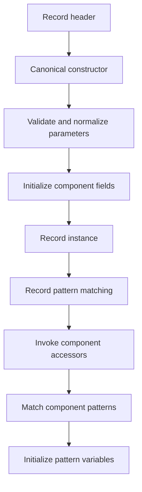

# Thành phần record, accessor và constructor ảnh hưởng đến deconstruction

Trong Java 21, record pattern cho phép tách một đối tượng `record` thành các giá trị thành phần ngay trong biểu thức kiểm tra kiểu hoặc `switch`. Quá trình này thường được gọi là *deconstruction* (phân rã dữ liệu). Kết quả phân rã phụ thuộc trực tiếp vào cấu trúc record và các accessor của nó. Constructor quyết định dữ liệu được xác thực, chuẩn hóa và lưu vào đối tượng khi tạo; accessor quyết định giá trị mà record pattern đọc ra khi phân rã.

Record pattern đã là tính năng chính thức từ Java 21, không cần bật preview. Bài viết tập trung vào ngữ nghĩa hiện hành của Java 21, đặc biệt là mối quan hệ giữa record component, canonical constructor, accessor và record pattern.

## 1. Record component xác định cấu trúc dữ liệu

Khai báo record đặt các thành phần dữ liệu trong phần header:

```java
record Point(int x, int y) {}
```

Với mỗi component, Java tạo một component field `private final` và một accessor method `public` không có tham số, cùng tên và kiểu trả về với component. Record cũng có canonical constructor với danh sách tham số tương ứng header, cùng các triển khai mặc định cho `equals`, `hashCode` và `toString` nếu lập trình viên không tự khai báo các phương thức đó.

Ví dụ trên tương đương về cấu trúc với một record có hai component `x` và `y`. Có thể đọc giá trị bằng `point.x()` và `point.y()`. Không thể truy cập trực tiếp các component field từ bên ngoài vì chúng là `private`.

Một record pattern sử dụng chính thứ tự và số lượng component trong header:

```java
record Point(int x, int y) {}

static void printPoint(Object value) {
    if (value instanceof Point(int x, int y)) {
        System.out.println("x=" + x + ", y=" + y);
    }
}
```

`Point(int x, int y)` kiểm tra giá trị có thể được xem là `Point` hay không, sau đó lấy hai component để khởi tạo biến mẫu `x` và `y`. Số lượng component trong record pattern phải bằng số lượng component của record; sai số lượng là lỗi biên dịch. Thứ tự các pattern component cũng tương ứng thứ tự khai báo trong record header.

Có thể dùng `var` để trình biên dịch suy luận kiểu component:

```java
if (value instanceof Point(var x, var y)) {
    System.out.println(x + y);
}
```

Record pattern có thể lồng nhau để phân rã cấu trúc nhiều tầng:

```java
record Address(String city, String country) {}
record Customer(String name, Address address) {}

static void printCustomer(Object value) {
    if (value instanceof Customer(
            var name,
            Address(var city, var country))) {
        System.out.println(name + " lives in " + city + ", " + country);
    }
}
```

Trong ví dụ, pattern ngoài đọc hai component của `Customer`; pattern lồng tiếp tục phân rã `Address`. Nếu giá trị được kiểm tra là `null`, record pattern không khớp. Tương tự, nếu component `address` là `null`, record pattern `Address(...)` lồng bên trong cũng không khớp.

## 2. Accessor là điểm đọc dữ liệu khi deconstruction

Khi khớp một record pattern, Java gọi accessor tương ứng với từng component để lấy giá trị. Việc phân rã không đọc trực tiếp component field. Nếu accessor được trình biên dịch tạo ngầm định, accessor trả về giá trị của component field tương ứng.

```java
record Product(String code, int quantity) {}

Product product = new Product("BK-21", 4);

if (product instanceof Product(String code, int quantity)) {
    System.out.println(code);      // BK-21
    System.out.println(quantity);  // 4
}
```

Ở đây, `Product::code()` và `Product::quantity()` là các accessor ngầm định. Record pattern gọi chúng để lấy `code` và `quantity`.

Record cho phép khai báo accessor tường minh. Accessor tường minh phải là phương thức instance `public`, không có tham số, không có mệnh đề `throws`, không generic và có kiểu trả về đúng bằng kiểu component. Trình biên dịch kiểm tra các ràng buộc về chữ ký, nhưng không thể bảo đảm thân phương thức trả về đúng giá trị component field.

Ví dụ sau hợp lệ về mặt cú pháp nhưng làm thay đổi dữ liệu mà deconstruction quan sát được:

```java
record Score(int value) {
    public int value() {
        return Math.max(0, this.value);
    }
}

Score score = new Score(-5);

if (score instanceof Score(int value)) {
    System.out.println(value); // 0
}
```

Component field của `score` vẫn chứa `-5`, nhưng accessor trả về `0`; record pattern nhận được `0`. Đây là khác biệt quan trọng: record pattern lấy dữ liệu thông qua accessor, không lấy trực tiếp giá trị được lưu trong field.

### Accessor phải giữ invariant của record

Java quy định record nên bảo đảm invariant sao chép: nếu `r` là một record không `null`, tạo bản sao bằng cách truyền các giá trị accessor vào canonical constructor:

```java
R copy = new R(r.c1(), r.c2(), ..., r.cn());
```

thì `r.equals(copy)` phải là `true`. Accessor và `equals` được khai báo tường minh cần tôn trọng invariant này. Trình biên dịch không thể kiểm tra đầy đủ điều đó.

Trong ví dụ `Score` ở trên, `new Score(-5)` có component field `value = -5`, còn accessor trả về `0`. Khi tạo bản sao bằng `new Score(score.value())`, đối tượng mới lưu `0`; hai record không còn bằng nhau. Một accessor làm biến đổi giá trị theo cách này khiến kết quả deconstruction không phản ánh dữ liệu component theo cách nhất quán và có thể gây lỗi cho mã sử dụng record.

Vì vậy, accessor thông thường nên trả về đúng component field, không thay đổi trạng thái, không phụ thuộc thời điểm gọi và không thực hiện tác dụng phụ. Nếu cần chuẩn hóa dữ liệu, hãy thực hiện tại constructor để giá trị lưu trong component field đã là giá trị chuẩn.

### Accessor có thể làm pattern matching kết thúc bất thường

Accessor tường minh có thể ném unchecked exception hoặc error trong lúc thực thi. Theo quy tắc pattern matching của Java 21, nếu lời gọi accessor kết thúc bất thường vì một nguyên nhân `S`, quá trình khớp pattern kết thúc bất thường bằng cách ném `MatchException` có `S` làm nguyên nhân (`cause`). Đây không phải trường hợp đơn giản là pattern không khớp.

```java
record Reading(int value) {
    public int value() {
        if (this.value < 0) {
            throw new IllegalStateException("Negative reading");
        }
        return this.value;
    }
}

Object input = new Reading(-1);

if (input instanceof Reading(int value)) {
    System.out.println(value);
}
```

Khi kiểm tra đối tượng trên, accessor ném `IllegalStateException`; thao tác khớp record pattern kết thúc bằng `MatchException` có exception đó làm cause. Do đó, không nên đặt kiểm tra nghiệp vụ có thể thất bại hoặc logic phụ thuộc môi trường trong accessor. Hãy bảo đảm invariant khi tạo record và để accessor có hành vi đọc đơn giản, ổn định.

## 3. Canonical constructor xác thực và chuẩn hóa dữ liệu trước khi phân rã

Mỗi record có canonical constructor. Nếu không khai báo constructor này, trình biên dịch tạo một constructor có danh sách tham số cùng thứ tự, tên và kiểu với các component trong header. Constructor ngầm định gán từng tham số vào component field tương ứng.

Khi cần xác thực hoặc chuẩn hóa dữ liệu, có thể khai báo canonical constructor tường minh. Java hỗ trợ hai cách: canonical constructor thông thường và compact canonical constructor.

### Canonical constructor thông thường

Constructor thông thường khai báo đầy đủ danh sách tham số tương ứng với record header và tự gán giá trị vào component field:

```java
record User(String name, int age) {
    public User(String name, int age) {
        this.name = java.util.Objects.requireNonNull(name).trim();
        if (age < 0) {
            throw new IllegalArgumentException("age must be non-negative");
        }
        this.age = age;
    }
}
```

Khi tạo `new User("  An  ", 20)`, component field `name` lưu giá trị đã bỏ khoảng trắng ở hai đầu. Khi record pattern phân rã đối tượng này, accessor `name()` trả về `"An"`. Constructor đã thiết lập dữ liệu chuẩn trước khi đối tượng được sử dụng.

Canonical constructor tường minh phải có quyền truy cập ít nhất bằng quyền truy cập của record. Danh sách tham số và kiểu của chúng phải tương ứng với các component theo đúng thứ tự. Constructor này không được khai báo generic, không có mệnh đề `throws` và không chứa lời gọi constructor tường minh `this(...)` hoặc `super(...)`.

### Compact canonical constructor

Compact constructor là cách viết ngắn hơn, không cần lặp lại danh sách tham số. Các tham số được khai báo ngầm định theo record header. Trong thân constructor, có thể kiểm tra hoặc gán lại tham số để chuẩn hóa dữ liệu. Sau khi thân constructor kết thúc bình thường, trình biên dịch tự gán các tham số vào component field tương ứng.

```java
record User(String name, int age) {
    User {
        name = java.util.Objects.requireNonNull(name).trim();
        if (age < 0) {
            throw new IllegalArgumentException("age must be non-negative");
        }
    }
}
```

Trong compact constructor, tên `name` và `age` chỉ các tham số ngầm định. Gán `name = ...` cập nhật giá trị tham số trước khi compiler tự gán vào field. Không được gán trực tiếp `this.name = ...` hoặc `this.age = ...` trong compact constructor. Cũng không được dùng `return` để thoát khỏi thân compact constructor.

Nếu validation thất bại và constructor ném exception, đối tượng record không được tạo thành công; vì thế không có instance không hợp lệ để deconstruction tiếp tục sử dụng.

### Constructor bổ sung

Record có thể khai báo constructor khác canonical constructor, chẳng hạn constructor nhận ít tham số hơn để cung cấp giá trị mặc định. Constructor bổ sung phải bắt đầu bằng lời gọi một constructor khác của cùng record thông qua `this(...)`; cuối cùng, việc khởi tạo vẫn đi qua canonical constructor.

```java
record User(String name, int age) {
    User {
        name = java.util.Objects.requireNonNull(name).trim();
        if (age < 0) {
            throw new IllegalArgumentException("age must be non-negative");
        }
    }

    User(String name) {
        this(name, 0);
    }
}
```

Nhờ vậy, quy tắc xác thực và chuẩn hóa tập trung trong canonical constructor, bất kể đối tượng được tạo qua constructor nào.

## 4. Constructor và accessor phối hợp để giữ dữ liệu nhất quán

Hai thành phần có vai trò khác nhau:

| Thành phần | Thời điểm hoạt động | Vai trò với deconstruction |
|---|---|---|
| Record header | Khi khai báo kiểu | Xác định tên, kiểu, số lượng và thứ tự component |
| Canonical constructor | Khi tạo instance | Xác thực, chuẩn hóa và lưu giá trị vào component field |
| Accessor | Khi đọc component hoặc khớp record pattern | Cung cấp giá trị được đọc cho mỗi component |
| Record pattern | Khi kiểm tra một giá trị | Gọi accessor và kiểm tra đệ quy các component pattern |

Có thể hình dung luồng xử lý như sau:



Constructor không được gọi lại khi record pattern phân rã một instance đã tồn tại. Pattern matching đọc các component thông qua accessor. Vì vậy, việc constructor chuẩn hóa dữ liệu chỉ bảo đảm kết quả phân rã đúng với giá trị đã lưu khi accessor cũng giữ invariant.

### Ví dụ chuẩn hóa và phân rã

```java
record Money(String currency, long minorUnits) {
    Money {
        currency = java.util.Objects.requireNonNull(currency)
                .trim()
                .toUpperCase(java.util.Locale.ROOT);
        if (currency.length() != 3) {
            throw new IllegalArgumentException("Invalid currency code");
        }
        if (minorUnits < 0) {
            throw new IllegalArgumentException("Amount must be non-negative");
        }
    }
}

static void printMoney(Object value) {
    if (value instanceof Money(var currency, var minorUnits)) {
        System.out.println(currency + " " + minorUnits);
    }
}

Money money = new Money(" usd ", 1250);
printMoney(money); // USD 1250
```

Constructor lưu mã tiền tệ đã chuẩn hóa thành `USD`. Accessor ngầm định trả lại giá trị đã lưu và record pattern nhận cùng giá trị đó. Nếu mã tiền tệ không hợp lệ hoặc số tiền âm, constructor từ chối tạo đối tượng.

## 5. Component mutable và defensive copy

Record có component field `final`, nhưng điều đó chỉ ngăn gán lại tham chiếu trong field. Nó không tự làm cho đối tượng được tham chiếu trở nên bất biến. Ví dụ, nếu component là `List`, một danh sách có thể bị thay đổi sau khi record được tạo; khi đó dữ liệu mà accessor và record pattern đọc có thể thay đổi theo.

Có thể dùng canonical constructor để tạo bản sao bất biến:

```java
import java.util.List;
import java.util.Objects;

record Order(List<String> items) {
    Order {
        items = List.copyOf(Objects.requireNonNull(items));
    }
}

List<String> source = new java.util.ArrayList<>();
source.add("book");

Order order = new Order(source);
source.add("pen");

if (order instanceof Order(var items)) {
    System.out.println(items); // [book]
}
```

`List.copyOf` tạo danh sách không thể sửa đổi từ nội dung đầu vào. Thay đổi danh sách `source` sau khi tạo `Order` không làm thay đổi component đã lưu. Accessor mặc định trả về tham chiếu tới danh sách bất biến đó, nên deconstruction quan sát cùng dữ liệu ổn định.

Nếu component chứa mảng hoặc đối tượng mutable khác, cần cân nhắc defensive copy cả khi nhận dữ liệu lẫn khi trả dữ liệu qua accessor. Nếu accessor trả ra tham chiếu mutable nội bộ, mã bên ngoài có thể sửa nội dung sau khi deconstruction hoặc qua lời gọi accessor thông thường. Khi thiết kế accessor trả bản sao, cần đồng thời xem xét invariant sao chép của record và ngữ nghĩa `equals`/`hashCode` mặc định.

## 6. equals, hashCode và toString không đọc qua accessor

Một điểm dễ gây nhầm lẫn là record pattern gọi accessor, trong khi các triển khai mặc định của `equals`, `hashCode` và `toString` dựa trực tiếp trên component field. Vì vậy, nếu accessor tường minh trả về giá trị khác field, kết quả pattern matching có thể không giống những gì lập trình viên suy ra từ `equals` hoặc `toString`.

```java
record LimitedValue(int value) {
    public int value() {
        return Math.min(this.value, 100);
    }
}

LimitedValue original = new LimitedValue(150);

System.out.println(original); // LimitedValue[value=150]

if (original instanceof LimitedValue(int value)) {
    System.out.println(value); // 100
}

LimitedValue copy = new LimitedValue(original.value());
System.out.println(original.equals(copy)); // false
```

`toString()` mặc định hiển thị field `150`, còn accessor và record pattern trả về `100`. Bản sao tạo từ accessor lưu `100`, do đó không bằng đối tượng gốc lưu `150`. Đây là lý do nên tránh accessor làm biến đổi giá trị component.

## 7. Các điểm cần kiểm tra khi thiết kế record cho deconstruction

Khi tạo hoặc sửa record được sử dụng trong record pattern, hãy kiểm tra các điểm sau:

1. **Header ổn định:** tên, kiểu, số lượng và thứ tự component thể hiện đúng cấu trúc dữ liệu mà bên gọi cần phân rã.
2. **Constructor bảo vệ invariant:** xác thực giá trị bắt buộc và chuẩn hóa dữ liệu ngay trong canonical constructor; dùng compact constructor khi chỉ cần kiểm tra hoặc điều chỉnh tham số.
3. **Mọi constructor đi qua canonical constructor:** constructor bổ sung phải ủy quyền bằng `this(...)` để không bỏ qua quy tắc khởi tạo chung.
4. **Accessor có tính quan sát ổn định:** ưu tiên accessor ngầm định hoặc accessor tường minh trả về component field; tránh tác dụng phụ, kết quả phụ thuộc thời điểm và exception không cần thiết.
5. **Dữ liệu mutable được bảo vệ:** dùng defensive copy phù hợp cho collection, mảng hoặc đối tượng có thể thay đổi từ bên ngoài.
6. **Kiểm tra pattern lồng nhau và null:** record pattern không khớp với `null`; các component lồng nhau cũng cần được kiểm tra theo kiểu pattern tương ứng.
7. **Kiểm tra hành vi sao chép:** bảo đảm `r.equals(new R(r.c1(), ..., r.cn()))` vẫn đúng với accessor và `equals` được khai báo tường minh.

Nếu accessor ném exception, hãy kiểm tra cách ứng dụng xử lý `MatchException` và nguyên nhân gốc. Trong thiết kế thông thường, dữ liệu không hợp lệ nên bị từ chối lúc tạo record thay vì đợi đến khi một nơi khác phân rã record mới phát hiện.

## Kết luận

Trong Java 21, record pattern phân rã record bằng cách gọi accessor của từng component. Canonical constructor quyết định dữ liệu được xác thực và lưu trữ; accessor quyết định giá trị được đọc ra khi matching. Muốn deconstruction có kết quả dự đoán được, hãy đặt invariant và chuẩn hóa trong constructor, bảo vệ component mutable, và giữ accessor nhất quán với component field cùng invariant sao chép của record.

## Tài liệu tham khảo

- [Java Language Specification, Java SE 21 — Record Classes (§8.10)](https://docs.oracle.com/javase/specs/jls/se21/html/jls-8.html)
- [Java Language Specification, Java SE 21 — Patterns (§14.30)](https://docs.oracle.com/javase/specs/jls/se21/html/jls-14.html)
- [Oracle Java SE 21 — Record Classes](https://docs.oracle.com/en/java/javase/21/language/records.html)
- [Oracle Java SE 21 — Record Patterns](https://docs.oracle.com/en/java/javase/21/language/record-patterns.html)
