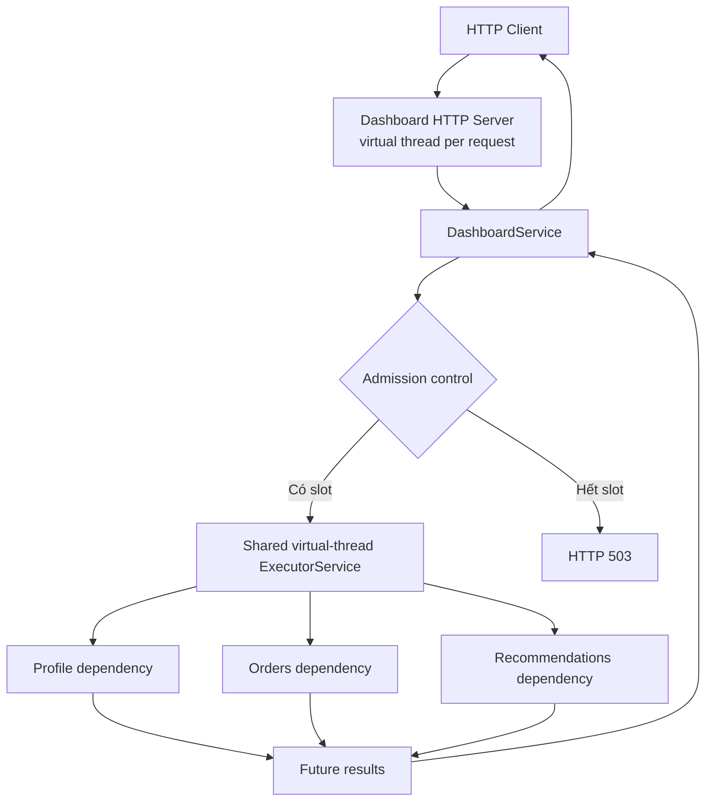

# Xây dịch vụ gọi nhiều dependency bằng virtual thread và `ExecutorService`

## Mục tiêu thực hành

Trong bài lab này, bạn xây một HTTP service tổng hợp dữ liệu từ ba dependency độc lập: hồ sơ người dùng, đơn hàng và gợi ý sản phẩm. Service nhận một request, gọi đồng thời ba dependency bằng `ExecutorService` tạo virtual thread, chờ kết quả trong một deadline chung rồi trả về một JSON response.

Lab sử dụng API có sẵn trong Java 21, không cần framework hay thư viện bên ngoài. Một HTTP server nhỏ đóng vai trò dependency giả lập để bạn có thể chạy và thử cả tình huống thành công, dependency lỗi, timeout và quá tải ngay trên máy local.

Sau khi hoàn thành, bạn sẽ biết cách:

- Tái sử dụng `HttpClient` và `ExecutorService` trong vòng đời service.
- Chạy blocking HTTP call trên virtual thread.
- Fan-out nhiều dependency bằng `submit()` và thu kết quả qua `Future`.
- Áp dụng request timeout và một deadline tổng cho cả nhóm lời gọi.
- Hủy các task còn lại khi có lỗi hoặc timeout.
- Giới hạn số request đồng thời bằng admission control và `Semaphore`.
- Phân biệt lỗi dependency, timeout và quá tải để trả HTTP status phù hợp.

## 1. Bài toán và kiến trúc

Client gọi `GET /dashboard`. API cần dữ liệu từ ba dependency độc lập. Nếu gọi tuần tự, thời gian chờ gần bằng tổng thời gian của cả ba lời gọi. Nếu gọi đồng thời, thời gian chờ gần với dependency chậm nhất, cộng overhead của service.



Các dependency không phụ thuộc lẫn nhau nên có thể được gọi song song. Service dùng `HttpClient.send()` theo phong cách blocking bên trong virtual thread. Cách này giữ code tuần tự, dễ đọc trong từng task, trong khi các lời gọi I/O có thể tiến triển đồng thời.

Trong ví dụ, server API và server giả lập dependency đều dùng virtual-thread-per-task executor. `DashboardService` có một executor dùng chung cho các lời gọi dependency; không tạo executor mới cho từng request.

## 2. Quy tắc thiết kế trước khi viết code

| Thành phần | Quyết định trong lab | Lý do |
|---|---|---|
| HTTP client | Một `HttpClient` dùng chung | Tái sử dụng cấu hình và connection management |
| Request handler | Virtual thread cho mỗi request | Phù hợp với HTTP handler có thao tác blocking |
| Fan-out | Một `ExecutorService` virtual-thread-per-task dùng chung | Chạy các dependency call đồng thời |
| Deadline | 900 ms cho toàn bộ dashboard | Tránh chờ mỗi dependency một timeout riêng nối tiếp nhau |
| HTTP request timeout | 750 ms cho từng dependency | Giới hạn thời gian của từng exchange |
| Admission control | Tối đa 32 request tổng hợp đồng thời | Ngăn số task tăng không giới hạn khi service quá tải |
| Outbound limit | Tối đa 96 dependency call đang giữ permit | Giới hạn số lời gọi HTTP đang hoạt động |
| Lỗi dependency | HTTP 502 | Service tổng hợp không lấy được dữ liệu upstream |
| Timeout | HTTP 504 | Dependency hoặc nhóm lời gọi vượt deadline |
| Quá tải nội bộ | HTTP 503 | Service tạm thời không nhận thêm request |

Virtual thread có chi phí thấp hơn platform thread trong workload blocking, nhưng không miễn phí và không tự giới hạn concurrency. `newVirtualThreadPerTaskExecutor()` không phải thread pool có kích thước cố định. Vì vậy, service vẫn cần giới hạn admission, timeout, giới hạn connection và backpressure phù hợp.

## 3. Tạo project lab

Tạo một thư mục mới và lưu toàn bộ chương trình dưới đây vào file `DashboardApplication.java`. Chương trình chỉ dùng JDK 21 và module `jdk.httpserver` để dựng HTTP server demo.

```java
import com.sun.net.httpserver.HttpExchange;
import com.sun.net.httpserver.HttpServer;

import java.io.IOException;
import java.io.OutputStream;
import java.net.InetSocketAddress;
import java.net.URI;
import java.net.http.HttpClient;
import java.net.http.HttpRequest;
import java.net.http.HttpResponse;
import java.net.http.HttpTimeoutException;
import java.nio.charset.StandardCharsets;
import java.time.Duration;
import java.util.concurrent.CountDownLatch;
import java.util.concurrent.ExecutionException;
import java.util.concurrent.ExecutorService;
import java.util.concurrent.Executors;
import java.util.concurrent.Future;
import java.util.concurrent.RejectedExecutionException;
import java.util.concurrent.Semaphore;
import java.util.concurrent.TimeUnit;
import java.util.concurrent.TimeoutException;

public class DashboardApplication {
    public static void main(String[] args) throws Exception {
        try (ExecutorService dependencyServerExecutor =
                     Executors.newVirtualThreadPerTaskExecutor();
             ExecutorService apiServerExecutor =
                     Executors.newVirtualThreadPerTaskExecutor();
             ExecutorService dependencyCallExecutor =
                     Executors.newVirtualThreadPerTaskExecutor()) {

            HttpServer dependencyServer = HttpServer.create(
                    new InetSocketAddress("127.0.0.1", 8081), 0);
            dependencyServer.setExecutor(dependencyServerExecutor);
            registerDependency(dependencyServer, "/profile",
                    "{\"id\":101,\"name\":\"An\"}", 120,
                    "demo.failProfile", "demo.slowProfile");
            registerDependency(dependencyServer, "/orders",
                    "[{\"id\":\"o-1001\",\"total\":250000}]", 180,
                    "demo.failOrders", "demo.slowOrders");
            registerDependency(dependencyServer, "/recommendations",
                    "[{\"id\":\"p-501\",\"name\":\"Keyboard\"}]", 90,
                    "demo.failRecommendations", "demo.slowRecommendations");

            HttpClient httpClient = HttpClient.newBuilder()
                    .connectTimeout(Duration.ofMillis(300))
                    .build();

            DashboardService dashboardService = new DashboardService(
                    httpClient,
                    dependencyCallExecutor,
                    URI.create("http://127.0.0.1:8081"));

            HttpServer apiServer = HttpServer.create(
                    new InetSocketAddress("127.0.0.1", 8080), 0);
            apiServer.setExecutor(apiServerExecutor);
            apiServer.createContext("/dashboard",
                    exchange -> handleDashboard(exchange, dashboardService));

            CountDownLatch stopped = new CountDownLatch(1);
            Runtime.getRuntime().addShutdownHook(new Thread(() -> {
                apiServer.stop(1);
                dependencyServer.stop(1);
                stopped.countDown();
            }, "dashboard-shutdown"));

            dependencyServer.start();
            apiServer.start();

            System.out.println("Dashboard API: http://127.0.0.1:8080/dashboard");
            System.out.println("Dependency stubs: http://127.0.0.1:8081");
            System.out.println("Press Ctrl+C to stop.");

            stopped.await();
        }
    }

    private static void registerDependency(
            HttpServer server,
            String path,
            String responseBody,
            long normalDelayMillis,
            String failProperty,
            String slowProperty) {

        server.createContext(path, exchange -> {
            try {
                if (!"GET".equals(exchange.getRequestMethod())) {
                    exchange.getResponseHeaders().set("Allow", "GET");
                    sendJson(exchange, 405, "{\"error\":\"method not allowed\"}");
                    return;
                }

                if (Boolean.getBoolean(failProperty)) {
                    sendJson(exchange, 503,
                            "{\"error\":\"simulated dependency failure\"}");
                    return;
                }

                long delay = Boolean.getBoolean(slowProperty)
                        ? 1_500
                        : normalDelayMillis;
                Thread.sleep(delay);
                sendJson(exchange, 200, responseBody);
            } catch (InterruptedException e) {
                Thread.currentThread().interrupt();
                try {
                    sendJson(exchange, 503,
                            "{\"error\":\"dependency request interrupted\"}");
                } catch (IOException ignored) {
                    // Client có thể đã đóng connection sau timeout/cancellation.
                }
            } finally {
                exchange.close();
            }
        });
    }

    private static void handleDashboard(
            HttpExchange exchange,
            DashboardService service) throws IOException {

        try {
            if (!"GET".equals(exchange.getRequestMethod())) {
                exchange.getResponseHeaders().set("Allow", "GET");
                sendJson(exchange, 405, "{\"error\":\"method not allowed\"}");
                return;
            }

            try {
                String body = service.loadDashboard();
                sendJson(exchange, 200, body);
            } catch (ServiceOverloadedException e) {
                sendJson(exchange, 503,
                        "{\"error\":\"service is temporarily overloaded\"}");
            } catch (TimeoutException e) {
                sendJson(exchange, 504,
                        "{\"error\":\"dependency deadline exceeded\"}");
            } catch (InterruptedException e) {
                Thread.currentThread().interrupt();
                sendJson(exchange, 503,
                        "{\"error\":\"request interrupted\"}");
            } catch (IOException e) {
                sendJson(exchange, 502,
                        "{\"error\":\"dependency request failed\"}");
            }
        } finally {
            exchange.close();
        }
    }

    private static void sendJson(
            HttpExchange exchange,
            int status,
            String body) throws IOException {

        byte[] bytes = body.getBytes(StandardCharsets.UTF_8);
        exchange.getResponseHeaders().set(
                "Content-Type", "application/json; charset=utf-8");
        exchange.sendResponseHeaders(status, bytes.length);
        try (OutputStream output = exchange.getResponseBody()) {
            output.write(bytes);
        }
    }

    private static final class DashboardService {
        private static final int MAX_IN_FLIGHT_REQUESTS = 32;
        private static final int MAX_OUTBOUND_CALLS = 96;
        private static final long TOTAL_DEADLINE_MILLIS = 900;
        private static final Duration DEPENDENCY_TIMEOUT = Duration.ofMillis(750);

        private final HttpClient httpClient;
        private final ExecutorService dependencyExecutor;
        private final URI dependencyBaseUri;
        private final Semaphore requestSlots =
                new Semaphore(MAX_IN_FLIGHT_REQUESTS);
        private final Semaphore outboundSlots =
                new Semaphore(MAX_OUTBOUND_CALLS);

        private DashboardService(
                HttpClient httpClient,
                ExecutorService dependencyExecutor,
                URI dependencyBaseUri) {
            this.httpClient = httpClient;
            this.dependencyExecutor = dependencyExecutor;
            this.dependencyBaseUri = dependencyBaseUri;
        }

        String loadDashboard()
                throws IOException, InterruptedException, TimeoutException {

            if (!requestSlots.tryAcquire()) {
                throw new ServiceOverloadedException("No request slot available");
            }

            Future<String> profile = null;
            Future<String> orders = null;
            Future<String> recommendations = null;
            long deadline = System.nanoTime()
                    + TimeUnit.MILLISECONDS.toNanos(TOTAL_DEADLINE_MILLIS);

            try {
                // Submit cả ba task trước khi chờ bất kỳ kết quả nào.
                profile = dependencyExecutor.submit(() -> get("/profile"));
                orders = dependencyExecutor.submit(() -> get("/orders"));
                recommendations = dependencyExecutor.submit(
                        () -> get("/recommendations"));

                String profileJson = await(profile, deadline);
                String ordersJson = await(orders, deadline);
                String recommendationsJson = await(recommendations, deadline);

                // Các body trong lab là JSON cố định từ dependency giả lập.
                return "{\"profile\":" + profileJson
                        + ",\"orders\":" + ordersJson
                        + ",\"recommendations\":" + recommendationsJson + "}";
            } catch (IOException | InterruptedException | TimeoutException e) {
                cancel(profile);
                cancel(orders);
                cancel(recommendations);
                throw e;
            } catch (RejectedExecutionException e) {
                cancel(profile);
                cancel(orders);
                cancel(recommendations);
                throw new ServiceOverloadedException(
                        "Dependency executor is not accepting tasks", e);
            } finally {
                requestSlots.release();
            }
        }

        private String get(String path)
                throws IOException, InterruptedException {

            if (!outboundSlots.tryAcquire()) {
                throw new ServiceOverloadedException("Outbound capacity exhausted");
            }

            try {
                HttpRequest request = HttpRequest.newBuilder(
                                dependencyBaseUri.resolve(path))
                        .timeout(DEPENDENCY_TIMEOUT)
                        .header("Accept", "application/json")
                        .GET()
                        .build();

                HttpResponse<String> response = httpClient.send(
                        request,
                        HttpResponse.BodyHandlers.ofString(StandardCharsets.UTF_8));

                if (response.statusCode() < 200 || response.statusCode() >= 300) {
                    throw new IOException("Dependency " + path
                            + " returned HTTP " + response.statusCode());
                }
                return response.body();
            } finally {
                outboundSlots.release();
            }
        }

        private static String await(Future<String> future, long deadline)
                throws IOException, InterruptedException, TimeoutException {

            long remaining = deadline - System.nanoTime();
            if (remaining <= 0) {
                throw new TimeoutException("Dashboard deadline exceeded");
            }

            try {
                return future.get(remaining, TimeUnit.NANOSECONDS);
            } catch (ExecutionException e) {
                Throwable cause = e.getCause();
                if (cause instanceof ServiceOverloadedException overloaded) {
                    throw overloaded;
                }
                if (cause instanceof HttpTimeoutException) {
                    throw new TimeoutException("A dependency request timed out");
                }
                if (cause instanceof IOException ioException) {
                    throw ioException;
                }
                if (cause instanceof InterruptedException interrupted) {
                    throw interrupted;
                }
                throw new IOException("Unexpected dependency failure", cause);
            }
        }

        private static void cancel(Future<?> future) {
            if (future != null && !future.isDone()) {
                future.cancel(true);
            }
        }
    }

    private static final class ServiceOverloadedException extends IOException {
        private ServiceOverloadedException(String message) {
            super(message);
        }

        private ServiceOverloadedException(String message, Throwable cause) {
            super(message, cause);
        }
    }
}
```

## 4. Đọc luồng xử lý

### 4.1. Executor dùng chung

Ứng dụng tạo ba executor và đóng chúng khi process shutdown:

- `dependencyServerExecutor` phục vụ các dependency giả lập.
- `apiServerExecutor` phục vụ request đến `/dashboard`.
- `dependencyCallExecutor` chạy các lời gọi outbound từ `DashboardService`.

Các executor được tạo một lần ở cấp ứng dụng. Không đặt `Executors.newVirtualThreadPerTaskExecutor()` bên trong `handleDashboard()` hoặc `loadDashboard()`, vì tạo executor cho từng request làm vòng đời tài nguyên khó quản lý và có thể gây overhead không cần thiết.

### 4.2. Submit trước, chờ sau

Ba lời gọi được submit liên tiếp:

```java
profile = dependencyExecutor.submit(() -> get("/profile"));
orders = dependencyExecutor.submit(() -> get("/orders"));
recommendations = dependencyExecutor.submit(() -> get("/recommendations"));
```

Sau khi cả ba task đã được gửi, service mới gọi `Future.get()` để thu kết quả. Nếu chờ profile trước khi submit orders và recommendations, các dependency sẽ bị gọi tuần tự và mất lợi ích fan-out.

`Future.get()` là blocking, nhưng request handler đang chạy trên virtual thread. Khi chờ, virtual thread có thể nhường carrier trong các thao tác blocking được JVM hỗ trợ. Mỗi dependency call cũng chạy trong virtual thread riêng.

### 4.3. Deadline chung và timeout từng request

`HttpRequest.timeout(750 ms)` giới hạn một HTTP exchange. `TOTAL_DEADLINE_MILLIS` tạo deadline 900 ms cho toàn bộ dashboard. Phương thức `await()` tính thời gian còn lại từ một mốc `System.nanoTime()` chung, nên không cấp lại 900 ms cho từng dependency.

Nếu chờ lần lượt ba future với timeout riêng 900 ms, tổng thời gian chờ có thể tiến gần 2,7 giây. Dùng deadline chung giúp tổng thời gian bị giới hạn bởi cùng một ngân sách.

### 4.4. Cancellation và cleanup

Khi một dependency lỗi hoặc deadline hết hạn, service gọi `cancel(true)` cho các future còn lại. Đây là yêu cầu hủy có interrupt, không phải bảo đảm server phía dependency lập tức dừng xử lý. Timeout trên `HttpRequest` vẫn là lớp giới hạn quan trọng cho HTTP exchange.

`outboundSlots` được release trong `finally` bên trong task thực hiện HTTP call. Nhờ đó permit chỉ được trả khi lời gọi đã thoát khỏi phần xử lý của task, kể cả khi task gặp exception.

`requestSlots` giới hạn số dashboard request đang được nhận xử lý. `tryAcquire()` không chờ permit; nếu đã đủ 32 request, service trả lỗi quá tải ngay. Đây là admission control, tránh tạo thêm một hàng đợi virtual thread chờ không giới hạn.

## 5. Biên dịch và chạy

Yêu cầu JDK 21. Từ thư mục chứa `DashboardApplication.java`, biên dịch:

```bash
javac --release 21 --add-modules jdk.httpserver DashboardApplication.java
```

Chạy ứng dụng:

```bash
java --add-modules jdk.httpserver DashboardApplication
```

Ứng dụng mở hai listener local:

| Địa chỉ | Vai trò |
|---|---|
| `http://127.0.0.1:8080/dashboard` | API tổng hợp cho client |
| `http://127.0.0.1:8081` | Dependency stub dùng trong lab |

Trong terminal khác, gọi API:

```bash
curl -i http://127.0.0.1:8080/dashboard
```

Trên Windows PowerShell có thể dùng `curl.exe` để gọi chương trình curl thực tế, tránh alias `curl` của PowerShell.

Response thành công có dạng:

```json
{
  "profile": {"id": 101, "name": "An"},
  "orders": [{"id": "o-1001", "total": 250000}],
  "recommendations": [{"id": "p-501", "name": "Keyboard"}]
}
```

Các dependency giả lập chờ lần lượt khoảng 120 ms, 180 ms và 90 ms. Vì được gọi song song, tổng thời gian thường gần với dependency chậm nhất thay vì tổng ba độ trễ. Thời gian đo thực tế còn phụ thuộc startup, scheduling, connection và máy chạy.

## 6. Thử các tình huống lỗi

Dừng ứng dụng bằng `Ctrl+C` trước khi chạy lại với từng system property.

### Dependency trả lỗi 503

Khởi chạy service với orders dependency bị lỗi:

```bash
java --add-modules jdk.httpserver -Ddemo.failOrders=true DashboardApplication
```

Gọi lại `/dashboard`. Service trả HTTP 502 vì upstream trả status không thành công. Các future còn lại được yêu cầu hủy.

### Dependency phản hồi quá chậm

Khởi chạy service với recommendations dependency chậm 1,5 giây:

```bash
java --add-modules jdk.httpserver -Ddemo.slowRecommendations=true DashboardApplication
```

Request timeout của dependency là 750 ms, trong khi deadline tổng là 900 ms. Gọi `/dashboard`; service sẽ trả HTTP 504 khi dependency vượt timeout/deadline.

### Admission control từ chối request

Trong code, `MAX_IN_FLIGHT_REQUESTS` là 32. Hạ giá trị này xuống 1 để quan sát rõ hành vi từ chối khi một request khác đang xử lý. Có thể tăng độ trễ của một dependency bằng system property rồi gửi nhiều request gần như đồng thời bằng công cụ load test đang có trong môi trường.

Request không lấy được slot sẽ nhận HTTP 503 ngay, thay vì xếp hàng không giới hạn. Khi thử tải, ghi nhận throughput, p95/p99 latency, tỷ lệ 503, CPU, heap và số outbound call đang hoạt động. Không kết luận chỉ dựa trên số virtual thread.

## 7. Bài tập mở rộng

Sau khi chạy được phiên bản cơ bản, thực hiện các thay đổi sau và ghi lại kết quả:

1. **Thêm dependency thứ tư:** tạo `/inventory` và thêm một future vào fan-out. Cập nhật giới hạn outbound để phản ánh số dependency tối đa trên mỗi request.
2. **Đưa URL ra cấu hình:** đọc base URI từ environment variable hoặc system property thay vì hard-code `127.0.0.1:8081`.
3. **Tách lỗi bắt buộc và tùy chọn:** quyết định dependency nào làm dashboard thất bại toàn bộ và dependency nào có thể trả dữ liệu fallback. Thể hiện trạng thái partial result trong response.
4. **Thêm retry có kiểm soát:** chỉ retry lỗi tạm thời phù hợp, giới hạn số lần, dùng backoff và tính retry vào deadline tổng. Không retry mọi lỗi 4xx hoặc retry vô hạn.
5. **Thêm metric:** đo request active, dependency duration, timeout, failure, rejection và số permit đang dùng. Đặt tên metric theo đúng phạm vi đo.
6. **Kiểm tra shutdown:** gửi request đang chạy rồi dừng process; xác nhận server ngừng nhận request mới và executor được đóng có trật tự.
7. **Thay JSON nối chuỗi bằng DTO:** trong service thực tế, dùng JSON library đã được dự án quản lý để parse và serialize response. Không nối trực tiếp body không tin cậy từ dependency vào JSON output.

## 8. Tiêu chí hoàn thành

| Tiêu chí | Kết quả mong đợi |
|---|---|
| Happy path | `/dashboard` trả dữ liệu từ cả ba dependency với HTTP 200 |
| Fan-out | Cả ba task được submit trước khi service chờ kết quả |
| Virtual thread | Request handler và dependency tasks chạy trên virtual-thread executor |
| Timeout | Dependency chậm bị giới hạn bởi request timeout/deadline tổng |
| Dependency failure | Upstream 5xx được chuyển thành lỗi gateway HTTP 502 |
| Deadline exceeded | Request vượt thời gian được trả HTTP 504 |
| Admission control | Khi hết slot, request mới nhận HTTP 503 ngay |
| Cancellation | Task còn lại nhận yêu cầu `cancel(true)` sau lỗi/timeout |
| Lifecycle | Executor được dùng chung và đóng khi ứng dụng shutdown |
| Observability | Có thể đo latency, throughput, rejection và lỗi theo dependency |

## 9. Câu hỏi tự đánh giá

1. Vì sao phải submit cả ba task trước khi gọi `Future.get()`?
2. Vì sao `newVirtualThreadPerTaskExecutor()` không thay thế admission control?
3. Khác biệt giữa connect timeout, request timeout và deadline tổng là gì?
4. Vì sao phải dùng cùng một mốc `System.nanoTime()` để tính thời gian còn lại?
5. `Future.cancel(true)` bảo đảm điều gì và không bảo đảm điều gì?
6. Vì sao semaphore được release trong `finally` của chính dependency task?
7. Khi một dependency trả HTTP 503, tại sao API tổng hợp có thể trả HTTP 502?
8. Khi nào nên trả partial response thay vì fail toàn bộ dashboard?
9. Vì sao không nên tạo một virtual-thread executor mới cho từng HTTP request?
10. Khi tăng concurrency, cần theo dõi những giới hạn nào ngoài số virtual thread?

## Kết luận

Lab đã xây một HTTP service Java 21 gọi ba dependency đồng thời bằng `ExecutorService` tạo virtual thread. `HttpClient.send()` giúp mỗi lời gọi I/O giữ cách viết blocking dễ đọc; `Future` phối hợp kết quả; deadline chung, request timeout, cancellation và semaphore kiểm soát thời gian cùng mức concurrency. Virtual thread giúp mở rộng số tác vụ chờ I/O, nhưng hệ thống vẫn cần admission control, giới hạn dependency, quan sát tài nguyên và xử lý lỗi rõ ràng. Khi đưa mô hình này vào production, hãy thay dependency stub bằng client thật, dùng JSON DTO, cấu hình endpoint từ môi trường và kiểm thử dưới workload đại diện.
