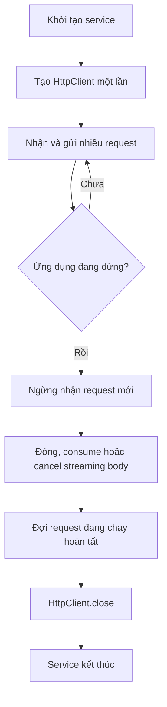

# Tích hợp HttpClient có vòng đời tài nguyên rõ ràng

`java.net.http.HttpClient` là HTTP client chuẩn của Java, có từ Java 11. Trên Java 21, `HttpClient` triển khai `AutoCloseable` và bổ sung các thao tác shutdown như `close()`, `shutdown()` và `awaitTermination(Duration)`. Điều này cho phép ứng dụng quản lý rõ thời điểm ngừng nhận request mới và giải phóng tài nguyên của client khi service kết thúc.

Trong bài thực hành này, bạn xây dựng một lớp client dùng chung cho nhiều request, cấu hình timeout, xử lý response đồng bộ và bất đồng bộ, tải response dạng streaming, rồi đóng tài nguyên đúng thứ tự. Trọng tâm là vòng đời của `HttpClient` và response body: tạo client theo vòng đời service, tái sử dụng connection pool, đóng stream đã nhận và chờ request đang chạy hoàn tất trước khi ứng dụng dừng.

## Mục tiêu thực hành

Sau bài học, bạn có thể:

- Tạo và tái sử dụng một `HttpClient` cho nhiều request.
- Giải thích vì sao không tạo client mới cho từng request.
- Quản lý `HttpClient` bằng `try-with-resources` hoặc lifecycle của service.
- Phân biệt connect timeout với request timeout.
- Đọc status code và response body theo cách đồng bộ hoặc bất đồng bộ.
- Đóng `InputStream`/`Stream` nhận từ streaming body handler.
- Dừng client theo cách orderly và chờ các operation hoàn tất.
- Phân biệt `shutdown()`, `awaitTermination()`, `shutdownNow()` và `close()`.
- Tránh để response body chưa đọc làm treo quá trình shutdown.
- Viết test kiểm tra thành công, lỗi HTTP, timeout và cleanup.

## 1. Hiểu vòng đời của HttpClient trong Java 21

Một `HttpClient` được tạo từ `HttpClient.newBuilder().build()` hoặc `HttpClient.newHttpClient()`. Sau khi tạo, client là immutable và có thể gửi nhiều request. Client thường quản lý connection pool riêng để tái sử dụng kết nối; các pool này thường không được chia sẻ giữa những instance `HttpClient` khác nhau.

Vì vậy, tạo một client cho mỗi lần gọi API thường làm mất lợi ích tái sử dụng kết nối, tăng số tài nguyên cần quản lý và khiến shutdown phức tạp hơn. Trong ứng dụng server, hãy tạo client theo vòng đời của service hoặc theo nhóm cấu hình kết nối (ví dụ cùng proxy, SSL context và authentication policy), rồi tái sử dụng cho các request đồng thời.

Java 21 bổ sung các phương thức lifecycle sau:

| API | Vai trò |
|---|---|
| `shutdown()` | Ngừng nhận request mới; request đã gửi được phép hoàn tất. Không chờ chúng hoàn tất. |
| `awaitTermination(Duration)` | Chờ các operation đã gửi hoàn tất sau khi shutdown; trả `true` nếu client đã terminated, `false` nếu hết thời gian chờ. |
| `isTerminated()` | Kiểm tra client đã hoàn tất mọi operation sau shutdown hay chưa. |
| `shutdownNow()` | Cố gắng dừng ngay các operation đang chạy; không bảo đảm mọi operation sẽ kết thúc. |
| `close()` | Thực hiện orderly shutdown và chờ các operation đã gửi hoàn tất. |

Các phương thức lifecycle này được thêm từ Java 21. Ví dụ trong bài dùng API Java 21 hiện hành; không cần dựa vào cách giữ client sống bằng thủ thuật thread hoặc chờ garbage collector thu hồi tài nguyên.

Các mô tả lifecycle ở đây áp dụng cho implementation built-in của JDK được tạo bằng `HttpClient.newHttpClient()` hoặc `HttpClient.newBuilder()`. `HttpClient` là abstract class; implementation tùy chỉnh có thể kế thừa các default lifecycle method vốn không thực hiện shutdown thực tế, nên phải tự cung cấp hành vi tương ứng nếu quản lý tài nguyên riêng.

### 1.1. Vòng đời phù hợp



Trong ứng dụng ngắn hạn như command-line tool, có thể dùng `try-with-resources` cho toàn bộ công việc. Trong web server hoặc worker chạy lâu dài, client thường là dependency singleton của service; container hoặc lifecycle hook của ứng dụng chịu trách nhiệm gọi `close()` khi service dừng. Không đặt `try (HttpClient ...)` bên trong mỗi method xử lý request.

## 2. Tạo client và gửi request đồng bộ

Bắt đầu với một API đơn giản trả về JSON dưới dạng `String`. Ví dụ này không phụ thuộc thư viện JSON để tập trung vào vòng đời HTTP.

```java
import java.io.IOException;
import java.net.URI;
import java.net.http.HttpClient;
import java.net.http.HttpRequest;
import java.net.http.HttpResponse;
import java.nio.charset.StandardCharsets;
import java.time.Duration;
import java.util.Objects;

public final class CatalogApi implements AutoCloseable {
    private final HttpClient httpClient;
    private final URI productsUri;

    public CatalogApi(URI productsUri) {
        this.productsUri = Objects.requireNonNull(productsUri);
        this.httpClient = HttpClient.newBuilder()
            .connectTimeout(Duration.ofSeconds(3))
            .followRedirects(HttpClient.Redirect.NORMAL)
            .version(HttpClient.Version.HTTP_2)
            .build();
    }

    public String listProducts() throws IOException, InterruptedException {
        HttpRequest request = HttpRequest.newBuilder(productsUri)
            .timeout(Duration.ofSeconds(8))
            .header("Accept", "application/json")
            .GET()
            .build();

        HttpResponse<String> response = httpClient.send(
            request,
            HttpResponse.BodyHandlers.ofString(StandardCharsets.UTF_8)
        );

        if (response.statusCode() < 200 || response.statusCode() >= 300) {
            throw new IOException("Catalog API returned HTTP " + response.statusCode());
        }

        return response.body();
    }

    @Override
    public void close() {
        httpClient.close();
    }
}
```

Các điểm cần chú ý:

- `HttpClient` được tạo một lần trong constructor và tái sử dụng cho mọi lần gọi `listProducts()`.
- `connectTimeout` giới hạn thời gian thiết lập một kết nối mới. Nếu kết nối được tái sử dụng, timeout này không áp dụng cho request đó.
- `HttpRequest.timeout` đặt thời hạn cho request; nếu response không được nhận trong thời hạn, thao tác có thể thất bại với `HttpTimeoutException`.
- `BodyHandlers.ofString(UTF_8)` đọc body thành `String` trước khi `send()` trả về. Với body dạng này, caller không nhận một stream cần tự đóng.
- HTTP status 4xx/5xx không tự động biến thành exception từ `send()`. Ứng dụng phải kiểm tra `statusCode()` theo API contract.
- `close()` đóng client khi owner của `CatalogApi` kết thúc.

`HTTP_2` là protocol được ưu tiên, không phải cam kết rằng mọi kết nối sẽ dùng HTTP/2. Khả năng thương lượng, proxy và server có thể khiến request sử dụng HTTP/1.1.

### 2.1. Dùng trong command-line application

```java
import java.net.URI;

public class Main {
    public static void main(String[] args) throws Exception {
        URI endpoint = URI.create("https://api.example.com/v1/products");

        try (CatalogApi catalog = new CatalogApi(endpoint)) {
            System.out.println(catalog.listProducts());
        }
    }
}
```

Khi rời khỏi block, `close()` được gọi. Với ứng dụng server, tạo `CatalogApi` ở startup và đóng ở shutdown hook hoặc lifecycle callback của framework. Nếu tạo instance theo từng HTTP request đến server, bạn sẽ liên tục tạo client/connection pool và không tái sử dụng kết nối hiệu quả.

## 3. Phân biệt connect timeout và request timeout

Hai timeout bảo vệ hai giai đoạn khác nhau:

| Timeout | Cấu hình ở đâu | Giới hạn điều gì |
|---|---|---|
| Connect timeout | `HttpClient.Builder.connectTimeout(...)` | Thời gian thiết lập kết nối mới tới server |
| Request timeout | `HttpRequest.Builder.timeout(...)` | Thời gian chờ response của request theo hợp đồng API |

Ví dụ:

```java
HttpClient client = HttpClient.newBuilder()
    .connectTimeout(Duration.ofSeconds(2))
    .build();

HttpRequest request = HttpRequest.newBuilder()
    .uri(URI.create("https://api.example.com/health"))
    .timeout(Duration.ofSeconds(5))
    .GET()
    .build();
```

Connect timeout chỉ có ý nghĩa khi cần tạo kết nối mới. Request timeout là thời hạn để nhận response theo hợp đồng của `HttpRequest`. Nếu không đặt request timeout, request không có một giới hạn thời gian tường minh do `HttpRequest` cấu hình. Với streaming handler như `ofInputStream()`, response có thể được trả cho caller khi stream đã sẵn sàng; thời gian caller tiếp tục đọc stream cần được quản lý riêng bằng deadline, giới hạn kích thước và chính sách đóng/cancel phù hợp.

Không nên chọn timeout quá thấp chỉ để request thất bại nhanh. Hãy dựa trên SLO, latency của dependency, retry policy và tổng deadline của nghiệp vụ. Retry một request đã timeout có thể làm tăng tải downstream; cần giới hạn số lần retry và dùng backoff phù hợp.

## 4. Quản lý response body dạng streaming

`BodyHandlers.ofString()` phù hợp với response nhỏ hoặc vừa vì body được đọc vào bộ nhớ. Với file lớn hoặc response cần xử lý từng phần, có thể dùng streaming handler. Khi đó, caller phải quản lý tài nguyên body.

### 4.1. `BodyHandlers.ofInputStream()`

Ví dụ tải response xuống file:

```java
import java.io.IOException;
import java.io.InputStream;
import java.io.OutputStream;
import java.net.URI;
import java.net.http.HttpClient;
import java.net.http.HttpRequest;
import java.net.http.HttpResponse;
import java.nio.file.Files;
import java.nio.file.Path;
import java.time.Duration;

static long download(
        HttpClient client,
        URI uri,
        Path destination
) throws IOException, InterruptedException {
    HttpRequest request = HttpRequest.newBuilder(uri)
        .timeout(Duration.ofSeconds(30))
        .GET()
        .build();

    HttpResponse<InputStream> response = client.send(
        request,
        HttpResponse.BodyHandlers.ofInputStream()
    );

    try (InputStream body = response.body()) {
        if (response.statusCode() < 200 || response.statusCode() >= 300) {
            throw new IOException("Download failed with HTTP " + response.statusCode());
        }

        try (OutputStream output = Files.newOutputStream(destination)) {
            return body.transferTo(output);
        }
    }
}
```

`InputStream` được đóng trong mọi nhánh, kể cả khi status code không thành công hoặc ghi file gặp lỗi. `transferTo()` đọc đến hết stream và trả về số byte đã chuyển. Với dữ liệu không tin cậy, cần giới hạn kích thước file/response theo yêu cầu ứng dụng thay vì mặc định cho phép tải không giới hạn.

Nếu không cần giữ connection để tái sử dụng, đóng stream sớm vẫn giải phóng tài nguyên body. Tuy nhiên, khi body chưa được đọc hết, implementation có thể phải hủy phần còn lại hoặc đóng connection; hiệu quả tái sử dụng phụ thuộc protocol và implementation.

### 4.2. `BodyHandlers.ofLines()`

`ofLines()` trả về `Stream<String>`. Stream này phải được đóng:

```java
HttpResponse<Stream<String>> response = client.send(
    request,
    HttpResponse.BodyHandlers.ofLines()
);

try (Stream<String> lines = response.body()) {
    lines.limit(100).forEach(System.out::println);
}
```

Ngay cả khi chỉ xử lý 100 dòng đầu, hãy đóng stream. Nếu dừng xử lý giữa chừng mà không đóng, body và request có thể vẫn còn mở.

### 4.3. `BodyHandlers.ofPublisher()` và custom subscriber

Publisher/subscriber dùng Reactive Streams Flow. Subscriber cần yêu cầu dữ liệu bằng `Subscription.request(n)` hoặc hủy bằng `Subscription.cancel()`. Một custom `BodySubscriber` không yêu cầu dữ liệu đến `onComplete`/`onError` và cũng không cancel có thể làm quá trình truyền body dừng lại.

Chỉ dùng publisher/subscriber khi ứng dụng thực sự cần backpressure hoặc xử lý dữ liệu theo luồng. Nếu chỉ cần đọc toàn bộ response nhỏ, `ofString()` đơn giản và ít rủi ro lifecycle hơn.

### 4.4. Những handler nào cần caller đóng body?

| Body handler | Dạng kết quả | Trách nhiệm lifecycle |
|---|---|---|
| `ofString()` | `String` | Body đã được handler đọc trước khi response hoàn tất |
| `ofByteArray()` | `byte[]` | Body được materialize trong bộ nhớ |
| `ofFile(path)` | `Path` | Handler ghi file và hoàn tất việc ghi trước khi trả response |
| `ofInputStream()` | `InputStream` | Caller phải đọc hết hoặc đóng stream |
| `ofLines()` | `Stream<String>` | Caller phải đóng stream |
| `ofPublisher()` | `Flow.Publisher<List<ByteBuffer>>` | Subscriber phải request dữ liệu hoặc cancel subscription |
| Custom `BodySubscriber` | Do ứng dụng định nghĩa | Phải xử lý tín hiệu, backpressure và cancellation đúng hợp đồng |

Đây là điểm đặc biệt quan trọng khi shutdown: request có thể chưa được xem là hoàn tất nếu body streaming vẫn còn chờ tiêu thụ.

## 5. Gửi request bất đồng bộ

`sendAsync()` trả về `CompletableFuture<HttpResponse<T>>`. Future hoàn tất khi response body được xử lý theo `BodyHandler` đã chọn. Với `ofString()`, caller có thể xử lý kết quả sau khi body đã được materialize.

```java
CompletableFuture<HttpResponse<String>> future = client.sendAsync(
    request,
    HttpResponse.BodyHandlers.ofString(StandardCharsets.UTF_8)
);

future.thenApply(HttpResponse::body)
    .thenAccept(body -> logger.info("Received {} characters", body.length()))
    .exceptionally(failure -> {
        logger.error("HTTP request failed", failure);
        return null;
    });
```

Không cần gọi `get()` hoặc `join()` ngay sau `sendAsync()` nếu mục tiêu là xử lý bất đồng bộ. Nếu gọi `join()` ngay, thread hiện tại lại chờ kết quả và phần lớn lợi ích của asynchronous composition bị mất.

### 5.1. Chờ các request bất đồng bộ trước khi đóng client

Một service có thể theo dõi các future do nó tạo ra và ngừng nhận công việc mới trước khi shutdown. Ví dụ đơn giản:

```java
List<CompletableFuture<HttpResponse<String>>> pending = new ArrayList<>();

pending.add(client.sendAsync(requestA, HttpResponse.BodyHandlers.ofString()));
pending.add(client.sendAsync(requestB, HttpResponse.BodyHandlers.ofString()));

CompletableFuture.allOf(pending.toArray(CompletableFuture[]::new)).join();
```

Trong service thực tế, cần quản lý danh sách operation theo lifecycle và không để collection pending tăng vô hạn. Có thể xóa future khi hoàn tất hoặc dùng cơ chế theo dõi in-flight request phù hợp.

### 5.2. Hủy future không bảo đảm server chưa xử lý request

```java
future.cancel(true);
```

Với implementation mặc định của JDK, cancel future có thể cố gắng hủy HTTP exchange để giải phóng tài nguyên. Tuy nhiên, không có bảo đảm request chưa được gửi hoặc server chưa bắt đầu xử lý. Nếu request đã tới server, việc cancel ở client không tự rollback tác dụng nghiệp vụ.

Vì vậy, cancellation cần kết hợp với idempotency key, timeout, retry policy và thiết kế API phù hợp. Không dùng `cancel(true)` như một cơ chế đảm bảo giao dịch từ xa bị hủy.

## 6. Đóng HttpClient đúng thứ tự

Với JDK built-in `HttpClient` được tạo qua `newHttpClient()` hoặc `newBuilder()`, Java 21 cung cấp lifecycle rõ ràng.

### 6.1. `close()` cho shutdown thông thường

```java
try (HttpClient client = HttpClient.newHttpClient()) {
    HttpResponse<String> response = client.send(
        request,
        HttpResponse.BodyHandlers.ofString()
    );
    System.out.println(response.statusCode());
}
```

`close()` bắt đầu orderly shutdown: request đã được gửi bằng `send()` hoặc `sendAsync()` được phép hoàn tất, client từ chối request mới và phương thức chờ các operation kết thúc. Nếu thread gọi `close()` bị interrupt trong lúc chờ, client có thể thử `shutdownNow()`, tiếp tục chờ operation đang thực thi và đặt lại interrupt status trước khi trả về.

Với server application, gọi `close()` sau khi application đã ngừng nhận request mới và đã cho các handler hiện tại hoàn tất. Đóng client quá sớm trong khi component khác còn gửi request sẽ khiến request mới bị từ chối.

### 6.2. `shutdown()` và `awaitTermination()` khi cần timeout chờ

Nếu muốn tự quyết định thời gian chờ, có thể tách hai bước:

```java
client.shutdown();

try {
    boolean finished = client.awaitTermination(Duration.ofSeconds(10));
    if (!finished) {
        client.shutdownNow();
        boolean stopped = client.awaitTermination(Duration.ofSeconds(5));
        if (!stopped) {
            logger.warn("HttpClient operations are still terminating");
        }
    }
} catch (InterruptedException interrupted) {
    client.shutdownNow();
    Thread.currentThread().interrupt();
}
```

`shutdown()` không chờ request hoàn tất. `awaitTermination()` chỉ có ý nghĩa sau khi đã gọi shutdown hoặc shutdownNow. Nếu hết thời gian chờ, nó trả `false`; điều đó không tự động dừng các operation còn lại.

`shutdownNow()` chỉ là nỗ lực dừng khẩn cấp. API không bảo đảm mọi operation đang chạy sẽ chấm dứt hoặc mọi thread đang chờ sẽ được thông báo. Dùng nó như bước escalation sau graceful shutdown, không dùng làm đường đóng mặc định.

Trong nhiều ứng dụng, `close()` là lựa chọn đơn giản nhất. Dùng shutdown/awaitTermination riêng khi ứng dụng cần một quy trình drain có giới hạn thời gian và có chính sách xử lý khi deadline hết.

### 6.3. Streaming body phải được giải phóng trước khi chờ shutdown

JDK 21 API ghi rõ việc không đóng, không cancel hoặc không đọc stream đến hết có thể ngăn request hoàn tất và làm orderly shutdown bị stall. Trước khi gọi `close()`:

- Đảm bảo mọi `InputStream` nhận từ `ofInputStream()` đã được đóng.
- Đảm bảo mọi `Stream<String>` nhận từ `ofLines()` đã được đóng.
- Đảm bảo publisher subscription đã request đủ dữ liệu hoặc cancel.
- Đảm bảo custom subscriber xử lý completion/error hoặc cancel đúng cách.
- Ngừng tạo request mới và xử lý các future đang pending theo chính sách của service.

Không đặt một stream streaming trong field toàn cục rồi quên lifecycle. Nếu cần trả stream cho caller khác, contract của API phải quy định rõ ai sở hữu và ai đóng stream.

## 7. Ai sở hữu HttpClient và Executor?

Một quy tắc quan trọng trong ứng dụng nhiều component là xác định owner của tài nguyên.

- Component tạo `HttpClient` chịu trách nhiệm gọi `close()` khi client không còn được dùng.
- Component sử dụng client được chia sẻ không tự đóng client sau mỗi request.
- Nếu truyền một `Executor` do ứng dụng quản lý vào `HttpClient.Builder.executor(...)`, hãy quản lý lifecycle của executor theo owner của nó. API builder nhận một `Executor`; không nên giả định việc đóng client thay thế mọi trách nhiệm shutdown của một `ExecutorService` do ứng dụng tạo.
- Nếu executor được chia sẻ với các component khác, chỉ shutdown khi tất cả owner và consumer đã hoàn tất.

Ví dụ khi ứng dụng tự sở hữu cả client lẫn executor:

```java
ExecutorService executor = Executors.newFixedThreadPool(4);
HttpClient client = HttpClient.newBuilder()
    .executor(executor)
    .build();

try {
    // Gửi và xử lý các request của ứng dụng.
} finally {
    client.close();
    executor.shutdown();
    try {
        if (!executor.awaitTermination(5, TimeUnit.SECONDS)) {
            executor.shutdownNow();
        }
    } catch (InterruptedException interrupted) {
        executor.shutdownNow();
        Thread.currentThread().interrupt();
    }
}
```

Ví dụ này giả định ứng dụng sở hữu executor và không còn component nào khác sử dụng nó. Nếu executor được chia sẻ, lifecycle phải được quản lý ở cấp owner chung thay vì đóng trong component HTTP.

Không cần cấu hình executor tùy chỉnh chỉ để dùng `sendAsync()`. `HttpClient` có executor mặc định khi builder không nhận executor tường minh. Chỉ cung cấp executor riêng khi có yêu cầu cụ thể về scheduling, isolation hoặc tích hợp với runtime của ứng dụng.

## 8. Bài lab: xây dựng CatalogApi có lifecycle rõ ràng

### 8.1. Yêu cầu

Tạo một component `CatalogApi` với các yêu cầu:

1. Chỉ tạo một `HttpClient` trong constructor.
2. Cấu hình connect timeout và request timeout riêng.
3. Có method GET trả về `String` và kiểm tra status code.
4. Có method download dùng `ofInputStream()` và luôn đóng stream.
5. Có method gửi request bất đồng bộ.
6. Implement `AutoCloseable` và đóng client ở lifecycle của component.
7. Không tạo hoặc đóng client theo từng method.

### 8.2. Cấu trúc gợi ý

```text
src/
  main/java/example/http/
    CatalogApi.java
    Main.java
  test/java/example/http/
    CatalogApiTest.java
```

### 8.3. Mã khung cho component

```java
public final class CatalogApi implements AutoCloseable {
    private final HttpClient client;
    private final URI baseUri;

    public CatalogApi(URI baseUri) {
        this.baseUri = Objects.requireNonNull(baseUri);
        this.client = HttpClient.newBuilder()
            .connectTimeout(Duration.ofSeconds(3))
            .followRedirects(HttpClient.Redirect.NORMAL)
            .build();
    }

    public HttpResponse<String> get(
            String path,
            Duration timeout
    ) throws IOException, InterruptedException {
        URI uri = baseUri.resolve(path);
        HttpRequest request = HttpRequest.newBuilder(uri)
            .timeout(timeout)
            .header("Accept", "application/json")
            .GET()
            .build();

        return client.send(request, HttpResponse.BodyHandlers.ofString());
    }

    public CompletableFuture<HttpResponse<String>> getAsync(
            String path,
            Duration timeout
    ) {
        URI uri = baseUri.resolve(path);
        HttpRequest request = HttpRequest.newBuilder(uri)
            .timeout(timeout)
            .header("Accept", "application/json")
            .GET()
            .build();

        return client.sendAsync(request, HttpResponse.BodyHandlers.ofString());
    }

    @Override
    public void close() {
        client.close();
    }
}
```

Mã khung cố ý trả `HttpResponse<String>` để caller quyết định cách phân loại status. Trong ứng dụng production, có thể thay bằng domain result hoặc exception cụ thể, nhưng vẫn cần giữ contract xử lý status và body rõ ràng.

`baseUri.resolve(path)` phù hợp với path do ứng dụng kiểm soát. Nếu `path` chứa dữ liệu người dùng, phải encode từng path segment/query parameter đúng chuẩn URI và kiểm tra origin để tránh request bị chuyển tới host ngoài dự kiến.

### 8.4. Bài tập download có cleanup

Thêm method `download(String path, Path destination)`:

- Tạo `HttpRequest` với request timeout.
- Dùng `BodyHandlers.ofInputStream()`.
- Mở stream bằng try-with-resources.
- Kiểm tra status code trong block quản lý stream.
- Ghi file và đóng cả input/output stream.
- Xử lý file đích nếu request thất bại giữa chừng (ví dụ xóa file tạm và chỉ move sang file chính sau khi hoàn tất).

Không ghi trực tiếp file đích cuối cùng nếu ứng dụng không chấp nhận file tải dở dang. Một cách an toàn hơn là ghi vào file tạm cùng filesystem, kiểm tra hoàn tất rồi move sang vị trí cuối.

### 8.5. Bài tập shutdown

Viết một test hoặc demo theo thứ tự:

1. Tạo `CatalogApi`.
2. Gửi hai request bất đồng bộ.
3. Ngừng nhận request mới.
4. Chờ future hoàn tất hoặc áp dụng cancellation theo deadline.
5. Đóng các streaming body đã nhận.
6. Gọi `close()`.
7. Xác minh ứng dụng kết thúc mà không còn request/body bị bỏ quên.

## 9. Kiểm thử với HTTP server giả lập

Không cần phụ thuộc API bên ngoài để kiểm tra lifecycle. Có thể dùng `com.sun.net.httpserver.HttpServer` trong test hoặc một HTTP server local tương đương để tạo endpoint có hành vi xác định.

Tạo các endpoint:

| Endpoint | Hành vi | Mục đích test |
|---|---|---|
| `/ok` | Trả 200 cùng body nhỏ | Đường đi thành công |
| `/error` | Trả 503 cùng body | Kiểm tra status/error handling |
| `/slow` | Trì hoãn response | Kiểm tra request timeout |
| `/large` | Trả body lớn theo từng phần | Kiểm tra streaming và cleanup |
| `/never-complete` | Giữ response mở theo thời gian giới hạn | Kiểm tra shutdown/drain và cancellation |

### 9.1. Test thành công và HTTP error

- Gọi `/ok`, xác minh status và body.
- Gọi `/error`, xác minh component phân loại status 503 đúng contract.
- Xác minh HTTP 503 không bị nhầm với `IOException` do network.

### 9.2. Test timeout

- Cấu hình request timeout ngắn hơn thời gian `/slow` phản hồi.
- Xác minh future hoặc `send()` thất bại với timeout phù hợp.
- Kiểm tra request tiếp theo vẫn có thể sử dụng client nếu client chưa bị shutdown.

### 9.3. Test streaming cleanup

- Gọi `/large` bằng `ofInputStream()`.
- Đọc hết stream hoặc đóng sớm trong try-with-resources.
- Gọi shutdown/close sau khi body đã được giải phóng.
- Lặp test nhiều lần để phát hiện resource leak hoặc shutdown bị treo.

### 9.4. Test nhiều request dùng chung client

- Gửi nhiều request tới cùng server bằng cùng một `HttpClient`.
- So sánh với trường hợp tạo client mới cho mỗi request.
- Quan sát connection reuse ở server/log hoặc công cụ network phù hợp.
- Không kết luận chỉ từ thời gian của một lần chạy; warm-up và connection setup có thể ảnh hưởng kết quả.

## 10. Những lỗi thường gặp

| Lỗi | Hậu quả | Cách sửa |
|---|---|---|
| Tạo `HttpClient` trong mỗi method | Không tận dụng tốt connection pool; tăng tài nguyên | Tạo theo lifecycle service và tái sử dụng |
| Đóng client sau từng request | Các request sau không thể dùng client đó | Chỉ đóng khi owner kết thúc |
| Không đặt request timeout | Request có thể chờ lâu ngoài dự kiến | Đặt timeout theo SLO/deadline |
| Nghĩ `connectTimeout` là timeout toàn request | Bỏ sót thời gian chờ response | Cấu hình `HttpRequest.timeout()` riêng |
| Nghĩ HTTP 500 tự ném exception | Xử lý lỗi status bị bỏ qua | Kiểm tra `statusCode()` |
| Dùng `ofInputStream()` nhưng không đóng stream | Request có thể chưa hoàn tất, giữ tài nguyên và làm shutdown stall | Đọc hết hoặc đóng stream |
| Dùng `ofLines()` nhưng không đóng Stream | Body streaming tiếp tục giữ tài nguyên | Dùng try-with-resources |
| Gọi `shutdown()` rồi giả định đã kết thúc | Request cũ vẫn có thể đang chạy | Dùng `awaitTermination()` hoặc `close()` |
| Dùng `shutdownNow()` như đóng bình thường | Operation có thể bị dừng đột ngột; không có bảo đảm kết thúc | Ưu tiên orderly shutdown |
| Đóng client trước khi ngừng nhận request | Request mới bị từ chối | Drain service trước, sau đó close client |
| Không quản lý executor tự tạo | Có thể để thread pool tồn tại sau lifecycle service | Quản lý executor theo owner riêng |

## 11. Checklist review code

- `HttpClient` được tạo theo lifecycle service, không tạo theo request.
- Cấu hình proxy, SSL context, redirect và version có chủ đích.
- Connect timeout và request timeout được phân biệt.
- Status code được kiểm tra theo contract API.
- Response body lớn không bị đọc toàn bộ vào memory nếu không cần.
- `InputStream`, `Stream` và publisher subscription được đóng/consume/cancel.
- Future bất đồng bộ được theo dõi và xử lý lỗi/cancellation.
- Ngừng nhận request mới trước khi shutdown client.
- Dùng `close()` cho orderly shutdown hoặc `shutdown()` + `awaitTermination()` khi cần deadline.
- `shutdownNow()` chỉ là bước escalation có kiểm soát.
- Executor do ứng dụng tạo có owner và lifecycle rõ ràng.
- Test có HTTP server local cho success, error, timeout, streaming và shutdown.
- Không ghi authorization header, cookie hoặc dữ liệu nhạy cảm vào log.

## 12. Nguyên tắc thiết kế

- Dùng một `HttpClient` bất biến cho một nhóm cấu hình kết nối và tái sử dụng nó.
- Gắn vòng đời client với service/application owner.
- Dùng `try-with-resources` cho client có vòng đời ngắn và `close()` ở lifecycle hook cho service chạy lâu.
- Dùng `close()` để chờ orderly shutdown; chỉ dùng `shutdownNow()` khi cần escalation.
- Đóng hoặc tiêu thụ mọi streaming response body trước khi chờ shutdown hoàn tất.
- Quản lý `ExecutorService` do ứng dụng sở hữu độc lập với lifecycle của client.
- Đặt timeout, giới hạn response size, retry và cancellation theo contract nghiệp vụ.
- Test lifecycle bằng server local có hành vi xác định thay vì phụ thuộc dịch vụ bên ngoài.

Một `HttpClient` được tích hợp tốt không chỉ gửi request thành công. Nó còn có owner rõ ràng, tái sử dụng connection, giới hạn thời gian chờ, giải phóng response body và dừng theo trình tự có thể kiểm thử. Các API lifecycle từ Java 21 giúp ứng dụng thực hiện những trách nhiệm đó một cách trực tiếp.

## Tài liệu tham khảo

- [Java SE 21 API — `HttpClient`](https://docs.oracle.com/en/java/javase/21/docs/api/java.net.http/java/net/http/HttpClient.html): `AutoCloseable`, connection pool, `send`/`sendAsync`, shutdown và close.
- [Java SE 21 API — `HttpClient.Builder`](https://docs.oracle.com/en/java/javase/21/docs/api/java.net.http/java/net/http/HttpClient.Builder.html): connect timeout, executor, redirect, protocol version và cấu hình client.
- [Java SE 21 API — `HttpRequest.Builder`](https://docs.oracle.com/en/java/javase/21/docs/api/java.net.http/java/net/http/HttpRequest.Builder.html): request timeout, method, header và URI.
- [Java SE 21 API — `HttpResponse.BodyHandlers`](https://docs.oracle.com/en/java/javase/21/docs/api/java.net.http/java/net/http/HttpResponse.BodyHandlers.html): body handlers dạng string, byte array, file, stream, lines và publisher.
- [Java SE 21 API — `HttpResponse.BodySubscribers`](https://docs.oracle.com/en/java/javase/21/docs/api/java.net.http/java/net/http/HttpResponse.BodySubscribers.html): body subscriber và xử lý response body theo luồng.
- [Java SE 21 API — `ExecutorService`](https://docs.oracle.com/en/java/javase/21/docs/api/java.base/java/util/concurrent/ExecutorService.html): lifecycle và shutdown của executor do ứng dụng quản lý.
