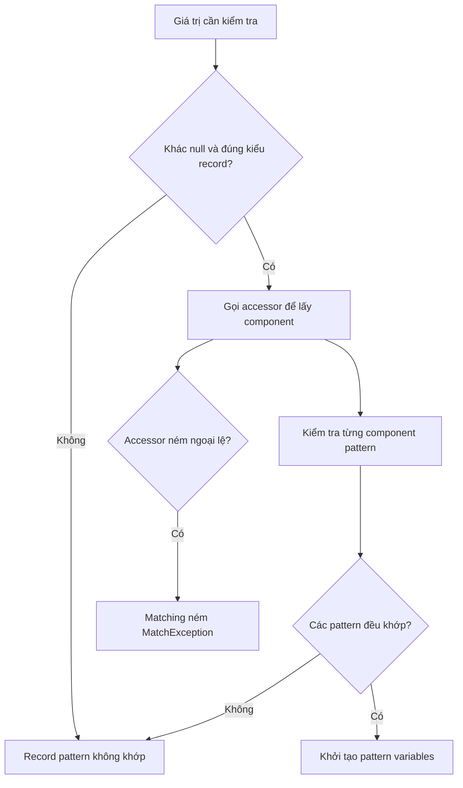

# Accessor được gọi khi deconstruction và tác động của accessor tùy chỉnh

Record pattern giúp lấy các thành phần của một record ngay trong biểu thức kiểm tra kiểu hoặc nhánh `switch`. Cú pháp trông giống như đọc trực tiếp các trường, nhưng theo đặc tả Java, quá trình deconstruction lấy từng giá trị bằng cách gọi accessor tương ứng của record.

Điểm này đặc biệt quan trọng khi record khai báo accessor tường minh. Accessor có thể ghi log, tạo bản sao phòng vệ, tính toán giá trị hoặc ném ngoại lệ. Những hành vi đó vẫn xảy ra khi record pattern được kiểm tra, dù mã nguồn tại vị trí sử dụng chỉ viết một pattern ngắn gọn.

Record Patterns đã là tính năng chính thức từ Java 21, vì vậy các ví dụ trong bài không cần bật preview feature.

## Mục tiêu học tập

Sau bài học, bạn có thể:

- Giải thích vì sao record pattern gọi accessor thay vì đọc trực tiếp component field.
- Xác định trường hợp accessor được gọi trong `instanceof`, `switch` và record pattern lồng nhau.
- Phân tích tác động của accessor tùy chỉnh, bao gồm logging, defensive copy và ngoại lệ.
- Giữ đúng hợp đồng của record khi khai báo accessor tường minh.
- Thiết kế accessor dễ dự đoán để pattern matching không gây tác dụng phụ ngoài ý muốn.

## 1. Deconstruction lấy giá trị qua accessor

Khai báo record sau:

```java
record User(String id, String displayName) {}
```

Với mỗi component, Java cung cấp một trường `private final` và một accessor `public` không tham số. Vì record không khai báo accessor riêng, compiler sinh các accessor trả về giá trị của component field tương ứng. Có thể gọi chúng trực tiếp:

```java
User user = new User("u-101", "An");

String id = user.id();
String name = user.displayName();
```

Record pattern thực hiện việc lấy các giá trị này tự động:

```java
static void printUser(Object value) {
    if (value instanceof User(String id, String displayName)) {
        System.out.println(id + ": " + displayName);
    }
}
```

Khi `value` là một `User` khác `null`, quá trình matching gọi `id()` và `displayName()` để lấy giá trị tương ứng rồi kiểm tra các component pattern. Trong ví dụ trên, `String id` và `String displayName` là các pattern variable được khởi tạo từ kết quả accessor.

Record pattern không truy cập trực tiếp các trường component. Vì thế, nếu một accessor được khai báo tường minh và có hành vi khác accessor mặc định, hành vi đó ảnh hưởng trực tiếp đến kết quả deconstruction.

### 1.1. Các điều kiện trước khi gọi accessor

Trước khi lấy component, giá trị phải phù hợp với kiểu record của pattern:

- Nếu giá trị là `null`, record pattern không khớp. Không có accessor nào của record được gọi.
- Nếu giá trị không thể chuyển sang kiểu record được nêu trong pattern, pattern không khớp và accessor không được gọi.
- Nếu giá trị là instance phù hợp, quá trình matching lấy từng component thông qua accessor tương ứng.

Danh sách component pattern phải có số phần tử bằng số component trong khai báo record. Các pattern lồng nhau tiếp tục được kiểm tra trên giá trị do accessor của record bên ngoài trả về.



Các pattern variable trong danh sách component chỉ được khởi tạo khi toàn bộ component pattern khớp. Nếu một component không khớp, kết quả của record pattern là không khớp; đây là tình huống khác với accessor ném ngoại lệ.

## 2. Accessor mặc định và accessor tùy chỉnh

Nếu record không khai báo accessor cho một component, accessor do compiler sinh ra chỉ trả về component field. Ví dụ:

```java
record Product(String code, int quantity) {}

Product product = new Product("P-01", 5);

if (product instanceof Product(var code, var quantity)) {
    System.out.println(code + " x " + quantity);
}
```

Ở đây, hai accessor được sinh tự động. Không có logic nghiệp vụ bổ sung nào được chạy ngoài việc lấy giá trị component.

Record cũng cho phép khai báo accessor tường minh. Accessor đó phải tuân thủ các điều kiện của ngôn ngữ:

- Là phương thức instance `public` và không có tham số.
- Kiểu trả về phải giống kiểu khai báo của component.
- Không được khai báo generic.
- Không có mệnh đề `throws`.

Ví dụ, accessor `displayName()` có thể ghi log trước khi trả về component field:

```java
record User(String id, String displayName) {
    public String displayName() {
        System.out.println("Đang đọc displayName");
        return this.displayName;
    }
}

static void printUser(Object value) {
    if (value instanceof User(var id, var name)) {
        System.out.println(id + ": " + name);
    }
}
```

Khi pattern khớp với một `User`, lời gọi accessor `displayName()` sẽ ghi log. Người đọc mã tại vị trí `instanceof` có thể không nhìn thấy lời gọi phương thức này, nhưng nó vẫn là một phần của quá trình matching.

Nếu cùng đối tượng được kiểm tra bằng record pattern ở hai vị trí khác nhau, accessor được thực thi trong mỗi lần matching tương ứng. Không nên coi kết quả accessor đã được lưu lại hoặc tự động tái sử dụng giữa các lần kiểm tra.

## 3. Giá trị accessor trả về là giá trị pattern nhận được

Vì deconstruction gọi accessor, pattern variable nhận kết quả trả về từ phương thức đó. Với accessor tùy chỉnh, kết quả có thể là một bản sao hoặc một giá trị được chuẩn hóa, miễn là accessor vẫn tuân thủ hợp đồng của record.

### 3.1. Defensive copy

Một tình huống hợp lệ là trả về bản sao để bên gọi có thể thao tác mà không làm thay đổi dữ liệu được lưu trong record:

```java
import java.util.ArrayList;
import java.util.List;

record Labels(List<String> values) {
    Labels {
        values = List.copyOf(values);
    }

    public List<String> values() {
        return new ArrayList<>(values);
    }
}
```

Constructor tạo một bản sao không thể thay đổi để lưu trong component field. Accessor trả về một `ArrayList` mới. Record pattern vì thế nhận bản sao có thể thay đổi:

```java
Labels labels = new Labels(List.of("java", "records"));

if (labels instanceof Labels(var extracted)) {
    extracted.add("temporary");
}

System.out.println(labels.values());
```

Việc thêm `temporary` chỉ thay đổi danh sách `extracted`. Component được lưu trong `labels` vẫn giữ nguyên. Ví dụ này vẫn đáp ứng hợp đồng sao chép của record vì danh sách mới có cùng nội dung và `List.equals` so sánh theo giá trị phần tử.

Điểm cần nhớ là kiểu của pattern variable được xác định từ kiểu component trong khai báo record, còn đối tượng thực tế mà biến nhận được là kết quả accessor. Với `Labels(var extracted)`, biến có kiểu `List<String>` và tham chiếu đến danh sách mới do accessor tạo ra.

### 3.2. Accessor trả về giá trị không tương ứng với component

Đoạn mã sau vẫn có thể biên dịch:

```java
record Temperature(int celsius) {
    public int celsius() {
        return celsius + 1;
    }
}

Temperature temperature = new Temperature(20);

if (temperature instanceof Temperature(var value)) {
    System.out.println(value); // 21
}
```

Pattern variable nhận `21` vì record pattern gọi `celsius()`. Tuy nhiên, accessor này làm sai hợp đồng của record: tạo một bản sao bằng các giá trị accessor trả về sẽ cho `new Temperature(21)`, không bằng record ban đầu có component field `20`.

Không nên viết accessor theo cách này. Một accessor tùy chỉnh cần trả về biểu diễn đúng của component để các thao tác đọc record nhất quán với constructor và các phương thức mặc định của record.

## 4. Side effect trong accessor ảnh hưởng đến pattern matching

Accessor là phương thức Java thông thường. Nếu thân phương thức ghi log, tăng bộ đếm, đọc dữ liệu bên ngoài, thay đổi trạng thái dùng chung hoặc thực hiện tính toán tốn kém, những việc đó có thể xảy ra khi pattern matching.

Ví dụ:

```java
record Request(String requestId) {
    public String requestId() {
        System.out.println("requestId() được gọi");
        return this.requestId;
    }
}

static boolean isKnownRequest(Object value) {
    return value instanceof Request(var requestId);
}
```

Mặc dù `isKnownRequest` chỉ có vẻ như kiểm tra kiểu và cấu trúc, lời gọi record pattern vẫn in ra log từ `requestId()`. Nếu hàm được gọi nhiều lần với cùng một đối tượng, dòng log có thể xuất hiện nhiều lần.

Các tác động cần cân nhắc:

- **Logging và metrics:** mỗi lần matching có thể tạo thêm log hoặc tăng bộ đếm. Điều này có thể làm số liệu phản ánh số lần đọc component thay vì số đối tượng duy nhất.
- **Truy cập tài nguyên bên ngoài:** đọc file, gọi dịch vụ hoặc truy vấn cơ sở dữ liệu khiến một thao tác kiểm tra pattern có độ trễ và phụ thuộc môi trường.
- **Thay đổi trạng thái:** sửa trạng thái dùng chung trong accessor có thể làm kết quả phụ thuộc vào thứ tự các thao tác khác trong chương trình.
- **Tính toán tốn kém:** một accessor tính lại dữ liệu phức tạp có thể bị gọi trong nhiều lần matching và làm tăng chi phí không dễ nhận ra ở nơi sử dụng pattern.

Vì record pattern được dùng trong `instanceof` và `switch`, side effect có thể xuất hiện trong điều kiện `if`, biểu thức chọn nhánh hoặc một pattern lồng sâu. Thiết kế an toàn là giữ accessor ngắn, xác định, ít tốn kém và không có side effect quan sát được.

Nếu cần logging hoặc metrics cho một luồng nghiệp vụ, hãy đặt chúng ở nơi gọi có chủ đích thay vì ẩn trong accessor. Nếu cần một phép tính có chi phí đáng kể, hãy đặt nó trong phương thức có tên thể hiện rõ hành động để người đọc nhận biết khi nào phép tính được thực hiện.

## 5. Accessor ném ngoại lệ

Accessor tường minh không được khai báo mệnh đề `throws`, nhưng thân phương thức vẫn có thể ném unchecked exception. Ví dụ:

```java
record Token(String value) {
    public String value() {
        if (this.value == null) {
            throw new IllegalStateException("Token chưa có giá trị");
        }
        return this.value;
    }
}

static void inspect(Object input) {
    if (input instanceof Token(var value)) {
        System.out.println(value);
    }
}
```

Nếu accessor ném `IllegalStateException`, quá trình matching không coi record pattern là không khớp. Theo JLS 21 §14.30.2, nếu lời gọi accessor hoàn tất bất thường vì lý do `S`, quá trình pattern matching hoàn tất bất thường bằng cách ném `MatchException` có `S` làm cause.

Có thể xử lý tại ranh giới phù hợp của ứng dụng:

```java
try {
    inspect(input);
} catch (MatchException ex) {
    Throwable cause = ex.getCause();
    System.err.println("Không thể deconstruct Token: " + cause);
}
```

Hãy phân biệt hai tình huống:

| Tình huống | Kết quả |
|---|---|
| Accessor trả về giá trị nhưng component pattern không khớp | Record pattern không khớp bình thường |
| Accessor ném ngoại lệ trong lúc được gọi | Pattern matching ném `MatchException` với nguyên nhân gốc làm cause |

Trong `switch`, `MatchException` phát sinh từ accessor cũng làm quá trình đánh giá pattern hoàn tất bất thường. Nhánh `default` không phải cơ chế thay thế cho việc xử lý lỗi accessor.

## 6. Record pattern lồng nhau cũng gọi accessor

Deconstruction có thể diễn ra nhiều cấp. Mỗi record pattern lồng nhau lấy component từ accessor của record tương ứng:

```java
record Address(String city) {
    public String city() {
        System.out.println("Đọc city");
        return this.city;
    }
}

record Customer(String id, Address address) {}

static void printCity(Object value) {
    if (value instanceof Customer(var id, Address(var city))) {
        System.out.println(id + " sống tại " + city);
    }
}
```

Để khớp pattern này, quá trình deconstruction lấy `id` và `address` qua accessor của `Customer`. Sau đó, pattern `Address(var city)` được kiểm tra trên giá trị `address` vừa nhận và lấy `city` qua accessor của `Address`.

Nếu accessor `Customer.address()` trả về `null`, record pattern lồng `Address(...)` không khớp vì `null` không khớp record pattern. Nếu accessor `Address.city()` ném unchecked exception, quá trình matching hoàn tất bất thường bằng `MatchException` như các trường hợp khác.

Khi phân tích một pattern lồng nhau, hãy lần theo từng cấp record để xác định accessor nào được gọi và giá trị trả về của accessor cấp trước được chuyển cho pattern cấp sau.

## 7. Hợp đồng của record khi khai báo accessor riêng

Record được thiết kế như một carrier minh bạch cho các component đã khai báo. Ngoài các ràng buộc về chữ ký accessor, Java API quy định một invariant cho record `R`: nếu tạo một bản sao bằng cách truyền các giá trị accessor của record ban đầu vào constructor canonical, bản sao phải bằng record ban đầu.

Ví dụ với `Labels` ở phần trước:

```java
Labels copy = new Labels(labels.values());
assert labels.equals(copy);
```

Đây là hợp đồng quan trọng khi accessor trả về defensive copy hoặc giá trị đã được chuẩn hóa. Giá trị accessor trả về phải đủ để tái tạo một record tương đương.

Một điểm dễ bỏ sót là các implementation mặc định của `equals`, `hashCode` và `toString` sử dụng component field trực tiếp. Chúng không gọi accessor. Vì vậy, accessor tùy chỉnh có thể khiến record pattern quan sát một giá trị khác với giá trị mà các phương thức mặc định này sử dụng nếu accessor được viết sai hợp đồng.

Ví dụ `Temperature` ở phần trước cho thấy sự khác biệt đó: pattern nhận `celsius + 1`, trong khi `equals` mặc định so sánh component field thực tế. Điều này có thể làm code khó hiểu khi một đoạn xử lý dùng record pattern còn đoạn khác dùng `equals` hoặc `toString`.

Khi cần accessor tường minh, hãy kiểm tra các điểm sau:

1. Accessor trả về đúng kiểu component và có ý nghĩa tương ứng với component đó.
2. Nếu accessor trả về bản sao, constructor và `equals` vẫn phải bảo đảm invariant sao chép.
3. Không để giá trị accessor thay đổi theo thời điểm, trạng thái toàn cục hoặc lần gọi.
4. Không dùng accessor để thực hiện I/O, gọi mạng hoặc thay đổi trạng thái nghiệp vụ.
5. Viết kiểm thử cho cả lời gọi accessor trực tiếp và deconstruction bằng record pattern.

## 8. Cách kiểm tra và chẩn đoán

Khi pattern cho ra giá trị bất ngờ hoặc có side effect không rõ nguồn gốc, hãy kiểm tra theo trình tự:

1. Xác nhận đối tượng có đúng kiểu record và không phải `null` tại thời điểm pattern được đánh giá.
2. Mở khai báo record và tìm accessor tường minh cho từng component trong pattern.
3. Gọi accessor trực tiếp trên cùng đối tượng để so sánh giá trị trả về với giá trị mà pattern variable nhận được.
4. Kiểm tra accessor có logging, metrics, truy cập tài nguyên, thay đổi trạng thái hoặc ném unchecked exception không.
5. Với pattern lồng nhau, tiếp tục kiểm tra accessor của từng record con.
6. Nếu nhận `MatchException`, xem `getCause()` để tìm lỗi phát sinh trong accessor.

Một kiểm thử nhỏ có thể xác nhận giá trị deconstruction:

```java
static String extractName(Object value) {
    if (value instanceof User(var id, var displayName)) {
        return displayName;
    }
    return "unknown";
}
```

Đặt một `User` có accessor tùy chỉnh vào `extractName` rồi xác minh kết quả. Nếu accessor tạo defensive copy, kiểm tra thêm rằng thay đổi pattern variable không làm thay đổi dữ liệu được giữ trong record. Nếu accessor có thể ném unchecked exception, kiểm tra `MatchException` và cause trong một test riêng.

Không nên dùng số lần log trong accessor làm hợp đồng nghiệp vụ. Log có thể giúp quan sát lúc phát triển, nhưng kiểm thử nên tập trung vào giá trị accessor trả về, invariant của record và kết quả matching.

## 9. Nguyên tắc thiết kế

| Nguyên tắc | Lý do |
|---|---|
| Ưu tiên accessor mặc định | Giá trị deconstruction khớp trực tiếp với component field và dễ dự đoán |
| Chỉ khai báo accessor riêng khi có nhu cầu rõ ràng | Mọi record pattern dùng component đó đều thực thi logic accessor |
| Giữ accessor không có side effect | Kiểm tra pattern không làm phát sinh log, I/O hoặc thay đổi trạng thái ngoài ý muốn |
| Trả về giá trị ổn định và tương ứng với component | Pattern variable, constructor và các phương thức record giữ được ý nghĩa nhất quán |
| Tuân thủ invariant sao chép | Record tạo lại từ các giá trị accessor phải bằng record ban đầu |
| Xử lý `MatchException` ở ranh giới thích hợp | Lỗi accessor là lỗi trong quá trình matching, không phải một kết quả không khớp thông thường |

Record pattern giúp mã nguồn ngắn gọn, nhưng không loại bỏ chi phí và hành vi của accessor. Hãy xem mỗi component pattern như một lời yêu cầu lấy dữ liệu qua API công khai của record. Khi accessor đơn giản và ổn định, deconstruction cũng đơn giản và ổn định.

## Tài liệu tham khảo

- [Java Language Specification, Java SE 21 — §14.30.2 Pattern Matching](https://docs.oracle.com/javase/specs/jls/se21/html/jls-14.html#jls-14.30.2): quy tắc matching record pattern, lời gọi accessor và `MatchException`.
- [Java Language Specification, Java SE 21 — §8.10.3 Record Members](https://docs.oracle.com/javase/specs/jls/se21/html/jls-8.html#jls-8.10.3): component field, accessor mặc định và điều kiện của accessor khai báo tường minh.
- [Java SE 21 API — `java.lang.Record`](https://docs.oracle.com/en/java/javase/21/docs/api/java.base/java/lang/Record.html): invariant sao chép của record và vai trò của constructor/accessor tùy chỉnh.
- [Java SE 21 Language Guide — Record Patterns](https://docs.oracle.com/en/java/javase/21/language/record-patterns.html): cú pháp record pattern, accessor tự động và pattern lồng nhau.
- [Java Language Changes for Java SE 21](https://docs.oracle.com/en/java/javase/21/language/java-language-changes-release.html): xác nhận Record Patterns là tính năng chính thức trong Java 21.
