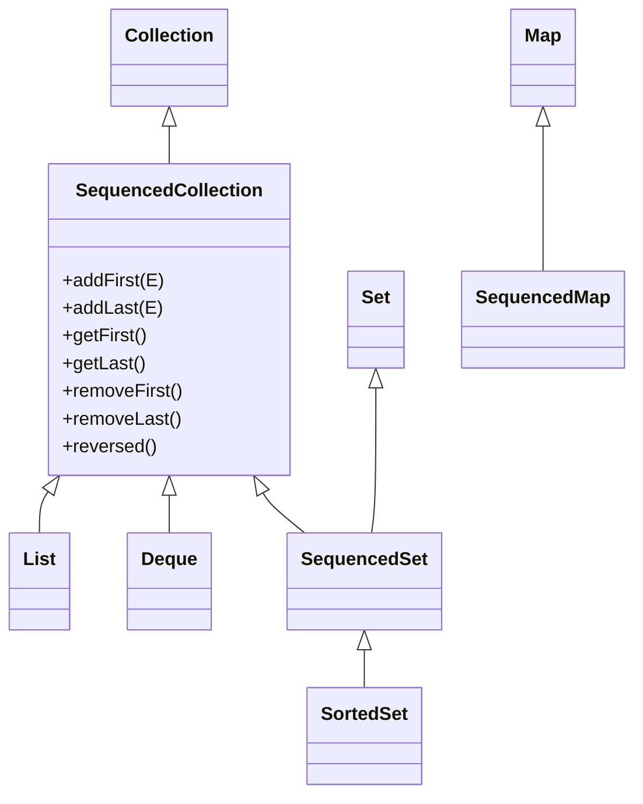

# Encounter order và nhu cầu truy cập hai đầu collection

Khi làm việc với collection, thứ tự phần tử có thể là một phần quan trọng của nghiệp vụ. Danh sách công việc cần giữ thứ tự thực hiện, tập người dùng cần duy trì thứ tự thêm vào, còn hàng đợi cần xử lý phần tử ở đầu và cuối. Trước Java 21, các kiểu collection có thứ tự cung cấp những cách truy cập hai đầu khác nhau, khiến mã dùng chung khó diễn đạt bằng một abstraction thống nhất.

Java 21 bổ sung `SequencedCollection` và các interface liên quan để mô hình hóa collection có encounter order xác định và hỗ trợ thao tác ở hai đầu. Thiết kế này giúp mã nguồn nói rõ rằng thứ tự phần tử có ý nghĩa, đồng thời cung cấp một bộ thao tác chung để đọc, thêm, xóa và xem collection theo chiều ngược lại.

## Mục tiêu học tập

Sau bài học, bạn có thể:

- Giải thích encounter order và phân biệt nó với thứ tự sắp xếp hoặc thứ tự ngẫu nhiên.
- Nhận diện loại collection phù hợp với `SequencedCollection`.
- Hiểu vì sao cần một abstraction chung cho thao tác ở đầu và cuối collection.
- Sử dụng các thao tác truy cập hai đầu và view đảo chiều trong ví dụ Java 21.
- Nhận biết giới hạn của collection bất biến và collection có thứ tự do comparator quyết định.

## 1. Encounter order là gì?

Encounter order là thứ tự mà các phần tử được duyệt khi chương trình đi qua collection, chẳng hạn bằng enhanced `for`, iterator hoặc các thao tác stream có bảo toàn encounter order như `forEachOrdered`. Với một collection có encounter order xác định, chương trình có thể dự đoán phần tử nào được gặp trước và phần tử nào được gặp sau.

Encounter order không nhất thiết là thứ tự phần tử được thêm vào. Nó phụ thuộc vào hợp đồng của kiểu collection:

| Loại collection | Encounter order | Ví dụ |
|---|---|---|
| List | Thứ tự vị trí của phần tử trong danh sách | `ArrayList`, `LinkedList` |
| Deque | Từ đầu deque đến cuối deque | `ArrayDeque`, `LinkedList` |
| Linked hash set | Thứ tự liên kết mà set duy trì khi thêm phần tử | `LinkedHashSet` |
| Sorted set | Thứ tự do natural ordering hoặc comparator xác định | `TreeSet` |
| Hash set thông thường | Không cam kết encounter order ổn định | `HashSet` |

Ví dụ, `LinkedHashSet` duy trì thứ tự thêm vào, trong khi `TreeSet` duy trì thứ tự sắp xếp. Cả hai đều có thứ tự duyệt xác định, nhưng ý nghĩa của thứ tự khác nhau. Với `HashSet`, chương trình không nên dựa vào thứ tự iterator trả về vì hợp đồng của kiểu này không bảo đảm một encounter order cụ thể.

Encounter order có ích khi thứ tự duyệt ảnh hưởng đến kết quả hoặc trải nghiệm người dùng, ví dụ:

- Hiển thị các bước xử lý theo đúng trình tự.
- Duyệt các sự kiện theo thứ tự đã ghi nhận.
- Lấy phần tử đầu tiên hoặc cuối cùng của một tập hợp có thứ tự.
- Xử lý hàng đợi từ đầu hoặc cuối tùy chiến lược.
- Tạo view đảo chiều mà không phải tự sao chép và đảo từng phần tử.

## 2. Vì sao cần abstraction cho hai đầu collection?

Các kiểu collection có encounter order đã tồn tại từ trước, nhưng khả năng thao tác hai đầu không đồng nhất. `Deque` có các phương thức như `addFirst`, `addLast`, `getFirst` và `removeLast`; `List` có truy cập theo chỉ số; `SortedSet` có phương thức lấy phần tử nhỏ nhất và lớn nhất theo thứ tự sắp xếp. Các abstraction này giải quyết những nhu cầu gần nhau bằng những API khác nhau.

Điều đó gây bất tiện khi một phương thức muốn nhận nhiều kiểu collection có thứ tự nhưng chỉ cần các thao tác chung như:

- Đọc phần tử đầu và cuối.
- Thêm phần tử ở đầu hoặc cuối khi kiểu cụ thể hỗ trợ.
- Loại bỏ phần tử đầu hoặc cuối khi collection có thể thay đổi.
- Duyệt theo chiều ngược lại.

Nếu tham số chỉ có kiểu `Collection<E>`, hợp đồng kiểu không cho phép gọi trực tiếp các thao tác hai đầu. Nếu dùng `List<E>`, phương thức không thể nhận một `LinkedHashSet<E>` dù set đó cũng có encounter order. Nếu dùng `Deque<E>`, phương thức lại giới hạn vào các cấu trúc deque.

`SequencedCollection<E>` giải quyết vấn đề này bằng cách biểu diễn đúng đặc tính chung: collection có encounter order xác định và có các thao tác chuẩn để làm việc với hai đầu. Nó không yêu cầu collection phải hỗ trợ truy cập ngẫu nhiên theo chỉ số.

## 3. Hệ thống interface Sequenced Collections trong Java 21

Java 21 bổ sung ba interface sequenced trọng tâm:



Các quan hệ quan trọng:

- `List<E>` mở rộng `SequencedCollection<E>`, vì danh sách có thứ tự vị trí.
- `Deque<E>` mở rộng `SequencedCollection<E>`, vì deque có đầu và cuối.
- `SequencedSet<E>` mở rộng cả `SequencedCollection<E>` và `Set<E>`, vì set có encounter order và không chứa phần tử trùng theo quy tắc của Set.
- `SortedSet<E>` mở rộng `SequencedSet<E>`, vì thứ tự sắp xếp cũng là một encounter order xác định.
- `SequencedMap<K, V>` là abstraction tương ứng cho map có encounter order của các ánh xạ; nó được trình bày riêng với các thao tác của collection.

Không phải mọi `Collection<E>` đều là `SequencedCollection<E>`. Ví dụ, `HashSet` không cam kết thứ tự duyệt và không thể được gán cho biến `SequencedCollection` chỉ vì nó triển khai `Collection`.

Các lớp cụ thể quen thuộc như `ArrayList`, `LinkedList`, `ArrayDeque`, `LinkedHashSet` và `TreeSet` có quan hệ với các interface sequenced tương ứng. Khi viết mã dùng abstraction, nên khai báo biến hoặc tham số bằng interface thể hiện đúng hợp đồng mà thuật toán cần.

## 4. Bộ thao tác chung của SequencedCollection

`SequencedCollection<E>` định nghĩa các thao tác ở hai đầu:

| Phương thức | Ý nghĩa |
|---|---|
| `addFirst(E)` | Thêm phần tử vào vị trí đầu theo encounter order |
| `addLast(E)` | Thêm phần tử vào vị trí cuối theo encounter order |
| `getFirst()` | Lấy phần tử đầu mà không xóa |
| `getLast()` | Lấy phần tử cuối mà không xóa |
| `removeFirst()` | Lấy và loại bỏ phần tử đầu |
| `removeLast()` | Lấy và loại bỏ phần tử cuối |
| `reversed()` | Trả về view có encounter order đảo ngược |

Các phương thức này bổ sung một cách diễn đạt thống nhất cho hai đầu collection. Mã nguồn không cần biết collection bên dưới là list, deque hay sequenced set để gọi `getFirst()` hoặc `getLast()`.

### 4.1. Ví dụ với List

Vì `List` mở rộng `SequencedCollection`, một list có thể được tham chiếu qua interface mới:

```java
import java.util.ArrayList;
import java.util.List;
import java.util.SequencedCollection;

List<String> tasks = new ArrayList<>(List.of("compile", "test"));
SequencedCollection<String> sequence = tasks;

sequence.addFirst("clean");
sequence.addLast("package");

System.out.println(sequence.getFirst()); // clean
System.out.println(sequence.getLast());  // package

sequence.removeFirst();
sequence.removeLast();

System.out.println(sequence); // [compile, test]
```

Biến `sequence` dùng abstraction chung, còn đối tượng thực tế vẫn là `ArrayList`. Các thao tác hai đầu được thể hiện rõ ràng mà không cần truy cập chỉ số `0` hoặc `size() - 1`.

### 4.2. Ví dụ với LinkedHashSet

`LinkedHashSet` duy trì encounter order và triển khai `SequencedSet`, vì vậy có thể dùng cùng API:

```java
import java.util.LinkedHashSet;
import java.util.SequencedSet;

SequencedSet<String> names = new LinkedHashSet<>();
names.add("An");
names.add("Binh");
names.addLast("Dung");
names.addFirst("Chi");

System.out.println(names); // [Chi, An, Binh, Dung]
System.out.println(names.getFirst()); // Chi
System.out.println(names.getLast());  // Dung
```

Đoạn mã có thể thao tác hai đầu set mà không cần chuyển set thành list. Quy tắc không trùng phần tử của `Set` vẫn được giữ. Với `SequencedSet`, nếu phần tử đã có trong set, `addFirst` hoặc `addLast` sẽ đưa phần tử đó đến vị trí đầu hoặc cuối tương ứng thay vì tạo phần tử trùng.

### 4.3. Ví dụ với Deque

`Deque` đã có các thao tác hai đầu và nay cũng là một `SequencedCollection`:

```java
import java.util.ArrayDeque;
import java.util.Deque;
import java.util.SequencedCollection;

Deque<String> deque = new ArrayDeque<>();
SequencedCollection<String> sequence = deque;

sequence.addLast("job-1");
sequence.addLast("job-2");
sequence.addFirst("urgent");

System.out.println(sequence.getFirst()); // urgent
System.out.println(sequence.getLast());  // job-2
```

Ví dụ cho thấy `SequencedCollection` có thể là kiểu tham chiếu chung cho các cấu trúc khác nhau, dù cách chúng lưu trữ phần tử bên trong không giống nhau.

## 5. Xem collection theo chiều ngược lại

Phương thức `reversed()` trả về một view có encounter order ngược với collection gốc. View này cho phép duyệt từ cuối về đầu mà không cần tạo một collection mới chỉ để đảo thứ tự.

```java
import java.util.ArrayList;
import java.util.List;
import java.util.SequencedCollection;

List<String> events = new ArrayList<>(List.of("created", "validated", "saved"));
SequencedCollection<String> newestFirst = events.reversed();

for (String event : newestFirst) {
    System.out.println(event);
}
```

Kết quả duyệt là:

```text
saved
validated
created
```

`reversed()` tạo view, không phải bản sao độc lập. Với collection có thể thay đổi và view hỗ trợ thay đổi, thay đổi qua view được phản ánh vào collection gốc và ngược lại. Vì vậy, nếu chỉ cần duyệt theo chiều ngược lại, không cần tạo `new ArrayList<>(...)` rồi gọi `Collections.reverse(...)`.

### 5.1. Thao tác trên view đảo chiều

View đảo chiều vẫn là một sequenced collection. Đầu và cuối của view được xác định theo encounter order đã đảo:

```java
List<String> steps = new ArrayList<>(List.of("one", "two", "three"));
SequencedCollection<String> reverse = steps.reversed();

System.out.println(reverse.getFirst()); // three
System.out.println(reverse.getLast());  // one

reverse.addFirst("zero-in-reverse");
System.out.println(steps); // [one, two, three, zero-in-reverse]
```

Thêm phần tử vào đầu view đảo chiều tương ứng với thêm phần tử vào cuối collection gốc. Điều này giúp thao tác trên view giữ nguyên ý nghĩa theo góc nhìn mà view đang trình bày.

### 5.2. Khi nào không nên dùng reversed view?

View đảo chiều rất hữu ích khi cần đọc hoặc thao tác trên cùng một collection theo chiều ngược lại. Tuy nhiên, hãy lưu ý:

- Nếu cần một snapshot độc lập để lưu trữ hoặc chuyển cho thành phần khác, hãy tạo bản sao tường minh.
- Nếu collection gốc không hỗ trợ sửa đổi, view cũng không trở thành collection có thể sửa đổi.
- Nếu implementation không hỗ trợ một thao tác cụ thể, gọi thao tác đó qua view vẫn có thể ném `UnsupportedOperationException`.
- Không nên vừa thay đổi collection vừa duyệt view nếu implementation không bảo đảm cách xử lý concurrent modification mà chương trình đang cần.

## 6. Collection có thứ tự nhưng không nhất thiết cho phép đặt tùy ý ở hai đầu

Encounter order xác định thứ tự duyệt; nó không có nghĩa mọi collection đều cho phép người gọi tùy ý quyết định phần tử nào đứng đầu hoặc cuối.

Ví dụ, `TreeSet` duy trì thứ tự dựa trên natural ordering hoặc comparator. Vị trí của một phần tử được quyết định bởi quy tắc sắp xếp. Do đó, dù `SortedSet` là một `SequencedSet`, thao tác yêu cầu chèn trực tiếp vào đầu hoặc cuối như `addFirst` và `addLast` không phù hợp với hợp đồng sắp xếp và implementation có thể ném `UnsupportedOperationException`.

```java
import java.util.SequencedSet;
import java.util.TreeSet;

SequencedSet<Integer> scores = new TreeSet<>();
scores.add(30);
scores.add(10);
scores.add(20);

System.out.println(scores.getFirst()); // 10
System.out.println(scores.getLast());  // 30
```

`getFirst()` và `getLast()` vẫn có ý nghĩa vì thứ tự sắp xếp xác định rõ hai đầu. Nhưng không nên kỳ vọng có thể ép một giá trị bất kỳ thành phần tử đầu bằng `addFirst()` trên một sorted set.

Đây là khác biệt giữa hai nhu cầu:

- **Đọc hai đầu:** cần biết phần tử đang đứng đầu hoặc cuối theo encounter order.
- **Điều khiển vị trí hai đầu:** cần có khả năng chủ động thêm hoặc chuyển phần tử đến đầu hoặc cuối.

Một abstraction chung có thể cung cấp tên phương thức thống nhất, nhưng implementation vẫn phải tuân thủ các ràng buộc về thứ tự và khả năng thay đổi của chính nó.

## 7. Collection rỗng và collection không hỗ trợ sửa đổi

Các phương thức truy cập và xóa ở hai đầu có hành vi khi collection rỗng:

| Phương thức | Khi collection rỗng |
|---|---|
| `getFirst()` | Ném `NoSuchElementException` |
| `getLast()` | Ném `NoSuchElementException` |
| `removeFirst()` | Ném `NoSuchElementException` |
| `removeLast()` | Ném `NoSuchElementException` |

Nếu collection có thể rỗng, hãy kiểm tra `isEmpty()` trước khi gọi hoặc xử lý ngoại lệ tại nơi phù hợp. Không giả định các phương thức này trả về `null` hay `Optional`.

Các phương thức thay đổi collection như `addFirst`, `addLast`, `removeFirst` và `removeLast` có thể không được hỗ trợ bởi một collection bất biến hoặc view không cho phép sửa đổi. Khi đó, implementation ném `UnsupportedOperationException` theo hợp đồng của thao tác không được hỗ trợ.

Ví dụ, `List.of(...)` tạo list không thể thay đổi:

```java
import java.util.List;
import java.util.SequencedCollection;

SequencedCollection<String> fixed = List.of("a", "b", "c");

System.out.println(fixed.getFirst()); // a
System.out.println(fixed.getLast());  // c
System.out.println(fixed.reversed()); // [c, b, a]

// fixed.addFirst("start"); // UnsupportedOperationException
```

Các thao tác đọc và tạo view vẫn hữu ích dù collection không sửa đổi được. Khả năng có encounter order và khả năng sửa đổi là hai đặc tính riêng biệt.

## 8. Chọn abstraction phù hợp trong API

Khi thiết kế phương thức nhận collection, hãy chọn kiểu tham số theo đúng hành vi mà phương thức cần:

| Nhu cầu | Kiểu tham số nên cân nhắc |
|---|---|
| Chỉ duyệt và thao tác tổng quát trên tập phần tử | `Collection<E>` |
| Cần encounter order và thao tác hai đầu | `SequencedCollection<E>` |
| Cần thứ tự và bảo đảm không có phần tử trùng | `SequencedSet<E>` |
| Cần hành vi hàng đợi hai đầu cụ thể | `Deque<E>` |
| Cần truy cập theo chỉ số và các thao tác đặc thù của list | `List<E>` |
| Cần thứ tự được xác định bởi comparator | `SortedSet<E>` hoặc `NavigableSet<E>` |

Ví dụ, một hàm chỉ cần đọc phần tử đầu và cuối có thể nhận `SequencedCollection`:

```java
static <E> void printEnds(SequencedCollection<E> values) {
    if (values.isEmpty()) {
        System.out.println("empty");
        return;
    }

    System.out.println("first=" + values.getFirst());
    System.out.println("last=" + values.getLast());
}
```

Hàm có thể nhận `ArrayList`, `LinkedList`, `ArrayDeque` hoặc `LinkedHashSet` mà không cần overload riêng, miễn là kiểu cụ thể đáp ứng hợp đồng `SequencedCollection`.

Nếu phương thức chỉ đọc, nên khai báo rõ rằng nó không thay đổi đầu vào trong tài liệu API. Kiểu `SequencedCollection` tự nó không có nghĩa collection bất biến hoặc mutable; khả năng sửa đổi vẫn phụ thuộc đối tượng thực tế.

## 9. Quy trình lựa chọn và sử dụng

Khi cần làm việc với một collection có thứ tự, hãy xác định lần lượt:

1. **Thứ tự có ý nghĩa gì?** Là thứ tự thêm vào, vị trí trong list, thứ tự comparator hay thứ tự xử lý của deque?
2. **Có cần thao tác ở hai đầu không?** Nếu chỉ cần duyệt, `Collection` hoặc abstraction hiện có có thể đã đủ. Nếu cần hai đầu, cân nhắc `SequencedCollection`.
3. **Có cần bảo đảm không trùng không?** Nếu có, dùng `SequencedSet` hoặc một subtype phù hợp.
4. **Có cần thay đổi vị trí không?** Kiểm tra implementation có hỗ trợ `addFirst` và `addLast`; sorted collection có thể không cho phép đặt vị trí tùy ý.
5. **Collection có thể rỗng hoặc bất biến không?** Xác định cách xử lý `NoSuchElementException` và `UnsupportedOperationException`.
6. **Có cần view hay snapshot?** Dùng `reversed()` khi cần góc nhìn ngược trên cùng collection; tạo bản sao khi cần dữ liệu độc lập.

## 10. Nguyên tắc thiết kế

- Dùng `SequencedCollection` khi thuật toán cần encounter order và các thao tác hai đầu.
- Không suy ra encounter order từ kết quả quan sát ngẫu nhiên của một implementation như `HashSet`.
- Phân biệt thứ tự thêm vào với thứ tự do comparator quyết định.
- Dùng `reversed()` để xem cùng collection theo chiều ngược lại; nhớ rằng đây là view.
- Kiểm tra collection rỗng trước khi gọi `getFirst`, `getLast`, `removeFirst` hoặc `removeLast` nếu đầu vào có thể rỗng.
- Kiểm tra khả năng sửa đổi trước khi gọi các thao tác thêm hoặc xóa.
- Chỉ chọn abstraction rộng hơn khi hợp đồng của thuật toán thực sự cần nó; dùng `List`, `Deque` hoặc `SequencedSet` khi cần hành vi riêng của các kiểu đó.

Sequenced Collections giúp biểu diễn encounter order và thao tác hai đầu bằng một bộ API thống nhất. Khi chọn đúng abstraction, thuật toán có thể làm việc với nhiều cấu trúc collection khác nhau mà vẫn giữ rõ ý nghĩa thứ tự, giới hạn sửa đổi và hành vi của từng implementation.

## Tài liệu tham khảo

- [Java SE 21 API — `SequencedCollection`](https://docs.oracle.com/en/java/javase/21/docs/api/java.base/java/util/SequencedCollection.html): encounter order, các thao tác hai đầu và reverse-ordered view.
- [Java SE 21 API — `SequencedSet`](https://docs.oracle.com/en/java/javase/21/docs/api/java.base/java/util/SequencedSet.html): hợp đồng sequenced dành cho Set.
- [Java SE 21 API — `List`](https://docs.oracle.com/en/java/javase/21/docs/api/java.base/java/util/List.html): quan hệ giữa List và SequencedCollection.
- [Java SE 21 API — `Deque`](https://docs.oracle.com/en/java/javase/21/docs/api/java.base/java/util/Deque.html): collection hai đầu và thứ tự từ đầu đến cuối deque.
- [JEP 431 — Sequenced Collections](https://openjdk.org/jeps/431): mục tiêu thiết kế và các interface sequenced được đưa vào Java 21.
