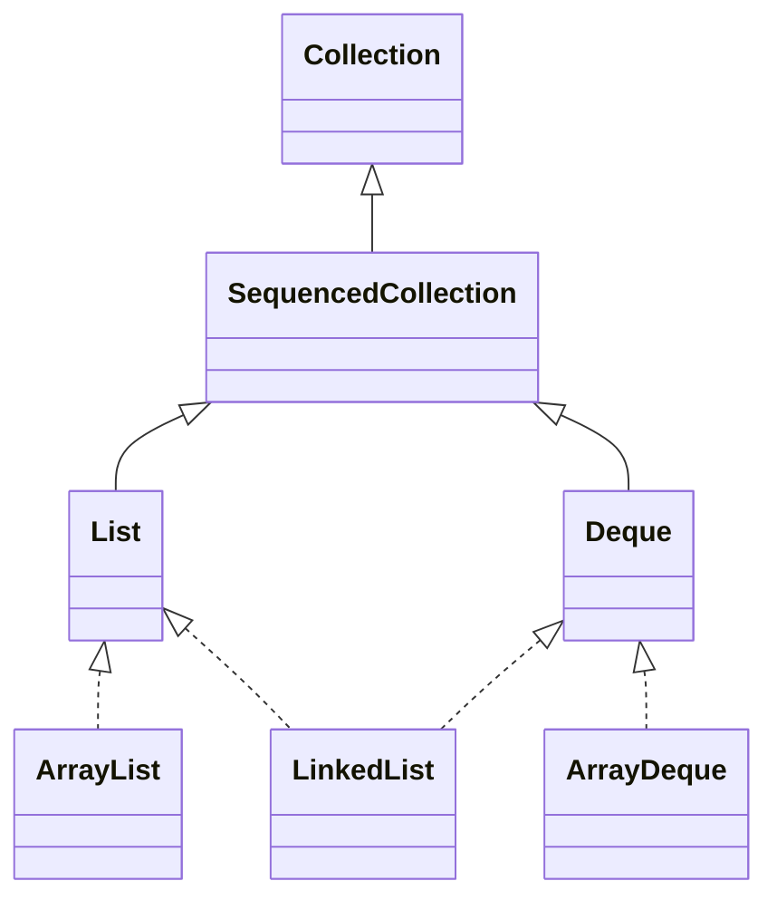

# Lựa chọn ArrayList, ArrayDeque hoặc LinkedList theo đặc tính thao tác

`ArrayList`, `ArrayDeque` và `LinkedList` đều là các collection có thứ tự trong Java, nhưng chúng được tối ưu cho những kiểu thao tác khác nhau. `ArrayList` phù hợp khi cần truy cập theo chỉ số; `ArrayDeque` phù hợp khi thường xuyên thêm hoặc lấy phần tử ở hai đầu; `LinkedList` có thể hữu ích khi cần đồng thời hợp đồng `List` và `Deque`, hoặc thường xuyên chèn/xóa tại vị trí đã có iterator.

Java 21 bổ sung họ giao diện **Sequenced Collections**, giúp các collection có thứ tự cung cấp một bộ thao tác thống nhất như `addFirst`, `addLast`, `getFirst`, `getLast`, `removeFirst`, `removeLast` và `reversed`. Giao diện thống nhất không làm các cấu trúc bên dưới có cùng hiệu năng: cùng một lời gọi `addFirst` có thể rất nhanh với `ArrayDeque` hoặc `LinkedList`, nhưng phải dịch chuyển phần tử với `ArrayList`.

## 1. Vị trí của ba collection trong Sequenced Collections

Java 21 định nghĩa `SequencedCollection<E>` cho collection có encounter order (thứ tự duyệt) xác định. `List` và `Deque` mở rộng giao diện này:



Sơ đồ chỉ thể hiện quan hệ chính: `LinkedList` triển khai cả `List` và `Deque`; `ArrayList` triển khai `List`; `ArrayDeque` triển khai `Deque`. Vì vậy:

| Lớp | Giao diện chính | Truy cập theo chỉ số |
|---|---|---|
| `ArrayList<E>` | `List<E>` | Có, hiệu quả |
| `ArrayDeque<E>` | `Deque<E>` | Không hỗ trợ chỉ số |
| `LinkedList<E>` | `List<E>`, `Deque<E>` | Có qua `List`, nhưng phải duyệt node |

`SequencedCollection` chuẩn hóa cách thao tác với phần tử đầu và cuối. Nó không yêu cầu mọi lớp phải có cùng cách lưu trữ hay cùng độ phức tạp.

## 2. So sánh cấu trúc dữ liệu

### ArrayList: mảng có thể mở rộng

`ArrayList` lưu các tham chiếu phần tử trong một mảng nội bộ có thể tăng dung lượng. Khi thêm phần tử vượt quá dung lượng hiện tại, implementation cần cấp phát mảng lớn hơn và sao chép các tham chiếu sang mảng mới.

Đặc điểm chính:

- Truy cập `get(index)` và cập nhật `set(index, value)` có độ phức tạp O(1).
- Thêm ở cuối thường có chi phí khấu hao O(1); một lần tăng dung lượng có thể cần O(n).
- Chèn hoặc xóa ở đầu hay giữa thường cần dịch chuyển các tham chiếu, nên có chi phí O(n) trong trường hợp tổng quát.
- Duyệt tuần tự thường hiệu quả nhờ các tham chiếu nằm liên tiếp trong mảng, tận dụng locality của bộ nhớ.
- Có thể chứa `null` và hỗ trợ truy cập theo chỉ số qua hợp đồng `List`.

Đây thường là lựa chọn mặc định tốt cho dữ liệu dạng danh sách khi ứng dụng cần đọc theo chỉ số, duyệt nhiều hoặc chủ yếu thêm ở cuối.

### ArrayDeque: deque dựa trên mảng vòng

`ArrayDeque` triển khai `Deque` bằng một mảng vòng có thể mở rộng. Hai đầu của deque được quản lý bằng vị trí đầu/cuối trong mảng; khi thêm hoặc lấy phần tử ở hai đầu, cấu trúc không cần dịch chuyển toàn bộ phần tử như `ArrayList`.

Đặc điểm chính:

- Thêm ở đầu/cuối có chi phí khấu hao O(1); khi mảng cần mở rộng, một thao tác riêng lẻ có thể tốn O(n).
- Lấy hoặc xóa ở đầu/cuối có chi phí O(1).
- Không hỗ trợ `get(index)` hoặc `set(index)` như `List`.
- Tìm kiếm bằng `contains` vẫn cần duyệt, thường là O(n).
- Không cho phép phần tử `null`.
- Có locality bộ nhớ tốt hơn linked list trong nhiều workload vì các tham chiếu được lưu trong mảng.

`ArrayDeque` phù hợp với hàng đợi FIFO, ngăn xếp LIFO và các thuật toán cần thêm/lấy phần tử ở cả hai đầu mà không cần truy cập theo chỉ số.

### LinkedList: danh sách liên kết đôi

`LinkedList` lưu mỗi phần tử trong một node riêng. Mỗi node giữ tham chiếu đến phần tử, node trước và node sau. Cấu trúc liên kết giúp thêm hoặc xóa node ở hai đầu mà không phải dịch chuyển các phần tử còn lại.

Đặc điểm chính:

- Thêm hoặc xóa ở đầu/cuối có chi phí O(1).
- Lấy phần tử theo chỉ số cần đi qua các node, nên `get(index)` và `set(index)` có chi phí O(n) trong trường hợp tổng quát.
- Chèn/xóa theo chỉ số cần tìm node trước, nên tổng chi phí thường là O(n).
- Nếu đã có `ListIterator` đứng đúng vị trí, thao tác `add` hoặc `remove` tại vị trí iterator có chi phí O(1), không cần tìm lại node.
- Mỗi node có overhead bộ nhớ và phải cấp phát riêng; locality thường kém hơn cấu trúc mảng.
- Có thể chứa `null` và triển khai cả `List` lẫn `Deque`.

`LinkedList` có thể phù hợp khi cần cả hai hợp đồng `List` và `Deque` trên cùng một đối tượng, hoặc khi chương trình thường xuyên sửa danh sách tại vị trí đã có iterator. Nó không tự động nhanh hơn `ArrayList` chỉ vì có thao tác chèn/xóa ở giữa.

## 3. Bảng độ phức tạp thao tác

Bảng sau mô tả độ phức tạp thường gặp của các implementation trong JDK. O(1) là thời gian hằng số; O(1) khấu hao nghĩa là chi phí trung bình trên một chuỗi thao tác là hằng số dù đôi khi có thao tác mở rộng mảng tốn O(n).

| Thao tác | `ArrayList` | `ArrayDeque` | `LinkedList` |
|---|---:|---:|---:|
| Lấy phần tử theo chỉ số | O(1) | Không hỗ trợ | O(n) |
| Cập nhật theo chỉ số | O(1) | Không hỗ trợ | O(n) |
| Thêm cuối | O(1) khấu hao | O(1) khấu hao | O(1) |
| Xóa cuối | O(1) | O(1) | O(1) |
| Thêm đầu | O(n) | O(1) khấu hao | O(1) |
| Xóa đầu | O(n) | O(1) | O(1) |
| Thêm/xóa ở chỉ số giữa | O(n) | Không hỗ trợ | O(n) để tìm vị trí; O(1) nếu đã có iterator tại đó |
| Tìm kiếm `contains` | O(n) | O(n) | O(n) |
| Duyệt toàn bộ | O(n) | O(n) | O(n) |

Độ phức tạp không mô tả toàn bộ thời gian chạy. Với cùng O(n), `ArrayList` thường có lợi thế nhờ locality và ít cấp phát node; với thao tác hai đầu, `ArrayDeque` thường là lựa chọn hiệu quả hơn cho một deque dựa trên mảng. Hãy đo trên workload thực tế nếu hiệu năng là yêu cầu quan trọng.

## 4. Chọn ArrayList khi cần List và truy cập theo chỉ số

Ví dụ, một màn hình hiển thị danh sách sản phẩm thường đọc nhiều phần tử theo vị trí, duyệt toàn bộ danh sách và thêm sản phẩm mới ở cuối:

```java
import java.util.ArrayList;
import java.util.List;

record Product(String code, String name) {
}

List<Product> products = new ArrayList<>();
products.add(new Product("P-01", "Keyboard"));
products.add(new Product("P-02", "Mouse"));
products.addLast(new Product("P-03", "Monitor"));

Product second = products.get(1);
Product last = products.getLast();
```

`ArrayList` phù hợp vì `get(1)` và `getLast()` đều truy cập trực tiếp vị trí trong mảng. Trong Java 21, `List` kế thừa các thao tác đầu/cuối của `SequencedCollection`, vì vậy có thể dùng `addFirst`, `addLast`, `getFirst`, `getLast`, `removeFirst`, `removeLast` và `reversed` với một `ArrayList`.

Tuy nhiên, API có sẵn không đồng nghĩa mọi thao tác đều rẻ. `products.addFirst(product)` phải dịch chuyển các phần tử hiện có để tạo chỗ ở đầu danh sách, nên có chi phí O(n). Nếu ứng dụng thường xuyên thêm/xóa đầu, hãy cân nhắc cấu trúc khác.

Khi biết trước số lượng phần tử gần đúng, có thể tạo `ArrayList` với initial capacity phù hợp hoặc dùng `ensureCapacity` để giảm số lần tăng mảng. Đây là tối ưu về cấp phát, không thay đổi độ phức tạp của chèn/xóa ở giữa.

## 5. Chọn ArrayDeque cho hàng đợi và ngăn xếp

### Hàng đợi FIFO

Hàng đợi FIFO xử lý phần tử theo thứ tự được thêm vào: thêm ở cuối, lấy ở đầu.

```java
import java.util.ArrayDeque;
import java.util.Deque;

Deque<String> jobs = new ArrayDeque<>();
jobs.addLast("job-001");
jobs.addLast("job-002");
jobs.addLast("job-003");

String nextJob = jobs.removeFirst(); // job-001
```

Hai thao tác ở đầu/cuối của `ArrayDeque` có chi phí khấu hao O(1), phù hợp với hàng đợi cần tăng giảm thường xuyên.

### Ngăn xếp LIFO

Ngăn xếp LIFO lấy phần tử được thêm gần nhất trước. Có thể dùng `push` và `pop` trên `Deque`:

```java
Deque<String> history = new ArrayDeque<>();
history.push("open-home");
history.push("open-settings");
history.push("edit-profile");

String lastAction = history.pop(); // edit-profile
```

`push` thêm ở đầu deque và `pop` lấy ở đầu deque. Với stack/queue không cần truy cập chỉ số, `ArrayDeque` thường là lựa chọn phù hợp.

`ArrayDeque` không cho phép `null`. Vì vậy, các phương thức như `peekFirst()` hoặc `pollFirst()` trả về `null` khi deque rỗng mà không bị nhầm với một phần tử `null` hợp lệ. Ngược lại, `getFirst()` và `removeFirst()` ném `NoSuchElementException` nếu deque rỗng. `LinkedList` cho phép `null`, nên nếu dùng `peekFirst()` hoặc `pollFirst()` với danh sách này, kết quả `null` có thể có nghĩa là deque rỗng hoặc phần tử đầu thực sự là `null`. Hãy chọn nhóm phương thức theo cách chương trình muốn xử lý trạng thái rỗng.

## 6. Khi nào LinkedList có lợi?

`LinkedList` có hai điểm khác biệt: nó triển khai đồng thời `List` và `Deque`, và nếu iterator đã ở đúng vị trí thì có thể chèn/xóa node mà không phải dịch chuyển phần tử.

Ví dụ:

```java
import java.util.LinkedList;
import java.util.ListIterator;

LinkedList<String> steps = new LinkedList<>();
steps.add("validate");
steps.add("save");
steps.add("notify");

ListIterator<String> iterator = steps.listIterator();
while (iterator.hasNext()) {
    if (iterator.next().equals("save")) {
        iterator.add("audit");
        break;
    }
}
```

Khi iterator đang đứng tại vị trí tìm được, `iterator.add("audit")` chèn node tại đó mà không dịch chuyển các phần tử còn lại. Tuy nhiên, việc tìm vị trí vẫn cần duyệt danh sách. Nếu chương trình thường xuyên gọi `get(index)` hoặc tìm vị trí theo chỉ số rồi mới chèn/xóa, tổng chi phí vẫn là O(n), và `ArrayList` có thể chạy nhanh hơn trong thực tế.

Một lý do khác để chọn `LinkedList` là một đối tượng cần đồng thời được truyền vào API nhận `List` và API nhận `Deque`. Chỉ nên chọn cách này khi yêu cầu hai hợp đồng trên cùng đối tượng là thực sự cần thiết; nếu chỉ cần thao tác hai đầu, `ArrayDeque` thường gọn và tiết kiệm bộ nhớ hơn.

## 7. API SequencedCollection trong Java 21

Trước Java 21, các thao tác ở đầu/cuối được thể hiện không đồng nhất giữa `List` và `Deque`. `Deque` đã có các phương thức như `addFirst` và `removeLast`, trong khi `List` chủ yếu dùng thao tác theo chỉ số. Java 21 giới thiệu `SequencedCollection` để chuẩn hóa các thao tác đó cho collection có encounter order.

Các phương thức chính:

| Phương thức | Ý nghĩa |
|---|---|
| `addFirst(e)` | Thêm phần tử vào đầu |
| `addLast(e)` | Thêm phần tử vào cuối |
| `getFirst()` | Lấy phần tử đầu, ném lỗi nếu rỗng |
| `getLast()` | Lấy phần tử cuối, ném lỗi nếu rỗng |
| `removeFirst()` | Lấy và xóa phần tử đầu, ném lỗi nếu rỗng |
| `removeLast()` | Lấy và xóa phần tử cuối, ném lỗi nếu rỗng |
| `reversed()` | Trả về view có encounter order đảo ngược |

Ví dụ với `List`:

```java
List<String> names = new ArrayList<>();
names.addLast("An");
names.addLast("Binh");
names.addFirst("Chi");

String first = names.getFirst();
List<String> reverseView = names.reversed();
```

`reversed()` trả về một view theo thứ tự ngược, không tạo bản sao độc lập. Thay đổi thông qua view được phản ánh vào collection gốc và ngược lại. Độ phức tạp của thao tác trên view phụ thuộc implementation nền: đảo thứ tự của một `ArrayList` không biến nó thành deque có thao tác đầu O(1).

`ArrayDeque` cũng hỗ trợ `reversed()` qua `Deque`. View đảo thứ tự giúp duyệt theo chiều ngược mà không cần sao chép collection chỉ để đảo thứ tự. Nếu cần một bản sao độc lập, hãy tạo collection mới từ view thay vì hiểu nhầm `reversed()` là thao tác copy.

## 8. Những khác biệt thực tế cần cân nhắc

| Tiêu chí | ArrayList | ArrayDeque | LinkedList |
|---|---|---|---|
| Mô hình dữ liệu | Mảng động | Mảng vòng | Node liên kết đôi |
| Có thứ tự duyệt | Có | Có | Có |
| Hợp đồng `List` | Có | Không | Có |
| Hợp đồng `Deque` | Không | Có | Có |
| Truy cập chỉ số | Nhanh | Không có | Chậm |
| Thao tác hai đầu | Đầu chậm, cuối nhanh | Nhanh | Nhanh |
| Chi phí bộ nhớ phụ | Dung lượng mảng dự phòng | Dung lượng mảng dự phòng | Tham chiếu node và overhead từng node |
| Cho phép `null` | Có | Không | Có |
| Locality khi duyệt | Thường tốt | Thường tốt | Thường kém hơn |

Ba lớp này đều không tự đồng bộ hóa. Nếu nhiều thread cùng thay đổi collection, cần cơ chế đồng bộ phù hợp hoặc chọn collection concurrent đáp ứng đúng yêu cầu. Không nên coi iterator fail-fast là cơ chế đồng bộ hay bảo đảm phát hiện mọi truy cập đồng thời.

## 9. Cây quyết định chọn collection

```text
Cần truy cập theo index thường xuyên?
  ├── Có  -> ArrayList
  └── Không
       |
       Cần thao tác add/remove ở hai đầu thường xuyên?
         ├── Có  -> ArrayDeque
         └── Không
              |
              Cần cả List và Deque trên cùng một đối tượng,
              hoặc thường sửa tại vị trí đã có ListIterator?
                ├── Có  -> Cân nhắc LinkedList
                └── Không -> Bắt đầu với ArrayList nếu cần List;
                             chọn cấu trúc theo API thực tế nếu không.
```

Đây là hướng dẫn chọn ban đầu. Với workload đặc biệt, hãy đo thời gian, allocation và bộ nhớ trên dữ liệu đại diện. Không nên chọn `LinkedList` chỉ vì một thao tác chèn/xóa có độ phức tạp O(1) sau khi đã tìm được node; chi phí tìm vị trí và cấp phát node vẫn có thể lớn hơn chi phí dịch chuyển mảng của `ArrayList`.

## 10. Kết luận

Hãy chọn collection theo thao tác chiếm ưu thế:

- Chọn **`ArrayList`** khi cần `List`, truy cập theo chỉ số, duyệt tuần tự và thêm cuối.
- Chọn **`ArrayDeque`** khi cần hàng đợi, ngăn xếp hoặc thao tác thường xuyên ở cả hai đầu.
- Chọn **`LinkedList`** khi cần cả `List` và `Deque` trên cùng đối tượng, hoặc khi có iterator tại vị trí thường xuyên chèn/xóa và chi phí node là chấp nhận được.

Sequenced Collections trong Java 21 mang lại API đầu/cuối thống nhất và view đảo thứ tự, giúp mã mô tả ý định rõ hơn. Để chọn đúng implementation, vẫn phải hiểu cấu trúc dữ liệu, độ phức tạp, bộ nhớ và đặc tính workload thực tế.

## Tài liệu tham khảo

- [JEP 431: Sequenced Collections](https://openjdk.org/jeps/431) — mục tiêu thiết kế và các giao diện Sequenced Collections được giới thiệu trong Java 21.
- [Java SE 21 API — SequencedCollection](https://docs.oracle.com/en/java/javase/21/docs/api/java.base/java/util/SequencedCollection.html) — hợp đồng thao tác đầu/cuối và `reversed()`.
- [Java SE 21 API — ArrayList](https://docs.oracle.com/en/java/javase/21/docs/api/java.base/java/util/ArrayList.html) — implementation `List` dựa trên mảng có thể mở rộng.
- [Java SE 21 API — ArrayDeque](https://docs.oracle.com/en/java/javase/21/docs/api/java.base/java/util/ArrayDeque.html) — implementation `Deque` dựa trên mảng có thể mở rộng và quy tắc không nhận `null`.
- [Java SE 21 API — LinkedList](https://docs.oracle.com/en/java/javase/21/docs/api/java.base/java/util/LinkedList.html) — implementation danh sách liên kết đôi của `List` và `Deque`.
