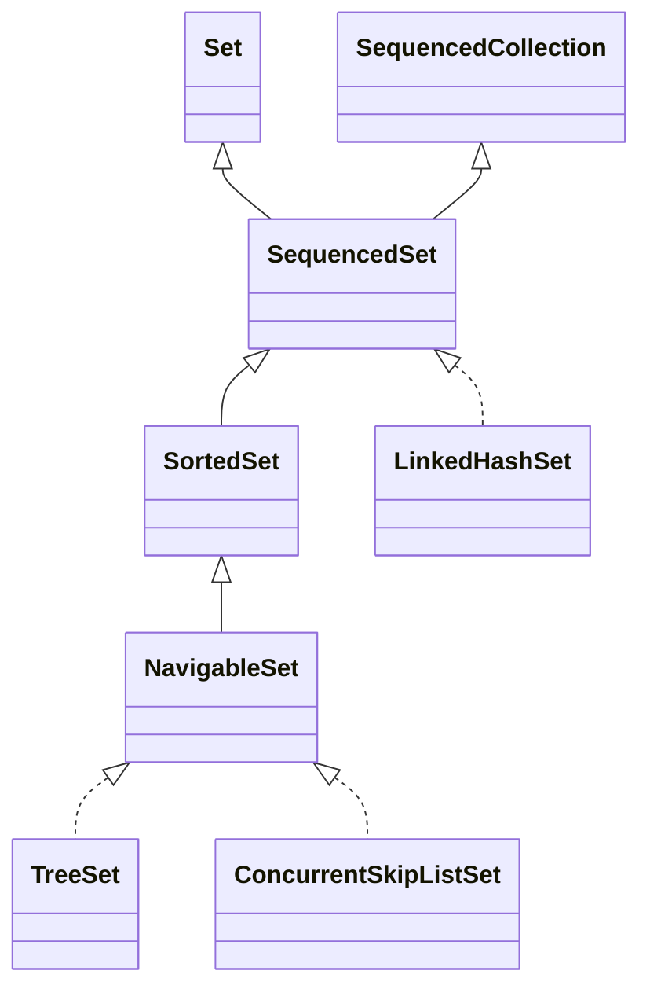

# Giới hạn addFirst, addLast trên các set có thứ tự sắp xếp

Java 21 bổ sung `SequencedSet<E>` để biểu diễn một tập hợp vừa không chứa phần tử trùng lặp, vừa có thứ tự duyệt xác định. Giao diện này kế thừa `SequencedCollection<E>` và `Set<E>`, vì vậy có các thao tác như `addFirst`, `addLast`, `getFirst`, `getLast`, `removeFirst`, `removeLast` và `reversed`.

Tuy nhiên, không phải mọi `SequencedSet` đều cho phép chủ động đặt một phần tử vào đầu hoặc cuối. Với `SortedSet`, thứ tự được quyết định bởi thứ tự tự nhiên hoặc `Comparator`; vì thế `addFirst` và `addLast` luôn ném `UnsupportedOperationException`. Đây là giới hạn có chủ đích: một thao tác thêm không thể yêu cầu phần tử đứng ở vị trí trái với thứ tự sắp xếp của tập hợp.

## 1. SequencedSet là gì?

`SequencedSet<E>` là giao diện kết hợp hai đặc tính:

- **Set:** các phần tử là duy nhất theo quy tắc bình đẳng của implementation.
- **SequencedCollection:** tập hợp có encounter order xác định, nghĩa là có thể xác định phần tử đầu, cuối và thứ tự duyệt.

Trong Java 21, quan hệ giao diện chính có thể hình dung như sau:



`LinkedHashSet` duy trì thứ tự chèn. `SortedSet` và các kiểu con như `NavigableSet` duy trì thứ tự dựa trên phép so sánh. `TreeSet` và `ConcurrentSkipListSet` là các implementation quen thuộc của nhóm sắp xếp.

Một điểm cần nhớ: `SequencedSet` không biến mọi set thành một danh sách có thể tùy ý sắp xếp. Nó chuẩn hóa cách quan sát và thao tác với hai đầu của encounter order; implementation vẫn quyết định encounter order được tạo ra như thế nào.

## 2. Hai kiểu encounter order khác nhau

### Thứ tự chèn với LinkedHashSet

`LinkedHashSet` giữ thứ tự các phần tử được thêm vào. Khi thêm một phần tử mới bằng `add`, phần tử được đặt ở cuối encounter order. Lệnh `add` với phần tử đã tồn tại không làm thay đổi vị trí của phần tử đó.

Java 21 bổ sung khả năng chủ động đổi vị trí bằng `addFirst` và `addLast`. Nếu phần tử đã có trong set, implementation sẽ di chuyển phần tử đến vị trí được yêu cầu.

```java
import java.util.LinkedHashSet;
import java.util.SequencedSet;

SequencedSet<String> tasks = new LinkedHashSet<>();
tasks.add("compile");
tasks.add("test");
tasks.add("package");

tasks.addFirst("clean");
System.out.println(tasks); // [clean, compile, test, package]

tasks.addLast("compile");
System.out.println(tasks); // [clean, test, package, compile]
```

`compile` không bị nhân đôi. Lần gọi `addLast("compile")` di chuyển phần tử đang tồn tại xuống cuối. Đây là hành vi đặc biệt của `LinkedHashSet` theo hợp đồng Java 21.

### Thứ tự sắp xếp với SortedSet

`SortedSet` xác định vị trí của phần tử bằng thứ tự tự nhiên (`Comparable`) hoặc `Comparator` được truyền khi tạo set. Khi gọi `add`, set tự tìm vị trí đúng theo thứ tự đó.

```java
import java.util.SortedSet;
import java.util.TreeSet;

SortedSet<Integer> scores = new TreeSet<>();
scores.add(30);
scores.add(10);
scores.add(20);

System.out.println(scores);          // [10, 20, 30]
System.out.println(scores.getFirst()); // 10
System.out.println(scores.getLast());  // 30
```

Thứ tự duyệt không phụ thuộc thứ tự gọi `add`. Phần tử nhỏ nhất theo thứ tự so sánh luôn ở đầu, còn phần tử lớn nhất theo thứ tự so sánh ở cuối.

Nếu dùng comparator đảo ngược, khái niệm đầu và cuối cũng đảo theo comparator:

```java
import java.util.Comparator;
import java.util.NavigableSet;
import java.util.TreeSet;

NavigableSet<Integer> descending =
        new TreeSet<>(Comparator.reverseOrder());

descending.add(10);
descending.add(30);
descending.add(20);

System.out.println(descending);             // [30, 20, 10]
System.out.println(descending.getFirst());  // 30
System.out.println(descending.getLast());   // 10
```

Vì vậy, “đầu” và “cuối” của `SortedSet` được xác định theo comparator, không nhất thiết là nhỏ nhất và lớn nhất theo thứ tự tự nhiên.

## 3. Vì sao SortedSet không hỗ trợ addFirst và addLast?

`addFirst(e)` yêu cầu phần tử `e` trở thành phần tử đầu tiên của encounter order. `addLast(e)` yêu cầu nó trở thành phần tử cuối cùng. Yêu cầu này phù hợp với collection có thứ tự chèn, nơi vị trí có thể được điều khiển độc lập với giá trị phần tử.

Với `SortedSet`, vị trí của phần tử đã được xác định bởi phép so sánh. Nếu set đang sắp xếp tăng dần, một giá trị lớn hơn mọi phần tử hiện có phải nằm ở cuối; một giá trị nhỏ hơn mọi phần tử phải nằm ở đầu. Không thể yêu cầu một giá trị bất kỳ đứng ở đầu hoặc cuối mà vẫn giữ nguyên quy tắc sắp xếp.

Vì lý do đó, đặc tả Java 21 quy định hai phương thức trên `SortedSet` luôn ném `UnsupportedOperationException`:

```java
import java.util.SortedSet;
import java.util.TreeSet;

SortedSet<Integer> numbers = new TreeSet<>();
numbers.add(10);
numbers.add(20);
numbers.add(30);

numbers.add(5);       // Hợp lệ: tự đặt 5 vào đầu theo thứ tự tăng dần.
numbers.add(40);      // Hợp lệ: tự đặt 40 vào cuối theo thứ tự tăng dần.

try {
    numbers.addFirst(25);
} catch (UnsupportedOperationException ex) {
    System.out.println("addFirst is not supported by SortedSet");
}

try {
    numbers.addLast(25);
} catch (UnsupportedOperationException ex) {
    System.out.println("addLast is not supported by SortedSet");
}
```

Hai lệnh `add(5)` và `add(40)` vẫn hoạt động bình thường vì chúng giao việc chọn vị trí cho comparator. Hai lệnh `addFirst` và `addLast` yêu cầu vị trí tường minh, nên bị từ chối ngay cả khi phần tử được truyền vào tình cờ có giá trị phù hợp với đầu hoặc cuối. Theo API của `SortedSet`, implementation của cả hai phương thức luôn ném `UnsupportedOperationException`.

Giới hạn này áp dụng cho các implementation sắp xếp như `TreeSet` và `ConcurrentSkipListSet`. Việc một implementation hỗ trợ thao tác thêm/xóa thông thường hoặc có khả năng truy cập hai đầu không có nghĩa nó hỗ trợ thêm ở vị trí tùy chọn.

## 4. Những thao tác đầu/cuối vẫn dùng được trên SortedSet

Không hỗ trợ `addFirst` và `addLast` không có nghĩa `SortedSet` không hỗ trợ các thao tác đầu/cuối khác. Trong Java 21, các phương thức sau có ý nghĩa rõ ràng với set sắp xếp:

| Phương thức | Hành vi trên SortedSet |
|---|---|
| `getFirst()` | Trả về phần tử đầu theo comparator; tương ứng `first()` |
| `getLast()` | Trả về phần tử cuối theo comparator; tương ứng `last()` |
| `removeFirst()` | Xóa và trả về phần tử đầu; ném `NoSuchElementException` nếu rỗng |
| `removeLast()` | Xóa và trả về phần tử cuối; ném `NoSuchElementException` nếu rỗng |
| `reversed()` | Trả về view của set với thứ tự so sánh/duyệt đảo ngược |

Với `NavigableSet`, có thêm `pollFirst()` và `pollLast()`. Hai phương thức này trả về phần tử đầu/cuối rồi xóa nó; nếu set rỗng, chúng trả về `null` thay vì ném `NoSuchElementException`.

Ví dụ:

```java
import java.util.NavigableSet;
import java.util.TreeSet;

NavigableSet<Integer> values = new TreeSet<>();
values.add(40);
values.add(10);
values.add(30);

int smallest = values.getFirst(); // 10
int largest = values.getLast();   // 40

int removedSmallest = values.removeFirst(); // 10
Integer removedLargest = values.pollLast(); // 40

System.out.println(values); // [30]
```

Các thao tác này không đặt một phần tử mới vào vị trí tùy ý. Chúng chỉ đọc hoặc loại bỏ phần tử mà thứ tự sắp xếp đã xác định ở hai đầu.

## 5. reversed() không biến SortedSet thành set có thứ tự chèn

`SequencedSet.reversed()` trả về một view có encounter order ngược với set gốc. Với `SortedSet`, view này vẫn giữ ngữ nghĩa sắp xếp, nhưng thứ tự so sánh được đảo ngược.

```java
NavigableSet<Integer> values = new TreeSet<>();
values.add(10);
values.add(20);
values.add(30);

NavigableSet<Integer> reverseView = values.reversed();

System.out.println(values);      // [10, 20, 30]
System.out.println(reverseView); // [30, 20, 10]
System.out.println(reverseView.getFirst()); // 30
```

`reverseView` là view gắn với set gốc, không phải bản sao độc lập. Thay đổi được hỗ trợ qua view sẽ tác động đến set gốc. Vì view vẫn là một `SortedSet`, `addFirst` và `addLast` trên view cũng không được hỗ trợ.

Nếu mục tiêu chỉ là duyệt theo thứ tự ngược, hãy dùng `reversed()` thay vì sao chép dữ liệu và tự đảo thứ tự. Nếu muốn điều khiển thứ tự chèn hoặc di chuyển một phần tử đến đầu/cuối, hãy chọn collection có thứ tự chèn như `LinkedHashSet`.

## 6. SequencedSet không đồng nghĩa với thứ tự có thể tùy chỉnh

Tên `SequencedSet` nhấn mạnh rằng set có encounter order xác định. Nó không cam kết mọi implementation đều cho phép sửa encounter order.

| Implementation | Cách xác định encounter order | `addFirst` / `addLast` |
|---|---|---|
| `LinkedHashSet` | Thứ tự chèn, có thể đổi vị trí bằng API đầu/cuối | Được hỗ trợ |
| `TreeSet` | Thứ tự tự nhiên hoặc comparator | Luôn ném `UnsupportedOperationException` |
| `ConcurrentSkipListSet` | Thứ tự tự nhiên hoặc comparator | Luôn ném `UnsupportedOperationException` |
| Unmodifiable `SequencedSet` view | Giữ thứ tự của set nền | Các thao tác sửa đổi ném `UnsupportedOperationException` |

Các phương thức thêm ở hai đầu là optional operations trong hợp đồng `SequencedCollection`. Vì vậy, việc biến có kiểu `SequencedSet<E>` cho phép gọi `addFirst` hoặc `addLast` ở compile time không bảo đảm implementation cụ thể hỗ trợ chúng ở runtime.

Ngoài ra, `Set.equals` và `Set.hashCode` không xét encounter order. Hai `SequencedSet` có cùng phần tử vẫn bằng nhau theo hợp đồng `Set`, dù thứ tự duyệt của chúng khác nhau. Không dùng `equals()` để kiểm tra thứ tự; nếu cần so sánh thứ tự, hãy duyệt và so sánh lần lượt các phần tử.

## 7. Chọn đúng kiểu set theo yêu cầu

**Dùng LinkedHashSet khi:**

- Cần loại bỏ phần tử trùng lặp và giữ thứ tự chèn.
- Cần di chuyển một phần tử đã tồn tại lên đầu hoặc xuống cuối.
- Cần tạo reverse view để duyệt từ phần tử mới nhất về phần tử cũ nhất.

**Dùng TreeSet hoặc một SortedSet khi:**

- Cần duy trì thứ tự theo giá trị hoặc theo một comparator nghiệp vụ.
- Cần các thao tác tìm phần tử gần nhất, lấy phần tử nhỏ nhất/lớn nhất hoặc truy vấn theo khoảng.
- Chấp nhận rằng vị trí được quyết định bởi thứ tự so sánh và không thể đặt tùy ý bằng `addFirst`/`addLast`.

Ví dụ, danh sách lịch sử thao tác cần thứ tự gần nhất/cũ nhất và có thể đưa một mục lên đầu có thể phù hợp với `LinkedHashSet`. Ngược lại, tập mã sản phẩm cần duy trì thứ tự từ nhỏ đến lớn theo mã nên dùng `TreeSet` với natural ordering hoặc comparator phù hợp.

Nếu một yêu cầu vừa cần sắp xếp theo khóa, vừa cần thứ tự thủ công độc lập, hãy tách hai khái niệm thành hai cấu trúc hoặc biểu diễn rõ khóa sắp xếp trong comparator. Không nên cố dùng `addFirst`/`addLast` để ghi đè thứ tự mà `SortedSet` cam kết duy trì.

## 8. Những lưu ý khi dùng Comparator

`SortedSet` xác định vị trí và tính duy nhất thông qua `compareTo` hoặc `Comparator.compare`. Nếu phép so sánh trả về `0`, set xem hai phần tử là cùng vị trí sắp xếp và không giữ cả hai như hai phần tử riêng biệt.

Để `SortedSet` tuân thủ đúng hợp đồng chung của `Set`, thứ tự so sánh nên nhất quán với `equals`. Nếu comparator coi hai đối tượng là bằng nhau trong khi `equals` coi chúng khác nhau, set vẫn có hành vi theo comparator nhưng có thể vi phạm kỳ vọng chung của `Set`.

Điều này cũng ảnh hưởng đến việc xác định phần tử đầu/cuối. `getFirst()` và `getLast()` phản ánh comparator, không phản ánh thời điểm phần tử được thêm vào. Khi thay comparator hoặc chọn comparator mới, cần xem lại ý nghĩa nghiệp vụ của hai đầu set.

## 9. Kết luận

`SequencedSet` trong Java 21 kết hợp tính duy nhất của `Set` với encounter order xác định. `LinkedHashSet` giữ thứ tự chèn và hỗ trợ `addFirst`/`addLast`, kể cả di chuyển phần tử đã tồn tại. `SortedSet` duy trì thứ tự theo natural ordering hoặc comparator, vì vậy hai phương thức thêm ở vị trí tường minh luôn ném `UnsupportedOperationException`.

Với set sắp xếp, hãy dùng `add` để comparator tự xác định vị trí; dùng `getFirst`, `getLast`, `removeFirst`, `removeLast` hoặc `reversed()` để thao tác với hai đầu theo thứ tự đã định. Khi cần thay đổi vị trí chèn một cách chủ động, hãy chọn `LinkedHashSet` hoặc một cấu trúc dữ liệu có encounter order có thể điều khiển.

## Tài liệu tham khảo

- [JEP 431: Sequenced Collections](https://openjdk.org/jeps/431) — thiết kế các giao diện Sequenced Collections được giới thiệu trong Java 21.
- [Java SE 21 API — SequencedSet](https://docs.oracle.com/en/java/javase/21/docs/api/java.base/java/util/SequencedSet.html) — hợp đồng của set có encounter order và `reversed()`.
- [Java SE 21 API — SortedSet](https://docs.oracle.com/en/java/javase/21/docs/api/java.base/java/util/SortedSet.html) — quy tắc `addFirst`/`addLast`, thứ tự comparator và thao tác hai đầu.
- [Java SE 21 API — LinkedHashSet](https://docs.oracle.com/en/java/javase/21/docs/api/java.base/java/util/LinkedHashSet.html) — thứ tự chèn và hành vi di chuyển phần tử bằng `addFirst`/`addLast`.
- [Java SE 21 API — TreeSet](https://docs.oracle.com/en/java/javase/21/docs/api/java.base/java/util/TreeSet.html) — implementation `NavigableSet` dựa trên cây và thứ tự sắp xếp.
- [Oracle Java 21 — Creating Sequenced Collections, Sets, and Maps](https://docs.oracle.com/en/java/javase/21/core/creating-sequenced-collections-sets-and-maps.html) — giải thích sự khác nhau giữa LinkedHashSet và SortedSet trong các thao tác thêm ở hai đầu.
