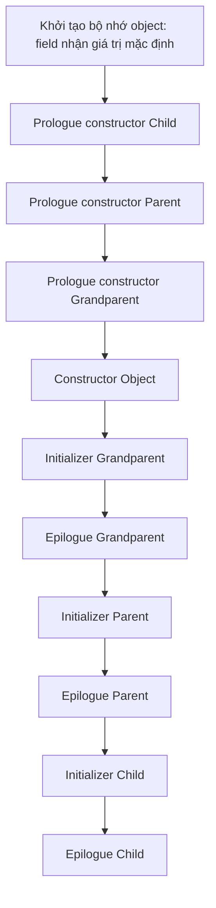

# Thứ tự khởi tạo trường, instance initializer và chuỗi constructor

Khi tạo một object Java, JVM không chạy ngay phần thân constructor của lớp cụ thể nhất. Trước hết, vùng nhớ cho object được cấp phát và các instance field nhận giá trị mặc định. Sau đó các constructor được gọi theo chuỗi kế thừa; khi constructor của superclass hoàn tất, field initializer và instance initializer của từng lớp lần lượt chạy, rồi phần còn lại của constructor lớp đó mới được thực thi.

Từ Java 25, Flexible Constructor Bodies (JEP 513) cho phép đặt một số câu lệnh trước lời gọi constructor tường minh `super(...)` hoặc `this(...)`. Điều này hữu ích khi cần kiểm tra tham số, chuẩn bị đối số cho superclass hoặc gán một số field trước khi constructor của superclass chạy. Các quy tắc khởi tạo field và instance initializer vẫn cần được hiểu chính xác để tránh ghi đè giá trị hoặc để superclass gọi nhầm trạng thái mặc định của subclass.

## 1. Phiên bản hiện hành của Flexible Constructor Bodies

Flexible Constructor Bodies có lịch sử preview trước khi trở thành ngôn ngữ Java chính thức:

| Phiên bản | JEP | Trạng thái |
| --- | --- | --- |
| Java 22 | JEP 447 — Statements before `super(...)` | Preview lần đầu |
| Java 23 | JEP 482 — Flexible Constructor Bodies | Preview lần hai |
| Java 24 | JEP 492 — Flexible Constructor Bodies | Preview lần ba |
| Java 25 | JEP 513 — Flexible Constructor Bodies | Final, không còn preview |

Tại ngày 25-11-2026, JDK 27 đã GA ngày 15-09-2026 và là feature release mới nhất; JDK 25 là bản LTS mới nhất. Flexible Constructor Bodies là tính năng ngôn ngữ final từ JDK 25 và tiếp tục dùng trực tiếp trên JDK 27. Không cần `--enable-preview` hoặc `--release` đặc biệt để sử dụng cú pháp này.

Vì module này học các tính năng Java 22 còn hữu ích trên Java hiện đại, cần phân biệt nguồn gốc với cách dùng hiện nay: Java 22 chỉ có bản preview đầu tiên; ví dụ trong bài dùng cú pháp final của JDK 25 trở lên.

## 2. Thứ tự khởi tạo object trong Java

### 2.1. Giá trị mặc định được gán trước

Khi một object được tạo, bộ nhớ dành cho tất cả instance field của lớp và các superclass được cấp phát. Trước khi bất kỳ constructor hoặc instance initializer nào chạy, mỗi field nhận giá trị mặc định theo kiểu:

| Kiểu field | Giá trị mặc định |
| --- | --- |
| `byte`, `short`, `int`, `long` | `0` |
| `float`, `double` | `0.0` |
| `char` | `\u0000` |
| `boolean` | `false` |
| Kiểu tham chiếu | `null` |

Đây là bước khởi tạo bộ nhớ của object. Nó xảy ra trước các giá trị được gán bởi field initializer, instance initializer block hoặc constructor.

### 2.2. Constructor của superclass chạy trước initializer của subclass

Với một lớp thông thường không khai báo lời gọi constructor tường minh, Java tự chèn lời gọi `super()` không tham số. Khi constructor của superclass kết thúc bình thường, Java mới chạy các instance field initializer và instance initializer block của lớp hiện tại theo thứ tự xuất hiện trong mã nguồn. Sau đó các câu lệnh còn lại trong constructor của lớp hiện tại mới chạy.

Với chuỗi kế thừa `Child extends Parent extends Grandparent`, thứ tự tổng quát là:

1. Prologue của constructor `Child` chạy trước lời gọi lên `Parent`.
2. Prologue của constructor `Parent` chạy trước lời gọi lên `Grandparent`.
3. Chuỗi constructor tiếp tục đi lên đến `Object`.
4. Khi chuỗi superclass trả về, initializer của `Grandparent` chạy theo thứ tự văn bản, rồi epilogue của `Grandparent`.
5. Initializer của `Parent` chạy theo thứ tự văn bản, rồi epilogue của `Parent`.
6. Initializer của `Child` chạy theo thứ tự văn bản, rồi epilogue của `Child`.

Nói cách khác, lời gọi đi từ subclass lên superclass; khi constructor superclass trả về, quá trình khởi tạo instance quay trở lại theo chiều superclass xuống subclass.



Sơ đồ mô tả trường hợp các constructor đi theo chuỗi `super(...)`. Nếu một constructor gọi constructor khác trong cùng lớp bằng `this(...)`, quy tắc delegation được trình bày riêng ở phần sau.

### 2.3. Field initializer và instance initializer block chạy theo thứ tự văn bản

Field initializer là biểu thức gán giá trị ngay tại khai báo instance field. Instance initializer block là block không có từ khóa `static` nằm trực tiếp trong thân lớp.

Hai loại initializer này được thực thi theo thứ tự văn bản của chúng trong lớp, như thể chúng là các bước khởi tạo được xếp nối tiếp nhau. Chúng chạy sau khi constructor của superclass hoàn tất và trước phần epilogue của constructor lớp hiện tại.

```java
class Parent {
    int parentValue = trace("Parent field initializer");

    {
        trace("Parent instance initializer");
    }

    Parent() {
        trace("Parent constructor body");
    }

    static int trace(String message) {
        System.out.println(message);
        return 1;
    }
}

class Child extends Parent {
    int first = trace("Child first field initializer");

    {
        trace("Child instance initializer");
    }

    int second = trace("Child second field initializer");

    Child() {
        trace("Child constructor body");
    }
}

public class InitializationOrder {
    public static void main(String[] args) {
        new Child();
    }
}
```

Kết quả:

```text
Parent field initializer
Parent instance initializer
Parent constructor body
Child first field initializer
Child instance initializer
Child second field initializer
Child constructor body
```

Constructor `Child()` không viết `super()`, nên Java tự chèn lời gọi đó. Constructor `Parent` và initializer của `Parent` hoàn tất trước khi initializer của `Child` chạy. Trong `Child`, `first`, instance initializer block và `second` chạy theo đúng thứ tự khai báo.

### 2.4. Static initializer là một quy trình riêng

Static field initializer và static initializer block chạy khi class được khởi tạo, không chạy lại cho mỗi object. Trong một chuỗi kế thừa, superclass được khởi tạo trước subclass; bên trong mỗi class, static field initializer và static initializer block chạy theo thứ tự văn bản.

Vì vậy, không nên gộp static initialization vào chuỗi instance constructor. Static initialization thiết lập trạng thái của class; instance initialization thiết lập trạng thái riêng của từng object.

## 3. Constructor chaining với `this(...)` và `super(...)`

Java có hai kiểu constructor invocation tường minh:

| Cú pháp | Ý nghĩa |
| --- | --- |
| `this(...)` | Gọi một constructor overload khác trong cùng class. |
| `super(...)` | Gọi constructor của direct superclass. |

Mỗi constructor chỉ có tối đa một constructor invocation tường minh. Một constructor không thể vừa gọi `this(...)` vừa gọi `super(...)`. Chuỗi `this(...)` cũng không được tạo vòng lặp trực tiếp hoặc gián tiếp.

Trước Java 25, lời gọi `this(...)` hoặc `super(...)` phải là câu lệnh đầu tiên trong constructor. Nếu không viết lời gọi tường minh, Java tự chèn `super()` trước phần thân constructor. Từ Java 25, có thể viết prologue trước lời gọi tường minh.

### 3.1. `this(...)` dùng để gom logic khởi tạo

Constructor gọi `this(...)` chuyển việc khởi tạo chính sang constructor được chọn. Các initializer của instance chỉ chạy một lần trong constructor chain, tại constructor thực hiện lời gọi lên superclass; chúng không chạy lại cho mỗi constructor trung gian gọi bằng `this(...)`.

```java
import java.util.Objects;

class User {
    private final String name;
    private final int age;

    User(String rawName) {
        String normalizedName = Objects.requireNonNull(rawName).strip();
        if (normalizedName.isEmpty()) {
            throw new IllegalArgumentException("name must not be blank");
        }

        // Prologue: chuẩn hóa và kiểm tra trước khi delegate.
        this(normalizedName, 0);
    }

    User(String name, int age) {
        if (age < 0) {
            throw new IllegalArgumentException("age must not be negative");
        }

        this.name = name;
        this.age = age;
    }
}
```

Constructor một tham số kiểm tra và chuẩn hóa dữ liệu trong prologue, rồi gọi constructor hai tham số bằng `this(...)`. Constructor hai tham số là nơi hoàn tất việc khởi tạo object. Cách tổ chức này tránh lặp lại logic gán field.

### 3.2. Constructor không viết lời gọi tường minh

Với class thông thường, nếu constructor không chứa `this(...)` hoặc `super(...)`, Java tự chèn `super()` và xem toàn bộ các câu lệnh đã viết là phần epilogue. Vì vậy, muốn chạy câu lệnh trước constructor của superclass, hãy viết lời gọi `super(...)` tường minh sau các câu lệnh prologue.

```java
class Base {
    Base(int value) {
        System.out.println("Base value = " + value);
    }
}

class Derived extends Base {
    Derived(String rawValue) {
        int value = Integer.parseInt(rawValue.strip());
        if (value < 0) {
            throw new IllegalArgumentException("value must not be negative");
        }

        super(value);
        System.out.println("Derived constructor body");
    }
}
```

Kết quả với `new Derived("42")`:

```text
Base value = 42
Derived constructor body
```

Việc phân tích và kiểm tra tham số xảy ra trước `super(value)`. Nếu dữ liệu không hợp lệ, constructor ném exception trước khi chạy constructor của superclass.

## 4. Flexible Constructor Bodies từ Java 25

### 4.1. Prologue và epilogue

Khi một constructor chứa lời gọi `this(...)` hoặc `super(...)`, các câu lệnh đứng trước lời gọi đó được gọi là **prologue**. Các câu lệnh đứng sau lời gọi là **epilogue**.

```java
class Parent {
    Parent(String value) {
        System.out.println(value);
    }
}

class Child extends Parent {
    Child(String input) {
        // Prologue: chạy trước lời gọi constructor.
        String normalized = input.strip();

        super(normalized);

        // Epilogue: chạy sau khi constructor Parent hoàn tất
        // và các initializer của Child đã chạy.
        System.out.println("Child is ready");
    }
}
```

Prologue có thể chứa các câu lệnh Java thông thường, chẳng hạn khai báo biến cục bộ, kiểm tra điều kiện, gọi static method, tính toán giá trị, ghi log hoặc ném exception. Kết quả của prologue có thể được dùng làm đối số cho `super(...)` hoặc `this(...)`.

### 4.2. Early construction context giới hạn việc truy cập object

Prologue và các biểu thức đối số của lời gọi constructor thuộc **early construction context**. Ở thời điểm này, object đang được xây dựng chưa hoàn tất. Java vì vậy giới hạn cách truy cập instance hiện tại.

Trong early construction context, không được:

- Đọc instance field của object đang xây dựng, dù viết `this.field` hay chỉ viết tên field.
- Gọi instance method của object đang xây dựng, dù viết `this.method()` hay chỉ viết `method()`.
- Dùng biểu thức `this` để truyền hoặc đọc object đang xây dựng.
- Truy cập field, gọi method hoặc method reference của superclass thông qua `super`.
- Tạo inner class cần chính object đang xây dựng làm enclosing instance.

Có thể dùng:

- Constructor parameters, local variables và các giá trị được tính từ chúng.
- Static field, static method và các API độc lập với object đang xây dựng.
- Điều kiện kiểm tra và `throw` để từ chối dữ liệu không hợp lệ.
- Phép gán trực tiếp cho blank instance field được khai báo trong chính class đó, theo các giới hạn ở phần tiếp theo.

Ví dụ không hợp lệ:

```java
class Parent {
    Parent() {}
}

class Example extends Parent {
    int count;

    Example() {
        count++;          // Lỗi: đọc instance field trước super(...).
        printStatus();    // Lỗi: gọi instance method trước super(...).
        super();
    }

    void printStatus() {
        System.out.println(count);
    }
}
```

Ví dụ hợp lệ:

```java
class Example extends Parent {
    Example(String input) {
        String value = input.strip();
        if (value.isEmpty()) {
            throw new IllegalArgumentException("input must not be blank");
        }

        super();
    }
}
```

Ở ví dụ hợp lệ, prologue chỉ sử dụng tham số và biến cục bộ, không truy cập object đang xây dựng.

### 4.3. Gán blank instance field trước `super(...)`

Một điểm quan trọng của JEP 513 là prologue được phép gán một instance field của chính class đang xây dựng trước khi gọi constructor superclass. Field được gán phải là field không có initializer tại khai báo. Đây là trường hợp đặc biệt được cho phép để khởi tạo sớm một phần trạng thái object; nó không cho phép đọc field hoặc gọi instance method trước `super(...)`.

```java
class Parent {
    Parent() {
        describe();
    }

    void describe() {
        System.out.println("Parent");
    }
}

class Child extends Parent {
    private final String label;

    Child(String rawLabel) {
        String normalized = rawLabel.strip();
        if (normalized.isEmpty()) {
            throw new IllegalArgumentException("label must not be blank");
        }

        // Gán blank final field trước khi Parent constructor chạy.
        this.label = normalized;
        super();
    }

    @Override
    void describe() {
        System.out.println("Child label = " + label);
    }
}

public class EarlyFieldInitialization {
    public static void main(String[] args) {
        new Child("  Java  ");
    }
}
```

Kết quả:

```text
Child label = Java
```

Khi `Parent()` gọi method `describe()`, dynamic dispatch chọn phiên bản override trong `Child`. Field `label` đã được gán trong prologue, nên method không nhìn thấy giá trị mặc định `null`.

Điều này hữu ích trong tình huống superclass constructor gọi một method có thể bị override. Tuy nhiên, gọi instance method có thể override từ constructor vẫn là thiết kế cần cân nhắc kỹ: object subclass chưa hoàn tất toàn bộ field initializer và instance initializer. Nếu có thể, nên tránh gọi method có thể override từ constructor superclass. Flexible Constructor Bodies giúp khởi tạo sớm các field cần thiết, nhưng không biến object đang xây dựng thành object đã hoàn tất.

### 4.4. Vì sao field có initializer không được gán sớm?

Field initializer và instance initializer block của class vẫn chạy sau khi constructor superclass hoàn tất. Vì thế, nếu cho phép gán sớm field có initializer, giá trị vừa gán có thể bị initializer ghi đè. Java không cho phép phép gán trong prologue vào field có initializer tại khai báo.

```java
class Parent {
    Parent() {}
}

class Counter extends Parent {
    private int count = 0;

    Counter(int initialCount) {
        this.count = initialCount; // Lỗi: field đã có initializer.
        super();
    }
}
```

Nếu cần gán `count` trước khi superclass constructor chạy, hãy bỏ initializer khỏi khai báo và gán field trong prologue:

```java
class Counter extends Parent {
    private final int count;

    Counter(int initialCount) {
        if (initialCount < 0) {
            throw new IllegalArgumentException("count must not be negative");
        }
        this.count = initialCount;
        super();
    }
}
```

Field `count` là blank final field: nó chưa có initializer và được gán đúng một lần. Sau khi constructor superclass kết thúc, các field initializer và instance initializer block của `Counter` vẫn chạy theo thứ tự văn bản. Những initializer đó không thể dùng để gán lại một blank final field đã được gán trong prologue.

## 5. Thứ tự thực thi chi tiết khi có Flexible Constructor Bodies

Với một constructor subclass có prologue và gọi `super(...)`, thứ tự đáng chú ý là:

1. Bộ nhớ object được cấp phát; tất cả instance field nhận giá trị mặc định.
2. Prologue của constructor subclass chạy. Nó có thể kiểm tra tham số, tính toán đối số và gán blank instance field hợp lệ của chính subclass.
3. Các đối số của `super(...)` được tính theo thứ tự từ trái sang phải.
4. Constructor superclass chạy theo quy tắc tương tự. Chuỗi tiếp tục đến `Object`.
5. Khi constructor superclass trực tiếp trả về, field initializer và instance initializer block của subclass chạy theo thứ tự văn bản.
6. Epilogue của constructor subclass chạy.

Với constructor gọi `this(...)`, prologue của constructor hiện tại chạy trước, sau đó constructor được delegate thực hiện. Initializer của class không chạy lại trong từng constructor gọi `this(...)`; chúng chạy một lần trong nhánh constructor cuối cùng gọi lên superclass. Khi constructor được delegate hoàn tất, epilogue của constructor gọi `this(...)` mới tiếp tục.

Một ví dụ rút gọn cho chuỗi `this(...)`:

```java
class Order {
    private final String code;
    private final int quantity;

    Order(String rawCode) {
        String normalized = rawCode.strip();
        if (normalized.isEmpty()) {
            throw new IllegalArgumentException("code must not be blank");
        }
        this(normalized, 1);
    }

    Order(String code, int quantity) {
        if (quantity <= 0) {
            throw new IllegalArgumentException("quantity must be positive");
        }
        this.code = code;
        this.quantity = quantity;
    }
}
```

Constructor một tham số có prologue để chuẩn hóa dữ liệu rồi delegate sang constructor hai tham số. Constructor hai tham số là constructor thực hiện chuỗi khởi tạo superclass và gán các field. Không có hai lần chạy instance initializer cho cùng một object.

## 6. Những trường hợp cần nhớ

| Trường hợp | Điều xảy ra |
| --- | --- |
| Constructor không có `this(...)`/`super(...)` | Java chèn `super()`; các câu lệnh trong constructor là epilogue. |
| Constructor có prologue rồi `super(...)` | Prologue chạy trước superclass; initializer của class chạy sau khi superclass hoàn tất. |
| Constructor có prologue rồi `this(...)` | Prologue chạy trước constructor được delegate; initializer chỉ chạy một lần trong chuỗi constructor. |
| Superclass constructor gọi method bị override | Method subclass có thể chạy trước initializer của subclass; blank field được gán trong prologue có thể giúp tránh giá trị mặc định. |
| Gán field có initializer trong prologue | Lỗi biên dịch vì initializer vẫn chạy sau superclass và có thể ghi đè giá trị. |
| Đọc field hoặc gọi instance method trong prologue | Lỗi biên dịch do object đang xây dựng chưa ở late construction context. |
| Constructor của record không canonical | Có thể kiểm tra/chuyển đổi tham số trước khi gọi canonical constructor bằng `this(...)`. |

## 7. Thực hành tốt

- Dùng prologue để xác thực dữ liệu và tính toán đối số cho `super(...)` hoặc `this(...)`.
- Nếu cần gán field trước superclass constructor, chỉ dùng blank instance field của chính class đang xây dựng; không khai báo initializer cho field đó.
- Không cố đọc `this`, instance field hoặc gọi instance method trong early construction context.
- Giữ logic constructor đơn giản. Đưa phép tính độc lập vào static method hoặc helper nhận tham số rõ ràng.
- Tránh gọi method có thể override từ constructor superclass. Nếu không thể thay đổi thiết kế đó, chỉ gán sớm những field mà method override thực sự cần.
- Giữ field initializer và instance initializer block cho trạng thái cần thiết lập sau khi superclass constructor hoàn tất.
- Dùng `this(...)` để gom logic khởi tạo vào một constructor chính và tránh lặp lại thao tác gán field.
- Không bật preview flag cho Flexible Constructor Bodies trên JDK 25 hoặc JDK 27; tính năng đã final.

## 8. Ghi nhớ

Thứ tự khởi tạo instance trong Java bắt đầu bằng giá trị mặc định cho mọi field. Constructor chain sau đó gọi từ subclass lên superclass; khi superclass constructor hoàn tất, field initializer và instance initializer block của từng class chạy theo thứ tự văn bản, rồi epilogue của constructor class đó mới chạy. Constructor gọi `this(...)` delegate sang constructor khác trong cùng class và không làm initializer chạy lặp lại.

Flexible Constructor Bodies cho phép viết prologue trước `super(...)` hoặc `this(...)`. Prologue có thể kiểm tra tham số, tính toán đối số và gán blank instance field hợp lệ của class hiện tại. Nó không được đọc instance field, gọi instance method hoặc sử dụng object đang xây dựng như một object đã hoàn chỉnh. JEP 513 đã final từ Java 25 và dùng ổn định trên JDK 27.

## Tài liệu tham khảo

- [JEP 513: Flexible Constructor Bodies](https://openjdk.org/jeps/513)
- [Flexible Constructor Bodies — Java SE 27](https://docs.oracle.com/en/java/javase/27/language/flexible-constructor-bodies.html)
- [Java Language Changes by Release — Java SE 25](https://docs.oracle.com/en/java/javase/25/language/java-language-changes-release.html)
- [Java Language Specification — Classes, Java SE 25](https://docs.oracle.com/javase/specs/jls/se25/html/jls-8.html)
- [JDK 27 Release Notes](https://www.oracle.com/java/technologies/javase/27-relnote-issues.html)
- [Oracle Java Downloads: JDK 27 and JDK 25 LTS](https://www.oracle.com/java/technologies/downloads/)
