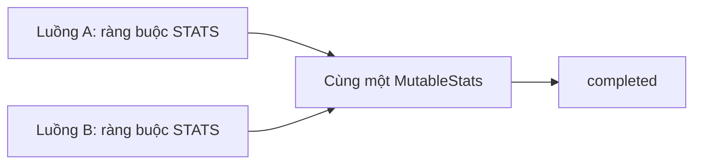

# Tách biệt phạm vi ràng buộc với tính an toàn luồng của đối tượng được tham chiếu

## 1. Bối cảnh và mục tiêu

Trong chương Scoped Value của module Java 22, bài này làm rõ hai câu hỏi độc lập:

- Trong lời gọi và luồng hiện tại, `ScopedValue.get()` trả về tham chiếu nào?
- Nếu nhiều luồng cùng có tham chiếu đến một đối tượng, các thao tác trên đối tượng đó có an toàn không?

Scoped Values xuất hiện ở Java 22 dưới dạng **preview lần thứ hai**, vì vậy không nên coi Java 22 là lần đầu tính năng này tồn tại. Từ Java 25, API đã trở thành tính năng chính thức. Bài tập trung vào nguyên lý còn áp dụng với Java hiện đại và sử dụng `ScopedValue.where(...).run(...)`, có ở cả Java 22 và Java 25. Xem [các thay đổi ở JDK 22](https://docs.oracle.com/en/java/javase/25/migrate/significant-changes-jdk-22.html), [các thay đổi ở JDK 25](https://docs.oracle.com/en/java/javase/25/migrate/significant-changes-jdk-25.html) và [Carrier của Java 22](https://docs.oracle.com/en/java/javase/22/docs/api/java.base/java/lang/ScopedValue.Carrier.html).

Sau bài học, bạn cần giải thích được vì sao một ràng buộc được quản lý đúng phạm vi vẫn có thể dẫn tới lỗi tranh chấp dữ liệu nếu giá trị được ràng buộc là đối tượng mutable dùng chung.

## 2. Khóa, ràng buộc và đối tượng là ba khái niệm khác nhau

Xét khai báo:

```java
private static final ScopedValue<StringBuilder> MESSAGE =
        ScopedValue.newInstance();
```

Có ba thành phần cần phân biệt:

| Thành phần | Vai trò | Điều không thể suy ra |
| --- | --- | --- |
| Khóa `MESSAGE` | Định danh dùng để tìm ràng buộc hiện hành | `static` không có nghĩa mọi luồng nhận cùng một giá trị |
| Ràng buộc trong phạm vi động | Liên kết khóa với giá trị khi thực thi một thao tác | Có phạm vi không đồng nghĩa đối tượng được sao chép |
| Đối tượng `StringBuilder` | Dữ liệu được truy cập qua tham chiếu trả về | Khóa `final` không làm nội dung builder bất biến |

Phạm vi động đi theo quá trình thực thi: phương thức được gọi trực tiếp hoặc gián tiếp trong thao tác có thể đọc ràng buộc nếu truy cập được khóa. Hai luồng có thể dùng cùng khóa nhưng ràng buộc những giá trị khác nhau. Một phạm vi lồng nhau có thể tạo ràng buộc mới; khi nó kết thúc, ràng buộc trước đó được khôi phục, kể cả khi thao tác ném ngoại lệ. Đây là các quy tắc của [ScopedValue trong Java 22](https://docs.oracle.com/en/java/javase/22/docs/api/java.base/java/lang/ScopedValue.html).

Có thể hình dung:

```text
khóa ScopedValue
        |
        v
ràng buộc hiện hành trong luồng/phạm vi
        |
        v
tham chiếu --------------------> đối tượng trên heap
                                      |
                                      v
                              trạng thái và đối tượng con
```

Từ mô hình này, cần xem xét cả những tham chiếu khác đến cùng đối tượng, gọi là **alias**. Một phương thức giữ alias vẫn có thể sửa đối tượng, dù nó không đọc khóa Scoped Value.

Bản thân `ScopedValue.Carrier` được tài liệu quy định là immutable và thread-safe. Tính chất này thuộc đối tượng chứa các ánh xạ; nó không biến các giá trị được ánh xạ thành immutable. Xem [đặc tả Carrier](https://docs.oracle.com/en/java/javase/25/docs/api/java.base/java/lang/ScopedValue.Carrier.html).

## 3. Ví dụ: khôi phục ràng buộc không hoàn tác thay đổi dữ liệu

Ví dụ hoàn chỉnh dưới đây chỉ chạy trên một luồng, nhằm quan sát riêng cơ chế phạm vi. Lưu mã thành `ScopeObjectDemo.java` nếu muốn thực hành:

```java
public class ScopeObjectDemo {
    private static final ScopedValue<StringBuilder> MESSAGE =
            ScopedValue.newInstance();

    public static void main(String[] args) {
        StringBuilder original = new StringBuilder("outer");

        ScopedValue.where(MESSAGE, original).run(() -> {
            System.out.println("outer before = " + MESSAGE.get());

            MESSAGE.get().append("/edited");

            ScopedValue.where(
                    MESSAGE,
                    new StringBuilder("inner")
            ).run(() -> {
                MESSAGE.get().append("/local");
                System.out.println("inner = " + MESSAGE.get());
            });

            System.out.println("outer after = " + MESSAGE.get());
        });

        System.out.println("bound outside = " + MESSAGE.isBound());

        original.append("/after-scope");
        System.out.println("original = " + original);
    }
}
```

Kết quả dự kiến:

```text
outer before = outer
inner = inner/local
outer after = outer/edited
bound outside = false
original = outer/edited/after-scope
```

Diễn giải theo danh tính đối tượng:

1. Ràng buộc ngoài trỏ tới đối tượng mà biến `original` đang giữ.
2. `append("/edited")` sửa chính đối tượng đó.
3. Ràng buộc trong trỏ tới một builder khác; thao tác `append("/local")` tác động lên builder mới.
4. Khi phạm vi trong kết thúc, `get()` lại tìm thấy đối tượng ngoài, với nội dung đã sửa.
5. Sau phạm vi ngoài, khóa không còn được ràng buộc trong luồng này, nhưng alias `original` vẫn sử dụng được.

Nếu thay builder mới ở phạm vi trong bằng `original`, cả hai phạm vi sẽ trỏ tới cùng đối tượng. Khi đó, thay đổi dữ liệu trong phạm vi trong vẫn còn nhìn thấy ở phạm vi ngoài.

**Rebinding thay đổi kết quả tra cứu tham chiếu trong phạm vi lồng nhau; nó không tạo giao dịch hay bản sao dữ liệu.**

Để chạy trên **đúng JDK 22**, cần bật preview khi biên dịch và chạy:

```shell
javac --enable-preview --release 22 ScopeObjectDemo.java
java --enable-preview ScopeObjectDemo
```

Với **JDK 25**, ví dụ này dùng API chính thức:

```shell
javac --release 25 ScopeObjectDemo.java
java ScopeObjectDemo
```

Các lệnh đầu dành cho bộ công cụ JDK 22; không dùng JDK 25 để biên dịch preview của Java 22. Quy tắc bật preview theo phiên bản được trình bày trong [tài liệu preview của Java 22](https://docs.oracle.com/en/java/javase/22/core/scoped-values.html).

## 4. Hai ràng buộc riêng vẫn có thể trỏ tới một đối tượng chung

Giả sử hai luồng đều có ràng buộc tới cùng một `MutableStats`:

```java
final class MutableStats {
    int completed;
}
```

Quan hệ tham chiếu có thể là:



Đây là sơ đồ chia sẻ đối tượng, không ngụ ý mọi cách tạo luồng đều tự kế thừa ràng buộc.

Giả sử cả hai luồng đều thực hiện thao tác sau trên đối tượng chung:

```java
stats.completed++;
```

Một lịch xen kẽ có thể xảy ra:

| Bước | Luồng A | Luồng B |
| --- | --- | --- |
| 1 | Đọc `completed = 0` | |
| 2 | | Đọc `completed = 0` |
| 3 | Tính `0 + 1`, ghi `1` | |
| 4 | | Tính `0 + 1`, ghi `1` |

Cả hai lần tăng đã chạy, nhưng kết quả cuối có thể là `1`. Lỗi này là **lost update**: một cập nhật ghi đè kết quả của cập nhật khác.

Mỗi luồng tìm đúng ràng buộc vẫn không làm phép tăng trở thành nguyên tử. Đổi trường thành `volatile int completed` cũng không biến chuỗi đọc–tính–ghi thành một thao tác nguyên tử.

Khi phân tích mã chạy đồng thời, cần phân biệt:

- **Visibility:** luồng đọc có quan sát được cập nhật từ luồng ghi theo các bảo đảm của mô hình bộ nhớ không?
- **Atomicity:** thao tác cần thực hiện liền khối có bị thao tác khác xen vào không?
- **Invariant:** các quan hệ nghiệp vụ giữa nhiều trường hoặc nhiều thao tác có được duy trì không?

Các quan hệ `happens-before`, như unlock–lock trên cùng monitor hay ghi–đọc trường `volatile`, thuộc [Java Memory Model, mục 17.4.5](https://docs.oracle.com/javase/specs/jls/se25/html/jls-17.html#jls-17.4.5). Không thể suy ra các quan hệ cần thiết cho mọi cập nhật của `stats` chỉ từ việc nó được đặt trong Scoped Value.

## 5. Thiết kế context bất biến để chia sẻ dữ liệu đọc

Một lựa chọn dễ kiểm soát cho metadata của request là dùng giá trị bất biến: mã request, mã tenant, tên người dùng hoặc danh sách quyền đã được chụp lại.

Ví dụ hoàn chỉnh:

```java
import java.util.ArrayList;
import java.util.List;
import java.util.Objects;

public class ImmutableContextDemo {
    record RequestContext(
            String requestId,
            String tenantId,
            List<String> permissions
    ) {
        RequestContext {
            Objects.requireNonNull(requestId);
            Objects.requireNonNull(tenantId);
            permissions = List.copyOf(permissions);
        }
    }

    private static final ScopedValue<RequestContext> CONTEXT =
            ScopedValue.newInstance();

    public static void main(String[] args) {
        var source = new ArrayList<>(List.of("READ"));
        var context = new RequestContext(
                "req-008", "tenant-a", source
        );

        source.add("WRITE");

        ScopedValue.where(CONTEXT, context).run(() -> {
            showPermissions();

            var narrower = new RequestContext(
                    context.requestId(),
                    context.tenantId(),
                    List.of()
            );

            ScopedValue.where(CONTEXT, narrower)
                    .run(ImmutableContextDemo::showPermissions);

            showPermissions();
        });
    }

    private static void showPermissions() {
        System.out.println(CONTEXT.get().permissions());
    }
}
```

Kết quả dự kiến:

```text
[READ]
[]
[READ]
```

Trong ví dụ tự xây dựng này:

- Sửa cấu trúc của `source` sau khi dựng context không thêm quyền vào context.
- Phạm vi trong chọn một context mới với danh sách quyền rỗng.
- Phạm vi ngoài vẫn đọc context cũ.
- Các thành phần `String` không có thao tác sửa nội dung, và danh sách quyền không cho phép thay đổi cấu trúc.

Tên `narrower` mô tả dữ liệu minh họa; việc thực thi kiểm tra quyền vẫn là trách nhiệm của logic ứng dụng.

Có thể chạy ví dụ bằng các lệnh ở phần trước sau khi đổi tên lớp và tệp tương ứng.

### 5.1. Record chỉ bất biến nông

Khai báo sau vẫn chứa danh sách mutable:

```java
record UnsafeContext(List<String> permissions) {}
```

Người gọi có thể giữ danh sách nguồn rồi thêm phần tử, hoặc lấy danh sách qua accessor để sửa. Trường component là `final` nhưng đối tượng mà trường tham chiếu tới vẫn có thể thay đổi. Đặc tả [java.lang.Record](https://docs.oracle.com/en/java/javase/25/docs/api/java.base/java/lang/Record.html) gọi đây là tính bất biến nông, tức shallow immutability.

### 5.2. Copy danh sách chưa đủ khi phần tử mutable

Đoạn mã minh họa, giả sử đã import `java.util.List`:

```java
var item = new StringBuilder("READ");
var snapshot = List.copyOf(List.of(item));

item.append("_CHANGED");

System.out.println(snapshot.get(0)); // READ_CHANGED
```

`List.copyOf` tạo danh sách không cho phép sửa cấu trúc, tách khỏi các thay đổi cấu trúc tiếp theo của collection nguồn. Tuy nhiên, nó không sao chép sâu từng phần tử. Vì vậy, ví dụ `RequestContext` dùng `List<String>` có đặc điểm khác với `List<StringBuilder>`. Xem [hợp đồng List.copyOf](https://docs.oracle.com/en/java/javase/25/docs/api/java.base/java/util/List.html#copyOf(java.util.Collection)).

Nếu phần tử là đối tượng miền nghiệp vụ mutable, hãy chuyển từng phần tử sang giá trị bất biến hoặc thiết kế bản sao phòng vệ phù hợp. Khi chụp dữ liệu đang có luồng khác sửa, việc tạo snapshot cũng cần tuân thủ cơ chế đồng bộ của nguồn.

### 5.3. Unmodifiable view vẫn phản ánh nguồn

Đoạn mã sau minh họa một vấn đề khác:

```java
import java.util.ArrayList;
import java.util.Collections;
import java.util.List;

// Đặt trong một phương thức:
var source = new ArrayList<>(List.of("READ"));
var view = Collections.unmodifiableList(source);

source.add("WRITE");
System.out.println(view); // [READ, WRITE]
```

`Collections.unmodifiableList` tạo một view đọc xuyên tới danh sách nền. Nó chặn sửa qua view, nhưng không chặn chủ sở hữu sửa danh sách nền. Vì thế, bọc một danh sách mutable bằng view chưa tạo ra snapshot độc lập. Xem [đặc tả unmodifiableList](https://docs.oracle.com/en/java/javase/25/docs/api/java.base/java/util/Collections.html#unmodifiableList(java.util.List)).

## 6. Khi thật sự cần dữ liệu mutable

Một đối tượng mutable có thể được ràng buộc vào Scoped Value. Câu hỏi thiết kế là ai có quyền đọc, ghi và theo cơ chế nào.

| Nhu cầu | Cách tổ chức có thể chọn | Điều kiện cần kiểm tra |
| --- | --- | --- |
| Truyền metadata cho nhiều lời gọi | Context bất biến | Cả dữ liệu lồng nhau cũng phải phù hợp |
| Tích lũy dữ liệu chỉ trong một luồng | Đối tượng thuộc riêng luồng | Không có alias được dùng đồng thời ở luồng khác |
| Đếm số tác vụ hoàn tất dùng chung | Bộ đếm atomic | Phép toán được chọn phải bao phủ thao tác cần nguyên tử |
| Cập nhật nhiều trường liên quan | Một khóa chung hoặc thiết kế giao dịch phù hợp | Mọi đường truy cập phải tuân thủ cùng quy tắc |
| Mỗi tác vụ tạo một kết quả | Trả kết quả để bên điều phối tổng hợp | Tránh để nhiều tác vụ sửa cùng vùng trạng thái |

### 6.1. Bộ đếm atomic có phạm vi bảo đảm cụ thể

Một kiểu dữ liệu hỗ trợ phép tăng nguyên tử có thể viết như sau:

```java
import java.util.concurrent.atomic.AtomicInteger;

final class RequestMetrics {
    private final AtomicInteger completed = new AtomicInteger();

    void taskCompleted() {
        completed.incrementAndGet();
    }

    int completed() {
        return completed.get();
    }
}
```

Nếu đối tượng này được chia sẻ qua Scoped Value, sự an toàn của phép tăng đến từ `AtomicInteger.incrementAndGet()`. API quy định phép tăng đó là nguyên tử; xem [AtomicInteger](https://docs.oracle.com/en/java/javase/25/docs/api/java.base/java/util/concurrent/atomic/AtomicInteger.html#incrementAndGet()).

Tuy nhiên, chuỗi `if (counter.get() < limit) counter.incrementAndGet();` vẫn gồm nhiều thao tác. Khi cần bảo đảm giới hạn, phải thiết kế một thao tác cập nhật nguyên tử phù hợp, chẳng hạn vòng lặp CAS, hoặc khóa bao trùm toàn bộ điều kiện và cập nhật.

Tương tự, hai trường atomic riêng lẻ chưa đủ để bảo đảm người đọc luôn quan sát một cặp dữ liệu nhất quán. Hãy xác định invariant trước khi chọn primitive đồng thời.

### 6.2. Concurrent collection không bảo vệ mọi đối tượng bên trong

Ví dụ kiểu dữ liệu:

```java
ConcurrentHashMap<String, ArrayList<String>>
```

Map hỗ trợ truy cập đồng thời, nhưng các `ArrayList` làm value vẫn cần chính sách truy cập riêng. Đưa map này vào Scoped Value không bổ sung bảo vệ cho từng list.

Ngay trên map, kiểm tra rồi thêm bằng nhiều lời gọi cũng phải được đánh giá như một thao tác tổng hợp. Với nhu cầu khởi tạo theo khóa, `computeIfAbsent` có hợp đồng nguyên tử riêng; điều đó vẫn không quy định cách dùng an toàn đối tượng trả về. Xem [ConcurrentHashMap.computeIfAbsent](https://docs.oracle.com/en/java/javase/25/docs/api/java.base/java/util/concurrent/ConcurrentHashMap.html#computeIfAbsent(K,java.util.function.Function)).

## 7. Kế thừa ràng buộc không tạo bản sao đối tượng

Scoped Values hỗ trợ chia sẻ sang luồng con trong các trường hợp có cấu trúc. Với `StructuredTaskScope`, các ràng buộc được chụp khi tạo task scope và được kế thừa bởi các luồng do `fork` của scope khởi chạy. Tài liệu yêu cầu giá trị dùng chung phải bất biến hoặc mọi truy cập phải được đồng bộ hóa thích hợp. Xem [quy tắc inheritance của ScopedValue](https://docs.oracle.com/en/java/javase/25/docs/api/java.base/java/lang/ScopedValue.html).

Vì vậy, với context mutable:

```text
request cha
  |
  +-- tác vụ con A ----+
  |                   +--> cùng context và trạng thái mutable
  +-- tác vụ con B ----+
```

Những tác vụ này không nhận các bản sao sâu độc lập. Dù đối tượng được tạo mới cho mỗi request, các tác vụ trong cùng request vẫn có thể dùng chung nó.

Không giả định `new Thread(...)`, `Thread.startVirtualThread(...)`, executor hay `CompletableFuture` tự kế thừa Scoped Value. Tạo một lambda bên trong phạm vi cũng không có nghĩa lambda mang theo ràng buộc động khi được chạy về sau.

Cần phân biệt hai trường hợp:

- Lambda gọi `CONTEXT.get()` khi chạy: cần có ràng buộc trong luồng và phạm vi thực thi lúc đó.
- Lambda giữ biến `context` đã lấy trước đó: giữ trực tiếp tham chiếu tới đối tượng, nên vẫn phải xét alias, vòng đời và đồng bộ.

Khi chuyển dữ liệu qua một cơ chế bất đồng bộ khác, hãy truyền dữ liệu cần thiết một cách rõ ràng theo hợp đồng của cơ chế đó. Chủ đề này độc lập với việc chọn đối tượng bất biến hay mutable.

## 8. Kết thúc scope không kết thúc vòng đời đối tượng

Từ ví dụ `ScopeObjectDemo`, biến `original` vẫn giữ builder sau khi `run` trả về. Đây là hệ quả của việc quản lý tham chiếu trong chương trình.

Khi thoát phạm vi, điều bị gỡ bỏ hoặc khôi phục là **ràng buộc** trong luồng. Không nên suy ra rằng:

- Đối tượng đã bị hủy hoặc không còn alias.
- Những thay đổi dữ liệu trước đó đã được hoàn tác.
- Tài nguyên bên trong đối tượng đã được đóng.
- Mọi tác vụ bất đồng bộ giữ tham chiếu đều đã hoàn tất.

Chẳng hạn, nếu một callback đưa context vào hàng đợi để xử lý sau, hàng đợi có thể tiếp tục giữ đối tượng dù request đã kết thúc. Với tài nguyên cần đóng, dùng cơ chế quản lý vòng đời phù hợp như `try-with-resources`; Scoped Value không gọi `close()` thay ứng dụng.

Ngoài phạm vi có ràng buộc, `get()` ném `NoSuchElementException` khi khóa không được ràng buộc trong luồng hiện tại. Điều đó chỉ nói về việc tra cứu qua khóa, không thu hồi tham chiếu đã được trả ra trước đó. Xem [hợp đồng get() của ScopedValue](https://docs.oracle.com/en/java/javase/26/docs/api/java.base/java/lang/ScopedValue.html#get()).

## 9. Áp dụng cho luồng xử lý request

Giả sử dịch vụ dựng trang tổng hợp đơn hàng bằng nhiều tác vụ: tải hồ sơ, tải đơn và tính ưu đãi.

Một cách phân chia trách nhiệm:

| Loại dữ liệu | Ví dụ | Cách truyền hoặc lưu |
| --- | --- | --- |
| Metadata dùng để đọc | Request ID, tenant ID, danh sách quyền | Một context bất biến được ràng buộc |
| Dữ liệu làm việc của từng tác vụ | Bộ đệm, danh sách tạm | Biến cục bộ thuộc tác vụ |
| Kết quả nghiệp vụ | Hồ sơ, danh sách đơn, ưu đãi | Kết quả trả về để tổng hợp |
| Chỉ số thật sự cần chia sẻ | Số tác vụ hoàn tất | Đối tượng có hợp đồng đồng thời rõ ràng |

Nếu cần thay metadata trong một nhánh xử lý, tạo context mới rồi rebind ở phạm vi con. Nếu cần tổng hợp kết quả, ưu tiên để tác vụ trả kết quả thay vì cùng ghi vào một `ArrayList` trong context.

Cách phân chia này giúp đọc mã theo hai bước: tìm phạm vi để biết context nào được chọn, rồi xem kiểu dữ liệu để biết cách truy cập nó có an toàn hay không.

## 10. Câu hỏi tự kiểm tra khi đọc mã

1. Khóa đang được ràng buộc ở đâu, và phạm vi nào quyết định giá trị của `get()`?
2. Hai lời gọi hoặc hai luồng đang nhận cùng một đối tượng hay hai đối tượng khác nhau?
3. Đối tượng có chứa collection, mảng hoặc thành phần mutable không?
4. Có alias nào sửa dữ liệu qua đường khác, kể cả sau khi scope kết thúc không?
5. Nếu có truy cập đồng thời, cơ chế nào bảo đảm visibility, atomicity và invariant?
6. Rebinding đang thay tham chiếu được chọn hay mã thực sự đang sửa đối tượng cũ?
7. Tác vụ con nhận ràng buộc theo hợp đồng nào, và ai quản lý thời điểm hoàn tất?
8. Tài nguyên và kết quả dùng chung có chủ sở hữu rõ ràng không?

Nếu lý do duy nhất để kết luận mã an toàn là “đối tượng đã nằm trong Scoped Value”, phân tích vẫn còn thiếu. Cần chỉ ra được tính bất biến, sự giới hạn truy cập trong một luồng hoặc cơ chế đồng bộ cụ thể của chính dữ liệu.
