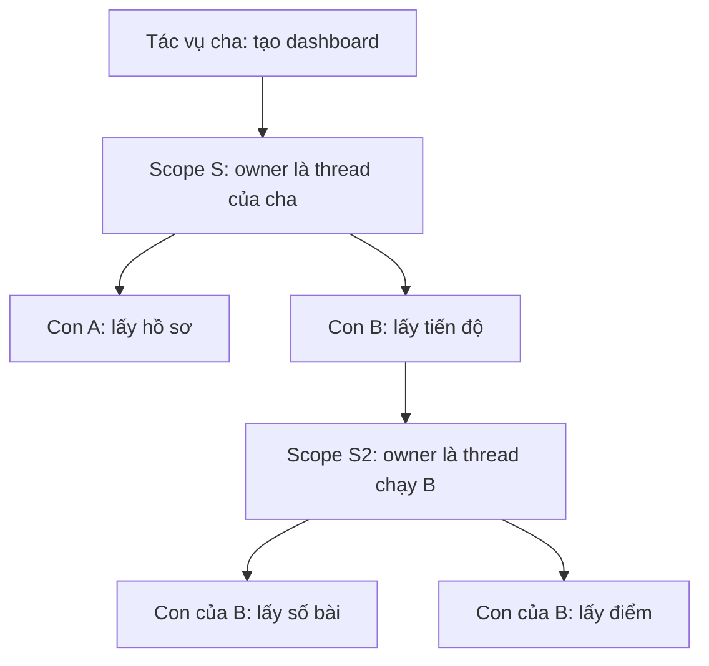

# Quan hệ cha con, vòng đời tác vụ và nguyên tắc kết thúc tác vụ trong phạm vi sở hữu

Khi một yêu cầu cần lấy hồ sơ người học và tiến độ học tập, hai thao tác có thể chạy đồng thời. Tuy nhiên, yêu cầu đó vẫn phải có nơi chịu trách nhiệm thu kết quả, xử lý lỗi và chờ công việc liên quan kết thúc. Structured concurrency tổ chức trách nhiệm này thành một cây tác vụ có phạm vi sống rõ ràng.

Trong bài này, **tác vụ cha sở hữu vòng đời của nhóm tác vụ con**: cha không hoàn tất việc rời phạm vi sở hữu khi những thread con do phạm vi đó quản lý còn đang chạy. Biết nguyên tắc này giúp bạn phân biệt việc đã có kết quả, đã yêu cầu hủy và đã thực sự kết thúc.

## 1. Mốc phiên bản và phạm vi áp dụng

Trong Java 22, Structured Concurrency là preview theo JEP 462; tài liệu của phiên bản đó mô tả cách nhóm và quản lý các tác vụ liên quan. Xem [Structured Concurrency trong Java 22](https://docs.oracle.com/en/java/javase/22/core/structured-concurrency.html).

Tại mốc đối chiếu **JDK 27**, tính năng vẫn là **preview**, được liệt kê là Seventh Preview theo JEP 533. Vì vậy, không nên coi API là hợp đồng ổn định giữa mọi phiên bản Java. Xem [các thay đổi của JDK 27](https://docs.oracle.com/en/java/javase/27/migrate/significant-changes-jdk-27-release.html).

Để học phần kiến thức từ Java 22 còn áp dụng đến hiện tại, bài tập trung vào quan hệ sở hữu và nguyên tắc kết thúc. Các đoạn mã cụ thể sử dụng **API JDK 27**, với `StructuredTaskScope.open()`, `fork()`, `join()` và `close()`; không dùng lại cách khởi tạo và các lớp chính sách của những preview cũ.

Lệnh thực hành trong bài yêu cầu JDK 27 và bật preview cả lúc biên dịch lẫn chạy. Quy tắc bật preview theo đúng phiên bản được giải thích trong [hướng dẫn Preview Features của Oracle](https://docs.oracle.com/en/java/javase/27/language/preview-language-vm-features.html).

## 2. Cha, con và owner là những vai trò nào?

Giả sử phương thức `loadDashboard` xử lý một yêu cầu xem bảng tiến độ:

```text
loadDashboard
└── scope của yêu cầu
    ├── lấy hồ sơ người học
    └── lấy tiến độ học tập
```

- **Tác vụ cha** là công việc tổng thể: tạo dữ liệu bảng tiến độ.
- **Tác vụ con** là phần việc được tách ra bằng `scope.fork(...)`.
- **Scope** là phạm vi quản lý các tác vụ được fork vào nó.
- **Owner thread** là thread mở scope; thread này điều phối việc fork, join và đóng scope.

Quan hệ trên mô tả trách nhiệm đối với công việc. Một thread được tạo thủ công bên trong phương thức không tự trở thành tác vụ con do scope quản lý chỉ vì nằm trong cùng đoạn mã.

Theo hướng dẫn hiện hành, tác vụ con có thể mở scope riêng để sinh các tác vụ con tiếp theo, tạo thành một hệ phân cấp. Scope mặc định dùng virtual thread cho công việc được fork. Xem [mô hình scope và tác vụ con](https://docs.oracle.com/en/java/javase/27/core/structured-concurrency.html).

Ví dụ, thao tác lấy tiến độ có thể chia thành lấy số bài hoàn thành và kết quả đánh giá:



Sơ đồ thể hiện quan hệ sở hữu, không ấn định thứ tự các thread được lập lịch. A và B có thể hoàn thành theo bất kỳ thứ tự nào phù hợp với công việc của chúng.

## 3. Vòng đời: mở, fork, join, đóng

Một lần sử dụng scope nên có hình dạng rõ ràng:

```text
Mở scope
    → Fork các phần việc
    → Join theo chính sách của nhóm
    → Xử lý kết quả
    → Close: hoàn tất trách nhiệm đối với các thread con
Rời phạm vi sở hữu
```

Có ba mốc cần tách biệt:

| Mốc | Câu hỏi được trả lời |
| --- | --- |
| Có kết quả hoặc lỗi của nhóm | Cha có thể quyết định kết quả nghiệp vụ chưa? |
| Scope bị hủy | Đã yêu cầu các công việc không còn cần thiết dừng chưa? |
| Đóng scope hoàn tất | Các thread do scope khởi chạy đã kết thúc hết chưa? |

`join()` có thể hoàn tất khi các tác vụ đã hoàn thành hoặc khi chính sách khiến scope bị hủy. `close()` chờ tất cả thread tác vụ con kết thúc; nếu scope chưa bị hủy, nó yêu cầu hủy trước khi chờ. Các thao tác `fork`, `join`, `close` chỉ được gọi bởi owner. Xem [hợp đồng StructuredTaskScope của JDK 27](https://docs.oracle.com/en/java/javase/27/docs/api/java.base/java/util/concurrent/StructuredTaskScope.html).

Với cách sử dụng đúng cấu trúc, quan hệ thời gian quan trọng là:

```text
Thời điểm close hoàn tất
    ≥ thời điểm kết thúc của từng thread con đã được scope khởi chạy
```

Một thông báo “đã yêu cầu hủy” chưa đủ chứng minh phạm vi sở hữu đã kết thúc. Thread con có thể còn đang xử lý interrupt, chạy `finally` hoặc giải phóng tài nguyên.

### Chính sách kết quả không thay thế trách nhiệm đóng scope

Với chính sách cần tất cả kết quả, cha chờ nhóm thành công hoặc phát hiện lỗi. Với chính sách chọn một kết quả thành công, cha có thể có đáp án trong khi các tác vụ khác đang dừng. `Joiner` quyết định kết quả và thời điểm hủy; nó không loại bỏ việc đóng scope. Các chính sách này được mô tả trong [StructuredTaskScope.Joiner](https://docs.oracle.com/en/java/javase/27/docs/api/java.base/java/util/concurrent/StructuredTaskScope.Joiner.html).

Trong một yêu cầu đọc dữ liệu, việc chọn chính sách nên xuất phát từ nhu cầu: dashboard cần cả hồ sơ lẫn tiến độ, còn việc đọc cùng một dữ liệu từ hai nguồn dự phòng có thể chỉ cần một câu trả lời thành công.

## 4. Ví dụ hoàn chỉnh: một cha, hai con

Lưu nội dung sau vào `ScopeLifecycleDemo.java`. Ví dụ dùng thời gian chờ để mô phỏng hai thao tác đọc dữ liệu; nó không truy cập dịch vụ bên ngoài.

```java
import java.util.concurrent.ExecutionException;
import java.util.concurrent.StructuredTaskScope;

public class ScopeLifecycleDemo {
    record Learner(long id, String name) {}
    record Progress(int completedLessons) {}
    record Dashboard(Learner learner, Progress progress) {}

    public static void main(String[] args) throws InterruptedException {
        boolean failProgress = args.length > 0 && args[0].equals("--fail");

        try {
            Dashboard dashboard = loadDashboard(42L, failProgress);
            System.out.println("Ket qua: " + dashboard);
        } catch (ExecutionException e) {
            System.out.println("Yeu cau that bai: " + e.getCause().getMessage());
        }
    }

    static Dashboard loadDashboard(long learnerId, boolean failProgress)
            throws InterruptedException, ExecutionException {
        try (var scope = StructuredTaskScope.open()) {
            var learner = scope.fork(() -> loadLearner(learnerId));
            var progress = scope.fork(() -> loadProgress(failProgress));

            scope.join();

            return new Dashboard(learner.get(), progress.get());
        }
    }

    static Learner loadLearner(long learnerId) throws InterruptedException {
        try {
            Thread.sleep(300);
            return new Learner(learnerId, "An");
        } finally {
            System.out.println("Tac vu ho so da roi than ham");
        }
    }

    static Progress loadProgress(boolean fail) throws InterruptedException {
        try {
            Thread.sleep(80);
            if (fail) {
                throw new IllegalStateException("Khong doc duoc tien do");
            }
            return new Progress(12);
        } finally {
            System.out.println("Tac vu tien do da roi than ham");
        }
    }
}
```

Biên dịch và chạy bằng JDK 27:

```shell
javac --enable-preview --release 27 ScopeLifecycleDemo.java
java --enable-preview ScopeLifecycleDemo
java --enable-preview ScopeLifecycleDemo --fail
```

Đây là các lệnh để người học thực hành. Các dòng kết quả bên dưới là kết quả mong đợi, không phải một lịch thực thi bắt buộc.

### Khi cả hai tác vụ thành công

`StructuredTaskScope.open()` dùng chính sách mặc định: `join()` hoàn tất bình thường khi mọi tác vụ thành công; nếu có tác vụ lỗi, nó ném `ExecutionException`. Khi join thành công, owner lấy hai giá trị để tạo `Dashboard`.

Dòng kết quả cuối cùng mong đợi:

```text
Ket qua: Dashboard[learner=Learner[id=42, name=An], progress=Progress[completedLessons=12]]
```

Hai thông báo từ `finally` xuất hiện trước dòng kết quả cuối. Không dùng thứ tự giữa hai thông báo đó để suy ra thứ tự đã fork hoặc để kiểm chứng tính đúng đắn của chương trình.

`Subtask.get()` lấy giá trị đã thành công sau khi owner join; nó không đóng vai trò thay `join()` để chờ tùy ý từng tác vụ. Gọi không đúng thời điểm hoặc khi kết quả không thành công có thể ném `IllegalStateException`. Xem [hợp đồng Subtask](https://docs.oracle.com/en/java/javase/27/docs/api/java.base/java/util/concurrent/StructuredTaskScope.Subtask.html).

### Khi tác vụ lấy tiến độ thất bại

Với tham số `--fail`, thao tác lấy tiến độ ném lỗi sau thời gian chờ mô phỏng. Chính sách mặc định khiến scope hủy công việc chưa hoàn thành và `join()` báo lỗi.

Luồng trách nhiệm là:

```text
Con lấy tiến độ lỗi
    → Nhóm có kết quả thất bại
    → Công việc còn lại được yêu cầu hủy
    → Rời try và thực hiện close
    → Chờ các thread con kết thúc
    → Ngoại lệ được chuyển đến catch ở main
```

Nếu thao tác lấy hồ sơ còn ở `Thread.sleep`, interrupt làm nó thoát bằng `InterruptedException` và chạy `finally`. Nếu hồ sơ đã hoàn thành trước đó, không có công việc đang chạy để dừng. Khoảng ngủ 80 ms và 300 ms phục vụ minh họa; hệ điều hành và scheduler vẫn có thể làm thay đổi thứ tự quan sát được.

Dòng kết quả lỗi mong đợi:

```text
Yeu cau that bai: Khong doc duoc tien do
```

`return new Dashboard(...)` nằm trong `try` cũng không cho phép phương thức vượt qua việc đóng scope. Với `try`-with-resources, việc đóng tài nguyên xảy ra trước khi chuyển điều khiển ra ngoài câu lệnh; nếu vừa có lỗi trong thân `try` vừa có lỗi đóng tài nguyên, lỗi đóng có thể trở thành suppressed exception. Xem [JLS §14.20.3](https://docs.oracle.com/javase/specs/jls/se27/html/jls-14.html#jls-14.20.3).

## 5. Hủy là hợp tác, kết thúc là điều phải chờ

Java dùng interrupt như một yêu cầu để thread ngừng hoạt động hiện tại. Mã tác vụ phải phản hồi yêu cầu đó. `Thread.sleep` ném `InterruptedException`; mã tính toán dài có thể kiểm tra `isInterrupted()`. Khi bắt `InterruptedException`, thông thường hãy truyền tiếp hoặc khôi phục trạng thái interrupt trước khi chuyển sang cách xử lý khác. Xem [Thread Interruption](https://docs.oracle.com/en/java/javase/27/docs/api/java.base/java/lang/Thread.html).

Ví dụ một phương thức tính toán có thể làm tác vụ con:

```java
static long sumInterruptibly(int[] values) throws InterruptedException {
    long total = 0;
    for (int i = 0; i < values.length; i++) {
        if ((i & 1023) == 0 && Thread.currentThread().isInterrupted()) {
            throw new InterruptedException("Da huy phep tinh");
        }
        total += values[i];
    }
    return total;
}
```

Phương thức trên giả định mảng khác `null`; mỗi lần cộng là công việc ngắn. Việc kiểm tra sau mỗi nhóm 1.024 phần tử chỉ là lựa chọn cho ví dụ, không phải ngưỡng chung của structured concurrency. Với thuật toán có mỗi bước rất lâu, cần đặt điểm kiểm tra phù hợp với độ trễ hủy mong muốn.

Một cách xử lý nên tránh là bắt `InterruptedException` rồi tiếp tục lặp như chưa có gì xảy ra. Khi tác vụ không chịu kết thúc, thời gian đóng scope cũng kéo dài.

Nếu owner bị interrupt trong `join`, nó có thể nhận `InterruptedException`; khi thoát `try`, việc đóng scope vẫn diễn ra. Nếu owner tiếp tục bị interrupt trong lúc `close` đang chờ, `close` tiếp tục chờ các thread kết thúc rồi hoàn tất với trạng thái interrupt được đặt. Nó không bỏ mặc các thread con. Hợp đồng này được quy định tại [StructuredTaskScope.close](https://docs.oracle.com/en/java/javase/27/docs/api/java.base/java/util/concurrent/StructuredTaskScope.html).

Trong mã phục vụ yêu cầu, hãy thiết kế tác vụ con sao cho việc dọn dẹp ngắn và có giới hạn phù hợp. Dùng một thao tác I/O không phản hồi interrupt mà không có cơ chế timeout riêng có thể khiến việc kết thúc kéo dài, dù phía cha đã biết yêu cầu thất bại.

## 6. Timeout không phải cam kết về thời gian close

Trong API JDK 27, có thể cấu hình timeout khi mở scope. Đoạn thay thế sau sử dụng các phương thức của ví dụ chính:

```java
try (var scope = StructuredTaskScope.open(
        config -> config.withTimeout(java.time.Duration.ofSeconds(2)))) {
    var learner = scope.fork(() -> loadLearner(42L));
    var progress = scope.fork(() -> loadProgress(false));
    scope.join();
    return new Dashboard(learner.get(), progress.get());
}
```

Đoạn này nằm trong phương thức trả về `Dashboard` và khai báo `throws InterruptedException, ExecutionException` như `loadDashboard`. `withTimeout` tạo cấu hình timeout; thời gian được tính từ lúc scope mở, gồm cả giai đoạn fork. Xem [StructuredTaskScope.Configuration](https://docs.oracle.com/en/java/javase/27/docs/api/java.base/java/util/concurrent/StructuredTaskScope.Configuration.html).

Với chính sách mặc định của JDK 27, timeout dẫn đến hủy scope và `join()` báo `ExecutionException` có nguyên nhân là `CancelledByTimeoutException`. Điều đó biểu thị hết thời gian chờ kết quả theo cấu hình. Nó không có nghĩa mọi thread đã dừng đúng tại mốc hai giây.

Có thể hình dung thời gian trả về cho bên gọi gồm:

```text
Thời gian chờ kết quả
    + thời gian tác vụ phản hồi hủy
    + thời gian hoàn tất dọn dẹp
```

Đây là cách phân tích độ trễ, không phải công thức dự đoán chính xác. Nếu yêu cầu nghiệp vụ cần deadline, hãy kiểm tra cả timeout của thao tác đọc dữ liệu, khả năng phản hồi interrupt và thời gian giải phóng tài nguyên. Structured concurrency cung cấp nơi giữ trách nhiệm; nó không biến mọi thao tác bên dưới thành thao tác có thời gian dừng cố định.

## 7. Scope lồng nhau: con sở hữu công việc của chính nó

Giả sử phần lấy tiến độ cần gọi thêm hai nguồn độc lập. Con B có thể mở scope S2 trong chính thread của B:

```java
static Progress loadDetailedProgress() throws InterruptedException,
        ExecutionException {
    try (var inner = StructuredTaskScope.open()) {
        var courseA = inner.fork(() -> {
            Thread.sleep(40);
            return 5;
        });
        var courseB = inner.fork(() -> {
            Thread.sleep(60);
            return 7;
        });

        inner.join();
        return new Progress(courseA.get() + courseB.get());
    }
}
```

Đặt phương thức này vào lớp ví dụ, rồi thay tác vụ lấy tiến độ bằng:

```java
var progress = scope.fork(ScopeLifecycleDemo::loadDetailedProgress);
```

Trong cấu trúc đó, thread của cha sở hữu scope ngoài; thread chạy `loadDetailedProgress` sở hữu scope trong. Con B không dùng scope ngoài để fork công việc mới: trong API JDK 27, nó không phải owner của scope ngoài.

Khi B thoát phương thức, nó đã đi qua phần đóng scope trong. Vì vậy, lúc scope ngoài chờ B kết thúc, nó cũng gián tiếp chờ trách nhiệm của B đối với các tác vụ phía dưới được hoàn tất.

Nếu B bị interrupt khi chờ `inner.join()`, ngoại lệ khiến B rời `try`; scope trong được đóng và hủy các công việc còn chạy của nó. Cơ chế này nối trách nhiệm dừng và dọn dẹp theo các tầng. Nó vẫn phụ thuộc vào việc mỗi tác vụ phản hồi hủy và mỗi scope được đóng đúng cấu trúc.

Không đưa scope vào một registry dùng chung để các thread bất kỳ mở rộng nhóm công việc. Giữ quyền điều phối ở owner và để mỗi nhánh mở scope riêng khi cần chia nhỏ công việc sẽ làm cây trách nhiệm dễ hiểu hơn.

## 8. Trạng thái kết quả khác với trạng thái thread

Trong JDK 27, trạng thái `Subtask` gồm:

| Trạng thái | Ý nghĩa về kết quả |
| --- | --- |
| `SUCCESS` | Tác vụ hoàn thành thành công và có thể lấy kết quả theo hợp đồng |
| `FAILED` | Tác vụ thất bại và có thể xem ngoại lệ theo hợp đồng |
| `UNAVAILABLE` | Kết quả hoặc ngoại lệ không sẵn có |

`UNAVAILABLE` không chỉ có nghĩa “đang chạy”. Nó còn có thể xuất hiện khi fork sau khi scope bị hủy hoặc khi công việc hoàn thành sau khi scope đã bị hủy. Đây không phải enum có trạng thái `CANCELLED` riêng. Xem [Subtask.State của JDK 27](https://docs.oracle.com/en/java/javase/27/docs/api/java.base/java/util/concurrent/StructuredTaskScope.Subtask.State.html).

Do đó, không suy luận “thread còn sống” chỉ từ `UNAVAILABLE`, hoặc “mọi thread đã dừng” chỉ từ `scope.isCancelled()`. Trong thiết kế của bài, mốc rời phạm vi sở hữu sau khi đóng scope là nơi xác định trách nhiệm với các thread con đã được hoàn tất.

Với chính sách mặc định, đường đi đơn giản là join thành công rồi lấy kết quả. Nếu dùng chính sách chọn một kết quả, không cố gọi `get()` cho mọi handle còn lại vì không phải mọi nhánh đều có giá trị thành công được công bố.

## 9. Công việc nào có thể thoát khỏi phạm vi sở hữu?

Đoạn sau minh họa một lỗi tổ chức công việc. Nó có thể biên dịch khi đặt trong phương thức có khai báo ngoại lệ thích hợp, nhưng không bảo đảm quản lý vòng đời của công việc nền:

```java
try (var scope = StructuredTaskScope.open()) {
    scope.fork(() -> {
        java.util.concurrent.CompletableFuture.runAsync(() -> {
            System.out.println("Cong viec nen tach roi");
        });
        return "Da gui cong viec";
    });
    scope.join();
}
```

Tác vụ được `fork` chỉ gửi một công việc vào `CompletableFuture`, rồi trả về. `runAsync` dùng cơ chế thực thi bất đồng bộ riêng, mặc định dựa trên common pool; xem [CompletableFuture.runAsync](https://docs.oracle.com/en/java/javase/27/docs/api/java.base/java/util/concurrent/CompletableFuture.html).

Scope biết thread chạy phần gửi việc, không tự nhận thêm quyền quản lý công việc đã được gửi sang executor khác. Việc công việc nền tình cờ chạy xong trước không tạo thành bảo đảm về vòng đời.

Với công việc thuộc cùng yêu cầu, cách tổ chức dễ kiểm soát là để callable thực hiện phần việc đó trực tiếp, hoặc mở scope lồng nhau khi nó cần chia tiếp. Nếu thực sự cần một tác vụ nền có vòng đời riêng, hãy giao nó cho thành phần có chủ sở hữu và cơ chế kết thúc riêng của ứng dụng.

Nguyên tắc kết thúc trong scope cũng áp dụng cho công việc cục bộ được quản lý, không tự hoàn tác hành động bên ngoài. Nếu một nhánh đã ghi dữ liệu trước khi nhánh khác lỗi, hủy nhóm không biến lần ghi thành chưa từng xảy ra. Trong thiết kế nghiệp vụ, xử lý transaction hoặc bù trừ là trách nhiệm cần xác định riêng.

## 10. Những lỗi làm mờ quyền sở hữu

| Cách viết | Hệ quả cần nhận ra |
| --- | --- |
| Fork rồi return trước khi gọi join | Thiếu bước nhận kết quả nhóm; sau khi đóng, API có thể báo `IllegalStateException` vì owner chưa thử join |
| Để con gọi fork/join/close trên scope của cha | Vi phạm quy tắc owner của API JDK 27 |
| Dùng close như cách bỏ qua join | Lẫn lộn bước nhận kết quả với bước hoàn tất vòng đời |
| Nuốt interrupt rồi tiếp tục xử lý dài | Yêu cầu hủy không làm công việc kết thúc kịp thời |
| Kết luận đã dừng chỉ vì join báo lỗi | Những nhánh khác có thể còn đang dọn dẹp |
| Trả một future đang chạy cho bên gọi rồi coi yêu cầu đã xong | Công việc đã có vòng đời cần được một chủ sở hữu khác quản lý |

Lỗi xảy ra trước bước join vẫn cần được truyền đi sau quá trình đóng scope. Không dùng việc API phát hiện vi phạm cấu trúc làm luồng điều khiển bình thường. Hãy để hình dạng phương thức thể hiện rõ: ai mở nhóm, ai nhận kết quả và ai chờ kết thúc.

## 11. Áp dụng khi thiết kế một yêu cầu thực tế

Với dashboard người học, hãy bắt đầu bằng việc xác định những kết quả bắt buộc. Nếu thiếu hồ sơ hoặc tiến độ đều khiến yêu cầu không dùng được, chính sách cần tất cả thành công phù hợp với ví dụ. Nếu một dữ liệu chỉ là phần bổ sung tùy chọn, hãy định nghĩa rõ kết quả thay thế thay vì bắt mọi lỗi của nhóm rồi trả một dashboard không rõ trạng thái.

Tiếp theo, xác định từng nhánh có phản hồi hủy không và tài nguyên của nó được giải phóng ở đâu. Giữ thao tác đọc, tính toán và dọn dẹp bên trong công việc do scope quản lý. Khi một nhánh cần chia nhỏ, nhánh đó mở và đóng scope riêng.

Khi đọc mã, bạn cần chỉ ra được ba nơi: **scope mở ở đâu, kết quả được quyết định ở đâu và việc chờ các thread con kết thúc diễn ra ở đâu**. Với các scope được dùng đúng cấu trúc, bên gọi nhận được kết quả hoặc lỗi sau khi phương thức hoàn tất trách nhiệm đối với cây công việc mà nó sở hữu.