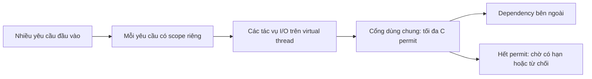

# Kết hợp virtual thread với tác vụ I/O và giới hạn tài nguyên bên ngoài

Một yêu cầu xem dashboard có thể cần đọc hồ sơ, tiến độ và danh mục khóa học từ các dịch vụ khác nhau. Chạy những thao tác độc lập cùng lúc giúp tránh chờ tuần tự. Nhưng nếu có nhiều yêu cầu vào đồng thời, việc tạo thêm virtual thread không làm cơ sở dữ liệu có thêm connection hay dịch vụ từ xa xử lý được nhiều lời gọi hơn.

Thiết kế cần phối hợp ba cơ chế: **virtual thread thực thi công việc chờ I/O; structured concurrency quản lý vòng đời nhóm tác vụ; giới hạn tài nguyên kiểm soát số công việc được phép đi tới dependency**. Mỗi cơ chế giải quyết một trách nhiệm riêng trong cùng luồng xử lý.

## 1. Mốc Java và những kiến thức tiếp tục sử dụng

Virtual thread đã là tính năng chính thức từ Java 21. Structured Concurrency xuất hiện trong Java 22 dưới dạng preview theo JEP 462. Các nguyên tắc phối hợp tác vụ, sở hữu vòng đời và kiểm soát tài nguyên vẫn hữu ích trong Java hiện đại; xem [hướng dẫn Virtual Threads](https://docs.oracle.com/en/java/javase/27/core/virtual-threads.html) và [Structured Concurrency của Java 22](https://docs.oracle.com/en/java/javase/22/core/structured-concurrency.html).

Phần mã cụ thể trong bài dùng **API JDK 27**. Ở mốc này, `StructuredTaskScope` vẫn là preview; phải bật preview khi biên dịch và chạy. Bài sử dụng `StructuredTaskScope.open()` thay cho các cách khởi tạo và lớp chính sách đã thay đổi qua những preview cũ. Trạng thái và hợp đồng hiện hành nằm trong [API StructuredTaskScope của JDK 27](https://docs.oracle.com/en/java/javase/27/docs/api/java.base/java/util/concurrent/StructuredTaskScope.html).

Các con số timeout và mức đồng thời trong ví dụ phục vụ giải thích cơ chế. Chúng cần được lựa chọn theo khả năng của dependency và kiểm chứng bằng dữ liệu vận hành của ứng dụng.

## 2. Vì sao virtual thread phù hợp với nhiều tác vụ I/O?

Khi virtual thread chờ một thao tác blocking I/O được runtime hỗ trợ, runtime có thể tạm dừng virtual thread và dành thread nền của hệ điều hành cho công việc khác. Cách này cho phép giữ mô hình mã gọi tuần tự trong từng tác vụ mà vẫn phục vụ nhiều công việc đang chờ. Virtual thread không làm phép tính CPU chạy nhanh hơn và không tự giảm thời gian đáp ứng của một dịch vụ từ xa. Xem [cơ chế và trường hợp sử dụng virtual thread](https://docs.oracle.com/en/java/javase/27/core/virtual-threads.html).

Ví dụ giả định lấy hồ sơ mất 250 ms, lấy tiến độ mất 400 ms:

```text
Chạy tuần tự, không có chờ bổ sung: khoảng 250 + 400 = 650 ms
Chạy đồng thời, đủ tài nguyên: gần max(250, 400) = 400 ms
```

Đây là phép tính minh họa trong điều kiện lý tưởng. Thời gian chờ permit, connection, CPU và xử lý kết quả làm tăng độ trễ thực tế. Nếu cả hai lời gọi phải qua một cổng chỉ cho một lời gọi hoạt động, chúng vẫn phải nối tiếp tại cổng đó.

Một nhánh đọc dữ liệu rồi xử lý nặng hàng trăm mili giây vẫn tiêu thụ CPU trong giai đoạn xử lý. Hãy đo từng giai đoạn thay vì kết luận mọi tác vụ có HTTP hoặc JDBC đều chỉ bị giới hạn bởi I/O.

## 3. Scope không phải bộ giới hạn tải của dependency

Giả sử ứng dụng có 400 yêu cầu đang xử lý và mỗi yêu cầu fork ba lời gọi độc lập. Khi chưa giới hạn ở lớp nào khác, ứng dụng có thể tạo nhu cầu thực hiện tới 1.200 lời gọi ra ngoài. Con số này là quy mô fan-out, chưa chứng minh dependency có thể phục vụ đồng thời từng ấy lời gọi.

| Thành phần | Vai trò chính | Điều không thể suy ra từ nó |
| --- | --- | --- |
| Virtual thread | Cung cấp luồng thực thi nhẹ cho tác vụ | Dependency có dung lượng vô hạn |
| Scope của yêu cầu | Thu kết quả và quản lý kết thúc nhóm con | Tổng tải từ mọi yêu cầu đã được chặn |
| Semaphore của dependency | Giới hạn số đoạn thao tác đang giữ permit | Số yêu cầu mỗi giây đã được giới hạn |
| Connection pool | Quản lý số connection dùng lại được | Mọi truy vấn đều nhanh hoặc không tranh chấp |
| Cơ chế tiếp nhận yêu cầu | Giới hạn lượng công việc vào hệ thống | Từng dependency đã có ngân sách phù hợp |

Hướng dẫn Oracle khuyến nghị dùng công cụ như `Semaphore` để hạn chế truy cập dịch vụ khi dùng virtual thread, thay vì tạo một pool virtual thread cố định chỉ để giới hạn concurrency. Xem [phần áp dụng virtual thread và giới hạn đồng thời](https://docs.oracle.com/en/java/javase/27/core/virtual-threads.html).

Một mô hình cho một dependency:



Trong mô hình này, scope có vòng đời theo yêu cầu. Cổng giới hạn có vòng đời dài hơn và được dùng chung bởi những yêu cầu cùng truy cập dependency.

## 4. Đặt giới hạn theo đúng tài nguyên

### Một giới hạn chung cho cùng dependency

Nếu mỗi yêu cầu tự tạo `new Semaphore(8)`, 100 yêu cầu có thể có tổng cộng 800 permit. Đó là 100 giới hạn độc lập, không phải giới hạn tám lời gọi cho cả ứng dụng.

Để kiểm soát tổng số lời gọi trong một instance ứng dụng, đặt semaphore trong một thành phần dùng chung theo dependency. Mọi đường gọi thuộc ngân sách đó phải đi qua cùng thành phần. Không tạo một semaphore mới bên trong mỗi phương thức xử lý yêu cầu.

Với nhiều dependency, có thể dùng các cổng riêng:

| Dependency | Giới hạn giả định trên một instance | Mục đích |
| --- | --- | --- |
| Dịch vụ hồ sơ | 8 thao tác đang giữ permit | Hạn chế tải lên dịch vụ hồ sơ |
| Dịch vụ tiến độ | 12 thao tác đang giữ permit | Tách ngân sách khỏi dịch vụ hồ sơ |
| Cơ sở dữ liệu | Pool tối đa 20 connection | Kiểm soát số phiên truy cập DB qua pool |

Các giá trị này là ví dụ thiết kế. Một dependency chậm không nên chiếm hết ngân sách của các dependency không liên quan chỉ vì tất cả dùng chung một semaphore toàn ứng dụng.

### Giới hạn đồng thời khác giới hạn tốc độ

Semaphore tám permit giới hạn tám thao tác đang giữ permit cùng lúc. Nó không đảm bảo tối đa tám lời gọi mỗi giây. Nếu tám thao tác kết thúc sau khoảng 100 ms rồi liên tục được thay bằng thao tác mới, riêng phép tính lý tưởng đã có thể tương ứng khoảng 80 thao tác mỗi giây.

Nếu nhà cung cấp đặt cả hạn mức concurrency lẫn quota theo giây hoặc phút, cần đáp ứng cả hai. Giới hạn tốc độ kiểm soát nhịp bắt đầu; giới hạn đồng thời kiểm soát lượng công việc đang chiếm tài nguyên. Hai giới hạn có thể cùng cần thiết.

### Giới hạn trên một instance khác giới hạn toàn hệ thống

Với năm instance cùng cấu hình tám permit, tổng ngân sách cục bộ có thể lên tới 40 thao tác giữ permit. Khi dependency đặt quota chung, cần phân chia ngân sách theo số instance hoặc dùng cơ chế điều phối phù hợp. Tăng replica phải đi kèm xem xét lại ngân sách gọi ra ngoài.

## 5. Giữ và trả permit đúng vòng đời thao tác

`Semaphore` cho phép lấy permit trước khi truy cập tài nguyên và trả permit sau khi hoàn tất. `tryAcquire(timeout, unit)` chờ có hạn, trả `false` khi hết thời gian và có thể ném `InterruptedException` nếu bị interrupt. Xem [hợp đồng Semaphore](https://docs.oracle.com/en/java/javase/27/docs/api/java.base/java/util/concurrent/Semaphore.html).

Mẫu tổ chức quan trọng:

```java
if (!permits.tryAcquire(150, java.util.concurrent.TimeUnit.MILLISECONDS)) {
    throw new java.util.concurrent.RejectedExecutionException("Dependency dang ban");
}

try {
    // Thực hiện thao tác cần giới hạn.
} finally {
    permits.release();
}
```

Có hai điều cần bảo toàn:

1. **Chỉ trả permit khi đã lấy thành công.** Nếu hết thời gian chờ hoặc bị interrupt trước khi lấy được permit, không được tăng số permit bằng một lần `release` thừa.
2. **Giữ permit trong toàn bộ phần việc chiếm tài nguyên được giới hạn.** Không trả ngay sau khi gửi yêu cầu nếu công việc mà bạn muốn đếm vẫn còn đang xử lý ở phía client.

Ví dụ đặt thao tác lấy permit bên trong từng callable được fork. Owner vẫn có thể điều phối nhóm, còn nhánh chờ permit có thể phản hồi interrupt khi nhóm bị hủy. Tránh để cha giữ permit rồi chờ một tác vụ con cũng cần chính permit đó.

Không dùng `availablePermits()` để quyết định “còn chỗ thì gọi” bằng hai thao tác tách rời. Giữa lúc đọc số permit và lúc gọi dịch vụ, thread khác có thể lấy chỗ đó. Hãy dùng chính thao tác acquire làm điểm tiếp nhận công việc.

## 6. Ví dụ hoàn chỉnh: scope, virtual thread và HTTP có giới hạn

Ví dụ sau đọc hai tài nguyên độc lập từ **cùng một dependency**. Một `LimitedReader` giữ semaphore dùng chung cho mọi lần gọi `loadPair` đi qua đối tượng đó. Mỗi lần `loadPair` mở scope riêng, còn mặc định của scope là fork bằng virtual thread.

Lưu vào `BoundedIoDemo.java`:

```java
import java.io.IOException;
import java.net.URI;
import java.net.http.HttpClient;
import java.net.http.HttpRequest;
import java.net.http.HttpResponse;
import java.time.Duration;
import java.util.concurrent.ExecutionException;
import java.util.concurrent.RejectedExecutionException;
import java.util.concurrent.Semaphore;
import java.util.concurrent.StructuredTaskScope;
import java.util.concurrent.TimeUnit;

public class BoundedIoDemo {
    record Pair(String first, String second) {}

    static final class LimitedReader {
        private final HttpClient client;
        private final Semaphore permits;

        LimitedReader(HttpClient client, int maxConcurrentCalls) {
            if (maxConcurrentCalls <= 0) {
                throw new IllegalArgumentException("Gioi han phai duong");
            }
            this.client = client;
            this.permits = new Semaphore(maxConcurrentCalls, true);
        }

        String get(URI uri) throws IOException, InterruptedException {
            HttpRequest request = HttpRequest.newBuilder(uri)
                    .timeout(Duration.ofSeconds(1))
                    .GET()
                    .build();

            if (!permits.tryAcquire(150, TimeUnit.MILLISECONDS)) {
                throw new RejectedExecutionException("Het ngan sach goi dependency");
            }

            try {
                HttpResponse<String> response = client.send(
                        request, HttpResponse.BodyHandlers.ofString());

                if (response.statusCode() / 100 != 2) {
                    throw new IOException("Dependency tra HTTP " + response.statusCode());
                }
                return response.body();
            } finally {
                permits.release();
            }
        }
    }

    static Pair loadPair(LimitedReader reader, URI first, URI second)
            throws InterruptedException, ExecutionException {
        try (var scope = StructuredTaskScope.open(
                config -> config.withTimeout(Duration.ofSeconds(2)))) {
            var a = scope.fork(() -> reader.get(first));
            var b = scope.fork(() -> reader.get(second));

            scope.join();
            return new Pair(a.get(), b.get());
        }
    }

    public static void main(String[] args)
            throws InterruptedException, ExecutionException {
        if (args.length != 2) {
            System.out.println("Can hai URL cua cung dependency");
            return;
        }

        try (HttpClient client = HttpClient.newBuilder()
                .connectTimeout(Duration.ofMillis(500))
                .build()) {
            LimitedReader reader = new LimitedReader(client, 8);
            Pair result = loadPair(reader, URI.create(args[0]), URI.create(args[1]));
            System.out.println("Do dai hai body: "
                    + result.first().length() + ", " + result.second().length());
        }
    }
}
```

Biên dịch bằng JDK 27:

```shell
javac --enable-preview --release 27 BoundedIoDemo.java
```

Nếu đã chuẩn bị một dịch vụ cục bộ có hai endpoint trả nội dung nhỏ với HTTP 2xx, có thể chạy:

```shell
java --enable-preview BoundedIoDemo "http://localhost:8080/profile" "http://localhost:8080/progress"
```

Hai URL là ví dụ địa chỉ thực hành; chương trình không tự tạo các endpoint đó. Kết quả thành công in độ dài hai body nên phụ thuộc nội dung dịch vụ cung cấp. Nếu endpoint không có sẵn, kết nối lỗi hoặc vượt timeout, chương trình báo ngoại lệ tương ứng qua kết quả nhóm.

### Những trách nhiệm được đặt ở đâu?

- `loadPair` sở hữu scope và hai nhánh của một lần xử lý.
- `LimitedReader` sở hữu ngân sách gọi dependency; nó phải được dùng lại giữa các yêu cầu trong ứng dụng server.
- `HttpClient` được dùng lại và đóng bởi thành phần tạo ra nó, sau khi các lần sử dụng đã hoàn tất. Tạo client cho từng lời gọi thường làm mất lợi ích tái sử dụng connection; xem [quản lý kết nối của HttpClient](https://docs.oracle.com/en/java/javase/27/docs/api/java.net.http/java/net/http/HttpClient.html).
- `finally` trả permit trong cả đường thành công, HTTP lỗi, I/O lỗi và interrupt sau khi đã acquire.

Ví dụ `main` chỉ thực hiện một cặp lời gọi, nên tự nó chưa tạo tải để quan sát đủ tám permit. Trong server, nhiều lần `loadPair` đồng thời phải nhận cùng `reader` thì cổng mới hạn chế tổng tải theo thiết kế. Nếu hai URL thuộc hai dependency có ngân sách độc lập, hãy dùng hai reader tương ứng.

### Phạm vi bảo đảm của ví dụ

Tối đa tám lời gọi đi qua cùng reader giữ permit cùng lúc. Với `BodyHandlers.ofString()`, body đã được nhận đầy đủ vào chuỗi khi kết quả HTTP được trả về; xem [các body handler](https://docs.oracle.com/en/java/javase/27/docs/api/java.net.http/java/net/http/HttpResponse.BodyHandlers.html).

Ví dụ giả định body nhỏ và không tự giới hạn kích thước body. Hai chuỗi kết quả còn được giữ trong `Pair` sau khi permit đã trả. Vì vậy, semaphore này không phải giới hạn toàn bộ bộ nhớ của chương trình.

Nếu chuyển sang body dạng stream, đừng trả permit rồi trả một stream còn mở cho bên gọi trong khi vẫn muốn tính thời gian đọc body vào ngân sách đó. Hãy định nghĩa rõ ai đọc, ai đóng stream và thời điểm trả permit. Việc nhận headers không đồng nghĩa đã giải phóng tài nguyên của một response dạng streaming.

## 7. Phân chia timeout theo từng giai đoạn

Các giá trị trong ví dụ có vai trò khác nhau:

| Cấu hình | Giá trị minh họa | Phần việc được giới hạn |
| --- | --- | --- |
| Chờ permit | 150 ms | Chờ được phép bắt đầu thao tác HTTP |
| Connect timeout | 500 ms | Thiết lập connection mới khi cần |
| Request timeout | 1 giây | Thực hiện một HTTP request theo hợp đồng client |
| Scope timeout | 2 giây | Ngân sách nhóm từ lúc mở scope |

`connectTimeout` không thay request timeout: khi connection cũ được dùng lại, giới hạn thiết lập connection mới không có tác dụng. Xem [HttpClient.Builder.connectTimeout](https://docs.oracle.com/en/java/javase/27/docs/api/java.net.http/java/net/http/HttpClient.Builder.html).

Trong JDK 27, hợp đồng request timeout bao phủ ít nhất đến lúc tạo `HttpResponse`, gồm lấy connection và nhận headers; triển khai tích hợp của JDK áp dụng timeout tới lúc body subscriber hoàn tất. Xem [HttpRequest.Builder.timeout](https://docs.oracle.com/en/java/javase/27/docs/api/java.net.http/java/net/http/HttpRequest.Builder.html).

Thời gian chờ semaphore xảy ra trước `client.send`, nên không được trừ tự động khỏi một giây của request timeout. Scope timeout tính từ lúc mở scope và có thể hủy khi nhánh còn đang chờ permit hoặc đang I/O.

Khi ứng dụng có deadline đầu cuối, cách lập ngân sách nên xét **thời gian còn lại**. Chẳng hạn còn 120 ms thì không có ý nghĩa khi tiếp tục chờ permit đủ 150 ms rồi cấp thêm một request timeout đầy đủ. Một phương án là giới hạn từng bước bởi giá trị nhỏ hơn giữa ngân sách của bước và phần deadline còn lại; nếu đã hết ngân sách thì dừng trước khi phát sinh lời gọi mới. Khi đo thời gian trôi qua trong một JVM, dùng đồng hồ đơn điệu như `System.nanoTime()` phù hợp hơn việc trừ các mốc đồng hồ lịch.

Không cộng mọi timeout trong bảng để suy ra cam kết thời gian trả về. Timeout của nhóm và thời gian dọn dẹp có thể chồng lấp hoặc tiếp diễn sau lúc nhóm đã có kết quả lỗi.

## 8. Hủy nhóm phải đi xuyên qua lớp chờ tài nguyên

Giả sử nhánh A báo lỗi trong khi B còn đang chờ permit:

```text
A báo lỗi
    → Chính sách nhóm hủy các nhánh còn lại
    → Thread chạy B nhận interrupt
    → tryAcquire của B thoát bằng InterruptedException
    → B không trả permit vì chưa acquire thành công
    → Scope chờ các thread con kết thúc
```

Nếu B đã acquire và đang `send`, nhánh đó thoát khỏi phần gọi HTTP rồi chạy `finally` để trả permit. Không bắt `InterruptedException` rồi tiếp tục acquire hoặc retry như một lời gọi bình thường.

Với `open()` và cấu hình dùng trong ví dụ, nhóm cần tất cả tác vụ thành công; lỗi từ một nhánh làm `join()` báo `ExecutionException`, còn `close()` hoàn tất việc chờ các thread con. Timeout của scope cũng không biến dọn dẹp thành thao tác tức thời. Xem [vòng đời và hủy scope](https://docs.oracle.com/en/java/javase/27/core/structured-concurrency.html).

### Trả permit cục bộ không chứng minh server đã dừng

Khi `send` bị interrupt, triển khai `HttpClient` mặc định cố hủy HTTP exchange, nhưng không bảo đảm thời điểm hủy có hiệu lực. Request có thể đã được gửi, server có thể còn xử lý và tài nguyên transport có thể được giải phóng bất đồng bộ. Xem [hợp đồng HttpClient.send](https://docs.oracle.com/en/java/javase/27/docs/api/java.net.http/java/net/http/HttpClient.html).

Vì thế, tám permit là giới hạn của phần việc cục bộ được reader quản lý, không phải bằng chứng server không bao giờ có quá tám hoạt động còn tiếp diễn sau các lần hủy. Một yêu cầu ghi dữ liệu cũng không tự rollback chỉ vì phía client bị interrupt.

Nếu cần hạn mức cứng ở phía cung cấp, dependency hoặc gateway phải thực thi hạn mức phù hợp. Phía client vẫn cần giới hạn và deadline để giảm tải, nhưng không thể thay thế hoàn toàn cơ chế phía server.

## 9. Khi dependency là cơ sở dữ liệu

Với JDBC, một `DataSource` có thể là triển khai tạo connection thông thường hoặc triển khai có pooling; không phải cứ khai báo kiểu `DataSource` là đã có pool giới hạn. Xem [các loại triển khai DataSource](https://docs.oracle.com/en/java/javase/27/docs/api/java.sql/javax/sql/DataSource.html).

Khi đã dùng pool giới hạn tối đa 20 connection và mọi truy cập DB đi qua pool đó, bản thân pool là cổng kiểm soát connection. Không cần thêm một semaphore 20 permit chỉ để lặp lại cùng giới hạn. Một giới hạn bổ sung chỉ có ý nghĩa nếu nó thể hiện một ngân sách khác, chẳng hạn dành tối đa bốn truy vấn nặng cùng lúc.

Ví dụ một tác vụ JDBC quản lý tài nguyên của riêng nó:

```java
static int countCompleted(javax.sql.DataSource dataSource, long learnerId)
        throws java.sql.SQLException {
    String sql = "SELECT COUNT(*) FROM completed_lessons WHERE learner_id = ?";

    try (var connection = dataSource.getConnection();
         var statement = connection.prepareStatement(sql)) {
        statement.setQueryTimeout(1);
        statement.setLong(1, learnerId);

        try (var result = statement.executeQuery()) {
            if (!result.next()) {
                throw new java.sql.SQLException("Thieu dong ket qua COUNT");
            }
            return result.getInt(1);
        }
    }
}
```

Đoạn này giả định đã có bảng `completed_lessons`, driver và DataSource được cấu hình. Nó minh họa phạm vi sống của connection, statement và result set, không tự tạo pool hoặc schema. Không truyền cùng một `Connection` lấy từ cha cho nhiều nhánh chỉ để né giới hạn pool; hãy xác định rõ nhu cầu transaction và quyền sở hữu từng connection.

Với pooling, đóng handle `Connection` trả khả năng tái sử dụng cho pool thay vì buộc đóng kết nối vật lý mỗi lần. Xem [cơ chế PooledConnection](https://docs.oracle.com/en/java/javase/27/docs/api/java.sql/javax/sql/PooledConnection.html).

Cần phân biệt thời gian chờ mượn connection với thời gian chạy truy vấn. `setQueryTimeout(1)` giới hạn thời gian thực thi statement theo JDBC, không cấu hình thời gian chờ pool. Khả năng hủy, đọc result set và hỗ trợ timeout cần được đối chiếu với driver cụ thể; xem [Statement.setQueryTimeout](https://docs.oracle.com/en/java/javase/27/docs/api/java.sql/java/sql/Statement.html).

Nếu DB dành ngân sách 100 connection cho ứng dụng và có năm instance, cấu hình 20 trên mỗi instance đã dùng hết ngân sách giả định đó. Còn phải xét job nền, công cụ vận hành, replica tăng thêm và các ứng dụng khác trước khi chọn mức thực tế.

## 10. Ít thread hệ điều hành không đồng nghĩa ít công việc tồn đọng

Semaphore giới hạn người đang giữ permit, nhưng không tự giới hạn số virtual thread đã được tạo để chờ. Chờ có hạn giúp kết thúc từng lần chờ, song một lượng yêu cầu đầu vào quá lớn vẫn có thể làm tăng bộ nhớ, số đối tượng và áp lực scheduler.

Với một API xử lý hàng nghìn phần tử, cần thêm giới hạn fan-out trên mỗi yêu cầu, số yêu cầu được tiếp nhận hoặc kích thước lô. Tạo một triệu tác vụ rồi để hầu hết chờ tám permit vẫn tạo ra một hàng đợi rất lớn, chỉ được biểu diễn bằng các tác vụ đang chờ.

Có thể tổ chức theo các lớp:

```text
Tiếp nhận có giới hạn
    → Số nhánh mỗi yêu cầu có giới hạn
    → Cổng concurrency theo dependency
    → Timeout của thao tác I/O
    → Giới hạn của dependency
```

Các lớp đó phải có mục đích rõ ràng. Nhiều hàng đợi chồng lên nhau mà không theo dõi thời gian chờ có thể làm yêu cầu hết deadline trước khi bắt đầu công việc hữu ích.

### Retry cũng sử dụng cùng ngân sách

Một request retry ba lần có thể tạo nhiều công việc hơn một request bình thường. Nếu dependency đang quá tải, retry ngay trên mọi nhánh có thể tăng tải đúng lúc hệ thống cần giảm tải.

Nếu nghiệp vụ cần retry, hãy giới hạn số lần thử và tổng deadline, để mỗi lần thử đi qua cổng của dependency. Thông thường không giữ permit của thao tác I/O trong thời gian chỉ ngủ chờ backoff; khi thử lại phải xin phép theo cùng chính sách. Không retry khi nhóm đã bị hủy, và chỉ retry các thao tác có ngữ nghĩa cho phép thực hiện lại an toàn.

## 11. Chọn mức giới hạn bằng quan sát

Đừng tăng permit chỉ vì nhiều virtual thread đang chờ. Khi dependency bão hòa, tăng mức đồng thời có thể làm từng thao tác chậm hơn, khiến cả nhóm yêu cầu giữ bộ nhớ lâu hơn.

Các số liệu hữu ích để chọn và điều chỉnh ngân sách:

| Số liệu | Điều cần phân tích |
| --- | --- |
| Số permit đang được giữ | Có thường xuyên chạm giới hạn không? |
| Thời gian chờ permit và số lần từ chối | Ngân sách nhỏ hay lượng vào vượt khả năng xử lý? |
| Độ trễ I/O sau khi được tiếp nhận | Dependency có chậm đi khi tăng concurrency không? |
| Timeout, HTTP 429/503, lỗi kết nối | Quota hoặc sức chịu tải bên ngoài có bị vượt không? |
| Số connection đang mượn và chờ pool | DB bị nghẽn ở connection hay ở truy vấn? |
| Bộ nhớ, CPU và số công việc chờ | Nút thắt đã chuyển về ứng dụng chưa? |
| Thời gian từ yêu cầu hủy đến kết thúc | Tác vụ và driver có phản hồi hủy đủ nhanh không? |

Giá trị trung bình chưa phản ánh đầy đủ các yêu cầu chờ lâu; nên quan sát cả các phân vị độ trễ phù hợp. Khi tăng số instance hoặc thay đổi số nhánh trên mỗi yêu cầu, cần đánh giá lại tổng tải gọi ra ngoài.

Với dashboard người học, một thiết kế dễ hiểu là giữ scope theo yêu cầu, reader dùng chung theo dependency, connection pool theo ngân sách DB và deadline xuyên suốt. Khi đó virtual thread giúp thực thi nhiều công việc chờ I/O, còn mức tải thực sự vẫn được quyết định bởi các tài nguyên mà ứng dụng đang sử dụng.