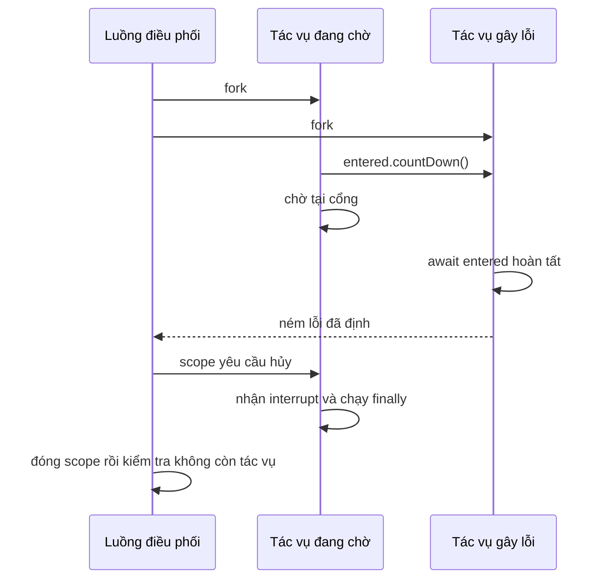

# Kiểm tra tình huống thành công, thất bại từng phần, timeout và rò rỉ tác vụ

## 1. Kiểm tra cả kết cục và vòng đời

Một phương thức chạy đồng thời có thể trả đúng dữ liệu nhưng vẫn để công việc tiếp tục chạy ngoài vòng đời dự kiến. Vì vậy, kiểm thử Structured Concurrency cần quan sát ít nhất hai nhóm thuộc tính:

- **Kết cục:** dữ liệu nào được trả về, lỗi nào được truyền ra và timeout được phân loại thế nào.
- **Vòng đời:** tác vụ nào đã chạy, tác vụ nào nhận yêu cầu hủy, bước dọn dẹp đã thực hiện chưa và còn luồng tác vụ sống sau khi đóng scope không.

Bài thuộc chương Đồng thời có cấu trúc của module Java 22, nhưng giữ trọng tâm ở kiến thức còn áp dụng trong Java hiện đại. Structured Concurrency đã có ở Java 22 dưới dạng preview và tiếp tục thay đổi API. **Mã minh họa trong bài dùng JDK 27**, nơi tính năng vẫn là preview lần thứ bảy theo tài liệu đối chiếu ngày 25/11/2026. Xem [ghi chú phát hành JDK 27](https://www.oracle.com/java/technologies/javase/27all-relnotes.html).

Không dùng tên lớp, phương thức hay kiểu ngoại lệ từ các vòng preview cũ để suy ra hành vi của ví dụ JDK 27.

## 2. Xác định hợp đồng trước khi viết assertion

Giả sử một phương thức tải hồ sơ và tồn kho để tạo dữ liệu trang. Cả hai thành phần đều bắt buộc.

Ma trận kiểm thử ban đầu:

| Tình huống | Cách tạo có kiểm soát | Kết cục cần kiểm tra | Thuộc tính vòng đời |
| --- | --- | --- | --- |
| Tất cả thành công | Hai dependency trả dữ liệu xác định | Đối tượng tổng hợp chứa đúng cả hai giá trị | Các tác vụ đã kết thúc |
| Một thành phần bắt buộc lỗi | Tác vụ A đã chạy và đang chờ; B ném lỗi đánh dấu | Lỗi gốc được giữ trong cause | A nhận hủy và chạy cleanup |
| Báo cáo cho phép thất bại từng phần | Một nguồn trả dữ liệu, một nguồn ném lỗi | Giữ riêng thành công và thất bại theo chính sách | Các tác vụ hoàn tất trước khi scope đóng xong |
| Timeout | Một dependency chờ cho tới khi bị hủy | Phân biệt hết thời gian với lỗi nghiệp vụ | Không còn tác vụ thuộc scope chạy sau khi đóng |
| Một thành công đủ để kết luận | Một ứng viên đã chờ, ứng viên khác trả kết quả hợp lệ | Trả kết quả của ứng viên thành công | Ứng viên còn lại được hủy và dừng |

“Thất bại từng phần” không có một kết quả mong đợi chung cho mọi phương thức. Với dữ liệu bắt buộc, phương thức tổng hợp có thể phải thất bại. Với báo cáo độc lập theo nguồn, giữ lại dữ liệu một phần có thể là hợp đồng đúng.

Trong JDK 27, chính sách mặc định của scope yêu cầu các tác vụ thành công và báo lỗi nếu một tác vụ thất bại. `allUntil(task -> false)` phục vụ việc thu các kết cục; `anySuccessfulOrThrow()` phục vụ nhu cầu có một thành công. Các chính sách này cần các assertion khác nhau; xem [đặc tả Joiner](https://docs.oracle.com/en/java/javase/27/docs/api/java.base/java/util/concurrent/StructuredTaskScope.Joiner.html).

## 3. Điều khiển sự kiện bằng latch

### 3.1. Vì sao chỉ thêm sleep dễ làm test thiếu tin cậy?

Mẫu suy luận sau không bảo đảm thứ tự sự kiện:

```text
khởi chạy tác vụ
ngủ 50 ms
giả định tác vụ đã bắt đầu
tạo lỗi ở tác vụ khác
```

Máy CI bận có thể chưa cho tác vụ đầu chạy sau 50 ms. Test khi đó đang kiểm tra một lịch thực thi khác với lịch bạn muốn tạo.

Thay vào đó, tác vụ đầu phát tín hiệu `entered.countDown()`. Tác vụ gây lỗi chờ tín hiệu đó rồi mới ném lỗi.



`CountDownLatch` cung cấp tín hiệu chờ một lần. Các thao tác trước `countDown()` có quan hệ happens-before với các thao tác sau khi `await()` tương ứng hoàn tất thành công. Xem [CountDownLatch](https://docs.oracle.com/en/java/javase/27/docs/api/java.base/java/util/concurrent/CountDownLatch.html).

### 3.2. Hạn chờ điều phối khác với deadline của ứng dụng

Trong mã minh họa:

- Latch dùng để thiết lập thứ tự sự kiện có hạn chờ 5 giây.
- Các ca thông thường cho scope ngân sách 10 giây.
- Ca timeout đặt ngân sách 100 ms và cố ý giữ một dependency chưa hoàn tất.

Các con số này phục vụ fixture minh họa, không phải tiêu chuẩn hiệu năng. Nếu latch không được mở trong hạn chờ, test báo thiếu sự kiện thiết lập, thay vì im lặng chờ vô hạn.

Vẫn cần một giới hạn tổng ở cấp tiến trình kiểm thử trong CI. Deadline của scope không thể thay thế giới hạn đó nếu một lỗi khiến tác vụ không hợp tác hủy.

## 4. Bộ kiểm tra minh họa bằng JDK 27

Ví dụ dưới đây không cần thư viện kiểm thử ngoài JDK. Hàm `check` ném `AssertionError`, nên không phụ thuộc cờ `-ea`.

`loadPage` là phương thức ứng dụng cần kiểm tra. Các `Callable` được truyền vào là điểm thay thế dependency để tạo lỗi, giữ tác vụ ở một mốc hoặc trả dữ liệu xác định.

`Tracker` theo dõi các luồng thực sự chạy dependency. `BlockingProbe` mô phỏng dependency đáp ứng interruption và ghi nhận việc chạy khối cleanup.

Lưu mã thành `StructuredConcurrencyChecks.java` nếu muốn thực hành:

```java
import java.time.Duration;
import java.util.concurrent.Callable;
import java.util.concurrent.ConcurrentLinkedQueue;
import java.util.concurrent.CountDownLatch;
import java.util.concurrent.ExecutionException;
import java.util.concurrent.StructuredTaskScope;
import java.util.concurrent.StructuredTaskScope.CancelledByTimeoutException;
import java.util.concurrent.StructuredTaskScope.Joiner;
import java.util.concurrent.StructuredTaskScope.Subtask.State;
import java.util.concurrent.TimeUnit;
import java.util.concurrent.atomic.AtomicBoolean;
import java.util.concurrent.atomic.AtomicInteger;

public class StructuredConcurrencyChecks {
    private static final Duration NORMAL_BUDGET = Duration.ofSeconds(10);

    record Page(String profile, int stock) {}

    static Page loadPage(
            Callable<String> profileCall,
            Callable<Integer> stockCall,
            Duration budget
    ) throws InterruptedException, ExecutionException {
        try (var scope = StructuredTaskScope.open(
                config -> config.withTimeout(budget))) {
            var profile = scope.fork(profileCall);
            var stock = scope.fork(stockCall);

            scope.join();
            return new Page(profile.get(), stock.get());
        }
    }

    public static void main(String[] args) throws Exception {
        successReturnsBothValues();
        partialFailureCancelsSibling();
        partialReportKeepsSuccessfulValue();
        timeoutHasExpectedCause();
        firstSuccessStopsLoser();
        System.out.println("5 checks passed");
    }

    static void successReturnsBothValues() throws Exception {
        var tracker = new Tracker();
        var bothEntered = new CountDownLatch(2);

        Page actual = loadPage(
                tracker.wrap(() -> {
                    bothEntered.countDown();
                    awaitSignal(bothEntered, "both dependencies entered");
                    return "Alice";
                }),
                tracker.wrap(() -> {
                    bothEntered.countDown();
                    awaitSignal(bothEntered, "both dependencies entered");
                    return 12;
                }),
                NORMAL_BUDGET
        );

        check(actual.equals(new Page("Alice", 12)), "wrong page data");
        check(tracker.threads.size() == 2, "expected both dependencies");
        tracker.assertStopped();
    }

    static void partialFailureCancelsSibling() throws Exception {
        var tracker = new Tracker();
        var slow = new BlockingProbe();
        var original = new IllegalStateException("stock-down");

        try {
            try {
                loadPage(
                        tracker.wrap(slow::run),
                        tracker.wrap(() -> {
                            awaitSignal(slow.entered, "profile entered");
                            throw original;
                        }),
                        NORMAL_BUDGET
                );
                throw new AssertionError("expected dependency failure");
            } catch (ExecutionException failure) {
                check(failure.getCause() == original, "lost original cause");
            }

            check(slow.sawInterrupt.get(), "profile did not observe interrupt");
            check(slow.cleaned.get(), "profile cleanup did not run");
            tracker.assertStopped();
        } finally {
            slow.release.countDown();
        }
    }

    static void partialReportKeepsSuccessfulValue() throws Exception {
        var tracker = new Tracker();
        var original = new IllegalArgumentException("one-source-down");

        try (var scope = StructuredTaskScope.open(
                Joiner.<String>allUntil(task -> false),
                config -> config.withTimeout(NORMAL_BUDGET))) {
            scope.fork(tracker.wrap(() -> "profile-data"));
            scope.fork(tracker.<String>wrap(() -> {
                throw original;
            }));

            var subtasks = scope.join();

            check(subtasks.size() == 2, "missing report item");
            check(subtasks.get(0).state() == State.SUCCESS,
                    "successful source was discarded");
            check(subtasks.get(0).get().equals("profile-data"),
                    "wrong partial value");
            check(subtasks.get(1).state() == State.FAILED,
                    "failure was hidden");
            check(subtasks.get(1).exception() == original,
                    "wrong source failure");
        }

        tracker.assertStopped();
    }

    static void timeoutHasExpectedCause() throws Exception {
        var tracker = new Tracker();
        var slow = new BlockingProbe();

        try {
            try {
                loadPage(
                        tracker.wrap(slow::run),
                        tracker.wrap(() -> 12),
                        Duration.ofMillis(100)
                );
                throw new AssertionError("expected timeout");
            } catch (ExecutionException failure) {
                check(failure.getCause() instanceof CancelledByTimeoutException,
                        "wrong timeout cause");
            }

            if (slow.entered.getCount() == 0) {
                check(slow.sawInterrupt.get(),
                        "started dependency did not observe interrupt");
                check(slow.cleaned.get(), "started dependency was not cleaned");
            }
            tracker.assertStopped();
        } finally {
            slow.release.countDown();
        }
    }

    static void firstSuccessStopsLoser() throws Exception {
        var tracker = new Tracker();
        var loser = new BlockingProbe();

        try {
            String winner;
            try (var scope = StructuredTaskScope.open(
                    Joiner.<String>anySuccessfulOrThrow(),
                    config -> config.withTimeout(NORMAL_BUDGET))) {
                scope.fork(tracker.wrap(loser::run));
                scope.fork(tracker.wrap(() -> {
                    awaitSignal(loser.entered, "loser entered");
                    return "valid-result";
                }));

                winner = scope.join();
            }

            check(winner.equals("valid-result"), "wrong winning value");
            check(loser.sawInterrupt.get(), "loser did not observe interrupt");
            check(loser.cleaned.get(), "loser cleanup did not run");
            tracker.assertStopped();
        } finally {
            loser.release.countDown();
        }
    }

    static final class BlockingProbe {
        final CountDownLatch entered = new CountDownLatch(1);
        final CountDownLatch release = new CountDownLatch(1);
        final AtomicBoolean sawInterrupt = new AtomicBoolean();
        final AtomicBoolean cleaned = new AtomicBoolean();

        String run() throws InterruptedException {
            try {
                entered.countDown();
                release.await();
                return "released";
            } catch (InterruptedException interrupted) {
                sawInterrupt.set(true);
                throw interrupted;
            } finally {
                cleaned.set(true);
            }
        }
    }

    static final class Tracker {
        final ConcurrentLinkedQueue<Thread> threads =
                new ConcurrentLinkedQueue<>();
        final AtomicInteger active = new AtomicInteger();

        <T> Callable<T> wrap(Callable<T> task) {
            return () -> {
                threads.add(Thread.currentThread());
                active.incrementAndGet();
                try {
                    return task.call();
                } finally {
                    active.decrementAndGet();
                }
            };
        }

        void assertStopped() {
            check(active.get() == 0, "dependency body is still running");
            for (Thread thread : threads) {
                check(!thread.isAlive(), "subtask thread is still alive");
            }
        }
    }

    static void awaitSignal(CountDownLatch signal, String event)
            throws InterruptedException {
        check(signal.await(5, TimeUnit.SECONDS),
                "setup event not observed: " + event);
    }

    static void check(boolean condition, String message) {
        if (!condition) {
            throw new AssertionError(message);
        }
    }
}
```

Biên dịch và chạy bằng **đúng bộ công cụ JDK 27**, bật preview ở cả hai bước:

```shell
javac --enable-preview --release 27 StructuredConcurrencyChecks.java
java --enable-preview StructuredConcurrencyChecks
```

Nếu mọi assertion đạt, chương trình dự kiến in:

```text
5 checks passed
```

Lệnh và API preview trong ví dụ dành cho Java 27, không phải lệnh biên dịch ngược về Java 22. Xem [hướng dẫn Structured Concurrency hiện hành](https://docs.oracle.com/en/java/javase/27/core/structured-concurrency.html).

## 5. Đọc ý nghĩa của từng ca kiểm tra

### 5.1. Thành công: đủ dữ liệu và không vô tình chạy tuần tự

Hai dependency cùng chờ `bothEntered` về 0 trước khi trả dữ liệu. Nếu một thay đổi khiến mã gọi xong dependency thứ nhất rồi mới gọi dependency thứ hai, tín hiệu không đủ và test thất bại sau hạn chờ thiết lập.

Assertion trên `Page` kiểm tra dữ liệu tổng hợp; số luồng đã ghi nhận kiểm tra hai dependency thực sự được gọi. Cuối cùng, `assertStopped()` xác nhận vòng đời kết thúc.

Đây là kiểm tra phối hợp có mục đích, không phải phép đo xem mã chạy nhanh hơn một ngưỡng mili giây tùy ý.

### 5.2. Thất bại một phần bắt buộc: giữ lỗi gốc và hủy nhánh khác

Tác vụ gây lỗi đợi `slow.entered`, nên biết dependency còn lại đã đi vào thân hàm trước khi ném lỗi.

Test kiểm tra ba điều khác nhau:

1. `ExecutionException` giữ đúng đối tượng lỗi đánh dấu trong cause.
2. Dependency đang chờ đã quan sát `InterruptedException`.
3. Khối `finally` và vòng đời luồng đều kết thúc.

Không bắt `Exception` chung rồi coi mọi lỗi là kết quả mong đợi. Nếu phương thức không ném lỗi, `AssertionError` phải thoát ra làm ca kiểm tra thất bại.

### 5.3. Báo cáo một phần: không đánh mất phần thành công

Ca báo cáo dùng `allUntil(task -> false)` và không yêu cầu hủy khi có lỗi nguồn. Danh sách handle được kiểm tra theo thứ tự fork, không theo thứ tự hoàn tất.

Phải đọc trạng thái trước khi dùng `get()` hay `exception()`. Hai phương thức này có điều kiện hợp lệ khác nhau; xem [Subtask](https://docs.oracle.com/en/java/javase/27/docs/api/java.base/java/util/concurrent/StructuredTaskScope.Subtask.html).

Nếu ứng dụng chuyển handle thành một DTO báo cáo, hãy đặt assertion trên DTO đó trong bộ kiểm thử thực tế: tên nguồn, dữ liệu, lỗi và trạng thái thiếu dữ liệu. Đoạn minh họa giữ handle để nhìn rõ cơ chế.

### 5.4. Timeout: có thể hủy trước khi dependency kịp chạy

Timeout bắt đầu khi scope được mở. Trong môi trường bị chậm lịch thực thi, một tác vụ có thể chưa chạy trước lúc scope bị hủy.

Vì vậy, ca timeout luôn kiểm tra nguyên nhân timeout nhưng chỉ yêu cầu có interruption và cleanup của `BlockingProbe` **nếu probe đã đi vào thân hàm**. Không bắt buộc số dependency đã chạy bằng hai.

Ca lỗi bắt buộc ở phần trước mới là kiểm tra chủ động cho trường hợp “đã bắt đầu rồi mới bị hủy”, nhờ handshake bằng latch.

Với chính sách mặc định của JDK 27, timeout được báo bằng `ExecutionException` có cause là `CancelledByTimeoutException`; xem [đặc tả nguyên nhân timeout](https://docs.oracle.com/en/java/javase/27/docs/api/java.base/java/util/concurrent/StructuredTaskScope.CancelledByTimeoutException.html) và [cấu hình timeout](https://docs.oracle.com/en/java/javase/27/docs/api/java.base/java/util/concurrent/StructuredTaskScope.Configuration.html).

### 5.5. Một thành công: ứng viên thua cũng phải dừng

Chỉ có kết quả đúng của ứng viên thắng chưa đủ để kết luận cách phối hợp đúng vòng đời. Ca `firstSuccessStopsLoser` buộc ứng viên thua đã bắt đầu trước khi ứng viên thắng trả kết quả.

Sau khi scope đóng, test kiểm tra ứng viên thua nhận interruption, chạy cleanup và không còn luồng sống. Điều này bao phủ đường thoát thành công sớm, khác với đường thoát do lỗi hoặc timeout.

Nếu ứng dụng yêu cầu tiêu chí chấp nhận dữ liệu, cần thêm tình huống một ứng viên trả rất sớm nhưng không đạt tiêu chí, còn ứng viên khác trả dữ liệu hợp lệ. Khi đó, giá trị được trả phải phù hợp với điều kiện nghiệp vụ.

## 6. Phát hiện rò rỉ tác vụ đúng thời điểm

### 6.1. Sau join chưa phải sau khi mọi luồng đã dừng

Một scope có thể có kết luận khi một tác vụ lỗi hoặc một ứng viên đã thành công. Các tác vụ còn lại vẫn cần thời gian đáp ứng yêu cầu hủy.

`close()` chờ các luồng tác vụ thuộc scope kết thúc. Vì vậy, assertion “không còn tác vụ chạy” trong ví dụ được đặt **sau khi thoát try-with-resources**, hoặc sau khi lời gọi `loadPage` đã trả về hay ném lỗi qua bước đóng scope.

Đặt assertion ngay sau `join()` ở bên trong block có thể báo lỗi cho một tác vụ đang dọn dẹp hợp lệ. Xem [hợp đồng đóng scope](https://docs.oracle.com/en/java/javase/27/docs/api/java.base/java/util/concurrent/StructuredTaskScope.html#close()).

### 6.2. Bộ đếm đang chạy bằng 0 chưa chứng minh luồng đã kết thúc

`active` về 0 khi thân dependency ra khỏi `finally`. Luồng vẫn có thể đang hoàn thành các bước của cơ chế điều phối.

Do đó, `Tracker` kiểm tra cả bộ đếm và `Thread.isAlive()` trên các đối tượng luồng đã ghi nhận. Không cần thêm một lần sleep sau khi scope đã đóng đúng hợp đồng.

Dữ liệu của fixture cũng phải an toàn khi truy cập đồng thời. Ví dụ sử dụng [ConcurrentLinkedQueue](https://docs.oracle.com/en/java/javase/27/docs/api/java.base/java/util/concurrent/ConcurrentLinkedQueue.html) để lưu tham chiếu luồng và [AtomicInteger](https://docs.oracle.com/en/java/javase/27/docs/api/java.base/java/util/concurrent/atomic/AtomicInteger.html) để cập nhật bộ đếm.

### 6.3. Phạm vi bảo đảm chỉ bao phủ công việc được quản lý

`Tracker` minh họa theo dõi các dependency đã được bọc. Nó không tự phát hiện mọi công việc mà dependency có thể tạo ra ở nơi khác.

Ví dụ, một dependency tự gửi công việc sang executor khác rồi trả về có thể làm thân dependency và luồng của scope kết thúc, trong khi công việc gửi đi vẫn chạy. Khi đó, cần theo dõi cả tác vụ gửi đi và hợp đồng hủy của nó.

Với ứng dụng thật, nên gắn công việc vào một định danh yêu cầu hoặc nhóm tác vụ, ghi nhận sự kiện bắt đầu/kết thúc và kiểm tra không còn công việc đang hoạt động của nhóm đó sau khi lời gọi hoàn tất.

Tránh kết luận dựa trên tổng số luồng của JVM. Đó là thông tin dùng chung với nhiều thành phần khác, không mô tả riêng vòng đời của yêu cầu đang được kiểm tra.

## 7. Kiểm thử timeout không phải kiểm chuẩn hiệu năng

Một assertion như “phương thức phải xong trong đúng 100 ms” trộn nhiều mục tiêu:

- Scope có dùng đúng deadline không.
- Dependency có đáp ứng hủy không.
- Máy chạy test có được cấp CPU kịp thời không.
- Bước dọn dẹp tài nguyên kéo dài bao lâu.

Bộ kiểm tra ở trên tập trung vào phân loại kết cục và dọn dẹp sau timeout. Đo độ trễ theo SLA cần một bài kiểm tra riêng với môi trường và tiêu chí thống kê phù hợp.

Nếu vẫn cần giới hạn thời gian tổng cho một ca tích hợp, hãy dùng khoảng dung sai có lý do, đồng thời lưu dấu mốc: mở scope, dependency bắt đầu, quan sát hủy, cleanup hoàn tất và phương thức trả về. Khi đo khoảng thời gian trong JVM, dùng đồng hồ đơn điệu như `System.nanoTime()`.

Với `allUntil(task -> false)` của JDK 27, timeout không tự làm `join()` ném ngoại lệ; nó có thể trả danh sách chứa mục `UNAVAILABLE`. Test cho đường này phải kiểm tra hợp đồng dữ liệu một phần, không áp dụng nguyên assertion ngoại lệ của `loadPage`.

Theo [Subtask.State](https://docs.oracle.com/en/java/javase/27/docs/api/java.base/java/util/concurrent/StructuredTaskScope.Subtask.State.html), `UNAVAILABLE` có thể xuất hiện khi tác vụ chưa hoàn tất hoặc kết cục không được ghi nhận trước khi scope bị hủy. Không coi trạng thái này là `SUCCESS` và không yêu cầu nó luôn là `FAILED` với một `InterruptedException`.

## 8. Đưa bộ kiểm tra vào ứng dụng thật

Ví dụ dùng cờ `cleaned` làm dấu mốc đã chạy `finally`; nó không chứng minh một kết nối mạng hay tài nguyên thật đã được giải phóng.

Ở mức tích hợp, bổ sung những quan sát gắn với dependency cụ thể:

| Dependency hoặc tài nguyên | Điều cần quan sát |
| --- | --- |
| Kết nối HTTP | Cách client đáp ứng hủy, đóng body và kết thúc lời gọi |
| Truy vấn dữ liệu | Timeout/cancel theo hợp đồng driver và khả năng tái sử dụng kết nối |
| Permit giới hạn đồng thời | Permit được trả lại trên cả thành công lẫn lỗi |
| Bộ đệm hoặc tài nguyên đóng được | Thao tác giải phóng/close thực sự được gọi |
| Công việc gửi sang executor khác | Không còn tác vụ hoặc callback của yêu cầu sau thời điểm hoàn tất |
| Scope lồng nhau | Lời gọi con kết thúc và không bỏ lại công việc ngoài phạm vi quản lý |

Interruption là yêu cầu hợp tác. Dependency không đáp ứng interrupt có thể làm `close()` chờ kéo dài. Trong mã bắt `InterruptedException`, cần truyền tiếp hoặc khôi phục interrupted status theo hợp đồng phù hợp; xem [Thread Interruption](https://docs.oracle.com/en/java/javase/27/docs/api/java.base/java/lang/Thread.html#interruption).

Để thử dependency cố tình không hợp tác hủy, dùng tiến trình kiểm thử riêng có giới hạn tổng và khả năng thu chẩn đoán trước khi kết thúc tiến trình. Không đặt một fake chạy vô hạn, bỏ qua interruption vào cùng tiến trình của toàn bộ bộ test mà thiếu cơ chế kiểm soát.

Khi framework kiểm thử dùng một luồng khác để giới hạn thời gian, hãy tạo và sử dụng scope trọn vẹn trong luồng thực thi ca đó. Không tạo scope ở luồng fixture rồi fork, join hay close từ một luồng khác.

## 9. Những kết luận test dễ đưa ra sai

| Kết luận vội | Bằng chứng cần bổ sung |
| --- | --- |
| “Đã trả đúng DTO nên không có rò rỉ” | Kiểm tra công việc còn hoạt động sau khi scope đóng |
| “Có ExecutionException tức đã timeout” | Kiểm tra cause theo chính sách đang dùng |
| “Đã gọi interrupt tức tác vụ đã dừng” | Quan sát cleanup và kết thúc thực sự |
| “Không thấy InterruptedException tức hủy sai” | Xác định tác vụ có được khởi chạy trước khi hủy không |
| “Bộ đếm về 0 tức mọi luồng đã chết” | Kiểm tra kết thúc các luồng thuộc ca kiểm thử |
| “Một nguồn lỗi thì lúc nào cũng phải fail-fast” | Đối chiếu hợp đồng bắt buộc hay cho phép dữ liệu một phần |
| “Chạy lặp nhiều lần là đủ chứng minh đúng” | Tạo các thứ tự sự kiện quan trọng một cách chủ động |

Bộ kiểm thử có ích cần chỉ ra được điều gì sai khi đổi chính sách, làm mất lỗi gốc, bỏ qua hủy hoặc tách công việc khỏi vòng đời của yêu cầu. Mỗi assertion nên gắn với một thuộc tính quan sát được của hợp đồng đó.
