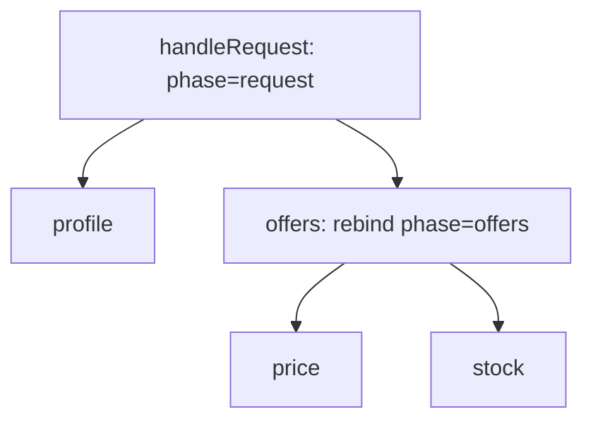

# Bài tập ngữ cảnh yêu cầu: ScopedValue và cây tác vụ trên JDK hỗ trợ tương ứng

## 1. Mục tiêu và phiên bản thực hành

Bài học thuộc chương **Vận dụng và nâng cấp** của module Java 22. Bạn sẽ thiết kế một luồng xử lý yêu cầu có nhiều tác vụ con, chia sẻ ngữ cảnh bằng `ScopedValue`, đồng thời kiểm soát vòng đời công việc bằng structured concurrency.

Kiến thức cần giữ lại khi nâng cấp là cách đặt ranh giới ngữ cảnh, truyền dữ liệu bất biến xuống cây tác vụ, khôi phục binding và xử lý thất bại có cấu trúc. Mã thực hành chính dùng **JDK 27**, theo tài liệu đối chiếu ngày **25/11/2026**, để sử dụng chữ ký API hiện hành.

| JDK | ScopedValue | Structured concurrency | Vai trò trong bài |
| --- | --- | --- | --- |
| 22 | Preview lần hai | Preview lần hai | Bối cảnh tính năng của module |
| 25 | API chuẩn hóa | Preview lần năm | Mốc ScopedValue trở thành API chính thức |
| 27 | API chuẩn hóa | Preview lần bảy | Phiên bản của lời giải tham khảo |

Trạng thái trên được mô tả trong [release notes JDK 22](https://www.oracle.com/java/technologies/javase/22-relnote-issues.html), [release notes JDK 25](https://www.oracle.com/java/technologies/javase/25-relnote-issues.html) và [release notes JDK 27](https://www.oracle.com/java/technologies/javase/27-relnote-issues.html).

**Lưu ý phiên bản:** trên JDK 27, `StructuredTaskScope` vẫn là preview. Bài này dùng `StructuredTaskScope.open()` và cách xử lý ngoại lệ của JDK 27; không xem mã preview của JDK 22 là mã có thể giữ nguyên khi nâng cấp.

Sau khi hoàn thành, bạn cần giải thích được:

- Tại sao một khóa `ScopedValue` dùng chung vẫn có binding riêng theo luồng và phạm vi thực thi.
- Những tác vụ nào trong cây được kế thừa binding.
- Rebinding trong một nhánh ảnh hưởng những nơi nào.
- Vì sao một đối tượng context bất biến phù hợp hơn một map bị sửa đồng thời.
- Sự khác biệt giữa `join()`, đóng scope, yêu cầu hủy và tác vụ thực sự kết thúc.

## 2. Tình huống: tổng hợp trang dashboard

Một dịch vụ cần tạo dashboard cho người dùng thuộc một tenant. Sau khi xác định yêu cầu, tầng tiếp nhận tạo ngữ cảnh gồm:

| Thuộc tính | Ý nghĩa |
| --- | --- |
| `requestId` | Định danh để đối chiếu các hoạt động của cùng yêu cầu |
| `tenantId` | Tenant mà yêu cầu đang xử lý |
| `userId` | Người dùng gắn với yêu cầu |
| `phase` | Nhãn giai đoạn xử lý, ban đầu là `request` |

Dashboard cần cả thông tin hồ sơ và thông tin ưu đãi. Nhánh ưu đãi lại cần giá và tồn kho:



Mọi nhánh phải giữ nguyên `requestId`, `tenantId` và `userId` của yêu cầu gốc. Riêng nhánh `offers` được tạo một context mới với `phase=offers`; hai tác vụ cháu `price` và `stock` đọc context mới đó.

Ví dụ:

| Vị trí quan sát | requestId | tenantId | phase |
| --- | --- | --- | --- |
| Gốc yêu cầu A | `req-A` | `tenant-A` | `request` |
| Hồ sơ của A | `req-A` | `tenant-A` | `request` |
| Giá và tồn kho của A | `req-A` | `tenant-A` | `offers` |
| Gốc yêu cầu B | `req-B` | `tenant-B` | `request` |
| Giá và tồn kho của B | `req-B` | `tenant-B` | `offers` |

Hai yêu cầu có thể được xử lý đồng thời trong cùng JVM. Kết quả của A không được chứa quan sát ngữ cảnh của B.

Trong bài tập, các lời gọi backend được mô phỏng trong bộ nhớ. Mục tiêu là quan sát ngữ cảnh và vòng đời tác vụ; không cần dựng HTTP server hay cơ sở dữ liệu.

## 3. Kiến thức cần dùng

### 3.1. Phân biệt khóa, giá trị và binding

Ba khái niệm khác nhau là:

- **Khóa:** đối tượng `ScopedValue<RequestContext>`, được tạo bằng `newInstance()`.
- **Giá trị:** một đối tượng `RequestContext` của một yêu cầu.
- **Binding:** việc liên kết khóa với giá trị trong khoảng thực thi của một thao tác.

Khóa thường được giữ trong `private static final`; điều đó không biến giá trị của mọi yêu cầu thành một biến dùng chung có thể ghi đè.

Dạng sử dụng cơ bản là:

```java
ScopedValue.where(CONTEXT, context).call(() -> processRequest());
```

`where` tạo carrier chứa ánh xạ; `call` mới thực hiện thao tác dưới binding đó. `call` trả kết quả, còn `run` phù hợp với thao tác không trả kết quả. Khi thao tác hoàn thành hoặc ném ngoại lệ, binding được khôi phục về trạng thái trước đó. Nguồn: [ScopedValue.Carrier của JDK 27](https://docs.oracle.com/en/java/javase/27/docs/api/java.base/java/lang/ScopedValue.Carrier.html).

Trong một method được gọi trực tiếp hoặc gián tiếp từ thao tác đã bind, code có quyền truy cập khóa có thể gọi `CONTEXT.get()`. Đây là phạm vi động của lần thực thi, không chỉ phạm vi từ vựng của một cặp ngoặc nhọn.

Không nên công khai khóa chỉ để mọi tầng tự bind lại tùy ý. Bài tập giữ khóa riêng trong lớp điều phối và cung cấp hàm đọc context cho các thành phần cần dùng. Tài liệu mô tả đối tượng `ScopedValue` như một khóa truy cập giá trị và lưu ý giới hạn quyền truy cập khóa. Nguồn: [ScopedValue — mô hình và quyền truy cập](https://docs.oracle.com/en/java/javase/27/docs/api/java.base/java/lang/ScopedValue.html).

### 3.2. Binding chỉ đọc không làm đối tượng tự bất biến

Không có thao tác gán lại giá trị hiện tại giống `ThreadLocal.set` trong một binding. Tuy nhiên, nếu giá trị được bind là một map có thể sửa, các tác vụ vẫn có thể sửa map đó.

Trong bài tập, `RequestContext` là record chỉ chứa `String`. Khi đổi `phase`, hãy tạo record mới thay vì sửa đối tượng đang được chia sẻ.

Nếu thêm collection sau này, cần xem xét cả nội dung của collection. Một field `final` trỏ tới danh sách có thể sửa không tạo ra tính bất biến sâu.

Context dùng để truyền dữ liệu xuống các tầng. Kết quả nghiệp vụ đi ngược lên qua giá trị trả về của tác vụ; không dùng context làm hộp chứa kết quả để nhiều tác vụ ghi đồng thời.

### 3.3. Kế thừa theo cấu trúc của cây tác vụ

Trình tự cần giữ là:

```text
Bind context của yêu cầu
    Mở task scope trong binding
        Fork các tác vụ con
        Join
    Đóng task scope
Kết thúc binding
```

Khi mở task scope, các binding hiện hành được ghi nhận để các tác vụ do scope fork kế thừa. Một tác vụ con có thể mở scope riêng, tiếp tục truyền binding xuống các tác vụ cháu. Nguồn: [StructuredTaskScope — inheritance of scoped value bindings](https://docs.oracle.com/en/java/javase/27/docs/api/java.base/java/util/concurrent/StructuredTaskScope.html).

Đây là điều làm cây ở phần 2 hoạt động: nhánh `offers` bind context mới rồi mở scope con bên trong binding đó.

Không suy rộng quy tắc này thành “mọi công việc bất đồng bộ đều tự nhận context”. `CompletableFuture`, executor, callback hoàn thành sau request hoặc một thread tự tạo không tự trở thành tác vụ con có cấu trúc của scope đang xét.

### 3.4. Rebinding là tạo phạm vi con

Trong nhánh `offers`:

1. Đọc context đang được kế thừa.
2. Tạo context mới, giữ nguyên định danh và đổi `phase`.
3. Bind context mới cho thao tác xử lý ưu đãi.
4. Mở scope của `price` và `stock` bên trong thao tác đó.
5. Sau khi thao tác kết thúc, context của nhánh trở về giá trị ban đầu.

Nhánh `profile` vẫn giữ binding riêng của nó. Rebinding trong `offers` không sửa record của `profile`, cũng không sửa binding của tác vụ gốc.

Hãy phân biệt việc **khôi phục binding** với việc xóa đối tượng khỏi bộ nhớ: nếu chương trình lưu context vào một kết quả hoặc cache thì tham chiếu đó vẫn tồn tại. `ScopedValue` chỉ quản lý khả năng đọc thông qua binding trong phạm vi tương ứng.

## 4. Đề bài và điều kiện hoàn thành

Hãy xây dựng lớp `RequestContextExercise` đáp ứng các yêu cầu sau:

| Mã | Yêu cầu |
| --- | --- |
| R1 | Context là đối tượng bất biến, kiểm tra những định danh bắt buộc |
| R2 | Mỗi yêu cầu được bind đúng một context gốc trong `handleRequest` |
| R3 | `profile`, `price`, `stock` đọc context qua accessor, không nhận context qua từng tham số trung gian |
| R4 | Cây có hai tầng fork: dashboard và offers |
| R5 | Chỉ nhánh offers và hậu duệ thấy `phase=offers` |
| R6 | Sau rebinding, nhánh offers khôi phục context ban đầu |
| R7 | Hai yêu cầu khác tenant có thể chạy đồng thời và trả đúng context của từng cây |
| R8 | Đọc context ngoài binding là lỗi rõ ràng, không tự chọn tenant mặc định |
| R9 | Nếu một phần bắt buộc thất bại, không trả dashboard thành công một phần |
| R10 | Scope được đóng trước khi thoát binding; tác vụ hỗ trợ hủy bằng interruption |
| R11 | Sau cả thành công và thất bại, luồng gọi không còn binding mới của yêu cầu |

Các đầu vào nghiệp vụ riêng của một hàm vẫn nên là tham số tường minh. Mục tiêu của bài không phải đưa mọi đối số vào context, mà là tránh chuyển tiếp lặp lại những metadata xuyên suốt luồng xử lý.

Ngữ cảnh đầu vào trong ví dụ được xem là đã được tầng tiếp nhận xác định. Việc bind một `tenantId` chỉ truyền giá trị đó xuống cây; nó không tự thực hiện xác thực hay kiểm tra quyền truy cập dữ liệu.

Trước khi xem lời giải, hãy phác thảo các hàm:

```text
handleRequest(context, failPrice)
    -> loadDashboard(failPrice)
        -> loadProfile()
        -> loadOffers(failPrice)
            -> loadPrice(failPrice)
            -> loadStock()
```

Đánh dấu vị trí bind, mở scope, fork, join và đóng scope trên bản phác thảo. Nếu có scope nào sống lâu hơn binding mà nó phụ thuộc, cần điều chỉnh ranh giới trước khi viết tiếp.

## 5. Lời giải tham khảo trên JDK 27

Ví dụ trả về những bản ghi quan sát thay cho dữ liệu backend thật, giúp kiểm tra context của từng tác vụ một cách trực tiếp.

Lưu mã thực hành dưới tên `RequestContextExercise.java`:

```java
import java.time.Duration;
import java.util.Objects;
import java.util.concurrent.ExecutionException;
import java.util.concurrent.StructuredTaskScope;

public final class RequestContextExercise {
    private static final ScopedValue<RequestContext> CONTEXT =
            ScopedValue.newInstance();

    private record RequestContext(
            String requestId,
            String tenantId,
            String userId,
            String phase) {

        RequestContext {
            Objects.requireNonNull(requestId, "requestId");
            Objects.requireNonNull(tenantId, "tenantId");
            Objects.requireNonNull(userId, "userId");
            Objects.requireNonNull(phase, "phase");
            if (requestId.isBlank() || tenantId.isBlank()
                    || userId.isBlank() || phase.isBlank()) {
                throw new IllegalArgumentException(
                        "Context fields must not be blank");
            }
        }

        RequestContext withPhase(String nextPhase) {
            return new RequestContext(
                    requestId, tenantId, userId, nextPhase);
        }
    }

    private record Observation(
            String component, RequestContext context) {
    }

    private record Offer(Observation price, Observation stock) {
    }

    private record Dashboard(Observation profile, Offer offer) {
    }

    private static RequestContext currentContext() {
        if (!CONTEXT.isBound()) {
            throw new IllegalStateException(
                    "This operation requires a request context");
        }
        return CONTEXT.get();
    }

    private static Observation observe(String component) {
        return new Observation(component, currentContext());
    }

    private static Dashboard handleRequest(
            RequestContext context, boolean failPrice) throws Exception {
        Objects.requireNonNull(context, "context");

        return ScopedValue.where(CONTEXT, context)
                .call(() -> loadDashboard(failPrice));
    }

    private static Dashboard loadDashboard(boolean failPrice)
            throws InterruptedException, ExecutionException {
        try (var scope = StructuredTaskScope.open(configuration ->
                configuration
                        .withName("request-" + currentContext().requestId())
                        .withTimeout(Duration.ofSeconds(5)))) {

            var profile = scope.fork(
                    RequestContextExercise::loadProfile);
            var offer = scope.fork(
                    () -> loadOffers(failPrice));

            scope.join();
            return new Dashboard(profile.get(), offer.get());
        }
    }

    private static Offer loadOffers(boolean failPrice) throws Exception {
        RequestContext inherited = currentContext();
        RequestContext offersContext = inherited.withPhase("offers");

        Offer result = ScopedValue.where(CONTEXT, offersContext).call(() -> {
            try (var scope = StructuredTaskScope.open(configuration ->
                    configuration.withName(
                            "offers-" + offersContext.requestId()))) {

                var price = scope.fork(() -> loadPrice(failPrice));
                var stock = scope.fork(
                        RequestContextExercise::loadStock);

                scope.join();
                return new Offer(price.get(), stock.get());
            }
        });

        if (!inherited.equals(currentContext())) {
            throw new AssertionError("Nested binding was not restored");
        }
        return result;
    }

    private static Observation loadProfile() throws InterruptedException {
        Thread.sleep(40);
        return observe("profile");
    }

    private static Observation loadPrice(boolean fail)
            throws InterruptedException {
        if (fail) {
            throw new IllegalStateException(
                    "Simulated price failure for "
                            + currentContext().requestId());
        }
        Thread.sleep(30);
        return observe("price");
    }

    private static Observation loadStock() throws InterruptedException {
        Thread.sleep(60);
        return observe("stock");
    }

    private static void verify(
            RequestContext original, Dashboard dashboard) {
        if (!original.equals(dashboard.profile().context())) {
            throw new AssertionError("Profile context differs");
        }

        RequestContext offersContext = original.withPhase("offers");
        if (!offersContext.equals(dashboard.offer().price().context())
                || !offersContext.equals(
                        dashboard.offer().stock().context())) {
            throw new AssertionError("Offer context differs");
        }
    }

    private static void requireUnbound() {
        if (CONTEXT.isBound()) {
            throw new AssertionError(
                    "Request context remains bound in the caller");
        }
    }

    public static void main(String[] args) throws Exception {
        requireUnbound();

        try {
            currentContext();
            throw new AssertionError("Missing context was accepted");
        } catch (IllegalStateException expected) {
            // Access outside a binding must fail.
        }

        var firstContext = new RequestContext(
                "req-A", "tenant-A", "user-A", "request");
        var secondContext = new RequestContext(
                "req-B", "tenant-B", "user-B", "request");

        try (var requests = StructuredTaskScope.open()) {
            var first = requests.fork(() -> {
                try {
                    return handleRequest(firstContext, false);
                } finally {
                    requireUnbound();
                }
            });
            var second = requests.fork(() -> {
                try {
                    return handleRequest(secondContext, false);
                } finally {
                    requireUnbound();
                }
            });

            requests.join();
            verify(firstContext, first.get());
            verify(secondContext, second.get());
        }

        requireUnbound();
        System.out.println("Two request trees: OK");

        var failingContext = new RequestContext(
                "req-failure", "tenant-A", "user-A", "request");

        try {
            handleRequest(failingContext, true);
            throw new AssertionError(
                    "A failed required subtask was accepted");
        } catch (ExecutionException expected) {
            System.out.println(
                    "Expected request failure: "
                            + expected.getClass().getSimpleName());
        }

        requireUnbound();
        System.out.println("Request binding cleanup: OK");
    }
}
```

### 5.1. Biên dịch và chạy

Dùng `java` và `javac` của **cùng JDK 27** trong thư mục thực hành:

```powershell
javac --version
java --version
javac --enable-preview --release 27 -encoding UTF-8 -d out RequestContextExercise.java
java --enable-preview -cp out RequestContextExercise
```

Cần bật preview ở đây vì có `StructuredTaskScope`. Nếu một chương trình JDK 25 trở lên chỉ dùng `ScopedValue` đã chuẩn hóa, bản thân `ScopedValue` không yêu cầu bật preview.

Các lớp dùng trong ví dụ thuộc `java.base`; không cần thêm module incubator. Cờ biên dịch và khởi chạy được mô tả trong [tài liệu javac JDK 27](https://docs.oracle.com/en/java/javase/27/docs/specs/man/javac.html) và [tài liệu java JDK 27](https://docs.oracle.com/en/java/javase/27/docs/specs/man/java.html).

Khi các thao tác hoàn tất trong timeout mô phỏng, đầu ra dự kiến là:

```text
Two request trees: OK
Expected request failure: ExecutionException
Request binding cleanup: OK
```

Đây là ví dụ để người học chạy trong môi trường tương ứng. Nó không kết nối đến backend thật và không đo hiệu năng.

### 5.2. Vì sao có một scope ngoài cùng?

Scope `requests` trong `main` chỉ là bộ điều khiển bài thực hành, dùng để chạy hai yêu cầu độc lập. Nó được mở khi chưa có request context.

Mỗi tác vụ của scope này gọi `handleRequest`, tự bind context của yêu cầu rồi tạo cây dashboard riêng. Từ đó trở xuống, việc kế thừa context diễn ra trong đúng cây.

Cấu trúc này không yêu cầu mọi yêu cầu trong một server thật phải thuộc chung một `StructuredTaskScope`. Trong ứng dụng thật, tầng tiếp nhận quyết định điểm bắt đầu của từng yêu cầu; scope tổng trong `main` chỉ giúp dựng tình huống đồng thời.

### 5.3. Vì sao có cả throws Exception và ngoại lệ cụ thể?

`loadDashboard` dùng chính sách mặc định trên JDK 27, nên khai báo `InterruptedException` và `ExecutionException`. Các hàm đi qua `ScopedValue.Carrier.call` dùng `throws Exception` để giữ ví dụ ngắn khi truyền tiếp nhiều checked exception.

Điều quan trọng là các hàm này **truyền tiếp ngoại lệ**, không đổi thất bại thành giá trị thành công. Trong ứng dụng thật, tầng biên có thể ánh xạ ngoại lệ sang kiểu lỗi của hệ thống, đồng thời giữ nguyên nguyên nhân và chính sách interruption.

`Subtask.get()` được gọi sau `join()` thành công để lấy kết quả; không dùng nó như một thao tác chờ thay thế `join()`. Nguồn: [StructuredTaskScope.Subtask JDK 27](https://docs.oracle.com/en/java/javase/27/docs/api/java.base/java/util/concurrent/StructuredTaskScope.Subtask.html).

## 6. Phân tích vòng đời và đường thất bại

### 6.1. Đường thành công

Một yêu cầu đi qua các ranh giới sau:

```text
handleRequest bind phase=request
    loadDashboard mở scope gốc
        profile đọc phase=request
        offers kế thừa phase=request
            offers bind phase=offers
                mở scope con
                    price đọc phase=offers
                    stock đọc phase=offers
                join và đóng scope con
            khôi phục phase=request trong nhánh offers
        join và đóng scope gốc
handleRequest kết thúc, khôi phục binding của luồng gọi
```

Dữ liệu trả về được hợp nhất sau khi các phần bắt buộc thành công. Context không phải kênh để hai nhánh ghi kết quả cho nhau.

Các `Observation` cố ý giữ tham chiếu đến context để bài thực hành kiểm tra. Vì vậy, kết quả có thể còn chứa đối tượng context sau khi binding đã kết thúc; điều này không có nghĩa `CONTEXT.get()` vẫn đọc được giá trị ấy ở luồng gọi.

### 6.2. Khi nhánh price thất bại

Trong chính sách mặc định của JDK 27, lỗi ở một tác vụ làm scope hủy những công việc còn lại và `join()` báo `ExecutionException`. Nhánh `offers` lại là một tác vụ của scope dashboard, nên thất bại của nó tiếp tục đi lên phạm vi bao ngoài. Việc đóng các scope giữ tác vụ con trong vòng đời của cha. Nguồn: [Hướng dẫn structured concurrency của JDK 27](https://docs.oracle.com/en/java/javase/27/core/structured-concurrency.html).

Trình tự khái niệm:

1. `price` ném lỗi mô phỏng.
2. Scope của offers xử lý thất bại; nếu `stock` còn đang chạy, nó được yêu cầu hủy.
3. Nhánh offers không trả về một `Offer` thành công.
4. Scope dashboard nhận thất bại của offers; nếu profile còn đang chạy, nó cũng được yêu cầu hủy.
5. Các scope đóng trước khi các binding tương ứng kết thúc.
6. Tầng gọi nhận lỗi; dashboard không được trình bày như một kết quả đầy đủ.

Trong thực thi thực tế, một tác vụ anh em có thể đã xong hoặc chưa bắt đầu chạy khi lỗi xảy ra. Không nên đặt điều kiện rằng luôn phải thấy đúng một dòng log “stock bị interrupt”.

Với scope lồng nhau, chuỗi nguyên nhân có thể chứa nhiều lớp ngoại lệ. Không giả định `getCause()` đầu tiên luôn là lỗi backend gốc; nếu cần phân loại lỗi, hãy thiết kế việc chuyển đổi hoặc duyệt nguyên nhân phù hợp ở tầng biên.

Hủy tác vụ cũng không hoàn tác tác dụng phụ đã xảy ra ở hệ thống bên ngoài. Với công việc ghi dữ liệu, cần thiết kế giao dịch hoặc hành vi nghiệp vụ tương ứng; bài này dùng công việc chỉ đọc mô phỏng để tập trung vào vòng đời.

### 6.3. Interruption là yêu cầu hợp tác

Các hàm backend mô phỏng gọi `Thread.sleep`, một thao tác có thể bị interrupt và ném `InterruptedException`. Chúng truyền ngoại lệ đó lên thay vì nuốt lỗi rồi tiếp tục xử lý.

Trong công việc thực tế:

- Khi có thể truyền `InterruptedException` lên, hãy để tầng gọi quyết định.
- Nếu tầng biên bắt interruption mà không thể ném tiếp, cần dừng công việc phù hợp và khôi phục cờ interrupt khi hợp đồng yêu cầu.
- Với vòng lặp tính toán dài, thiết kế điểm kiểm tra hủy nếu công việc cần hỗ trợ hủy.
- Kiểm tra hành vi của thư viện I/O đang dùng; không mặc định mọi lời gọi chặn đều phản ứng giống `sleep`.

Tài liệu `Thread` mô tả interruption là yêu cầu dừng hoặc hủy hoạt động hiện tại, không phải lệnh cưỡng bức kết thúc thread. Nguồn: [Thread — Thread Interruption](https://docs.oracle.com/en/java/javase/27/docs/api/java.base/java/lang/Thread.html).

### 6.4. Timeout không bảo đảm trả về đúng tại mốc thời gian

Ví dụ đặt timeout năm giây cho scope dashboard. Timeout bắt đầu khi scope được mở.

Trên JDK 27, với chính sách mặc định được dùng ở đây, khi timeout gây hủy thì `join()` báo `ExecutionException` có nguyên nhân `StructuredTaskScope.CancelledByTimeoutException`. Không viết phần xử lý theo giả định rằng chính lời gọi này luôn ném trực tiếp `TimeoutException`. Nguồn: [CancelledByTimeoutException trong JDK 27](https://docs.oracle.com/en/java/javase/27/docs/api/java.base/java/util/concurrent/StructuredTaskScope.CancelledByTimeoutException.html), [StructuredTaskScope JDK 27](https://docs.oracle.com/en/java/javase/27/docs/api/java.base/java/util/concurrent/StructuredTaskScope.html).

Đóng scope vẫn phải chờ các tác vụ mà nó quản lý kết thúc. Một tác vụ phớt lờ interruption có thể làm thời gian thoát scope dài hơn timeout. Vì vậy, “ngân sách chờ đã hết” và “mọi tài nguyên đã được thu hồi” là hai sự kiện cần phân biệt.

Con số năm giây chỉ phục vụ ví dụ. Khi có deadline chung của request, nên tính ngân sách còn lại cho mỗi phạm vi cần chờ, thay vì tự cấp lại nguyên ngân sách ở mỗi tầng. API cấu hình hỗ trợ timeout qua `withTimeout(Duration)`. Nguồn: [StructuredTaskScope.Configuration](https://docs.oracle.com/en/java/javase/27/docs/api/java.base/java/util/concurrent/StructuredTaskScope.Configuration.html).

## 7. Những thay đổi cần tự thực hiện

### 7.1. Kiểm tra khôi phục binding khi nhánh trong ném lỗi

Trong một method đang có request context, thêm một phạm vi rebinding cố ý ném lỗi:

```java
RequestContext before = currentContext();

try {
    ScopedValue.where(CONTEXT, before.withPhase("failure-demo")).run(() -> {
        throw new IllegalStateException("Simulated nested failure");
    });
} catch (IllegalStateException expected) {
    // Only the simulated nested operation failed.
}

if (!before.equals(currentContext())) {
    throw new AssertionError("Outer context was not restored");
}
```

Đoạn này phải được thực thi bên trong binding gốc, chẳng hạn qua một thao tác phụ được gọi từ `handleRequest`. Mục tiêu là kiểm tra giá trị bên ngoài được phục hồi sau lỗi, không chỉ kiểm tra trạng thái unbound sau khi toàn bộ request kết thúc.

Không dùng cách sửa `tenantId` của một đối tượng dùng chung để mô phỏng rebinding. Hãy tạo context mới và giới hạn nó trong thao tác con.

### 7.2. Tạo một phép kiểm tra hủy có thứ tự xác định

Lỗi ở `price` trong lời giải có thể xảy ra trước khi `stock` bắt đầu. Để chứng minh tác vụ đang chạy được hủy, hãy xây dựng tình huống có phối hợp:

1. Tác vụ chậm báo “đã bắt đầu” qua `CountDownLatch`.
2. Tác vụ gây lỗi chờ tín hiệu đó rồi mới ném lỗi.
3. Tác vụ chậm chờ bằng thao tác interruptible và ghi nhận việc kết thúc trong `finally`.
4. Sau khi hàm xử lý yêu cầu kết thúc bằng lỗi, kiểm tra tác vụ chậm đã ra khỏi `finally`.

Đây là kiểm tra quan hệ vòng đời. Không dùng một khoảng `sleep` ngẫu nhiên để suy ra rằng chắc chắn hai tác vụ đã cùng hoạt động.

Nếu thêm bộ đếm tác vụ đang chạy, cập nhật tăng khi tác vụ thực sự bắt đầu và giảm trong `finally`. Sau khi request đã thoát hoàn toàn, bộ đếm của các tác vụ thuộc cây đó phải về không.

### 7.3. Bổ sung deadline vào context

Mở rộng context với một deadline bất biến. Trước khi mở scope có timeout, tính khoảng thời gian còn lại; xử lý rõ trường hợp đã hết hạn.

Điểm cần giải thích trong bài làm:

- Tại sao một deadline của request không nên được đặt lại sau mỗi lần mở scope con?
- Thành phần nào áp dụng deadline thành cấu hình timeout cụ thể?
- Nếu backend vẫn tiếp tục sau yêu cầu hủy, tầng nào chịu trách nhiệm chờ nó kết thúc?
- Ngoại lệ hết hạn được ánh xạ thành lỗi của ứng dụng ở ranh giới nào?

Việc đặt deadline vào context chỉ truyền dữ liệu về thời hạn. Nó không tự cấu hình timeout cho mọi thư viện hoặc mọi tác vụ.

## 8. Các lỗi thiết kế cần nhận diện

### 8.1. Mở scope trước khi bind rồi fork trong binding mới

Mẫu dưới đây cố ý đặt sai ranh giới; đoạn mã giả định đang ở trong lớp có `CONTEXT` và `observe` như lời giải:

```java
// Sai: scope được mở trước binding mà tác vụ cần kế thừa.
try (var scope = StructuredTaskScope.open()) {
    ScopedValue.where(CONTEXT, context).run(() -> {
        scope.fork(() -> observe("incorrect-boundary"));
    });
    scope.join();
}
```

Scope được mở với tập binding ban đầu, còn lúc fork lại có binding mới. API kiểm tra tính phù hợp của binding khi fork; vi phạm cấu trúc có thể dẫn đến `StructureViolationException`.

Cách sửa là đưa việc mở scope và toàn bộ vòng đời của nó vào trong thao tác đã bind, như `handleRequest` và `loadDashboard` trong lời giải. Nguồn: [StructuredTaskScope — quy tắc binding và cấu trúc](https://docs.oracle.com/en/java/javase/27/docs/api/java.base/java/util/concurrent/StructuredTaskScope.html), [StructureViolationException](https://docs.oracle.com/en/java/javase/27/docs/api/java.base/java/util/concurrent/StructureViolationException.html).

Tương tự, không mở scope rồi để nó sống qua thời điểm kết thúc `call` hoặc `run` đã tạo binding cho scope đó.

### 8.2. Dùng context để gom kết quả của các tác vụ

Giả sử thêm `Map<String, Object> results` vào context rồi cho profile, price và stock cùng ghi vào. Thiết kế này tạo thêm vấn đề đồng bộ và làm luồng dữ liệu khó theo dõi.

Trong bài tập, mỗi tác vụ trả một kết quả của riêng nó. Tác vụ cha hợp nhất các kết quả sau `join()` thành công. Ngữ cảnh đi xuống cây; kết quả đi lên cây bằng giá trị trả về.

### 8.3. Trả một future hoặc callback rồi kết thúc request

Nếu `handleRequest` trả về một công việc chưa hoàn tất và thoát binding, callback chạy sau đó không còn nằm trong phạm vi thực thi đã bind chỉ vì nó từng được tạo ở đó.

Với công việc thực sự thuộc request, giữ nó trong scope và hoàn tất trước khi rời ranh giới. Với background job độc lập, thiết kế dữ liệu job tường minh và tạo ngữ cảnh mới ở điểm thực thi của job.

Khi dùng framework bất đồng bộ có cơ chế truyền context riêng, cần kiểm tra hợp đồng của framework đó. Không mặc định cơ chế kế thừa của `StructuredTaskScope` áp dụng cho một scheduler khác.

### 8.4. Hiểu ThreadLocal là API đã lỗi thời

Bài tập không yêu cầu thay mọi `ThreadLocal` trong ứng dụng. `ScopedValue` phù hợp với dữ liệu truyền một chiều xuống chuỗi gọi hoặc cây tác vụ có ranh giới rõ ràng. Những thiết kế cần trạng thái có thể thay đổi riêng theo thread phải được đánh giá theo mục đích của chúng.

Khi nâng cấp một ứng dụng, hãy phân loại từng trường hợp sử dụng trước: metadata bất biến của request, cache riêng của thread, tài nguyên có thể thay đổi hoặc trạng thái của framework không nhất thiết có cùng cách chuyển đổi.

### 8.5. Đánh đồng “không còn binding” với “không còn dữ liệu ở đâu”

Sau khi rời `call`, kiểm tra `CONTEXT.isBound()` trên luồng gọi giúp xác nhận ranh giới binding ở luồng đó. Nó không chứng minh context đã biến mất khỏi heap hoặc không được lưu ở một nơi khác.

Muốn tránh lưu metadata lâu hơn cần thiết, hãy xem cả cache, kết quả, message và callback mà chương trình tạo ra. Đây là hệ quả của luồng tham chiếu trong ứng dụng, khác với việc tự khôi phục binding.

## 9. Ma trận kiểm tra bài làm

Người học nên ghi lại phiên bản JDK, lệnh chạy, dữ liệu đầu vào và kết quả quan sát của các tình huống sau:

| Tình huống | Cách dựng | Điều kiện đạt |
| --- | --- | --- |
| Một yêu cầu thành công | Chạy đầy đủ cây dashboard | Ba tác vụ lá mang đúng định danh của request |
| Hai tenant đồng thời | Chạy hai cây và dùng cơ chế phối hợp khi cần | Không có kết quả mang context của cây còn lại |
| Rebinding bình thường | Đổi phase trong offers | Profile vẫn là `request`; price và stock là `offers` |
| Rebinding gặp lỗi | Ném lỗi trong phạm vi phase tạm | Context của phạm vi bao ngoài được khôi phục |
| Không có context | Gọi accessor ngoài binding | Lỗi rõ ràng, không tự nhận tenant mặc định |
| Tác vụ bắt buộc thất bại | Gây lỗi sau khi tác vụ anh em đã bắt đầu | Không trả dashboard thành công; tác vụ còn lại kết thúc trước khi scope đóng xong |
| Owner bị interrupt | Interrupt trong lúc owner đang chờ join | Không đổi interruption thành kết quả thành công |
| Timeout | Dùng tác vụ chậm có hỗ trợ hủy | Lỗi được phân loại đúng theo API JDK 27 và scope được đóng |
| Sau thành công và lỗi | Kiểm tra trên luồng gọi tương ứng | Không còn binding mới của request |
| Sai ranh giới scope | Mở scope ngoài rồi bind khi fork | Nhận diện được lỗi cấu trúc và giải thích cách sửa |

Không kiểm tra đồng thời chỉ bằng thứ tự log vì scheduler có thể thay đổi thứ tự chạy. Không đặt điều kiện mọi lần phải mất đúng một số millisecond cố định.

Muốn kiểm tra hai request thực sự chồng lấn, dùng latch hoặc một cơ chế đồng bộ phù hợp ở những điểm đã chọn. Các đối tượng đồng bộ phục vụ kiểm tra không cần trở thành một phần của context nghiệp vụ.

## 10. Khi chuyển bài sang một JDK khác

`ScopedValue` chuẩn hóa từ JDK 25 không làm cho tất cả API kết hợp với nó tự trở thành API chuẩn hóa. Đặc biệt, cần xem tài liệu structured concurrency đúng phiên bản.

| Điểm cần đối chiếu | JDK 25 | JDK 27 dùng trong bài |
| --- | --- | --- |
| Kiểu scope | `StructuredTaskScope<T, R>` | `StructuredTaskScope<T, R, R_X>` |
| Lỗi tác vụ với chính sách mặc định | `StructuredTaskScope.FailedException` | `ExecutionException` |
| Mở scope với cấu hình | Đối chiếu overload của phiên bản 25 | Lời giải dùng overload `open(configuration -> ...)` của phiên bản 27 |
| Timeout | Dùng hợp đồng timeout của phiên bản 25 | Nguyên nhân `CancelledByTimeoutException` với chính sách trong bài |
| Cờ thực hành preview | Gắn với release 25 | Gắn với release 27 |

Các khác biệt về chữ ký được thể hiện trong [StructuredTaskScope JDK 25](https://docs.oracle.com/en/java/javase/25/docs/api/java.base/java/util/concurrent/StructuredTaskScope.html) và [StructuredTaskScope JDK 27](https://docs.oracle.com/en/java/javase/27/docs/api/java.base/java/util/concurrent/StructuredTaskScope.html).

Do đó, đổi riêng `--release 27` thành `--release 25` không phải một phép chuyển đổi đầy đủ của lời giải. Cần dùng JDK đích để biên dịch preview, đối chiếu chữ ký, cách xử lý lỗi và chạy lại những tình huống tương ứng.

Một trình tự nâng cấp phù hợp cho bài thực hành là:

1. Chọn JDK đích và mở tài liệu API đúng release.
2. Giữ mô hình context bất biến và ranh giới binding của yêu cầu.
3. Điều chỉnh phần điều phối task scope theo API của release đó.
4. Kiểm tra lại truyền context qua cả hai tầng và khôi phục khi có lỗi.
5. Cấu hình preview cho cả tiến trình biên dịch, chạy và tiến trình chạy kiểm thử nếu có.
6. Ghi rõ phần nào đã chuẩn hóa, phần nào vẫn phụ thuộc API preview.

## 11. Sản phẩm cần nộp của bài thực hành

Bài làm hoàn chỉnh gồm mã chạy được trên JDK đã chọn, sơ đồ cây tác vụ và bảng kết quả kiểm tra. Kèm theo đó là diễn giải ngắn về ba ranh giới:

- **Ranh giới dữ liệu:** request context chứa gì, ai được đọc khóa và những dữ liệu nào vẫn truyền bằng tham số.
- **Ranh giới thực thi:** scope nào mở trong binding nào, tác vụ nào kế thừa context nào.
- **Ranh giới thất bại:** tác vụ nào là bắt buộc, cách xử lý interruption và timeout, thời điểm tất cả tác vụ của request đã kết thúc.

Với lời giải trong bài, bằng chứng cốt lõi là profile giữ context gốc, price và stock dùng context được rebind trong offers, hai cây yêu cầu giữ đúng tenant của mình, và mỗi scope đóng trước khi binding bao quanh nó kết thúc.
