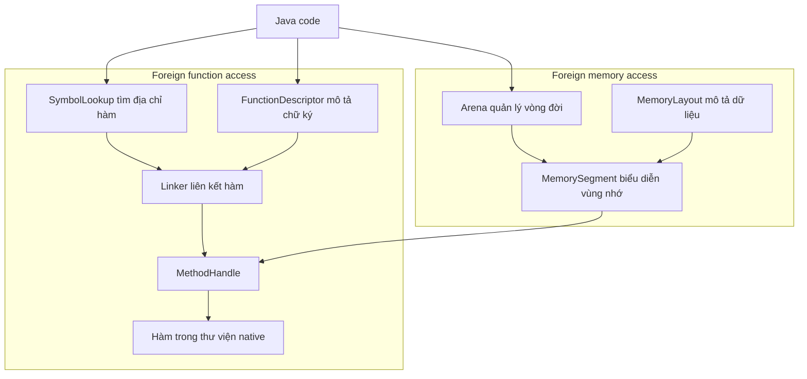

# JEP 454 và mô hình chính thức của Foreign Function & Memory API trong `java.lang.foreign`

Foreign Function & Memory API (FFM API) cho phép chương trình Java làm việc với vùng nhớ nằm ngoài heap và gọi hàm được cung cấp bởi thư viện native, chẳng hạn thư viện viết bằng C. API này đưa việc quản lý vùng nhớ, mô tả cấu trúc dữ liệu và liên kết hàm native vào một mô hình thống nhất trong Java.

JEP 454 hoàn thiện FFM API và đưa API này thành tính năng chính thức từ JDK 22. Trong Java hiện đại, API vẫn được cung cấp trong package `java.lang.foreign` thuộc module `java.base`; tài liệu Java SE 26 tiếp tục ghi nhận các kiểu chính của API với mốc `Since: 22`. Vì vậy, khi học nội dung này, hãy dùng API chuẩn hiện hành và không cần bật preview feature hay thêm module incubator.

## 1. Vì sao Java cần Foreign Function & Memory API?

Java chạy trong JVM và quản lý object trên heap bằng garbage collector. Tuy nhiên, nhiều hệ thống thực tế cần trao đổi dữ liệu với phần mềm nằm ngoài JVM:

- Gọi thư viện xử lý ảnh, âm thanh, nén dữ liệu, mật mã hoặc tính toán hiệu năng cao đã được viết bằng C/C++.
- Tích hợp với thư viện hệ điều hành, thiết bị hoặc phần mềm có giao diện native.
- Đọc và ghi dữ liệu trong vùng nhớ off-heap hoặc file được ánh xạ vào bộ nhớ.
- Trao đổi các cấu trúc nhị phân có bố cục cụ thể với một chương trình native.

Trước FFM API, Java thường dùng Java Native Interface (JNI) để gọi native code. JNI vẫn là một phần của nền tảng Java, nhưng cách tích hợp này thường cần khai báo native method, sinh header, viết mã C/C++ trung gian và chuyển đổi dữ liệu giữa object Java với kiểu dữ liệu native. Việc quản lý pointer và vòng đời vùng nhớ cũng đòi hỏi nhiều mã cẩn thận.

FFM API cung cấp một cách tiếp cận trực tiếp hơn cho các hàm tuân theo ABI của nền tảng. Java mô tả chữ ký hàm bằng `FunctionDescriptor`, tìm địa chỉ hàm bằng `SymbolLookup`, rồi dùng `Linker` tạo một `MethodHandle` để gọi hàm. Phần bộ nhớ được biểu diễn bằng `MemorySegment` và được quản lý vòng đời qua `Arena`.

FFM API không làm cho mọi thao tác native trở nên an toàn tuyệt đối. Nó bổ sung kiểm tra biên và vòng đời cho các segment do Java quản lý, nhưng chương trình vẫn phải cung cấp đúng chữ ký hàm, đúng bố cục dữ liệu và đúng hợp đồng về pointer của thư viện native.

## 2. Hai phần của mô hình FFM

FFM API gồm hai phần phối hợp với nhau:

1. **Foreign memory access** mô hình hóa vùng nhớ và cách đọc, ghi dữ liệu trong vùng nhớ đó.
2. **Foreign function access** mô hình hóa hàm native và cách gọi hàm từ Java hoặc cho phép native code gọi ngược vào Java.



Ở nhánh bộ nhớ, `Arena` quyết định một segment sống trong bao lâu và thread nào được truy cập. `MemorySegment` là đối tượng đại diện cho một vùng nhớ liên tục. `MemoryLayout` mô tả cách diễn giải các byte trong vùng đó.

Ở nhánh hàm, `SymbolLookup` tìm symbol trong thư viện; `FunctionDescriptor` mô tả kiểu trả về và các tham số; `Linker` kết hợp địa chỉ hàm với descriptor để tạo `MethodHandle`. Khi gọi handle, Java thực hiện lời gọi native theo ABI của hệ điều hành và bộ xử lý hiện tại.

## 3. Foreign memory access: `MemorySegment` và `Arena`

### 3.1. `MemorySegment` biểu diễn vùng nhớ

`MemorySegment` biểu diễn một vùng nhớ liên tục có kích thước xác định. Segment có thể đại diện cho:

- **Heap segment**: vùng nhớ nằm trong heap, thường được tạo từ mảng Java bằng `MemorySegment.ofArray(...)`.
- **Native segment**: vùng nhớ nằm ngoài heap, thường được cấp phát thông qua một `Arena`.
- **Mapped segment**: vùng nhớ được ánh xạ từ file, ví dụ qua API `FileChannel.map` nhận `Arena`.

Các loại segment dùng chung mô hình truy cập. Khi đọc hoặc ghi, chương trình cung cấp một layout để xác định kiểu dữ liệu, byte order và alignment, cùng offset tính theo byte hoặc index tương ứng.

Mỗi segment có hai giới hạn quan trọng:

- **Spatial bounds**: thao tác truy cập phải nằm trong phạm vi byte của segment. Truy cập vượt biên sẽ bị từ chối.
- **Temporal bounds**: segment chỉ được truy cập khi scope gắn với nó còn sống. Nếu `Arena` đã đóng, truy cập segment được cấp phát từ arena đó sẽ thất bại.

Nhờ vậy, các thao tác Java đọc hoặc ghi qua `MemorySegment` được kiểm tra biên và vòng đời. `asSlice(offset, size)` tạo một segment con dùng chung vùng nhớ gốc nhưng có phạm vi truy cập hẹp hơn; thao tác này không cấp phát hay sao chép vùng nhớ mới.

### 3.2. `Arena` kiểm soát vòng đời và quyền truy cập thread

`Arena` là nơi cấp phát native segment và quản lý thời điểm vùng nhớ được giải phóng. Bốn kiểu arena chính có đặc tính khác nhau:

| Cách tạo | Vòng đời | Đóng tường minh | Truy cập nhiều thread |
| --- | --- | --- | --- |
| `Arena.ofConfined()` | Có giới hạn | Có | Không; chỉ thread tạo arena |
| `Arena.ofShared()` | Có giới hạn | Có | Có |
| `Arena.ofAuto()` | Có giới hạn, do garbage collector quản lý | Không | Có |
| `Arena.global()` | Không giới hạn | Không | Có |

Với công việc có phạm vi rõ ràng trong một method hoặc một khối lệnh, `Arena.ofConfined()` thường là lựa chọn dễ kiểm soát nhất. Có thể dùng `try-with-resources` để đóng arena đúng lúc. Khi cần chia sẻ segment giữa nhiều thread, dùng `Arena.ofShared()` và tự tổ chức đồng bộ dữ liệu. Arena shared chỉ cho phép truy cập từ nhiều thread; nó không tự biến các thao tác đọc ghi thành thread-safe hay atomic.

`Arena.ofAuto()` để garbage collector quyết định thời điểm giải phóng vùng nhớ sau khi arena và các segment liên quan không còn reachable. Cách này không bảo đảm thời điểm giải phóng xác định. `Arena.global()` có vòng đời không giới hạn, vì vậy vùng nhớ cấp phát từ arena này không được giải phóng trong suốt vòng đời JVM. Chỉ chọn hai kiểu này khi vòng đời đó phù hợp với yêu cầu của ứng dụng.

Ví dụ cấp phát một mảng gồm năm số nguyên ở off-heap:

```java
import java.lang.foreign.Arena;
import java.lang.foreign.MemorySegment;
import java.lang.foreign.ValueLayout;

public class NativeMemoryExample {
    public static void main(String[] args) {
        long count = 5;

        try (Arena arena = Arena.ofConfined()) {
            long byteSize = count * ValueLayout.JAVA_INT.byteSize();
            long alignment = ValueLayout.JAVA_INT.byteAlignment();
            MemorySegment numbers = arena.allocate(byteSize, alignment);

            for (long i = 0; i < count; i++) {
                numbers.setAtIndex(ValueLayout.JAVA_INT, i, (int) (i * 10));
            }

            for (long i = 0; i < count; i++) {
                System.out.println(numbers.getAtIndex(ValueLayout.JAVA_INT, i));
            }
        } // Arena đóng và vùng nhớ native được giải phóng tại đây.
    }
}
```

`ValueLayout.JAVA_INT` mô tả một giá trị `int` có kích thước và alignment tương ứng. `setAtIndex` và `getAtIndex` tính offset từ index theo kích thước của layout. Sau khi khối `try` kết thúc, arena đóng; segment `numbers` không còn hợp lệ để truy cập.

### 3.3. Heap segment và native segment có thể dùng chung API

Nếu dữ liệu vẫn nằm trong một mảng Java, có thể tạo heap segment mà không cần sao chép:

```java
int[] values = {10, 20, 30};
MemorySegment segment = MemorySegment.ofArray(values);

int second = segment.getAtIndex(ValueLayout.JAVA_INT, 1);
System.out.println(second); // 20
```

Heap segment giúp dùng chung các thao tác và layout của FFM với dữ liệu Java hiện có. Tuy nhiên, heap segment không phải native pointer để truyền trực tiếp cho hàm C. Khi một hàm native cần địa chỉ vùng nhớ, hãy cấp phát native segment phù hợp hoặc dùng cơ chế trao đổi dữ liệu mà thư viện hỗ trợ.

## 4. `MemoryLayout`: mô tả cấu trúc dữ liệu trong bộ nhớ

Một vùng nhớ chỉ là dãy byte. Để diễn giải đúng dãy byte đó, chương trình cần biết kiểu dữ liệu, kích thước, alignment, byte order và vị trí các trường. `MemoryLayout` cung cấp mô hình khai báo cho những thông tin này.

Các layout thường dùng gồm:

| Layout | Ý nghĩa |
| --- | --- |
| `ValueLayout` | Giá trị cơ bản như `int`, `long`, `float`, `double` hoặc địa chỉ (`ADDRESS`). |
| `SequenceLayout` | Chuỗi phần tử cùng layout, thường dùng để mô tả mảng. |
| `StructLayout` | Các trường được đặt lần lượt trong một cấu trúc. |
| `UnionLayout` | Nhiều trường dùng chung điểm bắt đầu vùng nhớ. |
| `PaddingLayout` | Vùng đệm được thêm tường minh để mô tả khoảng trống trong cấu trúc. |

Ví dụ mô tả một cấu trúc C có trường `id` kiểu `int` và trường `score` kiểu `double` trên ABI 64-bit thường căn chỉnh `double` theo 8 byte:

```java
import java.lang.foreign.MemoryLayout;
import java.lang.foreign.ValueLayout;
import java.lang.invoke.VarHandle;

final class RecordLayoutExample {
    static final MemoryLayout RECORD = MemoryLayout.structLayout(
        ValueLayout.JAVA_INT.withName("id"),
        MemoryLayout.paddingLayout(4),
        ValueLayout.JAVA_DOUBLE.withName("score")
    );

    static final VarHandle RECORD_ID = RECORD.varHandle(
        MemoryLayout.PathElement.groupElement("id")
    );
}
```

Trong ví dụ này, bốn byte padding mô tả khoảng đệm giữa hai trường. `structLayout` ghép các thành phần theo thứ tự khai báo; nó không tự suy ra toàn bộ quy tắc padding của mọi compiler C. Bố cục thực tế của `struct` phụ thuộc ABI, compiler và khai báo native. Hãy đối chiếu header và tài liệu của thư viện, hoặc dùng công cụ sinh binding phù hợp, trước khi truy cập dữ liệu production.

Sau khi có layout, chương trình có thể cấp phát đúng kích thước bằng `arena.allocate(RECORD)` và dùng `VarHandle` hoặc layout path để truy cập trường có tên. Layout cũng có thể mô tả mảng lồng nhau, union, con trỏ có target layout và các trường có byte order khác native order.

## 5. Foreign function access: gọi hàm native

### 5.1. Các thành phần chính

- `Linker.nativeLinker()` lấy linker cho ABI của hệ điều hành và bộ xử lý đang chạy JVM.
- `SymbolLookup` tìm địa chỉ symbol, thường là địa chỉ hàm trong thư viện native. `defaultLookup()` tìm trong tập thư viện phổ biến do linker cung cấp; tập symbol cụ thể có thể khác theo nền tảng.
- `FunctionDescriptor` mô tả layout của giá trị trả về và từng tham số theo ABI native.
- `MethodHandle` là đối tượng Java có thể gọi. `Linker.downcallHandle(...)` tạo handle để gọi từ Java sang native; `Linker.upcallStub(...)` tạo function pointer để native code gọi ngược vào Java.

Trình tự một lời gọi downcall thường là:

1. Lấy `Linker` cho nền tảng hiện tại.
2. Tìm địa chỉ hàm bằng `SymbolLookup`.
3. Khai báo `FunctionDescriptor` khớp chính xác chữ ký native.
4. Tạo `MethodHandle` bằng `downcallHandle`.
5. Chuẩn bị tham số và vùng nhớ có vòng đời đủ dài, sau đó gọi handle.

### 5.2. Ví dụ gọi hàm `strlen` của thư viện C

Trong C, `strlen` nhận một chuỗi C kết thúc bằng byte `\0` và trả về độ dài theo byte với kiểu `size_t`. Kích thước và kiểu Java tương ứng của `size_t` phụ thuộc ABI. Có thể lấy layout chuẩn của kiểu này từ `Linker.canonicalLayouts()` thay vì giả định `size_t` luôn là `long`.

Ví dụ sau dùng `strlen` từ thư viện C tiêu chuẩn, theo cách tra cứu được tài liệu Java minh họa:

```java
import java.lang.foreign.Arena;
import java.lang.foreign.FunctionDescriptor;
import java.lang.foreign.Linker;
import java.lang.foreign.MemoryLayout;
import java.lang.foreign.MemorySegment;
import java.lang.foreign.ValueLayout;
import java.lang.invoke.MethodHandle;

public class StrlenExample {
    public static void main(String[] args) throws Throwable {
        Linker linker = Linker.nativeLinker();
        MemoryLayout sizeT = linker.canonicalLayouts().get("size_t");

        MethodHandle strlen = linker.downcallHandle(
            linker.defaultLookup().findOrThrow("strlen"),
            FunctionDescriptor.of(sizeT, ValueLayout.ADDRESS)
        );

        try (Arena arena = Arena.ofConfined()) {
            MemorySegment cString = arena.allocateFrom("Xin chào Java");
            long byteLength = (long) strlen.invoke(cString);
            System.out.println(byteLength);
        }
    }
}
```

`allocateFrom(String)` mã hóa chuỗi bằng UTF-8 và thêm ký tự kết thúc C `\0`. Vì vậy, `strlen` trả về số byte UTF-8 trước byte kết thúc, không nhất thiết bằng `String.length()` của Java. `ValueLayout.ADDRESS` mô tả tham số con trỏ; layout trả về lấy từ tên kiểu `size_t` do linker cung cấp. `invoke` cho phép chuyển đổi kiểu trả về nguyên thủy phù hợp khi layout `size_t` của ABI hiện tại có carrier khác nhau.

Ví dụ dựa trên việc `defaultLookup()` tìm thấy symbol `strlen` trong thư viện C tiêu chuẩn của nền tảng. Tập thư viện và symbol có thể khác theo hệ điều hành hoặc bộ xử lý. Khi gọi thư viện riêng, hãy dùng `SymbolLookup.libraryLookup(Path, arena)` hoặc overload nhận tên thư viện để nạp đúng thư viện, sau đó tìm symbol trong lookup đó. Vòng đời của lookup gắn với arena truyền vào; đóng arena có thể kết thúc vòng đời thư viện đã nạp qua lookup.

### 5.3. Downcall và upcall

**Downcall** là lời gọi từ Java sang hàm native. `downcallHandle` trả về `MethodHandle`, do đó có thể lưu handle và tái sử dụng thay vì tạo lại cho mỗi lần gọi. Chữ ký của handle được quyết định bởi `FunctionDescriptor` và quy tắc ABI.

**Upcall** là chiều ngược lại: Java cung cấp một method handle, rồi `upcallStub` tạo một function pointer mà native code có thể gọi. Đây là cách truyền callback Java cho thư viện native, ví dụ thư viện yêu cầu hàm so sánh hoặc hàm xử lý sự kiện. Arena được truyền vào `upcallStub` quyết định vòng đời function pointer; không được để native code tiếp tục gọi pointer sau khi arena đã đóng.

## 6. Native access và các giới hạn an toàn

Một số thao tác FFM được đánh dấu là **restricted** vì JVM không thể tự xác minh chúng có an toàn hay không. Các ví dụ quan trọng gồm tạo downcall handle, tạo upcall stub, nạp thư viện bằng `SymbolLookup.libraryLookup`, thay đổi giới hạn segment bằng `MemorySegment.reinterpret` và gắn target layout cho địa chỉ bằng `AddressLayout.withTargetLayout`.

Ứng dụng dùng các thao tác restricted cần được cấp native access. Với ứng dụng chạy trên classpath, có thể khởi chạy như sau:

```bash
java --enable-native-access=ALL-UNNAMED StrlenExample
```

Với ứng dụng dạng module, nên chỉ bật native access cho module thực sự cần quyền này:

```bash
java --enable-native-access=com.example.nativebridge -m com.example.nativebridge/com.example.Main
```

JDK 24 trở đi có cảnh báo cho native access không được bật tường minh theo mặc định hiện hành; định hướng của nền tảng là siết chặt quyền truy cập này trong các bản phát hành tương lai. Vì vậy, ứng dụng nên khai báo rõ module cần native access thay vì phụ thuộc vào hành vi mặc định.

Các kiểm tra của `MemorySegment` không thể bảo vệ hoàn toàn phần mã native. Ví dụ, Java có thể kiểm tra rằng segment truyền vào còn sống và thao tác Java nằm trong biên segment, nhưng không thể ngăn một hàm C ghi vượt khỏi vùng nhớ nếu chính hàm C xử lý pointer sai. Tương tự, linker không thể suy ra chữ ký thật của symbol từ thư viện; một `FunctionDescriptor` sai có thể dẫn đến hành vi không xác định, làm hỏng bộ nhớ hoặc khiến JVM dừng bất thường.

Đặc biệt cẩn thận với pointer được trả về từ native code. Một địa chỉ không tự cho biết kích thước vùng nhớ hay thời điểm vùng nhớ được giải phóng. Segment đại diện cho pointer như vậy thường có kích thước bằng 0. Chỉ mở rộng phạm vi bằng các API restricted như `reinterpret` khi hợp đồng của thư viện cung cấp kích thước và vòng đời đáng tin cậy; không tự đoán kích thước hoặc dùng một giới hạn rất lớn để đọc dữ liệu.

Native memory cũng nằm ngoài các bảo đảm thông thường của Java Memory Model. Nếu nhiều thread cùng đọc hoặc ghi một native segment, ứng dụng phải tự thiết kế cơ chế đồng bộ thích hợp. Việc dùng `Arena.ofShared()` chỉ giải quyết quyền truy cập từ nhiều thread, không tự giải quyết data race.

## 7. Khi nào nên dùng FFM API?

FFM API phù hợp khi ứng dụng cần gọi hàm theo ABI native, chia sẻ dữ liệu với thư viện C, truy cập cấu trúc nhị phân có bố cục đã biết hoặc quản lý vùng nhớ off-heap với thời điểm giải phóng rõ ràng. Với các thư viện C++ có giao diện phức tạp, một lớp wrapper xuất hàm theo C ABI thường giúp ranh giới tích hợp ổn định hơn.

Không cần đưa FFM vào mọi ứng dụng Java. Nếu API Java chuẩn đã đáp ứng yêu cầu, hãy tiếp tục dùng API đó. Nếu cần JNI do thư viện hoặc hệ thống hiện tại phụ thuộc vào JNI, JNI vẫn được nền tảng hỗ trợ; JEP 454 không loại bỏ JNI. FFM là lựa chọn chuẩn, trực tiếp và dễ quản lý hơn cho nhiều tình huống truy cập bộ nhớ và gọi hàm native.

Trước khi đưa tích hợp FFM vào production, hãy xác nhận các điểm sau:

- Thư viện native tồn tại đúng phiên bản và đúng kiến trúc hệ điều hành/bộ xử lý.
- `FunctionDescriptor` khớp chữ ký C thực tế, bao gồm kiểu trả về, tham số, con trỏ, kiểu biến thiên và quy tắc ABI.
- Layout của `struct`, `union`, mảng và padding khớp với header native.
- Arena sống đủ lâu cho toàn bộ thời gian native code sử dụng segment hoặc callback; arena được đóng đúng lúc.
- Native access được bật đúng module cần thiết.
- Có kiểm thử cho biên dữ liệu, lỗi native, luồng đồng thời và các nền tảng được hỗ trợ.

## 8. Ghi nhớ

JEP 454 đưa FFM API thành API chuẩn từ Java 22. Mô hình chính thức tách rõ hai trách nhiệm: `MemorySegment` cùng `Arena` quản lý và giới hạn vùng nhớ; `SymbolLookup`, `FunctionDescriptor` và `Linker` mô tả, tìm và gọi hàm native thông qua `MethodHandle`. `MemoryLayout` nối hai phần bằng cách mô tả chính xác cấu trúc dữ liệu được truyền qua ranh giới Java/native.

Điểm cần nhớ khi sử dụng là FFM cung cấp các kiểm tra hữu ích ở phía Java, nhưng không thay thế hiểu biết về ABI, chữ ký hàm, bố cục struct, quyền native access và hợp đồng vòng đời của thư viện. Đây là những điều kiện để việc tích hợp native hoạt động đúng và ổn định trên Java hiện đại.

## Tài liệu tham khảo

- [JEP 454: Foreign Function & Memory API](https://openjdk.org/jeps/454)
- [Package `java.lang.foreign` — Java SE 26 API](https://docs.oracle.com/en/java/javase/26/docs/api/java.base/java/lang/foreign/package-summary.html)
- [MemorySegment — Java SE 26 API](https://docs.oracle.com/en/java/javase/26/docs/api/java.base/java/lang/foreign/MemorySegment.html)
- [Arena — Java SE 26 API](https://docs.oracle.com/en/java/javase/26/docs/api/java.base/java/lang/foreign/Arena.html)
- [Linker — Java SE 26 API](https://docs.oracle.com/en/java/javase/26/docs/api/java.base/java/lang/foreign/Linker.html)
- [MemoryLayout — Java SE 26 API](https://docs.oracle.com/en/java/javase/26/docs/api/java.base/java/lang/foreign/MemoryLayout.html)
- [Restricted methods — Java SE 26 API](https://docs.oracle.com/en/java/javase/26/docs/api/java.base/java/lang/doc-files/RestrictedMethods.html)
- [Oracle Java Core Libraries Developer's Guide — Java SE 26](https://docs.oracle.com/en/java/javase/26/core/java-core-libraries-developer-guide.pdf)
