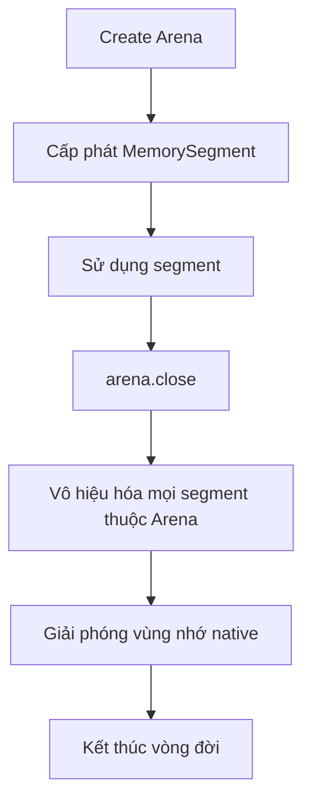

# Cấp phát vùng nhớ bằng `Arena` và giải phóng xác định bằng `try-with-resources`

Khi làm việc với Foreign Function & Memory API (FFM API), Java có thể cấp phát vùng nhớ native nằm ngoài heap. Vùng nhớ này không được garbage collector thu hồi theo cách giống object Java thông thường. Chương trình cần quản lý rõ thời điểm vùng nhớ được giải phóng để tránh giữ tài nguyên quá lâu hoặc truy cập vào vùng nhớ đã hết vòng đời.

Từ Java 22, `Arena` là API chính thức trong `java.lang.foreign` để cấp phát và quản lý vòng đời của native memory segment. Vì `Arena` triển khai `AutoCloseable`, cách dùng thông dụng là tạo arena trong câu lệnh `try-with-resources`. Khi khối lệnh kết thúc, Java tự gọi `close()`, vô hiệu hóa các segment thuộc arena và giải phóng vùng nhớ native tương ứng.

Nội dung dưới đây sử dụng API chuẩn từ Java 22 trở đi, vẫn được duy trì trong Java hiện đại. Không cần dùng các API incubator hoặc preview cũ để cấp phát và đóng vùng nhớ theo mô hình này.

## 1. Vì sao cần quản lý vòng đời vùng nhớ native?

Object Java thường được cấp phát trên heap và được garbage collector quản lý. Khi object không còn được tham chiếu, JVM có thể thu hồi bộ nhớ vào một thời điểm thích hợp. Cách quản lý này phù hợp với phần lớn ứng dụng Java.

Tuy nhiên, khi gọi thư viện native hoặc xử lý dữ liệu off-heap, chương trình có thể cần một vùng nhớ mà thư viện C/C++ có thể truy cập trực tiếp. Vùng nhớ này nằm ngoài heap Java và có thể chiếm tài nguyên hệ thống đáng kể. Garbage collector không thể tự quyết định thời điểm giải phóng theo yêu cầu của thư viện native.

Nếu cấp phát native memory nhưng không giải phóng đúng lúc, ứng dụng có thể tăng mức sử dụng bộ nhớ ngoài heap dù heap Java vẫn còn nhiều dung lượng. Nếu giải phóng quá sớm, Java hoặc native code có thể tiếp tục dùng một địa chỉ không còn hợp lệ, dẫn đến lỗi truy cập bộ nhớ hoặc làm JVM dừng bất thường.

FFM API giải quyết phần quản lý vòng đời thông qua `Arena`. Thay vì tự quản lý từng địa chỉ, chương trình gom các segment có chung vòng đời vào một arena và đóng arena tại ranh giới công việc thích hợp.

## 2. `Arena` là gì?

`Arena` là một interface trong package `java.lang.foreign`. Nó có hai vai trò chính:

- Là `SegmentAllocator`, cung cấp các phương thức cấp phát native `MemorySegment`.
- Là `AutoCloseable`, cho phép kết thúc vòng đời của các segment đã cấp phát bằng `close()` hoặc tự động qua `try-with-resources`.

Mỗi arena quản lý một **scope**. Mọi segment được cấp phát từ arena đều gắn với scope đó. Khi arena còn mở, segment có thể được truy cập theo giới hạn thread của arena. Khi arena đóng thành công, scope không còn sống; tất cả segment thuộc scope đó bị vô hiệu hóa và vùng nhớ native backing chúng được giải phóng.



Một arena có thể quản lý nhiều lần cấp phát. Đóng arena sẽ kết thúc vòng đời của tất cả segment thuộc arena, không cần gọi một hàm giải phóng riêng cho từng segment.

## 3. Cấp phát vùng nhớ bằng `Arena`

### 3.1. Cấp phát theo số byte và alignment

Phương thức `allocate(long byteSize, long byteAlignment)` cấp phát một native segment với kích thước và yêu cầu căn chỉnh địa chỉ cụ thể:

```java
import java.lang.foreign.Arena;
import java.lang.foreign.MemorySegment;

try (Arena arena = Arena.ofConfined()) {
    MemorySegment segment = arena.allocate(128, 8);
    System.out.println(segment.byteSize()); // 128
}
```

Trong ví dụ:

- `128` là số byte cần cấp phát.
- `8` là alignment theo byte; địa chỉ vùng nhớ được căn chỉnh theo yêu cầu này.
- Segment được gắn với scope của `arena`.
- Khi thoát khỏi khối `try`, arena đóng và 128 byte native memory được giải phóng.

Kích thước phải không âm. Alignment phải lớn hơn 0 và là lũy thừa của 2. Nếu cần lưu một kiểu dữ liệu cụ thể, nên lấy kích thước và alignment từ layout thay vì tự ghi các con số dễ sai.

### 3.2. Cấp phát theo `ValueLayout`

`ValueLayout` mô tả kiểu dữ liệu nguyên thủy và cung cấp kích thước cùng alignment tương ứng. Có thể dùng các thông tin đó để cấp phát một vùng nhớ phù hợp với kiểu dữ liệu:

```java
import java.lang.foreign.Arena;
import java.lang.foreign.MemorySegment;
import java.lang.foreign.ValueLayout;

try (Arena arena = Arena.ofConfined()) {
    long byteSize = ValueLayout.JAVA_INT.byteSize();
    long alignment = ValueLayout.JAVA_INT.byteAlignment();

    MemorySegment number = arena.allocate(byteSize, alignment);
    number.set(ValueLayout.JAVA_INT, 0, 2026);

    int value = number.get(ValueLayout.JAVA_INT, 0);
    System.out.println(value); // 2026
}
```

Đối với mảng, nhân kích thước một phần tử với số phần tử cần cấp phát:

```java
import java.lang.foreign.Arena;
import java.lang.foreign.MemorySegment;
import java.lang.foreign.ValueLayout;

public class ArenaArrayExample {
    public static void main(String[] args) {
        long length = 4;

        try (Arena arena = Arena.ofConfined()) {
            long byteSize = length * ValueLayout.JAVA_INT.byteSize();
            MemorySegment numbers = arena.allocate(
                byteSize,
                ValueLayout.JAVA_INT.byteAlignment()
            );

            for (long i = 0; i < length; i++) {
                numbers.setAtIndex(ValueLayout.JAVA_INT, i, (int) (i + 1) * 10);
            }

            for (long i = 0; i < length; i++) {
                System.out.println(numbers.getAtIndex(ValueLayout.JAVA_INT, i));
            }
        }
    }
}
```

Kết quả là `10`, `20`, `30`, `40`. `setAtIndex` và `getAtIndex` dùng index để truy cập phần tử theo kích thước của layout. Khi arena đóng, toàn bộ vùng nhớ của mảng được giải phóng cùng lúc.

### 3.3. Cấp phát và khởi tạo dữ liệu từ Java

Vì `Arena` là một `SegmentAllocator`, nó còn cung cấp các phương thức `allocateFrom`. Ví dụ, `allocateFrom(String)` chuyển chuỗi Java thành chuỗi C được mã hóa UTF-8 và kết thúc bằng byte `\0`:

```java
import java.lang.foreign.Arena;
import java.lang.foreign.MemorySegment;

try (Arena arena = Arena.ofConfined()) {
    MemorySegment cString = arena.allocateFrom("Xin chào Java");
    System.out.println(cString.byteSize());
}
```

Segment chuỗi được cấp phát trong arena và chỉ hợp lệ trong vòng đời của arena. Nếu thư viện native yêu cầu charset khác UTF-8, hãy chọn overload nhận `Charset` và dùng đúng encoding theo hợp đồng của thư viện.

## 4. Giải phóng xác định bằng `try-with-resources`

### 4.1. Cách hoạt động

`Arena` triển khai `AutoCloseable`, vì vậy có thể khai báo trực tiếp trong phần resource của `try-with-resources`:

```java
try (Arena arena = Arena.ofConfined()) {
    MemorySegment buffer = arena.allocate(1024);
    // Đọc, ghi hoặc truyền buffer cho hàm native tại đây.
} // Java tự gọi arena.close() tại đây.
```

Khi luồng thực thi rời khỏi khối `try`, Java tự gọi `close()`:

- Khi khối lệnh kết thúc bình thường, arena được đóng.
- Khi có exception hoặc `return` trong khối lệnh, arena vẫn được đóng trước khi luồng thực thi rời khỏi câu lệnh `try`.
- Nếu có nhiều resource trong cùng câu lệnh, chúng được đóng theo thứ tự ngược với thứ tự khai báo.

Điều này giúp vùng nhớ được giải phóng ở một thời điểm xác định, ngay khi công việc sử dụng nó kết thúc. Không phải chờ garbage collector chạy.

### 4.2. Điều gì xảy ra khi arena đóng?

Khi `close()` hoàn tất thành công:

1. Scope của arena chuyển sang trạng thái không còn sống.
2. Mọi `MemorySegment` được cấp phát từ arena đó không còn truy cập được.
3. Vùng nhớ native backing các segment được giải phóng.

Nếu tiếp tục đọc hoặc ghi một segment đã hết vòng đời, thao tác sẽ thất bại với `IllegalStateException`:

```java
import java.lang.foreign.Arena;
import java.lang.foreign.MemorySegment;
import java.lang.foreign.ValueLayout;

public class ClosedArenaExample {
    public static void main(String[] args) {
        MemorySegment number;

        try (Arena arena = Arena.ofConfined()) {
            number = arena.allocate(ValueLayout.JAVA_INT);
            number.set(ValueLayout.JAVA_INT, 0, 42);
        }

        // Arena đã đóng; segment không còn hợp lệ.
        System.out.println(number.get(ValueLayout.JAVA_INT, 0));
        // Ném IllegalStateException.
    }
}
```

Ví dụ trên minh họa lỗi vòng đời. Trong ứng dụng thực tế, không trả một segment ra khỏi method nếu arena quản lý segment đó đã đóng khi method kết thúc. Nếu caller cần tiếp tục dùng vùng nhớ, caller phải kiểm soát arena hoặc nhận một đối tượng quản lý cả arena và segment với cùng vòng đời.

### 4.3. Xử lý exception khi đóng resource

`try-with-resources` vẫn gọi `close()` nếu phần thân khối `try` ném exception. Nếu cả phần thân và thao tác đóng đều ném exception, exception từ phần thân được giữ làm exception chính; exception phát sinh khi đóng được lưu dưới dạng suppressed exception và có thể xem bằng `getSuppressed()`.

Thông thường không cần tự viết `finally` chỉ để gọi `arena.close()`. Dùng `try-with-resources` làm rõ ranh giới sở hữu và giúp việc đóng arena nhất quán ở cả luồng chạy bình thường lẫn luồng có lỗi.

## 5. Chọn loại Arena phù hợp

FFM API cung cấp bốn cách tạo arena phổ biến. Chúng khác nhau về vòng đời, khả năng đóng tường minh và giới hạn truy cập thread.

| Cách tạo | Vòng đời | Đóng tường minh | Thread được truy cập segment |
| --- | --- | --- | --- |
| `Arena.ofConfined()` | Có giới hạn, do chương trình quản lý | Có | Chỉ thread tạo arena |
| `Arena.ofShared()` | Có giới hạn, do chương trình quản lý | Có | Nhiều thread |
| `Arena.ofAuto()` | Do garbage collector quản lý; thời điểm giải phóng không xác định | Không | Nhiều thread |
| `Arena.global()` | Không giới hạn trong vòng đời JVM | Không | Nhiều thread |

### 5.1. `Arena.ofConfined()` — lựa chọn mặc định cho phạm vi một thread

Confined arena gắn với thread đã tạo nó. Chỉ owner thread được cấp phát, truy cập các segment thuộc arena và đóng arena. Nếu thread khác cố truy cập hoặc đóng arena, thao tác sẽ thất bại với `WrongThreadException`.

Đây thường là lựa chọn phù hợp cho một method, một tác vụ hoặc một khối xử lý dữ liệu chạy trên một thread:

```java
void processData() {
    try (Arena arena = Arena.ofConfined()) {
        MemorySegment temporaryBuffer = arena.allocate(4096);
        // Chỉ xử lý dữ liệu trong phạm vi công việc này.
    }
}
```

Phạm vi hẹp giúp xác định rõ ai sở hữu vùng nhớ và thời điểm giải phóng.

### 5.2. `Arena.ofShared()` — khi nhiều thread cần truy cập

Shared arena không có owner thread. Nhiều thread có thể truy cập segment được cấp phát từ arena và bất kỳ thread nào cũng có thể đóng arena.

```java
Arena arena = Arena.ofShared();
MemorySegment sharedBuffer = arena.allocate(4096);

// Có thể chuyển sharedBuffer cho các thread khác sử dụng.
// Chỉ đóng arena sau khi mọi thread đã kết thúc việc sử dụng buffer.
arena.close();
```

Shared arena cho phép truy cập từ nhiều thread, nhưng không tự đồng bộ nội dung bộ nhớ. Nếu nhiều thread cùng đọc và ghi một vùng dữ liệu, ứng dụng vẫn cần khóa, cơ chế đồng bộ hoặc quy tắc phân chia vùng ghi phù hợp để tránh data race.

Trước khi đóng shared arena, cần bảo đảm các thao tác đang sử dụng segment đã hoàn tất. Nếu một segment của arena đang được truy cập đồng thời, thao tác đóng có thể thất bại với `IllegalStateException`. Không đóng arena trong khi native code hoặc thread khác vẫn có thể dùng pointer thuộc arena đó.

### 5.3. `Arena.ofAuto()` và `Arena.global()` không dành cho giải phóng xác định

`Arena.ofAuto()` giao việc giải phóng cho garbage collector. Vùng nhớ chỉ được thu hồi sau khi arena và các segment liên quan không còn reachable, tại một thời điểm không xác định. Arena loại này không thể đóng tường minh; gọi `close()` sẽ ném `UnsupportedOperationException`.

`Arena.global()` có vòng đời không giới hạn. Các vùng nhớ được cấp phát từ global arena không được giải phóng trong suốt vòng đời JVM. Gọi `close()` trên global arena cũng ném `UnsupportedOperationException`.

Hai kiểu này có trường hợp sử dụng riêng, nhưng không đáp ứng yêu cầu giải phóng xác định. Khi cần kiểm soát thời điểm thu hồi native memory, hãy ưu tiên confined hoặc shared arena và đóng chúng rõ ràng.

## 6. Những lỗi vòng đời cần tránh

### Giữ segment sau khi arena đã đóng

Segment không sở hữu độc lập vùng nhớ. Vòng đời của segment phụ thuộc vào scope của arena. Không lưu segment vào field hoặc trả nó khỏi method nếu arena tương ứng sẽ đóng trước khi nơi nhận sử dụng xong.

### Đóng arena quá sớm khi native code còn giữ pointer

Một downcall có thể nhận địa chỉ từ segment. Nếu thư viện native lưu địa chỉ đó để sử dụng bất đồng bộ sau khi lời gọi trả về, arena phải còn mở cho đến khi thư viện báo đã dùng xong. Đóng arena trong khi native code vẫn giữ pointer có thể tạo lỗi use-after-free. Cần đọc rõ hợp đồng của thư viện về việc nó chỉ dùng pointer trong lúc gọi hay lưu pointer để dùng về sau.

### Đóng arena hai lần

`Arena.close()` không phải thao tác idempotent. Gọi `close()` trên arena đã đóng sẽ ném `IllegalStateException`. Vì vậy, khi đã dùng `try-with-resources`, không gọi thêm `arena.close()` bên trong khối `try`.

### Nhầm quyền truy cập nhiều thread với an toàn dữ liệu

`Arena.ofShared()` cho phép nhiều thread truy cập segment, nhưng không làm các phép đọc/ghi trở thành atomic và không tự ngăn race condition. Ứng dụng phải tự quản lý đồng bộ dữ liệu và chỉ đóng arena sau khi không còn thao tác đang sử dụng vùng nhớ.

## 7. Thực hành tốt khi quản lý Arena

- Tạo arena gần nơi bắt đầu sử dụng native memory và đóng nó ngay sau khi công việc hoàn tất.
- Ưu tiên `Arena.ofConfined()` cho xử lý tuần tự trên một thread; chỉ dùng `Arena.ofShared()` khi thật sự cần chia sẻ segment.
- Dùng `try-with-resources` thay vì tự gọi `close()` trong nhiều nhánh `if`, `return` hoặc `catch`.
- Cấp phát theo `MemoryLayout` hoặc kích thước và alignment lấy từ layout để tránh sai lệch bố cục dữ liệu.
- Không để segment hoặc native pointer thoát khỏi vòng đời của arena đang sở hữu vùng nhớ.
- Với thư viện native giữ pointer hoặc callback, xác định rõ thời điểm thư viện ngừng sử dụng trước khi đóng arena.
- Không dùng `Arena.ofAuto()` hoặc `Arena.global()` khi yêu cầu nghiệp vụ cần giải phóng native memory tại một thời điểm xác định.
- Đồng bộ truy cập khi nhiều thread dùng chung segment; chỉ đóng shared arena sau khi các thao tác liên quan đã kết thúc.

## 8. Ghi nhớ

`Arena` gom các native memory segment vào một scope chung và quản lý vòng đời của chúng. Khi arena đóng thành công, mọi segment thuộc arena bị vô hiệu hóa và vùng nhớ native tương ứng được giải phóng. Vì `Arena` triển khai `AutoCloseable`, `try-with-resources` là cách rõ ràng và đáng tin cậy để giải phóng tài nguyên đúng lúc.

Với công việc trên một thread, `Arena.ofConfined()` thường là lựa chọn phù hợp. Khi nhiều thread cần truy cập vùng nhớ, dùng `Arena.ofShared()` và tự bảo đảm đồng bộ. `Arena.ofAuto()` phụ thuộc vào thời điểm garbage collector, còn `Arena.global()` không giải phóng vùng nhớ trong vòng đời JVM; do đó cả hai không thay thế được việc đóng xác định.

Điều quan trọng nhất là giữ cho vòng đời của mọi segment và pointer native nằm trong khoảng thời gian arena còn sống. Hãy đóng arena sau khi toàn bộ Java code và native code đã dùng xong vùng nhớ.

## Tài liệu tham khảo

- [Arena — Java SE 26 API](https://docs.oracle.com/en/java/javase/26/docs/api/java.base/java/lang/foreign/Arena.html)
- [Package `java.lang.foreign` — Java SE 26 API](https://docs.oracle.com/en/java/javase/26/docs/api/java.base/java/lang/foreign/package-summary.html)
- [AutoCloseable — Java SE 26 API](https://docs.oracle.com/en/java/javase/26/docs/api/java.base/java/lang/AutoCloseable.html)
- [Core Libraries Developer's Guide: Memory Segments and Arenas — Java SE 26](https://docs.oracle.com/en/java/javase/26/core/memory-segments-and-arenas.html)
- [JEP 454: Foreign Function & Memory API](https://openjdk.org/jeps/454)
