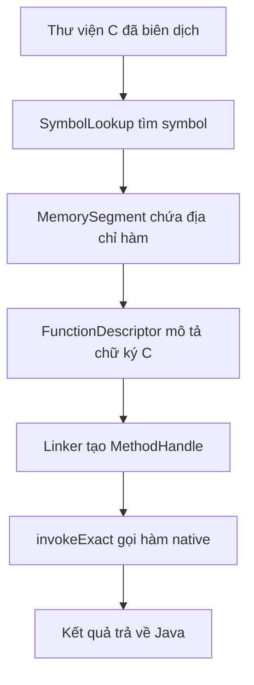

# Quy trình gọi thư viện C bằng Linker, SymbolLookup và FunctionDescriptor

Java 22 hoàn thiện Foreign Function & Memory API (FFM) trong package `java.lang.foreign`. API này cho phép Java gọi hàm native theo ABI của nền tảng mà không cần viết lớp JNI hay dùng API FFM dạng preview từ các phiên bản trước.

Một lời gọi hàm C từ Java thường có bốn việc: nạp thư viện native, tìm địa chỉ hàm cần gọi, mô tả chữ ký hàm theo quy ước gọi của C, rồi tạo và thực thi `MethodHandle`. Ba thành phần `Linker`, `SymbolLookup` và `FunctionDescriptor` phối hợp để thực hiện quy trình đó.

## 1. Vai trò của các thành phần

| Thành phần | Vai trò |
| --- | --- |
| `Linker` | Đại diện cho linker của ABI native hiện tại. Nó tạo `MethodHandle` để gọi một địa chỉ hàm native. |
| `SymbolLookup` | Tìm symbol, chẳng hạn tên hàm C, trong một thư viện hoặc phạm vi symbol được chỉ định. Kết quả là một `MemorySegment` đại diện cho địa chỉ symbol. |
| `FunctionDescriptor` | Mô tả kiểu dữ liệu trả về và các tham số của hàm native bằng các `MemoryLayout`. Mô tả phải khớp với chữ ký hàm C thực tế. |
| `Arena` | Quản lý vòng đời vùng nhớ native. Trong ví dụ, arena giữ hiệu lực của địa chỉ symbol trong thời gian gọi hàm. |
| `MethodHandle` | Đại diện cho lời gọi đã được liên kết. Java gọi handle này bằng `invokeExact`. |

Luồng xử lý có thể hình dung như sau:



`Linker` không tự đoán chữ ký hàm từ thư viện. Lập trình viên phải cung cấp `FunctionDescriptor` đúng với khai báo C, bao gồm kiểu trả về, kiểu từng tham số và quy ước ABI mà thư viện sử dụng.

## 2. Chuẩn bị một thư viện C nhỏ

Ví dụ dưới đây tạo hàm `add` nhận hai số nguyên 32 bit và trả về tổng của chúng. Hàm cần được export để `SymbolLookup` có thể tìm thấy.

Tạo file `mathops.c`:

```c
#include <stdint.h>

#if defined(_WIN32)
    #define EXPORT __declspec(dllexport)
#else
    #define EXPORT __attribute__((visibility("default")))
#endif

EXPORT int32_t add(int32_t left, int32_t right) {
    return left + right;
}
```

Biên dịch thành thư viện dùng chung. Chọn lệnh phù hợp với hệ điều hành và đặt file kết quả trong thư mục `native` của ứng dụng:

```bash
# Linux
cc -fPIC -shared mathops.c -o native/libmathops.so

# macOS
cc -dynamiclib mathops.c -o native/libmathops.dylib

# Windows, dùng Developer Command Prompt của Visual Studio
cl /LD mathops.c /Fe:native/mathops.dll
```

Tên file phải khớp với tên thư viện mà Java tìm. `System.mapLibraryName("mathops")` chuyển tên logic thành tên file theo nền tảng, ví dụ `libmathops.so`, `libmathops.dylib` hoặc `mathops.dll`.

## 3. Tìm symbol và tạo MethodHandle

File `CallNative.java`:

```java
import java.lang.foreign.Arena;
import java.lang.foreign.FunctionDescriptor;
import java.lang.foreign.Linker;
import java.lang.foreign.MemorySegment;
import java.lang.foreign.SymbolLookup;
import java.lang.foreign.ValueLayout;
import java.lang.invoke.MethodHandle;
import java.nio.file.Path;

public class CallNative {
    public static void main(String[] args) throws Throwable {
        Path libraryPath = Path.of(
                "native",
                System.mapLibraryName("mathops")
        ).toAbsolutePath();

        Linker linker = Linker.nativeLinker();

        try (Arena arena = Arena.ofConfined()) {
            // Nạp thư viện và tìm địa chỉ hàm C có tên "add".
            SymbolLookup symbols = SymbolLookup.libraryLookup(libraryPath, arena);
            MemorySegment addAddress = symbols.find("add")
                    .orElseThrow(() -> new UnsatisfiedLinkError(
                            "Không tìm thấy symbol add trong " + libraryPath
                    ));

            // C: int32_t add(int32_t left, int32_t right)
            FunctionDescriptor descriptor = FunctionDescriptor.of(
                    ValueLayout.JAVA_INT, // Kiểu trả về
                    ValueLayout.JAVA_INT, // Tham số thứ nhất
                    ValueLayout.JAVA_INT  // Tham số thứ hai
            );

            MethodHandle add = linker.downcallHandle(addAddress, descriptor);

            int result = (int) add.invokeExact(20, 22);
            System.out.println("20 + 22 = " + result);
        }
    }
}
```

Khi chạy thành công, chương trình in ra:

```text
20 + 22 = 42
```

### Bước 1: Chọn Linker native

```java
Linker linker = Linker.nativeLinker();
```

`Linker.nativeLinker()` lấy linker tương ứng với ABI native của tiến trình hiện tại. ABI quy định cách truyền tham số, nhận giá trị trả về, căn chỉnh dữ liệu và các chi tiết ở mức máy khi gọi hàm. Vì vậy, ứng dụng cần nạp thư viện được biên dịch cho đúng hệ điều hành và kiến trúc CPU đang chạy.

### Bước 2: Nạp thư viện và tra cứu symbol

```java
try (Arena arena = Arena.ofConfined()) {
    SymbolLookup symbols = SymbolLookup.libraryLookup(libraryPath, arena);
    MemorySegment address = symbols.find("add").orElseThrow();
}
```

`SymbolLookup.libraryLookup(Path, Arena)` nạp thư viện từ đường dẫn và tạo bộ tra cứu symbol của thư viện đó. `find("add")` trả về `Optional<MemorySegment>`: có giá trị khi symbol tồn tại và rỗng khi không tìm thấy. Dùng `orElseThrow` giúp báo lỗi ngay tại bước tra cứu.

`MemorySegment` ở đây biểu diễn địa chỉ hàm native, không phải vùng dữ liệu Java thông thường. Arena được truyền vào quản lý thời gian sống của việc nạp thư viện và symbol. Hãy giữ arena còn mở trong suốt thời gian sử dụng địa chỉ này; khi đóng arena, không tiếp tục gọi handle dựa trên địa chỉ đã hết hiệu lực.

Nếu thư viện đã được nạp bằng cơ chế khác, `SymbolLookup.loaderLookup()` có thể tra cứu symbol từ các thư viện được nạp bởi class loader. Với ví dụ tự quản lý đường dẫn thư viện, `libraryLookup` làm rõ thư viện nào đang được sử dụng.

### Bước 3: Mô tả chữ ký bằng FunctionDescriptor

```java
FunctionDescriptor descriptor = FunctionDescriptor.of(
        ValueLayout.JAVA_INT,
        ValueLayout.JAVA_INT,
        ValueLayout.JAVA_INT
);
```

`FunctionDescriptor.of(returnLayout, argumentLayouts...)` nhận layout trả về trước, sau đó là layout của từng tham số theo đúng thứ tự trong khai báo C. `ValueLayout.JAVA_INT` mô tả số nguyên 32 bit, phù hợp với `int32_t` trong ví dụ.

Với hàm C trả về `void`, dùng `FunctionDescriptor.ofVoid(argumentLayouts...)`. Với con trỏ C, layout tương ứng là `ValueLayout.ADDRESS`; giá trị phía Java thường được biểu diễn bằng `MemorySegment`.

Không nên mặc định mọi kiểu số nguyên C đều có kích thước giống kiểu Java cùng tên. Ví dụ, kích thước của `long` trong C phụ thuộc ABI và hệ điều hành. Khi cần mô tả kiểu C phụ thuộc nền tảng, lấy layout chuẩn từ linker:

```java
var cLayouts = linker.canonicalLayouts();
var cLongLayout = cLayouts.get("long");
```

Các layout trong `canonicalLayouts()` phản ánh cách ABI native hiện tại biểu diễn các kiểu C chuẩn. Hãy chọn đúng layout theo khai báo C và kiểm tra kiểu mà thư viện thực sự sử dụng.

### Bước 4: Tạo và gọi downcall handle

```java
MethodHandle add = linker.downcallHandle(address, descriptor);
int result = (int) add.invokeExact(20, 22);
```

`downcallHandle` liên kết địa chỉ hàm với mô tả chữ ký và trả về một `MethodHandle`. Tên *downcall* chỉ lời gọi đi từ Java xuống mã native. `invokeExact` yêu cầu kiểu tham số và kiểu kết quả tại điểm gọi khớp chính xác với kiểu của handle; trong ví dụ, handle có dạng `(int, int)int`.

## 4. Chạy chương trình

Biên dịch lớp Java:

```bash
javac --release 22 CallNative.java
```

Chạy chương trình và bật quyền truy cập native cho mã trên classpath:

```bash
java --enable-native-access=ALL-UNNAMED -cp . CallNative
```

Nếu ứng dụng chạy dưới dạng named module, thay `ALL-UNNAMED` bằng tên module được phép gọi API native, ví dụ:

```bash
java --enable-native-access=com.example.app -m com.example.app/com.example.app.CallNative
```

FFM API có các thao tác bị giới hạn quyền truy cập native. Cờ `--enable-native-access` khai báo rõ module nào được phép thực hiện các thao tác đó. Khi đóng gói ứng dụng, hãy cấu hình cờ này trong lệnh khởi chạy hoặc cấu hình runtime tương ứng.

## 5. Lưu ý khi làm việc với dữ liệu native

- **Khớp chữ ký C:** Kiểu trả về, kiểu tham số, thứ tự tham số và ABI trong `FunctionDescriptor` phải khớp chính xác với hàm được export. Sai layout có thể làm sai dữ liệu, hỏng bộ nhớ hoặc khiến tiến trình dừng bất thường.
- **Quản lý vòng đời:** Không sử dụng `MemorySegment` hoặc `MethodHandle` gắn với địa chỉ thư viện sau khi arena quản lý chúng đã đóng. Nếu hàm C giữ lại con trỏ để dùng sau khi hàm trả về, vùng nhớ được trỏ tới phải tiếp tục sống trong toàn bộ thời gian C sử dụng nó.
- **Chuỗi C:** Chuỗi C thường là dãy byte kết thúc bằng byte NUL (`\0`), còn `String` của Java không có cách biểu diễn đó. Hãy mã hóa chuỗi theo encoding mà thư viện yêu cầu và cấp phát vùng nhớ native có byte kết thúc phù hợp. `Arena.allocateFrom(String)` tạo vùng nhớ chứa chuỗi UTF-8 kết thúc bằng NUL.
- **Con trỏ và giá trị null:** Dùng `ValueLayout.ADDRESS` trong descriptor cho tham số con trỏ. Kiểm tra quy ước của thư viện về con trỏ null, quyền sở hữu vùng nhớ và việc hàm có giải phóng hoặc giữ lại con trỏ hay không.
- **Tính tương thích thư viện:** Thư viện phải đúng định dạng hệ điều hành, kiến trúc CPU và ABI với tiến trình Java. Đồng thời, các thư viện phụ thuộc của nó cũng phải được hệ điều hành tìm thấy.
- **Lỗi khi liên kết:** `UnsatisfiedLinkError` thường chỉ ra không nạp được thư viện hoặc không tìm thấy symbol. `WrongMethodTypeException` có thể xuất hiện khi kiểu gọi `invokeExact` không khớp kiểu handle.
- **Ranh giới an toàn:** FFM cho phép làm việc trực tiếp với địa chỉ và bộ nhớ native; JVM không thể tự bảo đảm mọi truy cập đều hợp lệ. Chỉ truyền địa chỉ, kích thước và dữ liệu đã được kiểm tra theo hợp đồng của thư viện.

## 6. Khi nào dùng quy trình này?

Quy trình `Linker` + `SymbolLookup` + `FunctionDescriptor` phù hợp khi ứng dụng Java cần tận dụng thư viện C có sẵn, gọi API của hệ điều hành hoặc tích hợp với thành phần native mà không muốn tự viết lớp JNI. Có thể tái sử dụng `MethodHandle` sau khi liên kết thay vì tra cứu symbol và tạo handle ở mỗi lần gọi.

Để lời gọi đáng tin cậy, hãy bắt đầu từ header C hoặc tài liệu ABI của thư viện, xác định chính xác kiểu dữ liệu và quyền sở hữu bộ nhớ, sau đó mô tả chúng bằng các layout tương ứng. Ví dụ `add` chỉ truyền số nguyên nên khá đơn giản; các hàm nhận struct, mảng hoặc con trỏ cần mô tả layout và vòng đời bộ nhớ cẩn thận hơn.

FFM API trong `java.lang.foreign` đã là API chính thức từ Java 22. Khi phát triển trên các JDK hiện đại, ưu tiên API này thay cho các ví dụ FFM incubator cũ hoặc mã dựa trên API preview trước Java 22.
