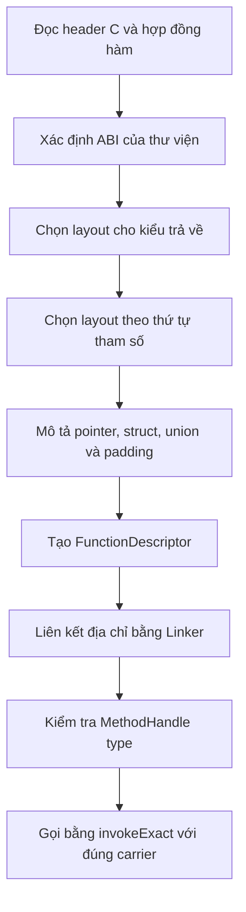

# Mô tả tham số cùng giá trị trả về theo ABI của nền tảng

Khi Java gọi một hàm C, linker cần biết chính xác hàm nhận những tham số nào và trả về kiểu dữ liệu gì. Thông tin này được mô tả bằng `FunctionDescriptor`, trong đó mỗi tham số và giá trị trả về được biểu diễn bằng một `MemoryLayout`. `Linker.nativeLinker()` sử dụng ABI của hệ điều hành và kiến trúc CPU hiện tại để chuyển lời gọi Java thành lời gọi native.

ABI (*Application Binary Interface*) quy định cách truyền tham số, nhận giá trị trả về, sử dụng thanh ghi và bố trí dữ liệu ở cấp máy. Một hàm C có cùng khai báo nguồn vẫn có thể có cách biểu diễn kiểu khác nhau giữa các nền tảng. Vì vậy, descriptor phải khớp với header C và ABI của thư viện đang nạp.

## 1. FunctionDescriptor mô tả chữ ký hàm

`FunctionDescriptor` chứa không hoặc nhiều layout tham số và không hoặc một layout trả về. Có hai cách tạo descriptor:

```java
// Hàm có giá trị trả về: return layout đứng trước, sau đó là các tham số.
FunctionDescriptor addDescriptor = FunctionDescriptor.of(
        ValueLayout.JAVA_INT,
        ValueLayout.JAVA_INT,
        ValueLayout.JAVA_INT
);

// Hàm C trả về void: chỉ mô tả các tham số.
FunctionDescriptor writeDescriptor = FunctionDescriptor.ofVoid(
        ValueLayout.ADDRESS,
        ValueLayout.JAVA_INT
);
```

Hai descriptor trên lần lượt mô tả các chữ ký tương đương:

```c
int add(int left, int right);
void write_value(int *target, int value);
```

Thứ tự layout tham số phải giống thứ tự tham số trong khai báo C. Với `FunctionDescriptor.of(...)`, layout đầu tiên là kiểu trả về; các layout còn lại là tham số. Với `ofVoid(...)`, hàm không có giá trị trả về.

`FunctionDescriptor.toMethodType()` cho biết kiểu Java mà `MethodHandle` sử dụng. Value layout ánh xạ sang kiểu carrier của layout, còn group layout như `struct` hoặc `union` ánh xạ sang `MemorySegment`.

## 2. Chọn layout theo kiểu dữ liệu C và ABI

Không nên ánh xạ kiểu C chỉ dựa trên tên gọi. Các kiểu `long`, `size_t` và `wchar_t` có thể khác kích thước giữa các ABI. `Linker.canonicalLayouts()` trả về các layout chuẩn của ABI mà native linker hiện tại hỗ trợ.

```java
Linker linker = Linker.nativeLinker();
Map<String, MemoryLayout> cLayouts = linker.canonicalLayouts();

MemoryLayout cInt = cLayouts.get("int");
MemoryLayout cLong = cLayouts.get("long");
MemoryLayout cSizeT = cLayouts.get("size_t");
MemoryLayout cWcharT = cLayouts.get("wchar_t");
```

Native linker bảo đảm có canonical layout cho các kiểu C cơ bản sau:

| Kiểu C | Cách biểu diễn trong FFM | Lưu ý |
| --- | --- | --- |
| `bool` | Canonical layout `bool` | Trên ABI Linux/x64 thường là `JAVA_BOOLEAN`. |
| `char`, `unsigned char` | Canonical layout `char` | Thường dùng carrier `byte`; `char` của Java là 2 byte nên không tương đương. |
| `short`, `int` | Canonical layout tương ứng | Kích thước theo ABI; `int32_t` có thể ánh xạ trực tiếp sang `JAVA_INT`. |
| `long` | Canonical layout `long` | Linux/x64 thường là 8 byte; Windows/x64 thường là 4 byte. |
| `long long` | Canonical layout `long long` | Thường là 8 byte trên các ABI phổ biến. |
| `float`, `double` | Canonical layout tương ứng | Ánh xạ sang `float` và `double`. |
| `size_t` | Canonical layout `size_t` | Thường là 8 byte trên ABI 64 bit và 4 byte trên ABI 32 bit. |
| `wchar_t` | Canonical layout `wchar_t` | Kích thước và cách mã hóa phụ thuộc nền tảng. |
| `void*` | `ValueLayout.ADDRESS` | Carrier phía Java là `MemorySegment`. |

Ví dụ, trên Linux/x64, C `long` và `size_t` thường tương ứng với `ValueLayout.JAVA_LONG`; trên Windows/x64, C `long` thường tương ứng với `ValueLayout.JAVA_INT`, còn `size_t` vẫn là kiểu 8 byte. Không được mặc định `ValueLayout.JAVA_LONG` luôn là C `long`.

Các kiểu số nguyên không dấu thường dùng layout có cùng kích thước với kiểu có dấu tương ứng. Carrier Java vẫn là kiểu có dấu, vì vậy cần dùng phép chuyển đổi unsigned như `Integer.toUnsignedLong(...)` hoặc `Long.compareUnsigned(...)` khi xử lý miền giá trị vượt quá giới hạn số dương của Java.

Với các kiểu có độ rộng cố định trong `<stdint.h>`, chọn layout có cùng kích thước và tương thích với cách ABI biểu diễn kiểu nền: thường là `int8_t` sang `JAVA_BYTE`, `int16_t` sang `JAVA_SHORT`, `int32_t` sang `JAVA_INT`, và `int64_t` sang `JAVA_LONG`. Kiểm tra typedef và ABI của nền tảng, đặc biệt trên kiến trúc ít phổ biến.

`long double` không nằm trong nhóm kiểu mà native linker bắt buộc phải cung cấp canonical layout. Không ánh xạ nó sang `JAVA_DOUBLE` chỉ dựa trên tên; độ chính xác và cách truyền có thể khác. Nếu linker hiện tại không hỗ trợ kiểu này, có thể cần một hàm C trung gian chuyển đổi sang kiểu được hỗ trợ.

## 3. Tham số và giá trị trả về dạng scalar

Với các kiểu số nguyên, số thực hoặc boolean, dùng value layout có carrier phù hợp. Ví dụ hàm C sau dùng kiểu số nguyên 32 bit có độ rộng cố định:

```c
#include <stdint.h>

int32_t add_i32(int32_t left, int32_t right) {
    return left + right;
}
```

Descriptor tương ứng:

```java
FunctionDescriptor descriptor = FunctionDescriptor.of(
        ValueLayout.JAVA_INT, // int32_t trả về
        ValueLayout.JAVA_INT, // int32_t left
        ValueLayout.JAVA_INT  // int32_t right
);
```

Khi tạo downcall handle, kiểu trả về và tham số của `invokeExact` phải khớp với carrier của descriptor:

```java
MethodHandle add = linker.downcallHandle(addAddress, descriptor);
int result = (int) add.invokeExact(20, 22);
```

`invokeExact` yêu cầu kiểu chính xác. Ví dụ, nếu descriptor dùng `JAVA_LONG`, lời gọi phải truyền `long` và nhận kết quả `long`; truyền một `int` rồi trông chờ JVM tự chuyển kiểu sẽ dẫn đến lỗi kiểu phương thức.

Với hàm C không trả về dữ liệu, dùng `FunctionDescriptor.ofVoid(...)`. Java gọi handle mà không ép kiểu kết quả:

Trong đoạn mã sau, `linker` đã được tạo bằng `Linker.nativeLinker()` và `writeAddress` là địa chỉ symbol `write_value` đã tìm bằng `SymbolLookup`.

```java
// C: void write_value(int32_t *target, int32_t value);
FunctionDescriptor descriptor = FunctionDescriptor.ofVoid(
        ValueLayout.ADDRESS,
        ValueLayout.JAVA_INT
);

MethodHandle writeValue = linker.downcallHandle(writeAddress, descriptor);
try (Arena arena = Arena.ofConfined()) {
    MemorySegment target = arena.allocate(ValueLayout.JAVA_INT);
    writeValue.invokeExact(target, 99);
    int value = target.get(ValueLayout.JAVA_INT, 0);
    System.out.println(value); // 99
}
```

Ở đây, tham số `int32_t *` được mô tả bằng `ADDRESS`, còn carrier Java tương ứng là `MemorySegment`. Bộ nhớ đích được cấp phát đủ kích thước và còn sống trong suốt lời gọi native.

## 4. Con trỏ, mảng và chuỗi C

Các kiểu con trỏ như `int*`, `char*`, `void*`, `struct Point*` hoặc con trỏ hàm đều được mô tả bằng address layout. Phía Java, một tham số địa chỉ được truyền dưới dạng `MemorySegment`.

```c
#include <stdint.h>

int32_t sum_i32(const int32_t *values, int32_t length) {
    int32_t sum = 0;
    for (int32_t i = 0; i < length; i++) {
        sum += values[i];
    }
    return sum;
}
```

Descriptor có kiểu trả về `int32_t`, tham số đầu là con trỏ tới phần tử `int32_t`, tham số thứ hai là số phần tử:

Đoạn Java giả sử `linker` đã được khởi tạo và `sumAddress` là địa chỉ symbol `sum_i32` trong thư viện native.

```java
FunctionDescriptor descriptor = FunctionDescriptor.of(
        ValueLayout.JAVA_INT,
        ValueLayout.ADDRESS,
        ValueLayout.JAVA_INT
);

MethodHandle sum = linker.downcallHandle(sumAddress, descriptor);

try (Arena arena = Arena.ofConfined()) {
    MemorySegment values = arena.allocate(
            3L * ValueLayout.JAVA_INT.byteSize(),
            ValueLayout.JAVA_INT.byteAlignment()
    );
    values.setAtIndex(ValueLayout.JAVA_INT, 0, 10);
    values.setAtIndex(ValueLayout.JAVA_INT, 1, 20);
    values.setAtIndex(ValueLayout.JAVA_INT, 2, 30);

    int total = (int) sum.invokeExact(values, 3);
    System.out.println(total); // 60
}
```

Trong C, tham số mảng trong khai báo hàm thường được điều chỉnh thành con trỏ. Vì vậy, `const int32_t values[]` trong danh sách tham số cũng được truyền như một địa chỉ; số phần tử thường phải truyền riêng. `const` không làm thay đổi address layout, nhưng hợp đồng C yêu cầu hàm không sửa dữ liệu được trỏ tới.

Với chuỗi C `const char*`, có thể dùng `Arena.allocateFrom(String)` để tạo chuỗi UTF-8 kết thúc bằng byte NUL:

```java
// C: int32_t count_bytes(const char *text);
FunctionDescriptor descriptor = FunctionDescriptor.of(
        ValueLayout.JAVA_INT,
        ValueLayout.ADDRESS
);

try (Arena arena = Arena.ofConfined()) {
    MemorySegment text = arena.allocateFrom("Xin chào");
    int count = (int) countBytes.invokeExact(text);
    System.out.println(count);
}
```

Encoding phải khớp hợp đồng của thư viện. `allocateFrom(String)` tạo UTF-8; nếu thư viện mong đợi encoding khác, cần tự mã hóa thành byte phù hợp và cấp phát vùng nhớ có byte kết thúc NUL khi cần.

`MemorySegment.NULL` biểu diễn con trỏ null khi API C cho phép nhận null. Không truyền `null` Java thay cho một địa chỉ; downcall handle dùng carrier `MemorySegment`.

Con trỏ hàm C cũng được mô tả bằng `ADDRESS`. Nếu cần truyền callback viết bằng Java cho C, tạo upcall stub bằng `Linker.upcallStub(...)` từ một `MethodHandle`, một `FunctionDescriptor` khớp chữ ký callback và một `Arena` quản lý vòng đời stub.

## 5. Mô tả struct và union theo ABI

Kiểu tổng hợp C được mô tả bằng group layout:

- C `struct` tương ứng với `MemoryLayout.structLayout(...)`.
- C `union` tương ứng với `MemoryLayout.unionLayout(...)`.
- Con trỏ tới struct hoặc union vẫn là `ValueLayout.ADDRESS`.

Ví dụ, C khai báo một struct gồm hai số nguyên 32 bit:

```c
#include <stdint.h>

typedef struct {
    int32_t x;
    int32_t y;
} Point;

Point translate(Point point, int32_t delta) {
    point.x += delta;
    point.y += delta;
    return point;
}
```

Java mô tả cùng bố cục:

```java
import java.lang.foreign.Arena;
import java.lang.foreign.FunctionDescriptor;
import java.lang.foreign.Linker;
import java.lang.foreign.MemoryLayout;
import java.lang.foreign.MemorySegment;
import java.lang.foreign.SegmentAllocator;
import java.lang.foreign.SymbolLookup;
import java.lang.foreign.ValueLayout;
import java.lang.invoke.MethodHandle;
import java.lang.invoke.VarHandle;
import java.nio.file.Path;

import static java.lang.foreign.MemoryLayout.PathElement.groupElement;

public class StructByValueDemo {
    public static void main(String[] args) throws Throwable {
        Linker linker = Linker.nativeLinker();

        try (Arena arena = Arena.ofConfined()) {
            Path libraryPath = Path.of(
                    "native",
                    System.mapLibraryName("geometry")
            ).toAbsolutePath();
            SymbolLookup symbols = SymbolLookup.libraryLookup(libraryPath, arena);
            MemorySegment translateAddress = symbols.find("translate").orElseThrow();

            MemoryLayout pointLayout = MemoryLayout.structLayout(
                    ValueLayout.JAVA_INT.withName("x"),
                    ValueLayout.JAVA_INT.withName("y")
            );

            FunctionDescriptor descriptor = FunctionDescriptor.of(
                    pointLayout,              // Point trả về theo giá trị
                    pointLayout,              // Point point truyền theo giá trị
                    ValueLayout.JAVA_INT      // int32_t delta
            );

            MethodHandle translate = linker.downcallHandle(translateAddress, descriptor);
            VarHandle x = pointLayout.varHandle(groupElement("x"));
            VarHandle y = pointLayout.varHandle(groupElement("y"));

            MemorySegment input = arena.allocate(pointLayout);
            x.set(input, 10);
            y.set(input, 20);

            // Hàm trả struct theo giá trị nên handle cần SegmentAllocator ở đầu.
            MemorySegment output = (MemorySegment) translate.invokeExact(
                    (SegmentAllocator) arena,
                    input,
                    5
            );

            System.out.println((int) x.get(output)); // 15
            System.out.println((int) y.get(output)); // 25
        }
    }
}
```

Vì giá trị trả về là group layout, downcall handle có thêm tham số đầu kiểu `SegmentAllocator` để cấp phát vùng nhớ cho struct kết quả. `Arena` triển khai `SegmentAllocator`, nên có thể dùng arena đang quản lý vùng nhớ của lời gọi.

Khi mô tả struct C thực tế, phải tính chính xác padding giữa các trường, căn chỉnh của từng trường và padding cuối struct. Ví dụ hai `int32_t` liên tiếp thường tạo struct 8 byte, căn chỉnh 4 byte. Một struct có `int32_t` rồi `double` có thể cần padding giữa hai trường theo ABI. Không tự suy ra bố cục từ thứ tự khai báo mà bỏ qua căn chỉnh.

Với union, các trường cùng bắt đầu tại offset 0 và kích thước tổng phụ thuộc thành phần lớn nhất cùng yêu cầu căn chỉnh. Layout phải phản ánh đúng định nghĩa C. Native linker chỉ hỗ trợ một tập con layout; struct hoặc union không đáp ứng quy tắc kích thước, căn chỉnh và padding của linker có thể bị từ chối khi tạo downcall handle.

## 6. Giá trị trả về là con trỏ

Nếu hàm C trả về con trỏ, dùng address layout làm return layout:

```c
int32_t *get_values(void);
```

```java
FunctionDescriptor descriptor = FunctionDescriptor.of(ValueLayout.ADDRESS);
MethodHandle getValues = linker.downcallHandle(getValuesAddress, descriptor);
MemorySegment pointer = (MemorySegment) getValues.invokeExact();
```

Carrier Java của địa chỉ trả về là `MemorySegment`. Tuy nhiên, linker không thể tự biết kích thước vùng nhớ hoặc thời gian sống của con trỏ. Với address layout không có target layout, segment trả về thường có kích thước 0 và thuộc global scope. Cần dựa vào hợp đồng của thư viện để biết số byte hợp lệ, quyền sở hữu và hàm giải phóng tương ứng trước khi đọc hoặc ghi.

Nếu kích thước đích được biết ngay từ khai báo, `AddressLayout.withTargetLayout(...)` có thể mô tả kích thước mục tiêu của con trỏ. Thao tác này là restricted method; việc cấp kích thước hoặc vòng đời sai có thể dẫn đến truy cập ngoài vùng nhớ hợp lệ. Không tự mở rộng một segment con trỏ thành kích thước tùy ý.

Nếu thư viện cấp phát bộ nhớ và chuyển quyền sở hữu cho Java, phải gọi đúng hàm giải phóng do thư viện cung cấp. Không đóng arena của Java để giải phóng một vùng nhớ mà thư viện C cấp phát bằng allocator riêng, và không gọi `free` lên vùng nhớ được cấp phát bởi một allocator khác.

## 7. Hàm có số lượng tham số biến đổi

Hàm C có dấu `...` như `printf` là hàm variadic. Khi liên kết, cần mô tả chữ ký đã được chuyên biệt hóa với số lượng và kiểu cụ thể của các tham số trong lần gọi đó, đồng thời truyền `Linker.Option.firstVariadicArg(index)` để đánh dấu vị trí tham số biến đổi đầu tiên.

```c
int printf(const char *format, ...);
```

Ví dụ gọi `printf` với chuỗi định dạng và ba tham số `int`:

Ví dụ giả sử `linker` đã được tạo bằng `Linker.nativeLinker()`; `defaultLookup()` tìm symbol trong các thư viện native phổ biến được linker cung cấp.

```java
MethodHandle printf = linker.downcallHandle(
        linker.defaultLookup().find("printf").orElseThrow(),
        FunctionDescriptor.of(
                ValueLayout.JAVA_INT,
                ValueLayout.ADDRESS,      // const char *format
                ValueLayout.JAVA_INT,     // variadic int thứ nhất
                ValueLayout.JAVA_INT,     // variadic int thứ hai
                ValueLayout.JAVA_INT      // variadic int thứ ba
        ),
        Linker.Option.firstVariadicArg(1)
);

try (Arena arena = Arena.ofConfined()) {
    int written = (int) printf.invokeExact(
            arena.allocateFrom("%d + %d = %d\n"),
            2,
            3,
            5
    );
}
```

Chỉ số `1` là vị trí của layout variadic đầu tiên trong descriptor, đếm từ 0; tham số format ở vị trí 0 là tham số cố định. Phải cung cấp option này cho hàm variadic ngay cả khi lần gọi cụ thể không truyền đối số variadic, vì ABI của một số nền tảng có quy tắc gọi khác nhau.

C áp dụng *default argument promotions* cho các đối số sau dấu `...`: `float` được nâng thành `double`; `char` và `short` được nâng thành `int` hoặc `unsigned int` theo quy tắc integer promotion. Native linker không tự thực hiện các phép nâng kiểu này. Descriptor phải dùng kiểu sau khi promotion; linker có thể từ chối layout variadic không hợp lệ.

## 8. Kiểm tra chữ ký và kiểu MethodHandle

Trước khi gọi native, có thể xem kiểu Java mà descriptor tạo ra:

```java
FunctionDescriptor descriptor = FunctionDescriptor.of(
        ValueLayout.JAVA_INT,
        ValueLayout.ADDRESS,
        ValueLayout.JAVA_INT
);

System.out.println(descriptor.toMethodType());
```

Với descriptor trên, kiểu tương ứng là `(MemorySegment, int)int`. Khi dùng overload `linker.downcallHandle(address, descriptor)`, địa chỉ đích đã được liên kết vào handle nên không còn là tham số của `invokeExact`.

Nếu dùng overload `linker.downcallHandle(descriptor)` không gắn địa chỉ trước, handle có thêm tham số đầu `MemorySegment` chứa địa chỉ hàm. Nếu return layout là group layout, handle còn có thêm tham số `SegmentAllocator` để nhận vùng nhớ kết quả. Nắm rõ các tham số bổ sung này giúp tránh lỗi `WrongMethodTypeException` khi gọi handle.

## 9. Quy trình tạo downcall đúng ABI



Khi rà soát một descriptor, hãy kiểm tra:

1. Thư viện được biên dịch cho đúng hệ điều hành, CPU và ABI của tiến trình Java.
2. Kiểu trả về và số lượng tham số khớp với khai báo C.
3. Mỗi layout scalar có kích thước và carrier phù hợp; kiểu C phụ thuộc nền tảng lấy từ `canonicalLayouts()`.
4. Con trỏ dùng `ADDRESS`; vùng nhớ mà con trỏ trỏ tới có kích thước, quyền truy cập và vòng đời hợp lệ.
5. Struct và union có kích thước, căn chỉnh và padding đúng ABI.
6. Hàm variadic có `firstVariadicArg` và dùng kiểu sau default argument promotions.
7. Kiểu lời gọi `invokeExact` khớp chính xác với `MethodHandle`.

## 10. Lỗi thường gặp và giới hạn an toàn

- **Dùng sai layout:** C `long` hoặc `size_t` có thể khác kích thước giữa Windows và Linux. Hãy lấy canonical layout theo linker hiện tại.
- **Nhầm `char` C với `char` Java:** C `char` là đơn vị 1 byte; Java `char` là 2 byte. Dùng layout C tương ứng.
- **Sai thứ tự tham số:** Descriptor giữ nguyên thứ tự khai báo. Đảo layout có thể làm hàm nhận sai dữ liệu dù handle vẫn được tạo.
- **Sai kiểu trả về:** Dùng `ofVoid` cho hàm `void`; không khai báo nhầm return layout.
- **Sai chữ ký struct:** Thiếu padding hoặc căn chỉnh có thể làm sai vị trí trường và cách ABI truyền struct.
- **Quên promotion ở hàm variadic:** FFM không tự đổi `float` thành `double` hoặc nâng kiểu số nguyên nhỏ.
- **Nhầm quyền sở hữu con trỏ:** Một địa chỉ hợp lệ không có nghĩa Java biết kích thước hoặc có quyền giải phóng nó.

`downcallHandle` là restricted method vì linker không thể đọc chữ ký hàm từ symbol để kiểm tra descriptor có khớp mã C hay không. Descriptor sai có thể gây hành vi không xác định, hỏng bộ nhớ hoặc làm JVM dừng bất thường. Chỉ tạo handle từ khai báo C đáng tin cậy và bật native access cho module cần dùng FFM.

Khi chạy ứng dụng trên classpath, bật native access bằng:

```bash
java --enable-native-access=ALL-UNNAMED -cp . NativeApp
```

Với ứng dụng dạng named module, thay `ALL-UNNAMED` bằng tên module. Cấu hình theo module giúp xác định rõ thành phần nào được phép gọi các thao tác native bị giới hạn.

## 11. Tài liệu tham khảo

- [Java SE 22 — Linker](https://docs.oracle.com/en/java/javase/22/docs/api/java.base/java/lang/foreign/Linker.html) — ABI, canonical layouts, cách ánh xạ kiểu C, downcall và variadic functions.
- [Java SE 22 — FunctionDescriptor](https://docs.oracle.com/en/java/javase/22/docs/api/java.base/java/lang/foreign/FunctionDescriptor.html) — mô tả layout tham số và giá trị trả về.
- [Java SE 22 — Linker.Option](https://docs.oracle.com/en/java/javase/22/docs/api/java.base/java/lang/foreign/Linker.Option.html) — `firstVariadicArg` và các tùy chọn liên kết.
- [Java SE 22 — ValueLayout](https://docs.oracle.com/en/java/javase/22/docs/api/java.base/java/lang/foreign/ValueLayout.html) — carrier và layout cho các kiểu giá trị.
- [JEP 454: Foreign Function & Memory API](https://openjdk.org/jeps/454) — FFM API chính thức từ Java 22.
