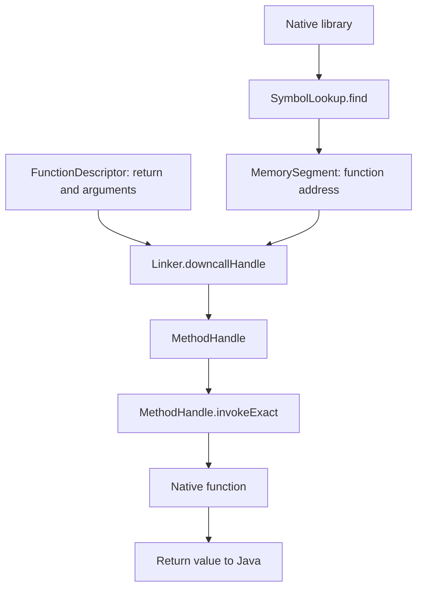

# Tạo downcall handle và gọi hàm native qua MethodHandle

Foreign Function & Memory API (FFM) cho phép Java gọi trực tiếp hàm được viết bằng C hoặc ngôn ngữ native tương thích mà không cần khai báo `native` method theo JNI. Cơ chế gọi từ Java sang mã native được gọi là **downcall**. FFM tạo một `MethodHandle` đại diện cho lời gọi đó; khi gọi handle, JVM và native linker chuyển các tham số Java sang dạng phù hợp với ABI của nền tảng rồi gọi hàm native.

FFM được chuẩn hóa trong Java 22 theo JEP 454, thuộc package `java.lang.foreign`. API này đã final, vì vậy không cần bật preview. Bài học tập trung vào cách tìm địa chỉ hàm, mô tả chữ ký bằng `FunctionDescriptor`, tạo downcall handle và gọi nó bằng `MethodHandle.invokeExact`.

## 1. Luồng tạo và gọi downcall handle

Một lời gọi native điển hình gồm các bước:

1. Lấy `Linker` phù hợp với hệ điều hành và kiến trúc CPU đang chạy.
2. Tìm symbol của hàm native trong thư viện đã nạp.
3. Mô tả kiểu trả về và các tham số của hàm bằng `FunctionDescriptor`.
4. Gọi `Linker.downcallHandle(...)` để tạo `MethodHandle`.
5. Gọi handle bằng các đối số có kiểu Java khớp với chữ ký đã mô tả.



Các lớp API chính:

| Thành phần | Vai trò |
| --- | --- |
| `Linker` | Biết ABI của nền tảng và tạo liên kết giữa Java với hàm native |
| `SymbolLookup` | Tìm địa chỉ symbol trong thư viện native |
| `MemorySegment` | Biểu diễn địa chỉ hàm hoặc vùng nhớ native |
| `FunctionDescriptor` | Mô tả kiểu trả về và kiểu các tham số của hàm native |
| `MethodHandle` | Đại diện cho lời gọi native đã được liên kết |
| `Arena` | Quản lý vòng đời bộ nhớ native và vòng đời thư viện được nạp qua `libraryLookup` |

## 2. Tạo một hàm C để Java gọi

Ta tạo một thư viện native nhỏ có hàm `add_ints`, nhận hai số nguyên C và trả về tổng của chúng.

```c
// native_math.c
#if defined(_WIN32)
    #define EXPORT __declspec(dllexport)
#else
    #define EXPORT __attribute__((visibility("default")))
#endif

EXPORT int add_ints(int left, int right) {
    return left + right;
}
```

Hàm có chữ ký C:

```c
int add_ints(int left, int right);
```

Đây là hàm đơn giản để minh họa. Trong ứng dụng thực tế, hàm native có thể xử lý ảnh, tính toán số học, gọi thư viện hệ thống hoặc tái sử dụng một thư viện C đã có.

### 2.1. Biên dịch thư viện native

Tên và định dạng thư viện phụ thuộc hệ điều hành. Có thể dùng GCC hoặc Clang trên Linux/macOS và MSVC trên Windows.

**Linux:**

```bash
cc -fPIC -shared native_math.c -o libnative_math.so
```

**macOS:**

```bash
cc -dynamiclib native_math.c -o libnative_math.dylib
```

**Windows, từ Developer Command Prompt của Visual Studio:**

```bat
cl /LD native_math.c /Fe:native_math.dll
```

Sau bước này, thư mục làm việc có file thư viện tương ứng với hệ điều hành. Thư viện phải được biên dịch cho cùng kiến trúc mà JVM đang chạy, ví dụ x64 với JVM x64.

## 3. Tìm symbol và tạo downcall handle trong Java

Đoạn mã sau nạp thư viện theo đường dẫn được truyền vào chương trình, tìm symbol `add_ints`, tạo function descriptor và gọi hàm native.

```java
// Main.java
import java.lang.foreign.Arena;
import java.lang.foreign.FunctionDescriptor;
import java.lang.foreign.Linker;
import java.lang.foreign.MemoryLayout;
import java.lang.foreign.MemorySegment;
import java.lang.foreign.SymbolLookup;
import java.lang.invoke.MethodHandle;
import java.nio.file.Path;

public class Main {
    public static void main(String[] args) throws Throwable {
        if (args.length != 1) {
            throw new IllegalArgumentException(
                    "Truyền đường dẫn đến thư viện native làm tham số đầu tiên");
        }

        // Lấy linker theo ABI của hệ điều hành và CPU hiện tại.
        Linker linker = Linker.nativeLinker();

        // Lấy layout chuẩn của kiểu int theo C ABI trên nền tảng hiện tại.
        MemoryLayout cInt = linker.canonicalLayouts().get("int");
        if (cInt == null) {
            throw new IllegalStateException("Native linker không cung cấp layout C int");
        }

        // Arena quản lý vòng đời thư viện và symbol được lấy từ thư viện đó.
        try (Arena arena = Arena.ofConfined()) {
            Path libraryPath = Path.of(args[0]).toAbsolutePath();
            SymbolLookup library = SymbolLookup.libraryLookup(libraryPath, arena);

            // Tìm địa chỉ của hàm C có tên add_ints.
            MemorySegment addAddress = library.find("add_ints")
                    .orElseThrow(() -> new IllegalStateException(
                            "Không tìm thấy symbol add_ints trong thư viện"));

            // Hàm C: int add_ints(int left, int right)
            FunctionDescriptor descriptor = FunctionDescriptor.of(
                    cInt,   // Kiểu trả về: int
                    cInt,   // Tham số thứ nhất: int
                    cInt    // Tham số thứ hai: int
            );

            // Tạo MethodHandle gắn với địa chỉ hàm native cụ thể.
            MethodHandle addInts = linker.downcallHandle(addAddress, descriptor);

            System.out.println("MethodHandle type: " + addInts.type());

            // Chữ ký Java tương ứng là (int, int) -> int.
            int result = (int) addInts.invokeExact(20, 22);
            System.out.println("20 + 22 = " + result);
        }
    }
}
```

Kết quả mong đợi:

```text
MethodHandle type: (int,int)int
20 + 22 = 42
```

### 3.1. Lấy native linker

```java
Linker linker = Linker.nativeLinker();
```

`Linker.nativeLinker()` trả về linker phù hợp với ABI của hệ điều hành và bộ xử lý mà JVM hiện tại đang chạy. ABI (Application Binary Interface) quy định cách truyền tham số, nhận giá trị trả về, căn chỉnh dữ liệu và các quy ước gọi hàm.

Không thể dùng một linker để gọi tùy ý thư viện được biên dịch cho kiến trúc khác. Thư viện native phải tương thích với nền tảng của JVM.

### 3.2. Tìm symbol của hàm native

```java
SymbolLookup library = SymbolLookup.libraryLookup(libraryPath, arena);
MemorySegment addAddress = library.find("add_ints").orElseThrow();
```

`SymbolLookup.libraryLookup(Path, Arena)` nạp thư viện từ đường dẫn và tạo bộ tra cứu symbol trong thư viện đó. Phương thức `find` trả về `Optional<MemorySegment>`; segment tìm được biểu diễn địa chỉ của symbol.

Nếu không tìm thấy tên symbol, `find` trả về `Optional.empty()`. Nguyên nhân thường gặp là tên hàm không khớp, thư viện không export hàm, hoặc mã C++ đã thay đổi tên symbol do name mangling. Khi export hàm C từ C++, cần khai báo hàm với `extern "C"` để giữ tên symbol theo C linkage.

Đối với các thư viện hệ thống phổ biến đã được nạp cùng JVM, `linker.defaultLookup()` cung cấp một symbol lookup mặc định. Với thư viện do ứng dụng tự phân phối, `libraryLookup` theo đường dẫn giúp chỉ rõ thư viện cần nạp.

### 3.3. Mô tả chữ ký bằng FunctionDescriptor

```java
FunctionDescriptor descriptor = FunctionDescriptor.of(
        cInt,
        cInt,
        cInt
);
```

`FunctionDescriptor` mô tả chữ ký của hàm native theo thứ tự:

```text
FunctionDescriptor.of(returnLayout, argumentLayout1, argumentLayout2, ...)
```

Với hàm `int add_ints(int left, int right)`, descriptor có một layout trả về và hai layout tham số. Nếu hàm C trả về `void`, dùng `FunctionDescriptor.ofVoid(...)`:

```java
FunctionDescriptor resetDescriptor = FunctionDescriptor.ofVoid(cInt);
```

Không được đoán kiểu C chỉ từ tên biến hoặc kiểu Java. Cùng một kiểu C có thể được ánh xạ khác nhau tùy ABI. Ví dụ, C `long` là 64 bit trên Linux/x64 nhưng thường là 32 bit trên Windows/x64; `size_t` cũng phụ thuộc data model. `linker.canonicalLayouts()` cung cấp layout chuẩn của các kiểu C mà linker hỗ trợ, chẳng hạn `int`, `long`, `size_t`, `float`, `double` và `void*`.

Một số ánh xạ phổ biến:

| Kiểu C | Layout FFM thường dùng | Kiểu Java carrier |
| --- | --- | --- |
| `int` | `ValueLayout.JAVA_INT` | `int` |
| `short` | `ValueLayout.JAVA_SHORT` | `short` |
| `float` | `ValueLayout.JAVA_FLOAT` | `float` |
| `double` | `ValueLayout.JAVA_DOUBLE` | `double` |
| `char*`, `void*` | `ValueLayout.ADDRESS` | `MemorySegment` |
| `size_t`, `long` | Layout lấy từ `canonicalLayouts()` | Phụ thuộc ABI |

Đối với cấu trúc C (`struct`), cần mô tả bằng `MemoryLayout.structLayout(...)` và tính đúng padding, alignment, thứ tự trường. Không được thay một cấu trúc native bằng danh sách field Java tùy ý rồi giả định bộ nhớ có cùng bố cục.

### 3.4. Tạo downcall handle

```java
MethodHandle addInts = linker.downcallHandle(addAddress, descriptor);
```

Lời gọi này kết hợp địa chỉ hàm và descriptor để tạo một `MethodHandle`. Kiểu của handle được suy ra từ descriptor. Với ví dụ trên, kiểu handle là:

```text
(int, int) -> int
```

Có hai overload thường gặp:

| Cách tạo | Chữ ký handle | Cách dùng |
| --- | --- | --- |
| `downcallHandle(address, descriptor)` | Chỉ gồm các tham số của hàm native | Địa chỉ hàm đã được gắn vào handle |
| `downcallHandle(descriptor)` | Có thêm `MemorySegment` ở vị trí đầu tiên | Truyền địa chỉ hàm mỗi lần gọi handle |

Ví dụ với overload thứ hai:

```java
MethodHandle genericAdd = linker.downcallHandle(descriptor);
int result = (int) genericAdd.invokeExact(addAddress, 20, 22);
```

Handle này có thể được dùng với nhiều symbol khác nhau miễn là chúng có cùng chữ ký ABI. Trong mã ứng dụng, overload gắn sẵn địa chỉ thường dễ đọc hơn khi chỉ gọi một hàm cụ thể.

### 3.5. Gọi MethodHandle bằng invokeExact

```java
int result = (int) addInts.invokeExact(20, 22);
```

`invokeExact` gọi handle với chữ ký chính xác. Các kiểu đối số và kiểu kết quả tại điểm gọi phải khớp với `MethodType` của handle. Nếu handle yêu cầu `int`, hãy truyền giá trị `int`; không tự thay bằng `long`, `Integer` hoặc kiểu khác.

Với `MethodHandle`, biểu thức gọi được kiểm tra theo kiểu tĩnh tại điểm gọi. Ép kiểu kết quả `(int)` trong ví dụ giúp trình biên dịch xác định kiểu trả về của lời gọi `invokeExact`. Phương thức này khai báo ném `Throwable`, vì vậy ví dụ cho phép `main` khai báo `throws Throwable`; ứng dụng thực tế có thể bắt và chuyển đổi lỗi theo quy tắc của ứng dụng.

## 4. Biên dịch và chạy chương trình Java

Sau khi đã tạo thư viện native phù hợp với hệ điều hành, biên dịch lớp Java:

```bash
javac Main.java
```

Khi chạy mã dùng FFM, nên bật quyền native access cho module chứa mã gọi restricted methods. Với chương trình chạy trên class path:

**Linux:**

```bash
java --enable-native-access=ALL-UNNAMED -cp . Main ./libnative_math.so
```

**macOS:**

```bash
java --enable-native-access=ALL-UNNAMED -cp . Main ./libnative_math.dylib
```

**Windows:**

```bat
java --enable-native-access=ALL-UNNAMED -cp . Main .\native_math.dll
```

`ALL-UNNAMED` áp dụng cho mã chạy trên class path. Nếu ứng dụng dùng named module, nên bật quyền cho đúng module, ví dụ:

```bash
java --enable-native-access=com.example.nativeapp -m com.example.nativeapp/com.example.Main ./libnative_math.so
```

Tùy chọn `--enable-native-access` khác với `--enable-preview`: FFM đã final từ Java 22, còn native access là quyền cần thiết để gọi một số API bị giới hạn vì chúng có thể thực thi mã native hoặc tạo liên kết không an toàn.

## 5. Quản lý vòng đời thư viện và địa chỉ native

Trong ví dụ, cả `SymbolLookup` và symbol segment được tạo trong `Arena`:

```java
try (Arena arena = Arena.ofConfined()) {
    SymbolLookup library = SymbolLookup.libraryLookup(libraryPath, arena);
    MemorySegment address = library.find("add_ints").orElseThrow();
    // Tạo handle và gọi hàm ở đây.
}
```

Vòng đời của thư viện được nạp bằng `libraryLookup` gắn với arena truyền vào. Khi arena đóng, thư viện được giải phóng khỏi lookup đó và các symbol segment liên quan hết hiệu lực. Vì vậy:

- Hãy tạo và sử dụng downcall handle trong thời gian arena còn mở.
- Không lưu handle hoặc địa chỉ để gọi sau khi arena đã đóng.
- Không đóng arena trong khi một lời gọi native còn đang thực thi.
- `Arena.ofConfined()` phù hợp khi arena và tài nguyên của nó chỉ được dùng trên một thread. Nếu nhiều thread cần truy cập đồng thời, hãy chọn arena có phạm vi chia sẻ và thiết kế đồng bộ phù hợp.

Việc đóng arena quản lý tài nguyên phía Java, nhưng không tự giải phóng các vùng nhớ mà hàm C đã tự cấp phát bằng `malloc`. Nếu native function trả về con trỏ đến vùng nhớ do C quản lý, ứng dụng phải tuân theo hợp đồng sở hữu bộ nhớ của thư viện, xác định ai giải phóng và khi nào được phép truy cập. Không dùng `MemorySegment.reinterpret` để tự đoán kích thước con trỏ.

## 6. Yêu cầu native access trên JDK hiện đại

`Linker.downcallHandle(...)` và `SymbolLookup.libraryLookup(...)` là các restricted methods. Những phương thức này có thể tạo liên kết sai với hàm native; nếu descriptor không khớp chữ ký thật, hậu quả có thể là JVM crash hoặc hỏng bộ nhớ.

Từ Java 22, runtime cảnh báo khi mã gọi restricted methods mà chưa bật native access. JEP 472 điều chỉnh cơ chế cảnh báo trong Java 24 để JNI và FFM có chính sách nhất quán hơn. Trên JDK hiện đại, hãy bật native access một cách có chủ đích:

```bash
java --enable-native-access=ALL-UNNAMED -cp . Main ./libnative_math.so
```

Với ứng dụng modular, ưu tiên chỉ cấp quyền cho module thực sự cần gọi native. JDK hiện tại vẫn cảnh báo theo chế độ mặc định khi ứng dụng gọi restricted native operations mà không bật quyền; các bản JDK tương lai dự kiến sẽ siết chặt và từ chối thao tác đó theo mặc định. Vì vậy, cấu hình native access ngay trong quá trình phát triển giúp ứng dụng sẵn sàng cho thay đổi này.

## 7. Các lỗi thường gặp khi gọi native

| Hiện tượng | Nguyên nhân thường gặp | Cách xử lý |
| --- | --- | --- |
| `find` không tìm thấy symbol | Sai tên hàm, symbol không được export, hoặc C++ name mangling | Kiểm tra tên export; với C++ dùng `extern "C"` khi cần C linkage |
| Không nạp được thư viện | Sai đường dẫn, sai định dạng thư viện, thiếu dependency native hoặc sai kiến trúc | Kiểm tra đường dẫn tuyệt đối, dependency và kiến trúc của JVM/thư viện |
| Cảnh báo hoặc `IllegalCallerException` liên quan native access | Module chưa được cấp quyền native access | Dùng `--enable-native-access=ALL-UNNAMED` cho class path hoặc chỉ định đúng tên module |
| `WrongMethodTypeException` | Kiểu đối số hoặc kiểu trả về ở `invokeExact` không khớp MethodHandle | Xem `handle.type()` và truyền đúng kiểu primitive/reference |
| JVM crash hoặc dữ liệu hỏng | Function descriptor sai, ABI không khớp, pointer không hợp lệ hoặc vi phạm vòng đời bộ nhớ | Đối chiếu chữ ký C và ABI, dùng canonical layouts, kiểm tra ownership và scope của pointer |
| Lỗi truy cập sau khi arena đóng | Dùng symbol hoặc tài nguyên gắn với arena đã hết hiệu lực | Giữ arena mở trong toàn bộ thời gian gọi native |

## 8. Nguyên tắc an toàn khi tạo downcall handle

Downcall handle không tự phát hiện đầy đủ chữ ký thật của hàm C. Nhà phát triển phải cung cấp descriptor chính xác. Trước khi gọi một hàm native, cần kiểm tra:

1. Tên symbol có đúng với hàm được export không.
2. Kiểu trả về, số lượng và thứ tự tham số có khớp khai báo native không.
3. Layout có đúng ABI, alignment và padding của nền tảng không.
4. Mọi con trỏ truyền vào có địa chỉ, kích thước, quyền truy cập và vòng đời hợp lệ không.
5. Thư viện có đáng tin cậy và được biên dịch cho đúng nền tảng không.

Chỉ nạp thư viện native từ nguồn tin cậy. Hàm native chạy trong cùng tiến trình với JVM; lỗi truy cập bộ nhớ hoặc hành vi không hợp lệ trong thư viện có thể làm dừng toàn bộ tiến trình Java.

## 9. Tóm tắt

Để gọi một hàm native qua FFM, hãy lấy `Linker`, tìm địa chỉ hàm bằng `SymbolLookup`, mô tả ABI bằng `FunctionDescriptor`, tạo `MethodHandle` bằng `downcallHandle` rồi gọi bằng `invokeExact`. Hãy giữ thư viện và symbol trong vòng đời của `Arena`, ánh xạ kiểu C theo ABI thực tế và bật native access cho module cần sử dụng.

FFM là API chuẩn từ Java 22 trong `java.lang.foreign`. Khi viết mã hiện nay, dùng API final này và tránh các ví dụ cũ dựa trên những phiên bản incubator trước Java 22 hoặc package `jdk.incubator.foreign`.

## 10. Tài liệu tham khảo

- [JEP 454 — Foreign Function & Memory API](https://openjdk.org/jeps/454)
- [Package java.lang.foreign — Java SE 22 API](https://docs.oracle.com/en/java/javase/22/docs/api/java.base/java/lang/foreign/package-summary.html)
- [Linker — Java SE 22 API](https://docs.oracle.com/en/java/javase/22/docs/api/java.base/java/lang/foreign/Linker.html)
- [SymbolLookup — Java SE 22 API](https://docs.oracle.com/en/java/javase/22/docs/api/java.base/java/lang/foreign/SymbolLookup.html)
- [FunctionDescriptor — Java SE 22 API](https://docs.oracle.com/en/java/javase/22/docs/api/java.base/java/lang/foreign/FunctionDescriptor.html)
- [JEP 472 — Prepare to Restrict the Use of JNI](https://openjdk.org/jeps/472)
- [Restricted Methods — Java SE 27](https://docs.oracle.com/en/java/javase/27/core/restricted-methods.html)
- [Significant Changes in JDK 24 — Oracle](https://docs.oracle.com/en/java/javase/24/migrate/significant-changes-jdk-24.html)
