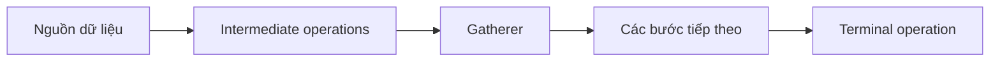

# Mô hình biến đổi trung gian không trạng thái và có trạng thái

Stream Gatherers mở rộng Stream API bằng cách cho phép xây dựng các phép biến đổi trung gian tùy chỉnh. Một gatherer nhận lần lượt các phần tử từ nguồn, có thể giữ trạng thái giữa các phần tử, rồi đẩy không, một hoặc nhiều kết quả xuống bước tiếp theo của pipeline.

Stream Gatherers được giới thiệu dưới dạng preview trong Java 22, tiếp tục preview ở Java 23 và trở thành API ổn định trong Java 24 theo JEP 485. Khi sử dụng trên Java hiện đại, hãy dùng API đã hoàn thiện trong package `java.util.stream`; không cần bật preview feature. Bài này tập trung vào hai mô hình biến đổi: không trạng thái và có trạng thái.

## 1. Gatherer nằm ở đâu trong Stream pipeline?

Một pipeline Stream thường gồm nguồn dữ liệu, các phép biến đổi trung gian và một terminal operation:



Các phép biến đổi trung gian thông thường như `map`, `filter` và `flatMap` đã đáp ứng nhiều nhu cầu. Tuy nhiên, đôi khi logic cần phối hợp nhiều phần tử, phát ra kết quả theo nhóm, duy trì bộ đếm hoặc tính giá trị tích lũy. Trước Gatherers, việc đóng gói một phép biến đổi trung gian như vậy thường khó tái sử dụng hoặc phải chuyển sang terminal operation.

Gatherer là một abstraction để định nghĩa logic trung gian đó. Gọi `Stream.gather(gatherer)` sẽ đưa gatherer vào pipeline, giống như cách gọi `map` hoặc `filter`.

Một gatherer có thể:

- Nhận một phần tử và phát ra một phần tử đã biến đổi.
- Loại bỏ một phần tử hoặc phát ra nhiều phần tử.
- Gom nhiều phần tử đầu vào thành một kết quả.
- Giữ trạng thái giữa các lần nhận phần tử.
- Kết thúc sớm khi downstream không còn muốn nhận dữ liệu.

## 2. Mô hình không trạng thái

Một phép biến đổi *stateless* xử lý mỗi phần tử độc lập. Kết quả của phần tử hiện tại không phụ thuộc vào những phần tử đã đi qua trước đó. Ví dụ quen thuộc là chuyển chuỗi thành chữ hoa, đổi đơn vị hoặc lọc phần tử theo điều kiện.

Các đoạn code trong bài tập trung vào phần pipeline; khi đặt vào một file Java hoàn chỉnh, cần import các kiểu được sử dụng, chẳng hạn `java.util.List`, `java.util.Locale`, `java.util.function.Predicate`, `java.util.stream.Gatherer`, `java.util.stream.Gatherers` và `java.util.stream.Stream`.

Với Stream API thông thường, có thể dùng `map`:

```java
List<String> names = Stream.of("an", "binh", "chi")
    .map(name -> name.toUpperCase(Locale.ROOT))
    .toList();
```

Gatherer cho phép đóng gói một phép biến đổi trung gian tương tự thành thành phần có thể tái sử dụng. Ví dụ sau định nghĩa gatherer chuyển mỗi chuỗi thành chữ hoa:

```java
static Gatherer<String, ?, String> toUpperCaseGatherer() {
    return Gatherer.of((unused, value, downstream) ->
        downstream.push(value.toUpperCase(Locale.ROOT))
    );
}

List<String> names = Stream.of("an", "binh", "chi")
    .gather(toUpperCaseGatherer())
    .toList();
```

Ở đây:

- `Gatherer.of(...)` tạo gatherer không cần trạng thái tích lũy.
- `unused` là tham số state không được sử dụng trong mô hình không trạng thái.
- `value` là phần tử đầu vào hiện tại.
- `downstream.push(...)` gửi kết quả đến bước kế tiếp và trả về `boolean` cho biết downstream còn muốn nhận phần tử hay không.

Nếu chỉ cần ánh xạ một-một, `map` thường ngắn gọn và dễ đọc hơn. Gatherer có ích khi muốn đóng gói một quy tắc biến đổi trung gian có thể phát ra nhiều kết quả, phối hợp với downstream hoặc kết hợp với các logic gatherer khác.

### Ví dụ: lọc bằng gatherer không trạng thái

Có thể định nghĩa một gatherer chỉ phát ra phần tử thỏa điều kiện:

```java
static <T> Gatherer<T, ?, T> filtering(Predicate<? super T> predicate) {
    return Gatherer.of((unused, value, downstream) -> {
        if (!predicate.test(value)) {
            return true;
        }
        return downstream.push(value);
    });
}

List<Integer> evenNumbers = Stream.of(1, 2, 3, 4, 5, 6)
    .gather(filtering(number -> number % 2 == 0))
    .toList();
```

Kết quả là `[2, 4, 6]`. Mỗi phần tử được kiểm tra độc lập; gatherer không cần ghi nhớ phần tử trước đó.

## 3. Mô hình có trạng thái

Một phép biến đổi *stateful* cần ghi nhớ thông tin từ các phần tử đã xử lý để quyết định cách xử lý phần tử tiếp theo. Trạng thái có thể là bộ đếm, tổng đang tích lũy, cửa sổ phần tử hoặc cấu trúc dữ liệu tạm.

Ví dụ:

- Tính tổng lũy kế của các số.
- Gom các phần tử thành từng nhóm có kích thước cố định.
- Tạo cửa sổ trượt để phân tích một chuỗi sự kiện.
- Chỉ phát ra kết quả sau khi đã nhận đủ một số phần tử.

Mô hình này khác với phép biến đổi không trạng thái ở chỗ kết quả không chỉ phụ thuộc vào phần tử hiện tại. Gatherer cần một vùng state để lưu thông tin trong suốt quá trình xử lý.

### Tính tổng lũy kế bằng Gatherers.scan

Java cung cấp các gatherer dựng sẵn trong lớp `Gatherers`. `Gatherers.scan` giữ giá trị tích lũy và phát ra một kết quả sau mỗi phần tử:

```java
List<Integer> runningTotals = Stream.of(1, 2, 3, 4, 5)
    .gather(Gatherers.scan(
        () -> 0,
        (total, value) -> total + value
    ))
    .toList();

System.out.println(runningTotals); // [1, 3, 6, 10, 15]
```

Với từng phần tử đầu vào, gatherer cập nhật tổng rồi phát ra tổng mới. Trạng thái tích lũy được duy trì giữa các lần gọi integrator. Kết quả của phần tử thứ ba phụ thuộc vào hai phần tử trước đó, vì vậy đây là phép biến đổi có trạng thái.

### Gom phần tử thành các cửa sổ cố định

`Gatherers.windowFixed(size)` gom các phần tử liên tiếp thành danh sách có kích thước cố định:

```java
List<List<Integer>> batches = Stream.of(1, 2, 3, 4, 5, 6, 7)
    .gather(Gatherers.windowFixed(3))
    .toList();

System.out.println(batches);
// [[1, 2, 3], [4, 5, 6], [7]]
```

Gatherer giữ các phần tử đã nhận trong cửa sổ hiện tại cho đến khi đủ kích thước, sau đó phát ra một danh sách và bắt đầu cửa sổ tiếp theo. Cửa sổ cuối có thể chứa ít phần tử hơn kích thước yêu cầu nếu nguồn kết thúc giữa chừng.

Một lựa chọn khác là `Gatherers.windowSliding(size)`, tạo các cửa sổ trượt chồng lấn nhau. Ví dụ với kích thước 3, các cửa sổ đầy đủ lần lượt chứa phần tử ở vị trí 1–3, 2–4, 3–5, v.v. Cách này phù hợp khi cần tính toán trên một vùng dữ liệu lân cận, chẳng hạn trung bình trượt hoặc phân tích chuỗi sự kiện.

## 4. Các thành phần trong một Gatherer

Giao diện `Gatherer` mô hình hóa vòng đời của một phép biến đổi trung gian. Một gatherer đầy đủ có bốn thành phần:

| Thành phần | Vai trò |
|---|---|
| Initializer | Tạo state ban đầu cho một lần xử lý |
| Integrator | Nhận từng phần tử, cập nhật state và có thể đẩy kết quả xuống downstream |
| Combiner | Kết hợp hai state từng phần khi pipeline xử lý song song |
| Finisher | Thực hiện bước cuối khi nguồn đã được xử lý xong và có thể phát ra kết quả cuối |

Integrator là phần cốt lõi. Nó nhận state, phần tử hiện tại và đối tượng `Downstream`. Nó trả về `true` để tiếp tục nhận phần tử hoặc `false` để báo rằng không cần xử lý thêm phần tử từ upstream.

Một gatherer không trạng thái có thể dùng factory `Gatherer.of(integrator)`, như các ví dụ ở trên. Gatherer có trạng thái có thể được tạo bằng các factory khác nhau tùy yêu cầu thực thi:

- `Gatherer.ofSequential(initializer, integrator)` dành cho gatherer có state nhưng xử lý tuần tự. Không cần cung cấp combiner hay finisher.
- `Gatherer.of(initializer, integrator, combiner, finisher)` cho phép định nghĩa đầy đủ vòng đời, bao gồm cách kết hợp state trong xử lý song song.

### Ví dụ: tự định nghĩa gatherer tính tổng lũy kế

Ví dụ sau dùng một mảng một phần tử làm state để lưu tổng. Vì gatherer được tạo bằng `ofSequential`, các phần tử được xử lý theo thứ tự:

```java
static Gatherer<Integer, long[], Long> runningTotalGatherer() {
    return Gatherer.ofSequential(
        () -> new long[] { 0L },
        (state, value, downstream) -> {
            state[0] = Math.addExact(state[0], value.longValue());
            return downstream.push(state[0]);
        }
    );
}

List<Long> totals = Stream.of(10, 20, 5)
    .gather(runningTotalGatherer())
    .toList();

System.out.println(totals); // [10, 30, 35]
```

Mảng `long[]` là đối tượng state có thể thay đổi. Integrator cộng phần tử hiện tại vào tổng rồi đẩy tổng mới xuống downstream. `Math.addExact` làm phép cộng phát sinh `ArithmeticException` nếu tổng vượt phạm vi `long`, thay vì âm thầm tràn số.

Nếu downstream không còn muốn nhận dữ liệu, `downstream.push` trả về `false` và integrator truyền kết quả đó trở lại pipeline. Điều này cho phép gatherer phối hợp với các thao tác ngắn mạch ở phía sau, chẳng hạn `findFirst` hoặc `limit`.

## 5. Khác biệt khi xử lý song song

Với gatherer không trạng thái, mỗi phần tử được xử lý độc lập nên việc chia dữ liệu thành các phần thường dễ hơn. Với gatherer có trạng thái, cần xác định cách state của từng phần được kết hợp để giữ đúng kết quả.

Nếu muốn một gatherer có trạng thái hỗ trợ xử lý song song, combiner phải kết hợp hai state từng phần theo đúng ngữ nghĩa của phép biến đổi. Không phải mọi state đều có thể ghép tùy ý. Ví dụ, tổng có thể cộng hai tổng từng phần; nhưng một phép biến đổi phụ thuộc thứ tự phần tử cần thiết kế cẩn thận để giữ thứ tự và kết quả tương đương xử lý tuần tự.

`Gatherer.ofSequential` thể hiện rõ rằng gatherer được xử lý tuần tự. Dùng factory này khi logic cần thứ tự tuần tự hoặc chưa có cách kết hợp state an toàn. Với gatherer song song, cần cài đặt combiner phù hợp và kiểm tra tính đúng đắn trên cả stream tuần tự lẫn song song.

Không nên chọn parallel stream chỉ vì gatherer có thể xử lý song song. Chi phí phối hợp, kích thước dữ liệu, tính độc lập của công việc và thứ tự kết quả đều ảnh hưởng đến hiệu năng. Hãy đo trên workload thực tế.

## 6. Các gatherer dựng sẵn thường dùng

Ngoài `scan`, Java cung cấp một số gatherer hữu ích trong `Gatherers`:

| Gatherer | Mô hình | Công dụng |
|---|---|---|
| `Gatherers.scan` | Có trạng thái | Phát ra kết quả tích lũy sau từng phần tử |
| `Gatherers.fold` | Có trạng thái | Tích lũy toàn bộ đầu vào và phát ra kết quả cuối |
| `Gatherers.windowFixed` | Có trạng thái | Gom các phần tử thành cửa sổ cố định, không chồng lấn |
| `Gatherers.windowSliding` | Có trạng thái | Tạo các cửa sổ chồng lấn |
| `Gatherers.mapConcurrent` | Có phối hợp đồng thời | Ánh xạ phần tử bằng các tác vụ có giới hạn mức đồng thời |

Ví dụ dùng `fold` để tạo một kết quả tổng hợp duy nhất sau khi xử lý đầu vào:

```java
List<Integer> total = Stream.of(1, 2, 3, 4)
    .gather(Gatherers.fold(
        () -> 0,
        Integer::sum
    ))
    .toList();

System.out.println(total); // [10]
```

Khác với `scan`, `fold` chỉ phát ra kết quả tích lũy cuối cùng khi quá trình xử lý kết thúc. Giá trị khởi tạo được cung cấp bởi supplier và được dùng làm state ban đầu cho phép tích lũy.

`mapConcurrent(maxConcurrency, mapper)` phù hợp với công việc ánh xạ độc lập có thể thực hiện đồng thời, chẳng hạn gọi dịch vụ hoặc tải dữ liệu cho từng phần tử. Tham số `maxConcurrency` giới hạn số tác vụ cùng lúc. Chỉ nên dùng khi mapper có thể chạy an toàn đồng thời và không phụ thuộc thứ tự thực thi; hãy xem tài liệu API để hiểu chính sách thứ tự và giới hạn của phiên bản JDK đang dùng.

## 7. Khi nào nên dùng Gatherer?

Dùng Gatherer khi cần tạo một phép biến đổi trung gian có thể tái sử dụng và logic không thể diễn đạt gọn bằng các operation có sẵn. Một số trường hợp điển hình:

- Cần phát ra nhiều phần tử từ một phần tử đầu vào hoặc loại bỏ phần tử theo logic phức tạp.
- Cần giữ trạng thái giữa các phần tử, chẳng hạn tổng lũy kế hoặc cửa sổ dữ liệu.
- Cần đóng gói một phép biến đổi thành thành phần dùng lại trong nhiều pipeline.
- Cần kiểm soát cách state được khởi tạo, cập nhật, kết hợp và hoàn tất.
- Cần ánh xạ đồng thời với giới hạn concurrency thông qua gatherer dựng sẵn.

Nếu chỉ cần ánh xạ, lọc, sắp xếp hoặc gom nhóm theo cách thông thường, hãy ưu tiên các Stream operation hoặc collector sẵn có. Gatherer là một công cụ mở rộng; dùng nó khi mô hình xử lý trung gian thực sự cần khả năng tùy chỉnh.

## Kết luận

Stream Gatherers cho phép xây dựng các phép biến đổi trung gian linh hoạt hơn cho Stream API. Gatherer không trạng thái xử lý từng phần tử độc lập, còn gatherer có trạng thái ghi nhớ thông tin giữa các phần tử để tạo kết quả như tổng lũy kế hoặc cửa sổ dữ liệu. Khi định nghĩa gatherer, cần hiểu vai trò của initializer, integrator, combiner và finisher, đặc biệt nếu muốn xử lý song song.

Stream Gatherers được hoàn thiện trong Java 24. Khi dùng trên các JDK hiện đại, hãy sử dụng API ổn định và lựa chọn mô hình không trạng thái hay có trạng thái dựa trên bản chất dữ liệu và yêu cầu của pipeline.

## Tài liệu tham khảo

- [JEP 461: Stream Gatherers (Preview), JDK 22](https://openjdk.org/jeps/461)
- [JEP 473: Stream Gatherers (Second Preview), JDK 23](https://openjdk.org/jeps/473)
- [JEP 485: Stream Gatherers, JDK 24](https://openjdk.org/jeps/485)
- [Java SE 24 API — Gatherer](https://docs.oracle.com/en/java/javase/24/docs/api/java.base/java/util/stream/Gatherer.html)
- [Java SE 24 API — Gatherers](https://docs.oracle.com/en/java/javase/24/docs/api/java.base/java/util/stream/Gatherers.html)
