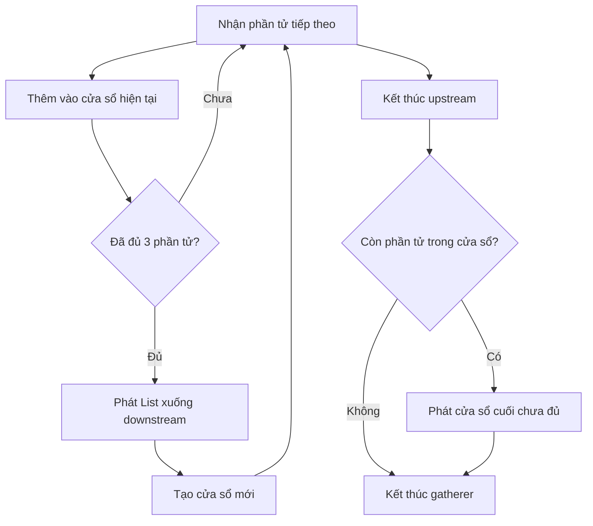

# Gatherers.windowFixed để chia luồng thành các cửa sổ không chồng lấn

Khi xử lý dữ liệu theo lô, ta thường cần gom các phần tử liên tiếp của một luồng thành những nhóm có kích thước cố định. Ví dụ, một dịch vụ nhập 1.000 bản ghi có thể gửi từng lô 100 bản ghi đến hệ thống lưu trữ. Java Stream trước đây không có phép trung gian dựng sẵn chuyên cho việc chia luồng thành các cửa sổ như vậy.

`Gatherers.windowFixed(int windowSize)` cung cấp khả năng đó. Gatherer nhận các phần tử theo thứ tự xuất hiện, gom đủ `windowSize` phần tử thành một `List`, phát danh sách xuống bước tiếp theo rồi bắt đầu cửa sổ mới. Các cửa sổ **không chồng lấn**; nếu cuối luồng còn ít phần tử hơn kích thước yêu cầu, cửa sổ cuối vẫn được phát với số phần tử còn lại.

Stream Gatherers được giới thiệu ở trạng thái preview trong Java 22 theo JEP 461 và trở thành API ổn định trong Java 24 theo JEP 485. Khi dùng JDK 24 trở lên, `Gatherers.windowFixed` là API final, không cần bật `--enable-preview`.

## 1. Cách windowFixed chia dữ liệu

Giả sử luồng đầu vào chứa các số từ 1 đến 8 và kích thước cửa sổ là 3:

```text
Đầu vào:       1  2  3  4  5  6  7  8
                \____/  \____/  \__/
Cửa sổ:        [1,2,3] [4,5,6] [7,8]
```

Phần tử trong một cửa sổ được giữ nguyên thứ tự xuất hiện. Sau khi phát một cửa sổ, phần tử tiếp theo sẽ bắt đầu cửa sổ kế tiếp. Vì vậy, một phần tử không xuất hiện trong nhiều cửa sổ như cách hoạt động của cửa sổ trượt.

| Đặc điểm | Hành vi của `windowFixed(3)` |
| --- | --- |
| Kích thước cửa sổ | Tối đa 3 phần tử |
| Các cửa sổ | Không chồng lấn |
| Thứ tự phần tử | Giữ encounter order của luồng |
| Luồng rỗng | Không tạo cửa sổ nào |
| Phần còn lại cuối luồng | Tạo cửa sổ cuối nhỏ hơn nếu còn phần tử |
| `windowSize` nhỏ hơn 1 | Ném `IllegalArgumentException` |

Ví dụ: với 8 phần tử và kích thước 3, kết quả có 3 cửa sổ: hai cửa sổ đủ 3 phần tử và một cửa sổ cuối gồm 2 phần tử.

## 2. Ví dụ đầu tiên với Stream.gather

Đoạn chương trình sau chia luồng số nguyên thành các nhóm 3 phần tử:

```java
import java.util.List;
import java.util.stream.Gatherers;
import java.util.stream.IntStream;

public class WindowFixedExample {
    public static void main(String[] args) {
        List<List<Integer>> windows = IntStream.rangeClosed(1, 8)
                .boxed()
                .gather(Gatherers.windowFixed(3))
                .toList();

        System.out.println(windows);
    }
}
```

Kết quả:

```text
[[1, 2, 3], [4, 5, 6], [7, 8]]
```

Giải thích từng phần:

1. `IntStream.rangeClosed(1, 8)` tạo luồng số nguyên từ 1 đến 8, bao gồm cả hai đầu mút.
2. `boxed()` chuyển `IntStream` thành `Stream<Integer>` để có thể tạo các danh sách `List<Integer>`.
3. `gather(Gatherers.windowFixed(3))` gom ba phần tử liên tiếp thành một cửa sổ.
4. `toList()` là thao tác kết thúc, kích hoạt pipeline và thu các cửa sổ thành một danh sách.

Kiểu kết quả là `List<List<Integer>>`: danh sách bên ngoài chứa các cửa sổ, mỗi cửa sổ là một danh sách các phần tử đầu vào.

## 3. Quy trình xử lý bên trong pipeline

`gather(...)` là một phép trung gian của Stream. Nó không cần xử lý toàn bộ luồng ngay tại thời điểm tạo pipeline; việc duyệt dữ liệu diễn ra khi có terminal operation như `toList()`, `forEach()` hoặc `count()`.

Với `windowFixed(3)`, có thể hình dung quy trình như sau:



Gatherer duy trì trạng thái cho cửa sổ đang mở. Integrator nhận từng phần tử và cập nhật trạng thái đó. Khi đủ số lượng, cửa sổ được chuyển xuống downstream. Khi upstream kết thúc, finisher phát nốt phần còn lại nếu cửa sổ hiện tại chưa rỗng.

Ví dụ với `windowSize = 3`:

| Phần tử nhận vào | Cửa sổ đang tích lũy | Hành động |
| --- | --- | --- |
| 1 | `[1]` | Chưa phát |
| 2 | `[1, 2]` | Chưa phát |
| 3 | `[1, 2, 3]` | Phát `[1, 2, 3]`, mở cửa sổ mới |
| 4 | `[4]` | Chưa phát |
| 5 | `[4, 5]` | Chưa phát |
| 6 | `[4, 5, 6]` | Phát `[4, 5, 6]`, mở cửa sổ mới |
| 7 | `[7]` | Chưa phát |
| 8 | `[7, 8]` | Chưa phát |
| Hết dữ liệu | `[7, 8]` | Finisher phát cửa sổ cuối |

Nếu số phần tử chia hết cho `windowSize`, mọi cửa sổ đều đủ kích thước. Nếu không chia hết, chỉ cửa sổ cuối có thể ngắn hơn.

## 4. Ứng dụng: xử lý dữ liệu theo từng batch

Một tình huống phổ biến là chia danh sách đơn hàng thành từng lô để gọi dịch vụ xử lý. Ví dụ dưới đây gom tối đa 100 đơn hàng vào mỗi batch:

```java
import java.util.List;
import java.util.stream.Gatherers;

record Order(long id, long amountInCents) {}

class OrderBatchJob {
    static void processOrders(List<Order> orders) {
        orders.stream()
                .gather(Gatherers.windowFixed(100))
                .forEach(OrderBatchJob::sendBatch);
    }

    private static void sendBatch(List<Order> batch) {
        System.out.println("Gửi batch có " + batch.size() + " đơn hàng");
        // Gọi repository hoặc API nhận batch ở đây.
    }
}
```

Nếu có 235 đơn hàng, `sendBatch` được gọi ba lần với kích thước lần lượt là 100, 100 và 35. Không cần tự viết vòng lặp chỉ số hoặc tự quản lý danh sách tạm.

Trong ứng dụng thực tế, phương thức xử lý batch nên có chiến lược riêng cho lỗi, retry và transaction. `windowFixed` chỉ chịu trách nhiệm chia phần tử thành nhóm; nó không tự thực hiện transaction, retry hoặc bảo đảm batch được lưu thành công.

## 5. Kết hợp với các phép trung gian khác

Vị trí của `gather` trong pipeline quyết định phần tử nào được đưa vào cửa sổ. Những phép trung gian đứng trước `gather` tác động lên luồng đầu vào; những phép đứng sau `gather` làm việc với từng danh sách cửa sổ.

### 5.1. Lọc trước khi chia cửa sổ

```java
import java.util.List;
import java.util.stream.Gatherers;

List<List<Integer>> windows = List.of(1, 2, 3, 4, 5, 6, 7, 8, 9)
        .stream()
        .filter(number -> number % 2 == 0)
        .gather(Gatherers.windowFixed(2))
        .toList();

System.out.println(windows);
// [[2, 4], [6, 8]]
```

`filter` chạy trước `gather`, vì vậy chỉ các số chẵn được đưa vào cửa sổ. Các cửa sổ được tạo từ chuỗi `[2, 4, 6, 8]`.

### 5.2. Lọc cửa sổ sau khi chia

```java
import java.util.List;
import java.util.stream.Gatherers;

List<List<Integer>> windows = List.of(1, 2, 3, 4, 5, 6, 7, 8)
        .stream()
        .gather(Gatherers.windowFixed(3))
        .filter(window -> window.size() == 3)
        .toList();

System.out.println(windows);
// [[1, 2, 3], [4, 5, 6]]
```

Ở đây, `filter` nhận từng `List<Integer>`. Cửa sổ cuối `[7, 8]` bị loại vì không đủ 3 phần tử.

### 5.3. Phân biệt limit trước và sau gather

```java
import java.util.stream.Gatherers;
import java.util.stream.Stream;

// Chỉ lấy tối đa 6 phần tử đầu vào rồi mới chia cửa sổ.
var firstSix = Stream.of(1, 2, 3, 4, 5, 6, 7, 8, 9)
        .limit(6)
        .gather(Gatherers.windowFixed(3))
        .toList();
// [[1, 2, 3], [4, 5, 6]]

// Chia thành cửa sổ trước, sau đó chỉ lấy tối đa 2 cửa sổ.
var firstTwoWindows = Stream.of(1, 2, 3, 4, 5, 6, 7, 8, 9)
        .gather(Gatherers.windowFixed(3))
        .limit(2)
        .toList();
// [[1, 2, 3], [4, 5, 6]]
```

Hai ví dụ cho cùng kết quả với dữ liệu này, nhưng ý nghĩa khác nhau: `limit` trước `gather` giới hạn số phần tử đầu vào; `limit` sau `gather` giới hạn số cửa sổ đầu ra.

## 6. Xử lý cửa sổ cuối và luồng rỗng

Hai trường hợp biên cần được hiểu rõ khi dùng API:

```java
import java.util.stream.Gatherers;
import java.util.stream.Stream;

var empty = Stream.<Integer>empty()
        .gather(Gatherers.windowFixed(3))
        .toList();
// []

var shortStream = Stream.of(10, 20)
        .gather(Gatherers.windowFixed(3))
        .toList();
// [[10, 20]]

var exactWindows = Stream.of(10, 20, 30, 40, 50, 60)
        .gather(Gatherers.windowFixed(3))
        .toList();
// [[10, 20, 30], [40, 50, 60]]
```

- Luồng rỗng không sinh ra danh sách rỗng bên trong; kết quả chỉ là danh sách cửa sổ rỗng.
- Nếu luồng có ít phần tử hơn kích thước cửa sổ, một cửa sổ chứa toàn bộ phần tử sẽ được phát khi luồng kết thúc.
- Nếu luồng kết thúc ngay sau một cửa sổ đầy, không có cửa sổ phụ nào được tạo.

Đối với luồng vô hạn, upstream không kết thúc nên không có cửa sổ cuối chưa đủ được phát. Chỉ các cửa sổ đã đủ kích thước mới được chuyển xuống downstream. Có thể dùng `limit` sau `gather` để yêu cầu một số lượng cửa sổ hữu hạn.

## 7. Khác biệt giữa windowFixed và windowSliding

Hai phương thức đều tạo các cửa sổ theo thứ tự xuất hiện, nhưng quy tắc dịch chuyển khác nhau.

| Đầu vào `[1, 2, 3, 4, 5, 6, 7]`, kích thước 3 | Kết quả |
| --- | --- |
| `Gatherers.windowFixed(3)` | `[[1, 2, 3], [4, 5, 6], [7]]` |
| `Gatherers.windowSliding(3)` | `[[1, 2, 3], [2, 3, 4], [3, 4, 5], [4, 5, 6], [5, 6, 7]]` |

`windowFixed` tiêu thụ các phần tử theo từng nhóm rời nhau. `windowSliding` dịch cửa sổ từng phần tử; cửa sổ kế tiếp giữ lại các phần tử cũ gần nhất và thêm phần tử mới. Vì vậy:

- Chọn `windowFixed` khi cần batch không chồng lấn, ví dụ gửi từng lô bản ghi hoặc xử lý từng nhóm sự kiện.
- Chọn `windowSliding` khi cần phân tích một khoảng dữ liệu liên tục, ví dụ tính trung bình trượt hoặc so sánh các lần đo liền kề.

Không dùng `windowSliding` để thay thế batch cố định nếu yêu cầu là mỗi phần tử chỉ thuộc một batch.

## 8. Giới hạn và lưu ý khi sử dụng

### 8.1. Kích thước cửa sổ phải dương

`windowFixed` ném `IllegalArgumentException` nếu `windowSize` nhỏ hơn 1. Nếu kích thước đến từ cấu hình hoặc đầu vào người dùng, hãy kiểm tra và báo lỗi rõ ràng:

```java
import java.util.List;
import java.util.stream.Gatherers;
import java.util.stream.Stream;

static <T> Stream<List<T>> fixedWindows(Stream<T> source, int windowSize) {
    if (windowSize < 1) {
        throw new IllegalArgumentException("windowSize phải lớn hơn 0");
    }

    return source.gather(Gatherers.windowFixed(windowSize));
}
```

### 8.2. Các cửa sổ được trả về là danh sách không sửa được

Mỗi `List` do `windowFixed` phát ra là unmodifiable. Các thao tác thay đổi như `add`, `remove` hoặc `clear` sẽ ném `UnsupportedOperationException`.

```java
import java.util.ArrayList;
import java.util.stream.Gatherers;
import java.util.stream.Stream;

var windows = Stream.of(1, 2, 3)
        .gather(Gatherers.windowFixed(2))
        .toList();

// windows.get(0).add(99); // UnsupportedOperationException

var mutableCopy = new ArrayList<>(windows.get(0));
mutableCopy.add(99); // Hợp lệ vì đây là ArrayList mới.
```

Nếu bước xử lý tiếp theo chỉ đọc dữ liệu, hãy dùng trực tiếp cửa sổ. Chỉ tạo bản sao có thể sửa khi thực sự cần thay đổi nội dung.

### 8.3. Cân nhắc bộ nhớ với cửa sổ lớn

Tài liệu API lưu ý các cửa sổ có thể được cấp phát liên tiếp và sớm vì lý do hiệu năng. Chọn kích thước cửa sổ quá lớn có thể dùng nhiều bộ nhớ trong thời gian đánh giá phép toán. Ngoài ra, nếu gọi `toList()` trên toàn pipeline, danh sách bên ngoài sẽ giữ lại tất cả cửa sổ và các phần tử của chúng.

Với nguồn dữ liệu lớn, cân nhắc xử lý từng cửa sổ ngay khi nó được phát xuống downstream thay vì luôn thu toàn bộ kết quả vào `List<List<T>>`. Chọn kích thước batch theo giới hạn bộ nhớ, giới hạn request của dịch vụ đích và chi phí mỗi lần xử lý.

### 8.4. Thứ tự và xử lý song song

`windowFixed` gom các phần tử theo encounter order. Nếu nghiệp vụ phụ thuộc thứ tự, hãy dùng nguồn có encounter order xác định và tránh loại bỏ thứ tự bằng `unordered()` trước khi chia cửa sổ.

Việc chia cửa sổ phụ thuộc ranh giới phần tử trước và sau trong luồng. Gatherer `windowFixed` không cung cấp combiner để ghép trạng thái của các phân vùng song song; vì vậy bản thân bước gom cửa sổ được thực hiện tuần tự. Gọi `parallel()` trên stream không biến thao tác chia batch này thành phép chia nhóm độc lập có thể ghép tùy ý. Nếu cần tăng thông lượng, hãy đo toàn pipeline và cân nhắc xử lý song song các batch sau khi đã xác định rõ thứ tự, tính độc lập và giới hạn tài nguyên của tác vụ.

## 9. Khi nào nên dùng Gatherers.windowFixed?

| Nhu cầu | Có phù hợp không? | Giải thích |
| --- | --- | --- |
| Chia danh sách thành các batch tối đa N phần tử | Có | Đây là mục đích trực tiếp của API |
| Gửi bản ghi đến API theo lô | Có | Mỗi lần downstream nhận một danh sách có kích thước giới hạn |
| Gom các sự kiện liên tiếp theo từng nhóm cố định | Có | Giữ encounter order và không chồng lấn |
| Tính toán trung bình trượt của N lần đo gần nhất | Không phù hợp | Dùng `windowSliding(N)` vì cần các cửa sổ chồng lấn |
| Nhóm phần tử theo giá trị khóa như mã khách hàng | Không phù hợp | Cần grouping theo khóa, không phải chia theo vị trí |
| Chia dữ liệu thành các nhóm có kích thước thay đổi theo điều kiện | Không phù hợp | Cần logic gom nhóm tùy chỉnh hoặc một phép biến đổi khác |

`Gatherers.windowFixed` phù hợp nhất khi quy tắc nhóm được xác định bằng số lượng phần tử liên tiếp. Nếu điều kiện kết thúc nhóm phụ thuộc nội dung phần tử, thời gian hoặc khóa nghiệp vụ, hãy chọn phép xử lý phù hợp với quy tắc đó.

## 10. Tài liệu tham khảo

- [JEP 461 — Stream Gatherers (Preview in Java 22)](https://openjdk.org/jeps/461)
- [JEP 485 — Stream Gatherers (Final in Java 24)](https://openjdk.org/jeps/485)
- [Gatherers — Java SE 27 API](https://docs.oracle.com/en/java/javase/27/docs/api/java.base/java/util/stream/Gatherers.html)
- [Gatherer — Java SE 27 API](https://docs.oracle.com/en/java/javase/27/docs/api/java.base/java/util/stream/Gatherer.html)
- [Stream.gather — Java SE 27 API](https://docs.oracle.com/en/java/javase/27/docs/api/java.base/java/util/stream/Stream.html#gather%28java.util.stream.Gatherer%29)
