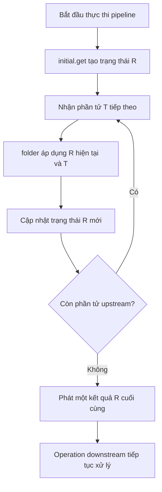

# `Gatherers.fold` để tích lũy và phát kết quả khi hoàn tất

`Gatherers.fold` là một gatherer có trạng thái, dùng để đọc các phần tử của stream theo thứ tự encounter, cập nhật một giá trị tích lũy và chỉ phát kết quả sau khi upstream đã hoàn tất. Nó phù hợp khi cần biến nhiều phần tử đầu vào thành một kết quả duy nhất nhưng muốn giữ thao tác đó bên trong pipeline `Stream`, để có thể tiếp tục nối các intermediate operation phía sau.

Stream Gatherers được giới thiệu dưới dạng preview trong Java 22 và được hoàn thiện thành API chính thức từ Java 24 qua JEP 485. `Gatherers.fold` hiện thuộc `java.util.stream.Gatherers`, có mốc `Since: 24`; vì vậy ví dụ trong bài dùng API chuẩn từ JDK 24 trở lên, không cần bật preview feature.

## 1. `fold` giải quyết bài toán nào?

Một stream có thể chứa nhiều phần tử, trong khi ứng dụng chỉ cần một kết quả tổng hợp sau khi đọc hết dữ liệu. Ví dụ:

- Ghép toàn bộ mã giao dịch thành một chuỗi báo cáo.
- Tích lũy các sự kiện theo thứ tự để tạo trạng thái cuối cùng.
- Duyệt các bản ghi và xây dựng một đối tượng tổng hợp có nhiều trường.
- Tạo kết quả từ một phép gộp phụ thuộc thứ tự, không có combiner phù hợp để chia nhỏ và ghép các phần kết quả.

Các terminal operation như `reduce` và `collect` đã giải quyết nhiều bài toán tổng hợp. Điểm khác biệt của `fold` là nó tạo ra một **intermediate operation**: đầu ra vẫn là một `Stream`, thường chứa đúng một phần tử kết quả. Vì vậy có thể nối `map`, `filter`, `flatMap` hoặc một gatherer khác sau khi fold hoàn tất.

Ví dụ, `reduce` trả về trực tiếp một giá trị terminal:

```java
int total = Stream.of(10, 20, 30)
    .reduce(0, Integer::sum);
```

Trong khi `fold` biến kết quả tích lũy thành một stream để tiếp tục xử lý:

```java
long total = Stream.of(10, 20, 30)
    .gather(Gatherers.fold(() -> 0L, (sum, value) -> sum + value))
    .findFirst()
    .orElseThrow();
```

Với ví dụ trên, kết quả cuối là `60L`.

## 2. Cấu trúc và cách hoạt động của `Gatherers.fold`

Chữ ký phương thức trong Java SE hiện hành:

```java
public static <T, R> Gatherer<T, ?, R> fold(
    Supplier<R> initial,
    BiFunction<? super R, ? super T, ? extends R> folder
)
```

Hai tham số có ý nghĩa:

| Tham số | Vai trò |
| --- | --- |
| `initial` | `Supplier` tạo giá trị tích lũy ban đầu cho mỗi lần thực thi gatherer. |
| `folder` | Hàm nhận giá trị tích lũy hiện tại và phần tử đầu vào tiếp theo, sau đó trả về giá trị tích lũy mới. |

`T` là kiểu phần tử đầu vào, còn `R` là kiểu kết quả tích lũy và cũng là kiểu phần tử đầu ra. Hai kiểu này không cần giống nhau. Ví dụ, stream đầu vào có thể là `Stream<Order>` nhưng kết quả fold là `SalesSummary`.

Quá trình xử lý diễn ra theo trình tự:

1. Khi pipeline được thực thi, `initial.get()` tạo trạng thái ban đầu.
2. Với mỗi phần tử upstream, `folder` nhận trạng thái hiện tại và phần tử đó.
3. Giá trị `R` do `folder` trả về trở thành trạng thái cho lần xử lý tiếp theo.
4. Khi upstream kết thúc, fold phát trạng thái cuối cùng xuống operation tiếp theo.



Điểm quan trọng là fold không phát trạng thái trung gian sau từng phần tử. Nó giữ trạng thái trong suốt quá trình duyệt và chỉ phát một kết quả khi upstream hoàn tất. Nếu không có exception trong quá trình xử lý, gatherer này phát đúng một phần tử, kể cả khi upstream rỗng (khi đó phần tử là giá trị ban đầu).

## 3. Ví dụ cơ bản: tích lũy tổng

Ví dụ sau cộng các số nguyên thành một giá trị `long`:

```java
import java.util.stream.Gatherers;
import java.util.stream.Stream;

public class FoldSumExample {
    public static void main(String[] args) {
        long total = Stream.of(10, 20, 30, 40)
            .gather(Gatherers.fold(
                () -> 0L,
                (sum, value) -> sum + value
            ))
            .findFirst()
            .orElseThrow();

        System.out.println(total); // 100
    }
}
```

Trong đó:

- `() -> 0L` tạo giá trị ban đầu.
- `(sum, value) -> sum + value` cập nhật tổng sau mỗi phần tử.
- `gather(...)` đưa kết quả fold trở lại pipeline dưới dạng `Stream<Long>`.
- `findFirst()` lấy phần tử duy nhất do fold phát ra.

Nếu chỉ cần một tổng số học đơn giản, `mapToLong(...).sum()` hoặc `reduce(...)` thường ngắn gọn hơn. Ví dụ này giúp thấy rõ mô hình tích lũy của fold; lợi ích của fold xuất hiện rõ hơn khi kết quả cần được giữ trong pipeline hoặc phép gộp có trạng thái và phụ thuộc thứ tự.

## 4. Ví dụ thực tế: tạo báo cáo chuỗi sau khi đọc hết dữ liệu

Giả sử ứng dụng cần tạo một dòng báo cáo từ các mã đơn hàng theo thứ tự xuất hiện. Có thể dùng `StringBuilder` làm trạng thái tích lũy:

```java
import java.util.stream.Gatherers;
import java.util.stream.Stream;

public class FoldReportExample {
    public static void main(String[] args) {
        String report = Stream.of("ORD-101", "ORD-102", "ORD-103")
            .gather(Gatherers.fold(
                StringBuilder::new,
                (builder, orderId) -> {
                    if (!builder.isEmpty()) {
                        builder.append(", ");
                    }
                    return builder.append(orderId);
                }
            ))
            .map(StringBuilder::toString)
            .findFirst()
            .orElseThrow();

        System.out.println(report);
        // ORD-101, ORD-102, ORD-103
    }
}
```

`StringBuilder::new` tạo một builder mới cho lần thực thi. `folder` thêm mã đơn hàng vào builder và trả lại chính builder đó làm trạng thái kế tiếp. Vì builder chỉ được phát xuống downstream sau khi upstream hoàn tất, `map(StringBuilder::toString)` có thể chuyển nó thành chuỗi bất biến để sử dụng tiếp.

Không nên viết `result + element` để ghép chuỗi lặp lại với dữ liệu lớn: mỗi lần ghép có thể tạo chuỗi mới và sao chép nội dung đã tích lũy. Một accumulator có thể thay đổi như `StringBuilder` giúp tránh việc tạo chuỗi mới ở mỗi bước.

## 5. Stream rỗng và giá trị ban đầu

`initial` không chỉ là trạng thái trước phần tử đầu tiên. Nếu upstream rỗng, giá trị do `initial` tạo ra chính là kết quả fold được phát xuống downstream.

```java
String result = Stream.<String>empty()
    .gather(Gatherers.fold(
        () -> "NO DATA",
        (current, value) -> current + value
    ))
    .findFirst()
    .orElseThrow();

System.out.println(result); // NO DATA
```

Vì vậy, với `Gatherers.fold`, stream đầu ra có một phần tử chứa giá trị ban đầu khi upstream rỗng, miễn là quá trình thực thi không ném exception. Điều này khác với `Stream.empty().reduce(BinaryOperator)`, vốn trả về `Optional.empty()`.

Hãy chọn `initial` phù hợp với ý nghĩa nghiệp vụ. Với phép cộng, `0` thường là giá trị đơn vị. Với phép ghép chuỗi, có thể dùng chuỗi rỗng hoặc một builder rỗng. Với một báo cáo, có thể dùng một đối tượng summary biểu diễn trạng thái chưa có dữ liệu.

`initial` là `Supplier` vì mỗi lần thực thi cần có trạng thái riêng. Nếu accumulator có thể thay đổi, hãy tạo một instance mới trong supplier; không trả về một object mutable dùng chung giữa nhiều lần thực thi pipeline.

## 6. `fold` chỉ phát kết quả cuối, khác `scan`

`Gatherers.fold` và `Gatherers.scan` đều nhận một supplier ban đầu và một hàm cập nhật trạng thái, nhưng cách phát kết quả khác nhau:

| Đặc điểm | `Gatherers.fold` | `Gatherers.scan` |
| --- | --- | --- |
| Mục đích | Tạo kết quả tổng hợp cuối cùng | Tạo các kết quả tích lũy theo từng bước (prefix scan) |
| Thời điểm phát | Khi upstream kết thúc | Sau mỗi phần tử đầu vào |
| Số kết quả | Một kết quả, kể cả khi upstream rỗng (giá trị initial) | Một kết quả cho mỗi phần tử đầu vào |
| Ví dụ với `1, 2, 3` và phép cộng | `6` | `1, 3, 6` |

Ví dụ:

```java
import java.util.stream.Gatherers;
import java.util.stream.Stream;

var finalTotal = Stream.of(1, 2, 3)
    .gather(Gatherers.fold(() -> 0, Integer::sum))
    .toList();

var runningTotals = Stream.of(1, 2, 3)
    .gather(Gatherers.scan(() -> 0, Integer::sum))
    .toList();

System.out.println(finalTotal);   // [6]
System.out.println(runningTotals); // [1, 3, 6]
```

Chọn `fold` khi downstream chỉ cần kết quả cuối cùng. Chọn `scan` khi cần quan sát từng trạng thái tích lũy, chẳng hạn số dư sau mỗi giao dịch hoặc tổng doanh thu tăng dần theo từng bản ghi.

## 7. Kết hợp fold với các operation khác

Vì `gather` là intermediate operation, có thể tiếp tục xử lý kết quả sau fold:

```java
String summary = Stream.of("java", "stream", "gatherer")
    .gather(Gatherers.fold(
        StringBuilder::new,
        (builder, word) -> builder.append(word).append(' ')
    ))
    .map(StringBuilder::toString)
    .map(String::strip)
    .map(String::toUpperCase)
    .findFirst()
    .orElseThrow();

System.out.println(summary); // JAVA STREAM GATHERER
```

Có thể kết hợp nhiều gatherer bằng `andThen` hoặc gọi `gather` liên tiếp. Ví dụ, nếu một gatherer trước đó tạo ra các giá trị tích lũy trung gian bằng `scan`, một `fold` phía sau có thể tổng hợp các giá trị đó thành một kết quả cuối:

```java
var cumulativeSummary = Stream.of(1, 2, 3, 4)
    .gather(Gatherers.scan(() -> 0, Integer::sum))
    .gather(Gatherers.fold(
        () -> new StringBuilder(),
        (builder, value) -> builder.append(value).append(' ')
    ))
    .map(StringBuilder::toString)
    .findFirst()
    .orElseThrow();

System.out.println(cumulativeSummary.strip()); // 1 3 6 10
```

Kết quả của gatherer trước là `1, 3, 6, 10`; fold nhận lần lượt các giá trị này và chỉ phát chuỗi tổng hợp sau khi upstream kết thúc.

## 8. Thứ tự xử lý, parallel stream và giới hạn

`Gatherers.fold` được thiết kế cho phép gộp có thứ tự, đặc biệt khi không thể cung cấp combiner để ghép hai trạng thái tích lũy độc lập. Hàm `folder` được áp dụng theo encounter order của upstream. Vì vậy, với stream có thứ tự, kết quả phản ánh đúng thứ tự phần tử nguồn.

Fold không cung cấp combiner để hợp nhất các accumulator từng phần. Do đó không nên kỳ vọng `parallel()` sẽ chia phép fold thành các phần độc lập để tăng tốc như một phép reduction có combiner phù hợp. Nếu cần tính toán song song, hãy cân nhắc `reduce` hoặc `collect` với accumulator và combiner có tính kết hợp đúng theo yêu cầu bài toán.

Một hệ quả quan trọng là fold phải đợi upstream kết thúc mới phát kết quả. Nếu dùng nó trên một stream vô hạn hoặc một stream không bao giờ hoàn tất, downstream sẽ không nhận được kết quả cuối cùng. Ngay cả khi phía sau có `findFirst()`, fold vẫn phải đọc hết upstream trước khi có thể phát phần tử đầu tiên của chính nó.

Nếu hàm `folder` ném exception, quá trình xử lý stream kết thúc bằng exception và không có kết quả fold hoàn chỉnh được phát. Supplier và folder cũng không được là `null`; nếu một trong các tham số này là `null`, factory method ném `NullPointerException`.

## 9. Khi nào nên dùng `Gatherers.fold`?

Dùng `Gatherers.fold` khi:

- Cần tích lũy nhiều phần tử thành một kết quả duy nhất.
- Cần kết quả vẫn nằm trong pipeline để nối thêm các operation.
- Phép gộp phụ thuộc thứ tự encounter hoặc không có combiner hợp lệ.
- Cần giữ một trạng thái tích lũy có cấu trúc, chẳng hạn builder hoặc đối tượng summary.

Ưu tiên `reduce` hoặc `collect` khi chúng mô tả bài toán rõ ràng hơn, đặc biệt với các phép gộp có tính kết hợp và cần hỗ trợ parallel. Dùng `scan` nếu cần phát trạng thái sau mỗi phần tử thay vì chỉ kết quả cuối.

## 10. Ghi nhớ

`Gatherers.fold(initial, folder)` tạo một gatherer stateful, có thứ tự, nhận từng phần tử upstream để cập nhật trạng thái `R`. Khi upstream kết thúc, nó phát một kết quả tổng hợp duy nhất. Nếu stream đầu vào rỗng, kết quả được phát chính là giá trị do `initial` tạo ra.

Khác với `reduce`, fold là intermediate operation và cho phép tiếp tục pipeline sau khi tích lũy. Khác với `scan`, fold không phát các trạng thái trung gian. Vì không có combiner để ghép accumulator, hãy dùng nó cho phép gộp có thứ tự và tránh kỳ vọng khả năng tăng tốc bằng parallel stream. API `Gatherers.fold` là API chuẩn từ Java 24 trở đi.

## Tài liệu tham khảo

- [Gatherers — Java SE 26 API](https://docs.oracle.com/en/java/javase/26/docs/api/java.base/java/util/stream/Gatherers.html)
- [Gatherer — Java SE 26 API](https://docs.oracle.com/en/java/javase/26/docs/api/java.base/java/util/stream/Gatherer.html)
- [Stream — Java SE 26 API](https://docs.oracle.com/en/java/javase/26/docs/api/java.base/java/util/stream/Stream.html)
- [JEP 485: Stream Gatherers](https://openjdk.org/jeps/485)
- [Stream Gatherers — Java Core Libraries Developer's Guide](https://docs.oracle.com/en/java/javase/26/core/stream-gatherers.html)
