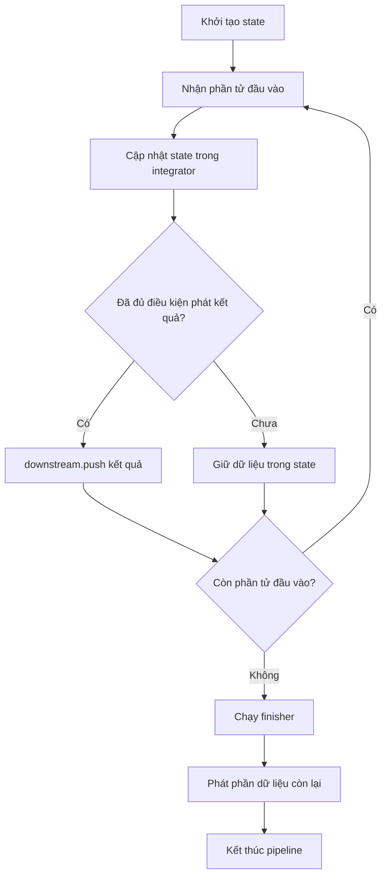

# Xử lý phần dữ liệu còn lại trong finisher khi nguồn kết thúc

Một custom `Gatherer` thường giữ dữ liệu tạm trong state rồi mới phát ra kết quả khi đã gom đủ số phần tử. Nhưng khi nguồn kết thúc, state có thể vẫn còn dữ liệu chưa đủ điều kiện để phát ra trong lúc tích hợp. `finisher` là nơi xử lý phần dữ liệu còn lại đó: nó nhận state cuối cùng và có thể đẩy thêm kết quả xuống downstream.

Ví dụ, một gatherer chia stream thành từng lô 3 phần tử. Với đầu vào có 8 phần tử, integrator phát ra hai lô đủ `[1, 2, 3]` và `[4, 5, 6]`; khi nguồn kết thúc, finisher phát nốt lô cuối `[7, 8]`. Nhờ vậy, dữ liệu cuối stream không bị bỏ sót.

Stream Gatherers được giới thiệu ở dạng preview trong Java 22 và trở thành API chính thức từ JDK 24 theo JEP 485. Bài viết dùng API ổn định `java.util.stream.Gatherer` của JDK 24 trở lên.

## 1. Vai trò của finisher trong vòng đời Gatherer

Một gatherer có thể gồm các thành phần sau:

| Thành phần | Nhiệm vụ |
| --- | --- |
| `initializer` | Tạo state ban đầu cho một lần xử lý. |
| `integrator` | Nhận từng phần tử đầu vào, cập nhật state và có thể phát kết quả ngay xuống downstream. |
| `combiner` | Kết hợp hai state khi gatherer hỗ trợ xử lý song song. |
| `finisher` | Xử lý state cuối cùng sau khi quá trình tích hợp kết thúc và phát các kết quả còn lại. |

Với gatherer chạy tuần tự, có thể dùng `Gatherer.ofSequential(initializer, integrator, finisher)`. `finisher` có kiểu `BiConsumer<A, Downstream<? super R>>`: nó nhận state kiểu `A` và downstream để phát ra kết quả kiểu `R`.

Luồng xử lý tổng quát:



Integrator xử lý các phần tử khi chúng đến. Finisher không nhận thêm phần tử đầu vào; nó chỉ nhìn vào state đã tích lũy để hoàn tất công việc.

## 2. Ví dụ: gom phần tử thành từng lô và phát lô cuối

Tạo custom gatherer để gom các phần tử thành lô có kích thước tối đa `batchSize`. Những lô đủ kích thước được phát ngay trong integrator. Nếu còn một lô chưa đầy khi nguồn kết thúc, finisher phát lô đó.

```java
import java.util.ArrayList;
import java.util.Collections;
import java.util.List;
import java.util.stream.Gatherer;
import java.util.stream.Stream;

public class BatchGathererDemo {
    private static <T> List<T> snapshot(List<T> values) {
        return Collections.unmodifiableList(new ArrayList<>(values));
    }

    static <T> Gatherer<T, ?, List<T>> batchesOf(int batchSize) {
        if (batchSize <= 0) {
            throw new IllegalArgumentException("batchSize phải lớn hơn 0");
        }

        return Gatherer.ofSequential(
                () -> new ArrayList<T>(),
                (buffer, element, downstream) -> {
                    buffer.add(element);

                    if (buffer.size() < batchSize) {
                        return true;
                    }

                    List<T> batch = snapshot(buffer);
                    buffer.clear();
                    return downstream.push(batch);
                },
                (buffer, downstream) -> {
                    if (!buffer.isEmpty()) {
                        downstream.push(snapshot(buffer));
                        buffer.clear();
                    }
                }
        );
    }

    public static void main(String[] args) {
        List<List<Integer>> batches = Stream.of(1, 2, 3, 4, 5, 6, 7, 8)
                .gather(batchesOf(3))
                .toList();

        System.out.println(batches);
    }
}
```

Kết quả:

```text
[[1, 2, 3], [4, 5, 6], [7, 8]]
```

Hai lô đầu được phát trong integrator khi buffer đạt 3 phần tử. Sau phần tử thứ 8, buffer còn `[7, 8]`. Khi nguồn đã được tích hợp hết, finisher phát nốt snapshot của buffer này.

`snapshot(buffer)` tạo một bản sao không thể sửa đổi, vì vậy các lô đã phát ra không bị thay đổi khi buffer được `clear()` và tái sử dụng cho lô tiếp theo. Cách tạo snapshot này cũng cho phép phần tử đầu vào là `null`; `List.copyOf` sẽ từ chối phần tử null.

## 3. Vì sao không phát lô cuối ngay trong integrator?

Trong lúc integrator nhận một phần tử, nó chưa thể biết phần tử đó có phải phần tử cuối của nguồn hay không. Nếu chỉ phát lô khi buffer đầy, phần còn lại có kích thước nhỏ hơn `batchSize` sẽ không bao giờ được phát nếu không có finisher.

Ví dụ với `batchSize = 3`:

| Thời điểm | Phần tử vừa nhận | Buffer sau khi cập nhật | Hành động |
| --- | ---: | --- | --- |
| 1 | `1` | `[1]` | Chưa phát |
| 2 | `2` | `[1, 2]` | Chưa phát |
| 3 | `3` | `[]` | Phát `[1, 2, 3]`, xóa buffer |
| 4 | `4` | `[4]` | Chưa phát |
| 5 | `5` | `[4, 5]` | Chưa phát |
| 6 | `6` | `[]` | Phát `[4, 5, 6]`, xóa buffer |
| 7 | `7` | `[7]` | Chưa phát |
| 8 | `8` | `[7, 8]` | Chưa phát |
| Nguồn kết thúc | — | `[7, 8]` | Finisher phát `[7, 8]` |

Finisher giải quyết đúng phần việc phụ thuộc vào việc đã biết chắc quá trình tích hợp đầu vào kết thúc. Không cần dự đoán kích thước nguồn hay giữ một phần tử chờ để nhận biết phần tử cuối.

## 4. Hiểu Downstream.push và tín hiệu dừng

`downstream.push(result)` chuyển một kết quả từ gatherer sang bước tiếp theo của pipeline và trả về `boolean`:

- `true`: downstream vẫn chấp nhận kết quả và integrator có thể tiếp tục xử lý.
- `false`: downstream không còn muốn nhận thêm kết quả, thường do một thao tác ngắn mạch như `limit` đã đủ dữ liệu.

Vì vậy, integrator trong ví dụ trả trực tiếp kết quả của `downstream.push(batch)` khi phát một lô. Nếu không phát lô, integrator trả `true` để tiếp tục đọc đầu vào.

Finisher có kiểu trả về `void`, nên không trả tín hiệu boolean cho framework. Nó có thể gọi `downstream.push(...)` để phát phần còn lại. Nếu downstream đã ngừng nhận kết quả, lời gọi push sẽ báo `false`; gatherer không thể buộc downstream tiếp nhận thêm dữ liệu. Integrator cũng có thể trả `false` để kết thúc việc đọc đầu vào sớm. Khi đó, hãy kiểm tra `downstream.isRejecting()` để biết downstream có đang từ chối kết quả hay không; nếu đã rejecting, phần finisher cố phát thêm sẽ không được chuyển tiếp. `isRejecting()` là kiểm tra best-effort, nhưng một khi trả về `true` thì downstream sẽ không chuyển lại sang trạng thái nhận kết quả.

Không nên bỏ qua giá trị trả về của `downstream.push` trong integrator rồi luôn trả `true`. Làm vậy có thể khiến gatherer tiếp tục đọc và xử lý đầu vào dù downstream đã yêu cầu dừng, gây lãng phí công việc và không tuân thủ giao thức tích hợp.

## 5. Xử lý nguồn rỗng và nguồn ngắn hơn một lô

Finisher cần xử lý cả trường hợp state rỗng. Ví dụ trong `batchesOf`, điều kiện `!buffer.isEmpty()` ngăn phát ra một lô rỗng khi nguồn không có phần tử hoặc khi số phần tử chia hết cho kích thước lô.

| Đầu vào | `batchSize` | Kết quả |
| --- | ---: | --- |
| `[]` | 3 | `[]` |
| `[1]` | 3 | `[[1]]` |
| `[1, 2]` | 3 | `[[1, 2]]` |
| `[1, 2, 3]` | 3 | `[[1, 2, 3]]` |
| `[1, 2, 3, 4]` | 3 | `[[1, 2, 3], [4]]` |
| `[1, 2, 3, 4, 5, 6]` | 3 | `[[1, 2, 3], [4, 5, 6]]` |

Nếu nguồn ngắn hơn một lô, integrator chưa phát kết quả nào; finisher phát toàn bộ phần tử còn lại thành một lô nhỏ. Nếu nguồn rỗng, finisher không phát gì.

## 6. Finisher với dữ liệu cần tổng hợp trước khi phát

Finisher không chỉ dùng để xả collection. Nó còn phù hợp với các tác vụ chỉ có thể hoàn tất khi đã xem hết đầu vào, chẳng hạn phát thống kê cuối cùng hoặc tạo báo cáo tổng hợp.

Ví dụ sau đếm số phần tử và tính tổng trong integrator, sau đó chỉ phát một bản tóm tắt khi nguồn kết thúc:

```java
import java.util.stream.Gatherer;
import java.util.stream.Stream;

record Summary(long count, long total) {}

public class SummaryGathererDemo {
    static Gatherer<Integer, long[], Summary> summary() {
        return Gatherer.ofSequential(
                () -> new long[2],
                (state, value, downstream) -> {
                    state[0]++;
                    state[1] += value;
                    return true;
                },
                (state, downstream) -> {
                    downstream.push(new Summary(state[0], state[1]));
                }
        );
    }

    public static void main(String[] args) {
        Summary result = Stream.of(10, 20, 30, 40)
                .gather(summary())
                .findFirst()
                .orElseThrow();

        System.out.println(result); // Summary[count=4, total=100]
    }
}
```

Trong ví dụ này, integrator chỉ cập nhật state và không phát kết quả. Finisher tạo một `Summary` duy nhất từ state cuối. Nếu đầu vào rỗng, finisher vẫn tạo `Summary[count=0, total=0]`, vì vậy stream kết quả có một phần tử tóm tắt. Nếu muốn stream rỗng khi không có đầu vào, hãy kiểm tra `state[0]` trước khi gọi `push`.

## 7. Khi nào cần finisher và khi nào không?

Không phải custom gatherer nào cũng cần finisher. Nếu integrator đã phát ra mọi kết quả ngay khi nhận phần tử và không giữ dữ liệu chờ xử lý, có thể dùng overload không có finisher.

| Tình huống | Cách xử lý |
| --- | --- |
| Mỗi phần tử đầu vào tạo ngay một kết quả | Phát trong integrator; không cần finisher. |
| Gom đủ N phần tử mới phát một nhóm | Phát nhóm đầy trong integrator; finisher phát nhóm cuối chưa đầy. |
| Tính thống kê toàn nguồn | Cập nhật state trong integrator; finisher phát bản tổng hợp. |
| Giữ phần tử cuối để ghép với dữ liệu kế tiếp | Xử lý phần tử đang chờ trong integrator khi phần tử tiếp theo đến; finisher xử lý phần tử còn chờ khi nguồn kết thúc. |

Nếu gatherer cần chạy song song, cần thiết kế thêm combiner để kết hợp state của các phân vùng đầu vào mà vẫn bảo toàn ý nghĩa kết quả. Finisher sẽ làm việc trên state cuối sau khi các state đã được kết hợp. `Gatherer.ofSequential` luôn mô tả gatherer tuần tự; gọi `parallel()` trên stream không bổ sung combiner cho gatherer này. Với thuật toán gom lô phụ thuộc thứ tự, đây thường là lựa chọn đơn giản và rõ ràng hơn.

## 8. Các lỗi thường gặp

- **Quên phát state còn lại:** chỉ phát khi buffer đủ kích thước khiến phần đuôi ngắn hơn kích thước lô bị mất.
- **Phát collection mutable rồi tiếp tục sửa:** downstream có thể nhìn thấy cùng một buffer bị thay đổi. Hãy phát snapshot độc lập như `snapshot(buffer)`.
- **Phát lô rỗng:** finisher không kiểm tra buffer rỗng có thể tạo một kết quả không có ý nghĩa khi nguồn chia hết cho kích thước lô hoặc nguồn rỗng.
- **Không tôn trọng tín hiệu downstream:** integrator nên trả về kết quả từ `downstream.push(...)` khi vừa phát dữ liệu.
- **Nhầm finisher với thao tác kết thúc Stream:** finisher thuộc vòng đời của Gatherer và có quyền phát thêm phần tử vào downstream; nó không phải terminal operation của Stream.
- **Dùng state dùng chung:** initializer nên tạo state riêng cho mỗi lần xử lý, đặc biệt khi state là mutable.
- **Giả định mọi gatherer đều chạy tuần tự:** nếu dùng factory hỗ trợ parallel, phải cung cấp combiner đúng và xem xét cách kết hợp phần dư ở ranh giới các phân vùng.

## 9. Dùng API dựng sẵn khi đã đáp ứng yêu cầu

Nếu mục tiêu chỉ là chia stream thành các cửa sổ cố định và giữ lại cửa sổ cuối nhỏ hơn kích thước yêu cầu, hãy cân nhắc `Gatherers.windowFixed(size)` trước khi tự viết gatherer. API dựng sẵn đã xử lý việc phát cửa sổ cuối chưa đầy.

Custom finisher phù hợp khi logic hoàn tất riêng của ứng dụng phức tạp hơn, chẳng hạn phát nhiều loại kết quả cuối, kiểm tra state cuối, tạo bản tổng hợp hoặc xả một cấu trúc dữ liệu mà không có gatherer dựng sẵn tương ứng.

## 10. Biên dịch và chạy

`Gatherer`, `Gatherer.ofSequential` và `Stream.gather` là API chính thức từ JDK 24. Với JDK 24 trở lên, biên dịch và chạy ví dụ mà không cần `--enable-preview`:

```bash
javac --release 24 BatchGathererDemo.java
java BatchGathererDemo
```

Nếu dự án dùng JDK mới hơn, hãy biên dịch theo phiên bản mục tiêu của dự án. Không dùng hướng dẫn preview của Java 22 làm cấu hình cho API Gatherer chính thức.

## 11. Tài liệu tham khảo

- [Java SE 24 — Gatherer](https://docs.oracle.com/en/java/javase/24/docs/api/java.base/java/util/stream/Gatherer.html) — initializer, integrator, combiner, finisher và `ofSequential`.
- [Java SE 24 — Gatherer.Downstream](https://docs.oracle.com/en/java/javase/24/docs/api/java.base/java/util/stream/Gatherer.Downstream.html) — phát kết quả và tín hiệu từ `push`.
- [Java SE 24 — Gatherers](https://docs.oracle.com/en/java/javase/24/docs/api/java.base/java/util/stream/Gatherers.html) — các gatherer dựng sẵn như `windowFixed`.
- [JEP 485: Stream Gatherers](https://openjdk.org/jeps/485) — Stream Gatherers trở thành tính năng chính thức từ JDK 24.
