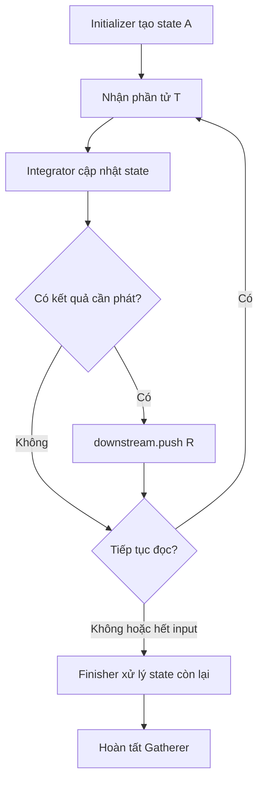

# Bài tập gom lô, loại trùng liên tiếp và tổng hợp sự kiện theo cửa sổ

Custom Gatherer cho phép tự định nghĩa một intermediate operation của Stream khi các operation có sẵn chưa diễn tả đúng cách dữ liệu cần được nhóm, lọc hoặc tổng hợp. Bài học này xây dựng ba gatherer có trạng thái: gom phần tử thành từng lô, loại các giá trị trùng nhau đứng cạnh nhau và tổng hợp sự kiện theo cửa sổ thời gian.

Stream Gatherers được giới thiệu dưới dạng preview trong Java 22 và trở thành API chính thức từ Java 24 qua JEP 485. Các ví dụ dưới đây dùng `Gatherer`, `Gatherer.Integrator` và `Gatherer.Downstream` của `java.util.stream` từ JDK 24 trở lên. Đây là API hiện hành; không cần dùng cú pháp preview hay module incubator của các bản Java trước.

## 1. Khi nào cần tự viết Gatherer?

Stream API có các intermediate operation quen thuộc như `map`, `filter`, `flatMap`, `distinct` và các terminal operation như `reduce`, `collect`. Tuy nhiên, một số bài toán cần giữ trạng thái giữa các phần tử, có thể phát nhiều kết quả trong lúc đọc dữ liệu hoặc cần thực hiện một thao tác cuối khi upstream kết thúc.

Ví dụ:

- **Gom lô (batching):** đọc từng phần tử và phát một danh sách sau mỗi N phần tử; cuối stream vẫn phải phát lô cuối nếu chưa đủ N phần tử.
- **Loại trùng liên tiếp:** với chuỗi `A, A, B, B, A`, chỉ phát `A, B, A`. Giá trị `A` xuất hiện lại sau `B` vẫn được giữ.
- **Tổng hợp theo cửa sổ:** gom các sự kiện có timestamp nằm trong cùng một khoảng thời gian, sau đó phát số lượng và tổng giá trị của cửa sổ khi chuyển sang cửa sổ tiếp theo hoặc khi hết dữ liệu.

`distinct()` không thay thế được gatherer loại trùng liên tiếp: `distinct()` loại mọi giá trị đã từng xuất hiện, còn bài toán ở đây chỉ so sánh với phần tử đứng ngay trước. `Collectors.groupingBy()` cũng khác với gom lô theo thứ tự vì nó gom theo khóa và thường tạo kết quả sau terminal operation.

## 2. Mô hình của một custom Gatherer

`Gatherer<T, A, R>` có ba tham số kiểu:

| Kiểu | Ý nghĩa |
| --- | --- |
| `T` | Kiểu phần tử đầu vào từ upstream. |
| `A` | Kiểu trạng thái trung gian do gatherer quản lý; thường là object có thể thay đổi. |
| `R` | Kiểu phần tử mà gatherer phát xuống downstream. |

Một gatherer được mô tả bằng tối đa bốn hàm:

1. **Initializer** tạo trạng thái mới cho mỗi lần thực thi pipeline.
2. **Integrator** nhận trạng thái, phần tử tiếp theo và `Downstream`; nó cập nhật trạng thái, có thể phát không, một hoặc nhiều kết quả, rồi trả về việc có tiếp tục nhận phần tử hay không.
3. **Combiner** kết hợp hai trạng thái độc lập khi gatherer hỗ trợ xử lý song song.
4. **Finisher** thực hiện thao tác cuối khi upstream đã hoàn tất, thường dùng để phát phần dữ liệu còn đang đệm.

Luồng dữ liệu cơ bản:



Trong một integrator, `downstream.push(value)` trả về `true` nếu downstream còn nhận kết quả và `false` nếu downstream đã từ chối thêm dữ liệu. Giá trị boolean trả về từ integrator cũng có ý nghĩa tương tự đối với upstream: `false` yêu cầu dừng việc tích hợp phần tử tiếp theo. Vì thế, khi phát kết quả trong integrator, thường có thể trả thẳng kết quả của `downstream.push(...)`.

### Dùng factory method `Gatherer.ofSequential`

Với gatherer có trạng thái nhưng chưa có cách ghép hai trạng thái an toàn, `Gatherer.ofSequential(...)` là lựa chọn trực tiếp. Nó nhận initializer, integrator và tùy chọn finisher. Không có combiner nên gatherer này được thực thi tuần tự.

```java
return Gatherer.<T, State, R>ofSequential(
    State::new,
    Gatherer.Integrator.of((state, element, downstream) -> {
        // Cập nhật state và phát kết quả nếu cần.
        return true;
    }),
    (state, downstream) -> {
        // Phát dữ liệu còn lại khi upstream hoàn tất.
    }
);
```

`Gatherer.Integrator.of(...)` dùng cho integrator có thể chủ động trả `false` để kết thúc sớm. Nếu integrator luôn xử lý hết input và không tự short-circuit, có thể dùng `Gatherer.Integrator.ofGreedy(...)`. Các ví dụ dưới đây dùng `of(...)` vì chúng cần chuyển tiếp trạng thái từ `downstream.push(...)`.

## 3. Bài tập 1: Gom stream thành các lô cố định

### Yêu cầu

Viết `batchesOf(batchSize)` nhận một stream và phát ra các `List<T>`:

- Mỗi lô đầy có đúng `batchSize` phần tử.
- Giữ nguyên encounter order.
- Nếu lô cuối chưa đủ phần tử, vẫn phát lô đó khi upstream kết thúc.
- Nếu input rỗng, không phát lô nào.
- `batchSize` phải lớn hơn 0.

Ví dụ với `batchSize = 3`:

<text color="secondary" size="sm">Input</text>

`[1, 2, 3, 4, 5, 6, 7]`

<text color="secondary" size="sm">Output</text>

`[[1, 2, 3], [4, 5, 6], [7]]`

### Lời giải

```java
import java.util.ArrayList;
import java.util.Collections;
import java.util.List;
import java.util.stream.Gatherer;

final class Batching {
    private Batching() {}

    private static final class BatchState<T> {
        final List<T> values = new ArrayList<>();
    }

    private static <T> List<T> immutableSnapshot(List<T> source) {
        return Collections.unmodifiableList(new ArrayList<>(source));
    }

    static <T> Gatherer<T, ?, List<T>> batchesOf(int batchSize) {
        if (batchSize <= 0) {
            throw new IllegalArgumentException("batchSize phải lớn hơn 0");
        }

        return Gatherer.<T, BatchState<T>, List<T>>ofSequential(
            BatchState::new,
            Gatherer.Integrator.of((state, element, downstream) -> {
                state.values.add(element);

                if (state.values.size() < batchSize) {
                    return true;
                }

                List<T> completedBatch = immutableSnapshot(state.values);
                state.values.clear();
                return downstream.push(completedBatch);
            }),
            (state, downstream) -> {
                if (!state.values.isEmpty()) {
                    List<T> finalBatch = immutableSnapshot(state.values);
                    state.values.clear();
                    downstream.push(finalBatch);
                }
            }
        );
    }
}
```

Integrator thêm phần tử vào buffer. Khi đủ số lượng, nó tạo snapshot độc lập, xóa buffer để chuẩn bị cho lô tiếp theo rồi phát snapshot xuống downstream. Finisher xử lý phần tử còn lại sau khi upstream hoàn tất. Snapshot dùng bản sao không thể sửa đổi để downstream không vô tình thay đổi dữ liệu nội bộ của gatherer; cách tạo này vẫn cho phép phần tử đầu vào là `null`.

### Cách sử dụng

```java
import java.util.List;
import java.util.stream.Stream;

final class BatchUsage {
    public static void main(String[] args) {
        List<List<Integer>> batches = Stream.of(1, 2, 3, 4, 5, 6, 7)
            .gather(Batching.batchesOf(3))
            .toList();

        System.out.println(batches);
        // [[1, 2, 3], [4, 5, 6], [7]]
    }
}
```

**Điểm cần kiểm tra:** input có 6 phần tử phải tạo đúng hai lô; input có 7 phần tử phải phát lô cuối một phần tử; input rỗng trả về danh sách rỗng; `batchesOf(0)` và kích thước âm phải ném `IllegalArgumentException`.

## 4. Bài tập 2: Loại bỏ các phần tử trùng liên tiếp

### Yêu cầu

Viết `distinctConsecutive()` chỉ phát phần tử nếu nó khác phần tử được phát gần nhất. So sánh bằng `Objects.equals` để hỗ trợ object tùy ý và giá trị `null`.

Ví dụ:

`["A", "A", "B", "B", "A", "C", "C"]`

trở thành:

`["A", "B", "A", "C"]`

### Lời giải

```java
import java.util.Objects;
import java.util.stream.Gatherer;

final class ConsecutiveDistinct {
    private ConsecutiveDistinct() {}

    private static final class LastValueState<T> {
        boolean hasPrevious;
        T previous;
    }

    static <T> Gatherer<T, ?, T> distinctConsecutive() {
        return Gatherer.<T, LastValueState<T>, T>ofSequential(
            LastValueState::new,
            Gatherer.Integrator.of((state, element, downstream) -> {
                if (downstream.isRejecting()) {
                    return false;
                }

                if (state.hasPrevious && Objects.equals(state.previous, element)) {
                    return true;
                }

                state.hasPrevious = true;
                state.previous = element;
                return downstream.push(element);
            })
        );
    }
}
```

Trạng thái chỉ cần giữ phần tử trước đó và một cờ cho biết đã nhận phần tử nào chưa. Cờ `hasPrevious` là cần thiết vì `null` cũng có thể là một phần tử hợp lệ. Nếu phần tử hiện tại bằng phần tử trước, integrator không phát gì. Nếu khác, nó cập nhật trạng thái và phát phần tử hiện tại.

`downstream.isRejecting()` cho biết downstream đã biết rằng nó không cần thêm dữ liệu. Kiểm tra này giúp dừng đọc upstream sớm khi có thể; đây là gợi ý best-effort, còn `push` vẫn là thao tác quyết định một phần tử có được nhận hay không.

### Cách sử dụng

```java
import java.util.List;
import java.util.stream.Stream;

final class DistinctUsage {
    public static void main(String[] args) {
        List<String> result = Stream.of("A", "A", "B", "B", "A", "C", "C")
            .gather(ConsecutiveDistinct.distinctConsecutive())
            .toList();

        System.out.println(result); // [A, B, A, C]
    }
}
```

**Điểm cần kiểm tra:** hai phần tử giống nhau cách nhau bởi một giá trị khác đều phải được giữ; input chỉ có một phần tử vẫn phát phần tử đó; input rỗng không phát gì; các phần tử `null` đứng cạnh nhau chỉ phát một `null`.

## 5. Bài tập 3: Tổng hợp sự kiện theo cửa sổ thời gian

### Yêu cầu và quy ước

Một hệ thống nhận sự kiện giao dịch. Mỗi sự kiện có timestamp và một giá trị số. Hãy tổng hợp số sự kiện và tổng giá trị theo các cửa sổ thời gian cố định, ví dụ mỗi phút một cửa sổ.

Để lời giải dễ hiểu và có semantics xác định, bài tập đặt ra các quy ước:

- Cửa sổ là **tumbling window**: không chồng lấn, mỗi sự kiện thuộc đúng một cửa sổ.
- Cửa sổ có dạng nửa mở `[startInclusive, endExclusive)`; sự kiện đúng thời điểm bắt đầu thuộc cửa sổ mới.
- Mốc cửa sổ được căn theo epoch Unix, độ phân giải mili giây.
- Input phải được sắp xếp không giảm theo thời điểm bắt đầu cửa sổ. Sự kiện đến muộn thuộc cửa sổ cũ hơn sẽ bị từ chối.
- Chỉ phát các cửa sổ có ít nhất một sự kiện; không tạo cửa sổ rỗng trong khoảng thời gian không có dữ liệu.
- Khi upstream kết thúc, finisher phát cửa sổ cuối cùng còn đang tích lũy.

Ví dụ với cửa sổ một phút:

| Timestamp | Amount |
| --- | ---: |
| 10:00:02 | 100 |
| 10:00:35 | 50 |
| 10:01:05 | 70 |
| 10:01:50 | 30 |

Kết quả gồm hai cửa sổ: `[10:00, 10:01)` có 2 sự kiện và tổng 150; `[10:01, 10:02)` có 2 sự kiện và tổng 100.

### Lời giải

```java
import java.time.Duration;
import java.time.Instant;
import java.util.Objects;
import java.util.stream.Gatherer;

final class EventWindows {
    private EventWindows() {}

    record Event(Instant timestamp, long amount) {
        Event {
            Objects.requireNonNull(timestamp, "timestamp");
        }
    }

    record WindowSummary(
        Instant startInclusive,
        Instant endExclusive,
        long eventCount,
        long totalAmount
    ) {}

    private static final class WindowState {
        Instant windowStart;
        long eventCount;
        long totalAmount;

        WindowSummary snapshot(long widthMillis) {
            return new WindowSummary(
                windowStart,
                windowStart.plusMillis(widthMillis),
                eventCount,
                totalAmount
            );
        }

        void clear() {
            windowStart = null;
            eventCount = 0;
            totalAmount = 0;
        }
    }

    static Gatherer<Event, ?, WindowSummary> tumblingSum(Duration width) {
        Objects.requireNonNull(width, "width");
        long widthMillis = width.toMillis();

        if (widthMillis <= 0 || !width.equals(Duration.ofMillis(widthMillis))) {
            throw new IllegalArgumentException(
                "width phải là Duration dương có độ phân giải mili giây"
            );
        }

        return Gatherer.<Event, WindowState, WindowSummary>ofSequential(
            WindowState::new,
            Gatherer.Integrator.of((state, event, downstream) -> {
                if (downstream.isRejecting()) {
                    return false;
                }

                Objects.requireNonNull(event, "event");
                long eventMillis = event.timestamp().toEpochMilli();
                long startMillis = Math.multiplyExact(
                    Math.floorDiv(eventMillis, widthMillis),
                    widthMillis
                );
                Instant bucketStart = Instant.ofEpochMilli(startMillis);

                if (state.windowStart == null) {
                    state.windowStart = bucketStart;
                } else if (bucketStart.isBefore(state.windowStart)) {
                    throw new IllegalArgumentException(
                        "Sự kiện đến muộn: input phải được sắp xếp theo cửa sổ thời gian"
                    );
                } else if (bucketStart.isAfter(state.windowStart)) {
                    WindowSummary completed = state.snapshot(widthMillis);
                    state.clear();

                    if (!downstream.push(completed)) {
                        return false;
                    }

                    state.windowStart = bucketStart;
                }

                state.eventCount = Math.addExact(state.eventCount, 1);
                state.totalAmount = Math.addExact(state.totalAmount, event.amount());
                return true;
            }),
            (state, downstream) -> {
                if (state.windowStart != null) {
                    WindowSummary finalWindow = state.snapshot(widthMillis);
                    state.clear();
                    downstream.push(finalWindow);
                }
            }
        );
    }
}
```

Integrator tính thời điểm bắt đầu cửa sổ bằng phép chia lấy floor trên epoch milliseconds. Khi sự kiện vẫn nằm trong cửa sổ hiện tại, nó cập nhật số lượng và tổng giá trị. Khi gặp cửa sổ mới, nó chụp kết quả cửa sổ cũ, xóa state rồi mới push kết quả; nếu downstream từ chối, integrator trả `false` để dừng. Finisher phát cửa sổ còn lại khi upstream kết thúc.

`Math.addExact` giúp phát hiện tràn số ở bộ đếm hoặc tổng giá trị thay vì âm thầm tạo kết quả sai. `Math.multiplyExact` cũng kiểm tra phép nhân khi căn mốc cửa sổ.

### Cách sử dụng

```java
import java.time.Duration;
import java.time.Instant;
import java.util.Comparator;
import java.util.List;

final class WindowUsage {
    public static void main(String[] args) {
        List<EventWindows.Event> events = List.of(
            new EventWindows.Event(Instant.parse("2026-01-01T10:00:02Z"), 100),
            new EventWindows.Event(Instant.parse("2026-01-01T10:00:35Z"), 50),
            new EventWindows.Event(Instant.parse("2026-01-01T10:01:05Z"), 70),
            new EventWindows.Event(Instant.parse("2026-01-01T10:01:50Z"), 30)
        );

        List<EventWindows.WindowSummary> summaries = events.stream()
            .sorted(Comparator.comparing(EventWindows.Event::timestamp))
            .gather(EventWindows.tumblingSum(Duration.ofMinutes(1)))
            .toList();

        summaries.forEach(System.out::println);
    }
}
```

Kết quả có hai `WindowSummary`: cửa sổ bắt đầu `10:00Z` có `eventCount = 2`, `totalAmount = 150`; cửa sổ bắt đầu `10:01Z` có `eventCount = 2`, `totalAmount = 100`.

### Giới hạn của ví dụ cửa sổ

Đây là gatherer tổng hợp theo cửa sổ thời gian cho input đã được sắp xếp. Nó không phải bộ xử lý event-time hoàn chỉnh cho dữ liệu đến trễ hoặc đến sai thứ tự. Hệ thống streaming thực tế thường cần watermark, chính sách late event, trạng thái nhiều cửa sổ đang mở và cơ chế phát lại hoặc cập nhật kết quả. Nếu cần cửa sổ trượt (sliding window) hoặc cửa sổ session, quy tắc lưu state và phát kết quả cũng phải được mở rộng.

Việc `.sorted(...)` trong ví dụ giữ cho bài tập tự chứa nhưng cần thu thập/sắp xếp dữ liệu trước khi phát kết quả; với luồng vô hạn, cách này không phù hợp. Nếu nguồn đã đảm bảo thứ tự event-time, có thể bỏ bước sort và xử lý trực tiếp.

## 6. Vì sao ba gatherer này dùng `ofSequential`?

Cả ba ví dụ đều dựa vào trạng thái mutable và encounter order:

- Batching cần ghép đúng các phần tử kề nhau thành lô và xử lý lô cuối.
- Loại trùng liên tiếp cần biết phần tử cuối của phân đoạn trước.
- Tổng hợp sự kiện cần biết cửa sổ đang mở và kiểm tra thứ tự cửa sổ.

`Gatherer.ofSequential` đảm bảo integrator và finisher làm việc trên một state tuần tự. Nếu dùng `Gatherer.of(...)` với combiner, ứng dụng phải định nghĩa cách ghép hai state độc lập sao cho kết quả tương đương xử lý toàn bộ input theo encounter order. Combiner sai có thể làm lô bị ghép sai, bỏ sót ranh giới trùng liên tiếp hoặc tổng hợp cửa sổ sai.

Không nên thêm combiner chỉ để gọi `.parallel()`. Chỉ triển khai gatherer parallelizable khi có thể chứng minh tính đúng đắn của việc phân vùng, ghép state và phát output. Với ba bài tập này, phiên bản tuần tự là lựa chọn dễ kiểm chứng và phù hợp với semantics đã nêu.

## 7. Checklist kiểm thử cho custom Gatherer

Khi hoàn thiện một gatherer, hãy kiểm tra các tình huống sau:

| Tình huống | Batching | Distinct liên tiếp | Window aggregation |
| --- | --- | --- | --- |
| Input rỗng | Không phát lô | Không phát phần tử | Không phát cửa sổ |
| Một phần tử | Phát lô một phần tử ở finisher | Phát phần tử đó | Phát cửa sổ chứa nó ở finisher |
| Ranh giới | Lô đủ kích thước được phát ngay | Giá trị đổi thì phát | Chuyển cửa sổ thì phát cửa sổ trước |
| Phần tử cuối | Lô chưa đủ vẫn được phát | Không cần flush | Cửa sổ cuối được phát |
| Downstream từ chối | Dừng tích hợp sau push trả false | Dừng tích hợp sau push trả false | Dừng tích hợp sau push trả false |
| Input không hợp lệ | Kích thước lô phải dương | Không có phần tử đặc biệt bị cấm | Timestamp phải hợp lệ và bucket không giảm |

Ngoài kết quả đầu ra, cần kiểm tra state không bị chia sẻ giữa hai lần thực thi gatherer. Initializer phải tạo state mới; không lưu buffer hoặc biến mutable dùng chung bên ngoài supplier. Finisher chỉ xử lý state của lần thực thi hiện tại và không giữ tham chiếu đến `Downstream` sau khi callback kết thúc.

## 8. Ghi nhớ

Custom Gatherer là intermediate operation tự định nghĩa, phù hợp với phép biến đổi có trạng thái và cần kiểm soát thời điểm phát dữ liệu. `Gatherer<T, A, R>` tách kiểu đầu vào, state và đầu ra. Initializer tạo state, integrator xử lý từng phần tử, downstream nhận output, còn finisher phát phần state còn lại khi upstream kết thúc. Combiner chỉ cần thiết nếu muốn hỗ trợ xử lý song song và có thể ghép state chính xác.

Ba bài tập thể hiện ba mẫu phổ biến: batching cần buffer và finisher; distinct liên tiếp chỉ cần nhớ phần tử trước; window aggregation cần state của cửa sổ đang mở và chính sách thứ tự dữ liệu. Hãy bắt đầu với `Gatherer.ofSequential` khi chưa có combiner đúng đắn, rồi chỉ tối ưu song song khi có thể chứng minh semantics không đổi.

## Tài liệu tham khảo

- [Gatherer — Java SE 26 API](https://docs.oracle.com/en/java/javase/26/docs/api/java.base/java/util/stream/Gatherer.html)
- [Gatherer.Downstream — Java SE 26 API](https://docs.oracle.com/en/java/javase/26/docs/api/java.base/java/util/stream/Gatherer.Downstream.html)
- [Gatherer.Integrator — Java SE 26 API](https://docs.oracle.com/en/java/javase/26/docs/api/java.base/java/util/stream/Gatherer.Integrator.html)
- [Stream — Java SE 26 API](https://docs.oracle.com/en/java/javase/26/docs/api/java.base/java/util/stream/Stream.html)
- [JEP 485: Stream Gatherers](https://openjdk.org/jeps/485)
- [Stream Gatherers — Java Core Libraries Developer's Guide](https://docs.oracle.com/en/java/javase/26/core/stream-gatherers.html)
