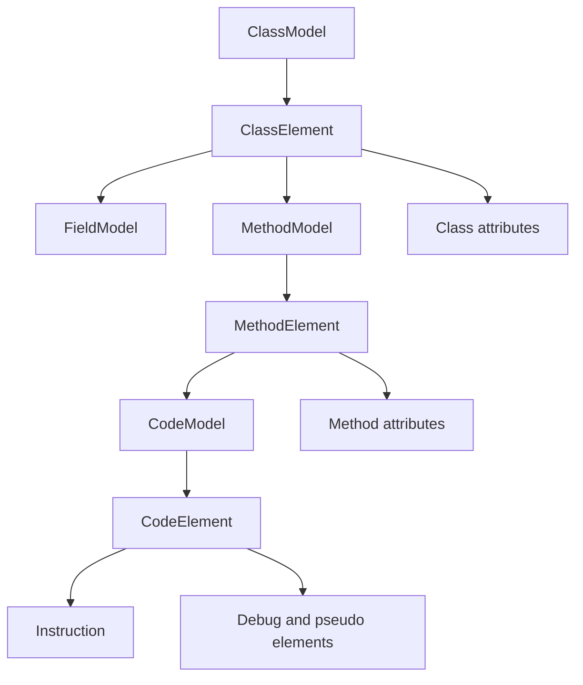

# Đọc byte class thành ClassModel và duyệt cấu trúc theo mô hình phần tử

Một file `.class` chứa nhiều thành phần của chương trình Java: tên lớp, lớp cha, interface, field, method, attribute, constant pool và bytecode của từng method. Khi xây dựng công cụ phân tích mã, kiểm tra dependency hoặc đọc bytecode, ta cần một cách truy cập các thành phần này mà không phải tự giải mã định dạng nhị phân của JVM.

**Class-File API** cung cấp mô hình Java cho cấu trúc đó. API nằm trong package `java.lang.classfile`; phương thức `ClassFile.parse(...)` đọc dữ liệu class thành `ClassModel`. Từ model gốc, chương trình có thể truy cập trực tiếp danh sách field/method hoặc duyệt lần lượt các phần tử theo cấu trúc phân cấp của class file.

Class-File API xuất hiện ở trạng thái preview trong Java 22 theo JEP 457, tiếp tục preview ở Java 23 theo JEP 466 và trở thành API ổn định từ Java 24 theo JEP 484. Bài này dùng API final từ Java 24 trở lên và tài liệu JDK hiện hành; không sử dụng các API preview hoặc package nội bộ không có cam kết tương thích.

## 1. Từ byte class đến ClassModel

`ClassFile` là điểm bắt đầu để đọc class file. Tạo một context bằng `ClassFile.of()`, sau đó gọi `parse` với dữ liệu nhị phân hoặc đường dẫn file:

```java
import java.lang.classfile.ClassFile;
import java.lang.classfile.ClassModel;
import java.nio.file.Path;

ClassFile classFile = ClassFile.of();
ClassModel model = classFile.parse(Path.of("out/com/example/Order.class"));
```

Nếu chương trình đã có dữ liệu dạng `byte[]`, có thể đọc theo cách sau:

```java
import java.nio.file.Files;
import java.nio.file.Path;

byte[] classBytes = Files.readAllBytes(Path.of("Order.class"));
ClassModel model = ClassFile.of().parse(classBytes);
```

Hai overload thường dùng:

| Phương thức | Đầu vào | Lỗi có thể gặp |
| --- | --- | --- |
| `ClassFile.parse(byte[])` | Mảng byte chứa class file | `IllegalArgumentException` nếu dữ liệu sai định dạng hoặc phiên bản class không được runtime hỗ trợ |
| `ClassFile.parse(Path)` | Đường dẫn đến file `.class` | `IOException` khi đọc file; `IllegalArgumentException` nếu class file không hợp lệ hoặc không được hỗ trợ |

`ClassModel` là mô hình mô tả một class file. Nó không phải đối tượng của lớp đang được phân tích và việc parse không đồng nghĩa với nạp hoặc thực thi lớp đó. Vì vậy, công cụ có thể đọc metadata và bytecode từ file mà không cần gọi `Class.forName` để khởi tạo lớp.

## 2. ClassModel là mô hình gốc của cấu trúc class file

Một `ClassModel` cung cấp các accessor để lấy nhanh những phần thường cần phân tích:

| Accessor | Thông tin |
| --- | --- |
| `thisClass()` | Tên class được mô tả trong file |
| `superclass()` | Lớp cha, nếu có |
| `interfaces()` | Các interface được triển khai |
| `flags()` | Access flags của class |
| `majorVersion()` | Phiên bản major của định dạng class file |
| `minorVersion()` | Phiên bản minor của định dạng class file |
| `fields()` | Danh sách `FieldModel` |
| `methods()` | Danh sách `MethodModel` |
| `constantPool()` | Mô hình constant pool |
| `attributes()` | Các attribute của class |

Ví dụ đọc thông tin tổng quan:

```java
System.out.println("Class: " + model.thisClass().asInternalName());
System.out.println("Major version: " + model.majorVersion());
System.out.println("Minor version: " + model.minorVersion());

model.superclass().ifPresent(parent ->
        System.out.println("Superclass: " + parent.asInternalName()));

model.interfaces().forEach(iface ->
        System.out.println("Interface: " + iface.asInternalName()));
```

`asInternalName()` trả về tên theo định dạng nội bộ của JVM, trong đó dấu chấm được thay bằng dấu gạch chéo, ví dụ `com/example/Order`. Đây là tên dùng trong class file; nếu cần tên hiển thị cho người dùng, chương trình có thể thay `/` bằng `.`.

## 3. Duyệt field và method bằng accessor

Nếu chỉ cần đọc danh sách field và method, sử dụng trực tiếp `fields()` và `methods()` là cách đơn giản nhất.

```java
import java.lang.classfile.ClassModel;
import java.lang.classfile.FieldModel;
import java.lang.classfile.MethodModel;

static void printMembers(ClassModel model) {
    System.out.println("Fields:");
    for (FieldModel field : model.fields()) {
        System.out.printf("  %s : %s%n",
                field.fieldName().stringValue(),
                field.fieldType().stringValue());
    }

    System.out.println("Methods:");
    for (MethodModel method : model.methods()) {
        System.out.printf("  %s %s%n",
                method.methodName().stringValue(),
                method.methodType().stringValue());
    }
}
```

`FieldModel` mô tả một field, còn `MethodModel` mô tả một method. Các giá trị `fieldType()` và `methodType()` là descriptor theo định dạng JVM, ví dụ `Ljava/lang/String;` hoặc `(I)Ljava/lang/String;`. Descriptor mô tả kiểu ở cấp bytecode, không phải chuỗi kiểu Java đã được định dạng sẵn.

`MethodModel.code()` trả về `Optional<CodeModel>` vì không phải method nào cũng có thân bytecode. Method abstract và native thường không có `Code` attribute. Khi cần đọc bytecode, luôn kiểm tra `Optional` trước:

```java
for (MethodModel method : model.methods()) {
    method.code().ifPresent(code -> {
        System.out.println("Method có bytecode: "
                + method.methodName().stringValue());
    });
}
```

## 4. Duyệt class theo mô hình phần tử

Ngoài các accessor, `ClassModel` còn là một `Iterable<ClassElement>` và một `CompoundElement<ClassElement>`. Điều đó cho phép duyệt các phần tử thành viên theo thứ tự cấu trúc của class file.

Các phần tử có thể bao gồm `FieldModel`, `MethodModel` và những loại attribute hoặc thành phần khác. Có thể dùng pattern matching để xử lý riêng những loại cần quan tâm:

```java
import java.lang.classfile.ClassElement;
import java.lang.classfile.ClassModel;
import java.lang.classfile.FieldModel;
import java.lang.classfile.MethodModel;

static void inspectElements(ClassModel model) {
    for (ClassElement element : model) {
        switch (element) {
            case FieldModel field -> System.out.println(
                    "Field: " + field.fieldName().stringValue());
            case MethodModel method -> System.out.println(
                    "Method: " + method.methodName().stringValue());
            default -> {
                // Các loại phần tử khác không cần xử lý trong ví dụ này.
            }
        }
    }
}
```

Cách duyệt này phù hợp khi công cụ muốn xử lý nhiều loại thành phần của class file trong cùng một vòng lặp. Nếu chỉ cần field hoặc method, các accessor ở phần trước rõ ràng và trực tiếp hơn.

## 5. Duyệt sâu từ class đến bytecode của method

Class-File API tổ chức các model theo cấu trúc phân cấp:



`MethodModel` cũng là một `CompoundElement`, vì vậy có thể duyệt các `MethodElement` của nó. `CodeModel` là mô hình của `Code` attribute và chứa các `CodeElement`. Các instruction được biểu diễn bởi những kiểu trong package `java.lang.classfile.instruction`.

Ví dụ liệt kê các lệnh gọi method trong tất cả method của một class:

```java
import java.lang.classfile.ClassModel;
import java.lang.classfile.CodeElement;
import java.lang.classfile.MethodModel;
import java.lang.classfile.instruction.InvokeInstruction;

static void printMethodCalls(ClassModel model) {
    for (MethodModel method : model.methods()) {
        method.code().ifPresent(code -> {
            for (CodeElement element : code) {
                if (element instanceof InvokeInstruction call) {
                    String owner = call.owner().asInternalName();
                    String name = call.name().stringValue();
                    String descriptor = call.type().stringValue();

                    System.out.printf("%s -> %s.%s%s%n",
                            method.methodName().stringValue(),
                            owner,
                            name,
                            descriptor);
                }
            }
        });
    }
}
```

`InvokeInstruction` mô tả một lệnh gọi method như `invokevirtual`, `invokestatic`, `invokespecial` hoặc `invokeinterface`. Từ instruction, chương trình có thể lấy class/interface sở hữu method, tên method và descriptor của lời gọi.

Không phải mọi `CodeElement` đều là instruction thực thi. Code model còn có thể chứa các phần tử hỗ trợ như nhãn, thông tin dòng nguồn và metadata debug. Nếu chỉ phân tích bytecode instruction, hãy kiểm tra kiểu cụ thể như `InvokeInstruction` hoặc `Instruction` thay vì giả định mọi phần tử đều là opcode.

## 6. Duyệt phần tử bằng elementStream

Các `CompoundElement` cung cấp `elementStream()`, `elementList()`, `forEach(...)` và iterator. Có thể dùng Stream API để kết hợp việc duyệt với lọc, ánh xạ hoặc thu thập kết quả.

Ví dụ đếm số instruction trong toàn bộ method có thân bytecode:

```java
import java.lang.classfile.instruction.Instruction;

long instructionCount = model.methods().stream()
        .flatMap(method -> method.code().stream())
        .flatMap(code -> code.elementStream())
        .filter(Instruction.class::isInstance)
        .count();

System.out.println("Instruction count: " + instructionCount);
```

`Optional.stream()` biến `Optional<CodeModel>` thành stream có 0 hoặc 1 phần tử. Vì vậy method không có code tự động không đóng góp phần tử nào vào pipeline.

Ví dụ tiếp theo thu thập các class được tham chiếu bởi lệnh gọi method:

```java
import java.lang.classfile.MethodModel;
import java.util.LinkedHashSet;
import java.util.Set;
import java.lang.classfile.instruction.InvokeInstruction;

Set<String> dependencies = new LinkedHashSet<>();

for (MethodModel method : model.methods()) {
    method.code().ifPresent(code -> {
        code.elementStream()
                .filter(InvokeInstruction.class::isInstance)
                .map(InvokeInstruction.class::cast)
                .map(call -> call.owner().asInternalName())
                .forEach(dependencies::add);
    });
}

dependencies.forEach(System.out::println);
```

Đây là phân tích dependency ở mức lệnh gọi method. Muốn phân tích đầy đủ dependency của class, cần xét thêm `FieldInstruction`, kiểu field/method descriptor, superclass, interface, annotation, constant pool và các loại instruction khác có thể tham chiếu đến kiểu.

## 7. Ví dụ hoàn chỉnh: xây dựng công cụ đọc class file

Chương trình sau nhận đường dẫn đến một file `.class`, đọc thành `ClassModel`, rồi in tên class, phiên bản định dạng, field, method và số instruction trong từng method.

```java
// ClassInspector.java
import java.io.IOException;
import java.lang.classfile.ClassFile;
import java.lang.classfile.ClassModel;
import java.lang.classfile.FieldModel;
import java.lang.classfile.MethodModel;
import java.lang.classfile.instruction.Instruction;
import java.nio.file.Path;

public class ClassInspector {
    public static void main(String[] args) throws IOException {
        if (args.length != 1) {
            throw new IllegalArgumentException(
                    "Usage: java ClassInspector <class-file-path>");
        }

        Path classPath = Path.of(args[0]);
        ClassModel model = ClassFile.of().parse(classPath);

        System.out.println("Class: " + model.thisClass().asInternalName());
        System.out.printf("Class-file version: %d.%d%n",
                model.majorVersion(), model.minorVersion());

        System.out.println("Fields:");
        for (FieldModel field : model.fields()) {
            System.out.printf("  %s : %s%n",
                    field.fieldName().stringValue(),
                    field.fieldType().stringValue());
        }

        System.out.println("Methods:");
        for (MethodModel method : model.methods()) {
            long count = method.code()
                    .map(code -> code.elementStream()
                            .filter(Instruction.class::isInstance)
                            .count())
                    .orElse(0L);

            System.out.printf("  %s %s | instructions=%d%n",
                    method.methodName().stringValue(),
                    method.methodType().stringValue(),
                    count);
        }
    }
}
```

Giả sử đã có file `Sample.class`, có thể biên dịch và chạy công cụ bằng JDK 24 trở lên:

```bash
javac --release 24 -d out Sample.java
javac ClassInspector.java
java ClassInspector out/Sample.class
```

Ví dụ đầu ra:

```text
Class: Sample
Class-file version: 68.0
Fields:
  name : Ljava/lang/String;
Methods:
  <init> (Ljava/lang/String;)V | instructions=3
  getName ()Ljava/lang/String; | instructions=2
  main ([Ljava/lang/String;)V | instructions=5
```

Số instruction và nội dung đầu ra phụ thuộc mã nguồn đã biên dịch. Các method abstract hoặc native có thể có số instruction bằng 0 vì không có `CodeModel`.

## 8. Hiểu cách ClassModel và các phần tử được parse

Các model và element của Class-File API là những mô tả bất biến của cấu trúc class file. API dùng mô hình phân cấp và hỗ trợ đọc theo nhu cầu (lazy parsing): tạo `ClassModel` không nhất thiết giải mã ngay toàn bộ class file. Khi truy cập `fields()`, `methods()`, attributes hoặc code, phần tương ứng mới được xử lý.

Điều này giúp công cụ chỉ đọc phần cần thiết. Ví dụ, nếu chỉ cần liệt kê tên method, không cần duyệt từng bytecode instruction. Nếu cần đếm lệnh gọi method, chương trình mới cần đi sâu vào `CodeModel`.

Lazy parsing cũng có một số hệ quả:

- Dữ liệu class file bị hỏng có thể chỉ phát sinh `IllegalArgumentException` khi chương trình truy cập đến phần cấu trúc lỗi, thay vì ngay tại lệnh `parse`.
- `ClassModel` và các model con không được bảo đảm thread-safe chỉ vì chúng là mô hình bất biến. Không nên chia sẻ một model đang được lazy-inflate giữa nhiều thread nếu chưa có đồng bộ hoặc cách xử lý phù hợp.
- Việc duyệt `CodeModel` giữ thứ tự các phần tử trong code attribute. Thứ tự này quan trọng khi phân tích luồng thực thi và vị trí instruction.

Nếu xây dựng công cụ nhận class file từ nguồn không tin cậy, cần xử lý lỗi parse ở cả bước tạo model lẫn khi đọc accessor. Không nên giả định dữ liệu đã hợp lệ chỉ vì `parse` trả về thành công.

## 9. Mô hình phần tử và truy cập trực tiếp: chọn cách nào?

| Mục tiêu | Cách tiếp cận phù hợp |
| --- | --- |
| Lấy nhanh tên class, version, superclass | Accessor trên `ClassModel` |
| Liệt kê field và method | `fields()` và `methods()` |
| Xử lý nhiều loại thành phần cấp class | Duyệt `ClassModel` như `Iterable<ClassElement>` |
| Đọc metadata của một method | Accessor trên `MethodModel` |
| Đọc bytecode của method | `MethodModel.code()` rồi duyệt `CodeModel` |
| Lọc hoặc thu thập nhiều loại element | `elementStream()` |
| Phân tích lệnh gọi hoặc truy cập field | Duyệt `CodeElement`, lọc `InvokeInstruction` hoặc `FieldInstruction` |

Hãy bắt đầu từ accessor khi biết chính xác dữ liệu cần lấy. Chuyển sang duyệt element khi cần xử lý nhiều loại cấu trúc hoặc muốn xây dựng pipeline phân tích. Khi đi sâu vào code, cần phân biệt instruction thực thi với các pseudo/debug element của `CodeModel`.

## 10. Những điều cần tránh khi đọc class file

- Không tự tách byte array theo offset và constant pool index nếu Class-File API đã cung cấp model tương ứng. Định dạng class file có nhiều cấu trúc và thay đổi theo phiên bản JVM.
- Không dùng package nội bộ như `jdk.internal.org.objectweb.asm` trong công cụ mới. Đây là API nội bộ, không có cam kết tương thích.
- Không tiếp tục dùng package `jdk.incubator.classfile` hoặc ví dụ preview từ Java 22/23 cho mã hiện nay. Dùng `java.lang.classfile` final từ Java 24.
- Không giả định mọi method đều có bytecode; kiểm tra `MethodModel.code()` trước khi duyệt.
- Không giả định mọi `CodeElement` là một instruction; lọc theo interface hoặc kiểu instruction cần phân tích.
- Không coi việc parse class file là xác minh đầy đủ tính đúng đắn của chương trình hoặc bảo đảm class có thể chạy thành công trong mọi class loader.

## 11. Tài liệu tham khảo

- [JEP 457 — Class-File API (Preview in Java 22)](https://openjdk.org/jeps/457)
- [JEP 466 — Class-File API (Second Preview)](https://openjdk.org/jeps/466)
- [JEP 484 — Class-File API (Final in Java 24)](https://openjdk.org/jeps/484)
- [Package java.lang.classfile — Java SE 27 API](https://docs.oracle.com/en/java/javase/27/docs/api/java.base/java/lang/classfile/package-summary.html)
- [ClassFile — Java SE 27 API](https://docs.oracle.com/en/java/javase/27/docs/api/java.base/java/lang/classfile/ClassFile.html)
- [ClassModel — Java SE 27 API](https://docs.oracle.com/en/java/javase/27/docs/api/java.base/java/lang/classfile/ClassModel.html)
- [MethodModel — Java SE 27 API](https://docs.oracle.com/en/java/javase/27/docs/api/java.base/java/lang/classfile/MethodModel.html)
- [CodeModel — Java SE 27 API](https://docs.oracle.com/en/java/javase/27/docs/api/java.base/java/lang/classfile/CodeModel.html)
- [CompoundElement — Java SE 27 API](https://docs.oracle.com/en/java/javase/27/docs/api/java.base/java/lang/classfile/CompoundElement.html)
