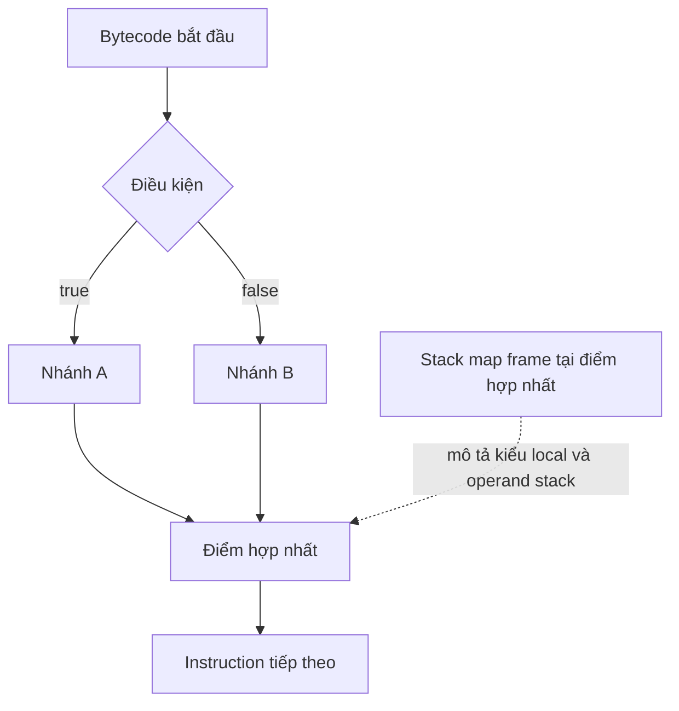

# Stack map, kiểm tra hợp lệ bytecode và xử lý lỗi khi nạp lớp

Một file `.class` có thể có cấu trúc nhị phân đọc được nhưng bytecode bên trong vẫn không hợp lệ. Ví dụ, một nhánh có thể đưa giá trị sai kiểu lên operand stack, một lệnh có thể dùng local variable chưa được khởi tạo đúng cách, hoặc các nhánh điều khiển có trạng thái stack không tương thích. JVM phải kiểm tra những điều kiện này trước khi cho phép bytecode thực thi.

**StackMapTable** lưu các mô tả kiểu của local variables và operand stack tại những điểm nhất định trong method. Các frame này hỗ trợ quá trình verification bằng kiểm tra kiểu. Với Class-File API hiện đại, ta có thể kiểm tra class file bằng `ClassFile.verify(...)`, đồng thời hiểu cách API sinh hoặc tái sử dụng stack map khi tạo và biến đổi bytecode.

Class-File API xuất hiện ở trạng thái preview trong Java 22 và trở thành API ổn định từ Java 24 theo JEP 484. `ClassFile.verify`, `StackMapTableAttribute` và `ClassFile.StackMapsOption` là API final từ Java 24, dùng được trên JDK 27 mà không cần bật preview. `StackMapTable` là thành phần của định dạng class file từ Java 6; nó không phải một tính năng mới được thêm vào Java 22.

## 1. Vì sao JVM cần kiểm tra bytecode?

Java source code được compiler chuyển thành bytecode. JVM không thể chỉ dựa vào việc file `.class` có magic number đúng hoặc parse được constant pool để kết luận chương trình an toàn về kiểu.

Trong lúc thực thi method, JVM quản lý hai vùng dữ liệu quan trọng:

- **Local variables**: các ô lưu tham số và biến cục bộ của method.
- **Operand stack**: ngăn xếp trung gian mà bytecode dùng để truyền toán hạng giữa các lệnh.

Mỗi instruction có yêu cầu về kiểu dữ liệu đầu vào và trạng thái stack. Chẳng hạn, lệnh cộng số nguyên cần hai giá trị kiểu int; lệnh gọi method cần các đối số khớp descriptor; lệnh `areturn` phải trả về một tham chiếu phù hợp với kiểu trả về của method.

Verifier kiểm tra luồng điều khiển và kiểu dữ liệu để bảo đảm các instruction có thể được thực thi theo quy tắc của JVM. Điều này ngăn bytecode thao tác operand stack hoặc local variables với kiểu không hợp lệ.

## 2. StackMapTable là gì?

`StackMapTable` là attribute nằm trong `Code` attribute của một method. Nó chứa các stack map frame. Mỗi frame mô tả trạng thái kiểu của local variables và operand stack tại một vị trí trong bytecode, thường là điểm bắt đầu của basic block hoặc đích của nhánh điều khiển.

Ví dụ, một method có điều kiện `if/else` tạo ra nhiều nhánh bytecode. Khi các nhánh gặp nhau, verifier cần biết trạng thái kiểu dự kiến tại điểm hợp nhất. Stack map frame cung cấp thông tin để JVM kiểm tra trạng thái thực tế của từng nhánh có phù hợp hay không.



Một `StackMapFrameInfo` mô tả:

| Thành phần | Ý nghĩa |
| --- | --- |
| `target()` | Nhãn chỉ vị trí bytecode mà frame áp dụng |
| `locals()` | Kiểu verification của các local variables tại vị trí đó |
| `stack()` | Kiểu verification của các giá trị trên operand stack |
| `frameType()` | Giá trị `frame_type` trong định dạng class file |

Các kiểu verification có thể biểu diễn primitive verification type, `null`, object type, `uninitializedThis` hoặc một object mới được tạo nhưng chưa hoàn tất khởi tạo. Đây là mô hình kiểu phục vụ verifier, không phải giá trị runtime thực tế của biến.

### 2.1. Quan hệ giữa StackMapTable và phiên bản class file

`StackMapTable` được đưa vào định dạng class file từ Java 6, tương ứng major version 50. Với class file có major version từ 50 trở lên, nếu `Code` attribute không có `StackMapTable`, JVM hiểu rằng method có một implicit stack map table rỗng. Vì vậy, không thể kết luận class file không hợp lệ chỉ vì không nhìn thấy attribute này.

Stack map frame đầu tiên của method được suy ra từ method descriptor và trạng thái ban đầu của method. Các frame tiếp theo mô tả trạng thái tại những vị trí cần kiểm tra trong luồng điều khiển.

## 3. Stack map hỗ trợ verification như thế nào?

Verifier phân tích bytecode theo các basic block. Ở mỗi điểm có frame, verifier so sánh trạng thái kiểu suy ra từ các instruction trước đó với trạng thái được mô tả trong stack map. Nếu hai trạng thái không tương thích, bytecode không vượt qua kiểm tra kiểu.

Ví dụ minh họa về trạng thái operand stack:

```text
Trạng thái dự kiến tại điểm hợp nhất:
  locals = [int, java/lang/String]
  stack  = [int]

Trạng thái do một nhánh tạo ra:
  locals = [int, java/lang/String]
  stack  = [java/lang/String]

Kết quả:
  Không tương thích vì operand stack cần int nhưng nhánh tạo String.
```

Ví dụ trên mô tả nguyên tắc kiểm tra kiểu, không phải bản dump của một class file cụ thể. Verifier còn kiểm tra các quy tắc khác như kiểu tham số khi gọi method, kiểu giá trị trả về, việc khởi tạo object và tính hợp lệ của luồng điều khiển.

## 4. Đọc và kiểm tra class file bằng ClassFile.verify

Từ Java 24, Class-File API cung cấp các overload `verify` để kiểm tra class file từ `Path`, `byte[]` hoặc `ClassModel`. Kết quả là danh sách `VerifyError`:

- Danh sách rỗng: không phát hiện lỗi verification trong phạm vi kiểm tra của API.
- Danh sách có phần tử: mỗi `VerifyError` mô tả một lỗi kiểm tra được phát hiện.
- File không đọc được, sai định dạng hoặc phiên bản không được runtime hỗ trợ có thể làm quá trình parse thất bại trước khi trả danh sách lỗi verification.

Ví dụ kiểm tra một file `.class` theo đường dẫn:

```java
import java.io.IOException;
import java.lang.classfile.ClassFile;
import java.nio.file.Path;
import java.util.List;

public class VerifyClassFile {
    public static void main(String[] args) throws IOException {
        if (args.length != 1) {
            throw new IllegalArgumentException(
                    "Usage: java VerifyClassFile <class-file-path>");
        }

        Path classPath = Path.of(args[0]);
        ClassFile classFile = ClassFile.of();

        try {
            List<VerifyError> errors = classFile.verify(classPath);

            if (errors.isEmpty()) {
                System.out.println("Không phát hiện lỗi bytecode verification.");
                return;
            }

            System.out.println("Phát hiện " + errors.size() + " lỗi:");
            for (VerifyError error : errors) {
                System.err.println("- " + error.getMessage());
            }
        } catch (IllegalArgumentException exception) {
            System.err.println("Không thể parse class file: "
                    + exception.getMessage());
        }
    }
}
```

Biên dịch và chạy trên JDK 24 trở lên:

```bash
javac VerifyClassFile.java
java VerifyClassFile out/com/example/Order.class
```

`ClassFile.verify(Path)` ném `IOException` nếu không đọc được file. `IllegalArgumentException` có thể xuất hiện khi class file sai định dạng hoặc phiên bản không được runtime hỗ trợ. Các lỗi bytecode verification được trả về dưới dạng `List<VerifyError>`.

Nếu đã có byte array, có thể gọi `classFile.verify(bytes)`. Nếu đã parse thành `ClassModel`, có thể gọi `classFile.verify(model)`. Việc dùng cùng một `ClassFile` context giúp các thao tác verify và parse sử dụng chung cấu hình cần thiết.

## 5. Cấu hình ClassHierarchyResolver khi verify

Để kiểm tra kiểu trong bytecode, verifier đôi khi cần biết quan hệ kế thừa giữa các class và interface. Ví dụ, khi hai nhánh trả về hai kiểu object khác nhau, verifier cần xác định kiểu cha chung phù hợp.

Mặc định, `ClassHierarchyResolver.defaultResolver()` dùng reflection và system class loader để tìm thông tin class. Cách này có thể không đủ trong ứng dụng sử dụng custom class loader, plugin loader hoặc agent. Với các trường hợp đó, hãy cấu hình resolver phù hợp với nơi lưu class file của ứng dụng.

Ví dụ dùng `ClassHierarchyResolver.ofResourceParsing(...)` để đọc metadata từ resource `.class` qua class loader:

```java
import java.io.IOException;
import java.lang.classfile.ClassFile;
import java.lang.classfile.ClassHierarchyResolver;
import java.nio.file.Path;
import java.util.List;

public class VerifyWithApplicationLoader {
    public static void main(String[] args) throws IOException {
        ClassLoader loader = Thread.currentThread().getContextClassLoader();
        if (loader == null) {
            loader = ClassLoader.getSystemClassLoader();
        }

        ClassHierarchyResolver resolver =
                ClassHierarchyResolver.ofResourceParsing(loader)
                        .orElse(ClassHierarchyResolver.defaultResolver());

        ClassFile classFile = ClassFile.of(
                ClassFile.ClassHierarchyResolverOption.of(resolver));

        List<VerifyError> errors = classFile.verify(Path.of(args[0]));
        errors.forEach(error -> System.err.println(error.getMessage()));
    }
}
```

`ofResourceParsing` lấy thông tin từ class file resource mà class loader tìm được, không cần chủ động nạp class chỉ để đọc quan hệ kế thừa. `orElse` cho phép dùng resolver mặc định khi resolver đầu tiên không có thông tin về một class. Nếu môi trường có quy tắc nạp class riêng, cần chọn resolver phản ánh đúng class path và class loader thực tế.

## 6. StackMapTable trong Class-File API

Class-File API mô hình hóa nhiều attribute thành element để duyệt. `StackMapTable` là trường hợp đặc biệt: nó gắn chặt với bytecode và được thư viện xử lý như một phần của `CodeModel`, thay vì xuất hiện như một element thông thường trong quá trình duyệt `CodeAttribute`.

API có các kiểu:

| Kiểu | Vai trò |
| --- | --- |
| `StackMapTableAttribute` | Mô hình attribute StackMapTable và cung cấp factory tạo attribute |
| `StackMapFrameInfo` | Mô tả một frame, vị trí đích, local variables và operand stack |
| `StackMapFrameInfo.VerificationTypeInfo` | Mô tả một kiểu verification trong frame |
| `ClassFile.StackMapsOption` | Điều khiển việc sinh hoặc bỏ qua stack map khi ghi class file |

Thông thường, khi chỉ đọc và kiểm tra một class file, hãy dùng `ClassFile.verify(...)` thay vì tự viết thuật toán so sánh frame. Việc tự tạo frame chỉ cần thiết khi xây dựng hoặc biến đổi bytecode ở mức thấp.

### 6.1. Tùy chọn sinh stack map khi tạo bytecode

`ClassFile.StackMapsOption` có ba chế độ:

| Tùy chọn | Hành vi |
| --- | --- |
| `STACK_MAPS_WHEN_REQUIRED` | Mặc định; sinh stack map khi cần hoặc tái sử dụng stack map cũ nếu vẫn tương thích |
| `GENERATE_STACK_MAPS` | Buộc chạy quá trình sinh stack map |
| `DROP_STACK_MAPS` | Không sinh stack map; người dùng nâng cao phải tự cung cấp frame khi bytecode cần chúng |

Có thể tạo context với chế độ sinh stack map bắt buộc:

```java
ClassFile classFile = ClassFile.of(
        ClassFile.StackMapsOption.GENERATE_STACK_MAPS);
```

Đây là tùy chọn cho quá trình build hoặc transform class file. Nó không thay thế `ClassFile.verify(...)` và không làm cho một chuỗi instruction sai kiểu trở thành hợp lệ.

`DROP_STACK_MAPS` chỉ phù hợp với công cụ bytecode nâng cao có khả năng tự xây dựng `StackMapTableAttribute`. Nếu bytecode có nhánh hoặc exception handler mà thiếu stack map cần thiết, class file đầu ra có thể không vượt qua verification của JVM.

## 7. Phân biệt parse, verify và JVM class loading

Ba bước này giải quyết các câu hỏi khác nhau:

| Hoạt động | Câu hỏi được trả lời | Kết quả/lỗi điển hình |
| --- | --- | --- |
| `ClassFile.parse(...)` | Có thể đọc cấu trúc class file thành model không? | `ClassModel`, hoặc `IllegalArgumentException` nếu sai định dạng/phiên bản không hỗ trợ |
| `ClassFile.verify(...)` | Bytecode có vượt qua kiểm tra verification của Class-File API không? | Danh sách `VerifyError`, rỗng nếu không phát hiện lỗi |
| JVM loading/linking | Class có thể được nạp, liên kết và dùng trong môi trường runtime cụ thể không? | `ClassFormatError`, `UnsupportedClassVersionError`, `VerifyError`, `NoClassDefFoundError` và các lỗi linkage khác |

Một class file parse được không có nghĩa bytecode của nó hợp lệ. Tương tự, `ClassFile.verify` trả về danh sách rỗng không bảo đảm class sẽ nạp thành công trong mọi ứng dụng. Quá trình runtime còn phụ thuộc class loader, module, quyền truy cập, các dependency và tính tương thích nhị phân.

## 8. Những lỗi thường gặp khi nạp và liên kết class

Các lỗi trong quá trình nạp class thường là những lớp con của `LinkageError`. Cần phân biệt nguyên nhân để xử lý đúng:

| Lỗi | Thời điểm/nguyên nhân thường gặp | Hướng kiểm tra |
| --- | --- | --- |
| `ClassFormatError` | JVM đọc thấy class file sai định dạng hoặc không thể diễn giải | Kiểm tra nguồn byte, quá trình đóng gói, công cụ transform và file có bị cắt/hỏng không |
| `UnsupportedClassVersionError` | Major/minor version của class file không được JVM đang chạy hỗ trợ | Kiểm tra JDK biên dịch và runtime; biên dịch với `--release` phù hợp |
| `VerifyError` | Bytecode vi phạm quy tắc verification, ví dụ kiểu operand stack/local không hợp lệ | Kiểm tra bytecode, stack map, transformer hoặc thư viện sinh bytecode |
| `NoClassDefFoundError` | JVM cần một class nhưng class loader không tìm được định nghĩa phù hợp; cũng có thể xảy ra sau khi khởi tạo class thất bại trước đó | Kiểm tra dependency, class path/module path, class loader và lỗi khởi tạo trước đó |
| `ClassCircularityError` | Quan hệ superclass/superinterface tạo chu trình không hợp lệ | Kiểm tra khai báo kế thừa và class được sinh động |
| `NoSuchMethodError` / `NoSuchFieldError` | Mã đã biên dịch tham chiếu member không tồn tại trong phiên bản class runtime | Kiểm tra dependency conflict và binary compatibility |
| `IncompatibleClassChangeError` | Cấu trúc member hoặc class/interface thay đổi không tương thích với bytecode đã biên dịch | Đồng bộ phiên bản compile-time và runtime của thư viện |
| `ExceptionInInitializerError` | Mã trong static initializer hoặc static field initializer ném exception | Xem cause của lỗi khởi tạo; đây không phải lỗi stack map |

`ClassNotFoundException` là checked exception thường gặp khi gọi `Class.forName(...)` hoặc `ClassLoader.loadClass(...)` mà không tìm được class. Nó khác với `NoClassDefFoundError`, vốn là một `LinkageError` phát sinh trong quá trình liên kết hoặc khi runtime cần định nghĩa class.

## 9. Ví dụ xử lý lỗi khi định nghĩa class từ byte array

Khi viết custom class loader, dùng overload `defineClass` có tên class để JVM kiểm tra tên dự kiến với tên bên trong class file. Tránh overload cũ không nhận tên vì overload đó đã deprecated.

```java
public class ByteArrayClassLoader extends ClassLoader {
    public ByteArrayClassLoader(ClassLoader parent) {
        super(parent);
    }

    public Class<?> define(String binaryName, byte[] classBytes) {
        Class<?> defined = defineClass(
                binaryName, classBytes, 0, classBytes.length);
        resolveClass(defined);
        return defined;
    }
}
```

Có thể ghi nhận các lỗi linkage tại ranh giới nạp class:

```java
try {
    ByteArrayClassLoader loader = new ByteArrayClassLoader(
            ClassLoader.getSystemClassLoader());

    Class<?> pluginClass = loader.define("com.example.Plugin", classBytes);
    System.out.println("Đã nạp: " + pluginClass.getName());
} catch (LinkageError error) {
    System.err.println("Không thể liên kết class: " + error);
    throw error;
}
```

Đoạn mã minh họa nơi lỗi linkage có thể xuất hiện. Ứng dụng thực tế nên ghi log tên class, nguồn bytecode, class loader và phiên bản dependency liên quan; không nên bắt rồi bỏ qua `LinkageError`, vì class có thể ở trạng thái không thể sử dụng an toàn.

## 10. Quy trình chẩn đoán bytecode không hợp lệ

Khi gặp lỗi nạp class, có thể kiểm tra theo thứ tự:

1. **Xác nhận đúng file**: kiểm tra đường dẫn, checksum, kích thước và nguồn tạo ra bytecode.
2. **Kiểm tra phiên bản**: đối chiếu `java --version` với JDK dùng để biên dịch hoặc transform class.
3. **Parse class file**: dùng `ClassFile.of().parse(path)` để phát hiện lỗi cấu trúc và đọc metadata.
4. **Verify bytecode**: dùng `ClassFile.verify(path)` trên JDK 24 trở lên; cấu hình `ClassHierarchyResolver` nếu ứng dụng có class loader riêng.
5. **Kiểm tra quá trình transform**: nếu bytecode được tạo bởi agent, proxy, enhancer hoặc công cụ instrumentation, kiểm tra lại instruction, nhánh và stack map sau transform.
6. **Kiểm tra dependency và linkage**: xác nhận các class, method và field mà bytecode tham chiếu có tồn tại trong runtime thực tế.
7. **Tái hiện bằng runtime đích**: chạy thử trên đúng JDK, module path, class path và class loader của môi trường gặp lỗi.

`javap -v` vẫn là công cụ dòng lệnh hữu ích để xem bytecode, constant pool và các attribute của file class. Có thể dùng nó để đối chiếu dump với kết quả `ClassFile.verify`, nhưng không cần tự phân tích định dạng nhị phân bằng các API nội bộ.

## 11. Tóm tắt trạng thái API

| Thành phần | Trạng thái hiện nay |
| --- | --- |
| `StackMapTable` trong định dạng class file | Thành phần chuẩn của JVM class file từ Java 6 (major version 50) |
| Class-File API trong Java 22 | Preview theo JEP 457 |
| Class-File API trong Java 23 | Preview lần hai theo JEP 466 |
| `java.lang.classfile` trong Java 24 trở lên | API final theo JEP 484 |
| `ClassFile.verify(...)` | API final từ Java 24; dùng được trên JDK 27 |
| `StackMapTableAttribute` / `StackMapFrameInfo` | API final từ Java 24 |
| `ClassFile.StackMapsOption` | API final từ Java 24; điều khiển việc sinh hoặc bỏ qua stack map khi ghi class file |

Khi làm việc với bytecode hiện nay, hãy dùng `java.lang.classfile` và `ClassFile.verify` trên JDK 24 trở lên. Preview của Class-File API trong Java 22/23 chỉ có ý nghĩa lịch sử; không dùng package incubator hoặc API nội bộ cho công cụ mới.

## 12. Tài liệu tham khảo

- [JEP 457 — Class-File API (Preview in Java 22)](https://openjdk.org/jeps/457)
- [JEP 466 — Class-File API (Second Preview in Java 23)](https://openjdk.org/jeps/466)
- [JEP 484 — Class-File API (Final in Java 24)](https://openjdk.org/jeps/484)
- [ClassFile — Java SE 27 API](https://docs.oracle.com/en/java/javase/27/docs/api/java.base/java/lang/classfile/ClassFile.html)
- [ClassFile.StackMapsOption — Java SE 27 API](https://docs.oracle.com/en/java/javase/27/docs/api/java.base/java/lang/classfile/ClassFile.StackMapsOption.html)
- [ClassHierarchyResolver — Java SE 27 API](https://docs.oracle.com/en/java/javase/27/docs/api/java.base/java/lang/classfile/ClassHierarchyResolver.html)
- [StackMapTableAttribute — Java SE 27 API](https://docs.oracle.com/en/java/javase/27/docs/api/java.base/java/lang/classfile/attribute/StackMapTableAttribute.html)
- [StackMapFrameInfo — Java SE 27 API](https://docs.oracle.com/en/java/javase/27/docs/api/java.base/java/lang/classfile/attribute/StackMapFrameInfo.html)
- [The Java Virtual Machine Specification, Chapter 4 — Class File Format](https://docs.oracle.com/javase/specs/jvms/se27/html/jvms-4.html)
- [The Java Virtual Machine Specification, Chapter 5 — Loading, Linking, and Initializing](https://docs.oracle.com/javase/specs/jvms/se27/html/jvms-5.html)
- [ClassLoader — Java SE 27 API](https://docs.oracle.com/en/java/javase/27/docs/api/java.base/java/lang/ClassLoader.html)
