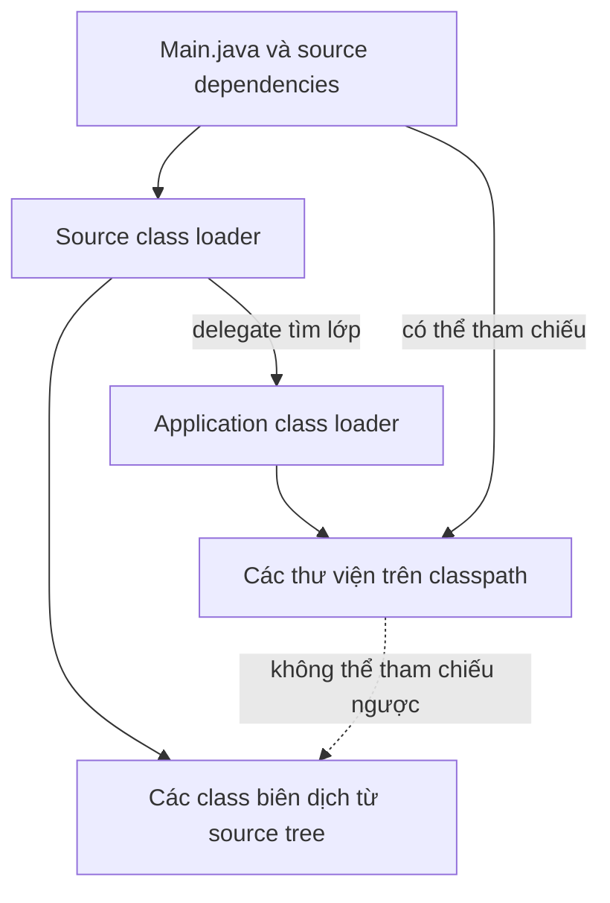

# Kết hợp mã nguồn với thư viện trên classpath và nhận diện xung đột lớp

Từ Java 22, `java` launcher có thể chạy một chương trình gồm nhiều file `.java` mà không cần biên dịch thủ công từng file trước. Ở chế độ source-file, launcher tự tìm và biên dịch các source file cần thiết trong cây thư mục của chương trình. Ta cũng có thể truyền thư viện đã đóng gói thành JAR qua `--class-path` để mã nguồn sử dụng các lớp bên ngoài.

Tính năng này được chuẩn hóa trong JEP 458 và vẫn là tính năng chính thức trên JDK hiện hành, bao gồm JDK 27. Đây không phải preview hay incubator API. Bài học tập trung vào cách kết hợp source file với JAR trên classpath và cách nhận diện các trường hợp trùng tên lớp có thể khiến chương trình biên dịch hoặc chạy sai.

## 1. Source-file mode và multi-file source launcher

Source-file mode được chọn khi đối số đầu tiên không phải option của `java` là đường dẫn tới file `.java`, hoặc khi dùng `--source`. Ví dụ:

```bash
java Main.java
```

Với JEP 458 trong Java 22, launcher mở rộng cách chạy source file để có thể tự tìm các source file khác mà lớp chính tham chiếu đến. Các file nguồn cần tuân theo cấu trúc package trong cây thư mục. Launcher biên dịch chúng trong bộ nhớ rồi nạp các lớp đã biên dịch để chạy chương trình.

Ví dụ, nếu lớp chính khai báo `package demo;` và nằm ở `src/demo/Main.java`, thư mục `src` là source root. Một lớp `demo.MessageHelper` được tham chiếu từ `Main` sẽ được tìm tại `src/demo/MessageHelper.java`.

```text
project/
├── src/
│   └── demo/
│       ├── Main.java
│       └── MessageHelper.java
└── lib/
    └── commons-lang3.jar
```

Launcher dùng source root làm source path để tìm source file phụ thuộc. Không cần liệt kê `MessageHelper.java` trong lệnh chạy, miễn là file nằm đúng package path và được tham chiếu từ chương trình.

## 2. Đưa thư viện JAR vào classpath

`--class-path` (viết tắt `-cp`, cũng có dạng `-classpath`) nhận danh sách thư mục, JAR hoặc ZIP chứa các class cần dùng. Trong source-file mode, launcher áp dụng option này cho môi trường biên dịch và môi trường chạy. Vì vậy, thư viện cần thiết phải có mặt trên classpath khi gọi `java`.

Ví dụ, giả sử chương trình sử dụng `StringUtils` của Apache Commons Lang. File JAR đã được đặt tại `lib/commons-lang3.jar`.

`src/demo/Main.java`:

```java
package demo;

public class Main {
    public static void main(String[] args) {
        String name = args.length == 0 ? "java" : args[0];
        MessageHelper helper = new MessageHelper();
        System.out.println(helper.greeting(name));
    }
}
```

`src/demo/MessageHelper.java`:

```java
package demo;

import org.apache.commons.lang3.StringUtils;

final class MessageHelper {
    String greeting(String name) {
        if (StringUtils.isBlank(name)) {
            return "Hello, guest";
        }

        return "Hello, " + StringUtils.capitalize(name.trim());
    }
}
```

Chạy từ thư mục `project` trên Linux hoặc macOS:

```bash
java --class-path "lib/commons-lang3.jar" src/demo/Main.java java
```

Trên Windows:

```powershell
java --class-path "lib\commons-lang3.jar" src\demo\Main.java java
```

Kết quả:

```text
Hello, Java
```

Trong lệnh trên:

- `--class-path` giúp compiler tìm `org.apache.commons.lang3.StringUtils` trong JAR và giúp application class loader nạp lớp đó khi chương trình chạy.
- `src/demo/Main.java` là source file được khởi chạy. Từ package `demo` và vị trí file, launcher xác định `src` là source root.
- `MessageHelper.java` được tìm tự động vì `Main` tham chiếu đến `MessageHelper` trong cùng package.
- `java` ở sau tên source file là đối số truyền cho `main(String[] args)`, không phải option của launcher.

Option của launcher như `--class-path` phải đặt trước source file. Những đối số nằm sau source file được chuyển cho chương trình. Nếu đặt `--class-path` sau `Main.java`, nó sẽ trở thành đối số của ứng dụng và không còn thiết lập classpath.

### Nhiều thư viện trên classpath

Các phần tử classpath được ngăn cách bằng dấu hai chấm (`:`) trên Linux/macOS và dấu chấm phẩy (`;`) trên Windows:

```bash
# Linux/macOS
java --class-path "lib/commons-lang3.jar:lib/json.jar" src/demo/Main.java
```

```powershell
# Windows
java --class-path "lib\commons-lang3.jar;lib\json.jar" src\demo\Main.java
```

Có thể dùng wildcard để đưa mọi JAR trong một thư mục vào classpath:

```bash
java --class-path "lib/*" src/demo/Main.java
```

Wildcard chỉ bao gồm các JAR trực tiếp trong thư mục `lib`, không tìm đệ quy trong các thư mục con. Thứ tự các JAR được mở rộng từ wildcard không được bảo đảm. Nếu ứng dụng có nhiều phiên bản thư viện hoặc các JAR chứa lớp trùng tên, hãy liệt kê từng JAR theo thứ tự tường minh thay vì dựa vào `lib/*`.

`--class-path` thay thế giá trị từ biến môi trường `CLASSPATH`. Nếu không truyền classpath và biến `CLASSPATH` cũng không được đặt, classpath mặc định là thư mục hiện tại (`.`).

## 3. Cách source classes và classpath classes được nạp

Trong source-file mode, các lớp được biên dịch từ source tree được nạp bởi một class loader riêng. Class loader này delegate việc tìm lớp cho application class loader, là loader thường nạp các lớp từ classpath. Điều đó tạo ra hướng nhìn thấy phụ thuộc rõ ràng:



Vì source class loader delegate tới application class loader:

- Mã nguồn được biên dịch trong source tree có thể tham chiếu các lớp trong JAR trên classpath.
- Lớp nằm trong JAR trên application classpath không thể tham chiếu ngược đến lớp chỉ được khai báo trong source file của lần chạy đó. Khi biên dịch thư viện JAR, các lớp source chưa được biên dịch trong bộ nhớ chưa tồn tại trên classpath của thư viện.
- Các source class được biên dịch trong bộ nhớ và không được ghi thành file `.class` vào thư mục dự án.

Đây là mô hình phù hợp cho chương trình nhỏ, ví dụ học tập, tiện ích dòng lệnh hoặc thử nghiệm API. Nếu một thư viện cần gọi ngược vào lớp ứng dụng, hãy đóng gói API chung thành một thư viện mà cả hai phía đều nhìn thấy, hoặc dùng quy trình build thông thường để biên dịch các phần phụ thuộc vào nhau.

## 4. Nhận diện xung đột tên lớp

Một class được nhận diện ở runtime bởi tên nhị phân và class loader đã định nghĩa nó. Vì source-file mode dùng class loader riêng cho source classes, việc để cùng một tên lớp xuất hiện ở nhiều nơi có thể dẫn đến lỗi hoặc khiến chương trình dùng nhầm phiên bản.

### 4.1. Trùng tên với lớp khởi chạy

Giả sử source file khai báo `package demo;` và lớp khởi chạy là `demo.Main`. Nếu một thư mục hoặc JAR trên application classpath cũng chứa lớp `demo.Main`, launcher báo lỗi. Đây là trường hợp được source-file mode quy định rõ: classpath không được có lớp cùng tên với lớp được khởi chạy từ source file.

Ví dụ cấu trúc có vấn đề:

```text
project/
├── src/demo/Main.java
└── lib/legacy-app.jar
    └── demo/Main.class
```

Nếu `legacy-app.jar` chứa `demo.Main`, lệnh sau sẽ không khởi chạy được:

```bash
java --class-path "lib/legacy-app.jar" src/demo/Main.java
```

Hãy đổi package hoặc tên lớp khởi chạy, hoặc loại JAR chứa lớp trùng khỏi classpath. Nếu cần chạy lớp `demo.Main` đã đóng gói trong JAR, hãy dùng chế độ chạy class/JAR phù hợp thay vì source-file mode cho cùng tên lớp.

### 4.2. Trùng tên giữa source dependency và một JAR

Ví dụ source tree có `demo.MessageHelper.java`, đồng thời một JAR trên classpath cũng chứa `demo.MessageHelper`. Không nên dựa vào giả định rằng source file luôn ghi đè lớp trong JAR. Source class loader delegate tới application class loader; classpath có thể cung cấp lớp cùng tên trước khi source loader tự định nghĩa lớp đó. Launcher chỉ quy định lỗi rõ ràng cho trường hợp trùng với lớp khởi chạy; không nên dựa vào một quy tắc override tổng quát cho mọi source dependency.

Để tránh lỗi khó chẩn đoán:

- Không khai báo cùng fully qualified class name trong source tree và thư viện JAR.
- Nếu muốn dùng phiên bản source, loại phiên bản JAR chứa cùng lớp khỏi classpath hoặc đổi package của lớp source.
- Nếu muốn dùng phiên bản trong JAR, xóa hoặc đổi tên source dependency bị trùng.

### 4.3. Trùng lớp giữa nhiều JAR

Classpath có thể chứa nhiều JAR cùng định nghĩa một fully qualified class name, ví dụ hai phiên bản khác nhau của một thư viện. Application class loader chỉ định nghĩa một lớp cho mỗi tên trong loader đó; thứ tự classpath ảnh hưởng đến bản được tìm thấy. Nếu chương trình được biên dịch với API của một phiên bản nhưng runtime nạp phiên bản khác, có thể gặp các lỗi như `NoSuchMethodError`, `NoSuchFieldError` hoặc `AbstractMethodError`.

Ví dụ:

```text
lib/
├── library-v1.jar   # com.example.Client có method send(String)
└── library-v2.jar   # com.example.Client có method send(String, int)
```

Nếu cả hai JAR đều nằm trên classpath, chương trình có thể nạp một phiên bản không tương thích với phiên bản mà mã nguồn kỳ vọng. Cách xử lý là chọn một phiên bản duy nhất, loại dependency trùng hoặc điều chỉnh thứ tự classpath có chủ đích. Không dùng wildcard khi thư mục có nhiều phiên bản của cùng thư viện vì thứ tự JAR được mở rộng không xác định.

### 4.4. Kiểm tra lớp thực tế được nạp từ đâu

Có thể yêu cầu JVM ghi log quá trình nạp lớp bằng Unified Logging:

```bash
java -Xlog:class+load=info --class-path "lib/*" src/demo/Main.java
```

Tìm tên lớp đáng ngờ trong log và kiểm tra nguồn nạp của nó. Cách này hữu ích khi chương trình chạy được nhưng sử dụng nhầm phiên bản lớp.

Có thể kiểm tra class loader của một lớp ngay trong chương trình:

```java
import org.apache.commons.lang3.StringUtils;

System.out.println(StringUtils.class.getClassLoader());

var codeSource = StringUtils.class.getProtectionDomain().getCodeSource();
System.out.println(
    codeSource == null ? "Unknown source" : codeSource.getLocation()
);
```

`getClassLoader()` cho biết loader đã định nghĩa lớp. `getProtectionDomain().getCodeSource()` thường cho biết vị trí JAR hoặc thư mục chứa lớp; giá trị có thể là `null` tùy cách lớp được nạp. Có thể dùng lệnh `jar --list --file path/to/library.jar` để kiểm tra một JAR có chứa đường dẫn lớp như `demo/MessageHelper.class` hay không.

## 5. Các giới hạn cần biết khi dùng source launcher

Source launcher thuận tiện cho chương trình gọn, nhưng không thay thế toàn bộ quy trình build:

- Launcher tự tìm source dependency trong source root được tính từ package của file khởi chạy. Source file nằm ngoài cây này không tự động được tìm thấy bằng cách thêm một thư mục tùy ý như khi cấu hình `javac --source-path`.
- Annotation processing bị tắt trong source-file mode, tương đương `-proc:none`. Vì vậy không thể trông chờ annotation processor trên classpath sinh mã nguồn trong lần chạy này.
- Launcher không cung cấp cách truyền mọi compiler option tùy ý như `-processor` hoặc `-Werror`.
- Nếu có `module-info.java` tại source root, các lớp trong source tree được đặt trong named module. Nếu không có, chúng chạy trong unnamed module. Ví dụ của bài dùng classpath và không khai báo `module-info.java`.
- `-jar` dùng JAR được chỉ định làm nguồn cho user classes và bỏ qua các thiết lập classpath khác. Khi khởi chạy source file với thư viện phụ thuộc, dùng `--class-path` như các ví dụ thay vì `-jar`.

Nếu dự án cần annotation processing, nhiều source root, compiler flags, đóng gói hoặc quản lý dependency phức tạp, hãy dùng `javac` cùng build tool như Maven hoặc Gradle. Source launcher vẫn hữu ích cho việc chạy nhanh một nhóm source file nhỏ với các JAR đã có sẵn.

## 6. Quy trình xử lý khi gặp lỗi

| Triệu chứng | Nguyên nhân nên kiểm tra | Cách xử lý |
| --- | --- | --- |
| `package ... does not exist` hoặc `cannot find symbol` cho lớp thư viện | JAR chưa có trên classpath, đường dẫn sai hoặc thiếu dependency bắc cầu | Kiểm tra `--class-path`, vị trí JAR và các JAR phụ thuộc. |
| Không tìm thấy source class phụ thuộc | Source file nằm sai package path hoặc ngoài source root | Đặt file theo cấu trúc package dưới source root của lớp khởi chạy. |
| Launcher báo lớp khởi chạy đã tồn tại trên classpath | JAR/thư mục có cùng fully qualified name với lớp được chạy từ source file | Đổi tên/package hoặc bỏ lớp trùng khỏi classpath. |
| `NoSuchMethodError` hoặc `NoSuchFieldError` | Runtime nạp phiên bản thư viện không tương thích với API mà mã nguồn dùng | Loại JAR trùng, chọn đúng phiên bản và kiểm tra thứ tự classpath. |
| JAR trên classpath cần gọi lớp trong source tree | Chiều phụ thuộc ngược với mô hình class loader của source launcher | Đóng gói API chung thành thư viện hoặc chuyển sang quy trình build thông thường. |

## 7. Ghi nhớ

JEP 458 cho phép `java Main.java` tự tìm và biên dịch source dependency từ source root, đồng thời `--class-path` cung cấp các thư viện JAR cần thiết cho cả compile và runtime. Hãy đặt option classpath trước source file, giữ source tree đúng cấu trúc package và chỉ đưa những JAR cần thiết vào classpath.

Khi kiểm tra xung đột, chú ý ba trường hợp: lớp khởi chạy trùng tên với lớp trên application classpath sẽ gây lỗi; source dependency trùng tên với lớp trong JAR có thể bị phân giải qua class loader cha; và nhiều JAR chứa cùng lớp có thể khiến runtime nạp nhầm phiên bản. Dùng classpath tường minh, tránh định nghĩa trùng fully qualified name và kiểm tra `-Xlog:class+load=info` khi cần xác định nguồn của lớp.

Multi-file source launcher là tính năng stable từ Java 22 và tiếp tục có trong JDK 27. Không cần bật preview hay dùng incubator API. Hãy dùng nó cho chương trình nhỏ, thử nghiệm và tiện ích đơn giản; với ứng dụng cần kiểm soát build, annotation processing, module hoặc dependency phức tạp, hãy chuyển sang quy trình biên dịch và đóng gói đầy đủ.

## Tài liệu tham khảo

- [JEP 458: Launch Multi-File Source-Code Programs](https://openjdk.org/jeps/458)
- [The `java` Command — Java SE 27](https://docs.oracle.com/en/java/javase/27/docs/specs/man/java.html)
- [ClassLoader — Java SE 27 API](https://docs.oracle.com/en/java/javase/27/docs/api/java.base/java/lang/ClassLoader.html)
- [The `javac` Command — Java SE 27](https://docs.oracle.com/en/java/javase/27/docs/specs/man/javac.html)
- [Launching Simple Source-Code Programs — dev.java](https://dev.java/learn/first-steps/first-java-code/launch-simple-source-code-programs/)
