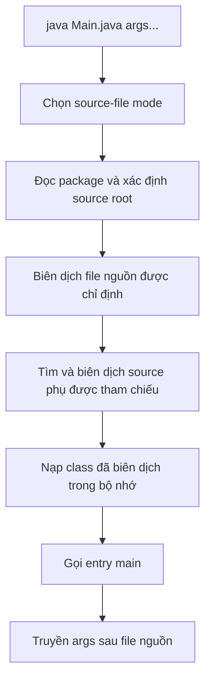
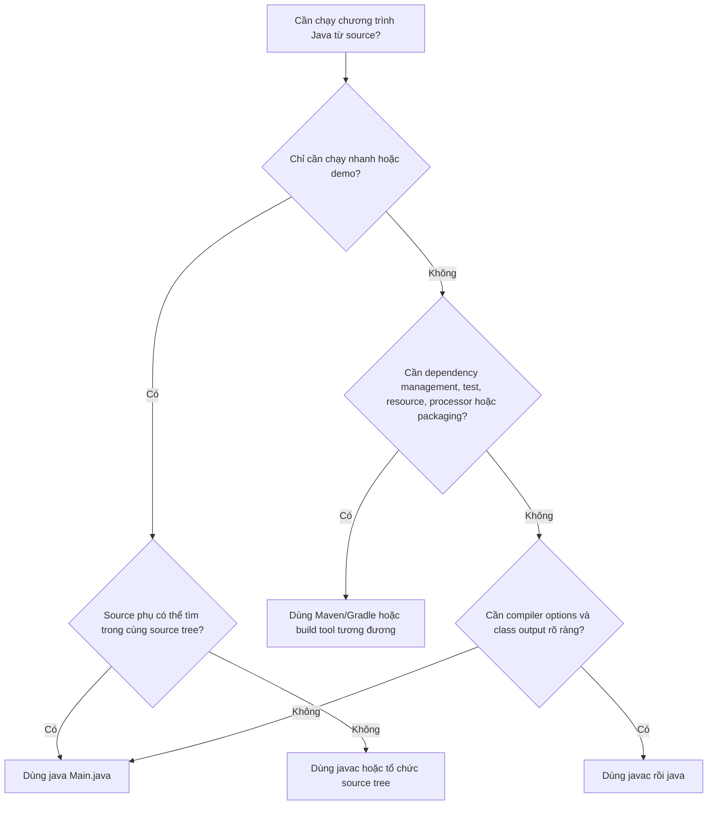

# Khi nào dùng source launcher và khi nào chuyển sang quy trình build đầy đủ

Java launcher có thể chạy chương trình trực tiếp từ file nguồn `.java`. Từ Java 22, khả năng source-file mode được mở rộng để tự tìm và biên dịch thêm các file nguồn cần thiết trong cùng source tree. Nhờ vậy, ta có thể viết một chương trình gồm nhiều lớp, chia thành nhiều file, rồi chạy bằng một lệnh `java` mà không cần tạo trước thư mục class output.

Tính năng này phù hợp với ví dụ học tập, script, tiện ích nhỏ và prototype. Khi dự án cần quản lý dependency, kiểm thử tự động, xử lý resource, annotation processing, đóng gói hoặc pipeline CI/CD, nên chuyển sang quy trình build đầy đủ bằng Maven, Gradle hoặc công cụ tương đương.

Multi-file source-code launcher được chuẩn hóa trong Java 22 theo JEP 458. Đây là tính năng final, không phải preview hoặc incubator. JDK 27 đã GA ngày 15-09-2026 và là feature release mới nhất tại thời điểm 25-11-2026; JDK 25 là LTS mới nhất. Source launcher hoạt động trên các JDK hiện đại có hỗ trợ tính năng này, bao gồm JDK 25 và JDK 27.

## 1. Source launcher giải quyết việc gì?

Trước Java 22, source-file mode chủ yếu chạy một file nguồn. Nếu chương trình cần lớp phụ nằm trong file `.java` khác, người dùng thường phải biên dịch các file đó trước bằng `javac`, rồi chạy class đã biên dịch.

Java 22 bổ sung khả năng để launcher tự tìm các file nguồn cần thiết trong source tree và biên dịch chúng cùng chương trình được chỉ định. Các class được biên dịch trong bộ nhớ cho lần chạy đó, vì vậy không cần tạo `out/` hoặc `target/classes/` chỉ để chạy một ví dụ nhỏ.

Ví dụ, chương trình có cấu trúc:

```text
demo/
└── src/
    └── com/
        └── example/
            ├── Main.java
            └── Greeter.java
```

`Main.java`:

```java
package com.example;

public class Main {
    public static void main(String[] args) {
        String name = args.length == 0 ? "Java" : args[0];
        System.out.println(Greeter.message(name));
    }
}
```

`Greeter.java`:

```java
package com.example;

final class Greeter {
    static String message(String name) {
        return "Xin chào, " + name + "!";
    }
}
```

Đứng tại thư mục `demo`, chạy:

```bash
java src/com/example/Main.java Phuong
```

Kết quả:

```text
Xin chào, Phuong!
```

Launcher nhận ra file `Main.java`, xác định source root từ package `com.example` và vị trí file, sau đó dùng thư mục `src` làm source path. Khi `Main` tham chiếu đến `Greeter`, launcher tìm file nguồn tương ứng trong source tree và biên dịch nó nếu cần. Đối số `Phuong` xuất hiện sau tên file nguồn nên được truyền cho `main`.

## 2. Cách source-file mode hoạt động

Khi đối số đầu tiên không phải option của lệnh `java` là một file có phần mở rộng `.java`, launcher chọn source-file mode. Có thể hình dung hoạt động này tương đương với việc biên dịch các source cần thiết vào bộ nhớ, rồi chạy class chính bằng class loader dành cho source-file mode.



Một số quy tắc quan trọng:

- Source root được tính từ package của class được khởi chạy. Nếu class thuộc package `com.example` và file nằm ở `src/com/example/Main.java`, source root là `src`.
- Các file nguồn phụ được tìm trong source tree đó khi cần để biên dịch chương trình.
- Nếu source root có `module-info.java`, các class nguồn được biên dịch vào named module tương ứng. Nếu không có, chúng chạy trong unnamed module.
- Class chính được chọn là top-level class đầu tiên trong file nguồn được chỉ định và class đó phải có entry `main` method.
- Các class được biên dịch trong bộ nhớ cho lần chạy hiện tại; launcher không tạo một thư mục output để thay thế build output của dự án.

## 3. Truyền class path và thư viện JAR

Source launcher vẫn có thể sử dụng thư viện đã được biên dịch thành JAR. Đặt `--class-path` trước file nguồn:

```bash
java --class-path lib/commons-text.jar src/com/example/Main.java
```

Option class path được dùng cho môi trường biên dịch và thực thi. Có thể chỉ định nhiều JAR hoặc thư mục; ký tự phân tách đường dẫn phụ thuộc hệ điều hành (`:` trên Linux/macOS, `;` trên Windows).

Ví dụ với nhiều dependency trên Linux/macOS:

```bash
java --class-path "lib/json.jar:lib/http-client.jar" \
     src/com/example/Main.java input.json
```

Trên Windows:

```bat
java --class-path "lib\json.jar;lib\http-client.jar" src\com\example\Main.java input.json
```

Điều này hữu ích khi một tiện ích nhỏ cần một vài JAR đã có sẵn. Tuy nhiên, source launcher không giải quyết dependency coordinates, phiên bản bắc cầu (transitive dependencies), conflict resolution, tải thư viện từ repository hoặc khóa phiên bản. Người chạy phải tự chuẩn bị toàn bộ JAR và class path chính xác.

Các option liên quan đến môi trường biên dịch như `--class-path`, `--module-path`, `--add-modules`, `--add-exports` và `--enable-preview` phải đặt trước file nguồn để launcher áp dụng cho bước biên dịch. Các đối số sau file nguồn được xem là đối số của chương trình.

## 4. Khi nào nên dùng source launcher?

Source launcher phù hợp khi mục tiêu chính là chạy nhanh một chương trình Java và chi phí thiết lập build project lớn hơn lợi ích nhận được.

| Tình huống | Vì sao source launcher phù hợp |
| --- | --- |
| Học Java, demo cú pháp hoặc chia sẻ ví dụ | Người học chỉ cần JDK và lệnh `java`, không phải thiết lập project build |
| Script xử lý dữ liệu hoặc tác vụ một lần | Có thể giữ logic trong một vài file `.java` và truyền input qua command line |
| Prototype hoặc proof of concept | Dễ thử ý tưởng trước khi quyết định cấu trúc project chính thức |
| Tiện ích nội bộ nhỏ | Có thể tách lớp phụ ra nhiều file mà vẫn chạy trực tiếp |
| Ví dụ tái hiện bug hoặc benchmark nhỏ | Dễ chia sẻ source tree và lệnh chạy để tái hiện |
| Công cụ dùng một vài JAR đã chuẩn bị sẵn | Có thể thêm JAR bằng `--class-path` mà chưa cần tạo build project |

Ví dụ một script đọc file đầu vào:

```bash
java src/com/example/ReportTool.java data/orders.csv --summary
```

`ReportTool.java` có thể dùng các lớp phụ như `CsvReader.java` hoặc `Summary.java` nằm cùng source tree. Launcher sẽ biên dịch những source cần thiết khi chạy.

## 5. Khi nào nên chuyển sang Maven, Gradle hoặc build tool đầy đủ?

Khi dự án có vòng đời phát triển và phát hành rõ ràng, source launcher không còn đủ vai trò. Lúc này build tool giúp mô tả dependency, biên dịch, kiểm thử, đóng gói và tái tạo kết quả build theo một quy trình thống nhất.

| Dấu hiệu của dự án | Nhu cầu thực tế | Vì sao nên dùng build tool |
| --- | --- | --- |
| Có nhiều dependency và dependency bắc cầu | Quản lý version, repository và conflict | Maven/Gradle giải quyết dependency graph thay cho class path thủ công |
| Có unit test và integration test | Chạy test theo lifecycle, báo cáo và phân loại kết quả | Build tool tích hợp test framework và test task/phase |
| Có resource ngoài source | Copy/filter resource, cấu hình theo môi trường | Build process quản lý resource directories và resource processing |
| Có annotation processor hoặc code generation | Sinh source/class trong quá trình compile | Source-file mode tắt annotation processing và không cung cấp option compiler tổng quát như `-processor` |
| Cần compiler warning policy hoặc compiler plugin | Dùng `-Werror`, processor, plugin hoặc cấu hình compiler chi tiết | Source-file mode không hỗ trợ truyền tùy ý các compiler options như khi gọi `javac` trực tiếp |
| Có nhiều module hoặc artifact | Build theo dependency giữa module và đóng gói riêng | Build tool quản lý module graph, thứ tự build và artifact |
| Cần JAR/WAR/container để triển khai | Đóng gói manifest, resource, dependency và metadata | Build tool cung cấp task/phase đóng gói và plugin triển khai |
| Có CI/CD và nhiều thành viên | Build lặp lại, kiểm thử nhất quán và version hóa | Build file lưu cấu hình trong repository và được CI thực thi giống môi trường local |
| Cần kiểm soát phiên bản JDK và reproducibility | Cùng toolchain, dependency và quy trình build giữa các máy | Build tool hỗ trợ toolchain và cấu hình build có thể kiểm soát |

Ví dụ với Maven Wrapper:

```bash
./mvnw test
./mvnw package
```

Trên Windows:

```bat
mvnw.cmd test
mvnw.cmd package
```

Ví dụ với Gradle Wrapper:

```bash
./gradlew test
./gradlew build
```

Build task có thể thực hiện nhiều bước hơn biên dịch và chạy một file: resolve dependency, compile main/test source set, chạy test, xử lý resource, kiểm tra chất lượng mã và tạo artifact theo cấu hình project. Cách đóng gói runnable JAR phụ thuộc plugin và cấu hình của dự án; không phải mọi lệnh `package` hoặc `build` đều tự tạo JAR có thể chạy bằng `java -jar`.

## 6. Giới hạn cần biết của source launcher

Source launcher là một cơ chế khởi chạy thuận tiện, không phải một build system rút gọn. Các giới hạn sau thường quyết định thời điểm nên chuyển công cụ:

### 6.1. Không có dependency management

Launcher nhận class path hoặc module path đã được chuẩn bị. Nó không đọc Maven `pom.xml`, Gradle build file hoặc version catalog để tự tải và giải quyết dependency. Nếu một thư viện cần thêm nhiều JAR khác, người dùng phải cung cấp đầy đủ các JAR đó.

### 6.2. Annotation processing bị tắt

Source-file mode biên dịch như thể annotation processing bị tắt (`-proc:none`). Vì vậy, không phù hợp với dự án cần Lombok, MapStruct hoặc annotation processor khác để sinh mã. Với những dự án này, hãy dùng Maven/Gradle hoặc gọi `javac` với cấu hình processor phù hợp.

### 6.3. Không truyền được mọi compiler option

Launcher nhận một tập option phục vụ môi trường compile/runtime, nhưng không có cơ chế truyền tùy ý mọi option của `javac`, chẳng hạn `-processor` hoặc `-Werror`. Nếu cần compiler flags chi tiết, hãy dùng `javac` hoặc build tool.

Nếu chỉ cần biên dịch tường minh mà chưa cần Maven/Gradle, có thể dùng `javac` làm bước trung gian:

```bash
javac -d out src/com/example/Main.java src/com/example/Greeter.java
java -cp out com.example.Main
```

Đây là quy trình biên dịch class file rõ ràng, nhưng việc quản lý dependency, test và đóng gói vẫn do người phát triển tự tổ chức.

### 6.4. Giới hạn class loader

Các class được biên dịch từ source file được nạp bởi class loader dành cho source-file mode và loader này ủy quyền cho application class loader. Vì vậy, class đã có trên application class path không thể tham chiếu ngược đến một class chỉ được biên dịch từ source file trong lần chạy đó.

Ngoài ra, nếu application class path đã có một class trùng tên với class chính được khởi chạy từ source file, launcher báo lỗi. Đây là một lý do khác để dùng build output và class loader thông thường khi ứng dụng có nhiều thành phần liên kết chặt chẽ.

### 6.5. Không thay thế quy trình module và đóng gói phức tạp

Nếu source root có `module-info.java`, launcher có thể biên dịch các source trong named module. Tuy nhiên, ứng dụng modular nhiều module, nhiều artifact, module path phức tạp hoặc cần tạo runtime image thường phù hợp với build tool và công cụ đóng gói chuyên dụng hơn.

## 7. So sánh nhanh các cách chạy Java

| Cách chạy | Phù hợp khi | Kết quả chính |
| --- | --- | --- |
| `java Main.java` | Ví dụ hoặc chương trình nhỏ, kể cả có source phụ | Biên dịch source cần thiết trong bộ nhớ rồi chạy |
| `javac ...` rồi `java -cp ...` | Cần kiểm soát compile options hoặc muốn giữ class output nhưng project còn đơn giản | File `.class` được tạo rõ ràng; class path do người dùng quản lý |
| Maven hoặc Gradle | Ứng dụng có dependency, test, resource, nhiều module hoặc quy trình phát hành | Build lifecycle, dependency management, test và artifact theo cấu hình |

Không có ngưỡng số file cố định để quyết định chuyển công cụ. Một chương trình có mười file nguồn nhưng chỉ dùng JDK và chạy một lần vẫn có thể phù hợp với source launcher. Ngược lại, một chương trình chỉ có hai file nhưng cần annotation processing, test tự động, dependency có version và đóng gói production thì nên dùng build tool.

## 8. Quy trình chuyển từ source launcher sang build project

Có thể chuyển dần mà không phải viết lại logic chương trình:

1. **Giữ nguyên package và phân chia source**: đặt các file vào `src/main/java` theo cấu trúc package.
2. **Khai báo dependency**: chuyển các JAR class path thủ công thành dependency có tọa độ và version trong `pom.xml` hoặc `build.gradle`.
3. **Tách test**: đặt unit test và integration test vào source set/thư mục test tương ứng.
4. **Đưa resource vào build**: quản lý file cấu hình, template và dữ liệu mẫu trong resource directories.
5. **Thiết lập compiler/toolchain**: chọn JDK mục tiêu, compiler options, encoding và annotation processor nếu cần.
6. **Tạo artifact**: cấu hình JAR/WAR hoặc container image, manifest và cách đưa dependency vào runtime.
7. **Tự động hóa CI**: chạy cùng lệnh wrapper trong local và CI để build/test nhất quán.

Ví dụ, source tree ban đầu:

```text
src/com/example/Main.java
src/com/example/Greeter.java
```

Có thể chuyển sang Maven:

```text
src/main/java/com/example/Main.java
src/main/java/com/example/Greeter.java
src/test/java/com/example/GreeterTest.java
pom.xml
```

Các lớp `Main` và `Greeter` vẫn giữ nguyên package và phần lớn mã nguồn. Build file bổ sung cách lấy dependency, chạy test và tạo artifact.

## 9. Cây quyết định chọn cách chạy



## 10. Ghi nhớ về phiên bản và preview

Multi-file source-code launcher theo JEP 458 đã final trong Java 22. Khi chạy trên JDK 25 LTS hoặc JDK 27, không cần `--enable-preview` cho tính năng này. Đừng nhầm source-file mode với các preview feature khác của ngôn ngữ: nếu chương trình sử dụng một preview feature riêng, nó vẫn phải tuân theo yêu cầu preview của đúng JDK đó.

Nếu cần chọn phiên bản ngôn ngữ/API cho source-file mode, có thể dùng `--source N` trước file nguồn. Trên JDK 27, giá trị `N` phải là phiên bản được JDK đó hỗ trợ; option này đồng thời giới hạn API công khai được phép sử dụng theo release tương ứng.

```bash
java --source 25 src/com/example/Main.java
```

Lệnh trên yêu cầu compiler xử lý source theo ngôn ngữ và API của Java 25, dù launcher đang thuộc JDK 27. Chỉ chọn phiên bản thấp hơn khi ứng dụng cần tương thích với release đó; nếu không, để mặc định theo JDK đang dùng sẽ tận dụng API hiện hành.

## 11. Tài liệu tham khảo

- [JEP 458 — Launch Multi-File Source-Code Programs](https://openjdk.org/jeps/458)
- [The `java` Command — Java SE 27 Tools Specification](https://docs.oracle.com/en/java/javase/27/docs/specs/man/java.html)
- [The `javac` Command — Java SE 27 Tools Specification](https://docs.oracle.com/en/java/javase/27/docs/specs/man/javac.html)
- [Java SE 27 Release Notes](https://www.oracle.com/java/technologies/javase/27-relnote-issues.html)
- [Oracle Java SE Support Roadmap](https://www.oracle.com/java/technologies/java-se-support-roadmap.html)
